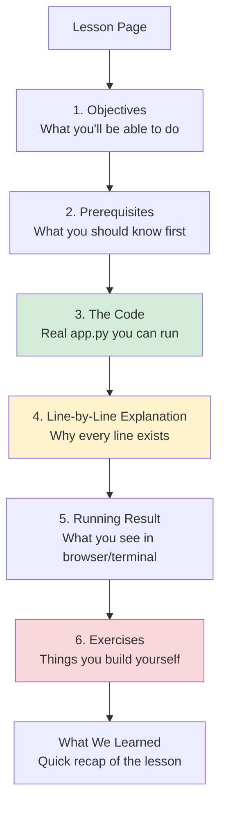
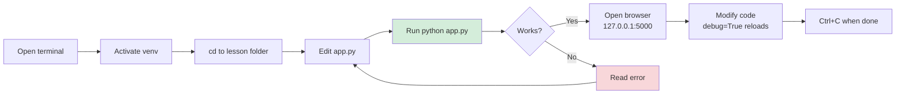
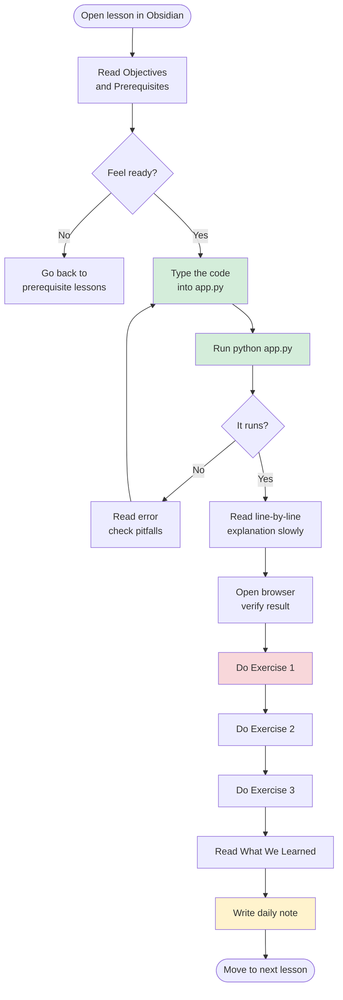

# How To Use This Course

Welcome back. Now that you've read the [[README]], let's talk about **how to actually learn from this course**. Reading a tutorial and learning from one are two different things — this guide bridges the gap.

> [!info] This guide is short but important.
> Spending 15 minutes here will save you hours of confusion later. Read it once. Refer back when you get stuck.

---

## The Anatomy of a Lesson #anatomy

Every lesson in this course follows the **same six-part structure**. Once you know the structure, you'll always know where to look when you need something.



### 1. Objectives

Every lesson opens with a box like this:

> [!example] By the end of this lesson, you'll be able to:
> - Create a Flask route that responds to a URL
> - Explain what `@app.route` does under the hood
> - Run a Flask app and view it in your browser

If you can do those three things after the lesson, **you're done**. Don't move on if you can't.

### 2. Prerequisites

A list of lessons or concepts you should already be comfortable with. If you can't tick all the boxes, go back and review. The lessons are sequenced for a reason — skipping forward is the #1 cause of confusion.

### 3. The Code

The full, runnable code for the lesson, in one block. **You should type this into a file and run it.** Don't read past this block without trying it yourself first.

### 4. Line-by-Line Explanation

The longest section. Each line of the code gets explained: what it does, why it's there, and what breaks if you remove it. This is the heart of the lesson — read it slowly.

> [!tip] Read with the code open
> Open the code in your editor and the lesson in Obsidian, side by side. As you read each explanation, look at the corresponding line. This dual-reading cements understanding.

### 5. Running Result

What you'll see when you run the code — both in your terminal and in your browser. Screenshots described in text. If your output doesn't match, something's wrong (see [[#Common Pitfalls]] below).

### 6. Exercises

Three to five exercises that ask you to modify the code, extend it, or build something small from scratch. **Do them.** Reading is passive. Typing is active. Active is what makes learning stick.

### What We Learned

A bulleted recap at the end. Use this as a review tool — come back to a lesson a week later, read just this section, and see if you can still explain each bullet.

---

## How to Run the Code #running

This is the single most important skill in the course. If you can't run Flask, you can't learn Flask. Here's the exact setup we recommend.

### Step 1: Make a folder for the course

Open your terminal and run:

```bash
mkdir flask-course
cd flask-course
```

This is your home base. Every lesson gets its own subfolder.

### Step 2: Create a virtual environment

A **virtual environment** (or "venv") is an isolated Python install just for this project. It keeps Flask from polluting your system Python and lets each project have its own dependencies.

```bash
python3 -m venv venv
```

This creates a folder called `venv/` containing a private Python. Now activate it:

```bash
# On macOS / Linux:
source venv/bin/activate

# On Windows (PowerShell):
venv\Scripts\Activate.ps1

# On Windows (Git Bash):
source venv/Scripts/activate
```

You'll see `(venv)` appear in your terminal prompt. That means it's active.

> [!warning] Activate the venv every time
> Every time you open a new terminal to work on the course, you must re-run the activate command. If you forget, `python` will use your system Python and you'll get `ModuleNotFoundError: No module named 'flask'`.

### Step 3: Install Flask

With the venv active:

```bash
pip install Flask
```

This installs Flask and its dependencies (Werkzeug, Jinja2, etc.) into your venv only. Verify it worked:

```bash
python -c "import flask; print(flask.__version__)"
```

You should see something like `3.0.x`.

### Step 4: Write the code

Create a file called `app.py` in your lesson folder:

```bash
mkdir lesson-01
cd lesson-01
# Now open this folder in your editor and create app.py
```

Type the lesson's code into `app.py`. **Type it.** Don't copy-paste. Typing builds muscle memory and forces you to notice every character.

### Step 5: Run it

```bash
python app.py
```

You should see something like:

```
 * Serving Flask app 'app'
 * Debug mode: on
 * Running on http://127.0.0.1:5000
```

Open your browser to `http://127.0.0.1:5000`. You should see your page.

### Step 6: Stop it

Press `Ctrl+C` in the terminal to stop the server. You'll do this hundreds of times. Get used to it.



> [!tip] `debug=True` is magic
> When you run Flask in debug mode, it auto-reloads whenever you save a file. You can edit `app.py`, save, and refresh the browser — no need to stop and restart the server. We'll cover this in Lesson 03.

---

## How to Do Exercises #exercises

Exercises are where the real learning happens. Here's how to do them right:

### The 20-Minute Rule

When you hit an exercise, **try for 20 minutes before looking at the answer**. Set a timer. Struggle with it. The struggle is where understanding happens.

If after 20 minutes you're truly stuck:

1. Re-read the lesson's explanation section
2. Look at the **hints** (most exercises have a `<details>` block you can expand)
3. Only as a last resort, look at the full solution

### Modify, don't copy

Exercises ask you to extend the lesson's code. Don't start from scratch — copy your working `app.py` to a new file (`app_exercise.py`) and modify it. This way you always have the working version to compare against.

### Test your own answer

Before checking the solution, **run your code in the browser**. Does it do what the exercise asked? If yes, you're done — even if your code looks different from the solution. There are many correct ways to write the same Flask code.

> [!example] A typical exercise
> **Exercise:** Add a new route `/about` that returns the string `"About this site"`.
>
> **How to do it:**
> 1. Open `app.py`
> 2. Below the existing `home()` function, add:
>    ```python
>    @app.route("/about")
>    def about():
>        return "About this site"
>    ```
> 3. Save the file (the server auto-reloads)
> 4. Visit `http://127.0.0.1:5000/about` in your browser
> 5. You should see "About this site"
>
> **Check:** Did it work? If yes, you've done the exercise. Move on.

---

## How to Take Notes in Obsidian #notes

This course is an Obsidian vault, and Obsidian is a *fantastic* learning tool if you use it well. Here's how we recommend using it.

### Use Daily Notes

Enable **Settings → Core Plugins → Daily Notes**. Then, every time you sit down to study, press `Ctrl/Cmd + U` (or click the calendar icon) to create today's note. In it, write:

```markdown
# [[Lesson 04 — Routes]]

## What I did today
- Completed Lesson 04
- Built routes for /, /about, /contact

## What clicked
- `@app.route` is a decorator that registers a URL handler
- The function name doesn't have to match the URL

## What confused me
- Still fuzzy on why we return strings instead of HTML
- Will review in Lesson 07

## Code snippet to remember
\`\`\`python
@app.route("/user/<name>")
def user(name):
    return f"Hello, {name}!"
\`\`\`

## Tomorrow
- Start Lesson 05 — URL converters
```

Over 24 lessons, this becomes a **personal learning journal**. When you forget something six weeks later, you can search your own notes — and your own explanation, written in your own words, will often click faster than re-reading the lesson.

### Link aggressively

When you write a note, use `[[wikilinks]]` to connect it to lessons, concepts, and other notes. Obsidian's power is the graph of connections between ideas.

For example, when you write a note about `url_for`, link it to `[[Lesson 09 — Static Files and url_for]]`, `[[routing]]`, and `[[jinja]]`. Later, when you're trying to remember where you learned `url_for`, you can find it from any of those tags.

### Use tags for topics

Tags group notes by topic across the whole vault. Click a tag like `#database` and you'll see every lesson, exercise, and personal note that mentions databases.

Recommended tag conventions:

- `#flask` — broad course tag
- `#routing`, `#jinja`, `#database`, `#auth` — module-level tags
- `#gotcha` — things that tripped you up
- `#review` — things you want to revisit later

> [!tip] The graph view
> Press `Ctrl/Cmd + G` to open Obsidian's graph view. It visualizes all your notes and links as a constellation. It's beautiful and surprisingly useful — clusters of related notes show you what you've learned deeply, and isolated notes show you what you might want to connect.

---

## How to Ask for Help #help

You will get stuck. When you do, here's the order to try:

### 1. Read the error message

Most Python errors are self-explanatory once you slow down. A `NameError: name 'app' is not defined` means you forgot to define `app` — probably a typo or you missed a line. **Read it out loud.**

### 2. Search the exact error

Copy the last line of the traceback, paste it into Google or your favorite AI assistant. Add the word "flask" if the error is generic. Example:

> `TypeError: 'str' object is not callable flask route`

You'll almost always find a Stack Overflow answer in the first result.

### 3. Check the lesson's "Common Pitfalls"

Every lesson has a `> [!warning] Common pitfalls` section near the end. We pre-emptively documented the errors students hit most often. Check there before asking.

### 4. Ask a community

If you've tried all of the above and you're still stuck, ask. Good places:

- **[Flask Discord](https://discord.gg/flask)** — active community, real-time help
- **[Stack Overflow](https://stackoverflow.com/questions/tagged/flask)** — for searchable, well-formed questions
- **Reddit r/flask** and r/learnpython — slower but friendly

When you ask, include:

1. **What you're trying to do** (the goal, not just the symptom)
2. **The exact code** (copy-paste a minimal example)
3. **The exact error** (copy-paste the full traceback)
4. **What you've already tried**

A question with all four of those gets answered in minutes. A question with just "it doesn't work, please help" gets ignored.

> [!warning] XY Problem warning
> When asking for help, describe your *actual goal*, not your attempted solution. "I want users to log in" is more useful than "I'm trying to read a cookie and set a session variable and it's not working." The community can suggest better approaches only if they know what you're really trying to do.

---

## Common Pitfalls Beginners Face #pitfalls

We document these in every lesson, but here are the **universal** ones that trip up everyone:

### 1. Forgetting to activate the venv

You open a terminal, type `python app.py`, and get:

```
ModuleNotFoundError: No module named 'flask'
```

**Cause:** You didn't activate the venv. Flask is installed in the venv, not in your system Python.

**Fix:** Run `source venv/bin/activate` (or the Windows equivalent) first. Look for `(venv)` in your prompt.

### 2. Running the wrong file

You're in `lesson-04/` but you type `python app.py` and Flask says it can't find the app — because you actually wanted to run `lesson-04/routes.py`.

**Fix:** Always check `pwd` (print working directory) and `ls` before running.

### 3. Editing a file but the server doesn't reload

This happens when `debug=True` is not set, or you're running an old Flask version. Restart the server with `Ctrl+C` then `python app.py` again.

### 4. Indentation errors

Python is whitespace-sensitive. A single space in the wrong place produces `IndentationError: unexpected indent`. If you copy-pasted code, redo the indentation by hand.

### 5. Port already in use

```
OSError: [Errno 98] Address already in use
```

You have another Flask server still running. Find and kill it:

```bash
# macOS/Linux
lsof -i :5000
kill -9 <PID>
```

Or run Flask on a different port: `app.run(port=5001)`.

### 6. Hardcoded URLs that break in production

You write `href="/static/style.css"` and it works on localhost but breaks when you deploy. The fix is `url_for('static', filename='style.css')`, covered in Lesson 09. This is one of the most common real-world Flask bugs.

> [!note] Don't memorize errors — recognize patterns
> After a few lessons, you'll start recognizing the *shape* of errors. `ModuleNotFoundError` → import problem. `IndentationError` → whitespace problem. `TypeError` → you're using the wrong type somewhere. Pattern-matching errors is a skill, and it grows fast.

---

## Your Study Workflow #workflow

Here's the recommended workflow for each lesson. Print it. Tape it to your monitor.



> [!success] You are now ready.
> That's everything you need to know to use this course well. The rest is just showing up, lesson after lesson, and typing the code. Let's get to it. Open [[Syllabus]] to see the full roadmap, or jump straight to [[Lesson 01 — Your First Flask App]].

---

**Tags:** #meta #how-to #obsidian #study-workflow
**Previous:** [[README]]
**Next:** [[Syllabus]] →
