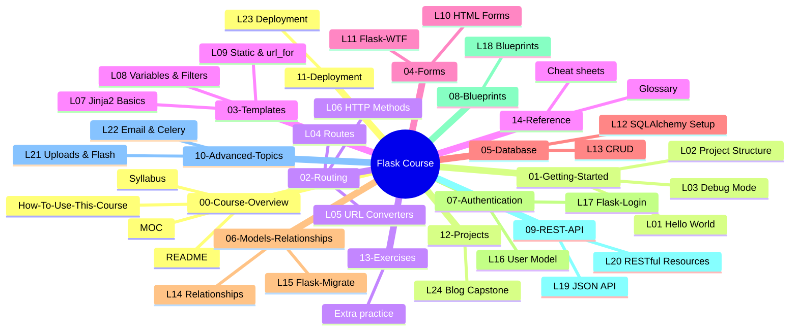
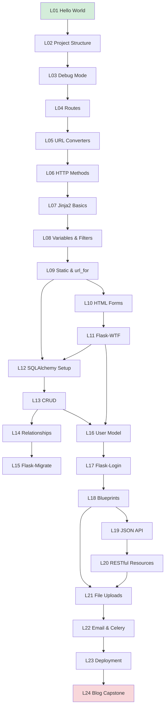

# Map of Content — Flask Teaching Course

> [!info] Bookmark this page.
> This is the **home base** of the vault. Every lesson, every reference, every tag — all reachable from here. When you get lost, come back to the MOC.

This Map of Content (MOC) is the master index of the Flask Teaching Course. It links to all 24 lessons, organized by module, with one-line descriptions and time estimates. Below the lesson index, you'll find a tag index and a visual map of the whole vault.

If this is your first time here, start with [[README]] for a warm welcome, then [[How-To-Use-This-Course]] to learn how to study effectively.

---

## Vault Structure Mindmap #mindmap

Everything you'll ever need in this course lives somewhere on this map. The rest of this page is the textual version, with links.

---

## Module 01 — Getting Started #m01

The foundation. Install Flask, run your first app, understand what happens under the hood.

| # | Lesson | What You'll Build | Time |
|---|--------|-------------------|------|
| 01 | [[Lesson 01 — Your First Flask App]] | "Hello, Flask!" served at localhost:5000 | 45–60 min |
| 02 | [[Lesson 02 — Project Structure]] | A reorganized project with `requirements.txt` and `venv/` | 30–45 min |
| 03 | [[Lesson 03 — Debug Mode]] | The same app with a deliberate bug — and the debugger to fix it | 30–45 min |

> [!tip] Start here if you're new to Flask
> Even if you've done a hello world before, Lesson 02 (project structure) and Lesson 03 (debug mode) cover things most tutorials skip. Don't skip them.

---

## Module 02 — Routing #m02

How URLs map to Python functions.

| # | Lesson | What You'll Build | Time |
|---|--------|-------------------|------|
| 04 | [[Lesson 04 — Routes and URL Rules]] | A 3-page site: home, about, contact | 30–45 min |
| 05 | [[Lesson 05 — URL Converters]] | Dynamic routes: `/user/<name>` and `/search?q=...` | 45–60 min |
| 06 | [[Lesson 06 — HTTP Methods]] | A form that POSTs data and echoes it back | 45–60 min |

---

## Module 03 — Templates #m03

Real HTML pages with Jinja2.

| # | Lesson | What You'll Build | Time |
|---|--------|-------------------|------|
| 07 | [[Lesson 07 — Jinja2 Basics]] | A multi-page site with `base.html` and child templates | 45–60 min |
| 08 | [[Lesson 08 — Variables and Filters]] | A page that loops over items and uses `{{ name\|capitalize }}` | 45–60 min |
| 09 | [[Lesson 09 — Static Files and url_for]] | A styled page with CSS and `url_for`-generated links | 30–45 min |

---

## Module 04 — Forms #m04

Accept user input. Validate it. Protect against CSRF.

| # | Lesson | What You'll Build | Time |
|---|--------|-------------------|------|
| 10 | [[Lesson 10 — HTML Forms]] | A contact form with manual validation | 45–60 min |
| 11 | [[Lesson 11 — Flask-WTF]] | The same form rebuilt with Flask-WTF and CSRF protection | 45–60 min |

---

## Module 05 — Database #m05

Persistent storage with SQLAlchemy.

| # | Lesson | What You'll Build | Time |
|---|--------|-------------------|------|
| 12 | [[Lesson 12 — SQLAlchemy Setup]] | A `Post` model backed by SQLite | 45–60 min |
| 13 | [[Lesson 13 — CRUD Operations]] | Full create/read/update/delete for posts | 45–60 min |

---

## Module 06 — Models & Relationships #m06

Connected data and production-safe schema changes.

| # | Lesson | What You'll Build | Time |
|---|--------|-------------------|------|
| 14 | [[Lesson 14 — Relationships]] | `User → Posts → Comments` relationships | 60 min |
| 15 | [[Lesson 15 — Flask-Migrate]] | A migration that adds a new column to `Post` | 45–60 min |

---

## Module 07 — Authentication #m07

Real users. Real logins. Real security.

| # | Lesson | What You'll Build | Time |
|---|--------|-------------------|------|
| 16 | [[Lesson 16 — User Model and Hashing]] | A registration page with hashed passwords | 60 min |
| 17 | [[Lesson 17 — Flask-Login]] | Login, logout, and a protected `/dashboard` route | 60 min |

---

## Module 08 — Blueprints #m08

Organize a growing app like a real production project.

| # | Lesson | What You'll Build | Time |
|---|--------|-------------------|------|
| 18 | [[Lesson 18 — Blueprints]] | Refactor everything into a multi-file package with `auth`, `blog`, `main` blueprints | 60 min |

---

## Module 09 — REST API #m09

Your app, but as a JSON API.

| # | Lesson | What You'll Build | Time |
|---|--------|-------------------|------|
| 19 | [[Lesson 19 — JSON API]] | `/api/posts` GET and POST endpoints returning JSON | 45–60 min |
| 20 | [[Lesson 20 — RESTful Resources]] | Full REST API with error handlers and a pytest suite | 60 min |

---

## Module 10 — Advanced Topics #m10

The extras that make an app feel real.

| # | Lesson | What You'll Build | Time |
|---|--------|-------------------|------|
| 21 | [[Lesson 21 — File Uploads]] | Image uploads, flash messages, and theme cookies | 60 min |
| 22 | [[Lesson 22 — Email and Celery]] | A "forgot password" flow with email and a Celery task | 60 min |

---

## Module 11 — Deployment #m11

Your app meets the real internet.

| # | Lesson | What You'll Build | Time |
|---|--------|-------------------|------|
| 23 | [[Lesson 23 — Deployment]] | Your app, deployed to a public URL with Gunicorn | 60 min |

---

## Module 12 — Capstone Project #m12

Build it all, yourself, from scratch.

| # | Lesson | What You'll Build | Time |
|---|--------|-------------------|------|
| 24 | [[Lesson 24 — Blog Capstone]] | A complete blog: auth, CRUD, comments, image uploads, API, deployed | 2–4 hours |

> [!success] When you finish Lesson 24
> You're not just done with a course — you've shipped a real application. Add it to your portfolio, put the link on your resume, and tell people "I built that."

---

## Supporting Material #support

Beyond the 24 lessons, the vault contains:

### 13-Exercises/

Extra practice problems, organized by module. Use these when:
- You finished a module but want more reps
- You're preparing for an interview
- You want to revisit a topic months later

→ [[Exercises Index]]

### 14-Reference/

Cheat sheets and quick-lookups. Not for learning — for *remembering*.

- [[Flask Cheat Sheet]] — one-page syntax reference
- [[Jinja2 Cheat Sheet]] — template syntax at a glance
- [[SQLAlchemy Cheat Sheet]] — common queries
- [[Flask CLI Cheat Sheet]] — `flask run`, `flask db`, etc.
- [[Glossary]] — every term used in the course, defined

> [!warning] Reference sheets are not lessons
> The cheat sheets in 14-Reference/ assume you've already learned the material. If you don't understand a snippet on a cheat sheet, find the lesson that teaches it and read that first.

---

## Tag Index #tags

Tags group content across the whole vault by topic. Click any tag in Obsidian to see every lesson, exercise, and note that uses it. Here are the major tags you'll encounter, with the lessons where they appear most prominently:

### By Module

| Tag | Used in |
|-----|---------|
| `#getting-started` | Lessons 01, 02, 03 |
| `#routing` | Lessons 04, 05, 06 |
| `#templates` | Lessons 07, 08, 09 |
| `#jinja` | Lessons 07, 08, 09 |
| `#forms` | Lessons 10, 11 |
| `#database` | Lessons 12, 13, 14, 15 |
| `#sqlalchemy` | Lessons 12, 13, 14, 15 |
| `#auth` | Lessons 16, 17 |
| `#blueprints` | Lesson 18 |
| `#rest-api` | Lessons 19, 20 |
| `#advanced` | Lessons 21, 22 |
| `#deployment` | Lesson 23 |
| `#capstone` | Lesson 24 |

### By Concept

| Tag | Used in |
|-----|---------|
| `#decorators` | Lessons 04, 06, 17 |
| `#http-methods` | Lesson 06, 19, 20 |
| `#csrf` | Lesson 11 |
| `#password-hashing` | Lesson 16 |
| `#sessions` | Lesson 17 |
| `#migrations` | Lesson 15 |
| `#relationships` | Lesson 14 |
| `#json` | Lessons 19, 20 |
| `#testing` | Lesson 20 |
| `#file-uploads` | Lesson 21 |
| `#email` | Lesson 22 |
| `#celery` | Lesson 22 |
| `#gunicorn` | Lesson 23 |
| `#env-vars` | Lessons 11, 23 |

### By Type

| Tag | Used in |
|-----|---------|
| `#lesson` | All 24 lessons |
| `#exercise` | All exercises in 13-Exercises/ |
| `#reference` | All files in 14-Reference/ |
| `#meta` | This file, README, Syllabus, How-To-Use |
| `#gotcha` | "Common Pitfalls" sections throughout |
| `#review` | "What We Learned" recaps |

### How to use tags for review

> [!tip] Tag-based review workflow
> A week after finishing a module, search for that module's tag and re-read just the `#review` sections. If you can explain every bullet without looking, you've retained it. If not, re-read the lesson.
>
> Example: search `#routing #review` to see the "What We Learned" sections of Lessons 04, 05, 06.

---

## Lesson Dependency Graph #dependencies

If you want to know what each lesson *unlocks* — what you can't do until you've done it — here's the dependency graph:

> [!note] Strictly sequential?
> Yes, mostly. Lessons 10 and 12 can technically be done in either order after Lesson 09, but we recommend the linear path. Every other lesson depends on the one before it.

---

## How to Navigate This Vault #navigation

Three ways to find anything in this course:

### 1. By module (this page)

Use the module sections above. Best when you know which topic you want.

### 2. By tag

Click any tag (e.g. `#database`) in any lesson, or open Obsidian's tag pane (View → Tag pane). Best when you want everything on a topic across the whole vault.

### 3. By search

Press `Ctrl/Cmd + O` to open Obsidian's quick switcher. Type a few letters of a lesson name. Best when you know roughly what you're looking for.

### 4. By graph

Press `Ctrl/Cmd + G` for the graph view. Best for *discovering* connections you didn't know existed — and for visualizing what you've learned.

---

## Quick Links #quicklinks

The five pages you'll visit most often, in one place:

- 🏠 [[README]] — Welcome and overview
- 📖 [[How-To-Use-This-Course]] — How to study effectively
- 📅 [[Syllabus]] — Full lesson-by-lesson roadmap
- 🗺️ [[Map-of-Content]] — This page (you are here)
- 🚀 [[Lesson 01 — Your First Flask App]] — Start here!

Plus the supporting material:

- 📝 [[Exercises Index]] — Extra practice problems
- 📋 [[Flask Cheat Sheet]] — One-page syntax reference
- 📚 [[Glossary]] — Every term defined

---

## A Note on Maintenance #maintenance

This vault is built to be **yours**. As you go through the lessons:

- Highlight, annotate, and add your own notes to lesson files (Obsidian supports inline annotations)
- Create your own daily notes linking back to lessons
- Add new tags that match how *you* think about topics
- Link from lesson pages to your own example projects

The MOC is a starting point, not a fixed structure. As you learn, you'll build a personal web of notes that makes this course *yours*. That's the point of Obsidian.

> [!success] Your map is ready.
> Twenty-four lessons, twelve modules, one deployed blog, all reachable from this page. Pick a starting point and go. We'll see you on the other side. 🌶️

---

**Tags:** #meta #moc #index #home
**Previous:** [[Syllabus]]
**Start:** [[Lesson 01 — Your First Flask App]] →
