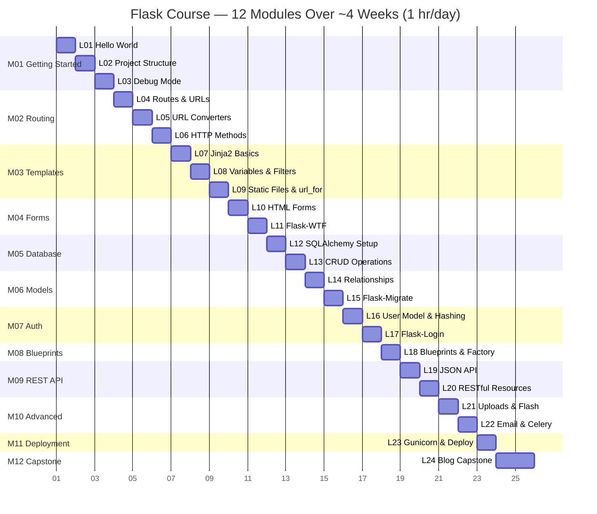
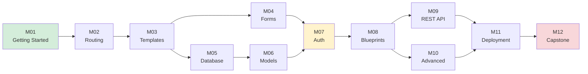

# Syllabus — The Full Roadmap

This is the complete map of the course: **24 lessons across 12 modules**, designed to take you from zero to a deployed Flask application. Every lesson has a clear purpose, clear prerequisites, and a clear deliverable. Trust the order.

> [!info] How to read this syllabus
> Each lesson is listed with:
> - **Title** and module
> - **Learning objectives** — what you'll be able to *do* after the lesson
> - **What you'll build** — the concrete code you'll have at the end
> - **Prerequisites** — lessons or skills you need first
> - **Estimated time** — 30–60 minutes of focused work

Don't skip ahead. Each lesson is the prerequisite for the next.

---

## Course Progression Timeline #timeline



At ~1 hour/day, you finish in about 4 weeks. The weekend crash course crams Modules 1–3 and 5, 7, 11 into ~8 hours. See [[README#Learning Paths]] for more.

---

## Module Dependency Graph #dependencies

Modules are sequential, but some can be done in parallel once you've passed the early ones. Here's the dependency structure:



> [!tip] You can branch after M03
> Once you know templates (Module 03), you can study Forms (M04) and Database (M05) in either order. But Auth (M07) requires both. If you want to deviate from the linear path, the diagram above shows what's safe.

---

## Module 01: Getting Started #m01

The foundation. You'll set up Python, install Flask, write your first app, and understand what happens when you run it.

### Lesson 01 — Your First Flask App

- **Module:** 01 — Getting Started
- **Estimated time:** 45–60 minutes
- **Prerequisites:** Python 3.10+ installed; basic Python (functions, imports)

**Learning objectives:**
- Install Flask in a virtual environment
- Write `app = Flask(__name__)` and explain what `__name__` is
- Create a route with `@app.route("/")`
- Run the dev server and view the page in a browser

**What you'll build:**
A single-file `app.py` that serves "Hello, Flask!" at `http://127.0.0.1:5000`.

→ [[Lesson 01 — Your First Flask App]]

---

### Lesson 02 — Project Structure & Virtual Environments

- **Module:** 01 — Getting Started
- **Estimated time:** 30–45 minutes
- **Prerequisites:** Lesson 01

**Learning objectives:**
- Organize a Flask project into folders (`app/`, `templates/`, `static/`)
- Create and use a `requirements.txt`
- Explain why virtual environments matter
- Pin dependency versions

**What you'll build:**
A reorganized project with `requirements.txt`, `venv/`, and a proper folder layout that you'll use for the rest of the course.

→ [[Lesson 02 — Project Structure]]

---

### Lesson 03 — Debug Mode & The Run Loop

- **Module:** 01 — Getting Started
- **Estimated time:** 30–45 minutes
- **Prerequisites:** Lesson 02

**Learning objectives:**
- Run Flask with `debug=True` and explain why
- Read a Flask traceback
- Understand the request/response cycle
- Use the interactive debugger

**What you'll build:**
The same app, but with a deliberate bug. You'll trigger the debugger, read the traceback, and fix it — building confidence with error messages.

→ [[Lesson 03 — Debug Mode]]

---

## Module 02: Routing #m02

How URLs map to Python functions. The heart of any web app.

### Lesson 04 — Routes and URL Rules

- **Module:** 02 — Routing
- **Estimated time:** 30–45 minutes
- **Prerequisites:** Lesson 03

**Learning objectives:**
- Create multiple routes (`/`, `/about`, `/contact`)
- Explain what `@app.route` actually does (decorators)
- Map URLs to view functions
- Return HTML strings, not just plain text

**What you'll build:**
A 3-page "static-ish" site with home, about, and contact routes.

→ [[Lesson 04 — Routes and URL Rules]]

---

### Lesson 05 — URL Converters & Query Parameters

- **Module:** 02 — Routing
- **Estimated time:** 45–60 minutes
- **Prerequisites:** Lesson 04

**Learning objectives:**
- Use `<int:id>`, `<string:name>`, `<path:subpath>`, `<uuid:token>` converters
- Read query parameters with `request.args`
- Build dynamic routes that respond to user input

**What you'll build:**
A `/user/<name>` route and a `/search?q=flask` route — your first dynamic pages.

→ [[Lesson 05 — URL Converters]]

---

### Lesson 06 — HTTP Methods & The Request Object

- **Module:** 02 — Routing
- **Estimated time:** 45–60 minutes
- **Prerequisites:** Lesson 05

**Learning objectives:**
- Distinguish GET vs POST vs PUT vs DELETE
- Use `methods=["GET", "POST"]` in route decorators
- Access form data and JSON via the `request` object
- Set response status codes

**What you'll build:**
A simple form that POSTs data back to the server and echoes it. The precursor to all form handling.

→ [[Lesson 06 — HTTP Methods]]

---

## Module 03: Templates #m03

Stop returning strings. Return real HTML pages with Jinja2.

### Lesson 07 — Jinja2 Basics & Template Inheritance

- **Module:** 03 — Templates
- **Estimated time:** 45–60 minutes
- **Prerequisites:** Lesson 06

**Learning objectives:**
- Use `render_template()` to return HTML files
- Set up the `templates/` folder
- Create a base template with ``
- Use `` to inherit from a base

**What you'll build:**
A multi-page site with a shared `base.html` and child templates for each route — your first real HTML.

→ [[Lesson 07 — Jinja2 Basics]]

---

### Lesson 08 — Template Variables, Filters & Control Structures

- **Module:** 03 — Templates
- **Estimated time:** 45–60 minutes
- **Prerequisites:** Lesson 07

**Learning objectives:**
- Pass variables from Flask to Jinja (`render_template("page.html", name="Alice")`)
- Use `{{ variable }}` syntax
- Apply filters like `{{ name|capitalize }}`, `{{ price|round(2) }}`
- Use ``, ``, ``

**What you'll build:**
A page that loops over a list of items and conditionally shows content — the foundation of every dynamic page you'll build.

→ [[Lesson 08 — Variables and Filters]]

---

### Lesson 09 — Static Files & `url_for`

- **Module:** 03 — Templates
- **Estimated time:** 30–45 minutes
- **Prerequisites:** Lesson 08

**Learning objectives:**
- Serve CSS, JS, and images from the `static/` folder
- Use `url_for('static', filename='style.css')` to build correct URLs
- Use `url_for()` to link between routes (avoiding hardcoding URLs)
- Explain why hardcoded `/static/...` URLs break in production

**What you'll build:**
A real styled page with a CSS file and a logo, with all URLs generated dynamically.

→ [[Lesson 09 — Static Files and url_for]]

---

## Module 04: Forms #m04

Accept input from users. Validate it. Protect against CSRF.

### Lesson 10 — HTML Forms & `request.form`

- **Module:** 04 — Forms
- **Estimated time:** 45–60 minutes
- **Prerequisites:** Lesson 09

**Learning objectives:**
- Write an HTML `<form>` with method and action
- Read submitted data with `request.form`
- Distinguish GET forms (query params) from POST forms (body)
- Basic manual validation

**What you'll build:**
A contact form that accepts a name and message, validates they're not empty, and shows a thank-you page.

→ [[Lesson 10 — HTML Forms]]

---

### Lesson 11 — Flask-WTF, Validation & CSRF Protection

- **Module:** 04 — Forms
- **Estimated time:** 45–60 minutes
- **Prerequisites:** Lesson 10

**Learning objectives:**
- Install and configure Flask-WTF
- Define a form class with `StringField`, `PasswordField`, validators
- Render forms in templates with `{{ form.hidden_tag() }}`
- Explain CSRF and how the `SECRET_KEY` defends against it

**What you'll build:**
The same contact form, rebuilt with Flask-WTF. You'll see how much boilerplate it eliminates and how CSRF protection works.

→ [[Lesson 11 — Flask-WTF]]

---

## Module 05: Database #m05

Persistent storage. Your app finally remembers things.

### Lesson 12 — SQLAlchemy Setup & Your First Model

- **Module:** 05 — Database
- **Estimated time:** 45–60 minutes
- **Prerequisites:** Lesson 11

**Learning objectives:**
- Install Flask-SQLAlchemy
- Configure `SQLALCHEMY_DATABASE_URI`
- Define a model class inheriting from `db.Model`
- Create tables with `db.create_all()`

**What you'll build:**
A `Post` model with `id`, `title`, `body`, `created_at` columns, backed by SQLite. Your first database table.

→ [[Lesson 12 — SQLAlchemy Setup]]

---

### Lesson 13 — CRUD Operations & Querying

- **Module:** 05 — Database
- **Estimated time:** 45–60 minutes
- **Prerequisites:** Lesson 12

**Learning objectives:**
- **C**reate rows with `db.session.add()` and `db.session.commit()`
- **R**ead rows with `Post.query.all()`, `.first()`, `.get(id)`, `.filter_by()`
- **U**pdate by modifying attributes and committing
- **D**elete with `db.session.delete()`
- Understand the session lifecycle

**What you'll build:**
A page that lists all posts and a route that creates a new post from a form. Full CRUD for the `Post` model.

→ [[Lesson 13 — CRUD Operations]]

---

## Module 06: Models & Relationships #m06

Connected data. A user has many posts. A post has many comments.

### Lesson 14 — One-to-Many & Many-to-Many Relationships

- **Module:** 06 — Models & Relationships
- **Estimated time:** 60 minutes
- **Prerequisites:** Lesson 13

**Learning objectives:**
- Define a one-to-many relationship with `db.relationship()` and `ForeignKey`
- Use `backref` and `back_populates`
- Define an association table for many-to-many
- Query across relationships (`user.posts`, `post.author`)

**What you'll build:**
Add a `User` model and a `Comment` model. A user has many posts; a post has many comments. Your data model starts to look like a real app.

→ [[Lesson 14 — Relationships]]

---

### Lesson 15 — Flask-Migrate & The Migrations Workflow

- **Module:** 06 — Models & Relationships
- **Estimated time:** 45–60 minutes
- **Prerequisites:** Lesson 14

**Learning objectives:**
- Install Flask-Migrate (Alembic wrapper)
- Run `flask db init`, `flask db migrate -m "message"`, `flask db upgrade`
- Explain why `db.create_all()` is fine for dev but not production
- Modify a model and generate a migration

**What you'll build:**
Add a new column to the `Post` model and generate a migration for it. You'll learn the production-safe way to evolve your schema.

→ [[Lesson 15 — Flask-Migrate]]

---

## Module 07: Authentication #m07

Real users. Real logins. Real security.

### Lesson 16 — User Model, Password Hashing & Registration

- **Module:** 07 — Authentication
- **Estimated time:** 60 minutes
- **Prerequisites:** Lesson 15

**Learning objectives:**
- Add `password_hash` column to User
- Use `werkzeug.security.generate_password_hash` and `check_password_hash`
- Build a registration form and route
- Explain why we never store plain-text passwords

**What you'll build:**
A working registration page that creates a real user in the database with a hashed password.

→ [[Lesson 16 — User Model and Hashing]]

---

### Lesson 17 — Flask-Login, Sessions & Protected Routes

- **Module:** 07 — Authentication
- **Estimated time:** 60 minutes
- **Prerequisites:** Lesson 16

**Learning objectives:**
- Install and configure Flask-Login
- Implement `UserMixin` and `login_manager.user_loader`
- Log users in with `login_user()`, log out with `logout_user()`
- Protect routes with `@login_required`
- Use `current_user` in templates

**What you'll build:**
A login form, a logout button, and a `/dashboard` route that only logged-in users can see. A complete auth flow.

→ [[Lesson 17 — Flask-Login]]

---

## Module 08: Blueprints #m08

Your app is getting big. Time to organize it.

### Lesson 18 — Blueprints & The Application Factory

- **Module:** 08 — Blueprints
- **Estimated time:** 60 minutes
- **Prerequisites:** Lesson 17

**Learning objectives:**
- Convert routes into a Blueprint with `Blueprint('auth', __name__)`
- Register blueprints with `app.register_blueprint()`
- Use the application factory pattern (`create_app()`)
- Split a single `app.py` into a proper package

**What you'll build:**
Refactor the entire project so far into a multi-file package with separate blueprints for `auth`, `blog`, and `main`. The structure of a real production Flask app.

→ [[Lesson 18 — Blueprints]]

---

## Module 09: REST API #m09

Your app, but as a JSON API other apps can talk to.

### Lesson 19 — Building a JSON API & Status Codes

- **Module:** 09 — REST API
- **Estimated time:** 45–60 minutes
- **Prerequisites:** Lesson 18

**Learning objectives:**
- Use `jsonify()` to return JSON responses
- Set HTTP status codes (`201 Created`, `404 Not Found`, `400 Bad Request`)
- Read JSON request bodies with `request.get_json()`
- Test endpoints with `curl` and Postman

**What you'll build:**
A `/api/posts` endpoint that returns all posts as JSON, and a POST endpoint that creates a post from a JSON body.

→ [[Lesson 19 — JSON API]]

---

### Lesson 20 — RESTful Resources, Error Handling & API Testing

- **Module:** 09 — REST API
- **Estimated time:** 60 minutes
- **Prerequisites:** Lesson 19

**Learning objectives:**
- Map HTTP methods (GET/POST/PUT/DELETE) to resource operations
- Write a custom error handler with `@app.errorhandler()`
- Return consistent JSON error responses
- Write automated tests with `pytest` and Flask's test client

**What you'll build:**
A complete REST API for posts with proper status codes, error handling, and a test suite you can run with `pytest`.

→ [[Lesson 20 — RESTful Resources]]

---

## Module 10: Advanced Topics #m10

The extras that make an app feel real.

### Lesson 21 — File Uploads, Flash Messages & Cookies

- **Module:** 10 — Advanced Topics
- **Estimated time:** 60 minutes
- **Prerequisites:** Lesson 20

**Learning objectives:**
- Handle file uploads with `<input type="file">` and `request.files`
- Validate and save uploaded files with `secure_filename`
- Show one-time messages with `flash()` and `get_flashed_messages()`
- Set and read cookies

**What you'll build:**
An image upload form for blog posts. Users can attach an image, see a flash message confirming success, and have their theme preference remembered via a cookie.

→ [[Lesson 21 — File Uploads]]

---

### Lesson 22 — Email Sending & Background Tasks with Celery

- **Module:** 10 — Advanced Topics
- **Estimated time:** 60 minutes
- **Prerequisites:** Lesson 21

**Learning objectives:**
- Send email with Flask-Mail (SMTP)
- Build HTML and text email templates
- Explain why slow tasks shouldn't run in the request
- Queue a background task with Celery and Redis

**What you'll build:**
A "forgot password" flow that emails a reset link, with the email send queued via Celery so the request returns instantly.

→ [[Lesson 22 — Email and Celery]]

---

## Module 11: Deployment #m11

Your app leaves `localhost` and meets the real internet.

### Lesson 23 — Gunicorn, Environment Variables & Production Deployment

- **Module:** 11 — Deployment
- **Estimated time:** 60 minutes
- **Prerequisites:** Lesson 22

**Learning objectives:**
- Run Flask with Gunicorn instead of the dev server
- Use `python-dotenv` to manage environment variables
- Set a real `SECRET_KEY` and switch to a production database URI
- Deploy to a Linux VPS (or Render/Fly.io as a managed alternative)

**What you'll build:**
Your app, running on a real public URL, with a real database, real secrets, and real logging. Not a tutorial anymore — a deployed application.

→ [[Lesson 23 — Deployment]]

---

## Module 12: Capstone Project #m12

Build it all, from scratch, yourself.

### Lesson 24 — Build a Complete Blog (Capstone)

- **Module:** 12 — Capstone Project
- **Estimated time:** 2–4 hours
- **Prerequisites:** All previous lessons

**Learning objectives:**
- Plan a Flask project from a blank folder
- Apply everything: routes, templates, forms, database, auth, blueprints, REST, deployment
- Make architectural decisions without a step-by-step guide
- Ship a real, working application

**What you'll build:**
A complete blog with:
- User registration and login
- Create / edit / delete posts (only your own)
- Comments on posts
- Image uploads for post banners
- A JSON API at `/api/posts` for fetching posts programmatically
- Deployed to a public URL

This is your graduation project. When it's live, you're a Flask developer.

→ [[Lesson 24 — Blog Capstone]]

---

## Total Time Estimates #totals

| Module | Lessons | Estimated Time |
|--------|---------|----------------|
| 01 — Getting Started | 3 | 2 hours |
| 02 — Routing | 3 | 2 hours |
| 03 — Templates | 3 | 2 hours |
| 04 — Forms | 2 | 1.5 hours |
| 05 — Database | 2 | 1.5 hours |
| 06 — Models | 2 | 2 hours |
| 07 — Authentication | 2 | 2 hours |
| 08 — Blueprints | 1 | 1 hour |
| 09 — REST API | 2 | 2 hours |
| 10 — Advanced | 2 | 2 hours |
| 11 — Deployment | 1 | 1 hour |
| 12 — Capstone | 1 | 3 hours |
| **Total** | **24** | **~22 hours** |

Add 20% for exercises and debugging, and you're at **~25–28 hours** of focused study.

---

## How to Track Your Progress #tracking

We recommend keeping a personal progress note in Obsidian. Here's a template — copy it into a new note called `My Progress`:

```markdown
# My Flask Course Progress

## Modules
- [ ] M01 — Getting Started
- [ ] M02 — Routing
- [ ] M03 — Templates
- [ ] M04 — Forms
- [ ] M05 — Database
- [ ] M06 — Models
- [ ] M07 — Auth
- [ ] M08 — Blueprints
- [ ] M09 — REST API
- [ ] M10 — Advanced
- [ ] M11 — Deployment
- [ ] M12 — Capstone

## Lessons Completed
- [ ] Lesson 01
- [ ] Lesson 02
...

## Notes
- Started: YYYY-MM-DD
- Target finish: YYYY-MM-DD
```

Check off lessons as you go. The visible progress is motivating.

> [!success] You've seen the whole map.
> That's the entire course. Twenty-four lessons, twelve modules, ~25 hours, one deployed blog. Head to [[Map-of-Content]] to find your starting point, or jump straight into [[Lesson 01 — Your First Flask App]].

---

**Tags:** #meta #syllabus #roadmap #course-structure
**Previous:** [[How-To-Use-This-Course]]
**Next:** [[Map-of-Content]] →
