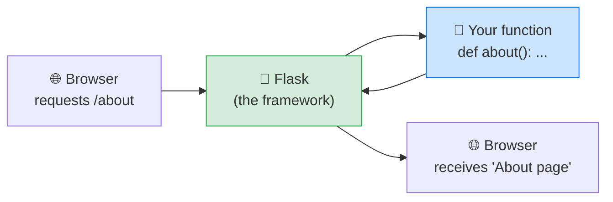
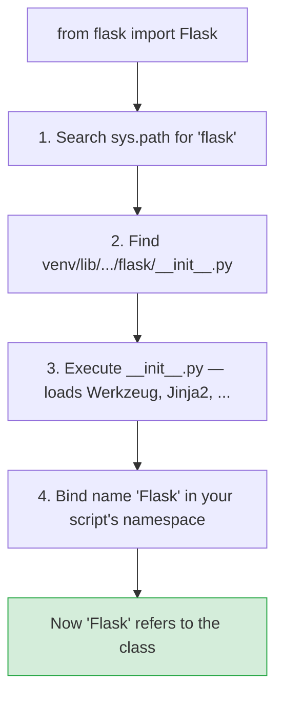
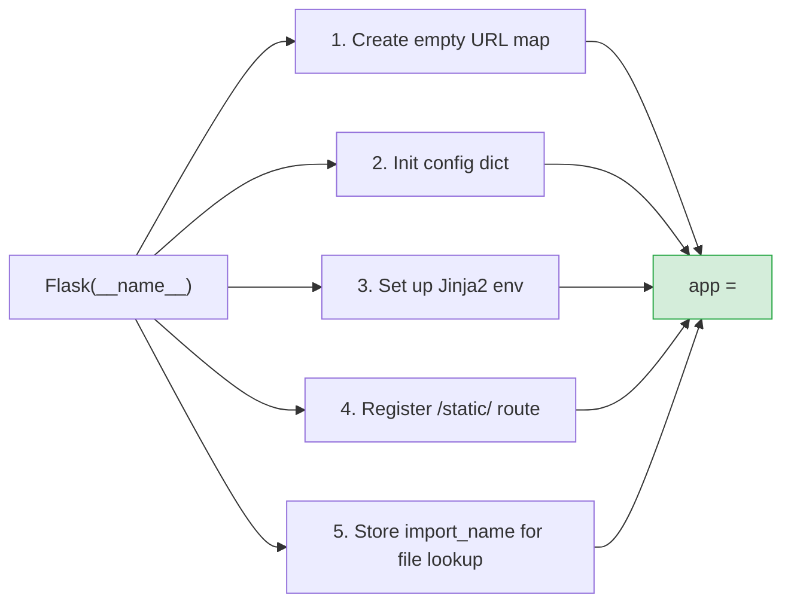
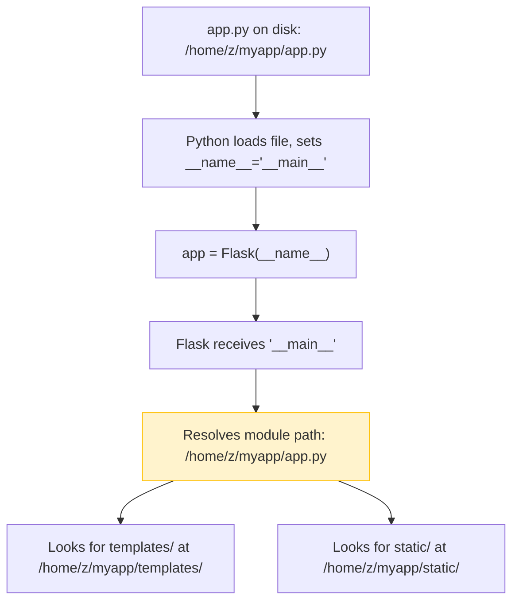
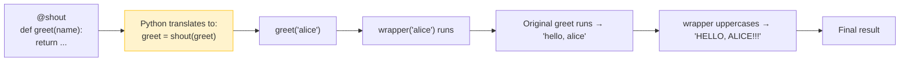
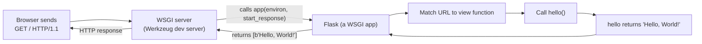
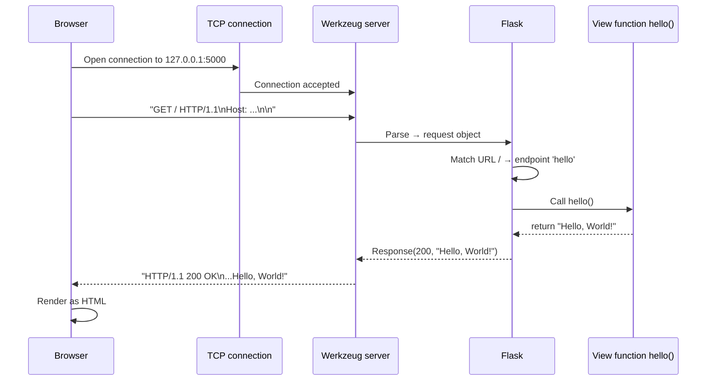
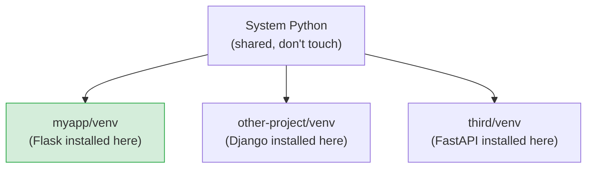
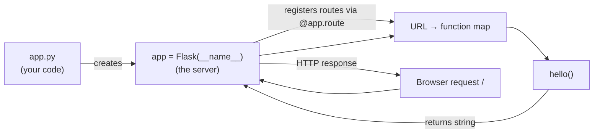

# Lesson 01 — Hello, World! Your First Flask App

> [!success] You're at the very beginning.
> Every Flask developer — from the hobbyist with a side project to the engineer running production systems at Netflix, Reddit, or Pinterest — once wrote the exact eight lines of code you'll write in this lesson. Take your time. Read every line. Run it. Change it. Break it. Fix it. **This is how you learn.**

#flask #getting-started #wsgi #decorators

## 1. Learning Objectives

By the end of this lesson you will be able to:

1. **Install Python and Flask** on your machine inside an isolated *virtual environment*.
2. **Explain what Flask is** — a small Python "micro-framework" for building web applications — and why we use it instead of writing raw HTTP servers.
3. **Write, run, and visit** a complete "Hello, World!" Flask application in your browser.
4. **Read every line** of a minimal Flask script and explain *why* that line exists, *what Python does internally* when it runs, and *what would happen if it were missing*.
5. **Understand decorators** (`@app.route`) at a level deep enough to write your own decorator from scratch.
6. **Understand `__name__`** — Python's most confusing built-in for beginners — and how Flask uses it to locate your files.
7. **Explain the HTTP request/response cycle** and WSGI — the protocol that sits between the browser and your Python code.
8. **Recognise and fix** the five most common beginner mistakes (forgotten venv, port conflict, capital `F` vs lowercase `f`, missing `@`, editing without reloading).
9. **Add multiple routes** to your app and visit each one independently.

## 2. Prerequisites

Before starting, you need:

- **Python 3.9 or newer.** Download from <https://www.python.org/downloads/>. To check, open a terminal and run `python --version` (or `python3 --version` on macOS/Linux). You should see something like `Python 3.12.1`.
- **A code editor.** VS Code is free and excellent (<https://code.visualstudio.com/>). Any plain-text editor works.
- **A terminal.** On macOS use Terminal.app or iTerm. On Windows use PowerShell or the "Command Prompt". VS Code's built-in terminal is great because it opens right where your files are.
- **About an hour of focused time.** Don't rush — every concept here will be reused in every future lesson.

> [!info] Don't have Python yet?
> Install it from <https://python.org>. **Windows users:** during installation, tick the box that says *"Add Python to PATH"*. Without it, `python` won't be recognised in the terminal.

## 3. The Problem — What Does a Web Server Actually Do?

Before we write any Flask, let's understand what we're trying to avoid.

Imagine you want to build a website. Maybe a personal blog. A todo list. A contact form. A small dashboard for your team. *Something* has to listen for requests from browsers, decide what to send back, and ship the response. That "something" is a **web server**.

You could write it the hard way: open a raw TCP socket, parse the HTTP request by hand, decide what HTML to send back, format the HTTP response, send it, close the connection. Here's what that looks like in Python with no framework:

```python
# A raw HTTP server — DON'T do this. Just look at the pain.
import socket

server = socket.socket(socket.AF_INET, socket.SOCK_STREAM)
server.bind(('127.0.0.1', 5000))
server.listen()

while True:
    client, _ = server.accept()
    request = client.recv(1024).decode()
    # ...now parse "GET / HTTP/1.1\r\nHost: ...\r\n\r\n" by hand...
    body = "Hello, World!"
    response = (
        "HTTP/1.1 200 OK\r\n"
        "Content-Type: text/plain\r\n"
        f"Content-Length: {len(body)}\r\n"
        "\r\n"
        f"{body}"
    )
    client.sendall(response.encode())
    client.close()
```

That's thirty lines just to say *hello*. Add a second page, form handling, cookies, JSON APIs, sessions, file uploads, templates — and you'll spend 95% of your time rewriting plumbing instead of building your actual idea.

> [!note] Historical context — the CGI era
> Before frameworks like Flask existed (Flask was released in 2010), most web development used **CGI** — the Common Gateway Interface. You wrote a separate Python script for every URL. The web server (Apache) would spawn a *new Python process* for every single request, run your script, send the output to the browser, and throw the process away. Spawning a Python process takes ~50–100 milliseconds; under any load at all, your server would crawl. CGI also meant no shared state, no connection pooling, no in-memory caching. Modern frameworks like Flask keep one long-running Python process that handles many requests — a *massive* speedup and the reason web apps feel instant today.

**This is the problem Flask solves.** Flask wraps all of that HTTP plumbing into a tiny, friendly API. You write Python functions, Flask turns them into web pages. That's the whole pitch.



Flask is called a *micro-framework* — not because it's only for tiny apps, but because it does one job (web serving) and stays out of your way. Database? Add SQLAlchemy. Forms? Add Flask-WTF. Auth? Add Flask-Login. You assemble exactly what you need. By the end of this course, you'll have built a real blog using this modular philosophy.

> [!example] Real-world analogy
> Think of Flask as a food truck. A food truck has the essentials — a grill, a counter, a window — and you bring the menu. A full-stack framework like Django is more like a restaurant chain with a corporate kitchen, accounting department, and HR. Both work. Flask is what you reach for when you want to ship something fast and stay in control of every ingredient.

## 4. The Code

Here is the complete Flask application you'll write. **Eight lines.** Save it mentally — every Flask app you ever write is a variation of this skeleton.

```python
from flask import Flask

app = Flask(__name__)

@app.route('/')
def hello():
    return "Hello, World!"

if __name__ == '__main__':
    app.run(debug=True)
```

That's it. Run it, open your browser, and you have a working web server. We'll explain every single line next — but not just "what it does." We'll explain *what Python does internally*, *why the line is necessary*, and *what would happen without it*.

## 5. Line-by-Line Explanation (Deep Dive)

This section is the heart of the lesson. Read it twice. Don't skip.

### Line 1 — `from flask import Flask`

```python
from flask import Flask
```

**What it does:** Brings the `Flask` class into your script from the `flask` package so you can use it.

**Why we need it:** Python doesn't know what "Flask" is by default — it's not built into the language. The `import` statement is how you say "go find this code someone else wrote, and make it available here." The `flask` package is what you installed with `pip install flask`. Inside that package lives a class named `Flask` (capital `F`), and that class is the thing that creates web applications.

#### What happens inside Python when you run this line

When the Python interpreter hits `from flask import Flask`, it does roughly this:

1. **Search `sys.path`** — a list of directories where Python looks for modules. This includes the standard library, your virtual environment's `site-packages/` folder, and the current directory.
2. **Find `flask/__init__.py`** — a folder named `flask` containing an `__init__.py` file. That's what makes `flask` a *package* (a folder of code) rather than a single module (a single file).
3. **Execute that file** — every statement at the top level of `flask/__init__.py` runs. This includes other imports (`from .app import Flask`), which transitively load Werkzeug, Jinja2, etc.
4. **Look up the name `Flask`** in the resulting module's namespace and bind it in *your* file's namespace as a local name.

After this line, `Flask` is a name you can use — it points to the class defined in the `flask` package.



> [!question] Student asks: Why `flask` (lowercase) on the left and `Flask` (capital) on the right?
> Great question — it confuses everyone. `flask` (lowercase) is the **package name**: the folder on disk containing all the Flask code. `Flask` (capital) is the **class name** inside that package. Python convention is: *packages and modules are lowercase* (`flask`, `os`, `datetime`), *classes are CapitalisedWords* (`Flask`, `Request`, `Response`). The line `from flask import Flask` reads as: "from the lowercase package, give me the capitalised class."

**Capital `F` matters.** Python is case-sensitive. Beginners often write `from flask import flask` and get a confusing `ImportError`. Be precise.

> [!tip] What is `from X import Y` doing?
> Think of `flask` as a toolbox and `Flask` as one specific tool inside. The line `from flask import Flask` says "open the toolbox and hand me that one tool." You could also write `import flask` and then use `flask.Flask(...)`, but the `from … import …` form is shorter and idiomatic. The `flask` package contains dozens of useful names — `request`, `render_template`, `redirect`, `url_for`, `session` — and you'll typically import several of them at the top of every file:
> ```python
> from flask import Flask, request, render_template, redirect, url_for
> ```

#### What's the alternative?

You *could* build a web app with no framework — using Python's built-in `http.server` module. It's about 30 lines of plumbing to get to "Hello, World," and the moment you want a second page or a form, you're writing raw HTTP parsing. Frameworks exist because the plumbing is the same for every app — so why write it twice?

### Line 2 — `app = Flask(__name__)`

```python
app = Flask(__name__)
```

This single line does more work than any other in the file. Let's unpack it carefully.

**What it does:** Creates your Flask application object and stores it in the variable `app`.

#### What is `Flask(...)`?

`Flask` is a class. Calling `Flask(...)` constructs an *instance* of that class — one specific running web application. You can think of it as a brand-new, empty web server waiting for instructions.

Internally, constructing a `Flask` object does a surprising amount:

1. Creates an empty **URL map** — the data structure that will hold every `@app.route` you later define.
2. Sets up a `config` dict with default settings (debug off, secret key empty, etc.).
3. Creates a `jinja_env` (the Jinja2 template engine, pre-configured to look in your `templates/` folder).
4. Registers a default static-file route (`/static/<filename>`) pointing at your `static/` folder.
5. Stores the `import_name` (the `__name__` you passed) so it can locate files relative to your module.

After this line, `app` is an object that *knows how to be a web server* — it just doesn't have any routes yet.



#### What is `__name__`? — the most confusing part for beginners

This is the magic part. `__name__` is a special built-in Python variable. Python sets it **automatically** before running your file — you never assign to it yourself. Its value depends on *how* the file was loaded:

- If you run your file directly with `python app.py`, then inside that file `__name__` equals the string `"__main__"`.
- If your file is *imported* by another file (e.g. `import app` from somewhere else), then `__name__` equals the module's name — `"app"`.

> [!question] Student asks: What's the point of having two different values?
> Python uses `__name__` to tell modules apart: *am I the main program, or am I being used as a library by someone else?* This is fundamental to Python's design — every file is *both* a script (you can run it) *and* a module (you can import it). The `__name__` variable lets each file know which role it's playing right now. Without it, a file would have no way to behave differently when run vs. imported.

#### Why does Flask need `__name__`?

Flask uses `__name__` to figure out *where your files live on disk*. When Flask needs to find your `templates/` folder, your `static/` folder, or configuration files, it starts looking relative to the location of the module that created the `Flask` instance. Passing `__name__` tells Flask "I am the file that started this app — look for resources next to me."

If you lied and passed a hardcoded string like `Flask('myapp')`, Flask would look for a module called `myapp` in `sys.path` — which might not exist, or might point to the wrong folder. Always pass `__name__`.



> [!example] Try it — see `__name__` for yourself
> Create a file called `name_test.py` containing just:
> ```python
> print(__name__)
> ```
> Run it: `python name_test.py` → prints `__main__`.
> Now from another Python file (or the REPL) do `import name_test` → prints `name_test`.
> Same file, different `__name__`. That's the whole trick.
>
> **Behind the scenes:** When Python runs `python name_test.py`, it sets `__name__ = "__main__"` *before* executing any of your code. When you `import name_test` from elsewhere, Python sets `__name__ = "name_test"` (the module's importable name). Your file's *content* is identical in both cases — only `__name__` differs. That's why it's so powerful.

#### Why `app`?

It's just a variable name. You could call it `my_server` or `webapp` or `bruce`. But `app` is the universal Flask convention — every tutorial, every blog post, every Flask codebase you'll ever see uses `app`. Stick with it; future-you reading your code (and us reading your code) will thank you.

> [!example] Real-world analogy
> Think of `Flask` as a restaurant chain (the class), `app` as YOUR specific restaurant location (the instance), and `__name__` as the address that says "this is the main location, not a franchise." When `app` needs to find its kitchen (templates folder) or its storage room (static folder), it uses the address to know where to look.

### Line 3 — `@app.route('/')`

```python
@app.route('/')
```

**What it does:** Tells Flask "when a browser requests the URL `/`, call the function I'm about to define."

#### What is the `@` symbol? — Decorators in depth

That `@` symbol is one of Python's most powerful features. It's a **decorator**. A decorator is a function that takes another function and *modifies* it — usually wrapping it with extra behaviour. Decorators always sit directly above a function definition and "decorate" that function.

To understand decorators, you need to understand that **in Python, functions are first-class objects**. You can pass a function as an argument, return a function from a function, and assign a function to a variable — just like any other value.

Here's a decorator built from scratch — no Flask involved:

```python
# A decorator that shouts everything the function returns
def shout(func):
    def wrapper(*args, **kwargs):
        result = func(*args, **kwargs)
        return result.upper() + "!!!"
    return wrapper

@shout
def greet(name):
    return f"hello, {name}"

print(greet("alice"))   # → "HELLO, ALICE!!!"
```

When Python sees `@shout` above `def greet`, it does *exactly* this behind the scenes:

```python
def greet(name):
    return f"hello, {name}"
greet = shout(greet)   # ← what the decorator does
```

So `greet` is *replaced* by whatever `shout(greet)` returns — which is the `wrapper` function. Now every time you call `greet(...)`, you're actually calling `wrapper(...)`, which calls the original `greet` and then uppercases the result.



#### How `@app.route` applies this

In Flask, `@app.route('/')` is shorthand for:

```python
def hello():
    return "Hello, World!"
hello = app.route('/')(hello)   # ← what the decorator does behind the scenes
```

Let's break that down:

1. `app.route('/')` returns a function — call it the "registerer."
2. Calling `registerer(hello)` registers `hello` in Flask's URL map under the path `/` and returns `hello` unchanged.
3. So `hello` is still `hello` — but Flask now *also* knows about it.

When a request comes in for `/`, Flask looks up its URL map, finds `hello`, and calls it.

> [!info] Decorators don't have to change the function
> Many decorators — `@app.route` included — *register* a function somewhere without modifying its behaviour. The function does exactly what it always did; the decorator just records that "this function exists and should be called when X happens." This is called a *registration decorator*, and it's extremely common in web frameworks, test runners (`@pytest.fixture`), and plugin systems.

#### What is `'/'`?

That's the URL path — the part of the address *after* the domain. Visiting `http://127.0.0.1:5000/` means "the root path." Visiting `http://127.0.0.1:5000/about` means "the path `/about`." So `@app.route('/')` wires up the homepage.

```mermaid
flowchart TD
    URL["URL in browser<br/>http://127.0.0.1:5000/"] -->|path is /| Map["Flask's URL map"]
    Map -->|matches @app.route('/')| Func["calls hello()"]
    Func -->|returns string| Resp["HTTP response sent back"]
    Resp --> Browser["Browser shows: Hello, World!"]
```

### Line 4 — `def hello():`

```python
def hello():
```

**What it does:** Defines a Python function named `hello` that takes no arguments.

**Naming conventions:**
- Function names are lowercase with underscores if needed: `hello`, `show_profile`, `delete_post`. (This is called *snake_case*.)
- Function names should describe what the page does. `hello` is fine for a tutorial; in a real app you'd call this `home` or `index`.
- The function name matters — Flask uses it as a unique identifier (the "endpoint name") for the route. Later, when you learn `url_for('hello')`, Flask looks up the function by name.

**No arguments?** Flask calls your function for you, and it passes no arguments (unless you've declared URL converters — see [[Lesson-05-URL-Converters]]). For now, no arguments.

> [!question] Student asks: Can I name the function anything?
> Yes — but it must be unique across your app. Two routes can't share a function name, because Flask uses the name as a key in its URL map. If you write two functions called `page`, the second silently overwrites the first.

### Line 5 — `return "Hello, World!"`

```python
    return "Hello, World!"
```

**What it does:** Returns a Python string from the function.

#### What Flask does with the return value

This is the magic. Flask takes whatever your function returns — a string, a dict, a tuple, a `Response` object — and sends it back to the browser as the HTTP response body. So when you `return "Hello, World!"`, the browser receives the text `Hello, World!` as the body of the response, with a default status code of `200 OK` and a `Content-Type` of `text/html`.

Here's what the actual HTTP response looks like on the wire:

```http
HTTP/1.1 200 OK
Server: Werkzeug/3.0.1 Python/3.12.1
Date: Mon, 12 May 2025 10:30:00 GMT
Content-Type: text/html; charset=utf-8
Content-Length: 13

Hello, World!
```

Flask formatted all of that for you — status line, headers, blank line, body. You just returned a string.

> [!info] You can return more than strings.
> - Return a **dict** and Flask auto-converts it to JSON (`return {"message": "hi"}` → `{"message": "hi"}` with `Content-Type: application/json`).
> - Return **HTML** and it renders as a web page (`return "<h1>Hi</h1>"`).
> - Return a **tuple** `(body, status_code)` for custom status (`return "Not found", 404`).
> - Return a **tuple** `(body, status_code, headers_dict)` to also set headers.
> - Return a **`Response` object** for full control (we'll see this in [[Lesson-09-Static-Files]]).
> We'll explore all of these in later lessons. For now, strings are enough.

### Line 6 — `if __name__ == '__main__':`

```python
if __name__ == '__main__':
```

**What it does:** A guard that runs the code inside it *only* when this file is executed directly, not when it's imported.

**Why this matters:** Recall that `__name__` is `"__main__"` only when the file is run directly. So `if __name__ == '__main__':` means "if a human typed `python app.py`, do the following; if another script imports this file, skip the following."

Why would we want to skip starting the server on import? Because in real apps, you sometimes want to import the `app` object from `app.py` into another file (for testing, or to run under a production server like Gunicorn). If you start the dev server on import, that's chaos — the import would block forever, and you'd have multiple servers running.

> [!example] Mental model: script vs. library
> Every Python file can serve two roles: a *script* (you run it) or a *library* (someone imports it). The `if __name__ == '__main__'` guard is how you say "do this only when I'm the script, not when I'm the library." This pattern is universal in Python — you'll see it in CLI tools, data science scripts, web apps, everywhere.

> [!note] In production, this block is rarely used.
> Production servers like Gunicorn import your `app` object directly and run their own server loop. The `if __name__ == '__main__':` block is for *development* — for you, the developer, hitting `python app.py`. We cover production deployment in [[Lesson-23-Deployment]].

### Line 7 — `app.run(debug=True)`

```python
    app.run(debug=True)
```

**What it does:** Starts the built-in development web server.

#### What `app.run()` does under the hood

1. **Binds to a network port** on your machine (default `127.0.0.1:5000` — your local computer, port 5000).
2. **Enters an infinite loop**, listening for HTTP requests.
3. For each request: parses it, finds the matching route, calls your function, formats the response, sends it back.

The server *never returns* — it just keeps handling requests forever, until you kill it with `Ctrl+C`.

#### What `debug=True` does

Enables two huge developer features:

1. **Auto-reload.** When you save a change to your `app.py`, Flask automatically restarts the server. No more killing and restarting by hand. (Internally, Flask spawns a *child process* that runs your app, while the *parent process* watches the filesystem. When a file changes, the parent kills and respawns the child. You'll see `* Restarting with stat` in the terminal when this happens.)
2. **The Werkzeug debugger.** When your code throws an error, instead of a generic "500 Internal Server Error", Flask shows an interactive web page with the full traceback. You can click into any frame and inspect variables. It's a superpower. (More in [[Lesson-03-Debug-Mode]].)

> [!warning] `debug=True` must NEVER be on in production.
> The Werkzeug debugger lets anyone with browser access *execute arbitrary Python code on your server*. That's great when it's only you on `127.0.0.1`, and catastrophic when it's the public internet. We'll cover this in detail in [[Lesson-03-Debug-Mode]] and [[Lesson-23-Deployment]].

## 6. The WSGI Layer — What Sits Between the Browser and Flask

You've probably heard the term "WSGI" thrown around. Let's demystify it.

**WSGI** (Web Server Gateway Interface) is a Python standard (PEP 3333) that defines a simple contract: *how a Python application talks to a web server*. The contract is dead simple — a WSGI application is just a *callable* (a function or an object with `__call__`) that takes two arguments and returns an iterable of bytes.

Here's the entire WSGI spec in code:

```python
def application(environ, start_response):
    # environ: dict of CGI-style environment variables (REQUEST_METHOD, PATH_INFO, ...)
    # start_response: a callable you call with (status, headers) before returning the body
    start_response('200 OK', [('Content-Type', 'text/plain')])
    return [b'Hello, World!']
```

That's it. That's all WSGI is. Flask is a *much* friendlier wrapper around this contract. When you write `return "Hello, World!"`, Flask packages that string into the `[b'Hello, World!']` iterable WSGI expects, calls `start_response('200 OK', [...])` for you, and hands the whole thing back to the server.



> [!info] Real-world deployment
> In production you don't use Flask's built-in server. You use a *WSGI server* like **Gunicorn** or **uWSGI** — a battle-tested program that knows how to accept thousands of concurrent connections, fork worker processes, and forward each request to your Flask app via the WSGI contract. The beauty of WSGI is that your Flask code is identical in dev and prod — only the server wrapping it changes. We cover this in [[Lesson-23-Deployment]].

## 7. The HTTP Request/Response Cycle — What Actually Travels Over the Wire

When you type `http://127.0.0.1:5000/` into your browser and hit Enter, here's *exactly* what happens:

1. **DNS resolution.** The browser looks up `127.0.0.1` — that's already an IP address (your own machine), so no lookup needed. For real sites like `google.com`, this step queries DNS servers worldwide to translate the hostname to an IP.
2. **TCP connection.** The browser opens a TCP connection to port 5000 on that IP. (TCP is a reliable, ordered-bytes protocol — it's the foundation of HTTP.)
3. **HTTP request sent.** The browser writes this text over the connection:
   ```http
   GET / HTTP/1.1
   Host: 127.0.0.1:5000
   User-Agent: Mozilla/5.0 (Macintosh; Intel Mac OS X 10_15_7) ...
   Accept: text/html,application/xhtml+xml,...
   Accept-Language: en-US,en;q=0.9
   Accept-Encoding: gzip, deflate
   Connection: keep-alive

   ```
   Notice the structure: a *request line* (`GET / HTTP/1.1`), then *headers* (key: value pairs), then a blank line marking the end of headers, then (optionally) a body. GET requests usually have no body.
4. **Flask receives the request.** Werkzeug parses this raw text into a Python `request` object with attributes like `request.method`, `request.path`, `request.headers`.
5. **URL matching.** Flask walks its URL map and finds that `/` is registered to the `hello` endpoint.
6. **View function called.** Flask calls `hello()`. Your function runs and returns `"Hello, World!"`.
7. **Response assembled.** Flask wraps the string into a `Response` object with default status `200 OK` and `Content-Type: text/html`.
8. **HTTP response sent back** over the same TCP connection:
   ```http
   HTTP/1.1 200 OK
   Server: Werkzeug/3.0.1 Python/3.12.1
   Content-Type: text/html; charset=utf-8
   Content-Length: 13

   Hello, World!
   ```
9. **Browser renders.** The browser reads the `Content-Type`, realises it's HTML, parses `Hello, World!` as HTML, and displays it.



> [!example] Try this — see the raw HTTP yourself
> Run your Flask app. Then in a *separate* terminal, use `curl` (available on macOS/Linux; on Windows use `curl.exe` or `Invoke-WebRequest`):
> ```bash
> curl -v http://127.0.0.1:5000/
> ```
> The `-v` flag means "verbose." You'll see the full request you sent and the full response you got back, with no browser hiding anything. This is gold for debugging — when something doesn't work, `curl -v` shows you exactly what's on the wire.

## 8. Running the Code

Now for the fun part — actually getting this running. Follow each step in order. **Don't skip the virtual environment step.** It looks optional, but it's the #1 thing that separates people who "got Flask working once" from people who can build real projects.

### Step 1 — Install Python

Download from <https://www.python.org/downloads/>. Verify:

```bash
python --version
# Should print: Python 3.12.x (or newer)
```

On macOS and many Linux distros, you may need `python3`:

```bash
python3 --version
```

### Step 2 — Open a terminal

Open Terminal.app (macOS), PowerShell (Windows), or your VS Code integrated terminal (`Ctrl+`\` or `Cmd+`\`).

### Step 3 — Make a project folder

```bash
mkdir myapp
cd myapp
```

You're now inside an empty folder called `myapp`. This is your project's home.

### Step 4 — Create a virtual environment

A *virtual environment* (venv) is a self-contained Python installation just for this project. Anything you `pip install` here won't affect your system Python or other projects.

```bash
python -m venv venv
```

(On macOS/Linux use `python3 -m venv venv` if `python` doesn't work.)

This creates a folder called `venv/` containing its own Python interpreter and its own `pip`. Think of it as a sandbox.



#### What is a virtual environment, really?

A venv is just a folder. Inside, there's:

- `bin/python` (or `Scripts\python.exe` on Windows) — a symlink (or copy) to the system Python interpreter.
- `bin/pip` — a script that runs `python -m pip`.
- `lib/python3.XX/site-packages/` — where installed packages live. This is *separate* from your system's `site-packages/`.
- `pyvenv.cfg` — a small config file marking this folder as a venv.

When you "activate" the venv, all that happens is: your shell prepends `venv/bin/` to your `PATH`. So when you type `python`, the shell finds `venv/bin/python` first. That's it. Activation is purely a shell convenience — you can run `./venv/bin/python app.py` directly without activating, and it works identically.

> [!info] Modern alternative: `uv`
> In 2026, the modern Python community uses **`uv`** (a Rust-based tool from Astral) instead of `python -m venv` and `pip`. It's 10–100× faster. We'll introduce `uv` and the modern `pyproject.toml` workflow in [[Lesson-02-Project-Structure]]. For now, `venv` + `pip` works perfectly and teaches you what's happening under the hood. #modern-python #uv

### Step 5 — Activate the virtual environment

**macOS / Linux:**
```bash
source venv/bin/activate
```

**Windows (PowerShell):**
```powershell
venv\Scripts\Activate.ps1
```

**Windows (Command Prompt):**
```cmd
venv\Scripts\activate.bat
```

If activation worked, your prompt changes to show `(venv)`:

```
(venv) user@machine:~/myapp$
```

> [!warning] If PowerShell refuses to run the activate script
> Run this once: `Set-ExecutionPolicy -Scope CurrentUser RemoteSigned`. Then try again.

### Step 6 — Install Flask

```bash
pip install flask
```

You'll see output like:

```
Collecting flask
  Downloading flask-3.0.0-py3-none-any.whl (99 kB)
Collecting Werkzeug>=3.0.0
  Downloading werkzeug-3.0.1-py3-none-any.whl (226 kB)
Collecting Jinja2>=3.1.2
  Downloading jinja2-3.1.2-py3-none-any.whl (133 kB)
...
Successfully installed Jinja2-3.1.2 MarkupSafe-2.1.3 Werkzeug-3.0.1 blinker-1.7.0 click-8.1.7 flask-3.0.0 itsdangerous-2.1.2
```

Flask pulls in a few dependencies automatically: **Werkzeug** (the WSGI toolkit that does the actual HTTP), **Jinja2** (the template engine), **itsdangerous** (for signed cookies), **click** (CLI support), and **blinker** (signals). You don't need to learn these — they're transparent.

### Step 7 — Create `app.py` and paste the code

Create a file named `app.py` inside your `myapp/` folder and paste the eight lines from section 4:

```python
from flask import Flask

app = Flask(__name__)

@app.route('/')
def hello():
    return "Hello, World!"

if __name__ == '__main__':
    app.run(debug=True)
```

### Step 8 — Run it

Make sure your venv is still activated (you should see `(venv)` in the prompt). Then:

```bash
python app.py
```

You'll see something like:

```
 * Serving Flask app 'app'
 * Debug mode: on
 * Running on http://127.0.0.1:5000
 * Restarting with stat
 * Debugger is active!
 * Debugger PIN: 123-456-789
```

> [!info] What is `127.0.0.1`?
> It's the IP address of *your own computer* — also called "localhost." Only your machine can reach it. Port `5000` is just a number Flask picked by default; thousands of ports exist (0–65535), and Flask uses 5000. Real websites use port 443 (HTTPS) or 80 (HTTP), but for development we use high ports that don't require admin rights.

### Step 9 — Visit it in your browser

Open your browser and go to:

```
http://127.0.0.1:5000/
```

You should see:

```
Hello, World!
```

🎉 **Congratulations.** You just built and ran a web application. The browser sent an HTTP GET request to your Flask server; Flask matched the path `/` to your `hello` function; `hello` returned `"Hello, World!"`; Flask wrapped that as an HTTP response and sent it back; your browser displayed it.

> [!success] What you actually did
> You turned a Python function into a webpage addressable from anywhere on your computer. Add another function, decorate it with a route, and you have another page. That's all of web development, scaled up.

## 9. Common Mistakes

### Mistake 1 — Forgetting to activate the venv

**Symptom:** `pip install flask` succeeds, but `python app.py` says `ModuleNotFoundError: No module named 'flask'`.

**Why:** You installed Flask into your system Python (or a different venv) but ran the script with another Python.

**Fix:** Activate the venv (Step 5). You should see `(venv)` in your prompt. Then `pip install flask` again (this time into the right place) and `python app.py`.

### Mistake 2 — Port 5000 already in use

**Symptom:**
```
OSError: [Errno 48] Address already in use
```
or, on macOS Monterey and later:
```
* Running on http://127.0.0.1:5000
```
followed by a browser page showing a weird AirPlay Receiver message.

**Why:** macOS Monterey+ uses port 5000 for the AirPlay Receiver service. Some Linux distros use it for other things.

**Fix:** Tell Flask to use a different port:

```python
if __name__ == '__main__':
    app.run(debug=True, port=5001)
```

Then visit `http://127.0.0.1:5001/`.

### Mistake 3 — Typing `flask` instead of `Flask`

**Symptom:**
```
ImportError: cannot import name 'flask' from 'flask'
```

**Why:** `from flask import flask` — wrong case. Python is case-sensitive.

**Fix:** Use `from flask import Flask` (capital `F`).

### Mistake 4 — Forgetting the `@` decorator

**Symptom:** Browser hits `/` and gets a `404 Not Found`, even though you wrote a `hello` function.

**Why:** Without `@app.route('/')`, Flask has no idea that `hello` is supposed to handle any URL. It's just an unused function sitting in a file.

**Fix:** Make sure the decorator sits *directly* above the function:

```python
@app.route('/')
def hello():
    return "Hello, World!"
```

### Mistake 5 — Editing the file but nothing changes

**Symptom:** You change `"Hello, World!"` to `"Goodbye!"`, save, refresh the browser, and it still says "Hello, World!"

**Why:** Either you didn't enable `debug=True` (so no auto-reload), or the auto-reload silently crashed.

**Fix:** Confirm `app.run(debug=True)`. If it crashed, you'll see an error in the terminal — fix the syntax error and it'll restart cleanly.

### Mistake 6 — Naming your file `flask.py`

**Symptom:** `ImportError: cannot import name 'Flask' from 'flask'` — but you definitely installed it!

**Why:** Python searches your *current directory* before `site-packages/`. If you have a local `flask.py`, Python imports *that* instead of the real Flask package. Same goes for naming your file `werkzeug.py`, `jinja2.py`, or `os.py`.

**Fix:** Rename your file to `app.py` (or anything not matching a real package name).

## 10. A Mental Model for Flask

Before we practise, let's lock in a mental model. When you build a Flask app, you're really doing four things:

1. **Create an app** — `app = Flask(__name__)`. This is your server, your router, your config holder, all in one object.
2. **Register routes** — `@app.route(URL)` decorates a view function, telling the app "this URL maps to this function." Routes go into the URL map.
3. **Run the server** — `app.run()` binds to a port and starts listening.
4. **Per request:** Flask receives an HTTP request, finds the matching view function in the URL map, calls it, takes its return value, wraps it in an HTTP response, and sends it back.

Everything else in this course — templates, databases, forms, auth, APIs, deployment — is *additions to step 2* (making your view functions more powerful) and *additions to step 4* (the request/response lifecycle). The skeleton is permanent.



## 11. Exercises

> [!tip] The 20-minute rule
> If you're stuck on an exercise for more than 20 minutes, re-read the relevant section above, then move on and come back. Learning isn't linear.

**Exercise 1 — Personalise the greeting.**
Change the return value so the browser shows `Hello, <Your Name>!` instead of `Hello, World!`. Save the file. Refresh the browser (debug mode should auto-reload; if not, stop the server with `Ctrl+C` and run `python app.py` again).

**Exercise 2 — Return HTML.**
Flask treats the return value as HTML by default. Change the return to:

```python
return "<h1>Hello, World!</h1><p>This is my first Flask app.</p>"
```

Refresh the browser. You should see a large heading and a paragraph.

**Exercise 3 — Add a second route.**
Below your `hello` function, add:

```python
@app.route('/bye')
def bye():
    return "Goodbye!"
```

Save, refresh, then visit `http://127.0.0.1:5000/bye`. You should see "Goodbye!". Try `/` and `/bye` — they're two different pages served by the same app.

**Exercise 4 — Trigger a 404.**
Visit `http://127.0.0.1:5000/nonexistent`. What do you see? Flask returns a `404 Not Found` page because no route matches that URL. Notice the default 404 page is actually fairly pretty — that's Flask's built-in error handler.

**Exercise 5 — Break it on purpose (and use the debugger).**
Add a line that throws an error:

```python
@app.route('/broken')
def broken():
    return 1 / 0
```

Visit `http://127.0.0.1:5000/broken`. You should see the Werkzeug debugger — a yellow-and-white error page with a full traceback. Hover over the highlighted lines and click them to expand an interactive Python console. (You'll need the PIN that Flask printed in the terminal to use the console.) This is what `debug=True` buys you.

**Exercise 6 — Build a tiny "add" calculator.**
Add a route `/add/<int:a>/<int:b>` that returns the sum of `a` and `b`. (Hint: this uses URL converters, which we'll cover in [[Lesson-05-URL-Converters]] — but see if you can figure it out from the syntax.) Visit `/add/2/3` and confirm you see `5`.

**Exercise 7 — Inspect the URL map.**
Add this temporary route and visit it:

```python
@app.route('/map')
def show_map():
    rules = []
    for rule in app.url_map.iter_rules():
        rules.append(f"{rule.rule} → {rule.endpoint}")
    return "<pre>" + "\n".join(rules) + "</pre>"
```

You'll see every route Flask knows about — including a `/static/<filename>` route Flask added automatically. This is your app's "table of contents."

## 12. What We Learned

Let's recap. In this lesson you:

- **Installed Python, created a virtual environment, and installed Flask** — the foundational setup you'll reuse in every project.
- **Wrote an eight-line Flask application** and ran it as a working web server.
- **Learned what each line does** in depth — `import`, `app = Flask(__name__)`, `@app.route('/')`, `def hello()`, `return "Hello, World!"`, the `__name__` guard, and `app.run(debug=True)`.
- **Understood `__name__`** — the magic Python variable that's `"__main__"` when you run a file directly, and the module name when imported. You saw how Flask uses it to locate your `templates/` and `static/` folders.
- **Understood decorators from scratch** — built a `@shout` decorator to see how `@app.route` works internally.
- **Saw how Flask maps URLs to Python functions** through the `@app.route` decorator and its URL map.
- **Learned about WSGI** — the contract between Python apps and web servers — and the full HTTP request/response cycle.
- **Used debug mode** to get auto-reload and the interactive Werkzeug debugger.
- **Hit and understood 404s and 500s** — the two HTTP status codes you'll see most as a beginner.
- **Practised** by personalising, HTML-ifying, and extending your app with new routes.

Here's a mental model you should walk away with: *a Flask app is a Python object that maps URLs to functions. When a request arrives, Flask looks up the URL, calls the function, and ships the return value back as an HTTP response. Everything else is details.*

## 13. Next Lesson

In [[Lesson-02-Project-Structure]] you'll graduate from a single file to a *real project layout*. You'll learn:

- Why one file doesn't scale past a few hundred lines
- The standard Flask project structure (`app.py`, `static/`, `templates/`, `requirements.txt`)
- How to use `requirements.txt` to make your project reproducible on any machine
- A preview of the `templates/` folder and Jinja2 (we go deep in [[Lesson-07-Jinja2-Basics]])
- How to organise a multi-page app so future-you can find anything
- **Modern addition:** an introduction to `pyproject.toml` (the 2026 standard) and `uv` (the modern package manager)

Before you start the next lesson, make sure you can:
- [x] Run your `app.py` and see "Hello, World!" in the browser
- [x] Explain to a friend what `@app.route('/')` does
- [x] Explain why `__name__` matters and what its two possible values are
- [x] Add a new route (like `/bye`) and visit it

If any of those are shaky, re-read the relevant section. **This is the foundation** — the rest of the course builds directly on top of it.

---

> [!quote] A note from your teacher
> You just wrote your first web server. Sit with that for a second. Eight lines of Python, and your laptop is now serving web pages to anyone who types the address. Every web framework in the world — Django, Rails, Express, Spring — is doing fundamentally the same thing as what you just did. The browser sends a request; you decide what to send back. That's it. That's the whole web. You're not playing with toys anymore. You're building the real thing. See you in the next lesson. 🚀
