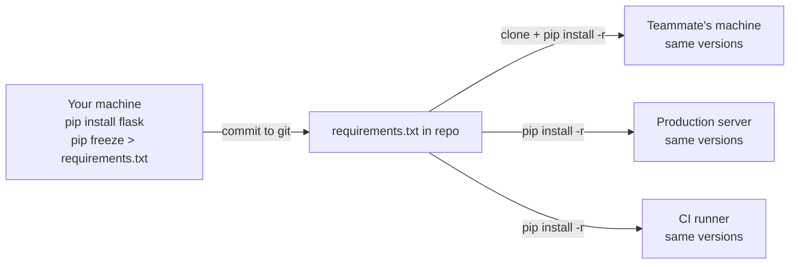
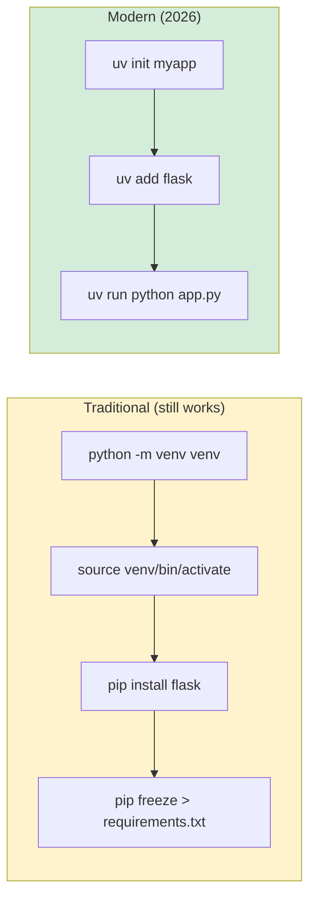
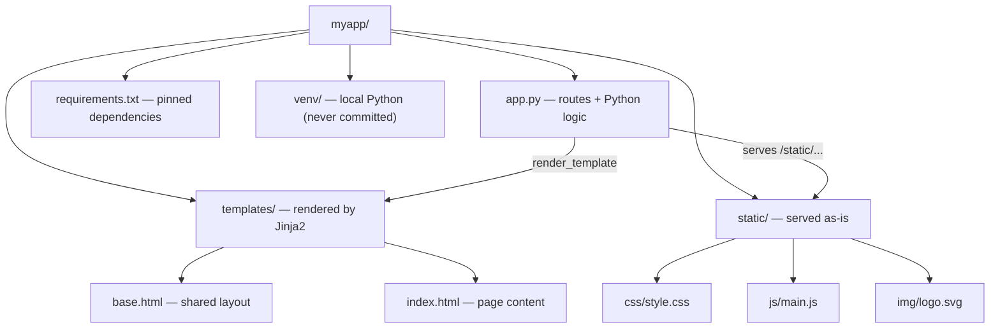

# Lesson 02 — Project Structure: Beyond a Single File

> [!success] You finished Lesson 01.
> You wrote a Flask app in eight lines and saw it run in your browser. Now it's time to learn how to *organise* a Flask project so it doesn't collapse into spaghetti the moment it grows. Project structure is boring like flossing is boring — it doesn't feel important until the day it suddenly is, and that day is always worse than the day you started flossing.

#flask #project-structure #venv #pyproject

## 1. Learning Objectives

By the end of this lesson you will be able to:

1. **Explain why a single `app.py` doesn't scale** past a few hundred lines — and what "doesn't scale" actually means in practice.
2. **Set up the standard Flask project layout** — `app.py`, `requirements.txt`, `static/`, `templates/`.
3. **Understand virtual environments in depth** — what they *really* are, why `./venv/bin/python` differs from system Python, and how activation actually works.
4. **Generate and use `requirements.txt`** so anyone can reproduce your exact environment, and understand *why* we pin versions (semantic versioning, lock files, reproducibility).
5. **Understand the role of the `static/` folder** for CSS, JS, and images — and why they're served *as-is*, not rendered.
6. **Understand the role of the `templates/` folder** for HTML files (Jinja2 preview) — and what makes a "template" different from a static HTML file.
7. **Explain `__init__.py`** and the difference between a Python *package* and a *directory*.
8. **Write a multi-route app** using this structure, complete with a rendered HTML template and a CSS file.
9. **Reason about project layout tradeoffs** — when to keep it simple, when to upgrade to Blueprints ([[Lesson-18-Blueprints]]).
10. **Recognise the modern alternative** — `pyproject.toml` and `uv` — and understand where the Python ecosystem is heading in 2026.

## 2. Prerequisites

- **[[Lesson-01-Hello-World]] completed.** You have a working `myapp/` folder with `app.py` and a venv containing Flask.
- **Basic terminal comfort.** You can `mkdir`, `cd`, `touch`, and edit files.
- **A code editor.** VS Code, Sublime, PyCharm — anything works. VS Code's file tree will make this lesson visually clearer.

## 3. The Problem — Why Structure Matters

In Lesson 01 you wrote a single `app.py` containing everything. That was fine — for eight lines.

Now imagine a real blog. You'd have:
- Routes for the homepage, post detail, archive, about, contact.
- HTML for each page (easily 100+ lines each).
- CSS for styling (hundreds of lines).
- JavaScript for interactivity.
- Database setup, models, helper functions.
- Forms, validation, authentication.

Stuff all of that into `app.py` and you'll have a 3,000-line file. Want to change the homepage text? Good luck finding it. Want to update the CSS without restarting the Python process? You can't — it's all in one file. Want a designer to work on the HTML while you work on the Python? They'd have to edit `app.py`, which is asking them to read Python.

This isn't a hypothetical problem. Every developer who's tried to keep a real web app in one file has hit this wall. The solution is **separation of concerns**: HTML goes in HTML files, CSS goes in CSS files, Python stays in Python files, and Flask knows where to look for each.

> [!example] Real-world analogy
> Think of your project as a kitchen. Python code is the cooking (recipe logic); HTML is the plating (what the dish looks like); CSS is the garnish (visual style); JS is the server carrying it to the table (interaction). If you dump all four into one pot, you get a sludge that nobody can debug. Separate them and each team member can work independently — the chef cooks, the designer plates, the stylist garnishes.

Here's the principle in one diagram:

```mermaid
flowchart TD
    App["app.py<br/>(Python: routes + logic)"]
    Tmpl["templates/<br/>(HTML files)"]
    Stat["static/<br/>(CSS, JS, images)"]
    Req["Browser request"] --> App
    App -->|render_template| Tmpl
    Tmpl -->|<link>, <script>| Stat
    App -->|url_for('static', filename=...)| Stat
    Stat -->|served directly| Req
    Tmpl -->|assembled HTML| App
    App -->|HTTP response| Req
```

### What "doesn't scale" actually means

When we say "single-file apps don't scale," we don't just mean the file gets long. We mean several specific problems compound:

1. **Cognitive load.** A 3,000-line file overwhelms your working memory. You scroll, search, lose your place.
2. **Merge conflicts.** When two teammates both edit `app.py` in different features, git can't merge them cleanly.
3. **Reload pain.** Flask's auto-reloader restarts the whole Python process on any change. If your file is huge, that's slow.
4. **Tooling friction.** Linters, type checkers, and IDEs slow down on giant files.
5. **Mental model decay.** Six months later, you won't remember where the "search" feature lives. With separate files, you find it by directory: `routes/search.py`.

The cure is to split your code along *responsibility boundaries*: routes here, templates there, assets over there.

### A BAD project structure (and why it's bad)

Let's look at what NOT to do:

```
myapp/
├── app.py              # 2,400 lines — routes, HTML, CSS-as-strings, DB queries, all mixed
├── venv/               # ✓
├── styles.css          # Loose file in root — Flask won't serve it
├── script.js           # Loose file in root — Flask won't serve it
├── data.db             # SQLite database in the root, gets committed to git by accident
├── notes.txt           # Developer's personal notes
├── old_app.py.bak      # Backup of last week's version
├── test.py             # Tests, but named like a regular file
└── requirements.txt    # Has 'flask' but no version pinned
```

Problems with this layout:
- **`styles.css` in root:** Flask only serves files from `static/`. This file is invisible to browsers.
- **`data.db` in root:** Will probably get committed to git unless you explicitly `.gitignore` it. Bad.
- **`old_app.py.bak`:** Version control exists for this reason. Delete backups; trust git.
- **Unpinned `requirements.txt`:** Will install *whatever Flask version is current* when someone runs `pip install -r requirements.txt`. That might be Flask 4.0 next year, which breaks your app.
- **`app.py` is 2,400 lines:** Every change requires reading the whole file to find your place.

> [!danger] The "just one more route" trap
> This is how bad structures happen. You start with 8 lines. You add a route (now 25). You add a CSS string (now 80). You add another route (now 120). Each addition is small and reasonable. Six months later you have a 2,400-line monster. The cure is to *set up the structure first* — before you need it. That's what this lesson is for.

## 4. The Code

### 4.1 The project layout

Create this structure inside your `myapp/` folder. Don't worry about what goes in each file yet — we'll fill them in.

```
myapp/
├── app.py
├── requirements.txt
├── venv/                  # created in Lesson 01
├── static/
│   ├── css/
│   │   └── style.css
│   ├── js/
│   │   └── main.js
│   └── img/
│       └── logo.svg
└── templates/
    ├── base.html
    └── index.html
```

> [!tip] Creating nested folders in one go
> On macOS/Linux/Windows PowerShell you can do:
> ```bash
> mkdir -p static/css static/js static/img templates
> ```
> (`-p` creates parent directories as needed, and you can list multiple at once.)

### 4.2 The complete code

Here's every file we'll fill in. We'll explain each one line-by-line after.

**`app.py`:**

```python
from flask import Flask, render_template

app = Flask(__name__)


@app.route('/')
def home():
    return render_template('index.html', title='Home', message='Welcome to my site!')


@app.route('/about')
def about():
    return render_template('index.html', title='About', message='This is the about page.')


if __name__ == '__main__':
    app.run(debug=True)
```

**`templates/base.html`:**

```html
<!DOCTYPE html>
<html lang="en">
<head>
    <meta charset="UTF-8">
    <title>{{ title }} — My Site</title>
    <link rel="stylesheet" href="{{ url_for('static', filename='css/style.css') }}">
</head>
<body>
    <header>
        <nav>
            <a href="{{ url_for('home') }}">Home</a>
            <a href="{{ url_for('about') }}">About</a>
        </nav>
    </header>
    <main>
        
    </main>
    <footer>
        <p>&copy; 2025 My Site</p>
    </footer>
    <script src="{{ url_for('static', filename='js/main.js') }}"></script>
</body>
</html>
```

**`templates/index.html`:**

```html



    <h1>{{ title }}</h1>
    <p>{{ message }}</p>

```

**`static/css/style.css`:**

```css
body {
    font-family: Arial, sans-serif;
    margin: 0;
    padding: 0;
    background: #fafafa;
    color: #222;
}

header {
    background: #28a745;
    padding: 1rem;
}

nav a {
    color: white;
    text-decoration: none;
    margin-right: 1rem;
}

main {
    padding: 2rem;
}

footer {
    background: #222;
    color: #ddd;
    padding: 1rem;
    text-align: center;
}
```

**`static/js/main.js`:**

```javascript
console.log("Site loaded. Hello from Flask!");
```

**`static/img/logo.svg`:**

```svg
<svg xmlns="http://www.w3.org/2000/svg" width="100" height="100" viewBox="0 0 100 100">
    <circle cx="50" cy="50" r="40" fill="#28a745"/>
    <text x="50" y="58" text-anchor="middle" fill="white" font-family="Arial" font-size="20">F</text>
</svg>
```

**`requirements.txt`:**

```
blinker==1.7.0
click==8.1.7
Flask==3.0.0
itsdangerous==2.1.2
Jinja2==3.1.2
MarkupSafe==2.1.3
Werkzeug==3.0.1
```

Your version numbers may differ — that's fine. The point is they're pinned.

## 5. Line-by-Line Explanation

### 5.1 `app.py`

The Python file is the smallest it's ever been — most of the work has moved into `templates/` and `static/`.

```python
from flask import Flask, render_template
```

We add `render_template` to the import. This is a Flask function that loads an HTML file from your `templates/` folder, fills in any placeholders, and returns the result. We use it instead of writing HTML strings inside Python.

```python
app = Flask(__name__)
```

Same as Lesson 01. Flask looks at `__name__` to find the folder where your `templates/` and `static/` directories live — so it knows to look in `myapp/templates/` and `myapp/static/`.

```python
@app.route('/')
def home():
    return render_template('index.html', title='Home', message='Welcome to my site!')
```

A route that calls `render_template('index.html', ...)`. Flask opens `templates/index.html`, parses it as a Jinja2 template, replaces `{{ title }}` with `'Home'` and `{{ message }}` with the welcome string, and returns the resulting HTML to the browser. We pass variables as **keyword arguments** — `title=...`, `message=...` — and they become available inside the template.

```python
@app.route('/about')
def about():
    return render_template('index.html', title='About', message='This is the about page.')
```

Same template, different variables. Notice we reused `index.html` — templates are just functions for HTML, and reusing them is encouraged.

```python
if __name__ == '__main__':
    app.run(debug=True)
```

Same as Lesson 01. Nothing new here.

### 5.2 `templates/base.html`

This file is a **template** — HTML with Jinja2 placeholders. Three Jinja2 constructs appear here:

- `{{ title }}` — print the value of the variable `title`. Anything inside `{{ ... }}` is evaluated and inserted into the HTML.
- `` — declare a "hole" that child templates can fill. Anything between `` is a Jinja2 statement (control flow, blocks), not output.
- `{{ url_for('static', filename='css/style.css') }}` — call a Python function (`url_for`) from inside the template. It returns the URL `/static/css/style.css`. We'll cover `url_for` in depth in [[Lesson-09-Static-Files]].

The `` line in `index.html` means "this template inherits everything in `base.html`, and fills in the `content` block." This is template inheritance — the same idea as classes in OOP, but for HTML. It lets every page share a header, footer, and stylesheet link without copy-pasting.

> [!info] Why `url_for` instead of writing `/static/css/style.css` directly?
> You *could* hardcode the path. But `url_for` is safer: if you ever move your `static/` folder, or deploy behind a different URL prefix, `url_for` will produce the right URL automatically. Hardcoded paths won't. Always use `url_for`.

### 5.3 `templates/index.html`

```html



    <h1>{{ title }}</h1>
    <p>{{ message }}</p>

```

Two things happen:
1. `` — inherit the entire layout (head, nav, footer, script tags).
2. `...` — override the empty `content` block from `base.html` with this page's content.

When `render_template('index.html', title='Home', message='...')` runs, Jinja2 assembles: base layout + the content block + the variables, producing one complete HTML document.

> [!example] A mental model for template inheritance
> Think of `base.html` as a form letter with blanks: *"Dear ___, your order ___ has shipped."* `index.html` is the act of filling in those blanks. The form letter is the structure; the child template is the per-page data. If you ever need to change the company logo in the footer, you change `base.html` once and every page on your site updates instantly. That's the power of inheritance.

### 5.3.1 Why two templates instead of one?

A common beginner question: "Why not just put everything in `index.html`?" Because in a real site, you'll have 5, 20, 100 pages — each with the same nav, footer, and stylesheet links but different content. If you copy-paste the layout into every page, then any layout change (a new nav item, a new font, a new analytics script) means editing 100 files. With inheritance, you change `base.html` once. This pattern is so universal that every web framework has some version of it: Rails calls them "layouts", Django calls them "template inheritance", ASP.NET calls them "master pages". The idea is always the same.

### 5.4 `static/css/style.css`

Just CSS. Flask serves any file inside `static/` at the URL `/static/<path>`. So `static/css/style.css` is reachable at `http://127.0.0.1:5000/static/css/style.css`. The browser's `<link rel="stylesheet" href="...">` tag fetches it automatically when rendering the page.

> [!question] Student asks: Why doesn't Flask render CSS through Jinja2?
> Because CSS isn't dynamic per-request. It's the *same for every user, every time*. Running it through Jinja2 would just waste CPU. Flask serves static files *byte-for-byte* as-is — fast and cacheable. Templates (HTML) get rendered because they contain per-request data (user's name, current page, etc.). Rule: if a file changes per request, it's a template; if it's identical for everyone, it's static.

### 5.5 `static/js/main.js`

JavaScript. Flask doesn't run it — the browser does. Flask just serves the file at `/static/js/main.js`, and the `<script src="...">` tag in `base.html` tells the browser to fetch and execute it.

### 5.6 `static/img/logo.svg`

An SVG image. Same idea — Flask serves it at `/static/img/logo.svg`, and you'd reference it from a template with ``.

### 5.7 `requirements.txt`

A plain-text list of every Python package your project needs, with exact version numbers. You can generate it with:

```bash
pip freeze > requirements.txt
```

`pip freeze` prints every installed package in `package==version` format. Redirecting with `>` writes that output to a file. Now anyone — your future self, a teammate, a CI server — can recreate your exact environment with:

```bash
pip install -r requirements.txt
```

This is how real Python projects stay reproducible. Without `requirements.txt`, "works on my machine" becomes "doesn't work on any other machine."



#### Why pin versions? (semantic versioning crash course)

Most packages use **semantic versioning** (semver): `MAJOR.MINOR.PATCH` (e.g. `3.0.1`).
- **MAJOR** bump (3 → 4) means *breaking changes*. Your code might break.
- **MINOR** bump (3.0 → 3.1) means *new features, no breaks*. Your code should still work.
- **PATCH** bump (3.0.0 → 3.0.1) means *bug fixes only*. Always safe.

If your `requirements.txt` says just `flask`, pip installs *whatever's latest*. Today that's Flask 3.0.0; tomorrow it might be Flask 4.0.0 with breaking changes. Your app breaks for new teammates but works for you, because you installed when 3.0.0 was current. This is the "dependency hell" every Python developer eventually meets.

Pinning (`flask==3.0.0`) says "install EXACTLY this version, no matter what's latest." Now everyone gets the same version. Reproducibility achieved.

> [!info] What `pip freeze` actually outputs
> It dumps *everything* installed in your venv — including transitive dependencies. So if Flask depends on Werkzeug, you'll see `Werkzeug==3.0.1` in your `requirements.txt` even though you never explicitly installed it. This is called a "fully pinned" lock file. It's verbose but bulletproof — every dependency is locked, not just your direct ones.
>
> In large projects, you might split this into two files:
> - `requirements.in` — just your direct deps (`flask`, `flask-sqlalchemy`, `gunicorn`).
> - `requirements.txt` — the fully-pinned output of `pip-compile requirements.in`.
> Tools like `pip-tools` (or modern `uv pip compile`) automate this.

## 6. Virtual Environments — A Deeper Look

In Lesson 01 we treated the venv as magic. Now let's demystify it.

### 6.1 What a venv really is

A venv is just a folder. Inside, there's:

```
venv/
├── bin/                  (Scripts/ on Windows)
│   ├── python            → symlink to /usr/bin/python3.12 (or system Python)
│   ├── python3           → same
│   ├── pip               → script that runs `python -m pip`
│   ├── activate          → shell script that prepends venv/bin to PATH
│   └── flask             → CLI for `flask run` etc.
├── lib/
│   └── python3.12/
│       └── site-packages/    ← THIS is where `pip install` puts things
│           ├── flask/
│           ├── jinja2/
│           ├── werkzeug/
│           └── ...
└── pyvenv.cfg            ← marks this folder as a venv
```

The key insight: **`venv/bin/python` and `/usr/bin/python3.12` are the *same interpreter*.** What differs is which `site-packages/` directory Python searches for installed packages.

When you run `./venv/bin/python -c "import flask"`, Python:
1. Starts up.
2. Reads `pyvenv.cfg` from the same directory as the binary.
3. Notices it's a venv — switches `sys.prefix` to `venv/`.
4. Adds `venv/lib/python3.12/site-packages/` to `sys.path`.
5. Searches there for `flask/` — finds it.

When you run `/usr/bin/python3.12 -c "import flask"`, Python:
1. Starts up.
2. No `pyvenv.cfg` — `sys.prefix` is `/usr`.
3. Adds `/usr/lib/python3.12/site-packages/` to `sys.path`.
4. Searches there for `flask/` — *not found* (you didn't `pip install` it system-wide). ImportError.

That's it. A venv is just a folder that changes *where Python looks for packages*.

```mermaid
flowchart TD
    Run["Run: ./venv/bin/python app.py"] --> Read["Python reads venv/pyvenv.cfg"]
    Read --> Switch["sys.prefix = venv/"]
    Switch --> Path["sys.path includes venv/lib/.../site-packages"]
    Path --> Find["import flask → FOUND in venv"]

    Run2["Run: /usr/bin/python3 app.py"] --> NoCfg["No pyvenv.cfg found"]
    NoCfg -> SysPrefix["sys.prefix = /usr"]
    SysPrefix --> SysPath["sys.path includes /usr/lib/.../site-packages"]
    SysPath --> NoFind["import flask → NOT FOUND"]
    style Find fill:#d4edda,stroke:#28a745
    style NoFind fill:#f8d7da,stroke:#dc3545
```

### 6.2 What "activation" actually does

Activating a venv is *purely a shell convenience*. When you run `source venv/bin/activate`, the script does roughly:

```bash
# (simplified)
VIRTUAL_ENV="/path/to/venv"
PATH="$VIRTUAL_ENV/bin:$PATH"     # ← this is the only important bit
export VIRTUAL_ENV
export PS1="(venv) $PS1"          # ← shows (venv) in your prompt
```

That's it. Activation just prepends `venv/bin/` to your `PATH`. So when you type `python`, the shell finds `venv/bin/python` first (because PATH is searched left-to-right).

You don't *need* to activate. You can always run `./venv/bin/python app.py` directly — same effect. Activation just saves typing.

> [!question] Student asks: What's the difference between `python -m venv` and `virtualenv`?
> `python -m venv` is built into Python (since 3.3). `virtualenv` is a third-party package that's slightly faster and supports older Pythons. For modern Python (3.9+), they're functionally equivalent. Use `python -m venv` — it's always available. (The `uv` tool we'll meet later has its own even-faster venv creator.)

## 7. Python Packages — Why `__init__.py` Matters

You'll sometimes see Python folders with an `__init__.py` file (which can be empty) and wonder what it's for.

The rule: **a folder with an `__init__.py` is a *package*** — it can be imported. A folder *without* one (in modern Python, "namespace packages") behaves subtly differently and is rarely what beginners want.

Example:

```
myapp/
├── app.py
└── utils/
    ├── __init__.py       ← empty file
    ├── strings.py
    └── numbers.py
```

With this layout, from `app.py` you can write:

```python
from utils.strings import shout
from utils.numbers import add
from utils import strings, numbers   # __init__.py makes this work
```

Without `__init__.py`, the imports above might still work in modern Python (via namespace packages) but tooling, type checkers, and IDEs behave more reliably with explicit `__init__.py` files.

> [!info] When do you need packages in a Flask app?
> Not in this lesson. We're keeping everything in `app.py`. But once your app grows past ~500 lines, you'll want to split it into a package — typically `myapp/__init__.py`, `myapp/routes.py`, `myapp/models.py`. We cover this in [[Lesson-18-Blueprints]]. For now, just know `__init__.py` exists and marks a folder as a Python package.

## 8. Modern Alternative: `pyproject.toml` and `uv` (2026)

The `venv` + `pip` + `requirements.txt` workflow has been the Python standard for over a decade. In 2026, it's being replaced by a faster, cleaner alternative. You should know it exists.

### 8.1 `pyproject.toml` — the modern config file

Instead of `requirements.txt` (plus `setup.py`, `setup.cfg`, `.flake8`, `mypy.ini`, `pytest.ini`), modern Python uses *one* file: `pyproject.toml`. It's a TOML file (like a stricter YAML) that holds:

- Project metadata (name, version, author).
- Dependencies (what to install).
- Optional dependencies (dev tools, test tools).
- Tool config (ruff, mypy, pytest — all in one place).

Here's a minimal `pyproject.toml` for our Flask app:

```toml
[project]
name = "myapp"
version = "0.1.0"
description = "My first Flask app"
requires-python = ">=3.12"
dependencies = [
    "flask>=3.0,<4",
]

[project.optional-dependencies]
dev = [
    "ruff>=0.6",
    "pytest>=8.3",
]

[tool.ruff]
line-length = 100

[tool.pytest.ini_options]
testpaths = ["tests"]
```

That's it. One file. Modern Python tooling reads it natively.

### 8.2 `uv` — the modern package manager

`uv` (from Astral, written in Rust) replaces `pip`, `pip-tools`, `virtualenv`, and even `pyenv`. It's 10–100× faster than `pip` and does everything in one binary.

The modern equivalent of this lesson's setup:

```bash
# Install uv (one-time)
curl -LsSf https://astral.sh/uv/install.sh | sh    # macOS/Linux
# or: winget install astral-sh.uv                   # Windows

# Create a project (replaces mkdir + venv + pip install)
uv init myapp
cd myapp
uv add flask                    # adds to pyproject.toml + installs

# Run your app (no need to activate venv!)
uv run python app.py
# or
uv run flask --app app run --debug
```

What `uv` does behind the scenes:
1. Creates a `.venv/` folder automatically.
2. Manages a `uv.lock` file (like `requirements.txt` but better — includes hashes for security).
3. Runs any command inside the venv without you needing to activate.

> [!tip] Which should you use?
> For learning: stick with `venv` + `pip` + `requirements.txt` through Lesson 14. It teaches you what's actually happening, and every Flask tutorial on the internet uses it. Once you're comfortable, switch to `uv` + `pyproject.toml` — it's faster and more reliable. The course's [[Modern-Flask-And-Python|Modern Tooling module]] covers the migration in depth. #uv #pyproject-toml



## 9. Running the Code

### Step 1 — Build the folder structure

From inside your existing `myapp/` folder:

```bash
mkdir -p static/css static/js static/img templates
```

### Step 2 — Create the files

Create each file from section 4.2 above. Use your editor. Save them at the exact paths shown.

### Step 3 — Activate your venv and run

```bash
source venv/bin/activate        # macOS/Linux
# or venv\Scripts\activate      # Windows
python app.py
```

You'll see:

```
 * Serving Flask app 'app'
 * Debug mode: on
 * Running on http://127.0.0.1:5000
 * Restarting with stat
 * Debugger is active!
 * Debugger PIN: 123-456-789
```

### Step 4 — Visit the homepage

Open `http://127.0.0.1:5000/` in your browser. You should see:

- A green header bar with two links: **Home** and **About**
- An `<h1>` reading "Home"
- A paragraph reading "Welcome to my site!"
- A dark footer reading "© 2025 My Site"
- The page background is light gray (`#fafafa`), text is dark (`#222`)

If you open the browser's developer tools (F12 → Network tab), you'll see three requests fired:
1. `GET /` → returns the assembled HTML
2. `GET /static/css/style.css` → returns the CSS
3. `GET /static/js/main.js` → returns the JS

The browser fetches these because the HTML referenced them via `<link>` and `<script>` tags.

### Step 5 — Visit /about

Click the "About" link in the header, or visit `http://127.0.0.1:5000/about` directly. Same layout, different content:

- `<h1>` reads "About"
- Paragraph reads "This is the about page."

Notice how the header and footer didn't change — that's template inheritance at work. The `base.html` defines the chrome, and `index.html` only fills in the content.

### Step 6 — Generate `requirements.txt`

```bash
pip freeze > requirements.txt
cat requirements.txt   # or open the file in your editor
```

You should see something like:

```
blinker==1.7.0
click==8.1.7
Flask==3.0.0
itsdangerous==2.1.2
Jinja2==3.1.2
MarkupSafe==2.1.3
Werkzeug==3.0.1
```

> [!success] Reproducibility checkpoint
> You can now `rm -rf venv` (or move to a new computer), recreate the venv, run `pip install -r requirements.txt`, and your app will work identically. This is huge.

## 10. Common Mistakes

### Mistake 1 — Putting `templates/` in the wrong place

**Symptom:** `jinja2.exceptions.TemplateNotFound: index.html`

**Why:** Flask looks for `templates/` in the folder indicated by `__name__`. If you created `templates/` outside your `myapp/` folder, or misspelled it as `template/`, Flask can't find it.

**Fix:** Confirm the structure:
```bash
ls myapp/
# Should show: app.py  requirements.txt  static  templates  venv
ls myapp/templates/
# Should show: base.html  index.html
```

### Mistake 2 — Using `templates/` for non-HTML files

**Symptom:** Files like `style.css` aren't found.

**Why:** Beginners sometimes put CSS inside `templates/`. CSS, JS, and images belong in `static/`, not `templates/`. Templates are *rendered* by Jinja2 (variables substituted, blocks assembled); static files are served *as-is* byte-for-byte.

**Fix:** Move CSS/JS/images to `static/`. Use `templates/` only for files with `{{ }}` or `` Jinja2 syntax.

### Mistake 3 — Forgetting `` or ``

**Symptom:** Template renders but the layout is broken — no header, no footer, or content appears twice.

**Why:** Jinja2 inheritance is strict. If you forget ``, the child template has no parent and renders only its own content. If you forget ``, Jinja2 can't tell where the block ends.

**Fix:** Every child template should start with `` and wrap its content in `...`. Match every `` with a ``.

### Mistake 4 — Committing `venv/` to git

**Symptom:** Your git repository balloons to hundreds of MB.

**Why:** The venv contains a full Python installation and all your dependencies. It's machine-specific and reproducible from `requirements.txt` — so it should never be in version control.

**Fix:** Add a `.gitignore` file:
```
venv/
__pycache__/
*.pyc
.env
```
We'll cover `.env` files in [[Lesson-17-Flask-Login]].

### Mistake 5 — Forgetting to update `requirements.txt` after installing new packages

**Symptom:** You add `flask-sqlalchemy` to your project, push to git, your teammate clones, runs `pip install -r requirements.txt`, and gets `ModuleNotFoundError: No module named 'flask_sqlalchemy'`.

**Why:** You installed the package locally but never regenerated `requirements.txt`.

**Fix:** After every `pip install`, re-run `pip freeze > requirements.txt`. Make this a habit. Some teams use tools like `pip-tools` to manage this automatically.

### Mistake 6 — Hardcoding absolute paths

**Symptom:** App works on your machine, crashes on a teammate's.

**Why:** You wrote something like `app = Flask('/home/z/myname/myapp')` instead of `app = Flask(__name__)`. Absolute paths only work on your machine.

**Fix:** Always use `__name__`. Let Flask figure out the paths.

## 11. Exercises

> [!tip] Do these in order — each builds on the previous.

**Exercise 1 — Add a contact page.**
Create a third route `/contact` that reuses `index.html` with `title='Contact'` and `message='Email me at hello@example.com'`. Add a "Contact" link to the nav in `base.html`. Visit all three pages and confirm the nav highlights/works on each.

**Exercise 2 — Style the active page.**
Modify `base.html` so the current page's nav link has a CSS class `active`. (Hint: pass the current page name as a variable to the template, and use a Jinja2 `` to add the class.) Add `.active { font-weight: bold; text-decoration: underline; }` to your CSS.

**Exercise 3 — Add a logo image.**
Reference the `logo.svg` in `base.html` inside the header:
```html

```
Refresh and confirm the green "F" logo appears next to your nav.

**Exercise 4 — Recreate the venv from `requirements.txt`.**
This is a confidence-builder. Stop your server (`Ctrl+C`). Deactivate your venv: `deactivate`. Delete it: `rm -rf venv`. Create a fresh one: `python -m venv venv`. Activate it. Install everything from `requirements.txt`: `pip install -r requirements.txt`. Run `python app.py`. Everything should work identically. This is the magic of pinned dependencies.

**Exercise 5 — Add a custom 404 page.**
Add an error handler in `app.py`:
```python
@app.errorhandler(404)
def not_found(e):
    return render_template('index.html', title='404', message='Page not found.'), 404
```
Visit `http://127.0.0.1:5000/anything`. You should see your styled 404 page instead of Flask's default.

**Exercise 6 — A bigger project: split into routes.**
Refactor `app.py` so the routes are in a separate `routes.py` file. (Hint: you'll need to import `app` from `app.py` into `routes.py`, and import the routes back into `app.py` — or, more cleanly, register routes inside `app.py` but move the *view functions* into a separate module.) This is a taste of [[Lesson-18-Blueprints]].

**Exercise 7 — Try the modern workflow (bonus).**
Install `uv` (see section 8.2). Run `uv init modern-myapp`, `cd modern-myapp`, `uv add flask`. Create an `app.py` with the Hello World code, then `uv run python app.py`. Notice: no `python -m venv`, no `pip install`, no `activate`. The future is fast.

## 12. What We Learned

In this lesson you:

- **Understood why single-file Flask apps don't scale** — separation of concerns.
- **Built the standard Flask project layout**: `app.py`, `requirements.txt`, `static/{css,js,img}/`, `templates/`.
- **Used `render_template`** to load HTML from the `templates/` folder and pass it variables.
- **Saw template inheritance** (`` / ``) — a preview of [[Lesson-07-Jinja2-Basics]].
- **Used `url_for`** to generate URLs for static files safely.
- **Generated and consumed `requirements.txt`** for reproducible environments — and learned *why* we pin versions (semantic versioning, dependency hell).
- **Learned what virtual environments actually are** — folders with `pyvenv.cfg` that change `sys.prefix` so Python searches a different `site-packages/`.
- **Saw the role of `__init__.py`** in marking Python packages.
- **Served CSS, JS, and images** from `static/` and watched the browser fetch them automatically.
- **Set up `.gitignore`** to avoid committing `venv/`.
- **Met the modern alternatives** — `pyproject.toml` and `uv` — and learned where the Python ecosystem is heading in 2026.

Here's the mental model:



## 13. Next Lesson

In [[Lesson-03-Debug-Mode]] we'll go deep on the `debug=True` flag we've been using since Lesson 01. You'll learn:

- The three ways to enable debug mode (and which is best for which situation)
- What the Werkzeug debugger *actually* does internally — including a peek at its interactive Python console
- How to read a Python traceback without panicking — frame by frame
- The most common errors you'll hit as a beginner (NameError, ImportError, SyntaxError, TemplateNotFound) and how to fix each
- Why debug mode must NEVER be enabled in production
- Modern alternatives: `rich` for beautiful tracebacks, `structlog` for structured logging

Before moving on, make sure:
- [x] You can run the multi-file app from this lesson.
- [x] You can explain to a friend what `static/` vs `templates/` is for.
- [x] You've successfully recreated your venv from `requirements.txt` (Exercise 4).
- [x] You can explain what a venv *is* — not just how to use one.

If those are solid, you're ready. See you in [[Lesson-03-Debug-Mode]]. 🐛

---

> [!quote] A note from your teacher
> Project structure feels boring compared to writing features. I get it. But every senior engineer I know spends serious time thinking about *where* code lives, not just *what* it does. A clean structure is what lets you find things six months later, what lets a teammate contribute without onboarding, and what lets your app grow from "demo" to "product" without a rewrite. You're building good habits now. Keep going. 📁
