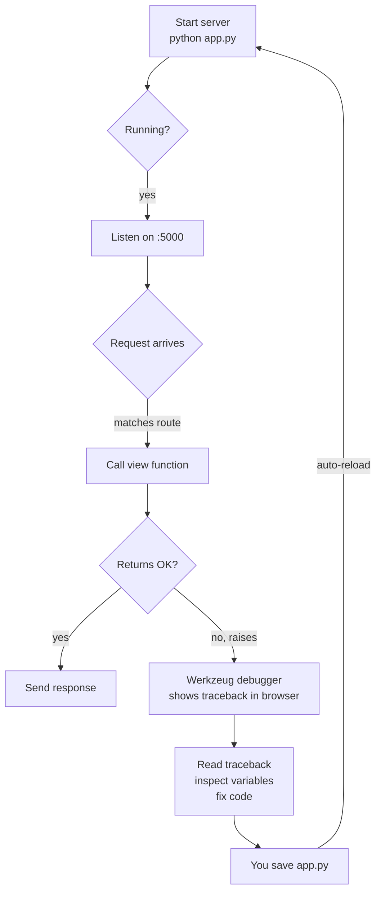
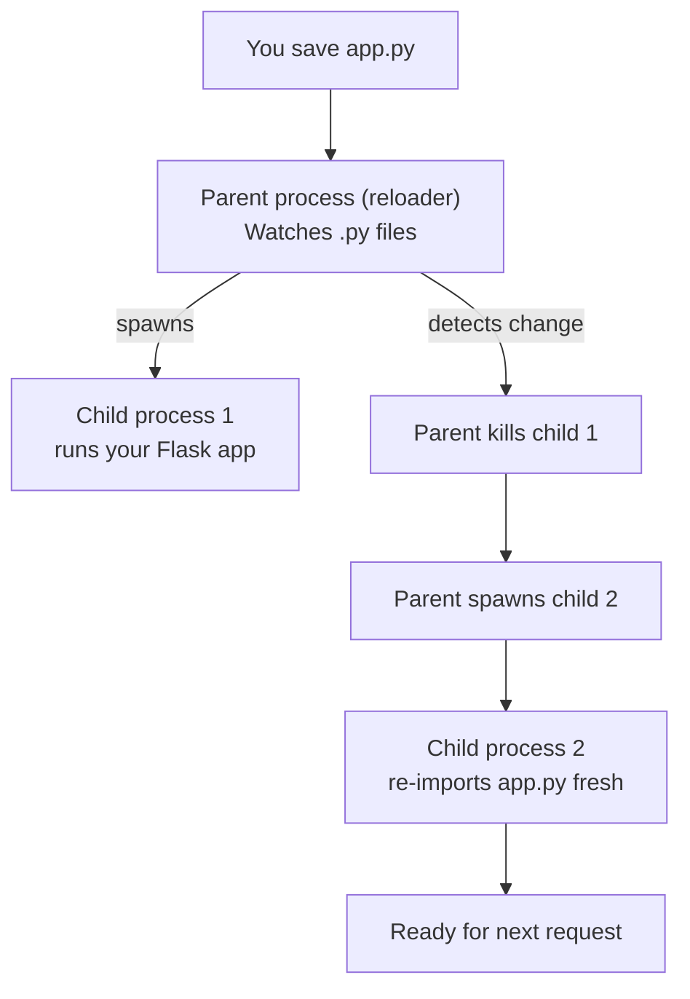
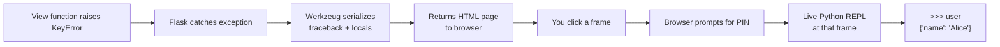
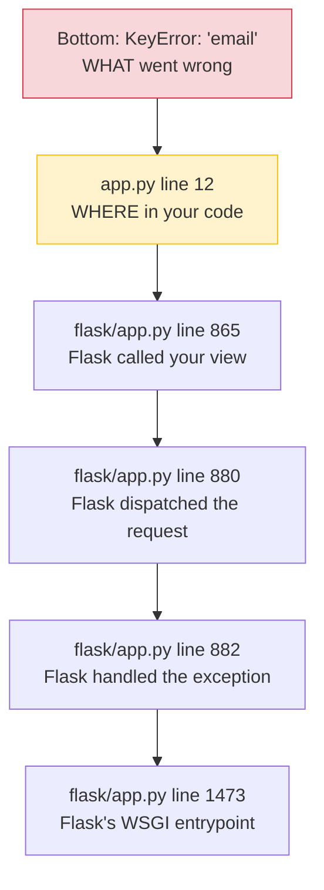
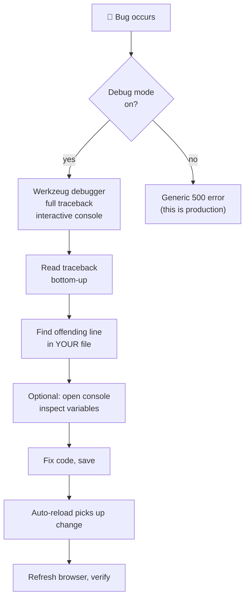

# Lesson 03 — Debug Mode: Your Best Friend (and Worst Enemy in Production)

> [!success] You've used `debug=True` since Lesson 01.
> In this lesson we'll finally unpack what it actually does — and why it's the single most important developer feature Flask offers. We'll go deep on the Werkzeug debugger, learn to read tracebacks like a detective, and meet the modern alternatives (`rich`, `structlog`) that pros use in production.

#flask #debug-mode #werkzeug #tracebacks

## 1. Learning Objectives

By the end of this lesson you will be able to:

1. **Explain what debug mode does** at three levels: auto-reload, the Werkzeug debugger, better error pages — and *how* each works internally.
2. **Enable debug mode three different ways** and know which to use when.
3. **Read a Python traceback** without panicking — frame by frame, identifying what each part means.
4. **Use the interactive Werkzeug debugger** to inspect variables at the point of failure, including the security model (why there's a PIN).
5. **Recognise and fix** the five most common beginner errors: `NameError`, `ImportError`, `SyntaxError`, `TemplateNotFound`, `KeyError`.
6. **Use `print()` effectively** for debugging, and understand why Python's `logging` module is better for real apps.
7. **Explain why debug mode must NEVER be enabled in production** — and what "production" actually means.
8. **Be aware of modern alternatives** — `rich` for beautiful tracebacks, `structlog` for structured logging.

## 2. Prerequisites

- **[[Lesson-02-Project-Structure]] completed.** You have a multi-file Flask app with templates and static files.
- **Comfortable enough with Python to read a basic error message.** You don't need to be an expert — this lesson will teach you that skill.

## 3. The Problem

Here's what web development looked like before debug mode. You wrote some code, started the server, hit a bug, and saw:

```
Internal Server Error
The server encountered an internal error and was unable to complete your request. Either the server is overloaded or there is an error in the application.
```

That's it. No clue *what* broke. No clue *where*. You'd then add `print()` statements everywhere, restart, reproduce, read the prints, remove them, repeat. Every bug was a 15-minute scavenger hunt.

And if you changed a single line of code, you had to manually `Ctrl+C` the server and restart it. Forgot to restart? You'd be debugging the *old* code, wondering why your fix did nothing.

This was soul-crushing. Flask fixed it. With `debug=True`, you get:

1. **Auto-reload.** Save a file → Flask restarts automatically. Your changes appear on the next refresh.
2. **The Werkzeug debugger.** When code throws an exception, the browser shows a full interactive traceback. Click any line → see the local variables at that frame. Click the small console icon → drop into a live Python REPL right at the failure point.
3. **Better error pages.** Even non-exception errors (like 404s) get informative styling.

These three features will save you hundreds of hours over the course of this course. Let's see how to use them.



> [!note] Historical context — how we used to debug
> Before Werkzeug's interactive debugger (released ~2010), Python web debugging meant tailing log files (`tail -f /var/log/myapp.log`) and guessing what state caused the error. You'd add `print()` statements, redeploy, reproduce, read, remove. The Werkzeug debugger was revolutionary because it showed you the *exact state at the moment of failure* — local variables, the call stack, even a live REPL — without you writing any debugging code. Modern Flask developers take this for granted. Don't.

## 4. The Code

Here are three equivalent ways to enable debug mode. Pick one — they all do the same thing.

### Method 1 — `app.run(debug=True)` (what we've been using)

```python
from flask import Flask

app = Flask(__name__)

@app.route('/')
def home():
    return "Hello"

if __name__ == '__main__':
    app.run(debug=True)
```

This is the simplest and most common for development. We've been using it since Lesson 01.

### Method 2 — `FLASK_DEBUG=1` environment variable

```python
from flask import Flask

app = Flask(__name__)

@app.route('/')
def home():
    return "Hello"

if __name__ == '__main__':
    app.run()
```

Then in your terminal, *before* running `python app.py`:

**macOS / Linux:**
```bash
export FLASK_DEBUG=1
python app.py
```

**Windows (PowerShell):**
```powershell
$env:FLASK_DEBUG=1
python app.py
```

**Windows (Command Prompt):**
```cmd
set FLASK_DEBUG=1
python app.py
```

This approach decouples configuration from code — useful when you want the same code to run in dev (debug on) and production (debug off) without edits.

### Method 3 — `app.config['DEBUG'] = True`

```python
from flask import Flask

app = Flask(__name__)
app.config['DEBUG'] = True

@app.route('/')
def home():
    return "Hello"

if __name__ == '__main__':
    app.run()
```

`app.config` is Flask's central configuration object — a dict-like structure for all settings. We'll use it heavily for things like `SECRET_KEY` in [[Lesson-17-Flask-Login]]. For debug mode, it's a valid approach, but Methods 1 and 2 are more idiomatic.

> [!tip] Which method should I use?
> For development: **Method 1** (`app.run(debug=True)`). It's the simplest and the most readable.
> For team projects with shared config: **Method 2** (env vars). It lets each developer (and the production server) set debug mode without editing code.
> Method 3 is rarely used for debug mode specifically, but `app.config` is the right way to set other options.

## 5. What Debug Mode Actually Does Internally

Let's go deeper than "it turns on the debugger." What physically happens when `debug=True`?

### 5.1 Auto-reload — the file watcher

When `debug=True`, `app.run()` enables `use_reloader=True`. The reloader works like this:

1. **The parent process** (called the "reloader") starts a *child process* that actually runs your Flask app.
2. The parent process watches all `.py` files in your project (and any imported modules) for changes.
3. When you save a file, the parent kills the child and starts a new one.
4. The new child re-imports everything fresh — so your code changes take effect immediately.

That's why you see `* Restarting with stat` in the terminal after every save — the parent just respawned the child.



> [!info] Why two processes?
> A single Python process can't easily "restart itself" — once code is imported, it's in memory. The two-process trick lets the parent kill and respawn the child cleanly. It's a bit of a hack, but it works reliably.

### 5.2 The Werkzeug debugger — interactive tracebacks

When `debug=True` enables `use_debugger=True`, Flask installs an exception handler. When your view function raises an exception:

1. Flask *catches* it (instead of returning a generic 500).
2. Flask serialises the full traceback — including local variables at every frame — into HTML.
3. The browser receives a styled page showing the traceback, with each frame clickable.
4. Each frame has a small terminal icon. Click it, enter the PIN (printed in your terminal at startup), and you get a Python REPL at that frame.

The REPL is *real* — you can run arbitrary Python code with access to all local variables. You can call functions, mutate state, even hit the database. This is debugging superpower-level.



### 5.3 The PIN — why it exists

The PIN is a 9-digit number Flask prints at startup:

```
 * Debugger PIN: 123-456-789
```

It's derived from:
- The MAC address of your machine's network interface.
- The user ID running the process.
- The path to the Python interpreter.

These inputs are hashed to produce a stable PIN for your machine. The PIN exists because the debugger console can execute arbitrary Python — that's a security disaster if anyone on the network can access it. The PIN gates access to "only people who can read this terminal."

> [!warning] The PIN is *not* strong security.
> If someone on your local network can reach your dev server, they can probably also crack the PIN (it's based on machine info that's often discoverable). The PIN is a *tripwire*, not a wall. **Never expose a debug-mode server to anything other than `127.0.0.1`.**

## 6. How to Read a Traceback (Like a Detective)

A traceback is Python's way of saying "here's the chain of calls that led to the error, and here's the error itself." Let's dissect one.

Here's a typical traceback you'll see:

```
Traceback (most recent call last):
  File "/home/z/myapp/venv/lib/python3.12/site-packages/flask/app.py", line 1473, in wsgi_app
    response = self.full_dispatch_request()
               ^^^^^^^^^^^^^^^^^^^^^^^^^^^^^
  File "/home/z/myapp/venv/lib/python3.12/site-packages/flask/app.py", line 882, in full_dispatch_request
    rv = self.handle_user_exception(e)
         ^^^^^^^^^^^^^^^^^^^^^^^^^^^^^
  File "/home/z/myapp/venv/lib/python3.12/site-packages/flask/app.py", line 880, in full_dispatch_request
    rv = self.dispatch_request()
         ^^^^^^^^^^^^^^^^^^^^^^^^^^^^
  File "/home/z/myapp/venv/lib/python3.12/site-packages/flask/app.py", line 865, in dispatch_request
    return self.ensure_sync(self.view_functions[rule.endpoint])(**view_args)
           ^^^^^^^^^^^^^^^^^^^^^^^^^^^^^^^^^^^^^^^^^^^^^^^^^^^^^^^^^^^^^^^^^^^^^^^^^^^^^^^^^^^^^^^^^
  File "/home/z/myapp/app.py", line 12, in broken
    return f"Hello, {user['email']}"
                         ~~~^^^^^^^^
KeyError: 'email'
```

### Frame-by-frame breakdown

A traceback is a *stack*. The **top** of the stack is the *outermost* call; the **bottom** is where the error actually happened.

1. **Bottom line is the actual error:** `KeyError: 'email'`. That tells you *what* went wrong — Python tried to look up the key `'email'` in a dict and it wasn't there.
2. **Read the stack from bottom to top** to see *where*. The bottom-most frame (your `app.py` line 12) is where it actually blew up.
3. **Each `File "..."` is a frame** — a function that was called. The line below it is the line of source code that was executing in that function.
4. **The caret `^^^`** points at the exact sub-expression that failed — here, `user['email']`. Werkzeug shows the part of the line that raised.
5. **Ignore framework internals** until you need them. The Werkzeug/Flask frames above are usually not the cause — they're just the call chain. Focus on the frames that point at *your* files (look for `myapp/` in the paths).



> [!example] Try this — read a real traceback
> Add this route to your app and visit `/broken`:
> ```python
> @app.route('/broken')
> def broken():
>     numbers = [1, 2, 3]
>     return f"The tenth number is {numbers[9]}"
> ```
> You'll see an `IndexError: list index out of range`. Read the traceback:
> - **Bottom:** `IndexError` — that's the *what*.
> - **Frame above:** your `app.py` line — that's the *where*.
> - **Caret:** points at `numbers[9]` — that's the *exact sub-expression*.
>
> Now you know exactly what to fix: either `numbers` needs more elements, or your index needs to be smaller.

Once you can read these, debugging becomes a 30-second activity instead of a 30-minute one.

## 7. Common Mistakes (and the Errors That Cause Them)

### `NameError: name 'X' is not defined`

**Symptom:** You used a variable or function name that doesn't exist.

**Typical causes:**
- Typo: `retrun` instead of `return`.
- Forgot to import: using `request` without `from flask import request`.
- Variable defined inside an `if` block but used outside it.

**Fix:** Read the traceback — it tells you the name and the line. Check spelling, check imports, check scope.

```python
# Bug — typo
def home():
    retrun "Hello"   # NameError on first call
```

### `ImportError: No module named 'X'`

**Symptom:** Python can't find the module you're trying to import.

**Typical causes:**
- Forgot to `pip install` it (or installed it in the wrong venv — see [[Lesson-01-Hello-World]] Mistake 1).
- Package name vs import name differ: `pip install Flask-SQLAlchemy` but `from flask_sqlalchemy import SQLAlchemy`. The pip name is hyphenated and title-cased; the import name is underscored and lowercase.
- You named your own file the same as a real package: a file named `flask.py` in your project shadows the real Flask.

**Fix:** Check spelling, check venv, check `pip list` to confirm the package is installed, and **never name your files the same as Python packages**.

### `SyntaxError: invalid syntax`

**Symptom:** Python can't even parse your file — the script won't start.

**Typical causes:**
- Missing colon: `def home()` instead of `def home():`
- Missing parenthesis or quote
- Mixed tabs and spaces (Python 3 is strict — use 4 spaces consistently)

**Fix:** The traceback points at the line (or the line just before the actual error — Python sometimes reports the next line). Look carefully at punctuation. Run `python -m py_compile app.py` to check syntax without running the app.

### `jinja2.exceptions.TemplateNotFound: X.html`

**Symptom:** `render_template('X.html')` can't find the file.

**Typical causes:**
- The file doesn't exist (typo in name).
- The file is in the wrong folder (should be in `templates/`, not project root).
- The file is named `x.HTML` and you asked for `x.html` — case matters on Linux.

**Fix:** `ls templates/` and confirm the exact filename. Match the case.

### `KeyError: 'X'` — accessing missing dict keys

**Symptom:** You did `d['X']` and `'X'` isn't a key.

**Typical causes:**
- `request.form['name']` when the form didn't submit a `name` field.
- `user['email']` when the user dict doesn't have an `email` key.
- JSON response from an API missing a field you expected.

**Fix:** Use `.get('key', default)` for safety: `request.form.get('name', '')` returns `''` instead of crashing.

### `Port 5000 already in use`

We covered this in Lesson 01. Either kill the other process or use `app.run(debug=True, port=5001)`.

## 8. Using `print()` (and Why `logging` Is Better)

The simplest debugging tool is `print()`. Sprinkle it through your function to see what's happening:

```python
@app.route('/user/<username>')
def show_user(username):
    print(f"[debug] show_user called with username={username!r}")
    user = lookup_user(username)
    print(f"[debug] lookup_user returned: {user}")
    if user is None:
        print("[debug] user is None, returning 404")
        return "Not found", 404
    return f"Hello, {user['name']}"
```

When you visit `/user/alice`, your terminal shows:

```
[debug] show_user called with username='alice'
[debug] lookup_user returned: {'name': 'Alice', 'email': 'alice@example.com'}
```

`print()` works. It's universal. But it has problems:

- In production, `print()` goes to stdout and is often lost (servers redirect stdout to logs that rotate, get compressed, etc.).
- You can't easily turn it off without editing code.
- You can't filter by severity (debug vs info vs warning vs error).

For real apps, use Python's `logging` module:

```python
import logging

logging.basicConfig(level=logging.DEBUG)
logger = logging.getLogger(__name__)

@app.route('/user/<username>')
def show_user(username):
    logger.debug("show_user called with username=%r", username)
    user = lookup_user(username)
    logger.debug("lookup_user returned: %s", user)
    if user is None:
        logger.warning("User not found: %s", username)
        return "Not found", 404
    return f"Hello, {user['name']}"
```

Benefits:
- **Levels** (`DEBUG`, `INFO`, `WARNING`, `ERROR`, `CRITICAL`) let you filter — set the level to `INFO` in production to silence `DEBUG` messages.
- **Formatting**: timestamps, log levels, source line numbers come for free.
- **Handlers**: send logs to a file, to syslog, to a Slack webhook — without touching your code.

We'll use `logging` more in [[Lesson-23-Deployment]]. For now, `print()` is fine while learning.

## 9. Modern Alternatives — `rich` and `structlog`

The Python ecosystem has produced two tools that make debugging and logging *much* nicer. They're optional but worth knowing about.

### 9.1 `rich` — beautiful tracebacks

The `rich` library (by Will McGugan) renders tracebacks with syntax highlighting, variable values inline, and code context. It's like the Werkzeug debugger but for your terminal.

```bash
pip install rich
```

```python
# At the top of your app
from rich.traceback import install
install()   # replaces Python's default traceback handler

# Now any uncaught exception prints beautifully
```

With `rich` installed, the same `KeyError: 'email'` traceback looks like:

```
Traceback (most recent call last):
  File "/home/z/myapp/app.py", line 12, in broken
    return f"Hello, {user['email']}"
                       │    └ 'email'
                       └ {'name': 'Alice'}
KeyError: 'email'
```

Notice the inline display of what `user` and `'email'` actually are — no need to add a `print()` to figure it out. `rich` is a *huge* quality-of-life upgrade for terminal debugging.

### 9.2 `structlog` — structured logging

For production apps where logs are shipped to systems like Datadog or Elasticsearch, plain-text logs are hard to search. `structlog` produces **structured** logs (JSON or key-value pairs) that machines can parse:

```bash
pip install structlog
```

```python
import structlog
logger = structlog.get_logger()

@app.route('/user/<username>')
def show_user(username):
    logger.info("user_lookup", username=username, ip=request.remote_addr)
    ...
```

Output:

```json
{"event": "user_lookup", "username": "alice", "ip": "127.0.0.1", "timestamp": "2025-05-12T10:30:00Z", "level": "info"}
```

In production you'd ship these to a logging service and grep them by `username=alice` or `level=error`. We use `structlog` heavily in the [[Modern-Flask-And-Python|Modern Tooling module]]. #rich #structlog

> [!tip] When should you adopt `rich` and `structlog`?
> For Lessons 01–14, `print()` and the Werkzeug debugger are enough. When you start building real projects (Lessons 18+), install `rich` for instant terminal beauty, and consider `structlog` once you have a deployment target that benefits from structured logs.

## 10. Running the Code — Exercises in Action

### Step 1 — See auto-reload in action

Make sure your app from Lesson 02 is running:

```bash
source venv/bin/activate
python app.py
```

You'll see:
```
 * Serving Flask app 'app'
 * Debug mode: on
 * Running on http://127.0.0.1:5000
 * Restarting with stat
 * Debugger is active!
 * Debugger PIN: 123-456-789
```

The line `* Restarting with stat` is the reloader announcing itself. The PIN is what you'll type into the browser if you want to use the interactive console.

### Step 2 — Change a file and watch it reload

Open `app.py` in your editor. Change the home route's message:

```python
@app.route('/')
def home():
    return render_template('index.html', title='Home', message='I just changed this!')
```

Save the file (don't touch the terminal). Look at your terminal — you'll see:

```
 * Detected change in '/path/to/myapp/app.py', reloading
 * Restarting with stat
 * Debugger is active!
```

Refresh your browser. The new message appears. **No restart required.** This is the single biggest time-saver in Flask development.

### Step 3 — Trigger an exception and see the debugger

Add a broken route to `app.py`:

```python
@app.route('/broken')
def broken():
    user = {'name': 'Alice'}
    return f"Hello, {user['email']}"   # 'email' doesn't exist!
```

Visit `http://127.0.0.1:5000/broken`. You'll see a Werkzeug debugger page — white background, yellow header, "KeyError" in red at the top, then a stack of frames. Each frame shows:

- File path and line number (clickable)
- The line of source code that was executing
- A small terminal icon → to open an interactive Python console at that frame

The top frame is where the error occurred: `return f"Hello, {user['email']}"`. Below it are the Flask internals that called your function. Read from the bottom up to follow the call chain: Flask received the HTTP request → matched the route → called `broken()` → `broken()` tried to access `user['email']` → KeyError.

Click the terminal icon next to the `broken` frame. Flask will ask for the PIN (the one printed in your terminal — `123-456-789` in our example). Enter it. You now have a Python REPL at that exact frame. Try:

```python
>>> user
{'name': 'Alice'}
>>> user.keys()
dict_keys(['name'])
>>> user['name']
'Alice'
```

You can experiment with the live state of your application at the point of failure. **This is superpower-level debugging.** Want to check what's in the database? What's in `request.args`? What a function returns? Just type it.

> [!warning] The PIN exists for a reason.
> Anyone with browser access to your dev server *and* the PIN can execute arbitrary Python. Don't share the PIN. Don't leave dev servers running on shared networks. In production, debug mode should be **off entirely** — no PIN, no debugger, no console.

## 11. Common Mistakes

### Mistake 1 — `debug=True` in production

**Symptom:** Your site gets hacked because someone used the debugger console to run `os.system('rm -rf /')`.

**Why:** The Werkzeug debugger can execute arbitrary Python. If your site is on the public internet with `debug=True`, anyone can take it over.

**Fix:** Never set `debug=True` in production. Use environment variables (`FLASK_DEBUG=0` or just don't set it). Production deployment tools (Gunicorn, Docker, etc.) never enable debug by default. We cover this in [[Lesson-23-Deployment]].

### Mistake 2 — Confusing the `use_reloader` and `use_debugger` flags

`debug=True` is shorthand for `use_reloader=True` AND `use_debugger=True`. Sometimes you want one but not the other:

```python
# Auto-reload, but custom error handling instead of Werkzeug's
app.run(use_reloader=True, use_debugger=False)

# No auto-reload (slow disk? container?), but still show debug pages
app.run(use_reloader=False, use_debugger=True)
```

Rare, but worth knowing.

### Mistake 3 — Reading tracebacks top-to-bottom

**Symptom:** You spend 20 minutes reading Flask's internal frames and never find your bug.

**Why:** Tracebacks are printed "most recent call last" — so the *bottom* is where the error happened. Reading top-to-bottom takes you through framework internals first.

**Fix:** Read from the bottom. The last line is the error type. The frame above it is usually *your* code. Read upward only as needed to trace the call chain.

### Mistake 4 — Editing code while the debugger console is open

**Symptom:** You trigger a 500, open the Werkzeug console, fix the code in your editor, save — and now the console shows stale state, or throws weird errors about missing variables.

**Why:** The console is connected to the *crashed process*. When auto-reload respawns the worker, the old process (and its console) is gone.

**Fix:** Treat the console as a *snapshot* of the moment of failure, not a live editing session. Inspect, learn what's wrong, close the console, then fix the code and reproduce the request.

### Mistake 5 — Treating `app.config['DEBUG']` and `app.run(debug=...)` as independent

**Symptom:** You set `app.config['DEBUG'] = True` *and* called `app.run(debug=False)`, and debug mode is still on (or vice versa).

**Why:** The `debug` argument to `app.run()` takes precedence over `app.config['DEBUG']`. They're not merged — `app.run()` wins.

**Fix:** Use *one* method, not two. If you must combine, remember the precedence: `app.run(debug=X)` > `app.config['DEBUG']` > `FLASK_DEBUG` env var.

## 8.5 A Deeper Look at the `logging` Module

Since `logging` is what you'll use in real apps, let's go a bit deeper.

The `logging` module has five severity levels, in increasing order:

| Level | When to use | Numeric value |
|---|---|---|
| `DEBUG` | Detailed diagnostic info — only useful when debugging | 10 |
| `INFO` | Confirmation that things are working as expected | 20 |
| `WARNING` | Something unexpected, but the app is still working | 30 |
| `ERROR` | A serious problem — the app couldn't do something | 40 |
| `CRITICAL` | A fatal error — the app can't continue | 50 |

When you set `logging.basicConfig(level=logging.DEBUG)`, you're saying "show everything at DEBUG or higher." Set it to `logging.WARNING` and DEBUG/INFO messages vanish. This is how production apps stay quiet — they log at INFO in dev, WARNING in prod.

Here's a more realistic logging setup for a Flask app:

```python
import logging

logging.basicConfig(
    level=logging.INFO,
    format='%(asctime)s [%(levelname)s] %(name)s: %(message)s',
)
logger = logging.getLogger(__name__)

@app.route('/pay', methods=['POST'])
def pay():
    amount = request.form.get('amount')
    logger.info("Payment received: amount=%s user=%s", amount, current_user)
    try:
        result = charge_card(amount)
    except PaymentError as e:
        logger.error("Payment failed: %s", e)
        return "Payment failed", 500
    logger.info("Payment succeeded: id=%s", result.id)
    return "Thanks!"
```

Notice the format string `%s` instead of f-strings — this is *lazy formatting*. If the log level is set above INFO, the format string is never evaluated, saving CPU. With f-strings, the formatting always runs even if the message is discarded. Use `%s` in production logging.

## 12. Exercises

**Exercise 1 — Trigger a `ZeroDivisionError`.**
Add a route `/divide` that returns `1 / 0`. Visit it. Read the traceback. Use the interactive debugger to evaluate `1 + 1` at the failing frame. Then fix the route to return `1 / 1` and confirm it works.

**Exercise 2 — Trigger a `NameError`.**
Add a route that returns an undefined variable:
```python
@app.route('/oops')
def oops():
    return nonexistent_variable
```
Read the traceback. Note that `nonexistent_variable` is highlighted. Fix it by defining the variable first.

**Exercise 3 — Trigger a `TemplateNotFound`.**
Call `render_template('does_not_exist.html')` from a route. Visit it. Read the error — note it's a `jinja2.exceptions.TemplateNotFound`. Create the file in `templates/` and confirm the error goes away.

**Exercise 4 — Debug with `print()`.**
Add a route `/debug` that:
1. Defines a list of names: `['Alice', 'Bob', 'Charlie']`
2. Prints the list
3. Prints the length
4. Returns the second name

Add `print()` statements before each step. Visit the route. Read the prints in your terminal. Then delete the prints and confirm the route still works.

**Exercise 5 — Disable debug mode and observe.**
Run your app with `app.run()` (no `debug=True`). Change a line of code, save, refresh. **Nothing changes** — no auto-reload. Trigger an error. You'll see a generic "Internal Server Error" page instead of the Werkzeug debugger. This is what production looks like. Now turn debug back on and appreciate what you have. 🙏

**Exercise 6 — Use `logging` instead of `print()`.**
Replace the `print()` calls from Exercise 4 with `logging.debug(...)` calls. Set the log level to `logging.DEBUG` and visit the route — confirm the messages appear in the terminal. Then change the level to `logging.INFO` and confirm the debug messages disappear.

**Exercise 7 — Install `rich` and compare.**
`pip install rich`, add `from rich.traceback import install; install()` at the top of `app.py`, then trigger the broken route from Step 3. Compare the Werkzeug browser debugger to `rich`'s terminal output. Which do you find easier to read?

## 13. What We Learned

In this lesson you:

- **Learned what debug mode does** — auto-reload (parent/child process model), Werkzeug debugger (interactive tracebacks), better error pages.
- **Enabled debug mode three ways**: `app.run(debug=True)`, `FLASK_DEBUG=1`, `app.config['DEBUG'] = True`.
- **Saw auto-reload in action** — save a file, server restarts automatically via parent/child process model.
- **Used the interactive Werkzeug debugger** to inspect variables at a failing frame, with the PIN for security.
- **Learned to read a Python traceback** — bottom-up, focusing on your own files.
- **Recognised common beginner errors**: `NameError`, `ImportError`, `SyntaxError`, `TemplateNotFound`, `KeyError`.
- **Used `print()` for debugging** and understood why `logging` is better for real apps.
- **Met modern alternatives**: `rich` for beautiful terminal tracebacks, `structlog` for structured production logs.
- **Saw what production looks like** with debug off — no reloader, no debugger, no interactive console.



## 14. Next Lesson

We now leave Module 01 (Getting Started) and enter Module 02 (Routing). In [[Lesson-04-Routes]] you'll learn:

- What a route really is — the URL-to-function mapping
- The `@app.route()` decorator in depth
- Multiple routes, URL rules, trailing slashes
- Wiring multiple URL paths to one function
- A first look at `url_for()` for building URLs by function name
- A multi-page site you can extend

Before you move on, make sure:
- [x] You can trigger and read three different kinds of errors.
- [x] You've used the interactive Werkzeug debugger console at least once.
- [x] You understand why debug mode must be off in production.

If you can explain to a friend why `debug=True` is dangerous in production, you're ready. See you in [[Lesson-04-Routes]]. 🛣️

---

> [!quote] A note from your teacher
> Bugs are not failures — they're information. Every traceback is the machine telling you exactly what it expected and exactly what it got. The Werkzeug debugger turns that information into a conversation: you can ask "what was in this variable?" and the answer appears instantly. Once you internalise this loop — see bug, read traceback, inspect, fix — programming stops feeling like guesswork and starts feeling like detective work. And detective work, honestly, is fun. 🕵️
