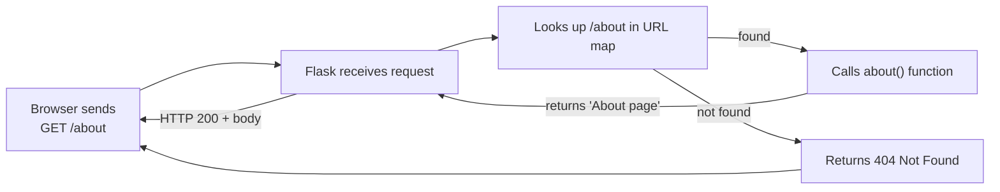
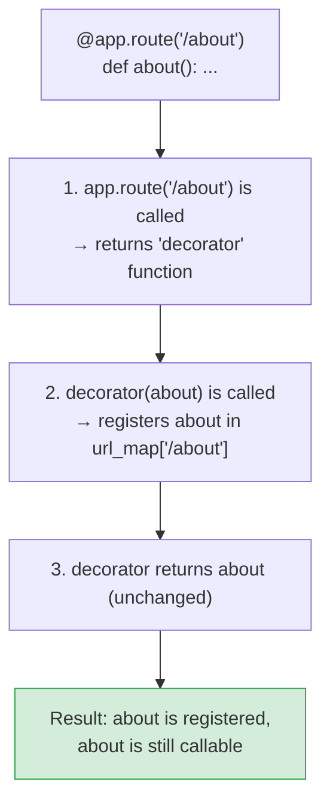
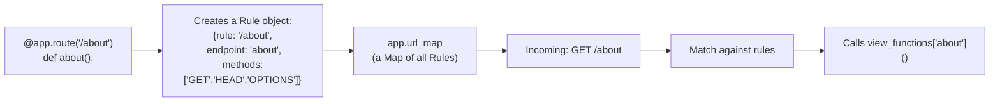
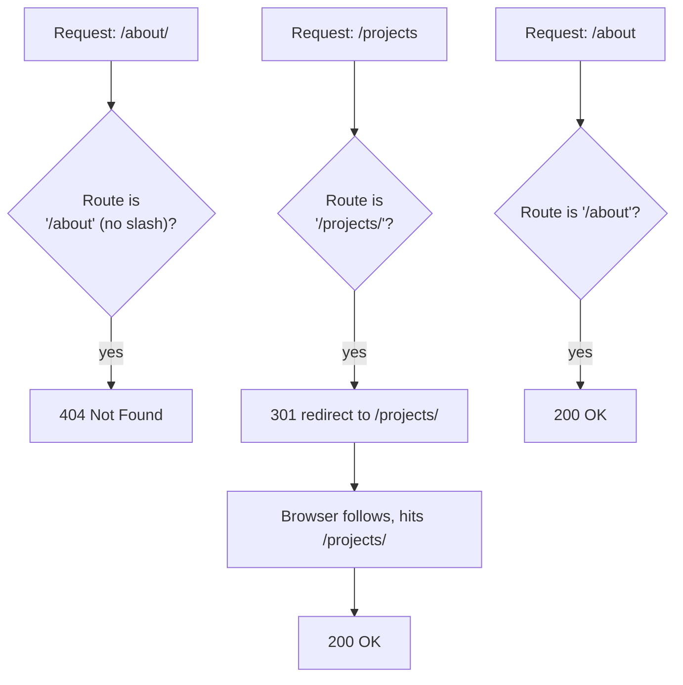
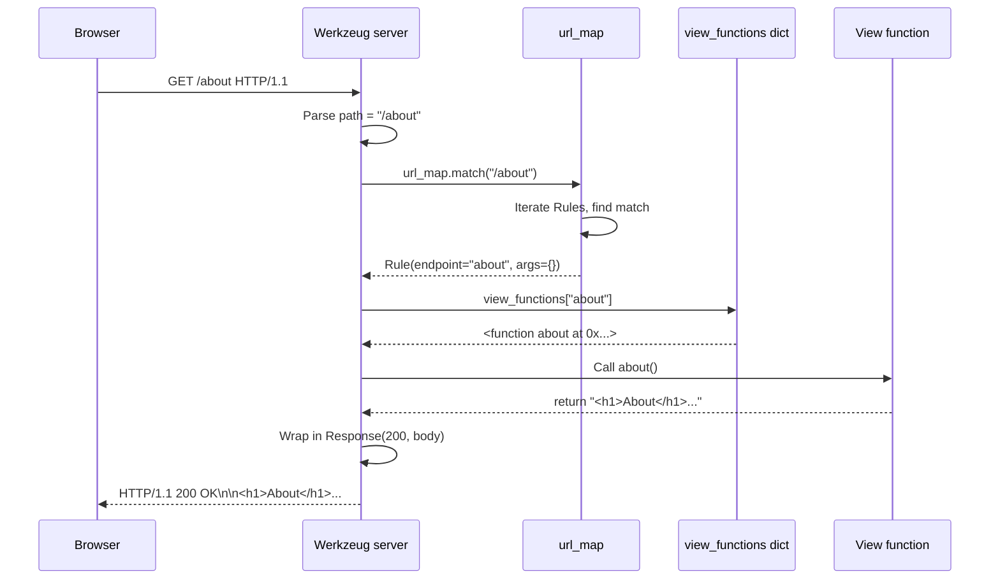
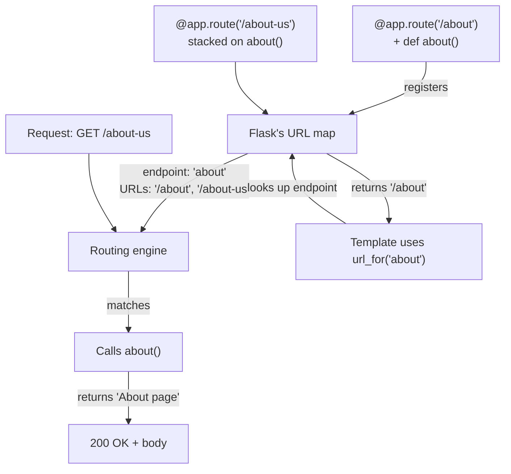

# Lesson 04 — Routes: Mapping URLs to Python Functions

> [!success] Welcome to Module 02.
> Routes are the heart of any web framework. By the end of this lesson, you'll be able to wire any URL to any Python function — the foundation of every Flask app you'll ever build. We'll go deeper than just syntax: we'll look inside Flask's URL map, build a decorator from scratch, learn RESTful URL design, and understand *why* trailing slashes behave so weirdly.

#flask #routing #decorators #rest

## 1. Learning Objectives

By the end of this lesson you will be able to:

1. **Define what a route is** and explain the URL-to-function mapping concept — both at the syntax level and at the "what's stored inside Flask" level.
2. **Use the `@app.route()` decorator** to register one or more URLs against view functions.
3. **Understand decorators in depth** — build a custom route decorator from scratch to see how registration works.
4. **Inspect Flask's URL map** via `app.url_map` to see every route, endpoint, and allowed method.
5. **Differentiate between URL rules** like `/`, `/about`, `/users/profile`, and `/posts/2025/`.
6. **Understand trailing slashes** — why `/about` and `/about/` behave differently, which to use, and the filesystem metaphor behind it.
7. **Map multiple URL paths to one function** by stacking decorators.
8. **Use `url_for()`** to generate URLs by function name instead of hardcoding them — and understand *why* this is a core principle of maintainable web apps.
9. **Apply RESTful URL design principles** — clean URLs, kebab-case, sensible hierarchy.
10. **Build a multi-page website** (home, about, services, contact) using clean routing.

## 2. Prerequisites

- **[[Lesson-03-Debug-Mode]] completed.** You can run a Flask app, read tracebacks, and use the debugger.
- **Basic understanding of decorators** (we covered `@app.route` in [[Lesson-01-Hello-World]] section 5 — we'll go deeper here).
- **Comfortable with Python functions** — defining them, calling them, returning values.

## 3. The Problem

A web server's core job is: *given a URL, decide what to send back.*

When a browser sends `GET /about HTTP/1.1`, your server needs to know:
- Is there an "about" page on this site?
- If yes, what should it return?
- If no, send a 404.

In Flask, this decision is made by **routes** — a mapping from URL patterns to Python functions. Without routes, your Flask app would respond to every URL with a 404. With routes, you control exactly which URLs exist and what each one returns.



The "URL map" is the data structure Flask builds as it parses your `@app.route(...)` decorators. Every decorator adds one entry: "URL pattern → function." When a request arrives, Flask walks this map to find the match.

> [!note] Historical context — before routing
> In the CGI era (1990s), each URL was a separate *file* on disk. `/about` meant "run the file `about.py`." There was no routing table — the filesystem *was* the router. The problem: URLs had to match filenames exactly, you couldn't have URLs like `/posts/2025/3/hello-flask` (no such file exists), and changing a URL meant renaming a file. Frameworks like Flask invented *routing tables* to decouple URLs from files: you declare the URL pattern in code, and the framework figures out which function to call. This is why Flask can have `/posts/<int:year>/<int:month>/<slug>` — a URL pattern that has no corresponding file.

This lesson is about *static* routes — URLs that always match exactly, like `/about` or `/contact`. In [[Lesson-05-URL-Converters]] you'll meet *dynamic* routes like `/user/<username>` that match patterns.

## 4. The Code

Here's a complete multi-page app showing every routing concept in this lesson:

```python
from flask import Flask, url_for

app = Flask(__name__)


@app.route('/')
def home():
    return """
    <h1>Home</h1>
    <nav>
      <a href="{home}">Home</a> |
      <a href="{about}">About</a> |
      <a href="{services}">Services</a> |
      <a href="{contact}">Contact</a>
    </nav>
    <p>Welcome to my site. Use the links above to navigate.</p>
    """.format(
        home=url_for('home'),
        about=url_for('about'),
        services=url_for('services'),
        contact=url_for('contact'),
    )


@app.route('/about')
def about():
    return "<h1>About</h1><p>We are a tiny demo site built with Flask.</p>"


@app.route('/services')
def services():
    return "<h1>Services</h1><ul><li>Web development</li><li>Teaching</li><li>Consulting</li></ul>"


@app.route('/contact')
def contact():
    return "<h1>Contact</h1><p>Email us at hello@example.com</p>"


# Multiple URLs to one function
@app.route('/team')
@app.route('/staff')
def team():
    return "<h1>Team</h1><p>This page is reachable at /team AND /staff.</p>"


# Trailing slash demonstration
@app.route('/projects/')
def projects():
    return "<h1>Projects</h1><p>This route ends with a slash. Visiting /projects will redirect here.</p>"


if __name__ == '__main__':
    app.run(debug=True)
```

Save this as `app.py` in your `myapp/` folder and run it. We'll walk through each piece below.

## 5. Line-by-Line Explanation

### Line 1 — `from flask import Flask, url_for`

We add `url_for` to the imports. `url_for` is a function that, given the *name* of a view function, returns its URL. We'll use it heavily in the home route below.

### The basic routes

```python
@app.route('/')
def home():
    ...
```

Decorate a function with `@app.route('/')` and Flask registers it as the handler for the homepage. The function name `home` becomes Flask's internal identifier (its "endpoint name") for this route. We'll use that name later with `url_for('home')`.

```python
@app.route('/about')
def about():
    return "<h1>About</h1><p>We are a tiny demo site built with Flask.</p>"
```

Same pattern, different URL and function. Each `@app.route(URL)` adds an entry to Flask's URL map. The URL pattern is a *string* — a path starting with `/`.

```python
@app.route('/services')
def services():
    return "<h1>Services</h1><ul>...</ul>"
```

You can return HTML directly. Flask sends it as `text/html` by default, so the browser renders the `<h1>` and `<ul>` tags.

> [!info] Returning HTML strings is OK for tiny demos.
> In real apps, you'd use `render_template('about.html')` instead — that's what [[Lesson-07-Jinja2-Basics]] is about. For this lesson, we keep HTML inline so we can focus purely on routing concepts.

## 6. Decorators in Depth — Building a Custom Route Decorator

We covered decorators in [[Lesson-01-Hello-World]], but let's go deeper — by building a tiny version of `@app.route` ourselves.

Recall: a decorator is a function that takes a function and returns a (possibly modified) function. Here's a minimal route registry that mimics what Flask does:

```python
# A miniature "Flask" — just to demystify @app.route
class MiniFlask:
    def __init__(self):
        self.url_map = {}      # URL string → function

    def route(self, url):
        # route(url) returns a DECORATOR
        def decorator(func):
            self.url_map[url] = func    # register the function
            return func                  # return it unchanged
        return decorator

    def dispatch(self, url):
        func = self.url_map.get(url)
        if func is None:
            return "404 Not Found"
        return func()


app = MiniFlask()

@app.route('/')
def home():
    return "Home page"

@app.route('/about')
def about():
    return "About page"

print(app.dispatch('/'))        # → "Home page"
print(app.dispatch('/about'))   # → "About page"
print(app.dispatch('/missing')) # → "404 Not Found"
```

Walk through what happens when Python parses `@app.route('/about')`:

1. `app.route('/about')` is *called* with `'/about'` as argument. It returns the inner `decorator` function.
2. The `decorator` function is then *called* with `about` as argument.
3. Inside `decorator`, we store `self.url_map['/about'] = about` — registration!
4. We return `about` unchanged. So the name `about` in the module still refers to the original function.

That's it. Flask's `@app.route` is a richer version of this — it supports dynamic URLs, methods, host matching, etc. — but the *core idea* is identical: a decorator that registers a function in a dict.



> [!question] Student asks: Why doesn't the decorator *change* the function?
> Because the goal is *registration*, not *wrapping*. Flask needs to remember that "URL `/about` → function `about`" — it doesn't need to modify `about`'s behaviour. The function does exactly what it always did when called; the decorator just records its existence. Other decorators (like `@login_required`) *do* wrap the function with extra behaviour. Decorators can do either or both.

## 7. Inspecting the URL Map

Here's the cool thing: Flask's URL map is a real Python object you can inspect. Add this temporary route to see it:

```python
@app.route('/routes')
def show_routes():
    lines = []
    for rule in app.url_map.iter_rules():
        lines.append(f"{rule.rule}  →  {rule.endpoint}  methods={list(rule.methods)}")
    return "<pre>" + "\n".join(lines) + "</pre>"
```

Visit `http://127.0.0.1:5000/routes`. You'll see something like:

```
/                       →  home           methods=['GET', 'HEAD', 'OPTIONS']
/about                  →  about          methods=['GET', 'HEAD', 'OPTIONS']
/services               →  services       methods=['GET', 'HEAD', 'OPTIONS']
/contact                →  contact        methods=['GET', 'HEAD', 'OPTIONS']
/team                   →  team           methods=['GET', 'HEAD', 'OPTIONS']
/staff                  →  team           methods=['GET', 'HEAD', 'OPTIONS']
/projects/              →  projects       methods=['GET', 'HEAD', 'OPTIONS']
/routes                 →  show_routes    methods=['GET', 'HEAD', 'OPTIONS']
/static/<filename>      →  static         methods=['GET', 'HEAD', 'OPTIONS']
```

Notice:
- The **endpoint** column is the function name. `url_for('about')` returns `/about` because that endpoint maps to that URL.
- `/team` and `/staff` both map to endpoint `team` — that's how the multi-decorator alias works.
- `/static/<filename>` is automatically registered by Flask to serve files from your `static/` folder (covered in [[Lesson-09-Static-Files]]).
- `methods` includes `GET`, `HEAD`, and `OPTIONS` by default. We'll cover methods in [[Lesson-06-HTTP-Methods]].



### What's a "Rule object"?

Internally, each `@app.route(...)` creates a `werkzeug.routing.Rule` instance. A `Rule` knows:
- Its URL pattern (e.g. `/about` or `/user/<int:id>`).
- Its endpoint name (the function name).
- Its allowed HTTP methods.
- Its converter list (for dynamic routes — see [[Lesson-05-URL-Converters]]).

The `app.url_map` is a `werkzeug.routing.Map` — a collection of `Rule`s. When a request arrives, Werkzeug calls `url_map.bind('').match(path)` to find the matching rule. This is the engine that powers routing.

## 8. Multiple URLs to One Function

```python
@app.route('/team')
@app.route('/staff')
def team():
    return "<h1>Team</h1><p>This page is reachable at /team AND /staff.</p>"
```

Stack two (or more) `@app.route` decorators on one function. Both URLs now point to the same handler. This is useful for:
- Aliases (`/team` and `/staff` mean the same thing)
- Backward compatibility (you renamed a URL but want the old one to still work)
- Multiple entry points to the same view

> [!tip] How decorator stacking works
> Decorators apply bottom-up. The function `team` is first registered for `/staff`, then for `/team`. The order doesn't matter for the result — both work. You can stack as many as you want.

When decorators stack, Python evaluates them bottom-up:

```python
# This:
@app.route('/team')
@app.route('/staff')
def team():
    return "Team"

# Is equivalent to:
def team():
    return "Team"
team = app.route('/staff')(team)    # inner decorator first
team = app.route('/team')(team)     # outer decorator second
```

Both calls register `team` against a URL; the second call returns `team` again unchanged. End result: `team` is registered for both `/staff` and `/team`.

## 9. The `url_for` Function

```python
return """
<h1>Home</h1>
<nav>
  <a href="{home}">Home</a> |
  <a href="{about}">About</a> |
  ...
</nav>
""".format(
    home=url_for('home'),
    about=url_for('about'),
    services=url_for('services'),
    contact=url_for('contact'),
)
```

`url_for('home')` returns the string `'/'`. `url_for('about')` returns `'/about'`. `url_for('services')` returns `'/services'`. You get the idea — pass the function name, get back the URL.

### Why bother? Three reasons

1. **DRY (Don't Repeat Yourself).** If you hardcode `href="/about"` in 50 templates and then decide to rename `/about` to `/about-us`, you have to edit 50 places. With `url_for('about')`, you change the URL in *one* place — the `@app.route('/about-us')` decorator — and every `url_for` call updates automatically.

2. **Extra arguments.** `url_for` can add query strings, hash fragments, and external URLs. We'll see this in [[Lesson-05-URL-Converters]] when we generate URLs for dynamic routes.

3. **Reverse routing.** You think in *function names*, not URLs. Your nav says "link to the about page" (`url_for('about')`), not "link to /about." The URL is an implementation detail.

> [!example] Reverse routing in action
> Suppose you rename `/about` to `/about-us` because marketing rebranded. With hardcoded URLs, you'd grep through every template, every Python file, every config — and you'd still miss one. With `url_for`, you change one line:
> ```python
> @app.route('/about-us')   # was '/about'
> def about():
>     return "About"
> ```
> Now every `url_for('about')` in your codebase returns `/about-us`. Old bookmarks break, but your code is intact. The function name didn't change because the *concept* (an about page) didn't change — only the URL did.

> [!info] `url_for` in templates vs in Python
> Inside Jinja2 templates (which you'll meet in [[Lesson-07-Jinja2-Basics]]), `url_for` is automatically available — you just write `{{ url_for('about') }}`. You don't need to import it in templates. Inside Python view functions, you must import it: `from flask import url_for`. This dual availability is a Flask convenience.

> [!warning] `url_for` only works inside a request context (or app context).
> If you call it from a Python script with no Flask app running, you'll get a `RuntimeError: Working outside of application context`. We'll cover contexts in [[Lesson-18-Blueprints]].

### How `url_for` works internally

When you call `url_for('about')`, Flask:
1. Looks up `'about'` in `app.url_map._rules_by_endpoint` — a dict mapping endpoint names to Rule objects.
2. Finds the Rule whose endpoint is `'about'`.
3. Calls `rule.build({})` — which produces the URL string `/about`.
4. Returns `'/about'`.

For dynamic routes (`/user/<username>`), you pass `username='alice'` and Flask substitutes it into the pattern: `rule.build({'username': 'alice'})` → `/user/alice`. We'll see this in [[Lesson-05-URL-Converters]].

## 10. Trailing Slashes — the Subtlety

```python
@app.route('/projects/')
def projects():
    return "<h1>Projects</h1>..."
```

Note the trailing slash in `/projects/`. Flask treats routes ending with `/` specially:

- Visiting `http://127.0.0.1:5000/projects/` → 200 OK, returns the page.
- Visiting `http://127.0.0.1:5000/projects` → Flask responds with **301 Moved Permanently** and redirects to `/projects/`. The browser follows the redirect and ends up at `/projects/`.

This is Flask being helpful. The convention is: a URL ending in `/` represents a *collection* (a folder-like resource), and the redirect normalises the URL.

Conversely, for a route *without* a trailing slash like `/about`:

- Visiting `/about` → 200 OK.
- Visiting `/about/` → **404 Not Found**. No automatic redirect.

The rule of thumb:
- Use **no trailing slash** for *specific* resources (`/about`, `/contact`, `/user/42`).
- Use **trailing slash** for *collection* resources (`/blog/`, `/users/`, `/projects/`).



> [!example] See it in action
> With the app above running:
> 1. Visit `http://127.0.0.1:5000/projects` — watch the URL bar. It silently becomes `/projects/`. That's the 301 redirect.
> 2. Visit `http://127.0.0.1:5000/about/` — you'll get a 404 because the route is `/about` (no slash).
> 3. Visit `http://127.0.0.1:5000/about` — 200 OK.

> [!note] Why this asymmetry?
> It's a convention borrowed from filesystem metaphors. In a filesystem, a path ending in `/` is a *directory* (a collection), and a path without `/` is a *file* (a single resource). When you `cd /etc` (without the slash) the shell silently adds the slash because `/etc` is a directory. Flask mirrors this: collection URLs end with `/` and auto-redirect, single-resource URLs don't and 404 if you add one. Once you internalise "directory vs file," the rule feels natural instead of arbitrary.

## 11. URL Design Principles — RESTful URLs

Good URLs are like good variable names: descriptive, consistent, and stable over time. Here are the principles:

### 11.1 Use nouns, not verbs

URLs describe *resources*, not actions. The HTTP method (`GET`, `POST`, `DELETE`) describes the action.

| Bad | Good |
|---|---|
| `/getUser?id=42` | `/users/42` |
| `/deletePost/5` | `DELETE /posts/5` |
| `/createUser` | `POST /users` |

The "good" URLs read like "the user with ID 42" — a noun. The action is conveyed by the HTTP method.

### 11.2 Use kebab-case, not snake_case or camelCase

| Bad | Good |
|---|---|
| `/user_profile` | `/user-profile` |
| `/userProfile` | `/user-profile` |
| `/UserProfile` | `/user-profile` |

Hyphens are the web standard for URL slugs. Google prefers them for SEO. Underscores can be hidden by underlines in browser URL bars.

### 11.3 Plural nouns for collections

- `/users/` — list of users (collection)
- `/users/42` — specific user (single resource)
- `/users/42/posts/` — all posts by user 42 (nested collection)

### 11.4 Hierarchy reflects relationships

- `/posts/2025/3/hello-flask` — post "hello-flask" published in March 2025
- `/shop/electronics/computers/laptops` — laptops in the computers subcategory of electronics

The URL reads like a path through a tree.

### 11.5 Avoid query strings for identity

| Bad | Good |
|---|---|
| `/user?id=42` | `/users/42` |
| `/post?slug=hello` | `/posts/hello` |

Query strings are for *filters*, not identity. We'll cover this in [[Lesson-05-URL-Converters]].

> [!example] Real-world example — GitHub's URLs
> GitHub is a great reference for RESTful URL design:
> - `github.com/torvalds/linux` — a specific user's specific repo
> - `github.com/torvalds/linux/tree/master` — the master branch (collection of files)
> - `github.com/torvalds/linux/blob/master/README.md` — a specific file
> - `github.com/torvalds/linux/issues/42` — issue #42
> - `github.com/torvalds/linux/issues?state=closed` — closed issues (filter via query string)
>
> Every URL reads like a sentence: "the README file on the master branch of torvalds's linux repo." That's good design.

### 11.6 URL stability — once published, never change

A URL is a *contract*. Once a user bookmarks it, links to it, or shares it, you break that contract by changing it. Before you ship a URL, ask: "Will this still work in 5 years?"

Tim Berners-Lee (inventor of the web) wrote a famous essay called "Cool URIs Don't Change." His argument: every URL you publish is a permanent commitment. Search engines index them, books cite them, people bookmark them. Changing a URL breaks all those references.

When you *must* change a URL (rebrand, refactor), keep the old one working as a 301 redirect to the new one. That's why Flask supports stacking decorators — `@app.route('/about') @app.route('/about-us')` lets you migrate without breaking bookmarks.

> [!success] Rule of thumb
> If a URL has been published for more than a week, treat it as immutable. Add redirects if you must change it. Never delete a URL without a redirect plan.

## 11.7 Behind the scenes — how Werkzeug matches URLs

When a request comes in with path `/about`, here's what happens inside Werkzeug:

1. **Parse the path** from the raw HTTP request line (`GET /about HTTP/1.1`).
2. **Iterate through `app.url_map`** — for each `Rule`, attempt to match.
3. **Each Rule has a compiled regex** (or a fast match function for static routes). For `/about` (static), Werkzeug just compares strings.
4. **First match wins.** Werkzeug returns the matching `Rule` and the parsed arguments (for dynamic routes).
5. **Flask looks up the endpoint** in `app.view_functions` — a dict mapping endpoint name → function.
6. **Flask calls the function** with the dynamic args as kwargs.
7. **The return value** is wrapped into a Response and sent back.



This is what makes Flask *fast* — URL matching is a single dict lookup for static routes, and a regex match for dynamic ones. The whole pipeline takes microseconds.

## 12. Naming Conventions for Routes and Functions

A few conventions that will make your codebase consistent and predictable:

- **Function names match URL concepts**: route `/about` → function `about`. Route `/users/profile` → function `user_profile` (or just `profile` if `users` is implied by context).
- **Use `snake_case` for function names**: `user_profile`, not `userProfile` or `UserProfile`. Python convention.
- **Use `kebab-case` for URLs**: `/user-profile` (hyphens), not `/user_profile` (underscores). Hyphens are the web standard because they read better and Google prefers them for SEO.
- **End collection URLs with `/`**: `/blog/`, `/users/`, `/api/posts/`. End single-resource URLs without: `/blog/intro`, `/users/42`.

These are conventions, not laws. But following them makes your URLs predictable and your code self-documenting.

### The `if __name__ == '__main__':` guard

Same as Lesson 01. We're in development, so `debug=True` is on for auto-reload and the Werkzeug debugger.

## 13. Running the Code

### Step 1 — Save and run

```bash
source venv/bin/activate
python app.py
```

Output:
```
 * Serving Flask app 'app'
 * Debug mode: on
 * Running on http://127.0.0.1:5000
 * Restarting with stat
 * Debugger is active!
 * Debugger PIN: 123-456-789
```

### Step 2 — Visit each route

| URL you visit | What you see |
|---|---|
| `http://127.0.0.1:5000/` | Home page with nav links |
| `http://127.0.0.1:5000/about` | "About" heading and a paragraph |
| `http://127.0.0.1:5000/services` | "Services" heading and a bulleted list |
| `http://127.0.0.1:5000/contact` | "Contact" heading and an email |
| `http://127.0.0.1:5000/team` | "Team" page |
| `http://127.0.0.1:5000/staff` | Same "Team" page (both URLs work) |
| `http://127.0.0.1:5000/projects/` | "Projects" page |
| `http://127.0.0.1:5000/projects` | Redirects to `/projects/` |
| `http://127.0.0.1:5000/nonexistent` | 404 Not Found |

### Step 3 — Inspect the URL map

Add the `/routes` endpoint from section 7 to your app. Visit it. You'll see the URL map we printed earlier.

## 14. Common Mistakes

### Mistake 1 — Two routes with the same URL

```python
@app.route('/about')
def about():
    return "About v1"

@app.route('/about')
def about_v2():       # AssertionError!
    return "About v2"
```

**Symptom:** Flask raises `AssertionError: View function mapping is overwriting an existing endpoint function: about` at startup.

**Why:** Flask keys routes by URL. Two functions can't both claim `/about`.

**Fix:** Use different URLs, or use one function and choose behaviour based on some condition.

### Mistake 2 — Two functions with the same name

```python
@app.route('/a')
def page():
    return "A"

@app.route('/b')
def page():       # NameError / overwriting
    return "B"
```

**Symptom:** The second `page` definition silently overwrites the first. `/a` returns "B" too, and `/b` also returns "B". (Python lets you redefine functions — no error.)

**Fix:** Give functions unique names. Flask uses the function name as the endpoint identifier, so collisions confuse `url_for`.

### Mistake 3 — Forgetting the leading `/`

```python
@app.route('about')   # missing leading slash
def about():
    return "About"
```

**Symptom:** `werkzeug.routing.exceptions.BuildError: Could not build url for endpoint 'about'` or the route just doesn't match.

**Why:** URL rules must start with `/`. Flask's URL map treats `about` as a relative path, which doesn't behave like you expect.

**Fix:** Always start with `/`: `@app.route('/about')`.

### Mistake 4 — Calling `url_for` outside a request

```python
# At module level — OUTSIDE any route
print(url_for('home'))   # RuntimeError!
```

**Symptom:** `RuntimeError: Working outside of application context`.

**Why:** `url_for` needs to know which app's URL map to consult. That's only available inside a request or an explicitly-pushed app context.

**Fix:** Only call `url_for` from inside a view function (or template). If you must call it from elsewhere, wrap the call:

```python
with app.app_context():
    print(url_for('home'))
```

### Mistake 5 — Using `url_for` with the URL instead of the function name

```python
url_for('/about')   # WRONG
url_for('about')    # RIGHT
```

**Why:** `url_for` takes the *endpoint name* (the function name), not the URL. It's reverse routing — you give it a name and it builds the URL.

**Fix:** Pass the function name as a string.

### Mistake 6 — Confusing static and dynamic routes

A common beginner confusion: trying to write a route per user.

```python
# BAD — doesn't scale
@app.route('/user/alice')
def alice():
    return "Alice's page"

@app.route('/user/bob')
def bob():
    return "Bob's page"

@app.route('/user/charlie')
def charlie():
    return "Charlie's page"
```

This works for three users but explodes at 3,000,000. You don't know all the usernames in advance, and you can't redeploy every time a user signs up. The right tool is a *dynamic* route — one route that handles any username. That's the subject of [[Lesson-05-URL-Converters]], and the syntax looks like `@app.route('/user/<username>')`. For now, just know that the static routes we covered here are the simple case, and dynamic routes are the powerful generalisation.

### Mistake 7 — Routes in the wrong order (dynamic routes)

When you mix static and dynamic routes, *static wins by specificity*, not by declaration order. But beginners sometimes assume "first declared = first matched." Example:

```python
@app.route('/user/<username>')
def show_user(username):
    return f"User: {username}"

@app.route('/user/me')
def show_me():
    return "This is YOU"
```

Visiting `/user/me` — does it call `show_me()` or `show_user(username='me')`? Flask (Werkzeug) is smart enough to prefer the more specific static match. So `show_me()` runs. Good.

But this isn't a law — it's Werkzeug's specificity algorithm. Don't rely on subtleties; prefer unambiguous URLs. If you find yourself writing overlapping routes, your URL design probably needs rethinking.

### Mistake 8 — Returning `None` accidentally

```python
@app.route('/about')
def about():
    print("About page loaded")
    # ← forgot to return anything!
```

**Symptom:** Browser shows "Internal Server Error" — TypeError: "The view function did not return a valid response."

**Why:** A Python function that doesn't `return` anything returns `None`. Flask can't make an HTTP response out of `None`.

**Fix:** Always `return` something — a string, a dict, a tuple, a `Response` object. Even `return ""` works (returns 200 OK with empty body).

## 14.5 Anatomy of a URL — Deeper Understanding

Let's dissect a URL to see how Flask sees it:

```
https://example.com:443/blog/2025/3/hello-flask?sort=desc&page=2#comments
\___/   \_________/ \_/ \_____________________/ \____________/ \______/
  |          |        |            |                  |            |
scheme    host    port          path            query string    fragment
```

- **Scheme** (`https`): the protocol. Browsers speak `http` or `https`.
- **Host** (`example.com`): the domain name. DNS resolves it to an IP.
- **Port** (`:443`): the TCP port. Default for HTTPS is 443; for HTTP, 80. Often omitted.
- **Path** (`/blog/2025/3/hello-flask`): the part Flask's router sees. This is what `@app.route` matches against.
- **Query string** (`?sort=desc&page=2`): key=value pairs after `?`. Flask exposes these as `request.args`.
- **Fragment** (`#comments`): a position inside the page. The browser uses this; it's *never sent to the server*.

> [!info] The fragment is invisible to Flask
> If your URL is `/about#team`, Flask only sees `/about`. The `#team` part is processed entirely by the browser — it scrolls to the element with `id="team"`. This is a frequent beginner confusion: "I added `#team` to my URL and my Flask route doesn't see it!" Correct — by design.

Flask's URL map matches **only the path**. Scheme, host, port, query, and fragment are handled elsewhere (HTTPS by the server, query by `request.args`, fragment by the browser). This is what makes Flask routes portable — the same `@app.route('/about')` works on `http://localhost:5000/about`, `https://example.com/about`, and `https://staging.example.com:8443/about`.

## 15. Exercises

**Exercise 1 — Add a "Pricing" page.**
Add a new route `/pricing` that returns a heading and a small table of three pricing tiers. Add a link to it from the home page nav using `url_for('pricing')`.

**Exercise 2 — Add a legacy URL alias.**
You're renaming `/about` to `/about-us` but want old links to keep working. Add a second decorator to your existing `about` function:

```python
@app.route('/about')
@app.route('/about-us')
def about():
    ...
```

Confirm both URLs work and `url_for('about')` returns `/about` (the first decorator wins).

**Exercise 3 — Demonstrate the trailing-slash redirect.**
Add a route `@app.route('/blog/')` and visit both `/blog` and `/blog/`. Open your browser's dev tools (F12 → Network tab) and confirm `/blog` returns a 301 with a `Location: /blog/` header.

**Exercise 4 — Build a complete site nav.**
Reorganise the home route to include nav links to all your pages. Use `url_for` for every link. Then change *one* URL (e.g. `/contact` → `/contact-us`) and confirm that the home page's link updates automatically — no manual edits needed. This is the DRY power of `url_for`.

**Exercise 5 — Inspect the URL map.**
Add the `/routes` endpoint from section 7 to your app. Visit it. Try adding a route with a typo (like `@app.route('pricing')` without the slash) and watch the URL map. Then fix it.

**Exercise 6 — Build a route decorator from scratch.**
Following section 6's `MiniFlask` example, write your own tiny framework with a `route` decorator and a `dispatch` function. Add three routes (`/`, `/hello`, `/bye`) and verify that calling `dispatch('/')` returns the right output. This exercise proves you understand decorators and registration.

**Exercise 7 — RESTify a set of URLs.**
Take these "ugly" URLs and rewrite them RESTfully:
- `/getArticle?slug=hello-world` → ?
- `/deleteUser?id=42` → ?
- `/listPostsByAuthor?author=alice` → ?
- `/createCommentForPost?id=5` → ?

Sketch the answers on paper. (Hint: nouns, plural, hyphens.)

## 16. What We Learned

In this lesson you:

- **Defined what a route is** — a mapping from a URL pattern to a Python function, stored in Flask's URL map.
- **Built a custom decorator from scratch** to see how `@app.route` actually works internally.
- **Inspected Flask's URL map** via `app.url_map.iter_rules()` — every route becomes a `Rule` object with a URL, endpoint, and methods.
- **Used `@app.route(URL)`** to register static routes.
- **Built a multi-page site** with home, about, services, contact, team, and projects pages.
- **Mapped multiple URLs to one function** by stacking decorators (and saw how Python applies them bottom-up).
- **Understood trailing-slash behaviour** — `/projects/` redirects from `/projects`, but `/about/` 404s when the route is `/about`. The filesystem metaphor: directories vs. files.
- **Learned RESTful URL design** — nouns not verbs, kebab-case, plural for collections, hierarchy for relationships.
- **Used `url_for(endpoint_name)`** to generate URLs by function name — the foundation of DRY, refactor-safe templates.
- **Avoided the six common routing mistakes** that trip up beginners.



## 17. Next Lesson

In [[Lesson-05-URL-Converters]] you'll graduate from static routes to **dynamic routes** — the killer feature that lets one function handle `/user/alice`, `/user/bob`, `/user/charlie`, and so on without writing a route per user. You'll learn:

- URL converters: `<string>`, `<int>`, `<float>`, `<path>`, `<uuid>`
- Capturing parts of the URL as function arguments
- Handling query strings with `request.args.get(...)`
- Building a URL shortener and a calculator as exercises
- Using `url_for` with dynamic arguments: `url_for('show_user', username='alice')`
- Building a custom converter (e.g. a `DateConverter`)

Before moving on, make sure:
- [x] You can explain the difference between a route's URL and its endpoint name.
- [x] You understand why `url_for` is preferred over hardcoded URLs.
- [x] You can predict whether `/about/` returns 200 or 404 given a route declared as `/about`.
- [x] You can build a simple decorator from scratch (Exercise 6).

If those are clear, you're ready for dynamic routing. See you in [[Lesson-05-URL-Converters]]. 🔗

---

> [!quote] A note from your teacher
> Routes are the skeleton of your app. Get them right and everything else flows naturally — your URLs become clean, your templates stay DRY, and your code reads like a list of pages. Get them wrong and you'll spend the next year untangling redirects and aliases. The habits you build now — using `url_for`, picking sensible URLs, choosing trailing slashes deliberately — will pay off every single day. Keep them sharp. 🛣️
