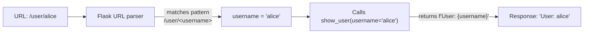
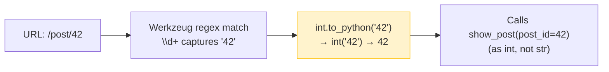
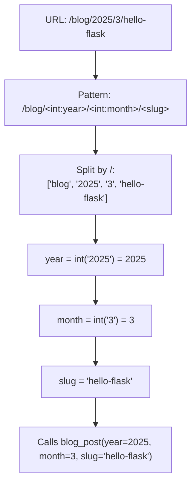
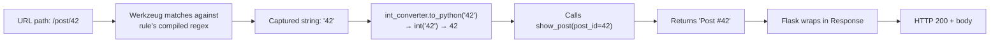
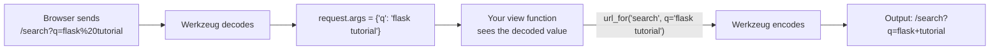
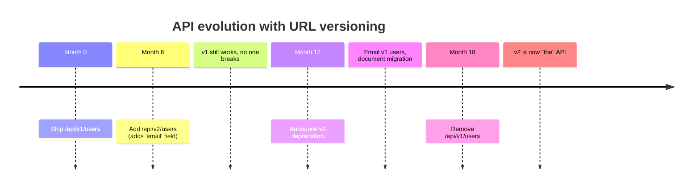
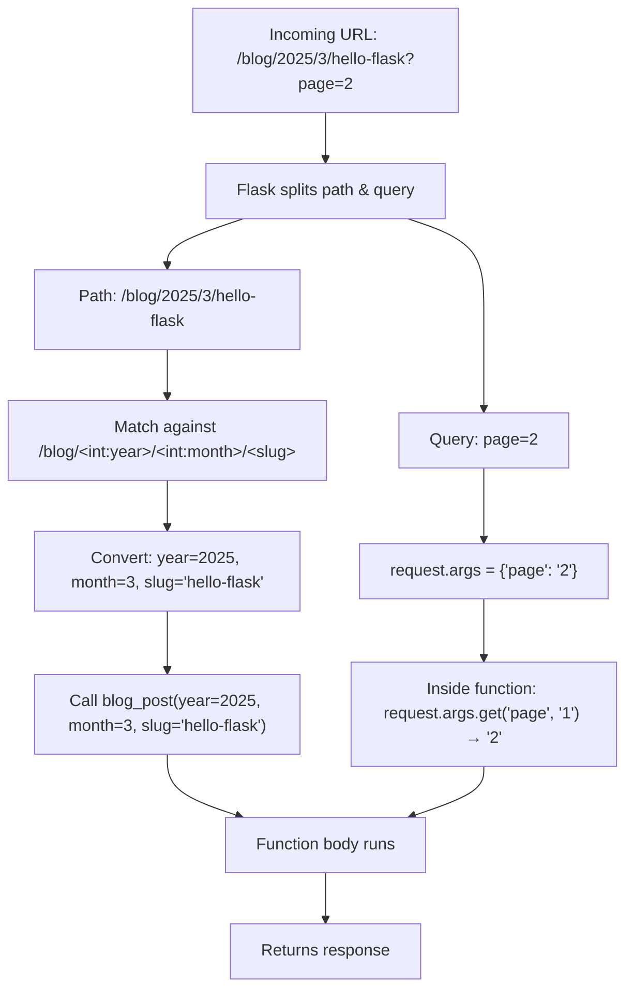

# Lesson 05 — URL Converters: Dynamic Routes and Query Parameters

> [!success] This is where Flask starts to feel powerful.
> Static routes are fine for `/about` and `/contact`. But what about `/user/alice`, `/post/42`, `/api/teams/engineering/members`? You can't write a route for every possible value. URL converters solve this — one route, infinite URLs. We'll go deeper than syntax: we'll see how converters work internally, build a custom converter from scratch, decode URL encoding, and design RESTful API routes with versioning.

#flask #url-converters #dynamic-routes #rest

## 1. Learning Objectives

By the end of this lesson you will be able to:

1. **Define dynamic routes** using `<variable>` syntax.
2. **Use every built-in converter**: `string`, `int`, `float`, `path`, `uuid` — and explain *how* each one matches URLs.
3. **Capture URL segments as function arguments** — the connection between the URL and the function signature, with name matching rules.
4. **Understand how converters work internally** — the `BaseConverter` class, `to_python`, `to_url`, and the regex that drives matching.
5. **Build a custom converter** from scratch (e.g. a `DateConverter` and a `HexColorConverter`).
6. **Generate URLs for dynamic routes** with `url_for(..., var=value)`.
7. **Read query strings** (`?q=hello&page=2`) using `request.args.get(...)`.
8. **Differentiate URL segments from query parameters** — when to use which (REST principles).
9. **Understand URL encoding** — what happens with spaces, special characters, and how Flask decodes them.
10. **Design API versioning in URLs** — `/api/v1/`, `/api/v2/` patterns.
11. **Build a URL shortener and a calculator** as practical exercises.

## 2. Prerequisites

- **[[Lesson-04-Routes]] completed.** You understand `@app.route`, endpoints, and `url_for`.
- **Python f-strings**: `f"Hello, {name}"`. If you've never seen one, you write `name = "Alice"`; then `f"Hi {name}"` becomes the string `"Hi Alice"`.
- **A working Flask app** you can run with `python app.py`.

## 3. The Problem

In [[Lesson-04-Routes]] you learned static routes. Imagine you wanted a profile page for every user. Without dynamic routes, you'd write:

```python
@app.route('/user/alice')
def alice_profile():
    return "Alice's profile"

@app.route('/user/bob')
def bob_profile():
    return "Bob's profile"

@app.route('/user/charlie')
def charlie_profile():
    return "Charlie's profile"
```

This is obviously absurd for a real site with thousands or millions of users. You don't know all the usernames in advance, and even if you did, redeploying every signup is insane.

What you want is a single route that says "match `/user/ANYTHING`, and pass that ANYTHING to the function." That's a **dynamic route**, and the "ANYTHING" is captured using a **URL converter**.



The same pattern handles `/post/42`, `/api/teams/eng/members/jane`, even `/files/2024/03/report.pdf` — depending on which converter you use. Flask provides five built-in converters, and you can write your own. We'll cover the five built-ins in depth, then build two custom ones.

## 4. The Code

Here's a complete app demonstrating every converter:

```python
from flask import Flask, request, url_for

app = Flask(__name__)

# Default converter: string (no slashes)
@app.route('/user/<username>')
def show_user(username):
    return f"<h1>User: {username}</h1><p>Username has {len(username)} characters.</p>"


# int converter: positive integers only
@app.route('/post/<int:post_id>')
def show_post(post_id):
    return f"<h1>Post #{post_id}</h1><p>This is blog post number {post_id}.</p>"


# float converter: positive floats
@app.route('/price/<float:amount>')
def show_price(amount):
    return f"<h1>Price</h1><p>The price is ${amount:.2f}.</p>"


# path converter: like string but accepts slashes
@app.route('/path/<path:subpath>')
def show_path(subpath):
    return f"<h1>Path</h1><p>Captured: {subpath}</p>"


# uuid converter: UUID strings
@app.route('/item/<uuid:item_id>')
def show_item(item_id):
    return f"<h1>Item</h1><p>UUID: {item_id}</p><p>Version: {item_id.version}</p>"


# Multiple converters in one route
@app.route('/blog/<int:year>/<int:month>/<slug>')
def blog_post(year, month, slug):
    return f"<h1>{slug}</h1><p>Published: {year}-{month:02d}</p>"


# Query parameters with request.args
@app.route('/search')
def search():
    q = request.args.get('q', '')          # default '' if missing
    page = request.args.get('page', '1')   # query values are always strings
    return f"<h1>Search</h1><p>Query: {q}</p><p>Page: {page}</p>"


# A url_for demonstration route
@app.route('/links')
def links():
    return f"""
    <h1>Generated Links</h1>
    <ul>
      <li><a href="{url_for('show_user', username='alice')}">Alice's profile</a></li>
      <li><a href="{url_for('show_post', post_id=42)}">Post #42</a></li>
      <li><a href="{url_for('blog_post', year=2025, month=3, slug='hello-flask')}">March 2025: hello-flask</a></li>
      <li><a href="{url_for('search', q='flask tutorial', page=2)}">Search: flask tutorial, page 2</a></li>
    </ul>
    """


if __name__ == '__main__':
    app.run(debug=True)
```

## 5. Line-by-Line Explanation

### 5.1 The default `string` converter

```python
@app.route('/user/<username>')
def show_user(username):
    return f"<h1>User: {username}</h1><p>Username has {len(username)} characters.</p>"
```

The `<username>` in the URL pattern is a **converter**. Without a prefix, it defaults to `string`. Flask captures the matching part of the URL — anything between slashes — and passes it to your function as a keyword argument with the same name (`username`).

Visiting `/user/alice` → Flask calls `show_user(username='alice')`.
Visiting `/user/bob_smith` → `show_user(username='bob_smith')`.

The `string` converter matches **any text without slashes**. Visit `/user/alice/extra` and you'll get a 404 — the `/extra` part isn't part of the pattern. To match slashes too, use the `path` converter (below).

> [!info] The variable name must match the function argument
> `@app.route('/user/<username>')` captures into a variable named `username`, so your function must declare `def show_user(username)`. If you write `def show_user(name)`, you'll get a `TypeError: show_user() got an unexpected keyword argument 'username'`. The names are how Flask knows what to pass where.

#### What happens internally

When Flask sees `<username>`, it:
1. Creates a `string` converter (the default).
2. The converter exposes a regex — for `string`, it's `[^/]+` (one or more non-slash characters).
3. Werkzeug compiles the URL pattern `/user/<username>` into a regex like `^/user/([^/]+)$`.
4. When a request arrives, Werkzeug matches the URL against this regex.
5. The captured group (`alice`) is passed to `string.to_python('alice')`, which returns `'alice'` unchanged.
6. Flask calls `show_user(username='alice')`.

### 5.2 The `int` converter

```python
@app.route('/post/<int:post_id>')
def show_post(post_id):
    return f"<h1>Post #{post_id}</h1><p>This is blog post number {post_id}.</p>"
```

`<int:post_id>` says "match a positive integer and pass it as an `int`." Visit `/post/42` and Flask calls `show_post(post_id=42)` — note `post_id` is the integer `42`, not the string `"42"`. Flask does the conversion for you.

- `/post/42` → 200, `post_id == 42` (int)
- `/post/0` → 200, `post_id == 0`
- `/post/-5` → 404 (`int` is positive-only; use a custom converter for negatives)
- `/post/abc` → 404 (doesn't match the int pattern)
- `/post/3.14` → 404 (int doesn't match floats)

The 404s are *good*: they prevent your view function from receiving garbage. Without the converter, you'd have to do `int(post_id)` yourself and handle the `ValueError` if the user passed text.

#### How `int` differs from `string` internally

The `int` converter has:
- A different regex: `\d+` (one or more digits).
- A `to_python` method that calls `int(value)` — converting the captured string `"42"` into the integer `42`.
- A `to_url` method that calls `str(value)` — so when you do `url_for('show_post', post_id=42)`, it builds `/post/42`.



### 5.3 The `float` converter

```python
@app.route('/price/<float:amount>')
def show_price(amount):
    return f"<h1>Price</h1><p>The price is ${amount:.2f}.</p>"
```

`<float:amount>` matches positive floating-point numbers. Visit `/price/19.99` → `amount == 19.99` (float). Visit `/price/20` → 404, because `float` requires a decimal point. If you want to accept both `20` and `19.99`, declare two routes or use a custom converter.

> [!warning] `float` requires a decimal point
> `/price/20` returns 404. `/price/20.0` returns 200. This bites everyone once. If you need to accept integer-looking prices, use `path` and parse with `float()` yourself, or add a second route.

### 5.4 The `path` converter

```python
@app.route('/path/<path:subpath>')
def show_path(subpath):
    return f"<h1>Path</h1><p>Captured: {subpath}</p>"
```

`<path:subpath>` is like `string` but **accepts slashes**. Visit `/path/foo/bar/baz` and `subpath == "foo/bar/baz"`. This is useful for:
- File browsers (`/files/2024/03/report.pdf`)
- Nested categories (`/shop/electronics/computers/laptops`)
- Anything where the user's URL itself contains forward slashes

Visit `/path/just_one_segment` and it still works — `subpath == "just_one_segment"`. Path is a superset of string.

The `path` converter's regex is `.*?` (any character, including slashes). The non-greedy `?` ensures it doesn't gobble up parts of the URL that should belong to other converters.

### 5.5 The `uuid` converter

```python
@app.route('/item/<uuid:item_id>')
def show_item(item_id):
    return f"<h1>Item</h1><p>UUID: {item_id}</p><p>Version: {item_id.version}</p>"
```

`<uuid:item_id>` matches UUID strings like `550e8400-e29b-41d4-a716-446655440000`. Flask converts it to a Python `UUID` object — so `item_id.version` works (UUIDs have a `.version` attribute). Visit `/item/not-a-uuid` and you get a 404.

UUIDs are common in databases for globally-unique IDs. If your app uses them, the `uuid` converter saves you from writing regex validation.

> [!info] What's a UUID?
> A UUID (Universally Unique Identifier) is a 128-bit number usually written as 32 hex digits in five groups separated by hyphens: `550e8400-e29b-41d4-a716-446655440000`. The total count of possible UUIDs is so vast (about 3 × 10^38) that generating two identical UUIDs by accident is considered practically impossible. That's why databases, distributed systems, and APIs love them — you can generate IDs on different machines without coordination and never collide. Python's `uuid.uuid4()` generates a random version-4 UUID.
>
> The `uuid` converter recognises all five standard UUID formats (versions 1, 2, 3, 4, 5) and rejects anything that isn't a valid UUID. If you visit `/item/abc` or `/item/550e8400-e29b-41d4-a716`, you get a 404 — the converter protects your view function from malformed input.

### 5.6 Multiple converters in one route

```python
@app.route('/blog/<int:year>/<int:month>/<slug>')
def blog_post(year, month, slug):
    return f"<h1>{slug}</h1><p>Published: {year}-{month:02d}</p>"
```

Mix and match. Visit `/blog/2025/3/hello-flask` → `year=2025`, `month=3`, `slug='hello-flask'`. The function signature must declare all three arguments in the same names. Order in the URL must match order in the pattern; order in the function arguments doesn't matter (Python keyword arguments).



## 6. How Converters Work Internally — The `BaseConverter` Class

Every converter in Flask is a subclass of `werkzeug.routing.BaseConverter`. Here's the contract:

```python
class BaseConverter:
    # The regex used to match this converter in the URL
    regex = '[^/]+'

    def __init__(self, map, *args, **kwargs):
        # Optional: parse arguments like <int:5:post_id> (custom args)
        pass

    def to_python(self, value):
        # Convert the captured URL string to a Python value
        # (called when routing: URL → view function)
        return value

    def to_url(self, value):
        # Convert a Python value back to a URL string
        # (called by url_for when building URLs)
        return str(value)
```

Three things to know:
1. **`regex`** defines what the converter matches in the URL. Werkzeug uses this regex during routing.
2. **`to_python(value)`** converts the captured URL string into the Python value your function receives.
3. **`to_url(value)`** does the reverse — used when `url_for` builds a URL from a Python value.

Here's how the built-ins implement this:

| Converter | `regex` | `to_python` | `to_url` |
|---|---|---|---|
| `string` (default) | `[^/]+` | returns value unchanged | `str(value)` |
| `int` | `\d+` | `int(value)` | `str(value)` |
| `float` | `\d+\.\d+` | `float(value)` | `str(value)` |
| `path` | `.*?` | returns value unchanged | `str(value)` |
| `uuid` | (complex UUID regex) | `uuid.UUID(value)` | `str(value)` |

Notice `int` and `uuid` differ from `string` in *both* the regex (what they match) *and* `to_python` (what type they return). That's why `/post/42` gives you an actual `int`, not a string.



## 7. Building a Custom Converter

Now let's build one. Suppose you want a route `/color/ff0000` that captures a hex color code and converts it to a `#ff0000` string. None of the built-ins fit — we need a custom converter.

```python
from werkzeug.routing import BaseConverter

class HexColorConverter(BaseConverter):
    def __init__(self, map):
        super().__init__(map)
        self.regex = '[0-9a-fA-F]{6}'   # exactly 6 hex chars

    def to_python(self, value):
        return f"#{value.lower()}"        # add # and lowercase

    def to_url(self, value):
        return value.lstrip('#').lower()  # strip # for URL form

# Register the converter with a name
app.url_map.converters['hex'] = HexColorConverter

@app.route('/color/<hex:color>')
def show_color(color):
    return f"Color: {color}"   # visit /color/ff0000 → "Color: #ff0000"
```

Three things to notice:
1. **`self.regex = '[0-9a-fA-F]{6}'`** defines what the converter matches in the URL. Werkzeug uses this regex during routing.
2. **`to_python(value)`** converts the captured URL string into the Python value your function receives.
3. **`to_url(value)`** does the reverse — used when `url_for` builds a URL from a Python value.

Try it: visit `/color/ff0000` → "Color: #ff0000". Visit `/color/xyz123` → 404 (doesn't match the regex). Visit `/color/ff0000ff` (8 chars) → 404 (regex expects exactly 6).

And `url_for('show_color', color='#ff0000')` returns `/color/ff0000` — `to_url` strips the `#` for you.

### A more useful example — `DateConverter`

Imagine you want URLs like `/posts/2025/03/15` to capture a `date` object. Let's build it:

```python
from datetime import date
from werkzeug.routing import BaseConverter

class DateConverter(BaseConverter):
    """Matches /YYYY/MM/DD and converts to a date object."""
    regex = r'\d{4}/\d{2}/\d{2}'   # note: matches slashes!

    def to_python(self, value):
        # value is like '2025/03/15'
        year, month, day = map(int, value.split('/'))
        return date(year, month, day)

    def to_url(self, value):
        # value is a date object
        return value.strftime('%Y/%m/%d')

app.url_map.converters['date'] = DateConverter

@app.route('/posts/<date:d>')
def posts_on_day(d):
    return f"Posts published on {d.strftime('%B %d, %Y')}"
```

Visit `/posts/2025/03/15` → Flask calls `posts_on_day(d=date(2025, 3, 15))`. Inside your function, `d` is a real `date` object — you can do `d.weekday()`, `d + timedelta(days=7)`, format it however you want. No manual parsing.

> [!example] When to write a custom converter
> - **Strict input formats** — ISBNs, ZIP codes, hex colors, MAC addresses.
> - **Type-rich URLs** — dates, money, coordinate pairs.
> - **Validation built into routing** — reject invalid inputs with 404 before they reach your view function.
> Custom converters move validation out of your view and into the routing layer. Your view function only ever receives already-validated, correctly-typed values.

## 8. Query Parameters with `request.args`

```python
@app.route('/search')
def search():
    q = request.args.get('q', '')
    page = request.args.get('page', '1')
    return f"<h1>Search</h1><p>Query: {q}</p><p>Page: {page}</p>"
```

This route has no converters — it's a static route. But it reads **query parameters** from the URL via `request.args`.

The `request` object is imported at the top: `from flask import request`. `request.args` is a dict-like object containing all query string parameters. Visit:

```
http://127.0.0.1:5000/search?q=flask+tutorial&page=2
```

And `request.args` looks like `{'q': 'flask tutorial', 'page': '2'}`. Note:
- Spaces in URLs are encoded as `+` or `%20` — Flask decodes them automatically.
- All query values are **strings**. `page` is `"2"`, not `2`. If you need an int, convert: `int(page)`.
- `request.args.get('q', '')` returns `''` if `q` is missing. Without the default, you'd get `None`.

> [!info] What is a "query string"?
> The query string is everything after the `?` in a URL. In `https://example.com/search?q=flask&sort=date&page=2`, the query string is `q=flask&sort=date&page=2`. It's a list of `key=value` pairs separated by `&`. Browsers encode special characters: spaces become `+` or `%20`, `&` becomes `%26`, `=` becomes `%3D`. Flask (via Werkzeug) decodes all of this for you, so `request.args.get('q')` returns the original `'flask'` even if the URL contained `q=flask%20tutorial`.
>
> Query strings are visible in the URL bar, get logged in server access logs, get saved in browser history, and have practical length limits (browsers cap around 2000 characters). Never put secrets, passwords, or large payloads in them.

> [!example] Reading multiple values for one key
> Sometimes a query parameter repeats: `?tag=python&tag=flask&tag=web`. To get all values, use `request.args.getlist('tag')` — returns `['python', 'flask', 'web']`. The plain `get('tag')` returns only the first one.

## 9. URL Encoding — What Happens with Special Characters

URLs can only contain a limited set of "safe" characters: letters, digits, and a few symbols (`-`, `_`, `.`, `~`, `/`, `?`, `#`, `&`, `=`, `+`). Everything else — spaces, accents, emoji, `&`, `=`, etc. — must be **percent-encoded**.

| Character | Encoded as |
|---|---|
| space | `+` or `%20` |
| `&` | `%26` |
| `=` | `%3D` |
| `?` | `%3F` |
| `/` | `%2F` |
| `#` | `%23` |
| `é` | `%C3%A9` (UTF-8 bytes) |
| `🚀` | `%F0%9F%9A%80` |

Flask (via Werkzeug) handles all of this automatically:
- **When a request arrives:** Werkzeug decodes the URL before routing. `request.args.get('q')` returns `'flask tutorial'` even if the URL was `?q=flask%20tutorial`.
- **When you build URLs with `url_for`:** Werkzeug encodes the values. `url_for('search', q='flask tutorial')` returns `/search?q=flask+tutorial`.



> [!question] Student asks: Should I encode URLs myself?
> Almost never. If you use `url_for` to generate URLs, Werkzeug handles encoding. If you read URLs via `request.args`, Werkzeug handles decoding. The only time you encode manually is if you're constructing URLs as raw strings (which you shouldn't be doing — use `url_for`).

### 9.1 Common encoding pitfalls

Even though Flask handles encoding for you, you'll hit these gotchas:

**Pitfall 1 — Slashes in path segments.** If a user's name contains a slash (say, `alice/admin`), the URL `/user/alice/admin` will be interpreted as `/user/alice/admin` with `username='alice'` and an extra `/admin` — almost certainly a 404. To put a literal slash in a path segment, it must be `%2F`: `/user/alice%2Fadmin`. Werkzeug decodes this back to `alice/admin` for you. But realistically, *don't allow slashes in usernames* — validate input.

**Pitfall 2 — Unicode in URLs.** Visiting `/user/café` works in modern browsers, which encode the URL as `/user/caf%C3%A9` before sending. Flask decodes it back to `café`. But older logs and tools may show the encoded form. Always use `url_for` for safety.

**Pitfall 3 — Empty path segments.** `/user//alice` (double slash) — does this match `/user/<username>`? It depends on the converter. By default, Werkzeug *normalises* URLs (collapses double slashes), but you can disable this. Don't rely on it.

**Pitfall 4 — Reserved characters in query strings.** If your query value contains `&` or `=`, it must be encoded (`%26` for `&`, `%3D` for `=`), or the parser will see it as a key/value separator. Werkzeug handles this when you use `url_for` with `q='a&b=c'` — it produces `q=a%26b%3Dc`. But if you build the URL by hand with f-strings, you'll get garbage.

> [!danger] Never build URLs by hand with f-strings
> ```python
> # BAD — breaks if username contains & ? = / etc.
> return f'<a href="/user/{username}">Profile</a>'
> ```
> Always use `url_for`:
> ```python
> return f'<a href="{url_for("show_user", username=username)}">Profile</a>'
> ```
> `url_for` URL-encodes the value safely. Hand-rolled URLs break on the first special character.

## 10. URL Segments vs Query Parameters — Which to Use?

This is a question every web developer faces. Here's the heuristic:

| Use URL segments | Use query parameters |
|---|---|
| Identifying a resource (`/user/alice`, `/post/42`) | Optional filters (`/search?q=flask&sort=date`) |
| Hierarchical structure (`/blog/2025/3/slug`) | Pagination (`/posts?page=3`) |
| Required values | Sorting (`/posts?sort=asc`) |
| When the value is part of "what the thing IS" | When the value is "how to display the thing" |

RESTful rule of thumb: **path segments identify; query parameters modify.** `/users/42` identifies user 42. `/users/42?include=posts&fields=name,email` modifies how to display them.

A search page like `/search?q=flask` uses a query parameter because the search term is a filter, not an identifier. There's no "search resource called flask" — there's just a search endpoint that takes a parameter.

> [!example] Same data, two styles — when each wins
> Consider a blog with categories. Which is better:
> - `/posts/python` (path segment), or
> - `/posts?category=python` (query parameter)?
>
> Both work. The path-segment version reads better, is more shareable ("check out /posts/python"), and is what users expect to be able to bookmark. The query version is more flexible when you have many optional filters (`/posts?category=python&year=2024&sort=popular`).
>
> Heuristic: if the parameter is *required* and *singular* (a post has exactly one category), use a path segment. If it's *optional* and *combinable* (filter by year AND category AND author), use query parameters. You can mix both: `/posts/<category>?year=2024`.

> [!warning] Security: query strings are visible
> Because query strings live in the URL, they're visible to anyone who can see the URL — including browser history, server access logs, the `Referer` header when users click outbound links, and anyone looking over the user's shoulder. Never put passwords, API tokens, session IDs, or other secrets in a query string. Use POST body (covered in [[Lesson-06-HTTP-Methods]]) or HTTP headers instead.

## 11. API Versioning in URLs

When you build an API (which we cover fully in [[Lesson-19-Building-JSON-API]] and [[Lesson-20-RESTful-Resources]]), you'll face the question: *how do I change my API without breaking existing clients?*

The answer is **versioning** — and the most common pattern is putting the version in the URL:

```python
@app.route('/api/v1/users')
def api_v1_users():
    return jsonify([{'id': 1, 'name': 'Alice'}])

@app.route('/api/v2/users')
def api_v2_users():
    # v2 adds an 'email' field
    return jsonify([{'id': 1, 'name': 'Alice', 'email': 'alice@example.com'}])
```

Both URLs work simultaneously. Clients on v1 keep working; new clients can adopt v2. When v3 ships, you keep v1 and v2 alive for a deprecation period (typically 6–12 months), then remove them.

### Why version in the URL (not headers)?

Some people argue for header-based versioning (`Accept: application/vnd.myapp.v2+json`). It's "more RESTful" in theory. In practice, URL versioning wins because:

1. **Visibility** — you can see the version in the URL bar, in logs, in curl commands. Headers are invisible.
2. **Cacheability** — CDNs cache by URL. Two URL versions get two cache entries. Header-based versions break caching.
3. **Debuggability** — pasting a URL into a browser or Postman just works. Header-based versioning requires extra setup.
4. **Simplicity** — Flask routes match URLs. No middleware to inspect headers.

> [!tip] Rule of thumb
> Use `/api/v1/`, `/api/v2/` for breaking changes. Use *additive* changes (new fields, new endpoints) without bumping the version — clients ignore unknown fields. Save version bumps for genuine breaks: removed fields, changed types, changed semantics.



### Real-world example — Twitter, GitHub, Stripe

- **Twitter:** `/2/tweets` — the v2 API launched in 2020 alongside v1.1, both still running.
- **GitHub:** uses header-based versioning (`X-GitHub-Api-Version: 2022-11-28`) for date-stamped versions. Controversial — many developers find it harder to debug.
- **Stripe:** URL versioning — `https://api.stripe.com/v1/charges`. Easy to test in a browser, easy to cache.

Most APIs you'll work with use URL versioning. It's the boring, predictable choice — which is exactly what you want for infrastructure.

## 12. Generating URLs for Dynamic Routes

```python
@app.route('/links')
def links():
    return f"""
    <h1>Generated Links</h1>
    <ul>
      <li><a href="{url_for('show_user', username='alice')}">Alice's profile</a></li>
      <li><a href="{url_for('show_post', post_id=42)}">Post #42</a></li>
      <li><a href="{url_for('blog_post', year=2025, month=3, slug='hello-flask')}">March 2025: hello-flask</a></li>
      <li><a href="{url_for('search', q='flask tutorial', page=2)}">Search: flask tutorial, page 2</a></li>
    </ul>
    """
```

`url_for` takes the endpoint name plus keyword arguments for every variable in the route pattern. For `/user/<username>`, you pass `username=...`. For `/blog/<int:year>/<int:month>/<slug>`, you pass all three. For a static route like `/search`, you can still pass query parameters as extra kwargs — they get appended as `?q=...&page=...`.

So `url_for('search', q='flask tutorial', page=2)` returns `/search?q=flask+tutorial&page=2`. Notice Flask URL-encoded the space as `+`. That's correct.

`url_for('show_user', username='alice')` returns `/user/alice`. If you forget to pass `username`, Flask raises `BuildError: Could not build url for endpoint 'show_user' with values ['...']  (missing 'username')`.

Behind the scenes, `url_for` calls each converter's `to_url` method to convert your Python value into a URL-safe string. For `int`, that's `str(42)` → `'42'`. For our custom `HexColorConverter`, that's `'#ff0000'.lstrip('#')` → `'ff0000'`.

## 13. Running the Code

### Step 1 — Save and run

```bash
source venv/bin/activate
python app.py
```

### Step 2 — Visit each dynamic route

| URL | Output |
|---|---|
| `http://127.0.0.1:5000/user/alice` | `User: alice` and "Username has 5 characters." |
| `http://127.0.0.1:5000/user/bob_smith` | `User: bob_smith` and "Username has 9 characters." |
| `http://127.0.0.1:5000/post/42` | `Post #42` and "This is blog post number 42." |
| `http://127.0.0.1:5000/post/abc` | **404 Not Found** — `abc` doesn't match `int` |
| `http://127.0.0.1:5000/price/19.99` | `Price` and "The price is $19.99." |
| `http://127.0.0.1:5000/price/20` | **404** — float requires decimal point |
| `http://127.0.0.1:5000/path/foo/bar/baz` | `Path` and "Captured: foo/bar/baz" |
| `http://127.0.0.1:5000/item/550e8400-e29b-41d4-a716-446655440000` | `Item` and "UUID: 550e8400-...-440000" + "Version: 4" |
| `http://127.0.0.1:5000/blog/2025/3/hello-flask` | `hello-flask` and "Published: 2025-03" |
| `http://127.0.0.1:5000/search?q=flask+tutorial&page=2` | `Search` with "Query: flask tutorial" and "Page: 2" |
| `http://127.0.0.1:5000/search` (no params) | `Search` with "Query: " and "Page: 1" (defaults) |
| `http://127.0.0.1:5000/links` | A page with four generated links — click each to verify |

### Step 3 — Confirm the type conversions

To prove that converters actually convert, add this debug route:

```python
@app.route('/debug/<int:n>/<float:f>/<path:p>')
def debug_types(n, f, p):
    return f"<pre>n = {n!r} (type: {type(n).__name__})\nf = {f!r} (type: {type(f).__name__})\np = {p!r} (type: {type(p).__name__})</pre>"
```

Visit `http://127.0.0.1:5000/debug/42/3.14/foo/bar`. You'll see:

```
n = 42 (type: int)
f = 3.14 (type: float)
p = 'foo/bar' (type: str)
```

The `!r` in the f-string shows the `repr` of each value, and `type(...).__name__` shows the type name. Flask has already done the conversion — your function received an `int`, not a string.

## 14. Common Mistakes

### Mistake 1 — Argument name doesn't match the converter variable

```python
@app.route('/user/<username>')
def show_user(name):       # WRONG: argument should be 'username'
    return f"Hi {name}"
```

**Symptom:** `TypeError: show_user() got an unexpected keyword argument 'username'`.

**Fix:** Match the names: `def show_user(username):`.

### Mistake 2 — Forgetting the converter type prefix

```python
@app.route('/post/<post_id>')          # string converter (default)
def show_post(post_id):
    return post_id + 1                 # TypeError: can't add int to str
```

**Symptom:** Works for `/post/42` but `post_id` is the *string* `"42"`, not the int `42`. Arithmetic fails.

**Fix:** Use `<int:post_id>` to get automatic conversion.

### Mistake 3 — Treating query values as ints

```python
page = request.args.get('page')        # returns "2" (string), not 2 (int)
return f"Showing page {page + 1}"      # TypeError!
```

**Symptom:** `TypeError: can only concatenate str (not "int") to str`.

**Fix:** Convert explicitly: `page = int(request.args.get('page', '1'))`. Better, with error handling:

```python
try:
    page = int(request.args.get('page', '1'))
except ValueError:
    page = 1   # graceful fallback
```

### Mistake 4 — Using `string` when you need `path`

```python
@app.route('/files/<filepath>')        # string converter
def serve_file(filepath):
    ...
```

Visit `/files/2024/03/report.pdf` → 404. The `string` converter stops at the first slash.

**Fix:** Use `<path:filepath>` to capture slashes.

### Mistake 5 — `BuildError` from `url_for`

```python
url_for('show_user')                   # missing 'username'
url_for('show_post', post_id='abc')    # post_id should be int
```

**Symptom:** `werkzeug.routing.exceptions.BuildError: Could not build url for endpoint 'show_user'. Missing required value: 'username'.` Or a silent failure if you pass the wrong type.

**Fix:** Pass every required variable as a keyword argument with the right type. For `int` converters, pass an int (`42`, not `"42"`).

### Mistake 6 — Confusing `request.args` with `request.form`

- `request.args` — query string parameters (in the URL, after `?`). Available for any request.
- `request.form` — POSTed form data (in the request body). Only available for POST/PUT. We'll cover this in [[Lesson-06-HTTP-Methods]].

Beginners sometimes write `request.form.get('q')` in a GET route and get `None`. That's because GET requests don't have form bodies. Use `request.args` for GET, `request.form` for POST.

## 15. Exercises

**Exercise 1 — Build a URL shortener.**
Create an in-memory dictionary mapping short codes to URLs:

```python
URLS = {
    'google': 'https://google.com',
    'gh': 'https://github.com',
    'py': 'https://python.org',
}

@app.route('/go/<code>')
def redirect_to_url(code):
    target = URLS.get(code)
    if target is None:
        return "Short code not found", 404
    return f'<a href="{target}">Click to visit {target}</a>'
```

Visit `/go/google`, `/go/gh`, `/go/unknown`. Then add a `/shorten` form (we'll do this properly in [[Lesson-06-HTTP-Methods]]) that lets visitors add new mappings.

**Exercise 2 — Build a calculator.**
Create a route `/calc/<operation>/<int:a>/<int:b>` that supports `add`, `sub`, `mul`, `div`:

```python
@app.route('/calc/<operation>/<int:a>/<int:b>')
def calc(operation, a, b):
    ops = {
        'add': lambda x, y: x + y,
        'sub': lambda x, y: x - y,
        'mul': lambda x, y: x * y,
        'div': lambda x, y: x / y if y != 0 else 'Cannot divide by zero',
    }
    if operation not in ops:
        return f"Unknown operation: {operation}", 400
    result = ops[operation](a, b)
    return f"{a} {operation} {b} = {result}"
```

Visit `/calc/add/5/3`, `/calc/mul/4/6`, `/calc/div/10/0`. Notice how the `int` converter protects you — `/calc/add/foo/3` returns 404, not a crash.

**Exercise 3 — Paginate a list.**
Create a list of 50 fake items. Build a route `/items?page=2&per_page=10` that returns items 11-20. Use `request.args.get('page', '1')` and `request.args.get('per_page', '10')`, convert both to int, slice the list. Show "Page 2 of 5".

**Exercise 4 — Generate links with `url_for`.**
Add a `/dashboard` route that uses `url_for` to generate links to:
- The user profile for the currently-logged-in user (hardcode `'alice'` for now)
- Their 5 most recent posts (post IDs 1-5)
- A search for their username

Use f-strings and `url_for`. Confirm each link works when clicked.

**Exercise 5 — Build a file browser.**
Create a route `/files/<path:filepath>` that pretends to serve files. For now, just return `"You requested: {filepath}"`. Try visiting:
- `/files/2024/03/report.pdf`
- `/files/images/vacation/beach.jpg`
- `/files/single`

Confirm slashes are captured.

**Exercise 6 — Build a custom converter (slug).**
Create a `SlugConverter` that matches only lowercase letters, digits, and hyphens (regex: `[a-z0-9-]+`). Register it as `slug` and use it in a route `/posts/<slug:slug>`. Test that `/posts/hello-world` works but `/posts/Hello World` returns 404.

**Exercise 7 — Build an API-versioned endpoint.**
Create `/api/v1/time` and `/api/v2/time` routes. v1 returns `{"time": "10:30"}` (just HH:MM). v2 returns `{"time": "10:30:45", "timezone": "UTC"}` (HH:MM:SS plus tz). Both work simultaneously. This is how real APIs evolve without breaking clients.

**Exercise 8 — Decode URL encoding by hand.**
Visit `http://127.0.0.1:5000/search?q=hello%20world%26flask` and use your `/search` route. What does `request.args.get('q')` return? (Hint: `%20` is space, `%26` is `&`.) Confirm Flask decoded the URL correctly.

## 16. What We Learned

In this lesson you:

- **Defined dynamic routes** with `<variable>` syntax.
- **Used all five built-in converters**: `string` (default), `int`, `float`, `path`, `uuid`.
- **Saw how converters work internally** — every converter is a `BaseConverter` subclass with a `regex`, `to_python`, and `to_url` method.
- **Built custom converters from scratch** — `HexColorConverter` and `DateConverter` — to handle domain-specific URL formats.
- **Captured URL segments as function arguments** — with automatic type conversion.
- **Generated URLs for dynamic routes** with `url_for(endpoint, var=value, ...)`.
- **Read query parameters** with `request.args.get(key, default)`.
- **Distinguished URL segments (identity) from query parameters (filters)** — a key REST design principle.
- **Learned URL encoding** — what `%20`, `%26`, `+` mean, and how Flask decodes them automatically.
- **Designed API versioning in URLs** — `/api/v1/`, `/api/v2/` for breaking changes.
- **Built real features** — a URL shortener, a calculator, a paginated list, a file browser.
- **Avoided the six common converter mistakes** — name mismatches, type confusion, `string` vs `path`, `request.args` vs `request.form`.



## 17. Next Lesson

In [[Lesson-06-HTTP-Methods]] you'll learn about the verbs that accompany URLs — GET, POST, PUT, DELETE — and how to handle form submissions in Flask. You'll learn:

- What HTTP methods are and what each one means (GET = read, POST = create, etc.)
- How to restrict routes to specific methods with `methods=['GET', 'POST']`
- The `request` object in depth: `request.method`, `request.form`, `request.args`, `request.files`, `request.headers`, `request.cookies`, `request.json`
- How to build a working form: GET form → POST submission → response
- Idempotency — which methods are safe to repeat and why it matters
- The PRG (Post-Redirect-Get) pattern in depth
- REST conventions for full CRUD
- Modern AJAX with `fetch()`

### Bonus: Custom converters recap

You won't need custom converters often — the five built-ins cover 99% of cases. But knowing they exist gives you a powerful escape hatch for unusual requirements (ZIP codes, ISBNs, hex colors, slugs with strict rules). We'll see them again in [[Lesson-18-Blueprints]] when we want to share converters across modules.

Before moving on, make sure:
- [x] You can build a dynamic route with two or more converters.
- [x] You can read query parameters and convert them to the right type.
- [x] You can generate a URL with `url_for` for a dynamic route.
- [x] You can explain the difference between `string` and `path` converters.
- [x] You've built at least one custom converter (Exercise 6 or 7).

If those are solid, you're ready for HTTP methods. See you in [[Lesson-06-HTTP-Methods]]. 📨

---

> [!quote] A note from your teacher
> Dynamic routes are the moment Flask stops feeling like a toy. With one decorator and a `<variable>`, you've gone from "one URL per function" to "infinite URLs per function." Real apps are 90% dynamic routes — user profiles, post pages, API endpoints, file browsers, search, everything. Master this lesson's converters and you can build most CRUD apps already. The remaining lessons add templates, forms, databases, and auth — but the routing foundation you just laid is permanent. 🔗
