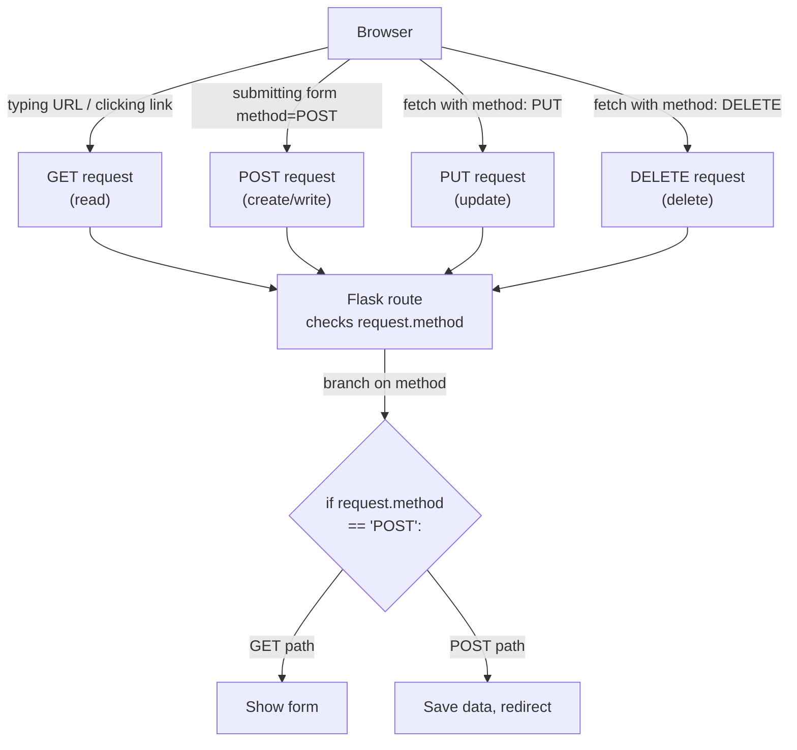
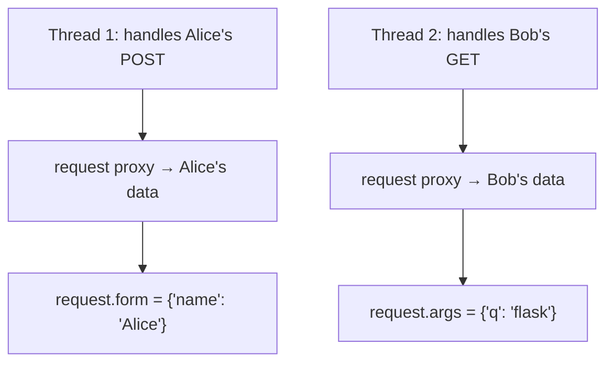
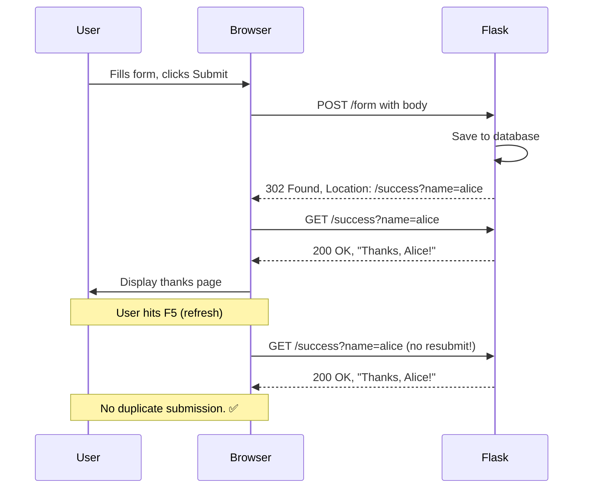
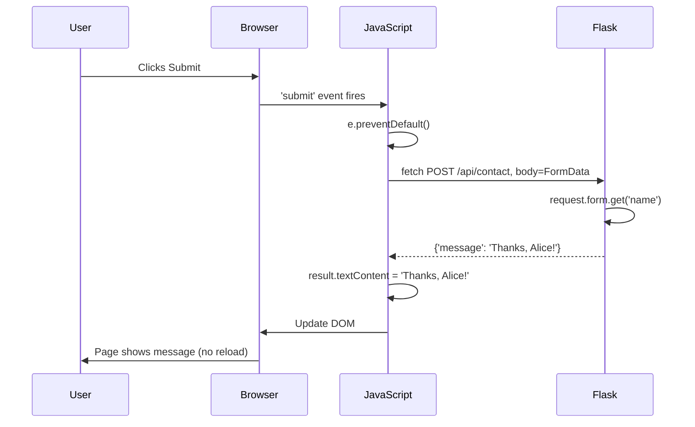
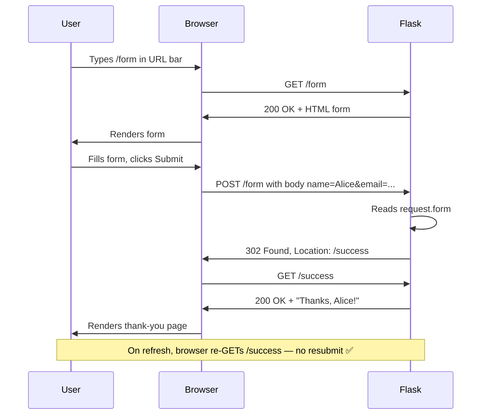

# Lesson 06 — HTTP Methods: GET, POST, and the Request Object

> [!success] The last lesson of Module 02.
> You've mastered URLs. Now meet the *verbs* that act on them. Every interaction on the web — clicking a link, submitting a form, uploading a photo — is one of a small set of HTTP methods. Today you learn them all, plus the `request` object in depth, the PRG pattern, REST conventions, and modern AJAX with `fetch()`.

#flask #http-methods #forms #rest #prg

## 1. Learning Objectives

By the end of this lesson you will be able to:

1. **Explain what HTTP is** — the protocol, its request/response structure, methods, headers, body, and status codes.
2. **Name and describe the five common HTTP methods**: GET, POST, PUT, PATCH, DELETE — and explain *idempotency* (which methods are safe to repeat and why).
3. **Restrict a Flask route to specific methods** using `methods=['GET', 'POST']`.
4. **Inspect the incoming request** using every part of the `request` object: `method`, `form`, `args`, `data`, `json`, `files`, `headers`, `cookies`, `values`, `path`, `url`.
5. **Build a working HTML form** with GET and POST handling in one Flask route.
6. **Explain the difference between GET and POST forms** — when each is appropriate, and the security implications.
7. **Apply the PRG (Post/Redirect/Get) pattern** to prevent duplicate form submissions.
8. **Use REST conventions** for full CRUD (Create, Read, Update, Delete).
9. **Use the modern `fetch()` API** for AJAX form submission.
10. **Build a contact form and a guess-the-number game** as practical exercises.

## 2. Prerequisites

- **[[Lesson-05-URL-Converters]] completed.** You understand routes, converters, and `request.args`.
- **HTML form basics.** You should recognise `<form>`, `<input>`, and `<button>`. If you've never written a form, the examples will teach you what you need.
- **A working Flask app** with `app.run(debug=True)` you can hit in a browser.

## 3. The Problem — Why More Than One HTTP Method?

So far, every interaction with your Flask app has been a **GET** request. You typed a URL, hit Enter, the browser sent `GET /something HTTP/1.1`, Flask ran your function, you got a page back. Read-only. Safe. Idempotent.

But the web isn't just reading. Real apps let users:
- Submit a contact form
- Log in
- Upload a profile picture
- Create a blog post
- Delete a comment
- Update their email address

These are *write* operations — they change server state. Sending them as GET would be wrong:

- GET parameters go in the URL → passwords would appear in browser history, server logs, and the URL bar.
- GET is supposed to be safe to repeat (refresh, back button) → resubmitting a "Buy" form on refresh would charge the user twice.
- GET is supposed to be cacheable → your "logout" link would get cached and stop working.

HTTP defines different *methods* (also called *verbs*) for different kinds of operations. The browser picks the method based on what you ask it to do — typing a URL is GET, submitting a `<form method="POST">` is POST, AJAX's `fetch(..., {method: 'DELETE'})` is DELETE.



By default, Flask routes only respond to GET. To accept other methods, you have to opt in. Let's see how.

## 4. The HTTP Protocol — A Quick Deep Dive

Before Flask, let's understand HTTP itself.

HTTP is a *request-response* protocol. A client (browser, mobile app, curl) sends a request; the server sends a response. Both request and response have the same structure:

1. A *first line* (request line for requests: `METHOD /path HTTP/1.1`; status line for responses: `HTTP/1.1 200 OK`).
2. *Headers* — key:value pairs, one per line, ending with a blank line.
3. An optional *body* — for POST/PUT requests, this is form data or JSON; for responses, it's the HTML/JSON/etc.

### 4.1 Anatomy of an HTTP request

```http
POST /form HTTP/1.1
Host: 127.0.0.1:5000
Content-Type: application/x-www-form-urlencoded
Content-Length: 23
User-Agent: Mozilla/5.0 (Macintosh; ...)
Accept: text/html,...

name=Alice&email=alice%40example.com
```

Breakdown:
- **Request line:** `POST /form HTTP/1.1` — the method, the path, the protocol version.
- **Headers:** `Host`, `Content-Type`, `Content-Length`, `User-Agent`, `Accept`, etc.
- **Blank line:** separates headers from body.
- **Body:** `name=Alice&email=alice%40example.com` — URL-encoded form data. `%40` is `@`.

### 4.2 Anatomy of an HTTP response

```http
HTTP/1.1 200 OK
Content-Type: text/html; charset=utf-8
Content-Length: 138

<html>
  <h1>Thanks, Alice!</h1>
  <p>We received your email: alice@example.com</p>
</html>
```

Breakdown:
- **Status line:** `HTTP/1.1 200 OK` — protocol, status code, status text.
- **Headers:** `Content-Type`, `Content-Length`, etc.
- **Blank line.**
- **Body:** the HTML the browser renders.

### 4.3 Status codes — the response's "result"

| Code | Meaning | When to use |
|---|---|---|
| `200 OK` | Success | Default for GET, POST |
| `201 Created` | Resource created | After POST that creates a new resource |
| `204 No Content` | Success, no body | After DELETE |
| `301 / 302` | Redirect | Permanent / temporary redirect |
| `400 Bad Request` | Client sent bad data | Form validation failed |
| `401 Unauthorized` | Not logged in | Need authentication |
| `403 Forbidden` | Logged in but not allowed | Authorization failed |
| `404 Not Found` | URL doesn't exist | No route matched |
| `405 Method Not Allowed` | URL exists but wrong verb | GET to a POST-only route |
| `422 Unprocessable Entity` | Data invalid | Often used by APIs for validation |
| `500 Internal Server Error` | Your code crashed | Bug in your view function |
| `503 Service Unavailable` | Server overloaded | Maintenance mode |

## 5. The Five Common HTTP Methods — In Depth

Each method has a specific meaning in REST:

| Method | Meaning | Idempotent? | Safe? | Has body? |
|---|---|---|---|---|
| `GET` | Read a resource | Yes | Yes | No (technically) |
| `POST` | Create a new resource | No | No | Yes |
| `PUT` | Replace a resource (whole) | Yes | No | Yes |
| `PATCH` | Partially update a resource | No | No | Yes |
| `DELETE` | Remove a resource | Yes | No | No (usually) |

### What does "idempotent" mean?

A method is **idempotent** if calling it once has the same effect as calling it 100 times. GET is idempotent (reading the same page 100 times doesn't change anything). DELETE is idempotent (deleting user 42 once has the same effect as deleting them 100 times — they're gone). POST is *not* idempotent (submitting a "create order" form 100 times creates 100 orders).

This matters because networks fail. If your browser sends a POST and the connection drops, you don't know if the server received it. Retrying POST is dangerous — you might double-charge. Retrying GET is always safe. This is why browsers ask "Resubmit form data?" when you refresh a POST result — they're protecting you from idempotency violations.

### What does "safe" mean?

A method is **safe** if it doesn't modify server state. GET is safe (just reads). POST is not (creates). Browsers are allowed to "pre-fetch" safe URLs (e.g. eagerly load linked pages) — they never pre-fetch unsafe URLs.

### What's the difference between PUT and PATCH?

- **PUT** replaces the *whole* resource. `PUT /users/42` with body `{"name": "Alice"}` would set user 42's name to Alice *and erase every other field* (email, age, etc.).
- **PATCH** partially updates. `PATCH /users/42` with body `{"name": "Alice"}` would change only the name, leaving other fields alone.

In practice, most web apps use PUT for "edit form" submissions (because they replace the whole record) and PATCH for API-only partial updates. Don't worry too much about the distinction — both are uncommon in beginner apps.

## 6. The Code

Here's a complete app demonstrating forms, methods, and the `request` object:

```python
from flask import Flask, request, redirect, url_for

app = Flask(__name__)


# A simple GET-only route (default behavior)
@app.route('/')
def home():
    return '<h1>Home</h1><p><a href="{form}">Go to form</a></p>'.format(form=url_for('form'))


# A route that handles BOTH GET and POST
@app.route('/form', methods=['GET', 'POST'])
def form():
    if request.method == 'POST':
        # User submitted the form
        name = request.form.get('name', '')
        email = request.form.get('email', '')
        return f"""
        <h1>Thanks, {name}!</h1>
        <p>We received your email: {email}</p>
        <p><a href="{url_for('form')}">Submit again</a></p>
        """
    # User is loading the page (GET)
    return """
    <h1>Contact Form</h1>
    <form method="POST" action="/form">
        <p><label>Name: <input type="text" name="name"></label></p>
        <p><label>Email: <input type="email" name="email"></label></p>
        <button type="submit">Send</button>
    </form>
    """


# A POST-only route (the form's action target)
@app.route('/submit', methods=['POST'])
def submit():
    name = request.form.get('name')
    if not name:
        return "Name is required", 400
    return f"Hello, {name}! Your submission was received."


# GET form that submits data in the URL
@app.route('/search')
def search_form():
    q = request.args.get('q', '')
    if q:
        return f"<h1>Search results for: {q}</h1>"
    return """
    <h1>Search</h1>
    <form method="GET" action="/search">
        <input type="text" name="q" placeholder="Search...">
        <button>Search</button>
    </form>
    """


# Guess the number game — state via session (preview)
import random
SECRET = random.randint(1, 100)

@app.route('/guess', methods=['GET', 'POST'])
def guess():
    message = ''
    if request.method == 'POST':
        try:
            guess = int(request.form.get('guess', ''))
        except ValueError:
            message = "Please enter a number."
        else:
            if guess < SECRET:
                message = f"{guess} is too low. Try higher."
            elif guess > SECRET:
                message = f"{guess} is too high. Try lower."
            else:
                return f"<h1>🎉 Correct! The number was {SECRET}.</h1>"
    return f"""
    <h1>Guess a number 1–100</h1>
    <p style="color: red">{message}</p>
    <form method="POST" action="/guess">
        <input type="number" name="guess" min="1" max="100">
        <button>Guess</button>
    </form>
    """


if __name__ == '__main__':
    app.run(debug=True)
```

## 7. Line-by-Line Explanation

### 7.1 The `methods` argument

```python
@app.route('/form', methods=['GET', 'POST'])
def form():
    ...
```

The `methods` argument is a list of HTTP verbs this route accepts. Without it, Flask defaults to `['GET']` (and silently adds `HEAD` and `OPTIONS`, which are GET-like). With `methods=['GET', 'POST']`, the route responds to both — and your function has to inspect `request.method` to know which one fired.

> [!info] What are HEAD and OPTIONS?
> - **HEAD** is "GET but don't send the body" — browsers use it to check if a URL exists without downloading the page. Flask handles it automatically for GET routes.
> - **OPTIONS** is used by browsers for CORS preflight (asking "am I allowed to POST here from a different origin?"). Flask also handles it automatically.
> You almost never need to think about either. Just know they're there.

### 7.2 The `request` object — your window into the incoming request

```python
from flask import request
```

The `request` object is a Flask *proxy* — it always points to the current request being handled. Inside any view function, `request` gives you access to everything about the incoming HTTP request:

| Attribute | What it contains | Example |
|---|---|---|
| `request.method` | The HTTP method as a string | `'GET'`, `'POST'` |
| `request.args` | Query string parameters (`?q=...`) | `request.args.get('q')` |
| `request.form` | POSTed form fields (from `<form method="POST">`) | `request.form.get('name')` |
| `request.files` | Uploaded files (`<input type="file">`) | `request.files['photo']` |
| `request.values` | Combined `args` + `form` | `request.values.get('q')` |
| `request.data` | Raw request body as bytes | `request.data.decode()` |
| `request.json` | Parsed JSON body (if Content-Type is JSON) | `request.json['name']` |
| `request.get_json(force=True)` | Parse body as JSON regardless of Content-Type | `request.get_json(force=True)` |
| `request.headers` | HTTP headers (a dict) | `request.headers.get('User-Agent')` |
| `request.cookies` | Browser cookies | `request.cookies.get('session')` |
| `request.path` | The URL path | `'/form'` |
| `request.full_path` | Path + query string | `'/form?q=hi'` |
| `request.url` | The full URL | `'http://127.0.0.1:5000/form?q=hi'` |
| `request.base_url` | URL without query string | `'http://127.0.0.1:5000/form'` |
| `request.remote_addr` | Client IP | `'127.0.0.1'` |
| `request.user_agent` | Parsed User-Agent | `request.user_agent.browser` |

You don't have to import `request` per-route — once imported, it's available everywhere. Flask swaps the underlying object per-request automatically.

> [!question] Student asks: How can `request` work without being passed in?
> Magic! (Well, *thread-local* magic.) Flask uses a `LocalProxy` object that, when accessed, looks up the *current* request for the *current* thread/greenlet. So when thread A handles a POST from Alice and thread B handles a GET from Bob simultaneously, each thread sees its own `request`. You never have to pass `request` as an argument — Flask manages the routing automatically.



### 7.3 Branching on `request.method`

```python
@app.route('/form', methods=['GET', 'POST'])
def form():
    if request.method == 'POST':
        # User submitted the form
        name = request.form.get('name', '')
        email = request.form.get('email', '')
        return f"<h1>Thanks, {name}!</h1>..."
    # User is loading the page (GET)
    return """<h1>Contact Form</h1>
    <form method="POST" action="/form">...</form>"""
```

The classic pattern: one route, two behaviours.

- **GET** (user clicked a link, typed the URL, or hit refresh) → show the empty form.
- **POST** (user clicked Submit) → read the submitted fields from `request.form` and process them.

This pattern is so common that almost every form in every Flask app follows it. You'll see it again in [[Lesson-10-HTML-Forms]] and [[Lesson-11-Flask-WTF]].

### 7.4 The HTML form

```html
<form method="POST" action="/form">
    <p><label>Name: <input type="text" name="name"></label></p>
    <p><label>Email: <input type="email" name="email"></label></p>
    <button type="submit">Send</button>
</form>
```

Two attributes matter for Flask:

- **`method="POST"`** — tells the browser to send a POST request (default is GET). This must match one of the methods in your `@app.route(..., methods=[...])`.
- **`action="/form"`** — the URL to submit to. Here it's the same URL that displayed the form, which is why the same route handles both. You can also submit to a different URL (`action="/submit"` — see the next section).

The `name="..."` attribute on each `<input>` becomes the key in `request.form`. So `<input name="email">` becomes `request.form['email']`. Without a `name`, the field is invisible to Flask.

### 7.5 Reading POSTed data with `request.form`

```python
name = request.form.get('name', '')
email = request.form.get('email', '')
```

`request.form` is a dict-like object containing all submitted form fields. Use `.get(key, default)` to avoid `KeyError` if a field is missing. Or use `request.form['name']` if you'd rather get an error for missing data — useful in development to catch form/HTML mistakes.

> [!warning] `request.form` only exists for POST/PUT/PATCH
> For GET requests, `request.form` is empty (because GET requests don't have bodies). Use `request.args` for GET. Mixing them up is a common bug.

### 7.6 A POST-only route

```python
@app.route('/submit', methods=['POST'])
def submit():
    name = request.form.get('name')
    if not name:
        return "Name is required", 400
    return f"Hello, {name}! Your submission was received."
```

This route only accepts POST. Visiting `http://127.0.0.1:5000/submit` in the browser (a GET request) returns **405 Method Not Allowed** — Flask's way of saying "this URL exists, but not for that verb."

The 405 is *good*. It prevents accidental data writes from GET requests (e.g. crawlers following links, browsers pre-fetching). If a route mutates server state, restrict it to POST/PUT/DELETE.

### 7.7 GET forms — when data goes in the URL

```python
@app.route('/search')
def search_form():
    q = request.args.get('q', '')
    if q:
        return f"<h1>Search results for: {q}</h1>"
    return """
    <h1>Search</h1>
    <form method="GET" action="/search">
        <input type="text" name="q" placeholder="Search...">
        <button>Search</button>
    </form>
    """
```

`<form method="GET">` makes the browser put the form fields into the URL as query parameters. Submit the form with `q=flask` and the browser navigates to `/search?q=flask`. Flask reads it from `request.args`.

**When to use GET forms:**
- Search boxes (shareable URLs: "check out /search?q=flask")
- Filters that should be bookmarkable
- Pagination

**When NOT to use GET forms:**
- Anything that changes server state (POST instead)
- Anything with passwords or secrets (POST, plus HTTPS)
- Long data (URLs have length limits; POST bodies don't)

```mermaid
flowchart LR
    subgraph GET["GET form (search)"]
        GForm["<form method=GET>"] -->|submit| GURL["Browser navigates to<br/>/search?q=flask"]
        GURL --> GFlask["Flask: request.args.get('q')"]
    end
    subgraph POST["POST form (login)"]
        PForm["<form method=POST>"] -->|submit| PBody["Browser sends body<br/>name=alice&password=..."]
        PBody --> PFlask["Flask: request.form.get('name')"]
    end
    style GET fill:#e7f3ff
    style POST fill:#ffe7e7
```



### 7.8 Returning status codes

```python
return "Name is required", 400
```

Returning a tuple `(body, status_code)` lets you control the HTTP status. `400 Bad Request` is the right code for "the user submitted invalid data." Other codes you'll use:
- `200 OK` (default)
- `201 Created` (after a successful POST that creates a resource)
- `204 No Content` (successful but nothing to return)
- `400 Bad Request` (client sent bad data)
- `401 Unauthorized` (not logged in)
- `403 Forbidden` (logged in but not allowed)
- `404 Not Found`
- `405 Method Not Allowed` (Flask returns this automatically)
- `500 Internal Server Error` (your code crashed)

### 7.9 The guess-the-number game

```python
import random
SECRET = random.randint(1, 100)

@app.route('/guess', methods=['GET', 'POST'])
def guess():
    message = ''
    if request.method == 'POST':
        try:
            guess = int(request.form.get('guess', ''))
        except ValueError:
            message = "Please enter a number."
        else:
            if guess < SECRET:
                message = f"{guess} is too low. Try higher."
            elif guess > SECRET:
                message = f"{guess} is too high. Try lower."
            else:
                return f"<h1>🎉 Correct! The number was {SECRET}.</h1>"
    return f"""<h1>Guess a number 1–100</h1>
    <p style="color: red">{message}</p>
    <form method="POST" action="/guess">
        <input type="number" name="guess" min="1" max="100">
        <button>Guess</button>
    </form>"""
```

A complete little game. GET shows the form. POST reads the guess, compares to `SECRET`, and re-renders the form with a hint message. The form's `action="/guess"` points back to itself, so the loop continues.

> [!warning] The `SECRET` here is module-level — it resets when the server restarts.
> This is fine for a demo but breaks if you reload the page in production (the number changes every restart). Real games store state in sessions or databases, which we cover in [[Lesson-17-Flask-Login]] and [[Lesson-12-SQLAlchemy-Setup]]. For now, the module-level variable is a teaching shortcut.

## 8. The PRG Pattern — Post/Redirect/Get

After a POST, if the user hits F5 to refresh, the browser asks "Do you want to resubmit the form data?" If they click yes, your route runs again — and if it created a database record, you get a duplicate.

This is the **resubmission problem**, and it's why every form-handling route in production follows the **PRG pattern** (Post/Redirect/Get):

1. **POST** — the form is submitted to your route.
2. **Redirect** — your route processes the data, then responds with `302 Found` and a `Location` header pointing to a GET URL.
3. **GET** — the browser follows the redirect, issues a fresh GET, and displays the result page.

```python
from flask import redirect, url_for

@app.route('/form', methods=['GET', 'POST'])
def form():
    if request.method == 'POST':
        name = request.form.get('name')
        # ... save to database ...
        return redirect(url_for('success', name=name))
    return "<form method='POST'>...</form>"

@app.route('/success')
def success():
    name = request.args.get('name', '')
    return f"<h1>Thanks, {name}!</h1>"
```

After POST, the browser is told to redirect to `/success?name=alice`. The browser issues a fresh GET, the URL bar updates, and refreshing the page just re-runs the GET — no duplicate submission.



> [!success] Rule of thumb
> **Every POST that mutates state should end with a redirect.** This is the single most important pattern for form-based web apps. We'll use it throughout [[Lesson-10-HTML-Forms]].

## 9. REST Conventions — Full CRUD

The five HTTP methods map cleanly onto the four CRUD operations (Create, Read, Update, Delete):

| CRUD operation | HTTP method | URL pattern | Example |
|---|---|---|---|
| **C**reate | POST | `/users` | Create a new user |
| **R**ead (list) | GET | `/users` | List all users |
| **R**ead (one) | GET | `/users/42` | Show user 42 |
| **U**pdate (whole) | PUT | `/users/42` | Replace user 42 |
| **U**pdate (partial) | PATCH | `/users/42` | Change user 42's email |
| **D**elete | DELETE | `/users/42` | Delete user 42 |

Notice the URL doesn't change between Create/Read/Update/Delete of the *same resource* — only the method does. This is REST in one table.

### Implementing CRUD in Flask

Here's a complete (in-memory) CRUD example:

```python
users = {}   # in-memory "database": {id: {name, email}}
next_id = 1

@app.route('/users', methods=['GET'])
def list_users():
    return jsonify(list(users.values()))

@app.route('/users/<int:user_id>', methods=['GET'])
def get_user(user_id):
    user = users.get(user_id)
    if not user:
        return {"error": "Not found"}, 404
    return user

@app.route('/users', methods=['POST'])
def create_user():
    global next_id
    data = request.get_json()
    user = {'id': next_id, **data}
    users[next_id] = user
    next_id += 1
    return user, 201    # 201 Created

@app.route('/users/<int:user_id>', methods=['PUT'])
def replace_user(user_id):
    if user_id not in users:
        return {"error": "Not found"}, 404
    data = request.get_json()
    users[user_id] = {'id': user_id, **data}    # full replace
    return users[user_id]

@app.route('/users/<int:user_id>', methods=['PATCH'])
def update_user(user_id):
    if user_id not in users:
        return {"error": "Not found"}, 404
    data = request.get_json()
    users[user_id].update(data)    # partial update
    return users[user_id]

@app.route('/users/<int:user_id>', methods=['DELETE'])
def delete_user(user_id):
    if user_id not in users:
        return {"error": "Not found"}, 404
    del users[user_id]
    return '', 204    # 204 No Content
```

We cover REST APIs in depth in [[Lesson-19-Building-JSON-API]] and [[Lesson-20-RESTful-Resources]]. The point of this example: notice how the *same URL* (`/users/42`) handles GET, PUT, PATCH, DELETE — Flask dispatches based on `request.method`.

## 10. Modern AJAX — the `fetch()` API

HTML forms submit synchronously: the browser navigates to the response URL, replacing the page. Modern apps often use **AJAX** (Asynchronous JavaScript and XML — though nobody uses XML anymore) to submit forms *without* navigating away.

The modern way to do AJAX is the browser's `fetch()` API. Here's a complete example that submits a form via `fetch` and shows the result inline:

```html
<!-- templates/contact.html -->
<form id="contact-form">
    <input type="text" name="name" placeholder="Name">
    <input type="email" name="email" placeholder="Email">
    <button type="submit">Send</button>
</form>
<div id="result"></div>

<script>
document.getElementById('contact-form').addEventListener('submit', async (e) => {
    e.preventDefault();   // prevent normal form submission
    const formData = new FormData(e.target);
    const response = await fetch('/api/contact', {
        method: 'POST',
        body: formData,    // fetch handles FormData automatically
    });
    const result = await response.json();
    document.getElementById('result').textContent = result.message;
});
</script>
```

And the Flask side:

```python
@app.route('/api/contact', methods=['POST'])
def api_contact():
    name = request.form.get('name', '')
    return {'message': f'Thanks, {name}!'}
```

The user clicks Submit → JavaScript intercepts → `fetch` POSTs to `/api/contact` → Flask reads `request.form`, returns JSON → JavaScript updates the page. No navigation, no full page reload.



> [!info] Why use `fetch` instead of regular forms?
> - **No page reload** — the user stays on the page, scroll position is preserved, no flicker.
> - **Instant feedback** — you can show "Saving..." while the request is in flight.
> - **Partial updates** — update one section of the page without re-rendering the whole thing.
> - **Modern UX** — this is how Twitter, Gmail, and every SPA work.
>
> The tradeoff: more JavaScript to write, harder to debug. For simple sites, regular forms + PRG are still the right choice. We cover AJAX + JSON APIs in [[Lesson-19-Building-JSON-API]].

## 11. Running the Code

### Step 1 — Save and run

```bash
source venv/bin/activate
python app.py
```

### Step 2 — Visit each route

| URL | What happens |
|---|---|
| `http://127.0.0.1:5000/` | Home page with a link to the form |
| `http://127.0.0.1:5000/form` (GET) | Empty contact form |
| `http://127.0.0.1:5000/form` (POST) | Fill the form, click Send → see "Thanks, [name]!" |
| `http://127.0.0.1:5000/submit` (GET) | **405 Method Not Allowed** |
| `http://127.0.0.1:5000/submit` (POST) | Only works if you POST to it — use the form below |
| `http://127.0.0.1:5000/search` | Empty search form |
| `http://127.0.0.1:5000/search?q=flask` | "Search results for: flask" |
| `http://127.0.0.1:5000/guess` | Number guessing game |

### Step 3 — Inspect the request

Add a temporary debug route to see all the request attributes:

```python
@app.route('/inspect')
def inspect():
    return f"""
    <pre>
method:  {request.method}
path:    {request.path}
url:     {request.url}
args:    {dict(request.args)}
form:    {dict(request.form)}
headers:
  {chr(10).join(f'  {k}: {v}' for k, v in request.headers.items())}
    </pre>
    """
```

Visit `http://127.0.0.1:5000/inspect?foo=bar&baz=qux`. You'll see something like:

```
method:  GET
path:    /inspect
url:     http://127.0.0.1:5000/inspect?foo=bar&baz=qux
args:    {'foo': 'bar', 'baz': 'qux'}
form:    {}
headers:
  Host: 127.0.0.1:5000
  User-Agent: Mozilla/5.0 (Macintosh; Intel Mac OS X 10_15_7) ...
  Accept: text/html,application/xhtml+xml,...
  Accept-Language: en-US,en;q=0.9
  ...
```

This is gold for debugging — when something doesn't work, dump the request and see what's actually arriving.

### Step 4 — See the 405 in action

Visit `http://127.0.0.1:5000/submit` directly in your browser. You'll see Flask's default 405 page:

```
Method Not Allowed
The method is not allowed for the requested URL.
```

Open dev tools (F12 → Network) and you'll see the response status is `405 Method Not Allowed`. This is Flask enforcing your `methods=['POST']` declaration.

## 12. Common Mistakes

### Mistake 1 — Forgetting `methods=['POST']`

```python
@app.route('/submit')
def submit():
    name = request.form.get('name')   # returns None!
    return f"Hello, {name}"
```

**Symptom:** Submitting a POST form to `/submit` gives 405. Or `request.form` is empty.

**Why:** By default, routes are GET-only. POST requests get a 405.

**Fix:** Add `methods=['POST']` (or `methods=['GET', 'POST']` if the same route shows the form).

### Mistake 2 — Using `request.form` for GET

```python
@app.route('/search')
def search():
    q = request.form.get('q')   # WRONG — use request.args for GET
    return f"Searching for {q}"
```

**Symptom:** `q` is always `None`, even when you visit `/search?q=flask`.

**Why:** GET requests don't have a body, so `request.form` is empty. Query parameters live in `request.args`.

**Fix:** Use `request.args.get('q', '')` for GET, `request.form.get('q', '')` for POST.

### Mistake 3 — `<input>` without a `name`

```html
<input type="text" placeholder="Your name">   <!-- no name attribute -->
```

**Symptom:** `request.form.get('name')` returns `None`, even though the user typed something.

**Why:** The `name` attribute is what Flask uses as the dict key. Without it, the browser sends nothing.

**Fix:** Always give every form field a `name`:
```html
<input type="text" name="name" placeholder="Your name">
```

### Mistake 4 — Wrong `action` URL

```html
<form method="POST" action="/submit-data">   <!-- but route is /submit -->
```

**Symptom:** Form submission returns 404.

**Why:** The `action` attribute must match a Flask route. A typo or trailing slash mismatch breaks it.

**Fix:** Use `url_for` to generate the action URL: `action="{{ url_for('submit') }}"` (in templates) or `action="/submit"` carefully matched. Best practice: use `url_for`.

### Mistake 5 — Resubmission on refresh (no PRG)

After a POST, if the user hits F5 to refresh, the browser asks "Do you want to resubmit the form data?" If they click yes, your route runs again — and if it created a database record, you get a duplicate.

**Fix:** The **PRG pattern** (Post/Redirect/Get). After handling POST successfully, redirect to a GET URL — see section 8 for the full example.

### Mistake 6 — Trusting form input (XSS)

```python
@app.route('/greet', methods=['POST'])
def greet():
    name = request.form.get('name')
    return f"Hello, {name}!"   # XSS vulnerability!
```

If a user submits `name=<script>alert('hi')</script>`, your response will run that JavaScript in every visitor's browser. This is **Cross-Site Scripting (XSS)**.

**Fix:** Flask's Jinja2 templates auto-escape HTML by default — use templates instead of f-strings whenever the data is user-supplied:

```python
from flask import render_template
return render_template('greet.html', name=name)   # safe — auto-escaped
```

If you must use an f-string, escape manually:
```python
from markupsafe import escape
return f"Hello, {escape(name)}!"
```

We cover XSS and other security topics in [[Lesson-11-Flask-WTF]] and [[Lesson-23-Deployment]].

## 13. Exercises

**Exercise 1 — Build a contact form.**
Create a `/contact` route that:
- On GET: shows a form with name, email, and message fields.
- On POST: returns a thank-you page with the submitted info.

Add simple validation: if any field is empty, return an error message asking the user to fill it in.

**Exercise 2 — Build a temperature converter.**
Create a `/convert` route with a form that takes a Celsius temperature and returns the Fahrenheit equivalent (`F = C * 9/5 + 32`). Use GET (so the URL is shareable: `/convert?c=20`). On submit, show both the input and the result.

**Exercise 3 — Improve the guess-the-number game.**
Modify the game so:
- It tracks how many guesses the user has made (display "Guess #3").
- It gives a hint after 5 wrong guesses ("Hint: the number is even" or "ends in 7").

Hint: you'll need to store state between requests. Use a module-level dict (keyed by something — for now, just one user) or wait for [[Lesson-17-Flask-Login]] where we'll do it properly with sessions.

**Exercise 4 — Build a tiny URL shortener (combining Lessons 5 and 6).**
Create:
- `GET /shorten` — a form to submit a long URL and a short code.
- `POST /shorten` — saves the mapping in a dict, redirects to `/`.
- `GET /go/<code>` — looks up the code and redirects to the long URL (use `redirect(target_url)`).

Test by shortening `https://python.org` to `py`, then visiting `/go/py` — your browser should redirect to python.org.

**Exercise 5 — Add the PRG pattern to your contact form.**
Refactor Exercise 1 to use Post/Redirect/Get: after a successful POST, redirect to `/contact/thanks` so refresh doesn't resubmit.

**Exercise 6 — Inspect a POST request.**
Modify the `/inspect` route from section 11.3 to accept POST. Submit a small form to it. Compare `request.form` and `request.args` side by side. Notice that POST requests still have `args` if you put `?foo=bar` in the action URL — both can coexist.

**Exercise 7 — Build a CRUD API for "notes".**
Create five routes:
- `GET /notes` — list all notes (return JSON).
- `GET /notes/<int:id>` — get one note.
- `POST /notes` — create a note (body: `{"text": "..."}`).
- `PUT /notes/<int:id>` — replace a note.
- `DELETE /notes/<int:id>` — delete a note.

Use an in-memory dict. Test with `curl` or Postman. This is your first real REST API.

**Exercise 8 — Build a `fetch()` form.**
Create a `/ajax-form` route that returns HTML with a `<form>` and some `<script>`. The script uses `fetch()` to POST to `/api/echo`, which returns `{"you_sent": "..."}`. The page updates a `<div>` with the response — no navigation. This is your first AJAX.

## 14. What We Learned

In this lesson you:

- **Learned the HTTP protocol** — request/response structure, headers, body, status codes.
- **Memorised the five common methods**: GET (read), POST (create), PUT (replace), PATCH (partial update), DELETE (delete).
- **Understood idempotency** — GET/PUT/DELETE are idempotent (safe to repeat); POST is not.
- **Restricted routes with `methods=[...]`** and saw 405s when wrong verbs are used.
- **Used the `request` object** in depth: `method`, `form`, `args`, `data`, `json`, `files`, `headers`, `cookies`, `values`, `path`, `url`.
- **Built a working form** with GET+POST in one route — the foundation of every form-based web app.
- **Distinguished GET forms from POST forms** — shareable search URLs vs. secure data submission.
- **Returned custom status codes** like 400 for bad input, 201 for created, 204 for deleted.
- **Learned the PRG pattern** to prevent duplicate submissions on refresh.
- **Mapped CRUD operations to HTTP methods** — the foundation of REST APIs.
- **Used the modern `fetch()` API** for AJAX form submission.
- **Saw an XSS vulnerability** and learned why templates auto-escape — a preview of [[Lesson-07-Jinja2-Basics]].



## 15. Next Lesson

We now leave Module 02 (Routing) and enter Module 03 (Templates). In [[Lesson-07-Jinja2-Basics]] you'll learn:

- What Jinja2 is and why we use it instead of f-strings
- `render_template` in depth — passing variables, accessing them in templates
- Template inheritance (``, ``)
- Filters (`{{ name | capitalize }}`)
- Control structures (``, ``)
- Auto-escaping and why it protects you from XSS

Before moving on, make sure:
- [x] You can build a route that handles both GET and POST.
- [x] You can read POSTed data with `request.form`.
- [x] You understand why passwords go in POST, not GET.
- [x] You've built at least one working form end-to-end.
- [x] You can explain the PRG pattern and why it matters.
- [x] You can name all five HTTP methods and say which are idempotent.

If those are solid, you've completed Module 02 — Routing. You can now map any URL to any function, capture dynamic values, and accept form submissions. That's most of what a web framework does. Templates (next) are about making the HTML side cleaner. See you in [[Lesson-07-Jinja2-Basics]]. 📨

---

> [!quote] A note from your teacher
> You've now built the routing layer of a real Flask app. URLs, dynamic values, query strings, forms — these are the load-bearing walls of every web framework, in every language. The fact that you can build a working form-to-database pipeline in 30 lines of Python is not trivial; it's the result of 30 years of HTTP and web framework evolution compressed into a tiny API. Be proud of that. The next modules add templates, databases, and auth — but the foundation you've laid here is permanent. See you in templates. 🚀
