# Lesson 08 — Template Logic: If, For, Filters, and Inheritance

> [!success] The most fun lesson in the course.
> Last lesson you learned to substitute variables into templates. Today you'll teach templates to *think* — to branch with ``, to loop with ``, to transform values with filters, and to inherit layout from a shared `base.html`. By the end you'll build a real todo list page that would be painful to write any other way. We'll go deep on **why** each piece exists, what happens behind the scenes, and how professional Flask apps structure their templates.

## 1. Learning Objectives

By the end of this lesson you will be able to:

1. **Use ``, ``, ``, and ``** to render different HTML based on conditions.
2. **Use `` and ``** to loop over lists, dicts, and ranges inside templates.
3. **Use the `loop` variable** to access `loop.index`, `loop.index0`, `loop.first`, `loop.last`, `loop.length`, `loop.revindex`, `loop.cycle()`.
4. **Apply filters** with the `|` pipe — `upper`, `lower`, `capitalize`, `title`, `length`, `default`, `join`, `replace`, `truncate`, `round`, `escape`, `striptags`, `trim`, `first`, `last`, `reverse`, `sort`, and **chain** filters like `{{ name | strip | capitalize }}`.
5. **Write custom filters** in Python and register them with Jinja.
6. **Build template inheritance** with a `base.html` skeleton, `` markers, and child templates using `` and `{{ super() }}`.
7. **Use `` and `` to drop one template into another**.
8. **Define Jinja macros** — reusable template "functions" — for repeated UI patterns like cards or buttons.
9. **Use `` and ``** to create variables inside templates and limit their scope.
10. **Build a real todo-list page** that brings all of this together.

## 2. Prerequisites

- **[[Lesson-07-Jinja2-Basics]] completed.** You know `render_template()`, `{{ }}`, ``, `{# #}`, and how variables cross from Python into templates.
- **Python fluency with `if/elif/else` and `for` loops.** You've written hundreds of these by now.
- **String methods:** `upper`, `lower`, `strip`, `split`, `join`. If these are fuzzy, skim the Python docs.

## 3. The Problem

In Lesson 07, our templates substituted variables — `{{ name }}`, `{{ age }}`. That's a 1:1 swap. But real pages are not 1:1 swaps. Real pages need to:

- Show a "**Welcome back, Alice**" greeting when the user is logged in, but a "**Please sign in**" prompt when they're not. That's a branch.
- Render a list of 50 todo items, each as a `<li>`. That's a loop.
- Truncate a long blog-post excerpt to 100 characters and add `…`. That's a transformation (filter).
- Reuse the same nav bar across 20 pages without copy-pasting it. That's template inheritance.

If templates could only substitute variables, you'd end up doing all this work in Python and passing the finished HTML strings over — which puts us right back in the f-string hell of Lesson 06. Jinja2 solves this with **control structures** and **filters** that live inside the template itself.

> [!question] Student asks: "Wait — aren't templates supposed to be *logicless*?"
> Some templating systems (Mustache, Handlebars) deliberately forbid logic — they call themselves "logic-less templates." The philosophy is "keep business logic in your code, templates are just for layout." Jinja2 takes a more pragmatic stance: a *little* logic in the template (conditionals for showing/hiding UI elements, loops for rendering lists) is healthy and readable. *Business* logic (charging credit cards, computing totals, sending emails) does not belong in templates. The dividing line is "presentation logic in templates, business logic in Python."

### 3.1 The cookbook analogy

Think of templates as a **cookbook**. A cookbook has:

- **Static text** — the recipe title, the method prose, the serving suggestions. Always the same in every printed copy.
- **Conditional text** — "If using fresh tomatoes, blanch and peel them first; if using tinned, skip this step." A branch.
- **Repeated text** — "Repeat for each piece of chicken." A loop.
- **Reusable components** — "Use the basic tomato sauce from page 42." An include.
- **Parameterised recipes** — "For the marinade, use 2 tbsp of [acid] (lemon juice, vinegar, or yoghurt) and 1 tsp of [spice]." A macro.

A cookbook author writes the *template* once. A reader cooking the dish chooses which branches to follow, how many times to repeat, and what to substitute — that's *rendering* the template with a particular *context* (your ingredients, your kitchen, your taste). The author never wrote a separate book for every possible combination; the template handles it.

Jinja2 gives your templates the same tools: branches (``), loops (``), includes (``), and parameterised components (macros). You write the *structure* once; the data decides which paths get taken at render time.

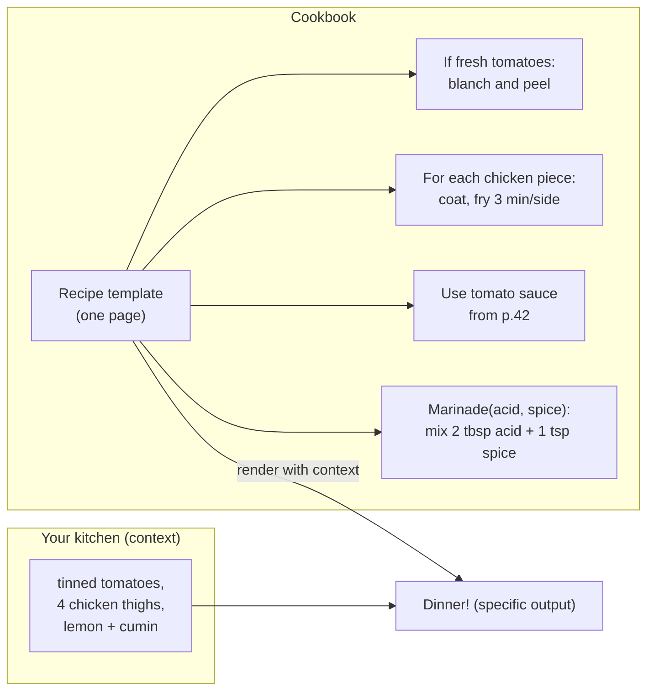

## 4. The Code

We'll build this in stages. First, control structures and filters in a single template. Then, template inheritance with `base.html`. Finally, a complete todo-list app that uses everything.

### 4.1 Project layout

```
template-logic/
├── app.py
└── templates/
    ├── base.html          {# the skeleton: nav, header, footer,  #}
    ├── index.html         {# home: extends base, simple welcome #}
    ├── todos.html         {# the todo list: uses , , filters #}
    ├── _item.html         {# a partial, included with  #}
    └── macros.html        {# reusable UI components:  #}
```

The `_item.html` filename starts with an underscore. That's not required by Jinja, but it's a convention some Flask developers use to mark "partial" templates — files meant to be ``d, not rendered on their own.

### 4.2 `app.py`

```python
from flask import Flask, render_template

app = Flask(__name__)

# In-memory "database" — a list of dicts. In real life this would be SQLAlchemy.
TODOS = [
    {'id': 1, 'task': 'Learn Jinja2 basics',  'done': True,  'priority': 'high'},
    {'id': 2, 'task': 'Master template logic', 'done': False, 'priority': 'high'},
    {'id': 3, 'task': 'Buy oat milk',          'done': False, 'priority': 'low'},
    {'id': 4, 'task': 'Call grandma',          'done': True,  'priority': 'medium'},
]


@app.route('/')
def home():
    return render_template('index.html', todos=TODOS)


@app.route('/todos')
def todos():
    return render_template('todos.html', todos=TODOS)


if __name__ == '__main__':
    app.run(debug=True)
```

### 4.3 `templates/base.html`

```html
<!DOCTYPE html>
<html lang="en">
<head>
    <meta charset="UTF-8">
    <title>My Flask App</title>
</head>
<body>
    <nav>
        <a href="{{ url_for('home') }}">Home</a> |
        <a href="{{ url_for('todos') }}">Todos</a>
    </nav>

    <main>
        
        {# Child templates override this #}
        
    </main>

    <footer>
        <p>&copy; 2026 — rendered at {{ none | default(now() | string, true) }}</p>
    </footer>
</body>
</html>
```

### 4.4 `templates/index.html`

```html


Home — {{ super() }}


    <h1>Welcome to my Flask app!</h1>
    <p>You have {{ todos | length }} todos total.</p>
    <p>{{ todos | selectattr('done') | list | length }} are done.</p>

```

### 4.5 `templates/todos.html`

```html


Todos


    <h1>My Todos</h1>

    
        <ul>
            
                
            
        </ul>
    
        <p>Nothing to do! 🎉</p>
    

    <p>
        Total: {{ todos | length }} |
        Done: {{ todos | selectattr('done') | list | length }} |
        Pending: {{ todos | rejectattr('done') | list | length }}
    </p>

```

### 4.6 `templates/_item.html`

```html
<li class="todo first
           last
           priority-{{ todo.priority }}">
    <span class="status">{{ '✅' if todo.done else '⬜' }}</span>
    <span class="task {{ 'done' if todo.done }}">{{ todo.task }}</span>
    <small>({{ todo.priority | upper }})</small>
</li>
```

We'll dissect every line of this after we run it.

## 5. Line-by-Line Explanation

### 5.1 Conditionals: ``, ``, ``, ``

Jinja's `` works exactly like Python's `if`, except the closing tag is `` (Python uses indentation; Jinja uses tags).

```html

    <a href="/admin">Admin panel</a>

    <a href="/profile">Your profile</a>

    <a href="/login">Sign in</a>

```

The expression inside `` is evaluated as Python. Truthy values (non-empty strings, non-zero numbers, non-empty lists, `True`) take the first branch; falsy values (`0`, `''`, `[]`, `None`, `False`) take the else branch.

> [!question] Student asks: "What about `` and ``?"
> Yes — all Python boolean operators work: `not`, `and`, `or`, `in`, `is`, comparisons (`==`, `!=`, `<`, `>`), parentheses. `` is perfectly valid.

#### 5.1.1 Behind the scenes: how `` compiles

When Jinja2's compiler sees `.........`, it generates Python that mirrors the structure:

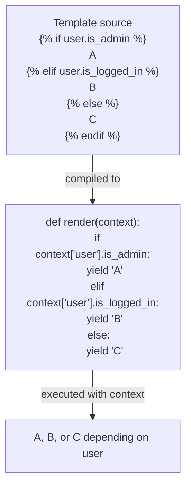

Notice that the compiled code is *real Python `if/elif/else`*. Jinja's `` is not a poor imitation — it compiles down to the exact same bytecode Python's `if` would produce. The only difference is that the body doesn't execute Python statements; it `yield`s strings.

> [!question] Student asks: "So is `` faster or slower than computing in Python and passing the result?"
> Same speed, essentially. The compiled `` becomes Python bytecode that runs at full speed. The only "overhead" is yielding strings instead of returning them, but Python's generator machinery is fast. In practice, you'll never measure a difference. Write whichever is more readable.

> [!try] Try this: inspect the compiled if
> In a Python shell:
> ```python
> from jinja2 import Environment
> env = Environment()
> src = env.compile('yesno', raw=True)
> print(src)
> ```
> Search the generated code for `if context`. You'll see the actual `if` statement Jinja generated. This is what runs every time you render that template.

### 5.2 Loops: `` and ``

```html

    <li>{{ todo.task }}</li>

```

This walks through `todos` and renders the inner block once per item, with `todo` bound to the current item. It works on any iterable — lists, tuples, dicts (iterates keys by default), strings (iterates characters), generators.

```html
{# Iterate dict keys #}
{{ key }}={{ my_dict[key] }}

{# Iterate dict items #}
{{ key }}={{ value }}

{# Iterate with index using range() #}
{{ i }}

{# Loop over two lists in parallel using zip #}
{{ name }}: {{ age }}
```

#### The `for...else` pattern

Jinja borrows Python's `for...else` (but uses it more sensibly than Python does — the name `else` for "ran zero times" is one of Python's worst naming decisions):

```html

    <li>{{ todo.task }}</li>

    <li>Nothing to do! 🎉</li>

```

The `else` block runs only if the loop iterated over an empty list. This is Jinja's "empty state" pattern — perfect for showing "No results found" when a search returns nothing.

### 5.3 The `loop` variable — your best friend inside loops

Inside any ``, Jinja injects a special variable called `loop` with information about the current iteration:

| Property | What it gives you |
|---|---|
| `loop.index` | The current iteration, **1-based** (1, 2, 3, ...) |
| `loop.index0` | The current iteration, **0-based** (0, 1, 2, ...) |
| `loop.first` | `True` on the first iteration, `False` otherwise |
| `loop.last` | `True` on the last iteration, `False` otherwise |
| `loop.length` | Total number of items (only available if the iterable supports `len()`) |
| `loop.revindex` | Iterations remaining, **1-based** (last item = 1) |
| `loop.revindex0` | Iterations remaining, **0-based** (last item = 0) |
| `loop.cycle('a', 'b')` | Cycles through a list — returns 'a' on iter 1, 'b' on iter 2, 'a' on iter 3, ... |
| `loop.previtem` | The previous item (undefined on first iteration) |
| `loop.nextitem` | The next item (undefined on last iteration) |

```html

    <tr class="odd-roweven-row">
        <td>{{ loop.index }}.</td>           {# 1, 2, 3, ... #}
        <td>{{ todo.task }}</td>
    </tr>

```

Or, even simpler — use `loop.cycle` for zebra striping:

```html

    <tr class="{{ loop.cycle('row-a', 'row-b') }}">
        <td>{{ todo.task }}</td>
    </tr>

```

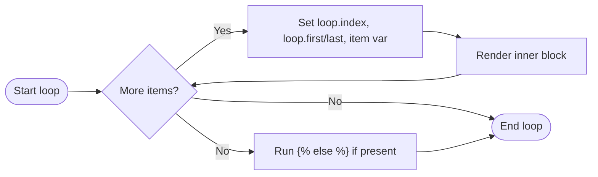

> [!try] Try this
> Render a list of five fruits. Use `loop.first` to bold the first item, `loop.last` to italicise the last, and `loop.index` to number them. The middle items get neither treatment.

#### 5.3.1 Nested loops and `loop.parent`

When loops nest, the inner loop's `loop` variable *shadows* the outer one. To access the outer loop from inside the inner one, Jinja gives you `loop.parent`:

```html

    <div class="row">
        
            <span class="cell row-{{ loop.parent.index }} col-{{ loop.index }}">
                {{ cell }}
            </span>
        
    </div>

```

Here `loop.parent.index` is the row number (outer loop), and `loop.index` is the column number (inner loop). Without `loop.parent`, the inner loop would have no way to ask "which row am I in?"

> [!question] Student asks: "Can I do `loop.parent.parent.index` for three-deep nesting?"
> Yes! Each level of nesting has its own `loop`, and `loop.parent` always points to the immediately enclosing loop's `loop`. For three-deep, `loop.parent` is the middle loop, `loop.parent.parent` is the outer. Beyond three levels your templates get hard to read — consider refactoring into a macro or moving some logic to Python.

> [!try] Try this: build a grid
> Pass a list of lists like `[['A', 'B', 'C'], ['D', 'E', 'F'], ['G', 'H', 'I']]` to a template. Use nested `` loops and `loop.parent.index` to render each cell with `class="cell r1 c1"`, `class="cell r1 c2"`, etc. Open DevTools and confirm the classes are correct.

### 5.4 Filters — the `|` pipe

Filters transform a value. The `|` pipe sends the value on the left into the filter on the right. You can chain them: `{{ name | strip | upper | truncate(10) }}` reads left-to-right: strip whitespace, uppercase, then truncate to 10 chars.

#### Built-in filters (the ones you'll use 90% of the time)

| Filter | Example | Output | Notes |
|---|---|---|---|
| `upper` | `{{ "hi" \| upper }}` | `HI` | Uppercases the string |
| `lower` | `{{ "HI" \| lower }}` | `hi` | Lowercases |
| `capitalize` | `{{ "hi there" \| capitalize }}` | `Hi there` | First letter upper, rest lower |
| `title` | `{{ "hi there" \| title }}` | `Hi There` | Each word capitalised |
| `trim` | `{{ " hi "\| trim }}` | `hi` | Strips leading/trailing whitespace |
| `strip` | same as `trim` | | Alias |
| `length` (or `count`) | `{{ todos \| length }}` | `4` | len() |
| `default` | `{{ x \| default('none') }}` | `none` (if x undefined) | Provide a fallback |
| `default(x, true)` | `{{ x \| default('none', true) }}` | `none` (if x is undefined OR falsy) | Second arg means "use default on empty/0/None too" |
| `join` | `{{ ['a','b'] \| join(', ') }}` | `a, b` | Join a list into a string |
| `replace` | `{{ "hi" \| replace('i', 'ey') }}` | `hey` | String replace |
| `truncate(80)` | `{{ long_text \| truncate(80) }}` | First 80 chars + `…` | Smart truncation |
| `round(2)` | `{{ 3.14159 \| round(2) }}` | `3.14` | Round to N decimals |
| `escape` (or `e`) | `{{ bio \| e }}` | HTML-escapes | Same as autoescape but explicit |
| `safe` | `{{ bio \| safe }}` | Marks as trusted, no escape | ⚠️ Only for trusted content |
| `striptags` | `{{ '<p>hi</p>' \| striptags }}` | `hi` | Remove all HTML tags |
| `first` | `{{ [1,2,3] \| first }}` | `1` | First element |
| `last` | `{{ [1,2,3] \| last }}` | `3` | Last element |
| `reverse` | `{{ [1,2,3] \| reverse \| list }}` | `[3,2,1]` | Reverse an iterable |
| `sort` | `{{ [3,1,2] \| sort \| list }}` | `[1,2,3]` | Sort ascending |
| `sort(reverse=true)` | `{{ [1,2,3] \| sort(reverse=true) \| list }}` | `[3,2,1]` | Sort descending |
| `unique` | `{{ [1,1,2] \| unique \| list }}` | `[1,2]` | Remove duplicates |
| `groupby` | `{{ users \| groupby('city') }}` | groups by attribute | Returns list of `(key, items)` tuples |
| `selectattr` | `{{ todos \| selectattr('done') \| list }}` | filter where attr is truthy | Like Python's `filter` |
| `rejectattr` | `{{ todos \| rejectattr('done') \| list }}` | filter where attr is falsy | Opposite of `selectattr` |

> [!info] Filters don't mutate the variable
> `{{ name | upper }}` *prints* the uppercased version. It does NOT change `name` itself. If you do `{{ name }}` later, you get the original. Filters are pure functions on the rendered output — they leave the context dict untouched.

#### Chaining filters

Filters chain left-to-right, just like a Unix pipe:

```html
{# Strip whitespace, then uppercase, then truncate to 3 chars #}
{{ "  hello world  " | strip | upper | truncate(3) }}
{# Output: HEL #}
```

Read it as: "take this string, pass it through strip → upper → truncate, and print the result."

### 5.5 Custom filters

You can register your own Python functions as Jinja filters. Two ways:

```python
# Way 1: Assign to app.jinja_env.filters dict
def reverse_string(s):
    return s[::-1]

app.jinja_env.filters['reverse'] = reverse_string

# Now in templates: {{ "hello" | reverse }}  →  "olleh"
```

```python
# Way 2: Use @app.template_filter() decorator
@app.template_filter('currency')
def currency_filter(amount):
    return f"${amount:,.2f}"

# Now in templates: {{ 1234.5 | currency }}  →  "$1,234.50"
```

#### A practical custom filter: relative time

A common real-world filter: turn a `datetime` into "5 minutes ago" / "2 hours ago" / "yesterday". You'd never want this logic scattered across templates — define it once as a filter:

```python
from datetime import datetime, timedelta

@app.template_filter('relative_time')
def relative_time(dt):
    """Turn a datetime into '5 minutes ago' style text."""
    now = datetime.now()
    diff = now - dt
    seconds = diff.total_seconds()

    if seconds < 60:
        return 'just now'
    elif seconds < 3600:
        return f'{int(seconds // 60)} minutes ago'
    elif seconds < 86400:
        return f'{int(seconds // 3600)} hours ago'
    elif seconds < 86400 * 7:
        return f'{int(seconds // 86400)} days ago'
    else:
        return dt.strftime('%Y-%m-%d')
```

```html
{# In any template #}
<p>Posted {{ post.created_at | relative_time }}</p>
{# → "Posted 5 minutes ago" #}
```

This is the gold standard for filters: **complex logic in Python, dead-simple call in the template**. If you ever look at a template and think "this is getting complicated," ask: "should this be a filter?"

#### 5.5.1 When to use a custom filter vs. compute in the view

A common design question: should a transformation live in a custom filter (called in the template) or in the view (with the result passed to the template)? Use this decision tree:

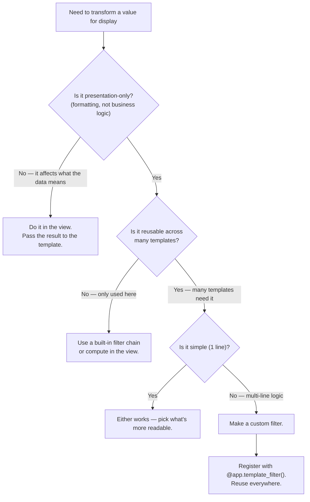

**Examples:**
- "Format this price as USD with cents" → custom filter `currency` (reusable, presentation-only).
- "Compute the user's age from their birthdate" → view (business logic; the age is data, not presentation).
- "Uppercase this string" → built-in `upper` filter (don't reinvent).
- "Show 'active' if user.is_active else 'inactive'" → inline `'active' if x else 'inactive'` (one-liner, not reusable).

> [!question] Student asks: "Can a custom filter take more than one argument?"
> Yes. Define `def filter_name(value, arg1, arg2):` and call `{{ x | filter_name(arg1, arg2) }}`. The value being filtered is always the *first* argument; additional arguments go in parentheses after the filter name.

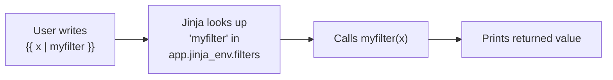

> [!question] Student asks: "Where should I put custom filters in a real app?"
> A common pattern: create a file `filters.py` next to `app.py`, define all your filter functions there, then in `app.py` do `from filters import register_filters; register_filters(app)`. The function loops through your filters and adds them to `app.jinja_env.filters`. This keeps `app.py` clean and makes filters reusable across projects.

### 5.6 Template inheritance — `base.html`, ``, ``

This is the big one. Real apps have 20+ pages that share a nav bar, footer, and `<head>`. Without inheritance, you'd copy-paste the nav into 20 files. Change the nav once → edit 20 files. With inheritance, you write the nav *once* in `base.html`, and 20 child templates extend it.

#### The base template

`base.html` is the skeleton. It contains everything that's the same across pages, plus **blocks** — named holes that children fill in:

```html
<!DOCTYPE html>
<html lang="en">
<head>
    <meta charset="UTF-8">
    <title>My Flask App</title>
</head>
<body>
    <nav><!-- nav stuff --></nav>
    <main>
        
        {# Default content (optional). Children can override. #}
        
    </main>
    <footer><!-- footer --></footer>
</body>
</html>
```

The `My Flask App` defines a block named `title` with a default value of "My Flask App". Child templates can either leave it alone (the default is used) or override it.

#### A child template

`index.html`:

```html


Home Page


    <h1>Welcome!</h1>
    <p>This is the home page.</p>

```

When Flask renders `index.html`, Jinja sees `` and:
1. Loads `base.html` as the *outer* structure.
2. Walks through `index.html` looking for `` definitions.
3. For each block defined in the child, replaces the matching block in the base.

So the output is: the base template's HTML, but with the `title` and `content` blocks replaced by the child's versions.

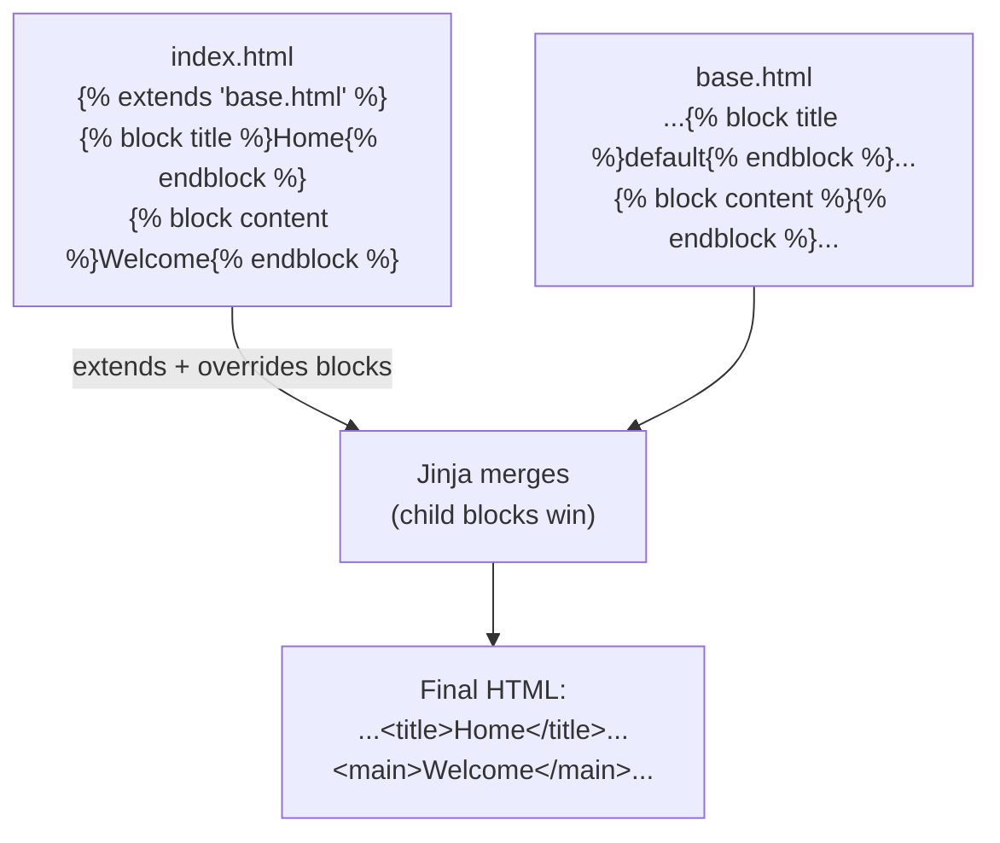

#### `{{ super() }}` — keeping the parent's content

Sometimes you don't want to *replace* the parent block, you want to *add to it*. Use `{{ super() }}` to insert the parent's version of the block:

```html
{# In a child template #}
Section — {{ super() }}
```

If `base.html` had `My Flask App`, the rendered output is `Section — My Flask App`. This is great for appending page-specific titles to a site-wide title.

#### Multi-level inheritance

You can have inheritance chains: `base.html` → `base_admin.html` → `admin_dashboard.html`. Each level overrides what it needs. Three levels is usually enough; beyond that, your hierarchy is probably too clever.

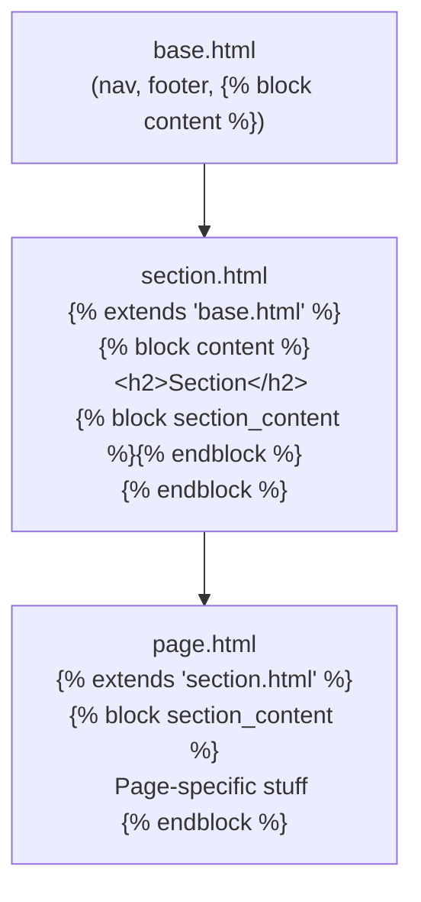

#### 5.6.1 Behind the scenes: how inheritance actually compiles

When Jinja2 sees `` at the top of `index.html`, it does something interesting at *compile* time: the compiled `index.html` is mostly empty — it only knows how to *provide* block contents. The actual page rendering is driven by `base.html`'s compiled function, which *calls* the child's block overrides at the right points.

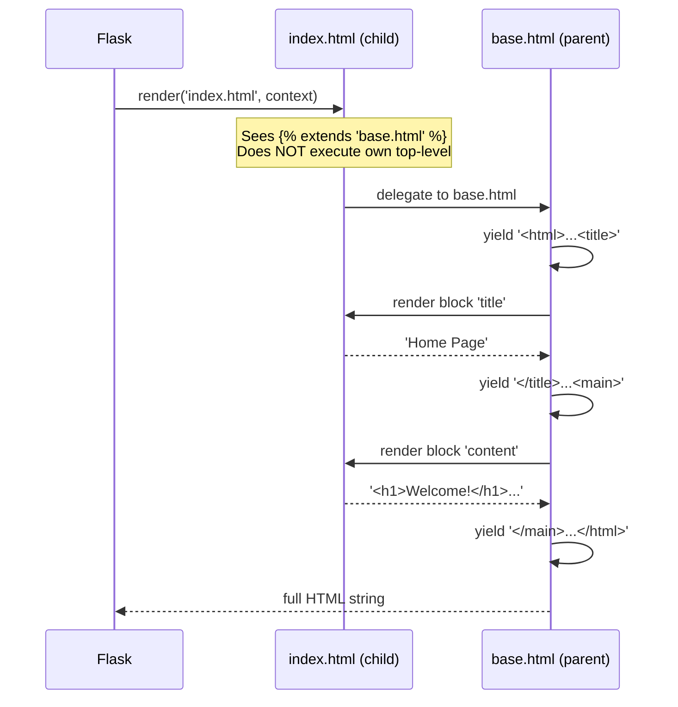

The child template is *not* rendered top-to-bottom on its own. It's a *provider* of block contents, and the parent template drives the show. That's why anything *outside* `` tags in a child template is silently dropped — there's no driver calling for it.

> [!question] Student asks: "Can a child template call `super()` multiple times in one block?"
> You can, but it'll render the parent block twice (and any side effects in the parent block, like ``, will fire twice). Almost always you want `super()` exactly once, at the start or end of the child block. If you find yourself wanting `super()` multiple times, you probably want a different structure — maybe split the block into two.

> [!try] Try this: see inheritance in action
> Make a child template with content *outside* a block:
> ```html
> 
> <p>This paragraph is outside any block.</p>
> <p>Inside the block.</p>
> ```
> Render it. Notice the first `<p>` is *missing* from the output. Only the block content made it through. This confirms the rule: outside a block, child content is silently dropped.
### 5.7 `` — drop in another template

`` grabs another template's rendered output and inserts it in place. Unlike inheritance (parent/child), includes are for **fragments** — small reusable pieces like a nav bar, a sidebar widget, a single comment.

```html
<!-- In todos.html -->
<ul>

    

</ul>
```

The included template has access to the same context as the including template — so inside `_item.html`, `todo` and `loop` are available. That's how `_item.html` can reference `{{ todo.task }}` and ``.

> [!question] Student asks: "When do I use `` vs `` vs macros?"
> - **``**: one template IS-A more specific version of another (a child of the base). One base, one child per page render. Think class inheritance.
> - **``**: drop a *fragment* into the current template. Multiple includes per page is fine. Think copy-paste without the copy-paste.
> - **Macros**: like a function — pass arguments, get HTML back. Reuse the same UI element with different data. Think `def button(label):` in Python.
>
> Rule of thumb: layout → extends; fragment → include; parameterised component → macro.

#### 5.7.1 The decision tree in detail

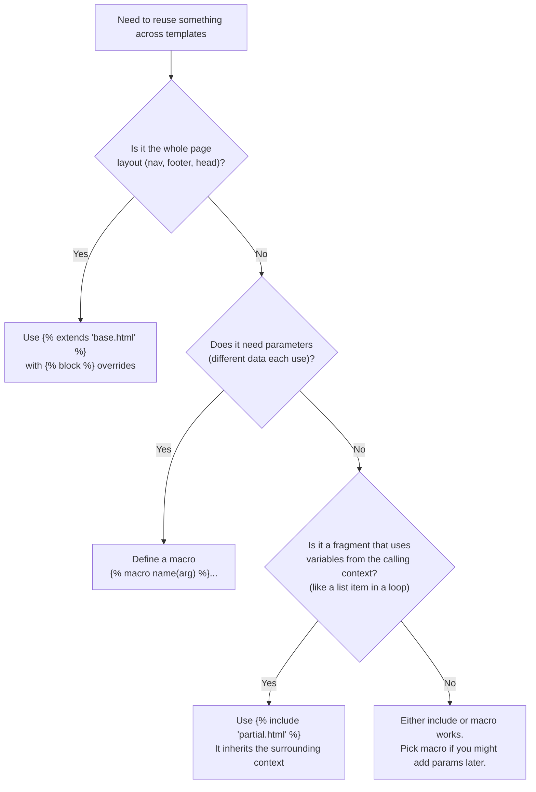

### 5.8 Macros — reusable template "functions"

Macros are Jinja's answer to "I want a `button(label, color)` function but in HTML":

```html
{# In macros.html #}

    <button class="btn btn-{{ kind }} btn-{{ size }}">{{ label }}</button>



    <div class="card">
        <h3>{{ title }}</h3>
        <p>{{ body }}</p>
    </div>

```

To use them in another template:

```html


{{ button('Save') }}
{{ button('Delete', kind='danger') }}
{{ button('Cancel', kind='secondary', size='sm') }}

{{ card('Hello', 'This is a card body.') }}
```

Macros are perfect for design-system components — buttons, alerts, cards, form fields. Define them once, import them everywhere.

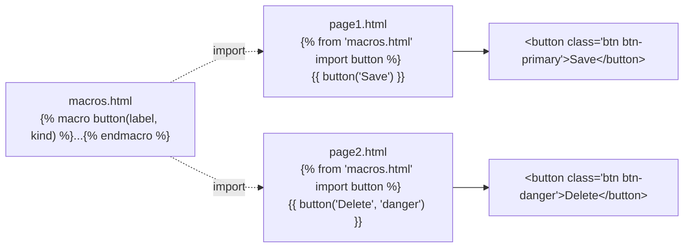

#### 5.8.1 Macros with context — accessing the calling template's variables

By default, macros only see the arguments you explicitly pass them — they're isolated functions, not context-sharing includes. Sometimes you want a macro to also see, say, the current `user` object without having to pass it every time. Add `with context` to the import:

```html


{# Now inside macros.html, button() can access variables from the calling template's context #}

    <button data-user-id="{{ user.id if user else '' }}">{{ label }}</button>

```

Use this sparingly — it makes macros less reusable (they depend on the calling context having a `user`). The default (no context) is the right choice 90% of the time.

> [!question] Student asks: "What's the difference between a macro and a custom filter?"
> Filters transform a *value* and return a *string* (typically short — `{{ x | upper }}` returns `X`). Macros render a *chunk of HTML* using one or more values, often with structure (multiple tags, attributes, nested elements). Use a filter for transformations of a single value; use a macro when you need to emit structured HTML with parameters. If your filter starts building HTML strings, it should probably be a macro.

> [!try] Try this: build a button macro
> Write a `button(label, kind='primary', icon=None)` macro that renders `<button class="btn btn-{{ kind }}"><i class="icon-{{ icon }}"></i>{{ label }}</button>`. Use it three times: `{{ button('Save') }}`, `{{ button('Delete', kind='danger', icon='trash') }}`, `{{ button('Cancel', kind='secondary') }}`. View source and confirm the HTML matches what you'd write by hand.

### 5.9 `` — variables inside templates

Sometimes you want to compute a value once and reuse it. `` creates a template-level variable:

```html



<p>Total: {{ total }} | Done: {{ done }} | Pending: {{ total - done }}</p>
```

Without ``, you'd compute `todos | length` three times in that line — once for the total, once for the pending calculation. `` lets you store it once.

#### 5.9.1 `` inside `` blocks — scope gotcha

A `` at the top level of a template creates a variable that lives for the rest of the template. But a `` *inside* a block (an ``, ``, or ``) has limited scope — it might not survive outside the block, especially across block boundaries in inheritance.

```html

    


{{ greeting }}  {# Might be undefined! #}
```

The reliable fix when you need to set a value conditionally is to use the `default` filter or set it before the block:

```html

{{ greeting }}  {# Always defined #}
```

This is one of the most surprising things about Jinja for beginners; if a `` "vanishes", check whether it was inside an ``.

> [!question] Student asks: "Can I `` a complex expression?"
> Yes. `` (the `~` is Jinja's string concatenation operator). You can also call functions: `` (if `datetime` is available in the template — you'd need to inject it as a global). Keep complex logic in the view when possible, though — `` should be for convenience, not business logic.

### 5.10 `` — scoped variables

`` creates a variable that lives until the end of the template (or until you `{% set %` it again). Sometimes you want a variable to live only inside a small block. That's what `` is for:

```html

    <p>{{ greeting }}</p>
    <p>{{ greeting }}, welcome back!</p>


{# greeting is undefined here #}
```

`` is to templates what a `with` block is to Python's scoping — it limits where a variable exists.

### 5.11 Comments: `{# ... #}`

```html
{# This is a Jinja comment. It's stripped out before the HTML is sent. #}

<!--
  This is an HTML comment. It IS sent to the browser, visible in View Source.
-->
```

Use Jinja comments for notes to yourself or other developers. Use HTML comments only when you want the browser to see them (rare).

### 5.12 Context scope — what variables are available where

This is a frequent source of bugs. Here are the rules:

1. Variables passed to `render_template()` are available in the main template **and** in any ``d templates (they share the context).
2. Variables passed to `render_template()` are available in templates that are ``ed — but blocks are *replaced*, so the variable isn't "used up" by the base.
3. Variables passed via `` (default) share the parent's context. Use `` to make the include see only what you explicitly pass.
4. Macros defined in another file don't see the calling template's context unless you pass it explicitly. Macros are like functions — they only see their arguments.
5. Inside a ``, you have access to the context that was active when the block was rendered — which is the parent template's context. (This is a subtle point; don't worry about it until you hit a problem with it.)

### 5.13 Behind the scenes: how Jinja compiles a template

When Flask first renders `todos.html`, Jinja doesn't just "find-and-replace" the `{{ }}` markers. It does something much smarter — it **compiles** the template into a Python function. Roughly, this template:

```html
<ul>

    <li>{{ todo.task | upper }}</li>

</ul>
```

…gets compiled into something like this (simplified, real Jinja is more sophisticated):

```python
def render(context):
    yield '<ul>\n'
    for todo in context['todos']:
        yield '    <li>'
        yield str(todo.task).upper()
        yield '</li>\n'
    yield '</ul>\n'
```

The compiled function is a **generator** that yields strings. Jinja joins them into the final HTML. The compiled function is cached in `app.jinja_env.cache` so subsequent requests skip the compile step.

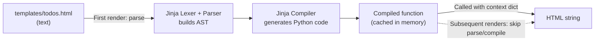

The implications are nice:

- **No re-parsing**: once compiled, rendering is just "call a function with a context dict" — very fast.
- **Python expressions work natively**: `{{ todo.task.upper() }}` literally becomes `str(todo.task.upper())` in the compiled code.
- **Debug mode reloads on file change**: when `app.run(debug=True)`, Flask watches template files and recompiles them if they change. In production, the cache lives for the process lifetime.
- **Errors point to the template line**: when something blows up, the traceback shows the line in the `.html` file, not the compiled Python.

> [!try] Try this
> Run your app in debug mode, edit a template, save, and reload the browser. Notice Flask picked up the change without a restart. That's debug-mode auto-reload in action.

#### 5.13.1 Common cache gotchas

The compiled-template cache is a *huge* performance win, but it bites beginners in two specific ways:

1. **Production doesn't pick up template changes.** In `debug=False`, Flask doesn't watch template files for changes. If you SSH into your server, edit `templates/index.html`, and reload the page, you'll see the *old* version — the compiled function in memory is what's running. The fix: restart your app (Gunicorn: `systemctl restart myapp` or `kill -HUP <pid>`).
2. **Stale templates after a deploy.** Some hosting platforms (especially containerised ones) keep the old worker processes around briefly during a rolling deploy. For a few seconds, half your users see the new templates and half see the old. This resolves itself as the rollout completes, but it's worth knowing about.

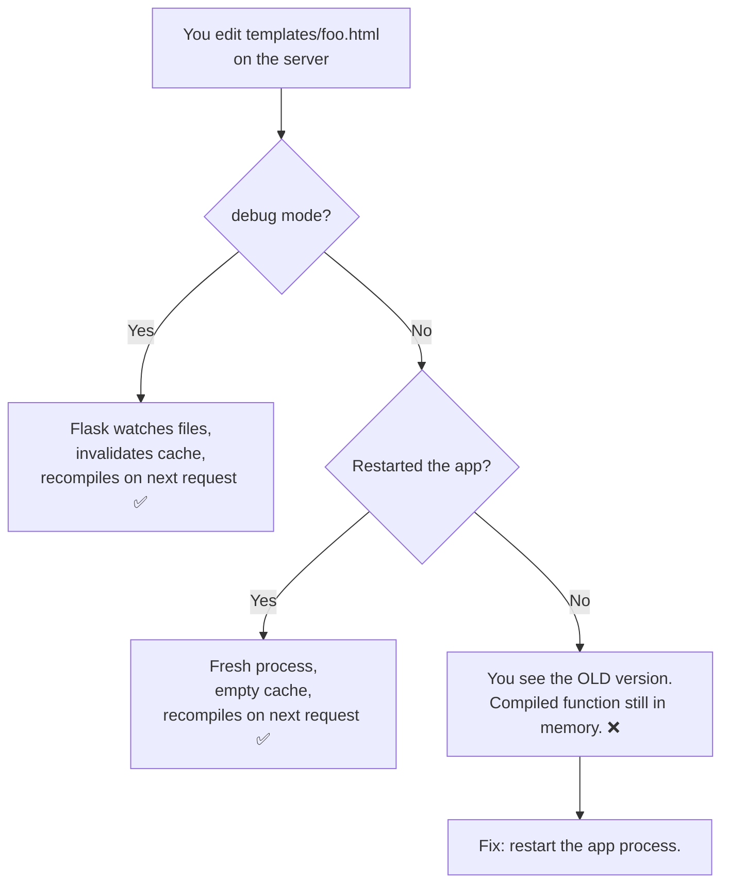

> [!tip] Production deploy rule of thumb
> Always restart your Flask workers after deploying new template files. Many CI/CD pipelines do this automatically; if you're deploying manually, make it part of your checklist. The "why isn't my template change showing up?" question is almost always this.

### 5.14 The mental model: a recipe for choosing the right tool

You now have many tools — ``, ``, filters, ``, ``, macros, ``. How do you pick?

| Need | Use |
|---|---|
| Show different HTML based on a condition | `` |
| Render the same HTML once per item in a list | `` |
| Transform a value for display (uppercase, truncate, format) | A filter |
| Same layout across many pages | `` + `` |
| Drop a fragment (nav bar, single comment) into a page | `` |
| Reusable UI component with arguments (button, card) | A macro |
| Compute a value once, reuse it | `` |
| Limit a variable's scope to a block | `` |
| Note to yourself that doesn't reach the browser | `{# comment #}` |

If you find yourself writing the same `...` block in five templates, ask: "should this be a macro?" If you find yourself copy-pasting the same nav bar into five templates, ask: "should this be in `base.html`?" Always be on the lookout for duplication — Jinja gives you the tools to kill it.

## 6. Running the Code

Save the four template files inside `templates/` and run:

```bash
python app.py
```

### 6.1 Visit `/`

Open `http://127.0.0.1:5000/`. You should see:

```
Home | Todos

Welcome to my Flask app!

You have 4 todos total.
1 are done.

© 2026 — rendered at ...
```

View source. Notice:

- The `<nav>`, `<main>`, and `<footer>` came from `base.html` — the child `index.html` never wrote them.
- The `<title>` is `Home — My Flask App` — `{{ super() }}` inserted the parent's title.
- `{{ todos | length }}` produced `4`, and `{{ todos | selectattr('done') | list | length }}` produced `1` — the chained filters did the work.

### 6.2 Visit `/todos`

```
My Todos

    ⬜ Learn Jinja2 basics ✅ (HIGH)
    ⬜ Master template logic (HIGH)
    ⬜ Buy oat milk (LOW)
    ⬜ Call grandma ✅ (MEDIUM)

Total: 4 | Done: 2 | Pending: 2
```

Open DevTools → Inspect the list. You'll see:

```html
<li class="todo first priority-high">
    <span class="status">✅</span>
    <span class="task done">Learn Jinja2 basics</span>
    <small>(HIGH)</small>
</li>
<li class="todo priority-high">
    <span class="status">⬜</span>
    <span class="task">Master template logic</span>
    <small>(HIGH)</small>
</li>
...
<li class="todo last priority-medium">
    ...
</li>
```

Notice:
- The first `<li>` has class `first`, the last has class `last` — from `` and ``.
- Each `<li>` has a `priority-{{ todo.priority }}` class — for CSS styling.
- The done items have `class="task done"` — from `{{ 'done' if todo.done }}`.
- The status emoji swaps based on `todo.done`.

### 6.3 Try an empty list

Edit `app.py` and temporarily change `TODOS = []`. Reload `/todos`. You should see:

```
My Todos

Nothing to do! 🎉

Total: 0 | Done: 0 | Pending: 0
```

The `` block of the `` ran, because the loop iterated zero times. Restore the list before continuing.

### 6.4 Real-world: how production apps use inheritance

In a real Flask app, you might have:

- `base.html` — full page skeleton with nav, footer, JS includes.
- `auth_base.html` — extends `base.html`, adds a sidebar with login state.
- `dashboard_base.html` — extends `base.html`, adds a sidebar with nav links.
- `login.html`, `register.html` — extend `auth_base.html`, just fill the `content` block.
- `dashboard.html`, `settings.html` — extend `dashboard_base.html`.

This means changing the nav bar in `base.html` updates 10+ pages instantly. That's the power of inheritance.

## 7. Common Mistakes

### 7.1 Missing `` or ``

```html

    <p>Hi</p>
{# missing  #}
```

Jinja raises `TemplateSyntaxError: Encountered unknown tag 'endblock'` (or similar). Always close what you open. Your editor's Jinja plugin will usually highlight the matching tag.

### 7.2 Putting content outside `` in a child template

```html
{# WRONG: this <p> is silently dropped #}

<p>Something</p>
...
```

In a child template, **everything outside `` tags is ignored**. The whole point of `` is "I'm just providing block contents" — stray text doesn't have anywhere to go.

### 7.3 Misspelling a block name

```html
{# In base.html #}


{# In child — typo #}
...
```

Jinja silently ignores the misspelled block. The parent's default (usually empty) shows up instead. You'll see a blank area in your page and wonder why. Triple-check block names.

### 7.4 `` vs `` confusion

- `` — *this template IS-A child of base*. The child only provides block overrides.
- `` — *drop header.html's content here*. The including template keeps its own structure.

A child template ``ing `base.html` cannot also `` something at the top level — there's nothing to include into. Only inside a `` can you ``.

### 7.5 Wrong braces

```html
{# WRONG: this prints "if user" #}
{{ if user }}...

{# RIGHT #}
...
```

If you see literal "if" or "for" in your page, you mixed up the braces.

### 7.6 Filters don't mutate

```html
{{ todos | sort }}     {# prints sorted list, does NOT sort todos #}
{{ todos | first }}    {# prints first item, todos unchanged #}
```

Filters transform the *output*, not the variable. If you need a sorted version of a list to use multiple times, `` first.

### 7.7 Dict iteration surprises

```html
   {# WRONG — dict isn't a list of tuples #}
   {# RIGHT #}
```

Iterating a dict directly yields keys only. Use `.items()` for both keys and values, just like Python.

### 7.8 Using macros without importing

```html
{# In page.html #}
{{ button('Save') }}   {# NameError: button is not defined #}
```

Macros don't appear magically. You must `` at the top of every template that uses them.

## 8. Exercises

> [!tip] The 20-minute rule
> If you're stuck for 20 minutes, take a break, re-read the relevant section, or come back tomorrow. Sleep helps.

1. **Blog post list.** Add a route `/blog` that renders a list of post dicts (`[{'title': ..., 'body': ..., 'date': ...}, ...]`). Use a `` loop, the `truncate(50)` filter on the body, and the `date` filter to format dates. (Jinja doesn't have a built-in date filter by default — use `{{ post.date.strftime('%Y-%m-%d') }}` instead, since dates are alive in the template.)

2. **Zebra-stripe a table.** Build a table of 10 users and use `loop.cycle('odd', 'even')` to give alternating rows different CSS classes. Inspect the rendered HTML to confirm the classes alternate.

3. **Nav include.** Extract the `<nav>` from `base.html` into `_nav.html` and `` it. Confirm the rendered output is identical.

4. **Filter playground.** Create a single route `/filters` that passes a string, a list, and a number to a template. In the template, demonstrate 10 different filters (one per `<p>` tag) and show the before/after.

5. **Empty-state messages.** Add a `...` block to your blog list from exercise 1. When the list is empty, show "No posts yet — check back soon!" instead.

6. **Two-level inheritance.** Create `auth_base.html` that extends `base.html` and adds a `<div class="auth-layout">` wrapper around ``. Then create `login.html` that extends `auth_base.html` and just fills the content block.

7. **Custom filter.** Write a `relative_time` filter that takes a `datetime` and returns "just now", "5 minutes ago", "2 hours ago", or "3 days ago" based on how long ago it was. Register it with `@app.template_filter('relative_time')` and use it in a template.

8. **Macro for form fields.** Write a `field(name, label, type='text', value='')` macro that renders:
   ```html
   <div class="form-field">
     <label for="{{ name }}">{{ label }}</label>
     <input type="{{ type }}" id="{{ name }}" name="{{ name }}" value="{{ value }}">
   </div>
   ```
   Use it three times in a form to render username, email, and password fields.

9. **N+1 awareness.** (Conceptual.) Suppose you have 100 blog posts and each one has an `author` attribute. You write `{{ post.author.name }}`. What database queries get executed? (Answer in a comment in your `app.py` — we'll cover this properly in [[Lesson-14-Relationships]].)

10. **Build a complete page.** Combine everything: a `base.html` with nav + footer, a `_sidebar.html` partial, a `macros.html` with `card()` and `button()` macros, and a `dashboard.html` that extends base, includes the sidebar, and renders 3 cards using the macro. The result should look like a real (ugly but functional) admin dashboard.

11. **Filter chain golf.** Starting with `"  Hello, World!  "` (note the spaces), produce the output `HELLO` using a chain of three filters. (Hint: `trim`, `replace`, `upper` — or `truncate`.) Show your chain to a colleague and see who can do it in fewer filters.

12. **Macro for a pagination control.** Write a `pagination(page, total_pages)` macro that renders `<a>` tags for Previous, the page numbers, and Next. Disable Previous when `page == 1` and Next when `page == total_pages`. Use the macro for a fictional `/posts?page=3` route.

13. **Inheritance chain.** Build a three-level chain: `base.html` → `section.html` → `article.html`. `section.html` adds a section header and sidebar; `article.html` fills in the article body. Confirm that editing the nav in `base.html` updates all three pages.

14. **Custom `currency` filter.** Write a filter that takes a number and a currency code (e.g., `{{ price | currency('EUR') }}`) and returns `"€1,234.50"`. Hint: Python's `locale` module or the `babel` library can format currencies properly — don't try to roll your own.

15. **Debug a stale template.** Run your app with `app.run(debug=False)`. Edit `index.html` and reload. Notice the change doesn't appear. Now restart the app and reload — change appears. Write a one-paragraph explanation of *why* this happens, referring to Jinja's compiled-template cache (section 5.13.1).

## 9. What We Learned

- **`` / `` / `` / ``** let templates branch on conditions, exactly like Python's `if`.
- **`` / ``** loops over lists, dicts, ranges. **``** inside a for loop runs if the iterable was empty.
- **The `loop` variable** gives you `loop.index` (1-based), `loop.index0`, `loop.first`, `loop.last`, `loop.length`, `loop.cycle()` — your tools for numbered lists, zebra striping, and first/last-item special cases.
- **Filters** transform values with the `|` pipe. You can chain them: `{{ x | strip | upper | truncate(10) }}`. The 20+ built-ins cover 90% of cases; **custom filters** are Python functions registered with `@app.template_filter()`.
- **Template inheritance** with ``, ``, and `{{ super() }}` lets you write the layout once in `base.html` and reuse it across every page. Multi-level inheritance (base → section → page) is supported.
- **``** drops a fragment template's output into the current template (great for nav bars, sidebars, single list items).
- **Macros** are reusable template functions: `...`, imported with ``.
- **``** creates template-level variables; **``** scopes them to a block.
- **Comments** are `{# ... #}` — stripped before the HTML is sent.
- **Context scope**: passed variables are available in `include`s (shared), but macros only see their arguments.

## 10. Next Lesson

You can now build full pages with logic. But our pages are still ugly — no CSS, no images, no JavaScript. The next lesson fixes that.

In [[Lesson-09-Static-Files]] you'll learn:

- **The `static/` folder** — where CSS, JS, images, and fonts live.
- **`url_for('static', filename='...')`** — the right way to reference assets in templates.
- **Why not hardcode paths** — production deployment, cache busting, DRY.
- **How Flask serves static files in development vs production.**
- **Modern additions:** Tailwind CSS 4.0 setup, Vite integration, CDN basics.

> [!quote] A note from your teacher
> You've now learned the single most important skill in Flask: turning data into HTML. Everything else — forms, databases, authentication — is just feeding *more data* into the templates you already know how to write. Take a moment to appreciate how far you've come. Then go make something ugly and be proud of it.
