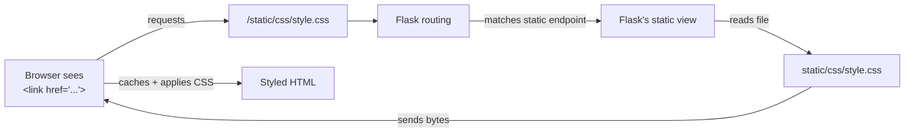
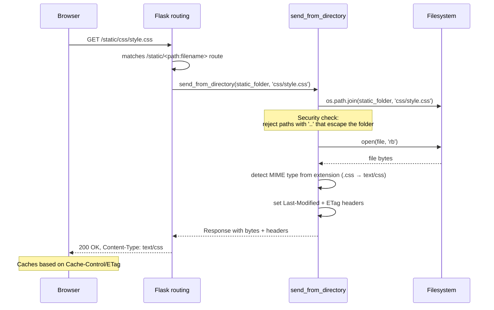
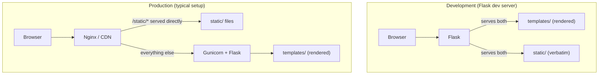
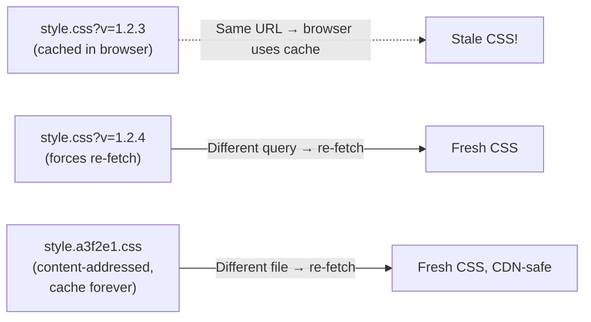
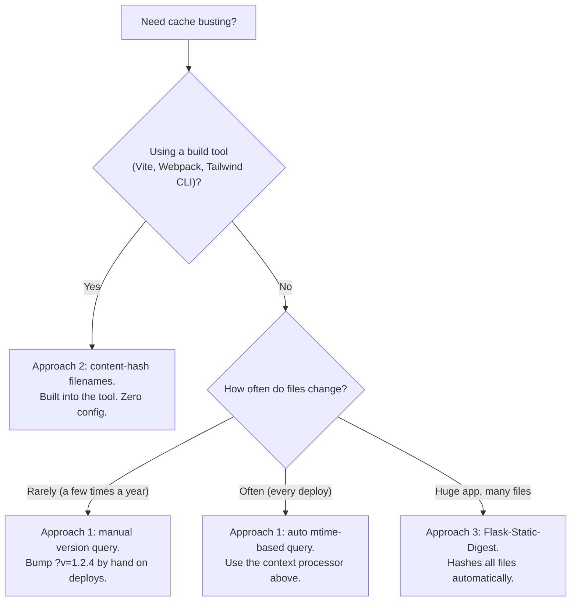
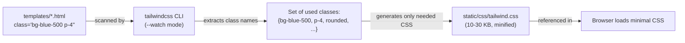
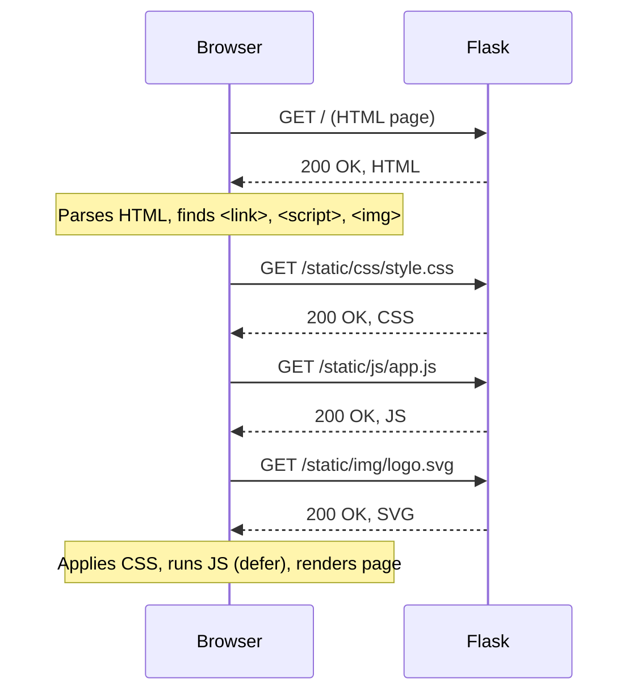
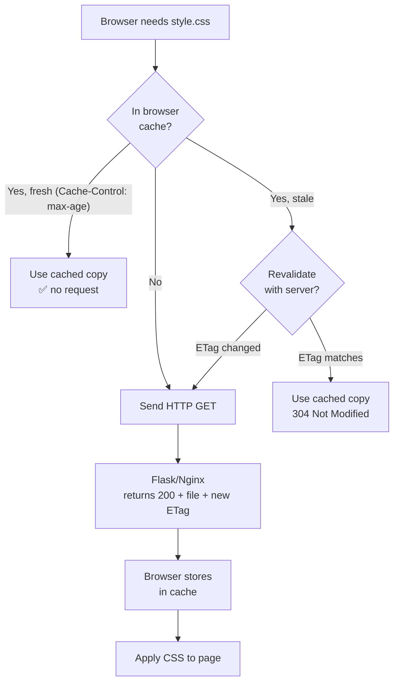

# Lesson 09 — Static Files: CSS, JS, Images, and Fonts

> [!success] Your templates are about to get dressed up.
> So far, every page Flask has sent was pure HTML — no styling, no images, no JavaScript. They look like 1995. Today you'll learn how to serve **static files**: CSS for styling, JavaScript for interactivity, images, fonts, favicons. You'll also learn **the right way** to reference them with `url_for('static', ...)`, why hardcoding `/static/css/style.css` is a footgun, and how the pros handle this in production (with CDNs, cache busting, and modern build tools like Tailwind and Vite).

## 1. Learning Objectives

By the end of this lesson you will be able to:

1. **Explain what static files are** and why they're different from templates.
2. **Use the `static/` folder convention** and organise files into `css/`, `js/`, `img/`, `fonts/` subfolders.
3. **Use `url_for('static', filename='...')`** to reference assets in templates — and explain why this beats hardcoded paths.
4. **Describe how Flask serves static files in development vs production.**
5. **Explain cache busting** and three ways to do it (query strings, file hashing, Flask's `STATIC_URL_PATH`).
6. **Integrate Tailwind CSS 4.0** with Flask using the standalone CLI (no Node.js required).
7. **Know when and how to use Vite** for a build step (and when not to).
8. **Reference a CDN** like Cloudflare or CloudFront for production assets.

## 2. Prerequisites

- **[[Lesson-07-Jinja2-Basics]] and [[Lesson-08-Template-Logic]] completed.** You can write templates with ``, ``, and `{{ }}`.
- **Basic HTML/CSS/JS.** You've seen `<link rel="stylesheet">` and `<script src="...">` before.

## 3. The Problem

Your todo app from Lesson 08 works. The HTML is clean. But when you open it in a browser, you see this:

```
Home | Todos

My Todos

  ⬜ Learn Jinja2 basics ✅ (HIGH)
  ...
```

Black text on a white background. Default Times New Roman. No spacing. No borders. No colors. It looks like a 1995 academic paper.

You know CSS would fix this. So you write `style.css`:

```css
body {
  font-family: system-ui, sans-serif;
  background: #fafafa;
  margin: 2rem;
}
.todo { padding: 0.5rem; border-bottom: 1px solid #eee; }
.todo.done .task { text-decoration: line-through; color: #aaa; }
.priority-high { border-left: 4px solid #e74c3c; }
.priority-medium { border-left: 4px solid #f39c12; }
.priority-low { border-left: 4px solid #27ae60; }
```

Now — where do you put this file? And how do you tell the browser where to find it?

If you say "next to `app.py` and reference it as `/style.css`," you'll discover two problems:

1. Flask will return a 404 for `/style.css` because no route matches it.
2. Even if you wrote a route to serve it, you'd reinvent what Flask already does for you.

The Flask way: put static files in a folder called **`static/`** and reference them with `url_for('static', filename='...')`.

### 3.1 The restaurant kitchen analogy

Think of a restaurant kitchen. Two kinds of things come out of it:

- **Made-to-order dishes** — the chef cooks them when you order, tailored to your request (no onions, extra sauce). Each one is a *template render*: same recipe, different parameters, different plate.
- **Pre-packaged items** — bread rolls, butter packets, printed menus, the bottle of hot sauce. These are *static files*: made once, stored, served as-is to every table. The chef doesn't touch them when you order; the waiter just grabs one and brings it.

A restaurant needs both. So does Flask. Your `templates/` folder is the kitchen where dishes are cooked to order; your `static/` folder is the pantry of pre-packaged items the waiter grabs without bothering the chef. The chef's time (Python processes) is expensive — you don't want them fetching bread rolls.

```mermaid
flowchart TB
    subgraph Restaurant
        Customer["Customer (browser)"]
        Customer --> Waiter["Waiter (HTTP server)"]
        Waiter -->{"What's ordered?"}
        Waiter -->|"Custom dish (URL like /user/alice)"| Chef["Chef (Flask + Jinja)"]
        Chef -->|"Cooks to order"| Template["templates/user.html<br/>+ context dict"']
        Waiter -->|"Bread roll (URL like /static/logo.svg)"| Pantry["Pantry (static/ folder)"]
        Pantry -->|"Hands it over as-is"| Static["static/logo.svg<br/>(bytes from disk)"]
        Template --> Plate1["Plate arrives hot"]
        Static --> Plate2["Bread roll arrives cold"]
    end
```

In production, you'd hire a dedicated bread-roll-fetcher (Nginx, CDN) so the chef can focus on cooking. We'll get to that in section 5.4.

## 4. The Code

### 4.1 What are static files?

Static files are **assets that don't change between requests**. They're not generated by Python code — they're just sent over as-is. Examples:

| Type | Examples | Why they're static |
|---|---|---|
| **CSS** | `style.css`, `theme.css` | Same for every user |
| **JavaScript** | `app.js`, `chart.js` | Same for every user |
| **Images** | `logo.svg`, `hero.jpg`, `icon.png` | Same for every user |
| **Fonts** | `Inter.woff2`, `Mono.ttf` | Same for every user |
| **Favicons** | `favicon.ico` | Same for every user |
| **PDFs, downloads** | `manual.pdf` | Same for every user |

Templates (`index.html`) are **dynamic** — Flask renders them with different data each request. Static files are **static** — they're sent verbatim every time. Flask treats them differently because static files can be served *very* fast (no rendering) and can be cached aggressively by browsers and CDNs.

### 4.2 Project layout

```
static-files-demo/
├── app.py
├── templates/
│   ├── base.html
│   └── todos.html
└── static/
    ├── css/
    │   └── style.css
    ├── js/
    │   └── app.js
    └── img/
        └── logo.svg
```

The convention: a top-level `static/` folder next to `app.py`, with subfolders for `css/`, `js/`, `img/`, `fonts/`. Just like `templates/`, the name `static/` is hardcoded into Flask's defaults.

### 4.3 `app.py`

```python
from flask import Flask, render_template

app = Flask(__name__)

TODOS = [
    {'id': 1, 'task': 'Learn Jinja2 basics',  'done': True,  'priority': 'high'},
    {'id': 2, 'task': 'Master template logic', 'done': False, 'priority': 'high'},
    {'id': 3, 'task': 'Buy oat milk',          'done': False, 'priority': 'low'},
]


@app.route('/')
@app.route('/todos')
def todos():
    return render_template('todos.html', todos=TODOS)


if __name__ == '__main__':
    app.run(debug=True)
```

### 4.4 `templates/base.html`

```html
<!DOCTYPE html>
<html lang="en">
<head>
    <meta charset="UTF-8">
    <title>My Todos</title>
    <link rel="stylesheet" href="{{ url_for('static', filename='css/style.css') }}">
    <link rel="icon" href="{{ url_for('static', filename='img/logo.svg') }}">
</head>
<body>
    <header>
        
        <h1>My Todos</h1>
    </header>
    <main>
        
    </main>
    <script src="{{ url_for('static', filename='js/app.js') }}" defer></script>
</body>
</html>
```

### 4.5 `templates/todos.html`

```html



<ul class="todo-list">
    
        <li class="todo priority-{{ todo.priority }} {{ 'done' if todo.done }}">
            <span class="status">{{ '✅' if todo.done else '⬜' }}</span>
            <span class="task">{{ todo.task }}</span>
        </li>
    
</ul>
<button id="clickme" class="btn">Clicked <span id="count">0</span> times</button>

```

### 4.6 `static/css/style.css`

```css
body {
    font-family: system-ui, -apple-system, sans-serif;
    background: #fafafa;
    color: #222;
    margin: 2rem auto;
    max-width: 720px;
}
header { display: flex; align-items: center; gap: 1rem; }
.todo-list { list-style: none; padding: 0; }
.todo {
    padding: 0.75rem 1rem;
    background: white;
    border: 1px solid #eee;
    border-left-width: 4px;
    margin-bottom: 0.5rem;
    display: flex;
    align-items: center;
    gap: 0.5rem;
    transition: transform 0.1s;
}
.todo:hover { transform: translateX(4px); }
.todo.done .task { text-decoration: line-through; color: #999; }
.priority-high { border-left-color: #e74c3c; }
.priority-medium { border-left-color: #f39c12; }
.priority-low { border-left-color: #27ae60; }
.btn {
    background: #3498db; color: white; border: none;
    padding: 0.5rem 1rem; border-radius: 4px; cursor: pointer;
    margin-top: 1rem;
}
.btn:hover { background: #2980b9; }
```

### 4.7 `static/js/app.js`

```javascript
// Click counter — demonstrates that Flask-rendered HTML + JS interop works
document.addEventListener('DOMContentLoaded', () => {
    const button = document.getElementById('clickme');
    const counter = document.getElementById('count');
    let count = 0;
    button.addEventListener('click', () => {
        count++;
        counter.textContent = count;
    });
});
```

### 4.8 `static/img/logo.svg`

```xml
<svg xmlns="http://www.w3.org/2000/svg" viewBox="0 0 64 64" width="64" height="64">
    <rect width="64" height="64" rx="12" fill="#3498db"/>
    <path d="M16 32 L28 44 L48 20" stroke="white" stroke-width="6" fill="none" stroke-linecap="round" stroke-linejoin="round"/>
</svg>
```

## 5. Line-by-Line Explanation

### 5.1 The `static/` folder convention

Just like `templates/`, Flask looks for a folder called `static/` next to your `app.py`. The name is hardcoded. If you call it `assets/` or `public/`, Flask won't find it (you can override with `Flask(__name__, static_folder='assets')`, but don't — stick with the convention).

Inside `static/`, you organise files by type:

```
static/
├── css/         {# all .css files #}
├── js/          {# all .js files #}
├── img/         {# all images #}
├── fonts/       {# all .woff2, .ttf files #}
└── uploads/     {# user-uploaded files (if you serve them statically) #}
```

You don't *have* to use these subfolders, but you'll thank yourself later. A `static/` folder with 200 files dumped in the root is a nightmare.

### 5.2 `url_for('static', filename='...')` — the right way

The single most important line in this lesson:

```html
<link rel="stylesheet" href="{{ url_for('static', filename='css/style.css') }}">
```

Let's dissect it:

- `url_for(...)` is the same function we met in Lesson 04 — it builds a URL by *endpoint name*. `'static'` is a special endpoint Flask defines for serving static files.
- `filename='css/style.css'` is the path to the file **inside the `static/` folder**.
- The function returns a URL like `/static/css/style.css` (the path the browser will request).



> [!question] Student asks: "Why not just write `/static/css/style.css` directly?"
> Three reasons:
>
> 1. **`STATIC_URL_PATH` can change.** In production, you might tell Flask to serve static files from `/assets/` instead of `/static/` (e.g., to put a CDN in front). If you hardcoded `/static/...` in 20 templates, you'd have to find-and-replace all of them. With `url_for`, you change one config setting.
>
> 2. **Cache busting.** When you change `style.css`, browsers will keep using their cached copy until you change the URL. With `url_for`, Flask can append a version hash automatically (more on this in section 5.6).
>
> 3. **DRY reverse routing.** Same reason you use `url_for('user', name='alice')` instead of `/user/alice` — if the route ever moves, the URL updates everywhere.

If that hasn't convinced you, remember: hardcoded URLs are the same footgun as hardcoded strings anywhere. Use `url_for` for *all* URLs in templates, including static files.

> [!try] Try this: hardcode vs `url_for`
> In `base.html`, temporarily change `{{ url_for('static', filename='css/style.css') }}` to a hardcoded `/static/css/style.css`. Reload the page — it works. Now change `Flask(__name__)` to `Flask(__name__, static_url_path='/assets')` in `app.py`. Reload: the hardcoded link 404s, but the `url_for` version (if you have any left) keeps working. This is the fragility you avoid by always using `url_for`.

> [!question] Student asks: "Can I pass extra query parameters through `url_for('static', ...)`?"
> Yes. `url_for('static', filename='css/style.css', v='1.2.3')` returns `/static/css/style.css?v=1.2.3`. Any keyword argument that isn't a Flask route parameter becomes a query string. This is one way to do cache busting (section 5.6).

### 5.3 How Flask serves static files in development

In dev, Flask handles static files itself. When the browser requests `/static/css/style.css`:

1. Flask's URL matcher sees `/static/<path:filename>` (a route Flask registered automatically).
2. The route points to Flask's `send_from_directory` view.
3. That view opens `static/css/style.css` from disk, reads its bytes, and returns them as the response with `Content-Type: text/css`.
4. The browser caches the file (based on `Cache-Control` headers) and applies the CSS.

Flask's dev server is *fine* for static files but not *fast*. It reads the file from disk on every request, doesn't do HTTP range requests well, and runs single-threaded by default. For development that's OK — your CSS is tiny. For production, it's a problem.

#### 5.3.1 Behind the scenes: `send_from_directory`

When Flask receives a request for `/static/css/style.css`, it dispatches to a built-in view function called `send_from_directory`. Here's what it does, step by step:



Two important details:

1. **Path safety.** `send_from_directory` carefully rejects any path containing `..` that would escape the `static/` folder. Without this check, a malicious URL like `/static/../../etc/passwd` could let attackers read arbitrary files. Flask handles this for you — never serve files yourself with a naive `open(path)`.
2. **MIME type sniffing.** Flask uses Python's `mimetypes` module to map file extensions to `Content-Type` headers. `.css` → `text/css`, `.js` → `application/javascript`, `.svg` → `image/svg+xml`. If you serve a weird file type and the browser refuses to use it, the MIME type is probably missing.

> [!question] Student asks: "Why does Flask register `/static/<path:filename>` as a route?"
> When you create `Flask(__name__)`, Flask secretly registers a route that looks like `@app.route('/static/<path:filename>')` pointing at `send_from_directory`. That's why `url_for('static', ...)` works without you writing any code. You can see this route by inspecting `app.url_map` — try `print(app.url_map)` in your `app.py`.

> [!try] Try this: inspect Flask's auto-registered routes
> Add `print(app.url_map)` to your `app.py` and run it. You'll see your custom routes plus a route called `'static'` that maps `'/static/<path:filename>'`. This is Flask's automatic static-file endpoint.



### 5.4 How Flask serves static files in production

In production, Flask's job is rendering HTML, not serving static files. Static files are served by a dedicated web server (Nginx, Apache, or a CDN like Cloudflare/CloudFront). The pattern:

1. **Nginx** sits in front of Gunicorn (which runs Flask).
2. Nginx is configured to serve `/static/*` directly from disk — it's a static file server, that's its specialty.
3. All other requests (`/`, `/todos`, `/user/alice`) get forwarded to Gunicorn → Flask.

A typical Nginx config snippet:

```nginx
server {
    listen 80;
    server_name myapp.com;

    # Serve static files directly — never touches Flask
    location /static/ {
        alias /var/www/myapp/static/;
        expires 1y;                          # cache for 1 year
        add_header Cache-Control "public";
    }

    # Everything else goes to Flask
    location / {
        proxy_pass http://127.0.0.1:8000;    # Gunicorn
        proxy_set_header Host $host;
    }
}
```

Why bother? Nginx can serve static files ~10x faster than Flask (it's written in C, uses sendfile() for zero-copy disk-to-network transfer, and handles thousands of concurrent connections). Letting Flask serve static files wastes Python processes on bytes-shoveling.

### 5.5 CDN integration

For high-traffic apps, you put a **CDN (Content Delivery Network)** in front of your static files. A CDN is a global network of cache servers — when a user in Tokyo requests your CSS, the CDN serves it from a Tokyo edge server instead of your origin in New York.

Two common patterns:

1. **Origin pull CDN** (Cloudflare default): You point your domain at Cloudflare. Cloudflare proxies all requests to your origin server but caches `/static/*` for hours. Subsequent requests never reach your server.

2. **Push CDN** (AWS S3 + CloudFront): You upload your static files to S3 once (in your deploy script). CloudFront distributes them globally. Your templates reference `https://d12345.cloudfront.net/static/css/style.css` instead of `/static/css/style.css`.

For the push CDN pattern, you set a Flask config:

```python
app.config['STATIC_URL_PATH'] = 'https://d12345.cloudfront.net/static'
```

Wait — that doesn't quite work, because `url_for('static', ...)` builds *paths* not full URLs. The right way is to override the URL in your template:

```html
{# In base.html — detect if we're in production #}

    <link rel="stylesheet" href="{{ config['CDN_URL'] }}/css/style.css">

    <link rel="stylesheet" href="{{ url_for('static', filename='css/style.css') }}">

```

Or define a custom `static_cdn` URL generator in your app. There are Flask extensions (e.g., Flask-CDN) that automate this. The point: **production is different from development**, and your asset URLs need to know that.

### 5.6 Cache busting

Browsers cache static files aggressively (good — it speeds up your site). But when you ship a new `style.css`, every browser is still using the old cached version. Your new styles don't show up. Users see a broken mix of new HTML + old CSS.

The fix: change the URL when the file changes. Three approaches:

#### Approach 1: Query string versioning

```html
<link rel="stylesheet" href="/static/css/style.css?v=1.2.3">
```

When you deploy v1.2.4, change the query string. The browser sees a new URL and re-fetches. The query string doesn't affect what Flask serves — `style.css` is still `style.css` — but the browser treats `?v=1.2.3` and `?v=1.2.4` as different URLs.

In Flask, you can automate this by reading the file's modification time:

```python
import os
from flask import url_for

@app.context_processor
def inject_static_version():
    def static_url(filename):
        url = url_for('static', filename=filename)
        path = os.path.join(app.static_folder, filename)
        try:
            mtime = int(os.path.getmtime(path))
            return f"{url}?v={mtime}"
        except OSError:
            return url
    return dict(static_url=static_url)
```

```html
{# In any template #}
<link rel="stylesheet" href="{{ static_url('css/style.css') }}">
```

Now every time `style.css` changes on disk, the `?v=` query string changes automatically, and browsers re-fetch.

> [!try] Try this: see cache busting in action
> Add the `static_url` context processor from the snippet above. Load your page in the browser, open the Network tab, and note the `?v=` value on `style.css`. Now edit `style.css` (add a comment), save, and reload. The `?v=` value should change because the file's mtime changed. The browser fetches the fresh copy.

#### Approach 2: File-name hashing (the modern way)

Build tools like Vite and Webpack do something smarter — they hash the file's *contents* and put the hash in the filename:

```
static/css/style.a3f2e1.css     {# hash of v1.2.3 contents #}
static/css/style.b8c4d9.css     {# hash of v1.2.4 contents — different! #}
```

When the contents change, the filename changes. Old browsers can never accidentally serve the new HTML with the old CSS — the URLs simply don't match. This is the gold standard; CDNs can cache these files "forever" because the URL is content-addressed.

#### Approach 3: Flask's built-in handler

Flask 2.0+ has a `STATIC_URL_PATH` and `STATIC_FOLDER` config but doesn't auto-hash. For real cache busting, use a Flask extension like `Flask-Static-Digest` (which hashes filenames) or do it yourself with Vite.



#### 5.6.1 Which cache-busting approach should you pick?



> [!question] Student asks: "Doesn't query-string cache busting break CDN caching?"
> Some older CDN configurations refused to cache URLs with query strings — they treated `?v=1.2.3` as a unique URL and bypassed the cache. Modern CDNs (Cloudflare, CloudFront, Fastly) all handle query strings fine. If you're using an old or unusual CDN, check its docs; otherwise, query strings are safe.

### 5.7 Modern: Tailwind CSS 4.0 with Flask

Tailwind CSS is the dominant styling approach in 2026 — a "utility-first" framework where you style HTML by adding classes like `bg-blue-500 p-4 rounded` instead of writing CSS. Tailwind 4.0 (released late 2024) replaced the old `tailwind.config.js` with **CSS-first configuration**.

#### Why Tailwind instead of plain CSS?

Three problems with traditional CSS in a Flask project:

1. **Class name collisions.** You name a class `.card` in your CSS. Six months later, you add Bootstrap and it also defines `.card`. One wins, the other breaks. Thecascade becomes a minefield.
2. **Dead CSS.** You write `.btn-large` for a button. Three months later, you delete the button. The `.btn-large` rule sits in your CSS forever, downloaded by every browser, never used.
3. **Context switching.** You write HTML in `index.html`, then jump to `style.css` to write the styling. Two files, two contexts. Tailwind keeps everything in the HTML.

Tailwind's answer: don't name classes. Use utility classes that map 1:1 to CSS properties: `bg-white p-4 rounded-lg shadow`. The classes are short, self-documenting, and never collide (Tailwind's utilities live in their own namespace). The compiler scans your templates and produces *only* the CSS you actually use — no dead CSS.

#### Tailwind 4.0 setup with Flask (no Node.js required)

You can use Tailwind with Flask without Node.js using the standalone CLI:

```bash
# Download the Tailwind CLI (single binary, no Node needed)
curl -sLO https://github.com/tailwindlabs/tailwindcss/releases/latest/download/tailwindcss-linux-x64
chmod +x tailwindcss-linux-x64
mv tailwindcss-linux-x64 tailwindcss
```

Create `static/css/app.css`:

```css
@import "tailwindcss";

@theme {
    --color-brand-500: #3498db;
    --color-brand-700: #2980b9;
}
```

The `@import "tailwindcss"` pulls in all of Tailwind's utilities. The `@theme` block defines custom design tokens that become Tailwind classes — `--color-brand-500` becomes `bg-brand-500`, `text-brand-500`, `border-brand-500`, etc.

Run the CLI to compile a production CSS file:

```bash
./tailwindcss -i static/css/app.css -o static/css/tailwind.css --watch
```

The `--watch` flag means: re-compile whenever `app.css` or any of your templates change. The output `tailwind.css` is what you ship to the browser — a single, minified file containing only the utility classes you actually used.

In your `base.html`:

```html
<link rel="stylesheet" href="{{ url_for('static', filename='css/tailwind.css') }}">
```

Now your templates can use Tailwind classes directly:

```html
<div class="bg-white rounded-lg shadow p-6 hover:shadow-lg transition">
    <h1 class="text-2xl font-bold text-brand-700">My Todos</h1>
</div>
```

#### Tailwind + Jinja macros = reusable components

Tailwind classes get verbose. The standard fix is to wrap them in Jinja macros (Lesson 08):

```html
{# In macros.html #}

<div class="bg-white rounded-lg shadow p-6 hover:shadow-lg transition">
    <h3 class="text-xl font-semibold mb-2">{{ title }}</h3>
    <p class="text-gray-600">{{ body }}</p>
</div>



<button class="px-4 py-2 rounded font-medium
               bg-brand-500 text-white hover:bg-brand-700
               bg-red-500 text-white hover:bg-red-700
               ">
    {{ label }}
</button>

```

Now `{{ button('Save') }}` produces a styled button, and you've hidden 200 characters of Tailwind classes behind a single call.

#### 5.7.1 Behind the scenes: how Tailwind scans your templates

Tailwind doesn't ship a 4 MB CSS file with every utility class. It scans your source files (templates, Python files, JS files — wherever HTML lives), finds every class name you actually used, and generates *only* the CSS for those classes. A typical Tailwind output is 10-30 KB, not megabytes.



The CLI is configured with a `@source` directive (Tailwind 4.0+) or `content` array (Tailwind 3.x) telling it which files to scan. Make sure your `templates/` folder is in the scan list — otherwise Tailwind won't see your classes and won't generate the CSS for them.

> [!tip] Why Tailwind wins in 2026
> Tailwind's killer feature is **scoped changes**. With traditional CSS, editing `.btn` could break 30 places you didn't know used `.btn`. With Tailwind, you edit classes directly in the HTML — only that one element changes. The trade-off: HTML gets verbose. The Flask community has largely accepted this trade-off.

> [!try] Try this: install Tailwind
> Download the Tailwind CLI as described above. Create `static/css/app.css` with `@import "tailwindcss";`. Run `./tailwindcss -i static/css/app.css -o static/css/tailwind.css --watch`. In `base.html`, swap your stylesheet link to load `tailwind.css`. Add `class="bg-blue-500 text-white p-4 rounded"` to your `<button>`. Reload — the button should be blue and rounded. Edit the class to `bg-red-500` and the CLI should rebuild instantly.

### 5.8 Modern: When to use Vite (and when not to)

Vite is the dominant JavaScript build tool in 2026. It bundles JS, compiles TypeScript, handles CSS preprocessing, and gives you hot module reloading in dev. You use it when:

- You have a real SPA (React/Vue/Svelte) that Flask serves as an API backend.
- You're writing TypeScript or modern JS that needs transpilation.
- You want SCSS or PostCSS preprocessing.
- You're using a complex frontend (charts, drag-and-drop, real-time editors).

You **don't** need Vite when:

- You have a server-rendered Flask app with vanilla JS (the vast majority of Flask apps).
- Your CSS is plain CSS or Tailwind (Tailwind has its own CLI).
- Your JS is a few hundred lines of `document.querySelector` + event listeners.

For a typical Flask app (Jinja templates + Tailwind + a sprinkle of vanilla JS), Vite is overkill. Reach for it only when you have a genuine frontend build need. See [[Modern-Frontend-Integration]] for the full decision matrix.

If you do need Vite, the pattern is:

```
myapp/
├── app.py
├── static/
│   └── dist/             {# Vite build output (gitignored) #}
├── frontend/
│   ├── package.json
│   ├── vite.config.ts
│   └── src/
│       ├── main.ts
│       └── App.vue
```

You run `npm run build` in `frontend/` to produce `static/dist/`. Flask then serves those built assets:

```html
<link rel="stylesheet" href="{{ url_for('static', filename='dist/assets/index.a3f2e1.css') }}">
<script type="module" src="{{ url_for('static', filename='dist/assets/index.b8c4d9.js') }}"></script>
```

The hash in the filename gives you content-addressed cache busting for free.

### 5.9 The `<script defer>` attribute

In `base.html`:

```html
<script src="{{ url_for('static', filename='js/app.js') }}" defer></script>
```

The `defer` attribute tells the browser: "download this script in the background, but don't execute it until the HTML is fully parsed." Without `defer`, the browser stops parsing HTML to download and execute the script — which slows down page load. With `defer`, the page renders first, then the script runs.

`<script>` tags at the *bottom* of `<body>` (like ours) get this for free because the HTML above them is already parsed. But `defer` is still good practice — it makes the intent explicit and lets the browser start downloading the script earlier.

> [!question] Student asks: "What about `async`?"
> `async` downloads the script in the background too, but executes it *as soon as it's downloaded* — potentially before the HTML is fully parsed. Use `async` for independent scripts (analytics, ads) where you don't care when they run. Use `defer` for scripts that need the DOM. For your app's JavaScript, `defer` is almost always right.

### 5.10 The DevTools Network tab — your debugging friend

Open Chrome DevTools (F12) → Network tab → reload the page. You'll see something like:

| Name | Status | Type | Size | Time |
|---|---|---|---|---|
| `/` | 200 | document | 1.2 KB | 35 ms |
| `style.css` | 200 | stylesheet | 800 B | 8 ms |
| `app.js` | 200 | script | 400 B | 5 ms |
| `logo.svg` | 200 | svg | 600 B | 4 ms |

Four requests for one page load. That's normal — every external resource (`<link>`, `<script>`, ``) is a separate HTTP request. If you see 404s in the Status column, your `url_for` paths are wrong. If you see red, something is broken.

The "Disable cache" checkbox (also in the Network tab) is essential for development — it forces the browser to re-fetch every asset on each reload, so you always see your latest CSS/JS.



### 5.11 The browser cache hierarchy (a quick mental model)

When the browser sees `<link href="/static/css/style.css">`, it goes through this decision tree before making a request:



This is why cache busting matters. Without `?v=` or a content hash, the browser may use a stale cached copy indefinitely — even after you ship a new file. With cache busting, the URL changes, the cache misses, and the browser fetches fresh.

### 5.12 Favicons, apple-touch-icon, and other meta assets

A few static files deserve special mention because they have unusual rules:

| File | Where browser expects it | Why |
|---|---|---|
| `favicon.ico` | `/favicon.ico` (root, not `/static/`) | Browsers fetch this *automatically*; you don't put it in HTML. |
| `apple-touch-icon.png` | Specified via `<link rel="apple-touch-icon">` | Used when iOS users add your site to their home screen. |
| `og:image.jpg` | Specified via `<meta property="og:image">` | Used by social media when your site is shared. |
| `robots.txt` | `/robots.txt` (root) | Read by search engine crawlers. |
| `sitemap.xml` | `/sitemap.xml` (root) | List of URLs for search engines. |

`favicon.ico` is the trickiest because browsers look for it at the *root* of your domain, not in `/static/`. The cleanest solution is to add a route in Flask:

```python
from flask import send_from_directory
import os

@app.route('/favicon.ico')
def favicon():
    return send_from_directory(
        os.path.join(app.root_path, 'static', 'img'),
        'favicon.ico',
        mimetype='image/vnd.microsoft.icon'
    )
```

Or, in production, configure Nginx to serve `/favicon.ico` from `static/img/favicon.ico`. Either way, you need a route for it because the browser will *always* request `/favicon.ico` whether you link to it or not — and you don't want a 404 in your logs for every page load.

> [!try] Try this: see the silent favicon request
> Open your app in a fresh browser tab. Open the Network tab. Reload. Look for `favicon.ico` in the request list — it's there even though you never put a `<link>` for it in your HTML. If you don't have a route for it, it 404s silently. Add the route above and the 404 disappears.

> [!question] Student asks: "What MIME types do I need to know?"
> The common ones for Flask apps: `.html` → `text/html`, `.css` → `text/css`, `.js` → `application/javascript`, `.json` → `application/json`, `.svg` → `image/svg+xml`, `.png` → `image/png`, `.jpg` → `image/jpeg`, `.woff2` → `font/woff2`, `.ico` → `image/vnd.microsoft.icon`. Python's `mimetypes` module knows these; Flask uses it automatically. If a weird file type doesn't render, check the `Content-Type` header in the Network tab.

## 6. Running the Code

Save all the files. Run:

```bash
python app.py
```

Open `http://127.0.0.1:5000/`. You should see:

```
[✓ icon] My Todos

[card with red left border]  ✅ Learn Jinja2 basics
[card with red left border]  ⬜ Master template logic
[card with green left border] ⬜ Buy oat milk

[Clicked 0 times button]
```

Click the button — the counter should increment. Right-click → View Page Source. Notice:

- The `<link href="/static/css/style.css">` — Flask's `url_for` generated that path.
- The `<script src="/static/js/app.js">` — same.
- The `` — same.

Open the Network tab. Reload. Confirm four requests come back with status 200.

## 7. Common Mistakes

### 7.1 Putting CSS in `templates/`

```
myapp/
├── app.py
├── templates/
│   └── style.css        ← WRONG
└── static/
```

Templates are for HTML Jinja renders. CSS goes in `static/css/`. If you put `style.css` in `templates/`, Flask's template loader will find it but the browser won't request it from there.

### 7.2 Hardcoded paths

```html
<!-- WORKS in dev, breaks in prod -->
<link rel="stylesheet" href="/static/css/style.css">
```

If you ever change `STATIC_URL_PATH` (e.g., to serve from a CDN), every hardcoded path breaks. Use `url_for('static', ...)`.

### 7.3 Including `static/` in the filename

```html
<!-- WRONG — Flask adds the /static/ prefix itself -->
<link href="{{ url_for('static', filename='/static/css/style.css') }}">

<!-- RIGHT -->
<link href="{{ url_for('static', filename='css/style.css') }}">
```

The `filename` argument is the path *inside* `static/`, not the full URL.

### 7.4 `<script>` in `<head>` without `defer`

```html
<head>
    <script src="/static/js/app.js"></script>  <!-- blocks rendering! -->
</head>
```

Without `defer` (or placement at end of `<body>`), the browser stops parsing HTML to download and execute the script. For tiny scripts it's fine; for large ones, it noticeably slows first paint. Always use `defer` or put scripts at the end of `<body>`.

### 7.5 Case sensitivity on Linux

```
img/Logo.PNG     ← file on disk (uppercase)
url_for('static', filename='img/logo.png')    ← template (lowercase)
```

On Windows and macOS (default filesystems), this works because they're case-insensitive. On Linux (most production servers), it 404s. **Always use lowercase filenames** to avoid this heartbreak.

### 7.6 Forgetting cache busting in production

You ship a new CSS file. Users complain the site still looks old. Why? Their browser cached the old CSS and won't re-fetch because the URL is identical. Solution: use a version query string or content-hash filenames.

### 7.7 Treating static files like templates

```html
<!-- WRONG: Jinja doesn't process static files -->
/* style.css */
body { background: {{ theme_color }}; }
```

Flask's static file handler sends files *verbatim*. Jinja does not process them. If you want dynamic CSS, use a route that returns CSS via `render_template_string`, or use CSS custom properties (variables) set in your HTML `<style>` tag.

## 8. Exercises

> [!tip] The 20-minute rule
> If you're stuck for 20 minutes, take a break, re-read the relevant section, or come back tomorrow.

1. **Add Bootstrap.** Include Bootstrap from a CDN (`<link href="https://cdn.jsdelivr.net/npm/bootstrap@5/dist/css/bootstrap.min.css">`) and restyle your todo list to use Bootstrap's `card`, `list-group`, and `btn` classes. Compare the dev experience to writing your own CSS.

2. **Add a Google Font.** Add `<link href="https://fonts.googleapis.com/css2?family=Inter">` to `<head>` and update `body { font-family: 'Inter', sans-serif; }` in your CSS. Notice the extra Network request for the font.

3. **Image gallery.** Add three small images (use `https://picsum.photos/200/150?random=N` for placeholders) and build a 3-column grid in CSS. Use `url_for('static', ...)` for any local images, and direct URLs for the picsum ones.

4. **Dark mode toggle.** Add a button that, when clicked, adds a `dark` class to `<body>`. In CSS, define `.dark { background: #222; color: #eee; }`. Use `localStorage` to remember the user's choice across reloads. (Vanilla JS — no build step needed.)

5. **Cache busting.** Implement the `static_url()` context processor from section 5.6. Edit `style.css`, save, and reload the browser. Confirm the `?v=` query string changes and the new CSS is loaded.

6. **Custom `static_folder`.** Change your Flask app to `Flask(__name__, static_folder='assets')`. Confirm that `url_for('static', ...)` still works (Flask is smart about the change) but the actual files now live in `assets/`.

7. **Tailwind setup.** Download the Tailwind CLI, create a `static/css/app.css` with `@import "tailwindcss";`, build it, and restyle your todo list using utility classes. Compare the lines of CSS you wrote by hand vs. the Tailwind approach.

8. **Vite investigation.** (Research only.) Read the [Vite docs](https://vitejs.dev). Make a list of three reasons you'd add Vite to a Flask project and three reasons you wouldn't. Discuss with a friend.

9. **Add a favicon route.** Add the `/favicon.ico` route from section 5.12. Drop any `.ico` file into `static/img/favicon.ico`. Open a fresh browser tab, view the Network tab, and confirm the favicon loads with status 200 (not 404).

10. **Custom MIME type.** Add a static file with an unusual extension (say, `static/data/weather.dat`). Try to load it via `url_for('static', filename='data/weather.dat')`. Check the `Content-Type` header Flask sends. If it's wrong (e.g., `application/octet-stream`), add it to Flask's MIME types via `mimetypes.add_type('application/x-weather', '.dat')` in your `app.py`.

11. **Multi-environment static URLs.** Set up your `app.py` so that when `FLASK_ENV=production` is set, `url_for('static', ...)` returns URLs pointing at a fictional CDN like `https://cdn.example.com/static/...`. (Hint: a context processor that checks `app.config`.) In dev, URLs should still point at `/static/...`.

12. **ETag inspection.** Open the Network tab, reload, then reload again. Look at the `style.css` request. The second time, you should see status `304 Not Modified` (or no request at all). Flask's `send_from_directory` sets an `ETag` header automatically — explain in a comment how this works.

13. **Tailwind + macros.** Combine Tailwind (section 5.7) with Jinja macros (from Lesson 08). Build a `card(title, body, kind='info')` macro that emits Tailwind classes. Then build a small dashboard with three cards (info, warning, error kinds) using your macro.

## 9. What We Learned

- **Static files** are assets served verbatim — CSS, JS, images, fonts. They go in a folder called **`static/`** next to `app.py`, organised into `css/`, `js/`, `img/`, `fonts/` subfolders.
- **`url_for('static', filename='...')`** builds the URL for a static file. Use it instead of hardcoding paths — it survives route changes, supports cache busting, and respects your `STATIC_URL_PATH` config.
- In **development**, Flask serves static files itself. In **production**, Nginx (or a CDN like Cloudflare/CloudFront) serves them — Flask only renders HTML.
- **Cache busting** forces browsers to re-fetch when files change. Three approaches: query strings (`?v=1.2.3`), content-hash filenames (`style.a3f2e1.css`), or Flask extensions.
- **Tailwind CSS 4.0** can be used with Flask via the standalone CLI (no Node.js needed). Configure it CSS-first with `@import "tailwindcss";` and `@theme {}`.
- **Vite** is for apps with a real frontend build need (TypeScript, SPAs, complex bundling). Most Flask apps don't need it — vanilla JS + Tailwind is enough.
- **`<script defer>`** tells the browser to download the script in the background and execute it after HTML parsing — essential for fast page loads.
- The **DevTools Network tab** is your best friend for debugging static file issues.

## 10. Next Lesson

You can now build attractive, interactive pages. The next step is collecting input from users.

In [[Lesson-10-HTML-Forms]] you'll learn:

- **HTML forms in depth** — every input type, every attribute.
- **`method` (GET vs POST) and `action`** — what they do, when to use which.
- **Form encoding** — `application/x-www-form-urlencoded` vs `multipart/form-data`.
- **`request.form` in Flask** — how the browser's POST data reaches your view.
- **Server-side validation** — why HTML5 isn't enough.
- **The PRG pattern** — preventing duplicate form submissions.
- **CSRF** — preview of the attack and how Flask-WTF defends against it.

> [!quote] A note from your teacher
> Static files are unglamorous but they're where the rubber meets the road. A Flask app that returns the right HTML but takes 5 seconds to load CSS is useless in production. Take the time to understand caching, CDNs, and the difference between dev and prod. Your future self deploying at 3 AM will thank you.
