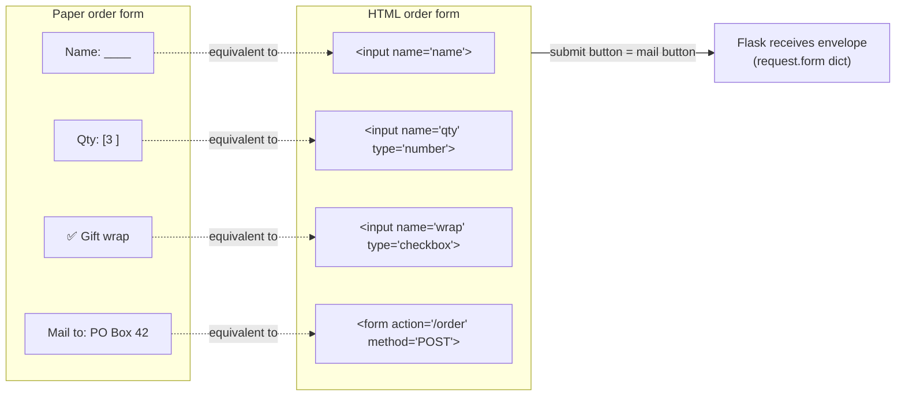
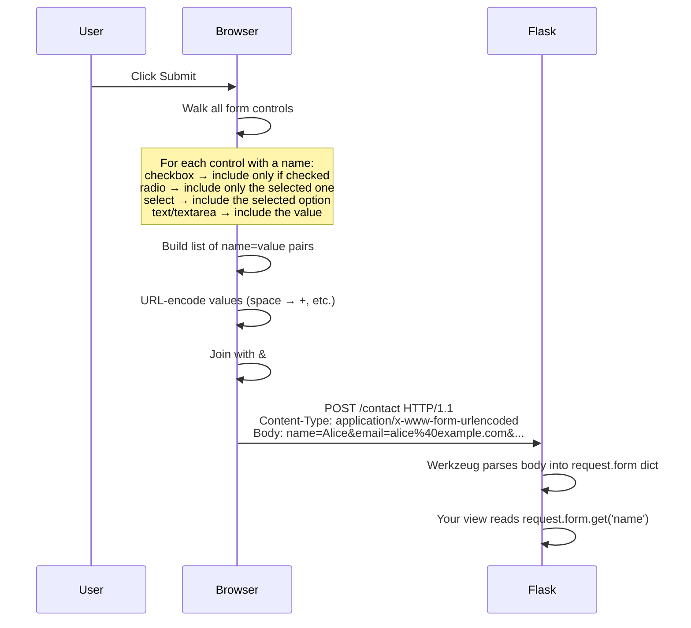
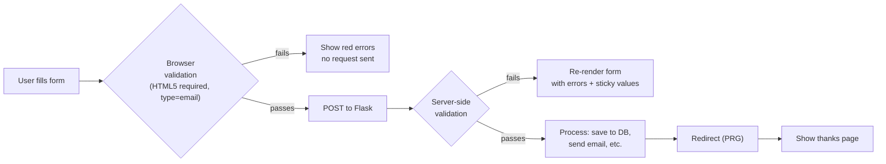
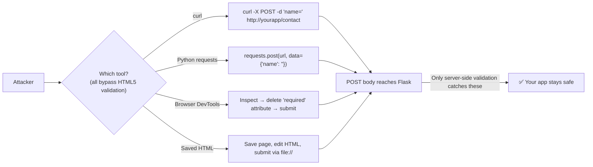
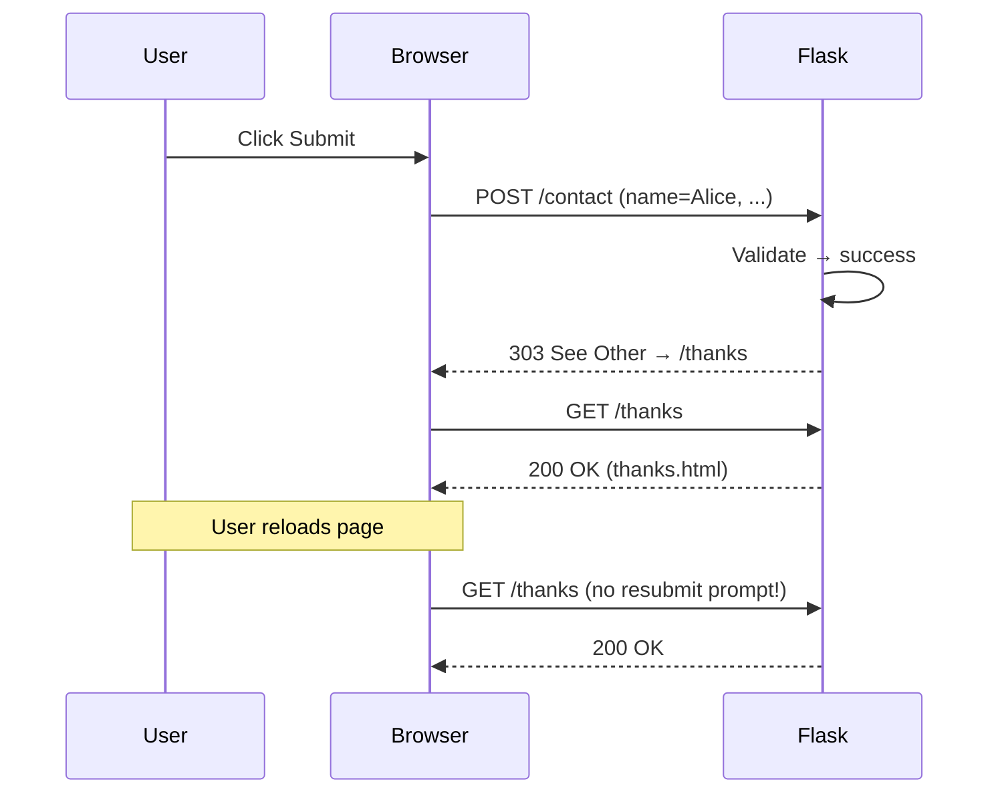
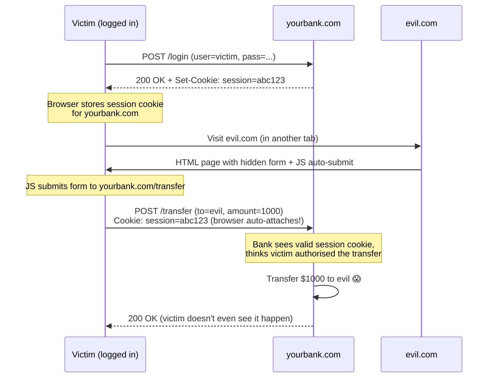
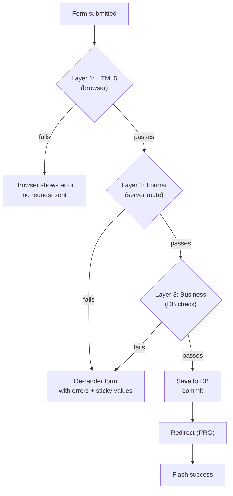
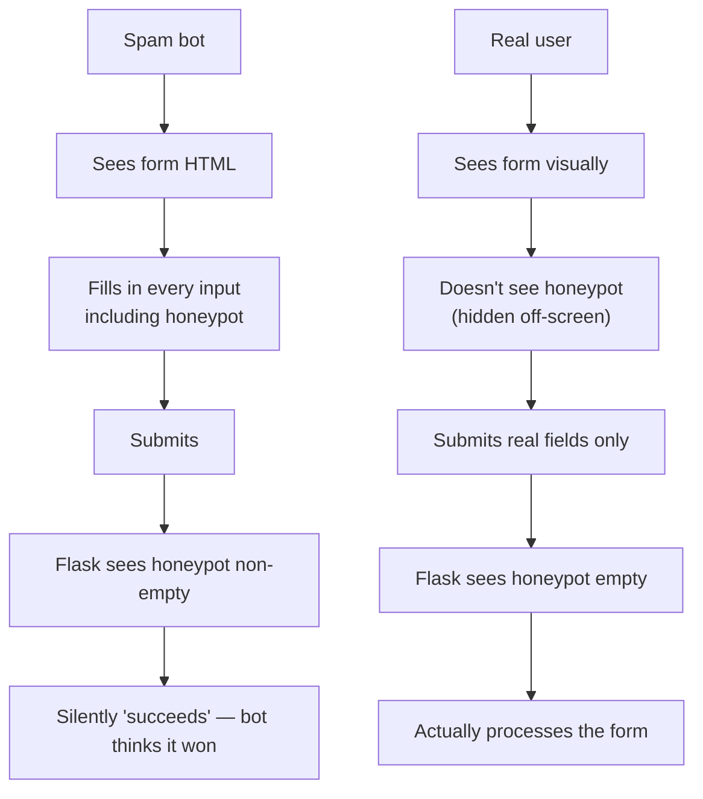

# Lesson 10 — HTML Forms: Collecting User Input

> [!success] Templates are about output. Forms are about input.
> So far, every page Flask has returned was a one-way conversation — Flask *told* the browser what to show. Today you'll learn the other direction: how the browser sends data *to* Flask. We're going to go deep on `<form>`, every input type, the difference between GET and POST, how `request.form` works in Flask, why server-side validation is non-negotiable, and the PRG pattern that prevents your users from accidentally submitting the same form 50 times. By the end you'll have a working contact form that's safe, friendly, and ready for Flask-WTF in the next lesson.

## 1. Learning Objectives

By the end of this lesson you will be able to:

1. **Write an HTML `<form>`** with every major input type and attribute.
2. **Explain the `method` attribute** — GET vs POST — and pick the right one for each form.
3. **Explain the `action` attribute** — where the form sends its data.
4. **Distinguish form encoding types**: `application/x-www-form-urlencoded`, `multipart/form-data`, `text/plain`.
5. **Read submitted form data in Flask** using `request.form` (POST) and `request.args` (GET).
6. **Use `request.form.get('x')` safely** instead of `request.form['x']`.
7. **Validate input server-side** — and explain why client-side validation alone is dangerous.
8. **Implement the PRG pattern** (Post/Redirect/Get) to prevent duplicate submissions.
9. **Recognise the CSRF vulnerability** and why we need protection (preview of Lesson 11).
10. **Build a complete contact form** with validation, sticky values, flash messages, and PRG.

## 2. Prerequisites

- **[[Lesson-06-HTTP-Methods]] completed.** You understand GET vs POST at the HTTP level.
- **[[Lesson-07-Jinja2-Basics]] through [[Lesson-09-Static-Files]] completed.** You can render templates, write Jinja logic, and serve static files.
- **Basic HTML form familiarity.** You've seen `<input type="text">` before; we'll go deeper.

## 3. The Problem

You want users to be able to:
- Sign up for an account
- Submit a contact request
- Search for products
- Post a comment
- Upload a profile photo

All of these require the browser to send data *to* the server. So far, every request your Flask app has handled was a GET — the browser asked for a page, Flask returned HTML. There was no user input beyond the URL itself.

HTML's answer to "how does the browser send data" is the **`<form>` element**. A form is a collection of inputs (`<input>`, `<textarea>`, `<select>`) that the browser bundles up and sends to a URL when the user clicks Submit. Flask receives this bundle as `request.form` (for POST) or `request.args` (for GET).

> [!question] Student asks: "Why do forms need a special HTML element? Couldn't the browser just send whatever?"
> Forms formalise the contract between browser and server. Without `<form>`, every site would invent its own way to package user input — different formats, different encodings, different submission mechanisms. Forms give us a standard: a `<form>` with `method="POST"` and `action="/submit"` will send an HTTP POST to `/submit` with the body containing all the named inputs, URL-encoded. Any browser, any server, any framework can understand that contract.

### 3.1 The paper order-form analogy

Before there were web forms, there were paper forms: order forms, tax returns, surveys, job applications. A paper form has:

- **Fields** — labeled boxes where you write information: "Name: ____", "Quantity: ____". Each field has a *name* (the label) and a *value* (what you write).
- **Field types** — checkboxes (yes/no), radio buttons (pick one of N), free-text lines, multi-line text areas. Different field types for different kinds of answers.
- **A submit action** — "sign and mail to this address". The form is useless until you submit it.
- **A destination** — the address on the envelope. Where the form goes when you submit.

HTML forms work identically. The `<input>` elements are the labeled boxes. The `name` attribute is the label. The `value` is what the user types. The `method` (GET/POST) is *how* the form is delivered (postcard vs sealed envelope). The `action` is the address on the envelope. Submitting the form is the browser "mailing the envelope" to your Flask app.



Just as a paper form has fields with labels and a destination address, an HTML form has named inputs and an action URL. The browser's Submit button is the act of licking the envelope and dropping it in the mailbox.

## 4. The Code

### 4.1 Project layout

```
forms-demo/
├── app.py
└── templates/
    ├── base.html
    ├── contact.html
    └── thanks.html
```

### 4.2 `app.py`

```python
from flask import Flask, render_template, request, redirect, url_for, flash

app = Flask(__name__)
app.secret_key = 'dev-secret-change-in-prod'   # needed for flash()


@app.route('/')
def home():
    return redirect(url_for('contact'))


@app.route('/contact', methods=['GET', 'POST'])
def contact():
    if request.method == 'POST':
        name = request.form.get('name', '').strip()
        email = request.form.get('email', '').strip()
        message = request.form.get('message', '').strip()
        errors = []

        # Server-side validation
        if not name:
            errors.append('Name is required.')
        if not email:
            errors.append('Email is required.')
        elif '@' not in email or '.' not in email:
            errors.append('Please enter a valid email address.')
        if not message:
            errors.append('Message is required.')
        elif len(message) < 10:
            errors.append('Message must be at least 10 characters.')

        if errors:
            # Re-render the form with errors + sticky values
            return render_template(
                'contact.html',
                errors=errors,
                name=name, email=email, message=message,
            )

        # Success! Flash a message and redirect (PRG pattern).
        flash(f"Thanks {name}, we'll be in touch!", 'success')
        return redirect(url_for('thanks'))

    # GET: just render the empty form
    return render_template('contact.html', errors=[], name='', email='', message='')


@app.route('/thanks')
def thanks():
    return render_template('thanks.html')


if __name__ == '__main__':
    app.run(debug=True)
```

### 4.3 `templates/base.html`

```html
<!DOCTYPE html>
<html lang="en">
<head>
    <meta charset="UTF-8">
    <title>Contact</title>
</head>
<body>
    
        
            <ul class="flash">
                
                    <li class="flash-{{ category }}">{{ msg }}</li>
                
            </ul>
        
    
    
</body>
</html>
```

### 4.4 `templates/contact.html`

```html



<h1>Contact Us</h1>


    <ul class="errors">
        
            <li>{{ err }}</li>
        
    </ul>


<form method="POST" action="{{ url_for('contact') }}">
    <p>
        <label for="name">Name:</label>
        <input type="text" id="name" name="name" value="{{ name }}" required>
    </p>
    <p>
        <label for="email">Email:</label>
        <input type="email" id="email" name="email" value="{{ email }}" required>
    </p>
    <p>
        <label for="message">Message:</label>
        <textarea id="message" name="message" rows="5" required>{{ message }}</textarea>
    </p>
    <p>
        <label>
            <input type="checkbox" name="subscribe" value="yes">
            Send me the newsletter
        </label>
    </p>
    <p>
        Priority:
        <label><input type="radio" name="priority" value="low"> Low</label>
        <label><input type="radio" name="priority" value="normal" checked> Normal</label>
        <label><input type="radio" name="priority" value="high"> High</label>
    </p>
    <p>
        <label for="topic">Topic:</label>
        <select id="topic" name="topic">
            <option value="">— Choose —</option>
            <option value="sales">Sales</option>
            <option value="support">Support</option>
            <option value="other">Other</option>
        </select>
    </p>
    <button type="submit">Send</button>
</form>

```

### 4.5 `templates/thanks.html`

```html


<h1>Thank you!</h1>
<p>Your message has been received.</p>
<p><a href="{{ url_for('contact') }}">Send another</a></p>

```

## 5. Line-by-Line Explanation

### 5.1 The `<form>` element — `method` and `action`

```html
<form method="POST" action="{{ url_for('contact') }}">
    ...
</form>
```

Two attributes matter most:

- **`action`**: the URL the form submits to. We use `url_for('contact')` so the URL is generated from the endpoint name (no hardcoding). If you omit `action`, the form submits to the *current* URL — common pattern when the same route handles both GET (show form) and POST (process form).
- **`method`**: GET or POST. This is the most important decision you'll make about a form.

### 5.2 GET vs POST — a deep dive

| Aspect | GET | POST |
|---|---|---|
| **Where data goes** | URL query string: `/search?q=flask` | HTTP request body (not visible in URL) |
| **Visible in browser history** | ✅ Yes (bad for passwords) | ❌ No |
| **Visible in server logs** | ✅ Yes (URLs are logged) | ❌ No (bodies usually aren't) |
| **Bookmarkable** | ✅ Yes — you can share `/search?q=flask` | ❌ No |
| **Length limit** | ~2000 chars (browser/server dependent) | Effectively unlimited |
| **Cacheable** | ✅ Yes (browsers/CDNs cache GETs) | ❌ No |
| **Idempotent?** | ✅ Yes (safe to retry) | ❌ No (each POST is a new action) |
| **Browser "back" button** | Replays silently | Asks "Resubmit form?" |
| **When to use** | Search, filters, pagination, links to specific state | Login, registration, submitting data, file upload |

The cardinal rule: **GET is for reading, POST is for writing**. If submitting the form changes server state (creates a user, sends an email, deletes a record), use POST. If it's just filtering/searching, use GET.

```mermaid
flowchart LR
    subgraph GET["GET form (search, filter)"]
        GetForm["<form method='GET'>"] -->|submits| GetURL["/search?q=flask&sort=newest"]
        GetURL -->|bookmarkable| Share["Can share this URL"]
        GetURL -->|replayable| Safe["Reload = no warning"]
    end
    subgraph POST["POST form (login, register)"]
        PostForm["<form method='POST'>"] -->|submits| PostURL["POST /login<br/>body: user=alice&pass=..."]
        PostURL -->|NOT bookmarkable| Private["URL bar shows /login<br/>only"]
        PostURL -->|replay warns| Warn["Reload = 'Resubmit?'"]
    end
```



> [!question] Student asks: "Why is GET idempotent but POST isn't?"
> "Idempotent" means "doing it N times has the same effect as doing it once." `GET /search?q=flask` returns the same results whether you do it once or a thousand times — no side effects. `POST /orders` creates a new order every time — clicking Submit 5 times creates 5 orders. That's why the browser warns you when you reload a POSTed page.

> [!question] Student asks: "What about PUT, PATCH, DELETE?"
> HTML forms only support GET and POST — you can't write `<form method="PUT">` (browsers ignore it and use GET). For PUT/PATCH/DELETE, you need JavaScript (`fetch()` with `method: 'PUT'`) or a hidden `_method` field that frameworks interpret. In practice, Flask apps use POST for everything form-based and reserve PUT/DELETE for JSON APIs (covered in [[Lesson-19-Building-JSON-API]]).

#### 5.2.1 Try this: see GET vs POST in the URL

> [!try] Try this: watch the URL bar
> Make a tiny form: `<form method="GET"><input name="q"><button>Go</button></form>`. Submit it. Notice the URL changes to something like `/?q=hello`. Now change `method` to `POST`. Submit. Notice the URL stays at `/` — the data is in the *body*, not the URL. Open DevTools → Network → click the request → Payload tab. You'll see the data there. This is the visible difference between GET and POST.

### 5.3 Form encoding: how the data is packaged

When the user clicks Submit, the browser bundles the form's named inputs and sends them as the HTTP request body. There are three encoding types — controlled by the `enctype` attribute on `<form>`:

#### `application/x-www-form-urlencoded` (the default)

```http
POST /contact HTTP/1.1
Content-Type: application/x-www-form-urlencoded

name=Alice+Smith&email=alice%40example.com&message=Hello+there
```

Spaces become `+`, special characters become `%XX` percent-encoded, fields joined with `&`. This is the default and works for all text inputs.

#### `multipart/form-data` (for file uploads)

```http
POST /upload HTTP/1.1
Content-Type: multipart/form-data; boundary=----WebKitFormBoundary

------WebKitFormBoundary
Content-Disposition: form-data; name="title"

My Photo
------WebKitFormBoundary
Content-Disposition: form-data; name="photo"; filename="cat.jpg"
Content-Type: image/jpeg

<binary JPEG bytes here>
------WebKitFormBoundary--
```

Each field becomes a "part" with its own headers. This is the only encoding that can carry binary data (files). Use it whenever your form has `<input type="file">`:

```html
<form method="POST" enctype="multipart/form-data" action="/upload">
    <input type="file" name="photo">
    <button>Upload</button>
</form>
```

In Flask, file uploads arrive in `request.files`, not `request.form`. We'll cover file uploads in depth in [[Lesson-21-File-Uploads]].

#### `text/plain` (almost never used)

Sends the data as plain text with no encoding. Mostly useless; ignore it.

```mermaid
flowchart TB
    Form["<form> submitted"] --> Encoding{enctype?}
    Encoding -->|default: x-www-form-urlencoded| Urlenc["name=Alice+Smith&email=..."]
    Encoding -->|multipart/form-data| Multi["Boundary-separated parts<br/>(supports files)"]
    Encoding -->|text/plain| Plain["name=Alice Smith\nemail=...<br/>(rarely used)"]
    Urlenc --> Flask["Flask: request.form"]
    Multi --> Flask2["Flask: request.form + request.files"]
    Plain --> Flask3["Flask: request.get_data() (raw)"]
```



#### 5.3.1 Behind the scenes: how the browser serializes a form

When you click Submit, the browser walks the form's elements in order, collecting each "successful control" (a control that has a `name` and is in a valid state — checked for checkboxes, selected for radios). For each, it produces a `name=value` pair. Then it joins them with `&` and applies the encoding.



This is why a checkbox without `name` does nothing — there's no key for the browser to use. And why unchecked checkboxes don't appear at all: the browser only includes "successful" controls, and an unchecked checkbox is not successful. (This trips up beginners: to detect "unchecked", your Python code checks `if request.form.get('subscribe'):` — `None` means unchecked, the value string means checked.)

> [!question] Student asks: "Why does Flask need separate dicts for `request.form`, `request.args`, `request.files`, and `request.json`?"
> Because they come from different places in the HTTP request. `request.args` comes from the URL query string (after the `?`). `request.form` comes from the body when the content type is `x-www-form-urlencoded` or `multipart/form-data`. `request.files` comes from the *file parts* of a `multipart/form-data` body. `request.json` comes from the body when the content type is `application/json` (typically from API clients, not HTML forms). Werkzeug parses each source independently. A single POST can have args (in the URL) and form data (in the body) at the same time.

### 5.4 Every input type — a reference

| Type | Renders as | Common attributes |
|---|---|---|
| `text` | Single-line text | `maxlength`, `placeholder`, `pattern` |
| `email` | Email input (validated by browser) | `multiple` (comma-separated) |
| `password` | Text input that masks characters | (same as text) |
| `number` | Number input with up/down arrows | `min`, `max`, `step` |
| `tel` | Telephone (no validation by spec) | `pattern` for custom |
| `url` | URL input (browser validates URL format) | |
| `search` | Search box (some browsers add a clear button) | |
| `date` | Date picker | `min`, `max` |
| `datetime-local` | Date + time picker | `min`, `max` |
| `time` | Time picker | |
| `month`, `week` | Month/week pickers | |
| `checkbox` | Toggle (on/off) | `checked` to default on |
| `radio` | One-of-many (group by `name`) | `checked` for default |
| `range` | Slider | `min`, `max`, `step` |
| `color` | Color picker | |
| `file` | File picker | `accept=".jpg,.png"`, `multiple` |
| `hidden` | Invisible field | For IDs, CSRF tokens |
| `submit` | Submit button | `value` is the label |
| `button` | Generic button (needs JS) | `onclick` etc. |
| `reset` | Reset button (clears form) | (rarely used) |
| `image` | Image as submit button | `src`, `alt` |

And two non-`<input>` form controls:

- **`<textarea>`**: multi-line text. Unlike `<input>`, the default value goes *between* the tags, not in a `value` attribute: `<textarea name="msg">Default text</textarea>`.
- **`<select>`**: dropdown. Contains `<option>` elements; the `value` attribute of the selected option is what gets submitted.

### 5.5 The `name` attribute — how Flask sees your input

```html
<input type="text" name="email">
```

The `name` attribute is **the key** Flask uses to look up the value. Without `name`, the input is *invisible* to Flask — it's still rendered in the browser, but the browser doesn't include it in the form submission.

```python
email = request.form.get('email')   # looks up by name attribute
```

Common mistake: forgetting `name` on a checkbox, then wondering why Flask always sees it as missing.

### 5.6 `request.form` (POST) vs `request.args` (GET)

| Object | When it's populated | Example |
|---|---|---|
| `request.args` | GET requests (query string) | `/search?q=flask` → `request.args.get('q')` |
| `request.form` | POST requests with `x-www-form-urlencoded` or `multipart/form-data` | `<form method="POST">` |
| `request.values` | Combined (args + form) — rare to use | |
| `request.files` | POST with `multipart/form-data` | File uploads |
| `request.json` | POST with `Content-Type: application/json` | API calls |

Both `request.form` and `request.args` behave like Python dicts. They have a `.get()` method (returns `None` if missing) and support `[]` access (raises `KeyError` if missing).

### 5.7 `request.form.get('x')` vs `request.form['x']` — why `get()` is safer

```python
# DANGEROUS: raises KeyError if 'name' wasn't in the form
name = request.form['name']

# SAFE: returns None (or your default) if missing
name = request.form.get('name')
name = request.form.get('name', '')   # default to empty string
```

Why does this matter? Two reasons:

1. **Users can tamper with forms.** A malicious user can save your HTML, delete the `<input name="email">` field, and submit the form. Your server gets a POST without `email`. `request.form['email']` crashes with a 500 error; `request.form.get('email')` returns `None` and your validation catches it.

2. **Bugs happen.** You rename `name` to `fullname` in the template but forget to update the route. With `[]`, every submission crashes. With `.get()`, you get an empty string and a friendlier "name is required" error.

**Rule: always use `.get()` on `request.form` and `request.args`.**

> [!try] Try this: tamper with a form
> Open your `/contact` form in a browser. Right-click → Inspect Element on the email field. Delete the `name="email"` attribute in the DevTools. Now submit the form. Flask receives the POST *without* an `email` field. If you used `request.form['email']`, the server crashes with a `KeyError` (500 error). If you used `request.form.get('email', '')`, the server returns a friendly "Email is required" validation error. This is exactly how an attacker would probe your form — make sure your code handles it gracefully.

### 5.8 Server-side validation — never trust the client

In our template, we wrote `required` on inputs:

```html
<input type="text" name="name" required>
```

The browser will block submission if the field is empty. So why do we *also* validate in Python?

```python
if not name:
    errors.append('Name is required.')
```

Because **the browser is not the only way to submit forms**. Anyone can:

- Save your HTML, delete the `required` attributes, submit.
- Use `curl` to POST raw data: `curl -X POST -d "name=" http://localhost:5000/contact`.
- Use a script (Python `requests`, Postman, Burp Suite) to send arbitrary POST bodies.

If you only validate client-side, all these bypass your validation. **Client-side validation is for UX (faster feedback), server-side validation is for security and data integrity.** You need both.



> [!warning] The Cardinal Rule of Forms
> **Never trust data from the client.** Validate *everything* on the server, even if the browser already validated it. The browser is a UX layer, not a security layer.

#### 5.8.1 Why both client-side AND server-side? Defense in depth

It's tempting to ask: "If the browser already validates with `required` and `type=email`, why bother on the server?" The answer is **defense in depth** — a security principle that says you should have multiple overlapping controls, so if one fails, others catch the threat.



The browser validates for *honest users with modern browsers*. It's a convenience, not a security boundary. Server-side validation is the actual security boundary — it's the only validation you control end-to-end.

> [!question] Student asks: "Can I just validate on the server and skip HTML5 validation?"
> You *can*, but the UX is worse. Without HTML5 `required`, the form submits, the server rejects it, the page reloads, the user sees the error, fixes one field, submits again, gets another error... With HTML5 validation, the user gets instant feedback *before* the request is even sent. Use both: HTML5 for fast UX, server for security.

### 5.9 Sticky values — keeping user input after a validation error

When validation fails, you re-render the form. But the user just typed a paragraph into the textarea — you don't want to wipe it. The fix: pass the submitted values back to the template and use them as the input's `value`:

```html
<input type="text" name="name" value="{{ name }}">
<textarea name="message">{{ message }}</textarea>
```

For `<input>`: `value="{{ name }}"`.
For `<textarea>`: the content goes *between* the tags.
For `<select>`: add `selected` to the chosen `<option>`.
For `<checkbox>` / `<radio>`: add `checked` to the chosen one.

```html
<input type="checkbox" name="subscribe" value="yes"
       {{ 'checked' if subscribe }}>
```

This is the "sticky form" pattern. Without it, every validation error wipes the user's input and they have to retype everything — terrible UX.

### 5.10 `flash()` — one-time messages

```python
flash("Thanks Alice, we'll be in touch!", 'success')
```

`flash()` stores a message in the user's session cookie. On the *next* request (typically after a redirect), the template can pull these messages with `get_flashed_messages()`. Once read, they're gone — perfect for "your action succeeded" notifications.

```html

    
        <ul class="flash">
            
                <li class="flash-{{ category }}">{{ msg }}</li>
            
        </ul>
    

```

`flash()` requires `app.secret_key` because the messages are stored in the signed session cookie. We'll cover this in depth in [[Lesson-17-Flask-Login]].

### 5.11 The PRG pattern — Post/Redirect/Get

Try this experiment: submit any POST form. After it succeeds, press the browser's Reload button. The browser will prompt:

> **Confirm Form Resubmission**
> The page that you're looking for used the information that you entered. Returning to that page might cause any action you took to be repeated. Do you want to continue?

That's bad UX. Worse, if your POST handler creates a database row, reloading creates a *duplicate* row. Reload 5 times → 5 duplicate orders.

The **PRG pattern** solves this:

1. **P**ost — the form submits a POST.
2. **R**edirect — on success, Flask returns a 303 redirect to a GET URL.
3. **G**et — the browser follows the redirect with a GET. Now Reload is safe — there's no POST to re-submit.

```python
if errors:
    return render_template('contact.html', ...)   # re-render on error
# Success
flash("Thanks!", 'success')
return redirect(url_for('thanks'))               # PRG: redirect on success
```

The user's URL bar ends up at `/thanks`. Reloading `/thanks` just re-renders the thanks page — no duplicate submission.



> [!question] Student asks: "Why a 303 redirect specifically?"
> 303 ("See Other") is the HTTP status code that explicitly means "your POST worked, now go GET this other URL." It's the correct semantic for PRG. A 302 also works in practice (most browsers treat 302 like 303 for POST), but 303 is the canonical choice. Flask's `redirect()` defaults to 302; pass `code=303` for explicit correctness: `redirect(url_for('thanks'), code=303)`.

#### 5.11.1 Try this: see the duplicate-submission problem

> [!try] Try this: break PRG on purpose
> Temporarily change your success path from `return redirect(url_for('thanks'))` to `return render_template('thanks.html')` (no redirect). Submit the form. When you land on the thanks page, press Reload. The browser will pop up "Confirm Form Resubmission?" — click Yes. If your route created a database row, you'd now have two identical rows. Restore the redirect and try again: reload after the redirect, and there's no prompt. PRG saved you.

### 5.12 CSRF — preview of the next lesson

Imagine this attack:

1. You log in to `yourbank.com`. Your session cookie is set.
2. You visit `evil.com` in another tab.
3. `evil.com` has a hidden form: `<form action="https://yourbank.com/transfer" method="POST"><input name="to" value="evil"><input name="amount" value="1000"></form>`
4. The form auto-submits via JavaScript.
5. Your browser sends the POST to `yourbank.com`, *including your session cookie*.
6. `yourbank.com` thinks *you* authorised the transfer.

This is **CSRF (Cross-Site Request Forgery)**. The defence: include a secret token in every form that the server validates. The token is tied to the user's session, so `evil.com` can't forge it.

```html
<form method="POST">
    <input type="hidden" name="csrf_token" value="{{ csrf_token }}">
    ...
</form>
```

We'll implement this properly in [[Lesson-11-Flask-WTF]] using Flask-WTF, which handles CSRF automatically. For now, just know the threat exists — and never write a POST form without CSRF protection in a real app.

#### 5.12.1 The full CSRF attack sequence



The vulnerability exists because of a fundamental browser behavior: **cookies are automatically attached to requests based on the destination domain, not the source page**. When `evil.com` triggers a POST to `yourbank.com`, the browser helpfully attaches the victim's `yourbank.com` session cookie. The bank can't tell the request came from `evil.com` — it looks like a normal request from the logged-in victim.

CSRF tokens defeat this: every form on `yourbank.com` includes a secret token tied to the user's session. `evil.com` can't read this token (same-origin policy prevents reading cross-domain pages), so it can't include it in the forged form. The bank rejects the missing-token request.

> [!question] Student asks: "Couldn't the bank just check the Referer header?"
> Sometimes it can, and many sites do as a defense-in-depth layer. But `Referer` can be missing (browsers strip it in some privacy modes) or spoofed in rare cases. CSRF tokens are the canonical defense because they're cryptographically tied to the session and don't depend on browser behavior. We'll cover the full mechanism in Lesson 11.

### 5.13 File upload forms

For file uploads, the form needs `enctype="multipart/form-data"`:

```html
<form method="POST" enctype="multipart/form-data" action="/upload">
    <input type="file" name="photo" accept="image/*">
    <button>Upload</button>
</form>
```

In Flask:

```python
@app.route('/upload', methods=['POST'])
def upload():
    photo = request.files.get('photo')
    if photo and photo.filename:
        photo.save(f'/tmp/{photo.filename}')
        return 'Saved!'
    return 'No file uploaded.'
```

`request.files` is a separate dict from `request.form`. Each value is a `Werkzeug FileStorage` object with `.filename`, `.content_type`, `.save(path)`, and file-like methods (`.read()`, `.stream`).

> [!warning] Always sanitise filenames
> Never save an uploaded file using the user-supplied filename directly. A malicious user could upload `../../../etc/passwd` and overwrite system files. Use `werkzeug.utils.secure_filename()`:
> ```python
> from werkzeug.utils import secure_filename
> safe_name = secure_filename(photo.filename)   # '../etc/passwd' → 'etc_passwd'
> photo.save(f'/tmp/{safe_name}')
> ```
> We cover file uploads in depth in [[Lesson-21-File-Uploads]].

### 5.14 Validation patterns — going deeper

Let's expand on validation. A good validation system has three layers:

1. **HTML5 attributes** (`required`, `type="email"`, `pattern`, `min`, `max`) — fastest feedback, but easily bypassed.
2. **Server-side validation in your route** — the security layer.
3. **Business-rule validation** — "does this username already exist?", "is this user old enough?" — needs database lookup.

Here's a more complete validation example with all three layers:

```python
@app.route('/register', methods=['GET', 'POST'])
def register():
    if request.method == 'POST':
        username = request.form.get('username', '').strip()
        email = request.form.get('email', '').strip()
        password = request.form.get('password', '')
        errors = []

        # Layer 2: basic format validation
        if not username or len(username) < 3:
            errors.append('Username must be at least 3 characters.')
        if not email or '@' not in email:
            errors.append('A valid email is required.')
        if len(password) < 8:
            errors.append('Password must be at least 8 characters.')

        # Layer 3: business rules (need DB)
        if username and User.query.filter_by(username=username).first():
            errors.append('That username is taken.')

        if errors:
            return render_template('register.html', errors=errors,
                                   username=username, email=email)

        # Success
        user = User(username=username, email=email)
        user.set_password(password)
        db.session.add(user)
        db.session.commit()
        flash('Account created! Please log in.', 'success')
        return redirect(url_for('login'))

    return render_template('register.html', errors=[], username='', email='')
```



The big insight: **all three layers fire in order**. The browser validates first (fast feedback). The server validates second (security). The business rules validate third (data integrity). Each layer catches what the previous missed.

### 5.15 Modern: AJAX form submission with `fetch()`

The traditional form submission (click Submit → browser navigates → page reloads) is fine for most cases. But sometimes you want to submit without a page reload — e.g., live search, "like" buttons, comment posting.

The modern approach is `fetch()`:

```html
<form id="contact-form">
    <input name="name" required>
    <input name="email" type="email" required>
    <button type="submit">Send</button>
</form>

<script>
document.getElementById('contact-form').addEventListener('submit', async (e) => {
    e.preventDefault();   // stop the default form submission
    const form = e.target;
    const data = new FormData(form);
    const response = await fetch(form.action, {
        method: 'POST',
        body: data,
    });
    if (response.ok) {
        alert('Thanks!');
        form.reset();
    } else {
        const errors = await response.json();
        console.error(errors);
    }
});
</script>
```

For modern Flask apps, **HTMX** is even better — it gives you AJAX form submission with no JavaScript at all, just HTML attributes (`hx-post="/contact" hx-target="#result"`). We cover HTMX in [[Modern-Frontend-Integration]].

### 5.16 Honeypot fields — catching bots without UX friction

A **honeypot field** is a hidden input that real users never see but bots (which read the raw HTML and fill in every field) fill in automatically. If the honeypot is non-empty on submission, you know it's a bot — silently reject it (don't even tell the bot you noticed).

```html
<form method="POST" action="/contact">
    <!-- Real users don't see this; bots fill it in -->
    <div style="position: absolute; left: -9999px;" aria-hidden="true">
        <label>Leave this empty: <input type="text" name="company_website" tabindex="-1" autocomplete="off"></label>
    </div>
    <!-- Real form fields below -->
    <input type="text" name="name" required>
    <button>Send</button>
</form>
```

```python
@app.route('/contact', methods=['POST'])
def contact():
    # Honeypot check — if filled, it's a bot
    if request.form.get('company_website'):
        # Pretend success so the bot moves on
        return redirect(url_for('thanks'))
    # ... real form processing
```



Honeypots aren't foolproof (sophisticated bots can detect them by checking CSS visibility), but they catch the long tail of unsophisticated spam bots with zero UX impact on real users.

> [!try] Try this: add a honeypot
> Add a honeypot field to your contact form. Manually submit the form without filling the honeypot — it should process normally. Now use `curl` to submit with the honeypot filled: `curl -d "name=Test&company_website=spam&message=hi" http://localhost:5000/contact`. Your Flask code should redirect to `/thanks` without actually processing the form.

## 6. Running the Code

Save all the files. Run:

```bash
python app.py
```

### 6.1 Visit `/contact` (empty form)

Open `http://127.0.0.1:5000/contact`. You should see the contact form. Don't fill anything in. Click "Send". You should see validation errors:

```
• Name is required.
• Email is required.
• Message is required.
```

(Or, if you're using a modern browser, the HTML5 `required` attribute blocks submission entirely. To see the server-side errors, open DevTools → Console and run: `document.querySelector('form').submit()` — bypasses HTML5 validation.)

### 6.2 Try a bad email

Type a name, type `not-an-email` in email, type a short message. Submit. You should see:

```
• Please enter a valid email address.
• Message must be at least 10 characters.
```

Notice your name and email are *still there* — sticky values. Only the failed fields need fixing.

### 6.3 Try a valid submission

Fill in all fields correctly. Submit. You should be redirected to `/thanks` and see:

```
Thanks Alice, we'll be in touch!  ← flash message (yellow background)
Thank you!
Your message has been received.
Send another
```

Click "Send another". You're back at the empty form. The flash message is gone (it was one-time).

### 6.4 Test PRG — reload after submit

Submit the form again. When you land on `/thanks`, press Reload. The page just reloads — no "Confirm Form Resubmission" prompt. PRG worked.

### 6.5 Test with `curl`

You don't need a browser to test a form. From the terminal:

```bash
# Submit a valid form
curl -i -X POST http://127.0.0.1:5000/contact \
     -d "name=Bob&email=bob@example.com&message=Hello+there+world"

# Should respond with 302 redirect to /thanks
```

The `-d` flag sends the data as `application/x-www-form-urlencoded`. Flask's `request.form` parses it just like a browser submission. This is how automated tests and API clients send forms.

### 6.6 Inspect the actual HTTP request

Want to see exactly what the browser sends? Use `mitmproxy`, `Charles`, or `Wireshark`. Or, in Chrome DevTools → Network tab → click the POST request → "Payload" tab. You'll see:

```
Form Data:
  name: Alice
  email: alice@example.com
  message: Hello there world
  subscribe: yes
  priority: normal
  topic: sales
```

Notice the unchecked radio buttons and unselected options are *not* in the payload — the browser only sends "successful" controls. (A checkbox is "successful" only if checked; a radio in a group is "successful" only if one is selected.)

### 6.7 Real-world: how production forms differ

In production:

- **HTTPS is mandatory.** Without HTTPS, every form submission (including passwords) is sent in plaintext over the network. Anyone on the same WiFi can read it. Flask doesn't enforce HTTPS — you configure it at the Nginx/load-balancer level (see [[Lesson-23-Deployment]]).
- **CSRF protection is on every POST form.** A single missing token is a security hole. We'll automate this with Flask-WTF.
- **Rate limiting** prevents brute-force attacks on login forms. Flask-Limiter is the standard tool.
- **Honeypot fields** catch bots: a hidden input that real users can't see but bots fill in. If it's non-empty, reject the submission.
- **Logging** of form submissions (minus sensitive fields) for audit trails.
- **Async processing** for slow actions (sending emails, generating PDFs) via Celery — covered in [[Lesson-22-Email-And-Tasks]].

### 6.8 Historical context: how we got here

Forms are one of the oldest parts of the web. The `<form>` element was added to HTML in 1993 (HTML 1.0). The GET/POST distinction came in HTML 2.0 (1995). File uploads (`multipart/form-data`) were standardised in RFC 1867 (1995). The `required`, `type="email"`, `pattern` attributes (HTML5 validation) arrived in 2014.

What changed in the last decade:

- **AJAX** (`fetch()`, `XMLHttpRequest`) let forms submit without page reloads.
- **SPAs** (React, Vue) replaced traditional forms with JavaScript-driven UIs that submit JSON.
- **HTMX** (2020s) brought back server-rendered forms with progressive enhancement — submit via AJAX with no JS code.
- **Auto-fill / password managers** made password forms more complex (must support autofill, must use `autocomplete="new-password"` etc.).
- **Web Components** and design systems standardised form widgets.

The basic `<form>` element hasn't changed in 30 years. It's still the simplest, most robust way to collect user input on the web.

## 7. Common Mistakes

### 7.1 Forgetting `methods=['POST']`

```python
@app.route('/contact')   # default is GET only
def contact():
    if request.method == 'POST':   # never runs!
        ...
```

Flask returns **405 Method Not Allowed** when you POST to a GET-only route. Always include `methods=['GET', 'POST']` (or whichever you need) when handling forms.

### 7.2 Missing `name` attributes on inputs

```html
<input type="text" id="name">   <!-- no name attribute -->
```

The browser submits only inputs with a `name`. Without it, Flask never sees the value. Always include both `id` (for `<label for>`) and `name` (for Flask).

### 7.3 No PRG → duplicate submissions

```python
if success:
    return render_template('thanks.html')   # no redirect!
```

Reload the page → "Confirm Form Resubmission" → user clicks Yes → another database row. Always redirect on successful POST.

### 7.4 Using `[]` instead of `.get()`

```python
name = request.form['name']   # KeyError if missing
```

If a malicious user submits a form without `name`, your app crashes with 500. Use `request.form.get('name', '')`.

### 7.5 No `SECRET_KEY` for `flash()`

```python
app = Flask(__name__)   # no secret_key
flash('Hi')             # RuntimeError: the session is unavailable
```

`flash()` stores messages in the session cookie, which requires `app.secret_key`. Always set it (and in production, load from an environment variable).

### 7.6 Client-side validation only

```html
<input type="email" required>   <!-- only validation -->
```

A malicious user bypasses this in 10 seconds with `curl`. Always validate server-side too.

### 7.7 Forgetting sticky values

```html
<input type="text" name="name">   <!-- no value attribute -->
```

Every validation error wipes the user's input. They type a long message, make one mistake, lose everything. Use `value="{{ name }}"`.

### 7.8 XSS via `| safe`

```html
<p>You searched for: {{ q | safe }}</p>   <!-- DANGEROUS -->
```

If `q` contains `<script>...</script>`, the `| safe` filter lets it execute. Never use `| safe` on user input. Jinja's autoescaping (Lesson 07) handles it without `| safe`.

### 7.9 CSRF vulnerability

```html
<form method="POST" action="/transfer">   <!-- no CSRF token -->
```

Any site can submit this form on the user's behalf. Always include a CSRF token (we'll do this properly with Flask-WTF in the next lesson).

## 8. Exercises

> [!tip] The 20-minute rule
> Stuck for 20 minutes? Take a break.

1. **Survey form.** Build a `/survey` route with at least 6 different input types (text, email, number, radio, checkbox, select, textarea). On submit, show a summary page with all the answers.

2. **Registration form.** Build a `/register` form with username, email, password, and password-confirm fields. Validate that passwords match. Don't actually create users yet — just show a success page.

3. **JavaScript character counter.** Add a `<textarea>` with a "0 / 500" character counter below it. Use vanilla JS to update the counter as the user types. Disable submit if over 500 chars.

4. **Temperature converter (GET form).** Build a `/convert` form that submits via GET (so the URL becomes `/convert?c=100&to=f`). Convert Celsius to Fahrenheit or Kelvin based on the `to` radio button. Bookmarkable URLs!

5. **PRG refactor.** Take the "guess the number" game from Lesson 06 (which uses sessions). Refactor it to use the PRG pattern so reloading doesn't resubmit the guess.

6. **CSRF demo.** Build two apps: `victim` on port 5000 with a `/transfer` POST route, and `evil` on port 5001 serving an HTML page that auto-submits a hidden form to `victim`. Confirm the attack works (the victim route processes the cross-origin POST). This is *why* we need Flask-WTF.

7. **File upload.** Build a `/upload` route that accepts a single image file and saves it to `static/uploads/`. Display the uploaded image after success. (Hint: use `werkzeug.utils.secure_filename` to clean up the filename.)

8. **AJAX form.** Refactor your contact form to use `fetch()` for submission — no page reload. Show a success message inline. (Hint: have the route return JSON when `request.headers.get('X-Requested-With') == 'fetch'`.)

9. **Sticky select.** Add a country `<select>` to your contact form. Make the user's chosen country stay selected after a validation error.

10. **Tamper test.** Use `curl` to submit your contact form with a missing `email` field: `curl -X POST -d "name=Alice&message=Hello+world+test" http://localhost:5000/contact`. Confirm Flask handles it gracefully (validation error, not a 500). Now submit with `curl` using `--data-urlencode` to include weird characters in the message (like `&`, `=`, `+`). Confirm Flask decodes them correctly.

11. **Honeypot in production-like form.** Add a honeypot field to your registration form. Write a test that submits the form with and without the honeypot filled. Confirm the bot version is silently rejected and the human version is processed.

12. **Replay attack demo.** Build a `/transfer` route that accepts a POST and "transfers money" (just prints to console). Don't add CSRF protection. Build a second tiny Flask app on a different port that serves a page with a hidden auto-submitting form targeting your `/transfer` route. Open the victim app, then visit the evil app — confirm the transfer happens without your explicit consent. (We'll fix this in Lesson 11 with Flask-WTF.)

13. **AJAX with sticky errors.** Refactor your contact form so submission happens via `fetch()`. On validation error, return JSON with field-specific errors and display them inline (next to each field) without losing the user's input. On success, show a thank-you message in place of the form.

## 9. What We Learned

- **`<form>`** is HTML's standard way to send user input to the server. The `method` (GET vs POST) and `action` (URL) attributes control where and how the data goes.
- **GET is for reading, POST is for writing.** Never use GET for actions that change server state.
- **Form encoding**: `application/x-www-form-urlencoded` (default, text), `multipart/form-data` (files), `text/plain` (rare).
- In Flask, **`request.form`** holds POST data, **`request.args`** holds GET query params, **`request.files`** holds uploaded files.
- **Always use `request.form.get('x', '')`**, never `request.form['x']` — `.get()` returns `None`/default on missing keys; `[]` raises `KeyError`.
- **Server-side validation is mandatory.** Client-side (HTML5 `required`, `type="email"`) is for UX; server-side is for security. Never trust the client.
- **Sticky values** (`value="{{ name }}"`) preserve user input across validation errors.
- **`flash()`** stores one-time messages in the session cookie; `get_flashed_messages()` retrieves them. Requires `SECRET_KEY`.
- **PRG (Post/Redirect/Get)** prevents duplicate submissions on reload.
- **CSRF** is a real vulnerability — every POST form needs a CSRF token. Flask-WTF (next lesson) handles this automatically.
- **File uploads** require `enctype="multipart/form-data"` and arrive in `request.files`.
- **`fetch()`** lets you submit forms without a page reload — or use HTMX for declarative AJAX.

## 10. Next Lesson

You can now build forms by hand — but it's a lot of boilerplate. Validation is repetitive. CSRF is missing. The next lesson fixes all of that.

In [[Lesson-11-Flask-WTF]] you'll learn:

- **What Flask-WTF is** and why it's better than raw HTML forms.
- **`SECRET_KEY`** in depth — what it signs, why it matters.
- **Form classes**: every field type, every validator.
- **Custom validators** — inline methods and standalone classes.
- **`form.validate_on_submit()`** — the one-line check that does POST + CSRF + validation.
- **`form.hidden_tag()`** — automatic CSRF token.
- **Rendering forms** three ways: manual HTML, `{{ form.field() }}`, Bootstrap-style.
- **Pydantic** as a modern alternative to WTForms.

> [!quote] A note from your teacher
> Forms are the most common vector for security bugs in web apps. CSRF, XSS, SQL injection via unsanitised input, replay attacks — they all start with a form. Take the time to internalise the patterns in this lesson. When you reach for Flask-WTF next, you'll understand *why* it does what it does — not just *how*.
