# Lesson 11 — Flask-WTF: Forms, Validation, and CSRF

> [!success] Hand-coded forms work. Flask-WTF makes them safer, shorter, and more maintainable.
> In Lesson 10 you built a contact form by hand: HTML inputs, `request.form.get()`, manual validation, sticky values, flash messages, PRG. It worked, but the code was verbose — 30 lines of validation logic for three fields. Now imagine a registration form with 12 fields. Now imagine 20 forms across your app. The boilerplate multiplies. **Flask-WTF** solves this by letting you define a form as a Python class — fields, validators, labels, CSRF protection, error rendering — all in one place. We'll go deep on every field type, every validator, custom validators, and the CSRF defence that makes your POST forms safe. Plus a peek at **Pydantic** as a modern alternative for JSON APIs.

## 1. Learning Objectives

By the end of this lesson you will be able to:

1. **Install and configure Flask-WTF** in a Flask project.
2. **Explain `SECRET_KEY`** in depth — what it signs, why env vars in production, how to generate one.
3. **Define a form as a Python class** with fields, validators, labels, and widgets.
4. **Use every major field type**: StringField, PasswordField, TextAreaField, IntegerField, DecimalField, FloatField, BooleanField, DateField, DateTimeField, SelectField, SelectMultipleField, RadioField, FileField, MultipleFileField, SubmitField, HiddenField, SearchField, URLField, EmailField.
5. **Use every major validator**: DataRequired, InputRequired, Email, Length, NumberRange, URL, EqualTo, Optional, AnyOf, NoneOf, Regexp, IPAddress, UUID, MacAddress.
6. **Write custom validators** — both inline methods and standalone classes.
7. **Explain CSRF** at the protocol level and how `form.hidden_tag()` defends against it.
8. **Use `form.validate_on_submit()`** — the one-line check that does POST + CSRF + validation.
9. **Render forms** three ways: manual HTML, `{{ form.field() }}`, Bootstrap-style.
10. **Show validation errors** in templates with `{{ form.field.errors }}`.
11. **Handle file uploads** with `FileField` and `MultipleFileField`.
12. **Compare WTForms to Pydantic** for JSON APIs.

## 2. Prerequisites

- **[[Lesson-10-HTML-Forms]] completed.** You understand forms, `request.form`, validation, PRG, and the CSRF threat.
- **Python OOP.** You've written classes with `__init__`, inheritance, and class attributes.

## 3. The Problem

Recall your Lesson 10 contact form. Here's the validation code:

```python
name = request.form.get('name', '').strip()
email = request.form.get('email', '').strip()
message = request.form.get('message', '').strip()
errors = []

if not name:
    errors.append('Name is required.')
if not email:
    errors.append('Email is required.')
elif '@' not in email or '.' not in email:
    errors.append('Please enter a valid email address.')
if not message:
    errors.append('Message is required.')
elif len(message) < 10:
    errors.append('Message must be at least 10 characters.')
```

That's 14 lines for 3 fields. Now scale to:

- A registration form (username, email, password, password confirm, first name, last name, birthdate, country, accept-TOS checkbox) — 9 fields.
- A "create blog post" form (title, slug, body, tags, category, featured image, publish date, draft checkbox) — 8 fields.
- 20 different forms across your app.

You'd have 500+ lines of repetitive validation. Worse, the validation logic lives in the route — tangled with HTTP plumbing. And there's still no CSRF protection.

> [!question] Student asks: "Can't I just write a helper function?"
> You can. Many beginners do: `validate_email(s)`, `validate_password(s)`, etc. But you still have to call each one, collect errors, render them per-field, handle sticky values, etc. The boilerplate doesn't go away — it just moves. Flask-WTF takes a different approach: *declare the form as a class*, and let the library generate the HTML, run the validation, collect errors, and protect against CSRF. You write 1 line per field; the library does the rest.

### 3.1 The schema-first analogy (forms as data contracts)

A Flask-WTF form class is a **schema** — a declarative description of what data you expect, what shape it should have, and what constraints it must satisfy. This same pattern shows up in many places in modern Python:

- **Database tables** in SQLAlchemy: `class User(db.Model): username = db.Column(db.String(80))` declares the shape of a row.
- **API request bodies** in Pydantic: `class UserCreate(BaseModel): username: str` declares the shape of a JSON payload.
- **Forms** in WTForms: `class LoginForm(FlaskForm): username = StringField(...)` declares the shape of a form submission.

In all three, you write a *class* once, and the library uses it to:
1. Generate the storage/rendering (SQL DDL, HTML form, JSON schema).
2. Validate incoming data against the schema.
3. Coerce values to the right Python types (`IntegerField` gives you an `int`, not a string).

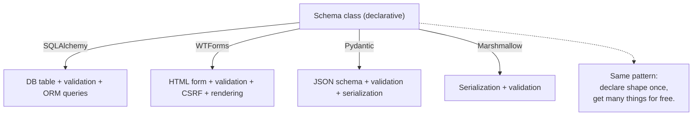

Once you internalize the pattern in one library, the others feel familiar. WTForms is the forms-specific instance of this broader idea: **declarative schemas beat imperative validation code**.

## 4. The Code

### 4.1 Install Flask-WTF

```bash
pip install Flask-WTF
```

Flask-WTF bundles WTForms (the form library) plus Flask-specific integration (CSRF, file uploads, etc.). One install gives you everything.

### 4.2 Project layout

```
wtf-demo/
├── app.py
└── templates/
    ├── base.html
    ├── login.html
    └── dashboard.html
```

### 4.3 `app.py`

```python
import os
from flask import Flask, render_template, redirect, url_for, flash
from flask_wtf import FlaskForm
from flask_wtf.file import FileField, FileAllowed
from wtforms import (StringField, PasswordField, SubmitField,
                     BooleanField, EmailField, ValidationError)
from wtforms.validators import DataRequired, Email, Length, EqualTo

app = Flask(__name__)
app.secret_key = os.environ.get('SECRET_KEY', 'dev-secret-change-me')

# Mock "database" of users
USERS = {
    'alice': {'password': 'wonderland', 'email': 'alice@example.com'},
}


# ---------- Form classes ----------

class LoginForm(FlaskForm):
    username = StringField('Username', validators=[DataRequired(), Length(min=3, max=80)])
    password = PasswordField('Password', validators=[DataRequired()])
    remember = BooleanField('Remember me')
    submit = SubmitField('Log In')


class RegistrationForm(FlaskForm):
    username = StringField('Username', validators=[DataRequired(), Length(min=3, max=80)])
    email = EmailField('Email', validators=[DataRequired(), Email()])
    password = PasswordField('Password', validators=[DataRequired(), Length(min=8)])
    confirm = PasswordField('Confirm Password', validators=[DataRequired(), EqualTo('password')])
    accept_tos = BooleanField('I accept the Terms of Service', validators=[DataRequired()])
    submit = SubmitField('Register')

    def validate_username(self, field):
        """Inline custom validator: username must not already be taken."""
        if field.data in USERS:
            raise ValidationError('That username is taken.')


# ---------- Routes ----------

@app.route('/')
def home():
    return redirect(url_for('login'))


@app.route('/login', methods=['GET', 'POST'])
def login():
    form = LoginForm()
    if form.validate_on_submit():
        user = USERS.get(form.username.data)
        if user and user['password'] == form.password.data:
            flash(f"Welcome back, {form.username.data}!", 'success')
            return redirect(url_for('dashboard'))
        flash('Invalid username or password.', 'error')   # don't say which one!
    return render_template('login.html', form=form)


@app.route('/dashboard')
def dashboard():
    return render_template('dashboard.html')


if __name__ == '__main__':
    app.run(debug=True)
```

### 4.4 `templates/base.html`

```html
<!DOCTYPE html>
<html lang="en">
<head>
    <meta charset="UTF-8">
    <title>My App</title>
</head>
<body>
    
        
            
                <div class="flash flash-{{ cat }}">{{ msg }}</div>
            
        
    
    
</body>
</html>
```

### 4.5 `templates/login.html`

```html


<h1>Log In</h1>

<form method="POST" action="{{ url_for('login') }}">
    {{ form.hidden_tag() }}   {# CSRF token — required! #}

    <p>
        {{ form.username.label }}
        {{ form.username(size=32, placeholder='alice') }}
        
            <span class="error">{{ err }}</span>
        
    </p>

    <p>
        {{ form.password.label }}
        {{ form.password(size=32) }}
        
            <span class="error">{{ err }}</span>
        
    </p>

    <p>
        {{ form.remember() }} {{ form.remember.label }}
    </p>

    <p>{{ form.submit() }}</p>
</form>

```

### 4.6 `templates/dashboard.html`

```html


<h1>Dashboard</h1>
<p>You're in. (In a real app, this would be behind @login_required.)</p>
<p><a href="{{ url_for('login') }}">Back to login</a></p>

```

## 5. Line-by-Line Explanation

### 5.1 `SECRET_KEY` in depth

```python
app.secret_key = os.environ.get('SECRET_KEY', 'dev-secret-change-me')
```

`SECRET_KEY` is the single most important security setting in a Flask app. It's a secret string Flask uses to **cryptographically sign** things:

1. **Session cookies.** Flask stores session data (like `session['user_id']`) in a cookie on the user's browser. To prevent tampering, Flask signs the cookie with `SECRET_KEY`. If someone changes the cookie, the signature won't match and Flask rejects it.
2. **CSRF tokens** (Flask-WTF). Each form gets a CSRF token tied to the session. The token is signed with `SECRET_KEY`, so attackers can't forge one.
3. **`flash()` messages.** Stored in the session cookie, signed with `SECRET_KEY`.

If `SECRET_KEY` leaks, attackers can:
- Forge session cookies and log in as any user.
- Forge CSRF tokens and submit forms on users' behalf.
- Decrypt anything you've signed with it.

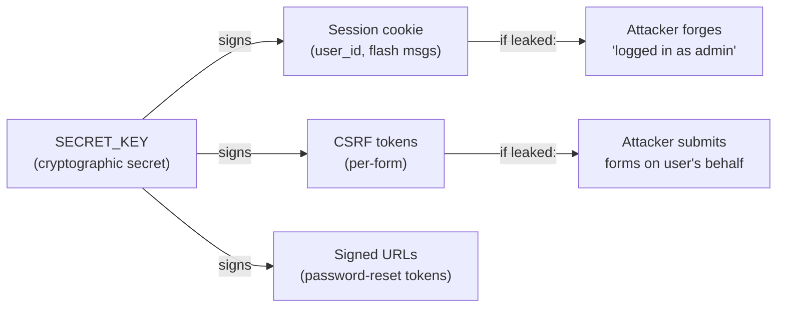

> [!warning] Three rules for SECRET_KEY
> 1. **Long and random.** At least 32 bytes. Generate with `python -c "import secrets; print(secrets.token_hex(32))"`.
> 2. **Different per environment.** Dev, staging, production all use *different* keys. If dev's key leaks, production is still safe.
> 3. **Loaded from environment variables.** Never hardcode in source. Use `os.environ.get('SECRET_KEY')` and set the env var in your shell, `.env` file (gitignored), or your hosting platform's secrets manager.

#### 5.1.1 What SECRET_KEY actually does — the cryptography

"Signing" a value means attaching a cryptographic MAC (message authentication code) computed from the value plus `SECRET_KEY`. Anyone can read the value, but only someone with `SECRET_KEY` can produce a valid signature for a *modified* value.

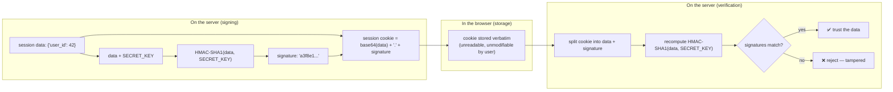

This is the same mechanism banks use for cheques (the magnetic ink signature): you can read the amount, but you can't modify it without invalidating the signature. If an attacker steals your session cookie, they can replay it (which is bad — see session fixation defence in Lesson 17) but they can't *modify* it (which would be catastrophic — they could change `user_id` from `42` to `1` and become admin).

> [!question] Student asks: "What algorithm does Flask use for signing?"
> Flask uses `itsdangerous`, a library by Armin Ronacher (Flask's creator). The default is HMAC-SHA1 for legacy reasons, but newer versions support SHA-512. HMAC-SHA1 is still cryptographically secure for signing (the SHA1 collision attacks don't apply to HMAC). For new high-security deployments, you can configure a stronger signer.

> [!try] Try this: tamper with a session cookie
> Log in to your demo app. Open DevTools → Application → Cookies → find the `session` cookie. Copy its value — it'll look like `eyJ1c2VyX2lkIjo0Mn0.XxXxXx.signature`. Paste it into a base64 decoder (or `echo 'eyJ1c2VyX2lkIjo0Mn0' | base64 -d` in a terminal) — you'll see `{'user_id': 42}`. Now try modifying just the data part and putting it back. Reload. Flask will reject the cookie (signature mismatch) and log you out. This is the signing defence in action.

### 5.2 The form class — `class LoginForm(FlaskForm)`

```python
class LoginForm(FlaskForm):
    username = StringField('Username', validators=[DataRequired(), Length(min=3, max=80)])
    password = PasswordField('Password', validators=[DataRequired()])
    remember = BooleanField('Remember me')
    submit = SubmitField('Log In')
```

A Flask-WTF form is a Python class inheriting from `FlaskForm`. Each **class attribute** is a field. The pattern:

```python
field_name = FieldType('Label text', validators=[...], **kwargs)
```

- `field_name` (the variable name) is what you use in templates (`form.username`) and what the HTML `name` attribute becomes.
- `'Label text'` is the human-readable label shown in `<label>`.
- `validators=[...]` is a list of validator callables that run on submit.
- `**kwargs` are extra options like `default=`, `description=`, `render_kw={'placeholder': '...'}`, `choices=[...]` (for select fields), etc.

When you instantiate the form (`form = LoginForm()`), WTForms:
1. Walks the class attributes, finding each field.
2. Creates Python field objects bound to the form.
3. If a POST request is in flight, pre-populates the fields from `request.form`.

This is metaclass magic — you don't see it, but it's why `form.username.data` works.

#### 5.2.1 Behind the scenes: the metaclass that builds forms

When you write `class LoginForm(FlaskForm):`, Python doesn't just create a normal class. `FlaskForm` uses a **metaclass** (specifically, WTForms' `FormMeta`) that intercepts class creation. As Python builds the class, the metaclass walks every class attribute. When it finds a `Field` instance (like `username = StringField(...)`), it doesn't leave it as a class attribute — it *registers* the field in an internal `_fields` dict and replaces the class attribute with a *descriptor*.

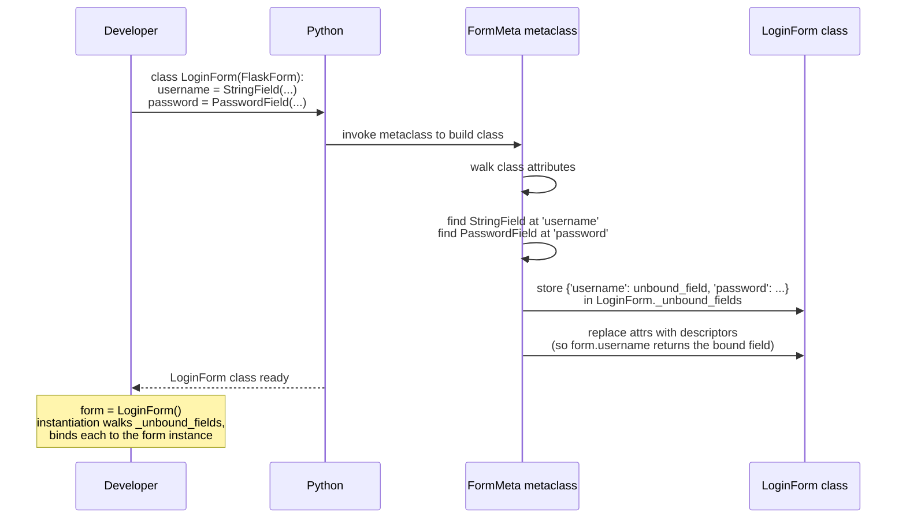

When you later do `form = LoginForm()`, the form's `__init__` walks `_unbound_fields` and creates a *bound* field for each, attaching it to the instance. That's why `form.username` works — the descriptor protocol hands back the bound field, which has `.data`, `.errors`, `.label`, and is callable (`form.username()` returns HTML).

This is the same pattern SQLAlchemy uses for model columns (`User.query` works because of metaclass magic on `db.Model`). Once you internalize "class attributes that look like fields are actually descriptors registered by a metaclass," a lot of Python libraries stop feeling magical.

> [!question] Student asks: "Why not just use `__init__` to set up fields?"
> You could write `def __init__(self): self.username = StringField(...)` in every form, but you'd lose the declarative style. The metaclass lets you write fields as class attributes (one line each, top of the class) instead of as boilerplate in `__init__`. It also lets WTForms introspect the form class to render it without an instance — useful for generating API docs or migrations.

```mermaid
flowchart TB
    Class["class LoginForm(FlaskForm):<br/>  username = StringField(...)<br/>  password = PasswordField(...)<br/>  submit = SubmitField(...)"]
    Class -->|metaclass scans attrs| Fields["Form fields registered<br/>in form._fields dict"]
    Fields -->|Instantiate: form = LoginForm()| Instance["form instance<br/>with .username, .password, .submit"]
    Instance -->|On POST: bind data| Bound["form.username.data = 'alice'<br/>(from request.form)"]
    Bound -->|form.validate_on_submit()| Valid["Run all validators<br/>collect errors"]
```

### 5.3 Field types — the full reference

| Field | Renders as | Common validators | Notes |
|---|---|---|---|
| `StringField` | `<input type="text">` | `DataRequired`, `Length` | Generic single-line text |
| `PasswordField` | `<input type="password">` | `DataRequired` | Masks characters; doesn't pre-fill for security |
| `TextAreaField` | `<textarea>` | `DataRequired`, `Length` | Multi-line text |
| `IntegerField` | `<input type="number">` (text) | `NumberRange` | Coerces to int; `None` if non-numeric |
| `DecimalField` | `<input type="number">` (text) | `NumberRange` | Coerces to `Decimal` (precise money) |
| `FloatField` | `<input type="number">` (text) | `NumberRange` | Coerces to float |
| `BooleanField` | `<input type="checkbox">` | (rarely) | `True` if checked, `False` otherwise |
| `DateField` | `<input type="date">` (text) | `DataRequired` | Parses `datetime.date` |
| `DateTimeField` | `<input type="datetime-local">` | `DataRequired` | Parses `datetime.datetime` |
| `EmailField` | `<input type="email">` | `Email` | HTML5 email input + server-side validation |
| `URLField` | `<input type="url">` | `URL` | HTML5 URL input + server-side validation |
| `SearchField` | `<input type="search">` | (text) | Like StringField, semantic type |
| `TelField` | `<input type="tel">` | `Regexp` | Phone numbers — no built-in format |
| `HiddenField` | `<input type="hidden">` | (rare) | For IDs, internal state |
| `SelectField` | `<select>` | `DataRequired` | `choices=[('value', 'Label'), ...]` |
| `SelectMultipleField` | `<select multiple>` | (rare) | Multiple values |
| `RadioField` | Multiple `<input type="radio">` | `DataRequired` | `choices=[...]`, one selected |
| `FileField` | `<input type="file">` | `FileAllowed`, `FileRequired` | Single file upload |
| `MultipleFileField` | `<input type="file" multiple>` | `FileAllowed` | Multiple files |
| `SubmitField` | `<input type="submit">` | (none) | Submit button |
| `FormField` | (renders another form) | (inherited) | Embed one form inside another |
| `FieldList` | (multiple of one field) | (per-item) | Dynamic lists, e.g., multiple emails |

#### Key field-type distinctions explained

**`IntegerField` vs `DecimalField` vs `FloatField`**: Use `IntegerField` for whole numbers (age, quantity). Use `DecimalField` for money — it uses Python's `Decimal` type which avoids floating-point errors (`0.1 + 0.2 == 0.3`, not `0.30000000000000004`). Use `FloatField` for scientific measurements where precision loss is acceptable.

**`StringField` vs `PasswordField`**: Both store strings, but `PasswordField` renders `<input type="password">` (masked) and *never pre-fills* on re-render. You don't want a sticky password field — that would put the password in the HTML source.

**`SelectField` vs `RadioField`**: Both present "choose one from N options". `SelectField` is a dropdown (compact, good for many options). `RadioField` shows all options at once (good for ≤ 5 options, when you want the user to see all choices).

**`SelectMultipleField` vs `FieldList`**: `SelectMultipleField` is a multi-select dropdown (Ctrl+click). `FieldList` is a dynamic list of fields the user can add/remove — like "add another email" with a + button.

**`HiddenField`**: For data you want to send but not display. Common uses: the ID of the record being edited (`<input type="hidden" name="id" value="42">`), internal state, or pre-filled values that shouldn't be edited. (Don't use it for security — users can edit hidden fields with browser DevTools.)

**`FormField` and `FieldList`**: Power-user features. `FormField(AnotherForm)` embeds one form inside another — useful for "billing address + shipping address" in one form. `FieldList(StringField('Email'))` renders a dynamic list of string fields — perfect for "add multiple recipients" UIs.

Example using several:

```python
class SurveyForm(FlaskForm):
    name = StringField('Your name', validators=[DataRequired()])
    age = IntegerField('Age', validators=[NumberRange(min=13, max=120)])
    gender = RadioField('Gender', choices=[('m', 'Male'), ('f', 'Female'), ('o', 'Other'), ('n', 'Prefer not to say')])
    country = SelectField('Country', choices=[('us', 'USA'), ('uk', 'UK'), ('ca', 'Canada')], default='us')
    interests = SelectMultipleField('Interests', choices=[('sport', 'Sport'), ('music', 'Music'), ('art', 'Art')])
    bio = TextAreaField('Bio', validators=[Length(max=500)])
    avatar = FileField('Avatar', validators=[FileAllowed(['jpg', 'png'], 'Images only!')])
    subscribe = BooleanField('Subscribe to newsletter', default=True)
    submit = SubmitField('Submit')
```

### 5.4 Validators — the full reference

Validators are callables that take the field, check its value, and raise `ValidationError` if invalid. They're applied in order.

| Validator | What it checks | Example |
|---|---|---|
| `DataRequired` | Field is not empty AND not just whitespace | `DataRequired()` |
| `InputRequired` | Field was submitted (even if empty) | `InputRequired()` — use for checkboxes |
| `Email` | Looks like an email (regex-based) | `Email(message='Invalid email')` |
| `Length(min=N, max=M)` | String length is in range | `Length(min=8, max=80)` |
| `NumberRange(min=N, max=M)` | Number is in range | `NumberRange(min=0, max=100)` |
| `URL` | Looks like a URL | `URL()` |
| `EqualTo('other')` | Matches another field's value | `EqualTo('password', message='Passwords must match')` |
| `Optional` | If empty, skip other validators | `Optional()` |
| `AnyOf(['a', 'b'])` | Value is in the list | `AnyOf(['yes', 'no'])` |
| `NoneOf(['admin', 'root'])` | Value is NOT in the list | `NoneOf(['admin'])` |
| `Regexp(r'^[a-z]+$')` | Matches a regex | `Regexp(r'^\d{4}$', message='4 digits')` |
| `IPAddress(ipv4=True, ipv6=True)` | Valid IP address | `IPAddress()` |
| `UUID` | Valid UUID | `UUID()` |
| `MacAddress` | Valid MAC address | `MacAddress()` |
| `FileAllowed(['jpg', 'png'])` | File extension whitelist | (Flask-WTF, for FileField) |
| `FileRequired()` | File was uploaded | (Flask-WTF) |

Example combining validators:

```python
password = PasswordField('Password', validators=[
    DataRequired(),
    Length(min=8, message='At least 8 characters.'),
    Regexp(r'.*[A-Z].*', message='At least one uppercase letter.'),
    Regexp(r'.*[0-9].*', message='At least one digit.'),
])
```

#### 5.4.1 Validation order matters

Validators run in the order they're listed. If `DataRequired()` fails, WTForms *short-circuits* the field — the later validators for that field don't run. (Without short-circuiting, an empty password would trigger *four* errors: "required", "too short", "no uppercase", "no digit" — confusing UX.)

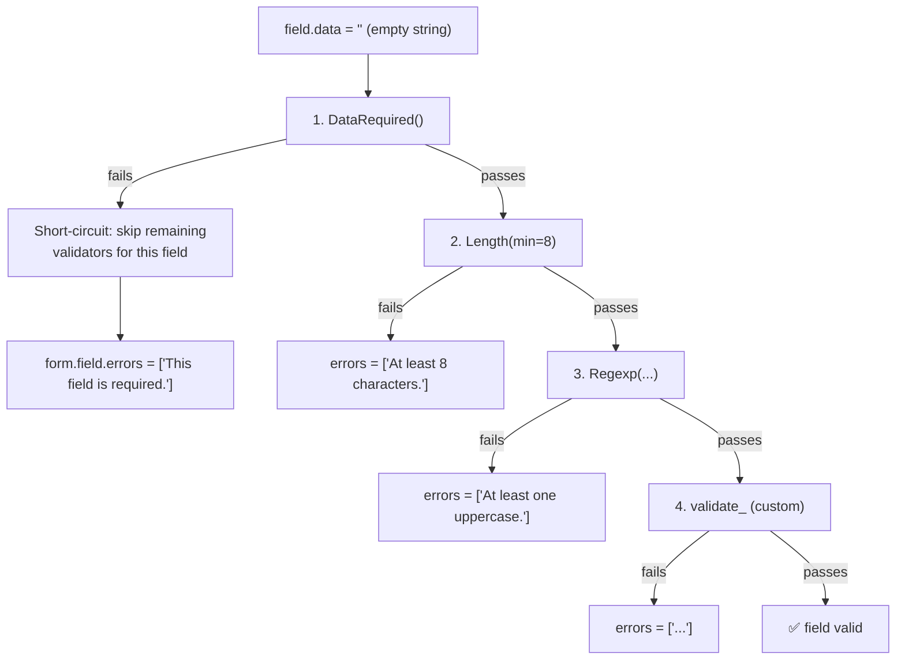

Practical implication: put `DataRequired()` first if you want a clean "required" message without three other error messages piling on. Put `Optional()` first if the field is allowed to be empty (e.g., a phone number that's not required but *if* provided must match a regex).

> [!question] Student asks: "What's the difference between `DataRequired` and `InputRequired`?"
> Subtle but important. `DataRequired` checks the *processed data* is truthy (after coercion — so an empty string fails, but so does `None`). `InputRequired` checks the *raw input* was submitted (so an empty string passes, but missing the field entirely fails). Use `DataRequired` for normal text fields. Use `InputRequired` for checkboxes (an unchecked checkbox is "missing" from the form, so `DataRequired` doesn't work — `InputRequired` does, but actually `DataRequired` works for BooleanField specifically because of WTForms' coercion rules).

> [!try] Try this: see validator short-circuiting
> Make a password field with `DataRequired()`, `Length(min=8)`, and a `Regexp` for uppercase. Submit the form with an *empty* password. You should see only one error ("required"). Now submit with `password` (8 chars, no uppercase). You should see one error ("uppercase required") — `Length` passed, `Regexp` failed. Now submit with `pass` (4 chars, no uppercase). You should see one error ("at least 8 chars") — `Length` failed and short-circuited the `Regexp`.

### 5.5 Custom validators — inline methods

For "does this username already exist?" type checks, you can't use a built-in validator — it needs database access. The pattern: write a method named `validate_<field_name>` on your form class:

```python
class RegistrationForm(FlaskForm):
    username = StringField('Username', validators=[DataRequired(), Length(min=3, max=80)])
    # ... other fields ...

    def validate_username(self, field):
        """Runs after the built-in validators for 'username'."""
        if field.data in USERS:
            raise ValidationError('That username is taken.')
```

WTForms calls any `validate_<fieldname>` method automatically. The method takes `(self, field)` and raises `ValidationError('message')` if invalid. The error appears in `form.username.errors` alongside the built-in validator errors.

### 5.6 Custom validators — standalone classes

For reusable validators across forms, write a class:

```python
class StrongPassword:
    """A reusable password-strength validator."""
    def __init__(self, min_length=8, message=None):
        self.min_length = min_length
        self.message = message or f'Must be at least {min_length} chars with upper, lower, digit.'

    def __call__(self, form, field):
        pw = field.data or ''
        if (len(pw) < self.min_length or
            not any(c.isupper() for c in pw) or
            not any(c.islower() for c in pw) or
            not any(c.isdigit() for c in pw)):
            raise ValidationError(self.message)

# Usage:
class RegistrationForm(FlaskForm):
    password = PasswordField('Password', validators=[DataRequired(), StrongPassword(min_length=10)])
```

A validator is just a callable that takes `(form, field)`. A class with `__call__` works because it can hold configuration (like `min_length`) on `self`.

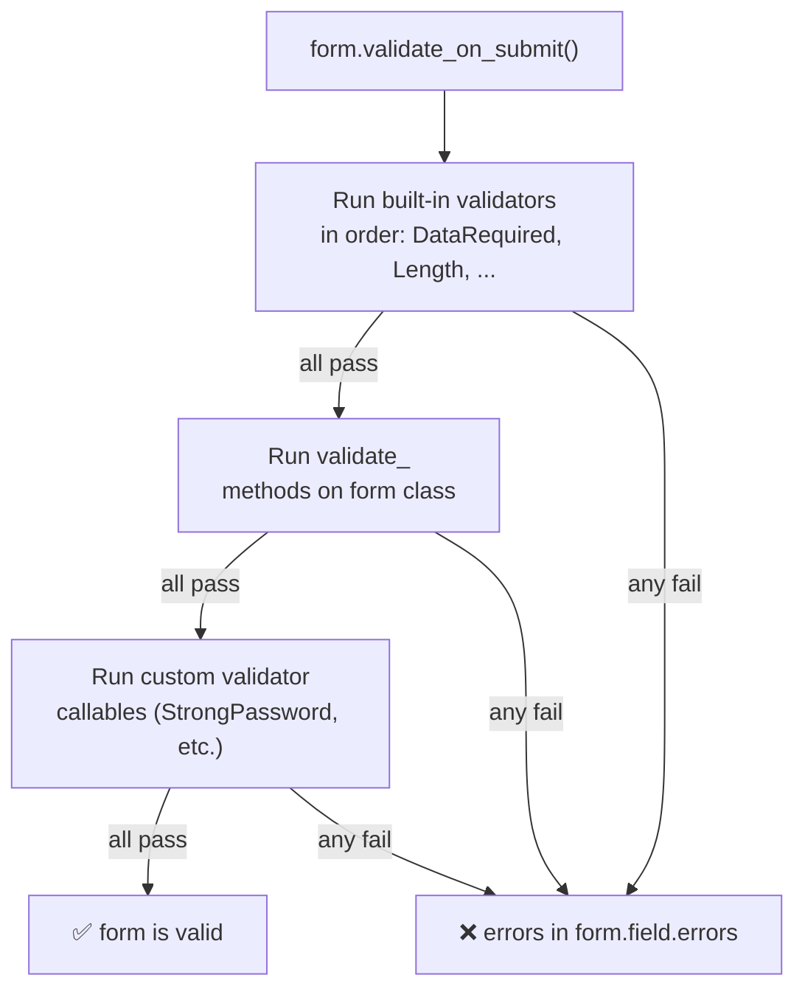

### 5.7 `form.hidden_tag()` — CSRF token in depth

In the template:

```html
<form method="POST" action="{{ url_for('login') }}">
    {{ form.hidden_tag() }}
    ...
</form>
```

`form.hidden_tag()` renders one or more `<input type="hidden">` elements — most importantly, the **CSRF token**:

```html
<input type="hidden" name="csrf_token" value="eyJ...long-signed-token... ">
```

The token is a signed, time-limited value tied to the user's session. When the form is submitted, Flask-WTF:

1. Reads the `csrf_token` from `request.form`.
2. Checks it against the session's expected token.
3. Verifies the signature (using `SECRET_KEY`).
4. Verifies it hasn't expired (default: 1 hour).

If any check fails, Flask-WTF returns 400 Bad Request. The form's `validate_on_submit()` returns `False`, and a CSRF error appears in `form.csrf_token.errors`.

#### The CSRF attack in detail

Imagine this scenario:

1. You log in to `yourbank.com`. Your browser stores a session cookie.
2. You visit `evil.com` in another tab (perhaps a phishing link).
3. `evil.com` has this hidden form that auto-submits via JavaScript:
   ```html
   <form action="https://yourbank.com/transfer" method="POST" id="f">
     <input type="hidden" name="to" value="evil_account">
     <input type="hidden" name="amount" value="10000">
   </form>
   <script>document.getElementById('f').submit();</script>
   ```
4. Your browser sends the POST to `yourbank.com/transfer` — **including your session cookie** (because the cookie was set for `yourbank.com`).
5. `yourbank.com` thinks *you* authorised the transfer. Money moves.

The defence: every form includes a secret token (`csrf_token`) tied to your session. `evil.com` doesn't know this token (it can't read pages from `yourbank.com` due to the same-origin policy), so it can't include a valid one in its malicious form. Your server rejects the request.

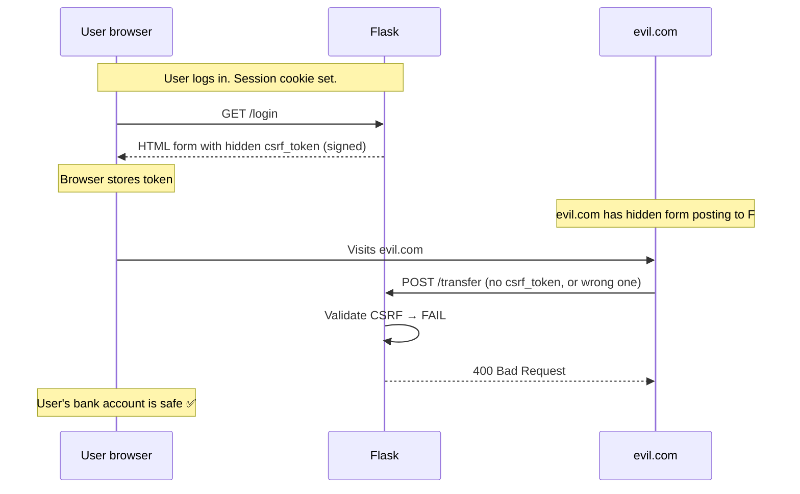

> [!question] Student asks: "Why can't evil.com just fetch the form, get the token, and use it?"
> Two reasons. First, the **same-origin policy**: JavaScript on `evil.com` cannot read the response from a request to `yourbank.com` (different origin). Second, the CSRF token is tied to the user's *session*, which `evil.com` doesn't have access to. Even if evil.com could submit the form (which it can, by hidden form auto-submit), it can't include the right token because it can't read it.

> [!question] Student asks: "Does CSRF protection slow down my forms?"
> Negligibly. The token is one extra hidden input and one extra signature check per request. The signature uses HMAC-SHA1, which is microseconds on modern hardware. You won't notice.

#### 5.7.1 The CSRF token lifecycle

A CSRF token isn't a static value — it has a lifecycle that begins when the form is rendered and ends when it's verified. Let's trace it:

```mermaid
sequenceDiagram
    participant Browser
    participant Flask
    participant Session as Session store

    Note over Browser,Flask: Step 1: User loads the form (GET)
    Browser->>Flask: GET /login
    Flask->>Session: read or create session
    Session-->>Flask: session_id=abc
    Flask->>Flask: generate csrf_token = HMAC(random_secret, session_id)<br/>with timestamp
    Flask-->>Browser: HTML with hidden input:<br/><input name='csrf_token' value='eyJ...'>
    Note over Browser: Token embedded in form HTML

    Note over Browser,Flask: Step 2: User submits (POST)
    Browser->>Flask: POST /login<br/>body: username=...&csrf_token=eyJ...
    Flask->>Flask: recompute expected token from session
    Flask->>Flask: compare sent token vs expected<br/>check signature (HMAC)<br/>check not expired (timestamp)
    alt token valid
        Flask->>Flask: run form validators
        Flask-->>Browser: redirect (success)
    else token invalid/missing/expired
        Flask-->>Browser: 400 Bad Request<br/>(or re-render form with CSRF error)
    end
```

Three things make this secure:

1. **The token is tied to the session.** It's derived from a per-session secret. Different users get different tokens.
2. **The token is signed.** An attacker can't forge one without `SECRET_KEY`.
3. **The token expires.** Default time limit is 1 hour. An attacker who somehow steals a token can't use it forever.

> [!try] Try this: tamper with the CSRF token
> Open `/login` in your browser. View source, find the `csrf_token` value. Now use `curl` to submit the form with the username and password, but with a *modified* token (change one character). Flask-WTF should return 400 Bad Request. This confirms the signature check is working — one byte off and the request is rejected.

### 5.8 `form.validate_on_submit()` — the one-line check

```python
if form.validate_on_submit():
    # do the thing
```

This one line does three things:

1. **Checks `request.method == 'POST'`**. If GET, returns `False` (don't process).
2. **Checks the CSRF token**. If invalid, returns `False`.
3. **Runs all validators** on all fields. If any fails, returns `False` and populates `form.field.errors`.

Only when all three pass does it return `True`. This is the standard pattern:

```python
@app.route('/login', methods=['GET', 'POST'])
def login():
    form = LoginForm()
    if form.validate_on_submit():
        # form.username.data, form.password.data are validated and safe
        user = USERS.get(form.username.data)
        if user and user['password'] == form.password.data:
            flash('Welcome!', 'success')
            return redirect(url_for('dashboard'))
        flash('Invalid credentials.', 'error')
    # GET or validation failed → render the form (with errors if any)
    return render_template('login.html', form=form)
```

The elegance: on GET, `form.validate_on_submit()` returns `False` (because method is GET), so the form is rendered empty. On POST with valid data, you process. On POST with invalid data, the form re-renders with errors — *and the user's input is preserved* (no sticky-value code needed!).

#### 5.8.1 Behind the scenes: what `validate_on_submit()` actually does

Let's unpack that one line into its actual implementation (simplified from Flask-WTF's source):

```python
def validate_on_submit(self):
    # 1. Must be a POST (or PUT/PATCH)
    if request.method not in ('POST', 'PUT', 'PATCH'):
        return False
    # 2. Bind form data from request.form (and request.files)
    #    (this happens in __init__ if formdata is provided, but
    #    FlaskForm auto-detects request.form)
    # 3. Check CSRF token
    if not self.validate_csrf(self.csrf_token.data):
        return False
    # 4. Run all field validators + custom validate_<field> methods
    return self.validate()  # returns True only if NO errors
```

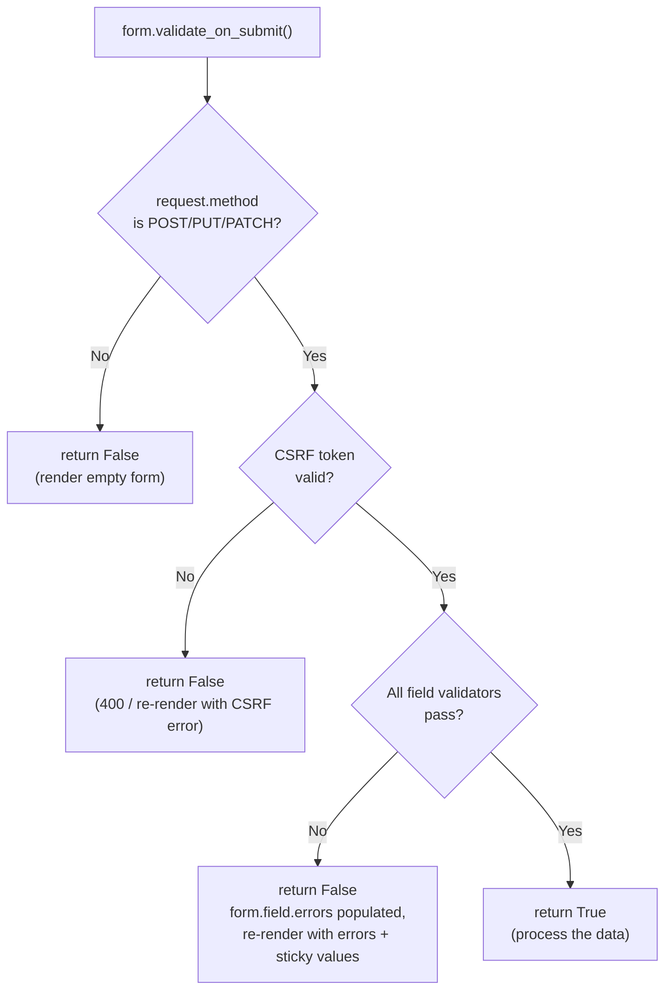

The genius: one boolean captures three distinct outcomes (wrong method, CSRF fail, validation fail) into "return False". Your route code only branches on True/False. The form's `.errors` attributes give you the details if you need them.

> [!question] Student asks: "How does WTForms know to read from `request.form`?"
> `FlaskForm.__init__` checks if `formdata` was explicitly passed. If not, it auto-detects: if `request.method` is POST and there's form data, it uses `request.form` (and `request.files` for file fields). On GET, it leaves fields unbound (so `.data` returns the default or `None`). This auto-binding is Flask-specific sugar that plain WTForms doesn't have — that's why `FlaskForm` exists separately from `wtforms.Form`.

> [!try] Try this: see the three outcomes
> Add `print(form.errors)` inside your login route, just before `return render_template`. Then:
> - Visit `/login` (GET). Terminal shows `{} ` — no errors yet, form is unbound.
> - Submit empty form. Terminal shows `{'username': [...], 'password': [...]}` — validators ran.
> - Submit valid credentials. The `if form.validate_on_submit()` branch runs, redirecting before the print fires.
> This is the cleanest way to see what `validate_on_submit` is doing behind the scenes.

### 5.9 Rendering forms three ways

#### Way 1: Manual HTML (full control)

```html
<form method="POST">
    {{ form.hidden_tag() }}
    <label for="username">{{ form.username.label.text }}</label>
    <input type="text" id="username" name="username"
           value="{{ form.username.data or '' }}"
           class="form-control is-invalid">
    
        <div class="invalid-feedback">{{ err }}</div>
    
</form>
```

Most verbose, most control. Use when you need pixel-perfect custom rendering.

#### Way 2: Field-by-field with `{{ form.field() }}`

```html
<form method="POST">
    {{ form.hidden_tag() }}
    <p>
        {{ form.username.label }} {{ form.username(size=32, class='form-control') }}
        <span class="err">{{ err }}</span>
    </p>
    <p>
        {{ form.password.label }} {{ form.password(size=32) }}
        <span class="err">{{ err }}</span>
    </p>
    {{ form.submit() }}
</form>
```

`{{ form.username(size=32) }}` calls the field as a function — the kwargs become HTML attributes. This is the most common pattern.

#### Way 3: Quick whole-form render

```html
{{ form.hidden_tag() }}
{{ form.username.label }} {{ form.username() }}
{{ form.password.label }} {{ form.password() }}
{{ form.submit() }}
```

Or even quicker (everything in one go):

```html
{{ form() }}
```

This renders the whole form with default HTML. Useful for prototyping; ugly for production.

#### Showing errors

```html

    <ul class="errors">
        
            <li>{{ err }}</li>
        
    </ul>

```

Each field has a `.errors` list. Iterate it to show all validation messages for that field. There's also `form.errors` (a dict of all field errors) for showing a summary at the top.

### 5.10 File uploads with Flask-WTF

```python
from flask_wtf.file import FileField, FileAllowed, FileRequired
from werkzeug.utils import secure_filename

class UploadForm(FlaskForm):
    photo = FileField('Profile photo', validators=[
        FileRequired(),
        FileAllowed(['jpg', 'jpeg', 'png'], 'Images only!'),
    ])
    submit = SubmitField('Upload')

@app.route('/upload', methods=['GET', 'POST'])
def upload():
    form = UploadForm()
    if form.validate_on_submit():
        f = form.photo.data
        filename = secure_filename(f.filename)
        f.save(f'app/static/uploads/{filename}')
        flash('Uploaded!', 'success')
        return redirect(url_for('home'))
    return render_template('upload.html', form=form)
```

The form must have `enctype="multipart/form-data"` — Flask-WTF handles this automatically when you use `{{ form() }}` or you can add it manually:

```html
<form method="POST" enctype="multipart/form-data">
    {{ form.hidden_tag() }}
    {{ form.photo.label }} {{ form.photo() }}
    {{ form.submit() }}
</form>
```

We cover file uploads in depth in [[Lesson-21-File-Uploads]].

### 5.11 Modern alternative: Pydantic

WTForms is great for HTML forms. But if you're building a JSON API (Lesson 19), you don't have HTML — clients send JSON. **Pydantic** is the modern Python data validation library, used heavily with FastAPI and increasingly with Flask.

```python
from pydantic import BaseModel, EmailStr, Field, field_validator

class UserCreate(BaseModel):
    username: str = Field(min_length=3, max_length=80)
    email: EmailStr
    password: str = Field(min_length=8)

    @field_validator('password')
    @classmethod
    def strong(cls, v):
        if not any(c.isupper() for c in v):
            raise ValueError('must contain uppercase')
        return v

# Usage in a Flask JSON API:
@app.route('/api/users', methods=['POST'])
def create_user():
    data = request.get_json()
    try:
        user = UserCreate(**data)
    except ValidationError as e:
        return jsonify({'errors': e.errors()}), 422
    # Save user, return 201
```

When to use which:

| Use WTForms when... | Use Pydantic when... |
|---|---|
| HTML form submission | JSON API |
| You want auto-generated HTML | You parse JSON bodies |
| File uploads (`FileField`) | SQLAlchemy model field types |
| Traditional Flask server-rendered apps | API-first / SPA backends |

For a typical Flask app, you'll often have *both*: WTForms for the admin panel and HTML forms, Pydantic for the public JSON API. They're complementary, not competing.

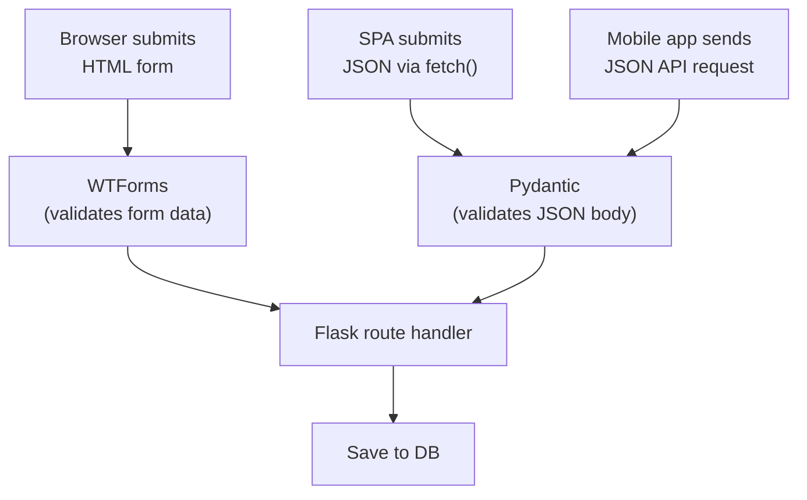

#### 5.11.1 WTForms vs Pydantic — philosophical differences

Both libraries implement "declarative schemas with validation," but they grew from different communities and reflect different priorities:

| Aspect | WTForms | Pydantic |
|---|---|---|
| **Born** | 2008 (web forms era) | 2017 (API/type-hint era) |
| **Driven by** | String labels and explicit validators | Python type hints (`x: str`)|
| **Output** | HTML form fields + validation | Parsed Python objects + JSON schema |
| **Error format** | Per-field list of strings | Structured error objects (machine-readable) |
| **Coercion** | Field types coerce (IntegerField → int) | Type hints coerce (`x: int` parses strings) |
| **Best at** | Rendering HTML + collecting form data | Validating JSON + serialising objects |
| **Performance** | Slower (metaclass + descriptors) | Faster (compiled validators in v2) |

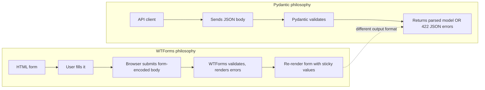

If you're building a server-rendered Flask app (Jinja templates, browser users), WTForms is the right tool. If you're building a JSON API for a React frontend or mobile app, Pydantic is the right tool. Many production Flask apps have *both*: WTForms for the admin panel, Pydantic for the public API.

> [!question] Student asks: "Can I use Pydantic for HTML forms?"
> You can — there's no rule against it. But you lose the HTML rendering (`form.username()` doesn't exist in Pydantic), CSRF integration, and file upload handling. You'd end up writing glue code to bridge the gaps. Use the right tool for the job: Pydantic for JSON, WTForms for HTML.

> [!try] Try this: convert a WTForm to Pydantic
> Take the `RegistrationForm` from this lesson and rewrite it as a Pydantic `BaseModel`. Notice: no `Field()` calls needed for labels (Pydantic doesn't render HTML), but type hints do the work (`username: str = Field(min_length=3)`). Compare the line count and readability. Both are clean — just different shapes.

### 5.12 Historical context: how we got here

Web forms have evolved significantly. Pre-2008, most Python frameworks (Django, TurboGears, Pylons) had their own form libraries — each slightly different. WTForms emerged in 2008 as a framework-agnostic library with a clean declarative API. Flask-WTF (2010) wrapped it for Flask-specific concerns: CSRF integration, file uploads, the `FlaskForm` base class.

The pattern of "form as a class with declarative fields" was revolutionary at the time. It inspired similar designs in:

- **Django Forms** (similar API, more tightly coupled to Django ORM)
- **Marshmallow** (Python serialization library, similar `Schema` class pattern)
- **Pydantic** (modern type-hint-driven version, used by FastAPI)
- **SQLModel** (combines Pydantic + SQLAlchemy)

The intellectual lineage: WTForms → Marshmallow → Pydantic. Each generation got more type-safe and more Pythonic. WTForms is still the right choice for HTML forms in Flask today, but Pydantic is the future for APIs.

## 6. Running the Code

Save all the files. Run:

```bash
python app.py
```

### 6.1 Visit `/login` (empty form)

Open `http://127.0.0.1:5000/login`. You should see the login form. Don't fill anything in. Click "Log In". You should see per-field errors:

```
Username: [            ]  This field is required.
Password: [            ]  This field is required.
```

Notice: no Python validation code wrote these. WTForms generated them from the `DataRequired()` validators.

### 6.2 Try invalid username (too short)

Type `ab` (only 2 chars). Submit. Error: "Field must be at least 3 characters long." (From the `Length(min=3)` validator.)

### 6.3 Try valid credentials

Username `alice`, password `wonderland`. Submit. You should be redirected to `/dashboard` and see:

```
Welcome back, alice!  ← flash message

Dashboard
You're in.
```

### 6.4 Try invalid credentials

Username `alice`, password `wrong`. Submit. You should see:

```
Invalid username or password.
```

Notice we don't say *which* is wrong — that's deliberate. Saying "username doesn't exist" lets attackers enumerate accounts. Always use a generic "invalid credentials" message.

### 6.4.1 The user-enumeration problem

If your login form says "username not found" vs "wrong password", an attacker can run through a list of common usernames (`admin`, `alice`, `bob`, ...) and learn which ones exist. They then focus their password-guessing on confirmed accounts. This is called **user enumeration** and it's a classic web vulnerability.

The defence: always use the *same* generic error message ("Invalid username or password") whether the username doesn't exist or the password is wrong. Even better, take the same time to respond in both cases (otherwise attackers can tell from response time which case it was — a "timing attack").

```python
# BAD — reveals which is wrong
if not user:
    flash('No such user.', 'error')
elif not user.check_password(form.password.data):
    flash('Wrong password.', 'error')

# GOOD — single generic message
if not user or not user.check_password(form.password.data):
    flash('Invalid username or password.', 'error')
```

Note the `or` — Python's short-circuit means if `user` is `None`, `check_password` is never called. That's slightly faster than the success case, but not enough for an attacker to exploit. (For high-security apps, hash a dummy password even if the user doesn't exist, to keep timing constant.)

### 6.5 Try the CSRF attack with `curl`

```bash
# Submit without CSRF token → 400 Bad Request
curl -i -X POST http://127.0.0.1:5000/login \
     -d "username=alice&password=wonderland"

# Submit with a CSRF token (extract one from the rendered form first):
# 1. GET /login to get the form HTML
# 2. Find the csrf_token value in the hidden input
# 3. POST with that token

curl -c cookies.txt http://127.0.0.1:5000/login   # saves session cookie
CSRF=$(curl -b cookies.txt http://127.0.0.1:5000/login | grep csrf_token | sed -n 's/.*value="\([^"]*\)".*/\1/p')
curl -b cookies.txt -X POST http://127.0.0.1:5000/login \
     -d "username=alice&password=wonderland&csrf_token=$CSRF"
```

The first command (no token) returns 400. The third (with token) succeeds. That's CSRF defence in action.

### 6.6 Real-world: how production login forms differ

In production, a login form has more moving parts than our demo:

- **Rate limiting.** Flask-Limiter caps login attempts per IP (e.g., 5 per minute). Without it, attackers can brute-force passwords at 1000 attempts/second.
- **Account lockout.** After N failed attempts on a *username*, lock the account for 15 minutes (or email the user). Defeats password guessing.
- **CAPTCHA.** For repeated failures, require solving a CAPTCHA. Defeats automated bots.
- **Two-factor authentication (2FA).** After password, require a TOTP code from the user's phone (Google Authenticator, Authy). We cover 2FA in a later lesson.
- **Logging.** Log every login attempt (success and failure) with IP, user agent, timestamp. Useful for detecting attacks.
- **Session hardening.** Set `SESSION_COOKIE_SECURE=True` (HTTPS only), `SESSION_COOKIE_HTTPONLY=True` (no JS access), `SESSION_COOKIE_SAMESITE='Lax'` (CSRF mitigation).
- **Password hashing.** Never store plaintext. Use `bcrypt` or `argon2`. We cover this in [[Lesson-16-User-Model-AndPasswords]].

The Flask-WTF part — the form class, validators, CSRF — is the foundation. The rest is hardening layered on top.

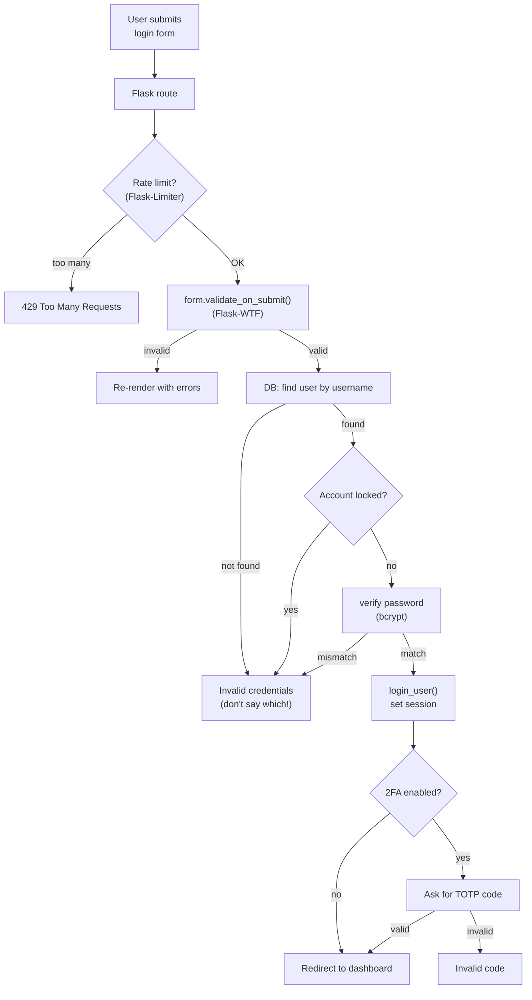

This is why production login is more than 5 lines of code. Each box is a defence layer; remove any one and you've opened a hole.

## 7. Common Mistakes

### 7.1 Forgetting `{{ form.hidden_tag() }}`

```html
<form method="POST">
    <!-- no hidden_tag -->
    {{ form.username() }}
</form>
```

The form submits, but the CSRF token is missing. Flask-WTF returns 400 Bad Request. **Always include `{{ form.hidden_tag() }}` inside `<form>` tags.**

### 7.2 Missing `SECRET_KEY`

```python
app = Flask(__name__)
# no secret_key set
form = LoginForm()  # RuntimeError: session not available
```

CSRF tokens are stored in the session, which requires `SECRET_KEY`. Set it before instantiating any form.

### 7.3 Missing `methods=['POST']`

```python
@app.route('/login')   # GET only!
def login():
    form = LoginForm()
    if form.validate_on_submit():   # always False (no POST possible)
```

`form.validate_on_submit()` checks for POST. If the route is GET-only, the form can never be submitted. Add `methods=['GET', 'POST']`.

### 7.4 `form.email` vs `form.email()`

```html
{{ form.email }}       <!-- shows the field object repr -->
{{ form.email() }}     <!-- renders the <input> -->
```

`form.email` is the field object (use for `.data`, `.errors`, `.label`). `form.email()` is a callable that returns HTML. Forgetting the `()` shows `<unbound Field>` in your page.

### 7.5 Field name vs label

```python
username = StringField('Your Username', ...)   # label is 'Your Username'
```

```python
form.username.data      # ← use the variable name
form.username.label()   # ← renders '<label for="username">Your Username</label>'
```

The variable name (`username`) is the Python and HTML name. The label string (`'Your Username'`) is what users see. Don't mix them up.

### 7.6 No business-logic error path

```python
if form.validate_on_submit():
    user = USERS.get(form.username.data)
    if user and user['password'] == form.password.data:
        # success
    # else: do nothing — user sees the empty form again, no error
```

Always handle the "validation passed but business logic failed" case. Flash a generic error.

### 7.7 Reading `.data` before validation

```python
form = LoginForm()
name = form.username.data   # always None on GET!
if form.validate_on_submit():
    ...
```

`form.username.data` is populated from `request.form` only when the form is bound — which happens automatically on POST. On GET, it's `None` (or your `default=`). Don't read `.data` until after `validate_on_submit()`.

### 7.8 Same `SECRET_KEY` across environments

```python
# DON'T commit this:
app.secret_key = 'my-production-secret-key-2024'
```

If your source code is public (e.g., open source) or your repo is leaked, attackers have your production key. Use environment variables with different values per environment.

### 7.9 Treating `Email()` validator as gospel

The `Email()` validator checks the *format* of an email. It does NOT check that the email exists, that the domain accepts mail, or that the user owns it. For real verification, send a confirmation email with a signed link.

## 8. Exercises

> [!tip] The 20-minute rule
> Stuck for 20 minutes? Take a break.

1. **Build the registration form.** Add a `/register` route using the `RegistrationForm` class from this lesson. Save new users to the `USERS` dict. After registration, redirect to `/login` with a flash message.

2. **Survey with checkboxes.** Build a `SurveyForm` with `SelectMultipleField` for "Which languages do you know?" (Python, JS, Rust, Go, etc.). Display the selected languages on the thanks page.

3. **Custom `StrongPassword` validator.** Implement the standalone validator class from section 5.6. Use it on your registration form's password field. Test with weak passwords ("password", "12345678") and confirm they're rejected.

4. **File upload preview.** Build an `/avatar` route with a `FileField` for image upload. After upload, show the image on the page. Restrict to JPG/PNG, max 1MB (use `FileAllowed` and check `len(f.read())`).

5. **Bootstrap integration.** Modify your login form to use Bootstrap classes (`form-control`, `is-invalid`, `invalid-feedback`). Hint: write a Jinja macro that wraps `{{ form.field() }}` with the right divs.

6. **Cross-field pizza validation.** Build a `PizzaForm` with `size` (radio: S/M/L) and `toppings` (multi-select). Add a custom validator: if size is S, max 3 toppings; if M, max 5; if L, max 7. Hint: use `validate_toppings` method that reads `self.size.data`.

7. **Pydantic JSON API.** Build a `/api/users` POST endpoint that accepts a JSON body, validates it with a Pydantic `UserCreate` model, and returns either 201 (created) or 422 (validation errors). Test with `curl -X POST -H "Content-Type: application/json" -d '{"username":"ab","email":"bad","password":"x"}' http://localhost:5000/api/users`.

8. **Rate-limited login.** Add `Flask-Limiter` to your login route: max 5 attempts per minute per IP. After 5 failures, return 429 Too Many Requests. (Look up Flask-Limiter docs.)

9. **Form version 2: edit profile.** Build a `/profile/edit` form that pre-populates from a `User` object. Hint: pass `obj=user` to the form constructor, or set `username=default` per field.

10. **Decode a session cookie.** Run your Flask app, log in, and grab the `session` cookie from DevTools. Use Python's `itsdangerous` library to decode it: `from itsdangerous import URLSafeTimedSerializer; s = URLSafeTimedSerializer(app.secret_key); print(s.loads(cookie))`. Confirm you can read the session data — but try modifying it and re-signing without the key, which should fail.

11. **Two-form page.** Build a single page with two forms (e.g., a login form and a signup form, both POSTing to different routes). Each form needs its own `{{ form.hidden_tag() }}`. Confirm each form's CSRF token is independent and submitting one doesn't trigger the other.

12. **Cross-field validator class.** Rewrite the `validate_username` inline method as a standalone validator class (`UniqueUsername`) that takes a database session in its constructor. Use it on both `RegistrationForm` and an `EditProfileForm`. Confirm both forms reject duplicate usernames.

13. **Pydantic + WTForms side-by-side.** Build a `/register` HTML form (WTForms) and a `/api/register` JSON endpoint (Pydantic), both validating the same fields with the same rules. Confirm both reject the same bad inputs. Discuss: which has nicer error messages for humans? For machines?

14. **CSRF expiry test.** Find Flask-WTF's `WTF_CSRF_TIME_LIMIT` config (default 3600 seconds). Set it to 5 seconds for testing. Open the login form, wait 10 seconds, then submit. The form should be rejected with a CSRF error. Restore the default.

## 9. What We Learned

- **Flask-WTF** = WTForms (form library) + Flask integration (CSRF, file uploads). `pip install Flask-WTF`.
- **`SECRET_KEY`** signs session cookies, CSRF tokens, flash messages, and any signed URL. Generate with `secrets.token_hex(32)`, store in env vars, differ per environment.
- A **form class** inherits from `FlaskForm`. Each class attribute is a field. Instantiate with `form = MyForm()`. On POST, fields are auto-bound to `request.form`.
- **Field types**: `StringField`, `PasswordField`, `TextAreaField`, `IntegerField`, `DecimalField`, `FloatField`, `BooleanField`, `DateField`, `DateTimeField`, `EmailField`, `URLField`, `SelectField`, `RadioField`, `FileField`, `MultipleFileField`, `SubmitField`, `HiddenField`, `FormField`, `FieldList`.
- **Validators**: `DataRequired`, `InputRequired`, `Email`, `Length`, `NumberRange`, `URL`, `EqualTo`, `Optional`, `AnyOf`, `NoneOf`, `Regexp`, `IPAddress`, `UUID`, `MacAddress`, `FileAllowed`, `FileRequired`. They run in order and collect errors.
- **Custom validators**: inline `validate_<field>` methods (for form-specific checks like uniqueness), or standalone classes (for reusable rules like password strength).
- **`form.hidden_tag()`** renders the CSRF token (and any other hidden fields). Always include it inside `<form>`.
- **`form.validate_on_submit()`** is the one-line check that does POST + CSRF + all validators. Returns `True` only when everything passes.
- **Render forms** three ways: manual HTML (full control), `{{ form.field() }}` (per-field), `{{ form() }}` (whole form). Show errors with ``.
- **File uploads** use `FileField` + `FileAllowed`. The form must have `enctype="multipart/form-data"` (Flask-WTF handles this when you use `{{ form() }}`).
- **Pydantic** is the modern alternative for JSON APIs. Use WTForms for HTML forms, Pydantic for JSON endpoints — they complement each other.

## 10. Next Lesson

You can now collect and validate user input safely. Where do you store it? Right now, our "database" is an in-memory dict — it disappears when the server restarts. We need a real database.

In [[Lesson-12-SQLAlchemy-Setup]] you'll learn:

- **What a database is** (relational model, tables, rows, columns).
- **What an ORM is** and why we use one instead of raw SQL.
- **SQLAlchemy architecture** (Core + ORM) and **Flask-SQLAlchemy** as the integration layer.
- **The database URI** — `sqlite:///`, `postgresql://`, MySQL.
- **The `db` object** and what it does.
- **Model definition** — `db.Model`, `db.Column`, column types.
- **`db.create_all()`** — what it actually does.
- **The session** — `db.session.add()` and `db.session.commit()`.
- **Modern SQLAlchemy 2.0** with `Mapped[T]` and `mapped_column()`.

> [!quote] A note from your teacher
> Flask-WTF is one of those libraries that seems magical until you understand the metaclass tricks. Once you get that the form class is a *schema* and the instance is *bound data*, everything clicks. The patterns you learned here — declarative schemas, validators as callables, custom checks — show up everywhere: SQLAlchemy models, Pydantic schemas, Django forms, Marshmallow. Master this and you've mastered a quarter of web framework design.
