# Lesson 13 — CRUD Operations: Querying, Sessions, and Transactions

> [!success] You have a database. Now let's use it.
> Last lesson you set up SQLAlchemy, defined a `User` model, and created one user via the Flask shell. Today you'll learn the four fundamental database operations — **Create, Read, Update, Delete** (CRUD) — that power every web app. We'll go deep on the SQLAlchemy query API (both the legacy `Model.query` and the modern 2.0 `select()` style), filtering with operators, ordering, pagination, aggregates, JOINs, and the session lifecycle that makes transactions work. By the end you'll build a complete user-management app: list, search, paginate, create, edit, delete — all backed by a real database.

## 1. Learning Objectives

By the end of this lesson you will be able to:

1. **Map CRUD operations** to HTTP methods, SQL verbs, and SQLAlchemy methods — and explain why this triad exists.
2. **Create rows** with `db.session.add()` + `db.session.commit()` — and know exactly when the SQL `INSERT` fires.
3. **Read rows** with the 2.0 `select()` API: `db.session.execute(db.select(Model))` — and decode the `Result` → `scalars()` → `.all()` chain.
4. **Filter** with `filter_by()` (simple) and `filter()` (expressions), using operators `==`, `!=`, `>`, `<`, `>=`, `<=`, `like`, `ilike`, `in_`, `is_`, `between`, `contains`, `startswith`, `endswith`, `match`.
5. **Combine conditions** with `and_`, `or_`, `not_` (and the `&`, `|`, `~` operator overloads).
6. **Order** with `.order_by()`, **limit** with `.limit()`, **offset** with `.offset()`.
7. **Paginate** with `db.paginate()` (Flask-SQLAlchemy 3.x API) and understand the dual-query strategy.
8. **Use terminal methods** correctly: `.first()`, `.all()`, `.one()`, `.one_or_none()`, `.get()`, `.get_or_404()`, `.scalar()`, `.scalars()`.
9. **Compute aggregates** with `func.count()`, `func.sum()`, `func.avg()`, `func.min()`, `func.max()` — including GROUP BY.
10. **Write JOINs** — explicit `.join()` and the implicit `.any()` / `.has()` for relationships.
11. **Update** rows by modifying attributes and committing, plus bulk updates.
12. **Delete** rows with `db.session.delete()`, plus bulk deletes.
13. **Explain the session lifecycle** — clean → dirty → committed → broken states.
14. **Handle transactions and atomicity** — multi-statement transactions, savepoints, isolation levels.
15. **Build a complete user-management app** with list/search/paginate/create/edit/delete routes.

## 2. Prerequisites

- **[[Lesson-12-SQLAlchemy-Setup]] completed.** You have a `User` model, a `myapp.db` SQLite file, and `db.session` working.
- **[[Lesson-10-HTML-Forms]] and [[Lesson-11-Flask-WTF]] completed.** You can build forms, validate, and use PRG (Post-Redirect-Get).

## 3. The Problem

You have a `User` model and a database. But all you can do is add users via the Flask shell. You can't:

- Show all users on a page.
- Search for users by name or email.
- Edit a user's email.
- Delete a user.
- Paginate 10,000 users into pages of 25.
- Count how many users signed up this week.
- Show users with their posts (a JOIN).

These are the **CRUD operations** — the bread and butter of any web app. Wikipedia is CRUD. Twitter is CRUD. Your banking app is CRUD (with extra security). 80% of web development is "build CRUD for entity X." Today you'll learn CRUD for the `User` model, and the patterns generalise to every other model you'll ever write.

> [!analogy] CRUD is the universal verb set
> CRUD isn't a database thing — it's the universal verb set for *any* persistent data system. A library does CRUD on books. A filesystem does CRUD on files. A todo app does CRUD on tasks. Once you internalise CRUD, you can learn any storage system by asking "how do I create / read / update / delete?" The vocabulary differs (POST/INSERT/add, GET/SELECT/find) but the verbs are the same.

## 4. The Code

### 4.1 CRUD mapping

CRUD maps to everything — HTTP, SQL, SQLAlchemy:

| CRUD | HTTP | SQL | SQLAlchemy 2.0 |
|---|---|---|---|
| **C**reate | POST | `INSERT` | `db.session.add(obj)` + `commit()` |
| **R**ead | GET | `SELECT` | `db.session.execute(db.select(Model))` |
| **U**pdate | PUT/PATCH (or POST) | `UPDATE` | modify object + `commit()` |
| **D**elete | DELETE (or POST) | `DELETE` | `db.session.delete(obj)` + `commit()` |

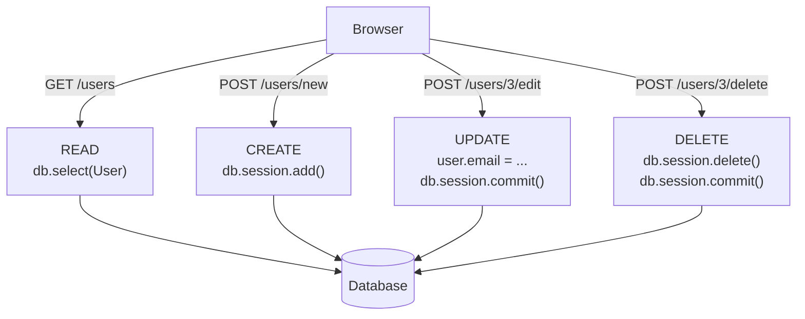

Why this mapping? Because each layer is solving a different problem:

- **HTTP** is about *transporting* the intent. GET is safe/cacheable (no side effects), POST/PUT/DELETE modify state.
- **SQL** is about *what the database should do*. It has exactly four row-level operations.
- **SQLAlchemy** is about *what your code should look like*. It mirrors SQL but in Python idioms.

> [!info] Why PUT vs PATCH?
> Strictly: PUT replaces an entire resource; PATCH modifies part. `PUT /users/3` with `{"username": "x"}` should blank out email/age. `PATCH /users/3` with `{"username": "x"}` should only change username. In practice, most Flask apps use POST for both — browsers don't natively support PUT/PATCH/DELETE without JavaScript or method overrides. We'll use POST throughout this course.

### 4.2 Project layout

```
crud-demo/
├── app.py
└── templates/
    ├── base.html
    ├── list.html
    ├── show.html
    └── form.html
```

### 4.3 `app.py`

```python
from flask import Flask, render_template, request, redirect, url_for, flash, abort
from flask_sqlalchemy import SQLAlchemy
from datetime import datetime

app = Flask(__name__)
app.config['SQLALCHEMY_DATABASE_URI'] = 'sqlite:///users.db'
app.config['SQLALCHEMY_TRACK_MODIFICATIONS'] = False
app.secret_key = 'dev-secret'

db = SQLAlchemy(app)


class User(db.Model):
    __tablename__ = 'users'
    id = db.Column(db.Integer, primary_key=True)
    username = db.Column(db.String(80), unique=True, nullable=False)
    email = db.Column(db.String(120), unique=True, nullable=False)
    age = db.Column(db.Integer)
    created_at = db.Column(db.DateTime, default=datetime.utcnow)

    def __repr__(self):
        return f'<User {self.username}>'


with app.app_context():
    db.create_all()


# ---------- READ (list + search + paginate) ----------

@app.route('/users')
def user_list():
    page = request.args.get('page', 1, type=int)
    per_page = request.args.get('per_page', 5, type=int)
    search = request.args.get('q', '').strip()

    stmt = db.select(User)
    if search:
        # LIKE is case-sensitive in SQLite; ilike is case-insensitive in Postgres
        stmt = stmt.where(
            User.username.contains(search) | User.email.contains(search)
        )
    stmt = stmt.order_by(User.created_at.desc())

    # Flask-SQLAlchemy 3.x paginate
    pagination = db.paginate(stmt, page=page, per_page=per_page, error_out=False)
    return render_template('list.html', users=pagination.items, pagination=pagination, search=search)


# ---------- READ (single) ----------

@app.route('/users/<int:user_id>')
def user_show(user_id):
    user = db.session.get(User, user_id)
    if not user:
        abort(404)
    return render_template('show.html', user=user)


# ---------- CREATE ----------

@app.route('/users/new', methods=['GET', 'POST'])
def user_create():
    if request.method == 'POST':
        username = request.form.get('username', '').strip()
        email = request.form.get('email', '').strip()
        age = request.form.get('age', type=int)

        errors = []
        if not username:
            errors.append('Username is required.')
        if not email or '@' not in email:
            errors.append('A valid email is required.')
        if User.query.filter_by(username=username).first():
            errors.append('That username is taken.')

        if errors:
            return render_template('form.html', errors=errors,
                                   username=username, email=email, age=age)

        user = User(username=username, email=email, age=age)
        db.session.add(user)
        try:
            db.session.commit()
        except Exception:
            db.session.rollback()
            flash('Could not save user (maybe email already exists?).', 'error')
            return render_template('form.html', errors=[], username=username, email=email, age=age)

        flash(f'User {username} created.', 'success')
        return redirect(url_for('user_show', user_id=user.id))

    return render_template('form.html', errors=[], username='', email='', age=None)


# ---------- UPDATE ----------

@app.route('/users/<int:user_id>/edit', methods=['GET', 'POST'])
def user_edit(user_id):
    user = db.session.get(User, user_id)
    if not user:
        abort(404)

    if request.method == 'POST':
        user.username = request.form.get('username', '').strip() or user.username
        user.email = request.form.get('email', '').strip() or user.email
        user.age = request.form.get('age', type=int)
        db.session.commit()
        flash('User updated.', 'success')
        return redirect(url_for('user_show', user_id=user.id))

    return render_template('form.html', errors=[], user=user,
                           username=user.username, email=user.email, age=user.age)


# ---------- DELETE ----------

@app.route('/users/<int:user_id>/delete', methods=['POST'])
def user_delete(user_id):
    user = db.session.get(User, user_id)
    if not user:
        abort(404)
    db.session.delete(user)
    db.session.commit()
    flash(f'User {user.username} deleted.', 'success')
    return redirect(url_for('user_list'))


if __name__ == '__main__':
    app.run(debug=True)
```

### 4.4 `templates/base.html`

```html
<!DOCTYPE html>
<html lang="en">
<head>
    <meta charset="UTF-8">
    <title>Users</title>
</head>
<body>
    <nav><a href="{{ url_for('user_list') }}">All users</a> | <a href="{{ url_for('user_create') }}">New user</a></nav>
    
        
            
                <div class="flash flash-{{ cat }}">{{ msg }}</div>
            
        
    
    
</body>
</html>
```

### 4.5 `templates/list.html`

```html


<h1>Users</h1>

<form method="GET">
    <input type="text" name="q" value="{{ search }}" placeholder="Search...">
    <button>Search</button>
</form>

<table border="1" cellpadding="6">
    <tr><th>ID</th><th>Username</th><th>Email</th><th>Age</th><th>Joined</th><th>Actions</th></tr>
    
    <tr>
        <td>{{ user.id }}</td>
        <td><a href="{{ url_for('user_show', user_id=user.id) }}">{{ user.username }}</a></td>
        <td>{{ user.email }}</td>
        <td>{{ user.age or '—' }}</td>
        <td>{{ user.created_at.strftime('%Y-%m-%d') }}</td>
        <td>
            <a href="{{ url_for('user_edit', user_id=user.id) }}">Edit</a>
            <form method="POST" action="{{ url_for('user_delete', user_id=user.id) }}" style="display:inline">
                <button onclick="return confirm('Delete {{ user.username }}?')">Delete</button>
            </form>
        </td>
    </tr>
    
    <tr><td colspan="6">No users found.</td></tr>
    
</table>

<p>
    
        <a href="{{ url_for('user_list', page=pagination.prev_num, q=search) }}">Previous</a>
    
    Page {{ pagination.page }} of {{ pagination.pages }}
    
        <a href="{{ url_for('user_list', page=pagination.next_num, q=search) }}">Next</a>
    
</p>

```

### 4.6 `templates/show.html`

```html


<h1>{{ user.username }}</h1>
<p>Email: {{ user.email }}</p>
<p>Age: {{ user.age or '—' }}</p>
<p>Joined: {{ user.created_at }}</p>
<p>
    <a href="{{ url_for('user_edit', user_id=user.id) }}">Edit</a> |
    <a href="{{ url_for('user_list') }}">Back</a>
</p>

```

### 4.7 `templates/form.html`

```html


<h1>EditCreate User</h1>


    <ul class="errors"><li>{{ e }}</li></ul>


<form method="POST">
    <p><label>Username: <input type="text" name="username" value="{{ username }}"></label></p>
    <p><label>Email: <input type="email" name="email" value="{{ email }}"></label></p>
    <p><label>Age: <input type="number" name="age" value="{{ age or '' }}"></label></p>
    <button>SaveCreate</button>
</form>

```

## 5. Line-by-Line Explanation

### 5.1 Create — `db.session.add()` + `commit()`

```python
user = User(username='alice', email='alice@example.com', age=30)
db.session.add(user)
db.session.commit()
```

Three steps:

1. **Instantiate** the model with the values you want. At this point, the object only exists in Python memory — `user.id` is still `None`.
2. **`db.session.add(user)`** stages the user in the session. SQLAlchemy tracks it as a "new" object to be inserted. Still no SQL has run.
3. **`db.session.commit()`** flushes the session to the database. SQLAlchemy runs `INSERT INTO users (username, email, age, created_at) VALUES (?, ?, ?, ?)`, the database assigns an `id`, and SQLAlchemy updates `user.id` to the new value.

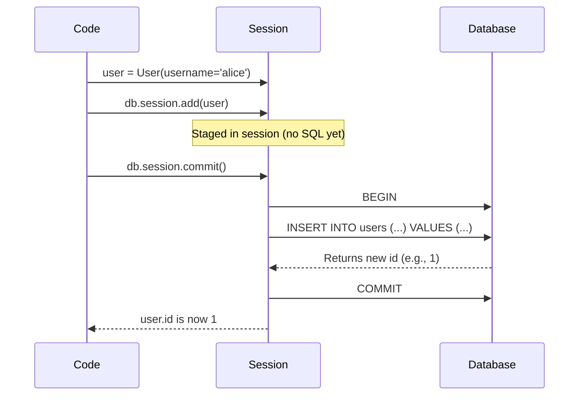

> [!question] Student asks: "Why three steps? Why not just `User.create(username='alice')`?"
> The session exists to support **transactions** — multiple changes that should succeed or fail together. If you're creating a user AND their profile AND sending a welcome email, you want all three to commit at once. The session lets you stage them, then `commit()` flushes them as one atomic unit. Django's ORM hides this with `Model.objects.create()`, but it's just sugar over the same pattern.

> [!info] When does the INSERT actually fire?
> Strictly: at `flush()` time, not `commit()` time. `commit()` calls `flush()` internally. But during a `commit()`, SQLAlchemy may also auto-flush before any `SELECT` to ensure the session sees its own pending changes. You can disable auto-flush with `db.session.autoflush = False`. For 99% of code, you don't need to think about this — just remember: nothing hits the DB until `commit()` (or `flush()`).

### 5.2 Read — the 2.0 `select()` API

```python
# All users
users = db.session.execute(db.select(User)).scalars().all()

# One user by ID
user = db.session.get(User, 42)   # equivalent to SELECT WHERE id=42

# Filter
users = db.session.execute(
    db.select(User).where(User.username == 'alice')
).scalars().all()

# Order
users = db.session.execute(
    db.select(User).order_by(User.created_at.desc())
).scalars().all()
```

The pattern: build a **statement** (`db.select(User).where(...).order_by(...)`), then **execute** it (`db.session.execute(stmt)`), then **extract** results (`.scalars().all()`).

Why `scalars()`? `db.session.execute()` returns a `Result` object that yields *rows* — each row is a tuple even if there's only one column. `.scalars()` extracts the first column from each row (the `User` object). `.all()` materialises the result as a list.

```mermaid
flowchart LR
    Stmt["db.select(User)<br/>.where(...)<br/>.order_by(...)"] -->|"Statement object<br/>(lazy)"| Exec["db.session.execute(stmt)"]
    Exec -->|Result object| Rows["Yields rows:<br/>(User,), (User,), ..."]
    Rows -->|.scalars()| Users["Yields User objects<br/>(no tuple wrapper)"]
    Users -->|.all()| List["list[User]"]
    Users -->|.first()| One["User | None"]
```

> [!analogy] The statement as a recipe
> Think of `db.select(User).where(...)` as a *recipe* — instructions for what to cook. You haven't cooked anything yet; you can hand the recipe to a friend, modify it (`stmt = stmt.order_by(...)`), or store it. `db.session.execute(stmt)` is the actual *cooking* — now there's food on the table (a `Result`). `.scalars().all()` is plating the food into a list you can serve. The separation lets you build complex queries dynamically, then execute once.

#### `.where()` vs `.filter()` — what's the difference?

In 2.0, **they're identical**. `filter()` is the legacy name (from `Model.query.filter()`); `where()` is the new 2.0 name (clearer — it directly maps to SQL `WHERE`). The SQLAlchemy docs recommend `where()` for new code. We use them interchangeably below.

### 5.3 Legacy `Model.query` vs modern `select()`

You'll see both styles in tutorials. Here's the translation:

| Legacy (1.x) | Modern (2.0) |
|---|---|
| `User.query.all()` | `db.session.execute(db.select(User)).scalars().all()` |
| `User.query.filter_by(username='x').first()` | `db.session.execute(db.select(User).filter_by(username='x')).scalars().first()` |
| `User.query.filter(...).count()` | `db.session.scalar(db.select(db.func.count()).select_from(User).where(...))` |
| `User.query.get(42)` | `db.session.get(User, 42)` |
| `User.query.first_or_404()` | `db.session.get(User, 42) or abort(404)` |
| `User.query.paginate(...)` | `db.paginate(db.select(User), ...)` |

The legacy style is shorter (and still works in 2.x), but it's removed in 2.1. For new code, use the 2.0 style.

> [!question] Student asks: "I see `User.query.filter_by(...)` in the create route — why mix styles?"
> Good catch! It's intentional. In the validation block we want a quick existence check: `User.query.filter_by(username=username).first()` reads cleanly. The 2.0 equivalent (`db.session.execute(db.select(User).filter_by(username=username)).scalars().first()`) is verbose for the same thing. Mixing is fine *within a codebase* — just don't mix within a single route. For consistency in production code, pick one and apply it everywhere; we lean 2.0 throughout this course.

### 5.4 Filtering — `filter_by()` vs `filter()`

**`filter_by(**kwargs)`** — simple equality only:

```python
db.select(User).filter_by(username='alice', age=30)
# Equivalent: WHERE username = 'alice' AND age = 30
```

**`filter(*expressions)`** — full Python expressions on columns:

```python
db.select(User).filter(User.username == 'alice')
db.select(User).filter(User.age > 18)
db.select(User).filter(User.email.endswith('@example.com'))
db.select(User).filter(User.username.in_(['alice', 'bob', 'carol']))
```

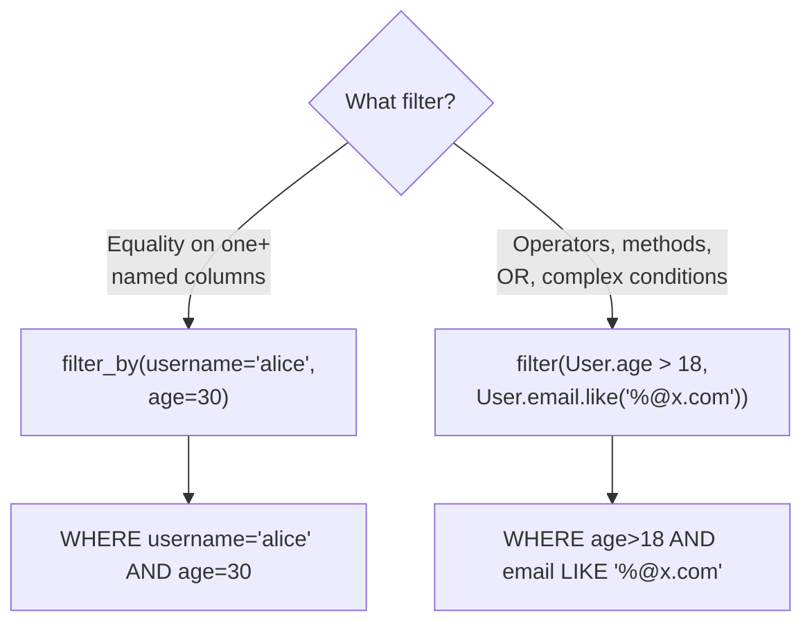

> [!question] Student asks: "How does `User.username == 'alice'` work? That's a comparison, not an assignment."
> SQLAlchemy overrides `__eq__` on `User.username` (a `Column` object). Instead of returning `True`/`False`, it returns a SQL expression object. The expression knows "compare the `username` column to the value `'alice'`". When you pass it to `.filter()`, SQLAlchemy compiles it to SQL. This trick — operator overloading returning expression objects — is the heart of SQLAlchemy's query API.

> [!try] Try this
> Open a Python REPL with your models loaded. Type `User.username == 'alice'` and see what comes back. You'll see something like `<sqlalchemy.sql.elements.BinaryExpression object at 0x...>` — that's the SQL expression object, not a boolean. Then call `str(...)` on it (or `.compile(compile_kwargs={'literal_binds': True})`) to see the SQL it would generate. This is the magic that makes the ORM feel like Python.

### 5.5 Query operators

| Operator | Meaning | Example |
|---|---|---|
| `==` | Equal | `User.age == 30` |
| `!=` | Not equal | `User.age != 30` |
| `>` `<` `>=` `<=` | Comparison | `User.age > 18` |
| `.like('%pattern%')` | LIKE (case-sensitive in SQLite) | `User.username.like('al%')` |
| `.ilike('%pattern%')` | Case-insensitive LIKE (PostgreSQL) | `User.username.ilike('AL%')` |
| `.contains('x')` | Like `%x%` | `User.email.contains('@example')` |
| `.startswith('x')` | Like `x%` | `User.username.startswith('a')` |
| `.endswith('x')` | Like `%x` | `User.email.endswith('.com')` |
| `.in_([a, b])` | IN | `User.username.in_(['alice', 'bob'])` |
| `.is_(None)` | IS NULL | `User.age.is_(None)` |
| `.is_not(None)` | IS NOT NULL | `User.age.is_not(None)` |
| `.between(a, b)` | BETWEEN | `User.age.between(18, 65)` |
| `.match('x')` | Full-text search (DB-dependent) | `User.bio.match('python flask')` |
| `.concat(other)` | String concatenation | `User.username.concat('@x.com')` |

#### LIKE vs ILIKE — case sensitivity gotcha

`LIKE` is case-sensitive in SQLite by default. In PostgreSQL, `LIKE` is also case-sensitive; `ILIKE` is the case-insensitive variant. SQLite has no `ILIKE`. So:

- `User.username.like('al%')` matches `alice` but NOT `Alice` in both SQLite and PostgreSQL.
- `User.username.ilike('al%')` matches both `alice` and `Alice` — but only works in PostgreSQL.

For database-agnostic case-insensitive search, use `.contains()` (which compiles to `LIKE '%' || ? || '%'`) and rely on a case-insensitive collation, or use `func.lower(User.username) == search.lower()`. We use `.contains()` in our app for portability.

#### Combining conditions

**AND (implicit — comma-separated)**:

```python
db.select(User).filter(User.age > 18, User.age < 65)
# WHERE age > 18 AND age < 65
```

**AND (explicit)**:

```python
from sqlalchemy import and_
db.select(User).filter(and_(User.age > 18, User.age < 65))
```

**OR**:

```python
from sqlalchemy import or_
db.select(User).filter(or_(User.username == 'alice', User.username == 'bob'))
# WHERE username = 'alice' OR username = 'bob'
```

**NOT**:

```python
from sqlalchemy import not_
db.select(User).filter(not_(User.username == 'alice'))
# or, simpler:
db.select(User).filter(User.username != 'alice')
```

In our `user_list` route, we use `|` (bitwise OR) as shorthand:

```python
stmt = stmt.where(
    User.username.contains(search) | User.email.contains(search)
)
# Equivalent: WHERE username LIKE '%search%' OR email LIKE '%search%'
```

SQLAlchemy overloads `&`, `|`, `~` on columns to mean AND, OR, NOT — useful for combining expressions inline. Read `&` as AND, `|` as OR, `~` as NOT.

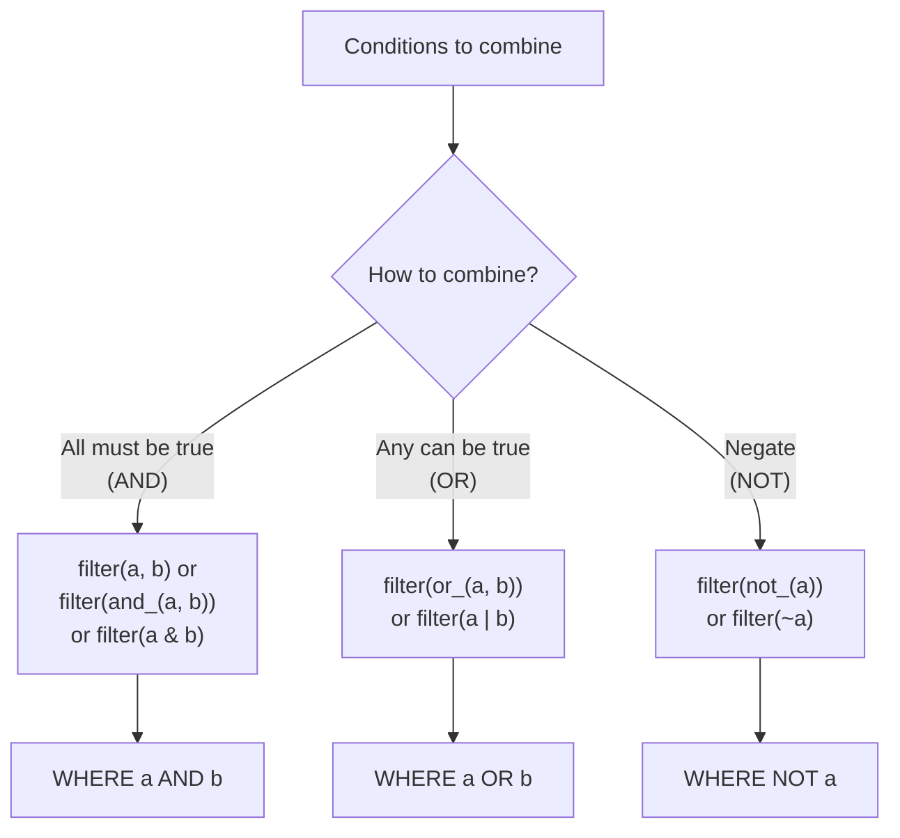

> [!question] Student asks: "Why `&` instead of `and`?"
> Python's `and` operator returns the first falsy value (or the last truthy one) — it can't be overloaded. SQLAlchemy can't intercept `a and b`. The `&` operator CAN be overloaded via `__and__`, so SQLAlchemy uses it. Same for `|` (OR) and `~` (NOT). It's a Python language limitation.

> [!info] Operator precedence gotcha
> `&` and `|` have *higher* precedence than `==` in Python! So `User.age > 18 & User.username == 'x'` parses as `User.age > (18 & User.username) == 'x'` — gibberish. Always wrap conditions in parens: `(User.age > 18) & (User.username == 'x')`. The comma form `filter(a, b)` doesn't have this problem.

### 5.6 Ordering, limiting, offset

```python
# Order ascending (default)
db.select(User).order_by(User.username)

# Order descending
db.select(User).order_by(User.username.desc())

# Multiple columns
db.select(User).order_by(User.age.desc(), User.username.asc())

# Limit
db.select(User).limit(10)

# Offset (skip first N) — used for pagination
db.select(User).offset(20).limit(10)   # page 3 of 10-per-page
```

#### Order by null handling

By default, `NULL` sorts as "smallest" in ascending order (first) and "largest" in descending (last). To control this explicitly:

```python
from sqlalchemy import nullslast  # or nullsfirst

db.select(User).order_by(nullslast(User.age.desc()))
# NULLs at the end, regardless of asc/desc
```

This matters for `deleted_at` columns — you often want non-deleted rows first.

> [!try] Try this
> Add 5 users, some with `age` set, some without. Try `.order_by(User.age.asc())` and `.order_by(User.age.desc())`. Where do NULL ages land? Then try `nullslast` and `nullsfirst`. Different databases have different defaults — PostgreSQL puts NULLs *last* in ASC, *first* in DESC; SQLite puts them *first* in ASC, *last* in DESC. Always be explicit if NULL ordering matters.

### 5.7 Terminal methods — `.first()`, `.all()`, `.one()`, etc.

These methods *execute* the query and return results:

| Method | Returns | When to use |
|---|---|---|
| `.all()` | `list[Model]` | You want every row |
| `.first()` | `Model \| None` | You want one row (or None) |
| `.one()` | `Model` (raises if not exactly one) | You expect exactly one row; raise `NoResultFound` if 0, `MultipleResultsFound` if 2+ |
| `.one_or_none()` | `Model \| None` (raises if 2+) | You expect 0 or 1 row; raise on 2+ |
| `.scalar()` | First column of first row, or None | For aggregate queries (`SELECT COUNT(*)`) |
| `.scalars().all()` | `list[Model]` | 2.0-style way to get a list of models |

```python
# Get by ID
user = db.session.get(User, 42)   # returns None if not found

# Get by ID or 404 (Flask-SQLAlchemy helper)
user = db.get_or_404(User, 42)    # raises 404 if not found

# First user by username
user = db.session.execute(
    db.select(User).filter_by(username='alice')
).scalars().first()    # None if no match

# Exactly one (raises if 0 or 2+)
user = db.session.execute(
    db.select(User).filter_by(email='alice@example.com')
).scalars().one()
```

> [!warning] `.get()` is special
> `db.session.get(User, 42)` does NOT run a SQL query if `User` with id=42 is already in the session's identity map. It returns the cached object. This is a performance optimisation — but it can surprise you if you expected a fresh query. Use `db.session.execute(db.select(User).where(User.id == 42)).scalars().one()` to force a DB round-trip.

> [!question] Student asks: "When do I use `.one()` vs `.first()`?"
> `.one()` *asserts* there's exactly one row. It's a safety check: if your "find user by unique email" returns 2 rows, something is wrong with your uniqueness constraint and you want to know loudly. `.first()` silently returns one of many — fine for "give me any user named alice" but bad for "give me THE user with this email." Use `.one()` when the query *should* return exactly one row; `.first()` when you want "any matching row." `.one_or_none()` is the middle ground: 0 or 1 is OK, 2+ is an error.

### 5.8 Pagination

```python
@app.route('/users')
def user_list():
    page = request.args.get('page', 1, type=int)
    per_page = request.args.get('per_page', 5, type=int)

    stmt = db.select(User).order_by(User.created_at.desc())
    pagination = db.paginate(stmt, page=page, per_page=per_page, error_out=False)
    # pagination.items → list of users for this page
    # pagination.page → current page number
    # pagination.pages → total number of pages
    # pagination.has_prev / has_next → booleans
    # pagination.prev_num / next_num → page numbers
    # pagination.total → total number of rows
    return render_template('list.html', users=pagination.items, pagination=pagination)
```

`db.paginate()` (Flask-SQLAlchemy 3.x) runs a `LIMIT`/`OFFSET` query and a `COUNT(*)` query in one call. `error_out=False` means out-of-range pages return empty results instead of 404 — friendlier UX.

In the template:

```html

    <a href="{{ url_for('user_list', page=pagination.prev_num) }}">Previous</a>

Page {{ pagination.page }} of {{ pagination.pages }}

    <a href="{{ url_for('user_list', page=pagination.next_num) }}">Next</a>

```

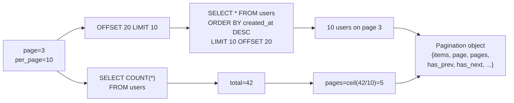

> [!info] Why pagination runs two queries
> One query gets the *rows on this page* (`LIMIT 10 OFFSET 20`). Another gets the *total count* (`SELECT COUNT(*)`) so we can compute "page X of Y." Without the count, you don't know if there's a next page. There are clever ways to avoid the count (e.g., "is there a next page?" via `LIMIT 11` and checking if 11 came back), but `db.paginate()` does the straightforward thing. For tables with millions of rows, `COUNT(*)` can be slow on PostgreSQL — consider estimated counts (via `pg_class.reltuples`) for huge tables.

> [!try] Try this
> Set `per_page=3` and add 10 users. Visit `/users?page=2`. Look at the SQL log — confirm two queries ran (data + count). Now visit `/users?page=999` with `error_out=False` — you should see an empty page, not a 404. Toggle `error_out=True` and reload to see the difference.

### 5.9 Aggregates

```python
from sqlalchemy import func

# Count users
count = db.session.scalar(db.select(db.func.count()).select_from(User))

# Count with filter
count = db.session.scalar(
    db.select(db.func.count()).select_from(User).where(User.age > 18)
)

# Sum, average, min, max
total_age = db.session.scalar(db.select(db.func.sum(User.age)))
avg_age = db.session.scalar(db.select(db.func.avg(User.age)))
youngest = db.session.scalar(db.select(db.func.min(User.age)))
oldest = db.session.scalar(db.select(db.func.max(User.age)))

# Group by (e.g., user count by age)
result = db.session.execute(
    db.select(User.age, db.func.count(User.id).label('count'))
    .group_by(User.age)
    .order_by(db.func.count(User.id).desc())
).all()
# Result: list of (age, count) tuples
for age, count in result:
    print(f'{age}: {count} users')
```

#### Behind the scenes: what aggregates compile to

```python
db.select(db.func.count(User.id)).where(User.age > 18)
# Compiles to: SELECT COUNT(users.id) FROM users WHERE users.age > 18
```

`db.func.X` is SQLAlchemy's way of calling any SQL function — `count`, `sum`, `avg`, `lower`, `now`, `coalesce`, even database-specific ones like `pg_sleep` or `jsonb_extract_path_text`. Whatever you put after `func.` becomes a function call in the SQL.

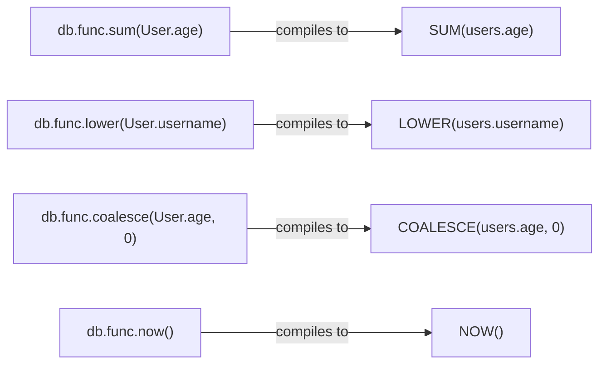

> [!question] Student asks: "What's `.label('count')` for?"
> It names the result column. Without it, the column would be named `count_1` (SQLAlchemy auto-name) — awkward to access. With `.label('count')`, you can access it as `row.count`. Particularly useful in GROUP BY queries where you want a clean name in the result.

### 5.10 JOINs

A JOIN combines rows from two (or more) tables based on a related column. We'll cover relationships in depth in [[Lesson-14-Relationships]], but here's how JOINs look in SQLAlchemy:

```python
# Suppose User has many Post (Lesson 14)
from sqlalchemy import select

# Explicit JOIN
stmt = (
    select(User, Post)
    .join(Post, User.id == Post.user_id)   # INNER JOIN posts ON users.id = posts.user_id
    .where(Post.title.contains('Flask'))
)
for user, post in db.session.execute(stmt):
    print(user.username, '→', post.title)
```

#### Types of JOIN

| JOIN type | What it does | SQLAlchemy |
|---|---|---|
| INNER JOIN | Only rows matching in both tables | `.join(Post)` or `.join(Post, onclause)` |
| LEFT OUTER JOIN | All rows from left, matched or not | `.outerjoin(Post)` |
| FULL OUTER JOIN | All rows from both tables | `.outerjoin(Post, full=True)` |
| CROSS JOIN | Cartesian product (rare, dangerous) | `.select_from(User, Post)` |

```python
# LEFT JOIN — find users with no posts
stmt = (
    select(User)
    .outerjoin(Post)
    .group_by(User.id)
    .having(db.func.count(Post.id) == 0)
)
lonely_users = db.session.execute(stmt).scalars().all()
```

#### Implicit JOIN via relationships

If your model has a relationship (Lesson 14), you can use cleaner syntax:

```python
# Users who have at least one post
db.select(User).where(User.posts.any())

# Users who have a post with 'Flask' in the title
db.select(User).where(User.posts.any(Post.title.contains('Flask')))

# Posts whose author is from Canada (many-to-one direction)
db.select(Post).where(Post.author.has(User.country == 'Canada'))
```

These compile to `EXISTS` subqueries — often faster than JOINs for "does any related row match?" queries.

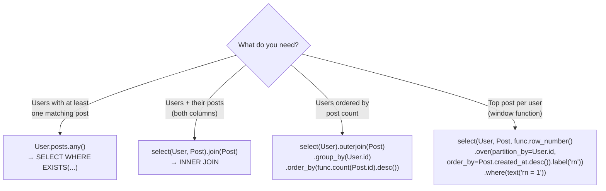

> [!info] When to use JOIN vs EXISTS
> JOIN is for when you *need data* from both tables. EXISTS (`.any()`, `.has()`) is for "does a related row exist?" — you don't need the related data, just a yes/no. EXISTS often stops scanning as soon as it finds one match, while JOIN produces all matching rows. For "users with posts," `EXISTS` is usually faster.

### 5.11 Update — modify + commit

```python
user = db.session.get(User, 42)
user.email = 'new@example.com'   # modify attribute
db.session.commit()              # runs UPDATE
```

That's it. The session tracks that `user` was modified; on `commit()`, SQLAlchemy runs `UPDATE users SET email = ? WHERE id = ?`. You don't write an explicit "update" command — just change the object and commit.

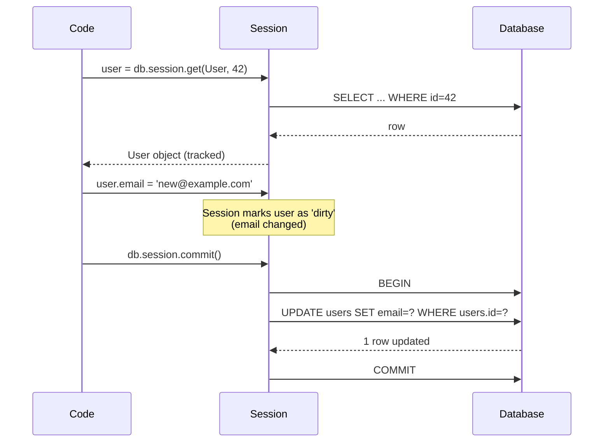

#### Bulk update (2.0 style)

```python
# Bulk update: set is_minor=True for all users under 18
db.session.execute(
    db.update(User).where(User.age < 18).values(is_minor=True)
)
db.session.commit()
# Runs: UPDATE users SET is_minor = 1 WHERE users.age < 18
# Returns: number of rows updated (e.g., 47)
```

Bulk updates run a single SQL statement instead of N Python-level updates. For 1000 rows, bulk is ~100x faster than looping with attribute updates. The trade-off: bulk updates bypass ORM events (`before_update`, etc.) and don't update in-memory objects.

> [!warning] Bulk update doesn't refresh in-memory objects
> If you `db.session.execute(db.update(User).where(...).values(is_minor=True))` and then `db.session.get(User, 42)` (where user 42 was already in the session), you might get the *old* `is_minor` value. The identity map doesn't know the bulk update happened. Either expire the session (`db.session.expire_all()`) or avoid mixing bulk updates with ORM-tracked objects.

### 5.12 Delete

```python
user = db.session.get(User, 42)
db.session.delete(user)
db.session.commit()   # runs DELETE FROM users WHERE id = 42
```

```python
# Bulk delete (2.0 style)
db.session.execute(
    db.delete(User).where(User.created_at < '2020-01-01')
)
db.session.commit()
```

Same trade-off as bulk update: fast, but bypasses ORM events and cascades defined in Python (DB-level cascades via `ON DELETE CASCADE` still fire).

> [!try] Try this
> Create a user, then try to delete them twice (without re-querying). The second `db.session.delete(user)` will raise `InvalidRequestError: Object is not in the session`. Why? Because after the first delete + commit, the object is "detached" — it's no longer tracked. Delete + commit is one-shot.

### 5.13 The session lifecycle

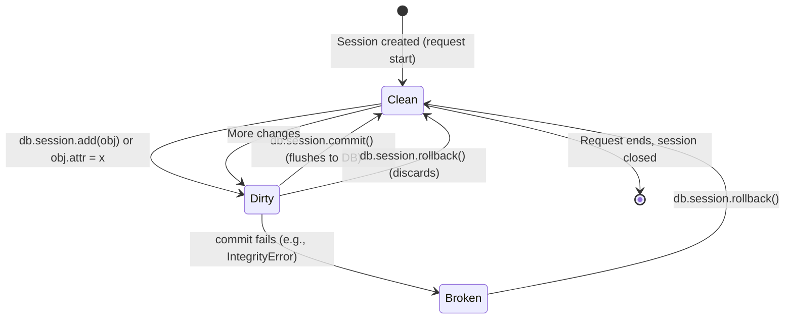

Key states:

- **Clean**: no pending changes.
- **Dirty**: changes staged but not committed.
- **Broken**: a commit failed; you must `rollback()` before doing anything else.

> [!warning] After an exception, always rollback
> If `db.session.commit()` raises (e.g., `IntegrityError` because a unique constraint was violated), the session is in a "broken" state. Any further operation on it will raise `PendingRollbackError`. You MUST call `db.session.rollback()` to clear the broken state. This is why our `user_create` route wraps commit in `try/except` with a `rollback()` in the except block.

```python
try:
    db.session.commit()
except db.IntegrityError:
    db.session.rollback()  # MANDATORY — session is broken
    flash('Could not save.', 'error')
```

#### Object states in detail

Every ORM object exists in one of four states:

| State | Description | Example |
|---|---|---|
| **Transient** | Not in session, not in DB | `user = User(...)` — just created |
| **Pending** | In session, not yet flushed | After `db.session.add(user)` |
| **Persistent** | In session AND in DB | After `commit()`; or after a `select()` returns it |
| **Detached** | Was persistent, but session closed/removed | After `db.session.expunge(user)` or session closes |

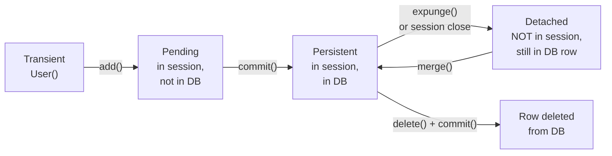

> [!try] Try this
> Create a user, commit, then `db.session.expunge(user)`. Now `user.username` works — but `user.posts` (a lazy relationship) will raise `DetachedInstanceError`. The object is detached; it can't make new DB queries. Re-attach with `db.session.merge(user)` or just query fresh.

### 5.14 Transactions and atomicity

A **transaction** is a sequence of database operations that succeed or fail together. SQLAlchemy sessions are transactional: everything you do between two `commit()` calls is one transaction.

```python
# Transfer money: debit one account, credit another. Both must succeed.
from_account = db.session.get(Account, 1)
to_account = db.session.get(Account, 2)
from_account.balance -= 100
to_account.balance += 100
db.session.commit()   # both changes apply atomically
```

If anything fails between the two modifications (e.g., a constraint violation, a power loss, a crash), the database rolls back *both* changes. The money never goes missing. This is **atomicity** — the A in ACID (Atomicity, Consistency, Isolation, Durability).

#### The ACID guarantees

| Property | Meaning | Why it matters |
|---|---|---|
| **A**tomicity | All operations in a transaction succeed or none do | No partial money transfers |
| **C**onsistency | A transaction moves the DB from one valid state to another | Constraints (FK, unique) always hold |
| **I**solation | Concurrent transactions don't see each other's partial results | Two users editing same row don't conflict |
| **D**urability | Once committed, changes survive crashes | Power loss doesn't lose committed data |

Relational databases give you ACID for free. NoSQL databases often sacrifice some of these for performance (e.g., MongoDB has weaker isolation by default).

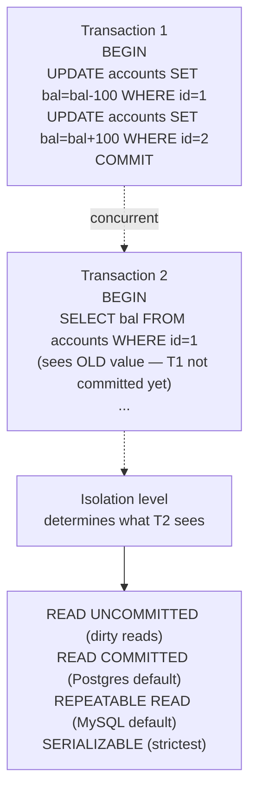

#### Isolation levels

| Level | What it prevents | Performance cost |
|---|---|---|
| READ UNCOMMITTED | Nothing — you can see uncommitted changes ("dirty reads") | Fastest, dangerous |
| READ COMMITTED | Dirty reads — you only see committed data | Default in PostgreSQL |
| REPEATABLE READ | Dirty reads + non-repeatable reads (same query returns same result within txn) | Default in MySQL |
| SERIALIZABLE | All anomalies — transactions behave as if run sequentially | Slowest, may abort txns |

Set isolation in SQLAlchemy:

```python
from sqlalchemy import create_engine
engine = create_engine('postgresql://...', isolation_level='REPEATABLE READ')
# Or per-transaction:
with db.session.begin():
    db.session.connection(execution_options={'isolation_level': 'REPEATABLE READ'})
    # ... transactional work ...
```

Most Flask apps use the default (READ COMMITTED in PostgreSQL) and never think about isolation. You'll need higher levels for financial apps or anywhere consistency matters more than throughput.

#### Savepoints — partial rollback

```python
try:
    sp = db.session.begin_savepoint()
    # ... risky operation ...
    sp.commit()
except Exception:
    sp.rollback()   # rolls back to savepoint, not the whole transaction
    # session is still usable for other work
```

Savepoints are useful when part of a transaction might fail but you want to continue with other work. Example: importing 1000 records; if record 47 fails, roll back just record 47 and continue with 48-1000.

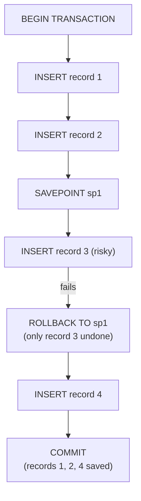

> [!analogy] Savepoints as undo points in a video game
> Think of a transaction as a level in a game, and a savepoint as a checkpoint. If you die after a checkpoint, you respawn at the checkpoint — you don't restart the whole level. Without savepoints, one failure = whole transaction undone. With savepoints, you can isolate risky sub-operations and recover locally.

### 5.15 Relationships in queries (preview)

If your `User` has many `Post`s (Lesson 14), you can filter on related fields:

```python
# Users who have at least one post
db.select(User).where(User.posts.any())

# Users who have a post with 'Flask' in the title
db.select(User).where(User.posts.any(Post.title.contains('Flask')))

# JOIN explicitly
db.select(User).join(Post).where(Post.title.contains('Flask'))
```

We'll cover relationships in depth in Lesson 14.

## 6. Running the Code

Save all files. Run:

```bash
python app.py
```

### 6.1 Visit `/users` (empty)

Open `http://127.0.0.1:5000/users`. You should see an empty table with "No users found."

### 6.2 Create a few users

Click "New user" — fill in the form. Submit. You should be redirected to the user's show page with a flash message "User X created."

Create 3-4 users this way.

### 6.3 Watch the SQL log

Add this to `app.py` to log all SQL:

```python
import logging
logging.basicConfig()
logging.getLogger('sqlalchemy.engine').setLevel(logging.INFO)
```

Now reload `/users`. In the terminal you'll see:

```
INFO sqlalchemy.engine.Engine:SELECT users.id, users.username, users.email, users.age, users.created_at
FROM users ORDER BY users.created_at DESC
LIMIT ? OFFSET ?
INFO sqlalchemy.engine.Engine:[generated in 0.00012s] (5, 0)
INFO sqlalchemy.engine.Engine:SELECT COUNT(*) FROM (SELECT ... FROM users ORDER BY users.created_at DESC) AS anon_1
INFO sqlalchemy.engine.Engine:[generated in 0.00010s] ()
```

Two queries: one for the page's data, one for the total count (for pagination). This is the standard Flask-SQLAlchemy pagination pattern.

### 6.4 Search

Type `alice` in the search box. Submit. The URL becomes `/users?q=alice`. The SQL becomes:

```sql
SELECT ... FROM users
WHERE (users.username LIKE '%' || ? || '%' OR users.email LIKE '%' || ? || '%')
ORDER BY users.created_at DESC
```

### 6.5 Edit a user

Click "Edit" on a user. Change their email. Submit. You should see "User updated." and the show page reflects the new email.

### 6.6 Delete a user

Click "Delete" on a user. Confirm. The user disappears from the list. The SQL was `DELETE FROM users WHERE users.id = ?`.

### 6.7 Test pagination

Add 10+ users (via the form or the shell). Visit `/users?per_page=3`. You should see "Previous / Page 1 of N / Next" navigation. Click Next — URL becomes `/users?page=2&per_page=3`.

### 6.8 Real-world: production CRUD patterns

In production:

- **Soft deletes** instead of hard deletes: add a `deleted_at` column, set it on "delete", filter out `deleted_at IS NOT NULL` in queries. Lets you recover accidentally deleted data.
- **Audit logs**: every CREATE/UPDATE/DELETE writes a row to an `audit_log` table recording who/when/what. Critical for compliance (HIPAA, SOX).
- **Optimistic concurrency**: add a `version` column; on UPDATE, check it hasn't changed since you read. Prevents two users overwriting each other's edits.
- **Bulk operations** for large data: `db.session.execute(db.update(User).where(...).values(...))` runs a single SQL UPDATE, not N Python-level updates.
- **Pagination always**: never `User.query.all()` on a table that could grow. Always paginate, even if you "know" there are only 10 rows today.
- **Read replicas** for reporting: route heavy SELECT queries to a replica, leaving the primary for writes.
- **Connection pool tuning**: `pool_size=20`, `pool_recycle=300` (5 min — Postgres drops idle conns), `pool_pre_ping=True`.
- **Query timeouts**: `SET statement_timeout = 5000` (5 sec) prevents runaway queries from piling up.
- **Indexing**: any column you filter or sort on should have an index. Without indexes, the DB does a "sequential scan" (reads every row) — fine for 100 rows, fatal for 10M.

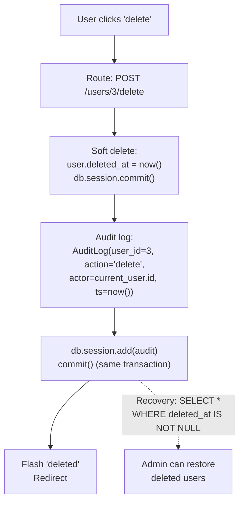

The diagram shows a single transaction doing both the soft delete and the audit log write — atomicity guarantees they succeed or fail together. No "user was deleted but no audit log" inconsistency.

### 6.9 Historical context: how querying evolved

The SQLAlchemy Query API has gone through three generations:

1. **SQLAlchemy 0.x (2006-2010)**: `Query(User).filter(User.name == 'x')`. Verbose, low-level.
2. **SQLAlchemy 1.x (2010-2023)**: `User.query.filter(User.name == 'x').all()`. The `Model.query` shortcut, added by Flask-SQLAlchemy, became the dominant API.
3. **SQLAlchemy 2.0 (2023-present)**: `db.session.execute(db.select(User).where(...)).scalars().all()`. Unifies Core and ORM onto one `select()` API, supports async, full type hints.

The 2.0 style is more verbose but more explicit and powerful. It matches the API of every other database library in the Python ecosystem (asyncpg, databases, SQLModel). For new projects, use 2.0; for existing projects, the legacy style still works.

## 7. Common Mistakes

### 7.1 Forgetting `commit()`

```python
user = User(username='alice', ...)
db.session.add(user)
# no commit!
return redirect(...)
```

User disappears on next request. Always commit after writes.

### 7.2 `.get()` without None handling

```python
user = db.session.get(User, 42)
print(user.username)   # AttributeError if user is None!
```

Always check: `if not user: abort(404)`. Or use `db.get_or_404(User, 42)`.

### 7.3 `filter_by` with operators

```python
# WRONG — filter_by only supports equality
User.query.filter_by(age > 18)

# RIGHT — use filter for operators
db.select(User).where(User.age > 18)
```

### 7.4 Duplicate unique without try/except

```python
user = User(email='alice@example.com')   # email is unique
db.session.add(user)
db.session.commit()   # IntegrityError if alice already exists!
```

Wrap commit in try/except, rollback on failure. Or check uniqueness first with a SELECT.

### 7.5 GET for destructive actions

```html
<a href="/users/3/delete">Delete</a>   <!-- WRONG: GET -->
```

GET requests can be triggered by browsers in unexpected ways (preloaders, prefetchers, crawlers). Use POST:

```html
<form method="POST" action="/users/3/delete">
    <button>Delete</button>
</form>
```

### 7.6 Missing CSRF token

The POST form above has no CSRF token. Add `{{ form.hidden_tag() }}` (if using Flask-WTF) or include a CSRF token manually. Otherwise attackers can submit the form on the user's behalf.

### 7.7 `.all()` for existence check

```python
# INEFFICIENT — loads all rows into memory just to check
if User.query.all():
    print('have users')
```

Use `SELECT 1` or `count()`:

```python
if db.session.scalar(db.select(db.func.count()).select_from(User)) > 0:
    print('have users')
```

Even better, use `exists()`:

```python
from sqlalchemy import exists
has_users = db.session.scalar(db.select(exists().where(User.id.is_not(None))))
```

### 7.8 Pagination with `error_out=True`

```python
pagination = db.paginate(stmt, page=page, per_page=per_page)   # default error_out=True
```

If a user visits `/users?page=999`, they get a 404. With `error_out=False`, they get the last valid page — friendlier.

### 7.9 Trusting user-supplied `page`/`per_page`

```python
per_page = request.args.get('per_page', 10, type=int)
# What if user sends per_page=1000000?
```

Always cap `per_page` to a reasonable max (e.g., 100):

```python
per_page = min(request.args.get('per_page', 10, type=int), 100)
```

### 7.10 Mixing bulk and ORM updates

```python
# BULK: updates DB, but not in-memory objects
db.session.execute(db.update(User).where(...).values(active=True))

# Then immediately:
user = db.session.get(User, 42)
print(user.active)  # might be False! (stale identity map)
```

After bulk updates, call `db.session.expire_all()` to force re-querying on next access.

### 7.11 N+1 queries (preview of Lesson 14)

```python
# BAD — 1 query for users + N queries for posts (one per user)
users = db.session.execute(db.select(User)).scalars().all()
for user in users:
    print(user.posts)  # lazy-loads posts → 1 query PER user
```

If you have 100 users, this is 101 queries. Lesson 14 covers `joinedload` / `selectinload` to fix this.

## 8. Exercises

> [!tip] The 20-minute rule
> Stuck? Take a break.

1. **Search by email only.** Modify the search to look only in `email`, not `username`. Test with `?q=@example.com`.

2. **Add `created_at` filter.** Add a "joined after" date input to the search form. Filter users with `User.created_at > date`. Test by adding users with different dates.

3. **Sortable columns.** Make the table headers clickable — clicking "Username" sorts by username, "Joined" by created_at. Use a `?sort=username` query param and toggle asc/desc on click.

4. **Bulk delete.** Add a checkbox next to each user in the list. Add a "Delete selected" button that deletes all checked users in one transaction.

5. **Confirmation pages.** Instead of `confirm()` JavaScript, build a `/users/3/delete/confirm` GET page that shows "Are you sure you want to delete Alice?" with a POST form.

6. **CSV export.** Add a `/users.csv` route that returns all users as a CSV file. Set `Content-Type: text/csv` and `Content-Disposition: attachment; filename=users.csv`.

7. **Pagination widget.** Improve the pagination UI to show page numbers (1, 2, 3, ..., 10) with the current page highlighted. Add "First" and "Last" links.

8. **Soft delete.** Add a `deleted_at` column (nullable DateTime). Modify delete to set `deleted_at` instead of removing the row. Update all queries to exclude `deleted_at IS NOT NULL` rows. (Hint: use a query decorator or default filter.)

9. **Audit log.** Use SQLAlchemy event listeners (`@event.listens_for(User, 'before_update')`) to log every change to an `AuditLog` table with the user ID, the column changed, old value, new value, and timestamp.

10. **Aggregate dashboard.** Add a `/stats` route that shows: total user count, average age, oldest user, newest user, count of users signed up this week, count by age bracket (use `case()` or `between()`).

11. **Optimistic locking.** Add a `version` column (Integer, default 1). Modify update to check the version hasn't changed: `UPDATE users SET email=?, version=version+1 WHERE id=? AND version=?`. If 0 rows updated, flash "Someone else edited this user."

12. **Query plan analysis.** Add an index on `User.email` (`index=True`). Use `sqlite3` and `EXPLAIN QUERY PLAN SELECT * FROM users WHERE email = 'x'` to confirm the index is used. Try the same on a non-indexed column — notice the "sequential scan."

13. **Async exploration.** (Research only.) Read the SQLAlchemy 2.0 async docs. Write a short note: when would you use async DB in a Flask app, and what changes in the query syntax?

14. **Raw SQL fallback.** Write a complex analytics query (e.g., "top 5 users by post count in the last 30 days") in raw SQL using `db.session.execute(db.text('...'))`. Compare the readability to the ORM equivalent. When would you prefer raw SQL?

## 9. What We Learned

- **CRUD** = Create, Read, Update, Delete. Maps to HTTP POST/GET/PUT(PATCH)/DELETE, SQL INSERT/SELECT/UPDATE/DELETE, SQLAlchemy `add`/`select`/modify/`delete`.
- **Create**: `obj = Model(...)`, `db.session.add(obj)`, `db.session.commit()`.
- **Read (2.0 style)**: `db.session.execute(db.select(Model).where(...).order_by(...)).scalars().all()`. Legacy `Model.query.all()` still works but is removed in 2.1.
- **`filter_by(**kwargs)`** for equality; **`filter(*exprs)`** for operators and complex conditions. Operators: `==`, `!=`, `>`, `<`, `.like`, `.ilike`, `.contains`, `.startswith`, `.endswith`, `.in_`, `.is_`, `.between`. Combine with `and_`, `or_`, `not_` (or `&`, `|`, `~`).
- **Ordering** with `.order_by(Col.asc()/.desc())`. **Limit/offset** with `.limit(N).offset(M)`. NULL handling via `nullslast` / `nullsfirst`.
- **Pagination**: `db.paginate(stmt, page=p, per_page=n, error_out=False)`. Returns a `Pagination` object with `.items`, `.page`, `.pages`, `.has_prev`, `.has_next`, `.prev_num`, `.next_num`. Runs two queries (data + count).
- **Terminal methods**: `.all()` (list), `.first()` (Model or None), `.one()` (raises if not 1), `.one_or_none()` (raises if 2+), `.scalar()` (first cell), `.scalars()` (unwrap tuples). For ID lookups: `db.session.get(Model, id)` or `db.get_or_404(Model, id)`.
- **Aggregates**: `db.func.count()`, `.sum()`, `.avg()`, `.min()`, `.max()`. Use with `.group_by()` and `.label('name')`.
- **JOINs**: explicit `.join()` / `.outerjoin()`, or implicit `.any()` / `.has()` for relationships.
- **Update**: modify object attributes, then `commit()`. Bulk: `db.session.execute(db.update(Model).where(...).values(...))` — fast but bypasses ORM.
- **Delete**: `db.session.delete(obj)`, `commit()`. Bulk: `db.session.execute(db.delete(Model).where(...))`.
- **Session lifecycle**: clean → dirty → committed. On commit failure: state becomes "broken" — you must `rollback()` before continuing. Object states: transient → pending → persistent → detached.
- **Transactions** are atomic — all changes commit or none do. Use savepoints for partial rollback. ACID guarantees atomicity, consistency, isolation, durability. Isolation levels (READ COMMITTED, REPEATABLE READ, SERIALIZABLE) trade consistency for performance.
- **Production patterns**: soft deletes, audit logs, optimistic concurrency, bulk operations, always-paginate, index filter/sort columns, query timeouts, connection pool tuning.

## 10. Next Lesson

CRUD on a single table is the foundation. Real apps have **relationships**: users have posts, posts have comments, posts have tags. The next lesson is the biggest in the database module.

In [[Lesson-14-Relationships]] you'll learn:

- **One-to-many** relationships in depth: foreign keys, `db.relationship()`, `backref`, `lazy`.
- **The `lazy` parameter**: `select`, `joined`, `subquery`, `dynamic`, `selectin` — and how to choose.
- **The N+1 query problem** — what it is, how to spot it, how to fix it with `joinedload` / `selectinload`.
- **Many-to-many** with association tables.
- **One-to-one** with `uselist=False`.
- **Self-referential** relationships (user follows users).
- **Cascading deletes**.
- A complete **blog app** with User → Posts → Comments → Tags.

> [!quote] A note from your teacher
> CRUD feels mechanical at first — list, show, new, edit, delete, repeat. The patterns are the same for every model. But mastering CRUD means understanding the session, transactions, query composition, and the performance implications of every line. The best Flask developers write CRUD that's safe under concurrent users, fast on million-row tables, and easy to extend. Today's lesson is the foundation; the next lesson — relationships — is where things get interesting.
