# Lesson 14 — Relationships: One-to-Many, Many-to-Many, and the N+1 Problem

> [!success] Real-world data is connected. Today you'll learn to model it.
> So far, your `User` table is an island — disconnected from everything else. But real apps have **relationships**: users write posts, posts have comments, posts have tags, users follow other users. Modeling these connections is the difference between a database that mirrors reality and one that fights you at every turn. We'll go deep on **one-to-many** (foreign keys, `db.relationship()`, the `lazy` parameter), **many-to-many** (association tables), **one-to-one**, self-referential relationships, cascading deletes — and the famous **N+1 query problem** that turns "list 100 users with their posts" into 101 database queries. By the end you'll build a real blog with Users, Posts, Comments, and Tags.

## 1. Learning Objectives

By the end of this lesson you will be able to:

1. **Explain why relationships matter** — real-world data is connected, and relational databases model connections via foreign keys.
2. **Model one-to-many relationships** with foreign keys and `db.relationship()`, and explain the difference between a FK column and a relationship attribute.
3. **Explain `backref` and `back_populates`** — the two ways to set up bidirectional access — and choose between them.
4. **Use the `lazy` parameter**: `select` (default), `joined`, `subquery`, `dynamic`, `selectin` — and reason about the SQL each generates.
5. **Diagnose and fix the N+1 query problem** with `joinedload`, `selectinload`, and `lazy='selectin'`.
6. **Model many-to-many relationships** with association tables (`db.Table`) and `secondary=`.
7. **Model one-to-one relationships** with `uselist=False` + `unique=True`.
8. **Model self-referential relationships** (e.g., user follows users, nested comments) using `primaryjoin`, `secondaryjoin`, and `remote_side`.
9. **Use cascading deletes** — automatic cleanup of related rows — and explain ORM-side vs DB-side cascades.
10. **Query across relationships** with `any()`, `has()`, explicit JOINs, and EXISTS subqueries.
11. **Reason about the identity map** in the context of relationships — how SQLAlchemy keeps in-memory objects consistent.
12. **Build a complete blog app** with User → Posts → Comments → Tags.

## 2. Prerequisites

- **[[Lesson-13-CRUD-Operations]] completed.** You're fluent in `db.select()`, `filter()`, the session lifecycle.
- **Basic SQL JOINs.** If "LEFT JOIN" means nothing to you, skim a tutorial first — we'll cover the basics but won't linger.

## 3. The Problem

Without relationships, your database is a pile of disconnected tables. Imagine a blog with separate `users`, `posts`, and `comments` tables — but no links between them:

- "Show all posts by Alice" → impossible. You'd have to store the author's name as a string in each post, then `WHERE author_name = 'Alice'`. But what if Alice changes her username? You'd have to update every post she wrote. Denormalisation hell.
- "Show all comments on this post" → impossible. Same problem.
- "Show all posts tagged 'python'" → impossible. Tags would have to be comma-separated strings in a `tags` column. Searching means `WHERE tags LIKE '%python%'` — slow and error-prone (matches `pythonista` too).

The relational model solves this with **foreign keys** — columns that point to rows in other tables. Once you have foreign keys, you can JOIN tables, query across relationships, and keep your data consistent.

> [!analogy] The address book vs the link
> Without FKs, every post stores the author's full name — like writing "Alice Smith who lives at 123 Main St" on every letter. If Alice moves, you have to update every letter. With a FK, the post stores just Alice's ID — like writing "Alice (row 1 in users)" on the letter. If Alice changes her name or address, you update row 1 in `users` once, and every post that points to row 1 automatically reflects the new info. The FK is a *pointer*, not a copy.

## 4. The Code

### 4.1 The three relationship types

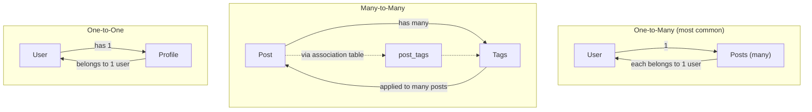

| Type | Example | Implementation |
|---|---|---|
| **One-to-Many** | User → Posts | FK on the "many" side (posts.author_id → users.id) |
| **Many-to-Many** | Post ↔ Tags | Association table with two FKs |
| **One-to-One** | User ↔ Profile | FK with `unique=True` + `uselist=False` |

### 4.2 Project layout

```
relationships-demo/
├── app.py
└── templates/
    ├── base.html
    ├── index.html
    ├── post.html
    ├── user.html
    └── tag.html
```

### 4.3 `app.py`

```python
from flask import Flask, render_template, abort
from flask_sqlalchemy import SQLAlchemy
from datetime import datetime

app = Flask(__name__)
app.config['SQLALCHEMY_DATABASE_URI'] = 'sqlite:///blog.db'
app.config['SQLALCHEMY_TRACK_MODIFICATIONS'] = False
app.secret_key = 'dev'

db = SQLAlchemy(app)


# ---------- Association table for many-to-many ----------

post_tags = db.Table(
    'post_tags',
    db.Column('post_id', db.Integer, db.ForeignKey('posts.id'), primary_key=True),
    db.Column('tag_id', db.Integer, db.ForeignKey('tags.id'), primary_key=True),
)


# ---------- Models ----------

class User(db.Model):
    __tablename__ = 'users'
    id = db.Column(db.Integer, primary_key=True)
    username = db.Column(db.String(80), unique=True, nullable=False)
    email = db.Column(db.String(120), unique=True)

    # One-to-many: a user has many posts
    posts = db.relationship('Post', backref='author', lazy='selectin',
                            cascade='all, delete-orphan')

    def __repr__(self):
        return f'<User {self.username}>'


class Post(db.Model):
    __tablename__ = 'posts'
    id = db.Column(db.Integer, primary_key=True)
    title = db.Column(db.String(200), nullable=False)
    body = db.Column(db.Text)
    created_at = db.Column(db.DateTime, default=datetime.utcnow)
    author_id = db.Column(db.Integer, db.ForeignKey('users.id'), nullable=False)

    # One-to-many: a post has many comments
    comments = db.relationship('Comment', backref='post',
                               cascade='all, delete-orphan', lazy='selectin')

    # Many-to-many: a post has many tags, tags have many posts
    tags = db.relationship('Tag', secondary=post_tags, backref='posts')

    def __repr__(self):
        return f'<Post {self.title!r}>'


class Comment(db.Model):
    __tablename__ = 'comments'
    id = db.Column(db.Integer, primary_key=True)
    body = db.Column(db.Text, nullable=False)
    created_at = db.Column(db.DateTime, default=datetime.utcnow)
    post_id = db.Column(db.Integer, db.ForeignKey('posts.id'), nullable=False)
    author_name = db.Column(db.String(80))

    def __repr__(self):
        return f'<Comment by {self.author_name}>'


class Tag(db.Model):
    __tablename__ = 'tags'
    id = db.Column(db.Integer, primary_key=True)
    name = db.Column(db.String(50), unique=True, nullable=False)

    def __repr__(self):
        return f'<Tag {self.name}>'


with app.app_context():
    db.create_all()


# ---------- Routes ----------

@app.route('/')
def index():
    posts = db.session.execute(
        db.select(Post).order_by(Post.created_at.desc())
    ).scalars().all()
    return render_template('index.html', posts=posts)


@app.route('/posts/<int:post_id>')
def show_post(post_id):
    post = db.session.get(Post, post_id)
    if not post:
        abort(404)
    return render_template('post.html', post=post)


@app.route('/users/<int:user_id>')
def show_user(user_id):
    user = db.session.get(User, user_id)
    if not user:
        abort(404)
    return render_template('user.html', user=user)


@app.route('/tags/<int:tag_id>')
def show_tag(tag_id):
    tag = db.session.get(Tag, tag_id)
    if not tag:
        abort(404)
    return render_template('tag.html', tag=tag)


if __name__ == '__main__':
    app.run(debug=True)
```

## 5. Line-by-Line Explanation

### 5.1 One-to-many — the foreign key

```python
class Post(db.Model):
    author_id = db.Column(db.Integer, db.ForeignKey('users.id'), nullable=False)
```

The **foreign key** is the column that connects a Post to its User. The argument to `db.ForeignKey()` is the *table name + column name* it points to — `'users.id'`, not `'User.id'`. (SQLAlchemy needs the actual database table name because at the DB level, that's what FKs reference.)

A foreign key says: "this column's value must match an existing `id` in the `users` table." The database enforces this — you can't insert a Post with `author_id=999` if no user 999 exists. This is **referential integrity**.

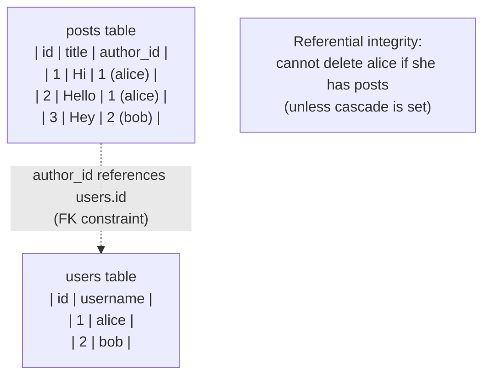

> [!question] Student asks: "Why is `ForeignKey('users.id')` a string? Why not `ForeignKey(User.id)`?"
> Because at the time `Post` is being defined, `User` may not exist yet (Python evaluates class bodies top-to-bottom). Using a string lets SQLAlchemy resolve the reference *later*, after all models are loaded. This is also why you reference the *table name* (`users`) not the *class name* (`User`) — the table is what actually exists in the database.

> [!analogy] A foreign key is a phone number
> Think of `author_id` as a phone number stored in the post. It's not Alice herself — it's a number that *reaches* Alice. If you want to talk to Alice, you dial the number (run `SELECT * FROM users WHERE id = author_id`). The FK constraint is the phone book — it guarantees the number you stored belongs to a real person. Without the constraint, you could store `author_id=999` and dial into nothing.

#### Why `nullable=False` on FKs?

If `author_id` can be NULL, you can have "orphan" posts that belong to no user. Usually that's wrong — a post has to have an author. Set `nullable=False` to enforce that at the DB level. (Exception: if you allow anonymous posts, the FK might be nullable and you'd check `if post.author` before using it.)

### 5.2 One-to-many — `db.relationship()`

```python
class User(db.Model):
    posts = db.relationship('Post', backref='author', lazy='selectin')
```

`db.relationship()` defines the **Python-side** connection — it's not a column in the database. It tells SQLAlchemy: "give `User` a `.posts` attribute that returns this user's posts."

The key insight: `author_id` is the **database column** (a real `INTEGER` in the `posts` table). `posts` is the **Python attribute** (a calculated property that runs a SQL query when accessed). They're two sides of the same coin.

```python
user = db.session.get(User, 1)
user.posts        # ← runs SELECT * FROM posts WHERE author_id = 1
post = user.posts[0]
post.author       # ← backref, returns the User (no SQL — already in session)
post.author_id    # ← the actual FK column value (1)
```

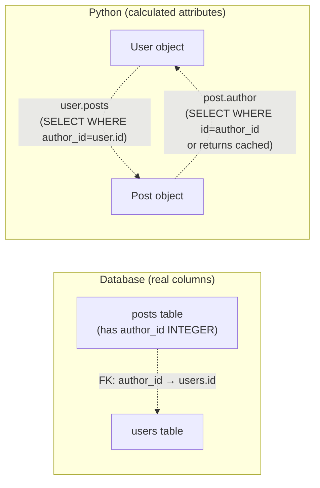

> [!info] What `db.relationship()` actually creates
> Behind the scenes, `db.relationship()` is a Python **descriptor** — an object that customises attribute access. When you write `user.posts`, the descriptor intercepts the access, runs a SQL query (if not already loaded), caches the result, and returns it. On subsequent accesses within the same session, it returns the cached value. The descriptor is *not* a column in the database — it's pure Python.

### 5.3 `backref` vs `back_populates`

`backref='author'` is a shortcut: it creates the reverse relationship automatically. After this line, `Post` has an `.author` attribute that returns the User who wrote it.

The explicit alternative is `back_populates`:

```python
class User(db.Model):
    posts = db.relationship('Post', back_populates='author')

class Post(db.Model):
    author = db.relationship('User', back_populates='posts')
    author_id = db.Column(db.Integer, db.ForeignKey('users.id'))
```

You declare both sides explicitly and link them with `back_populates`. More verbose but clearer — you can see at a glance what's connected to what. Use `backref` for simple cases; `back_populates` for complex graphs where clarity matters.

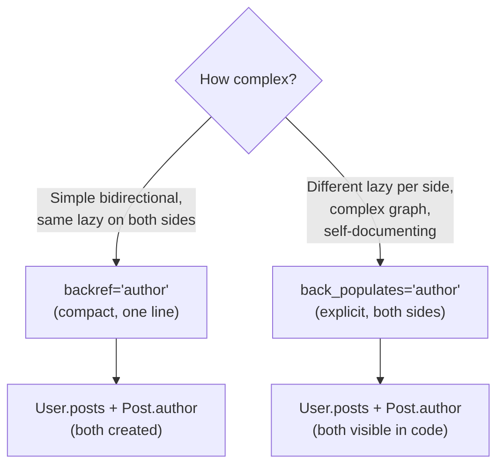

### 5.4 The `lazy` parameter — when related data loads

This is the most important parameter on `db.relationship()`. It controls **when** the related objects are loaded from the database.

| Value | When it loads | SQL | Use when |
|---|---|---|---|
| `'select'` (default) | On first access | Second SELECT: `WHERE author_id = ?` | Default — fine for most cases |
| `'joined'` | Same query as parent, via JOIN | One SELECT with JOIN | You always need the related data, parent and child in 1 query |
| `'selectin'` | Second query, batched for all parents | `WHERE author_id IN (?, ?, ?)` | Listing multiple parents with their children — avoids N+1 |
| `'subquery'` | Second query, via subselect | Subquery | Like selectin but older; rarely needed in 2026 |
| `'dynamic'` | Returns a Query object, not a list | No SQL until you call `.all()` etc. | You need to filter/paginate the relationship |

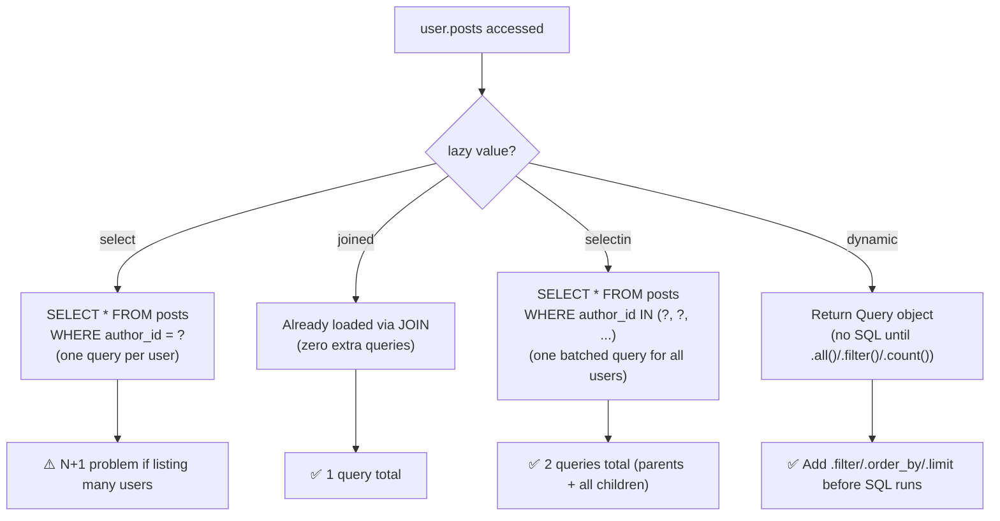

#### `lazy='dynamic'` — the Query object

```python
class User(db.Model):
    posts = db.relationship('Post', lazy='dynamic')

user = db.session.get(User, 1)
user.posts                    # → Query object (no SQL yet!)
user.posts.filter(Post.title.contains('Flask')).all()  # SQL runs now
user.posts.count()            # SELECT COUNT(*) ...
user.posts.order_by(Post.created_at.desc()).limit(5).all()
```

`lazy='dynamic'` is for when the relationship might be huge and you don't want to load all of it. "Alice has 10,000 posts — I want the latest 10, not all 10,000." Without `dynamic`, `user.posts` loads every post eagerly.

> [!question] Student asks: "What's the difference between `select` and `selectin`?"
> `select` runs one query *per parent* — accessing `user1.posts` runs `WHERE author_id = 1`, accessing `user2.posts` runs `WHERE author_id = 2`. If you loop over 100 users, that's 100 queries (N+1). `selectin` runs *one batched query for all parents* — `WHERE author_id IN (1, 2, ..., 100)` — and distributes the results in Python. Same data, 50x fewer round-trips. `selectin` is almost always better when you might list multiple parents.

> [!try] Try this
> Set `lazy='select'` on `User.posts` and visit the index page. Check the SQL log — count the queries. Then change to `lazy='selectin'` and reload — count again. The difference is the N+1 problem in action. Now try `lazy='joined'` — notice the JOIN query and how each post is duplicated if a user has many.

### 5.5 The N+1 query problem

This is the most common performance bug in ORM code. Imagine listing 100 users with their posts:

```python
users = db.session.execute(db.select(User)).scalars().all()   # 1 query
for user in users:
    print(user.username, len(user.posts))   # 100 queries (one per user)!
```

**Total: 101 queries.** With 1000 users, 1001 queries. Each query has overhead (network round-trip, parsing, planning) — your page takes seconds instead of milliseconds.

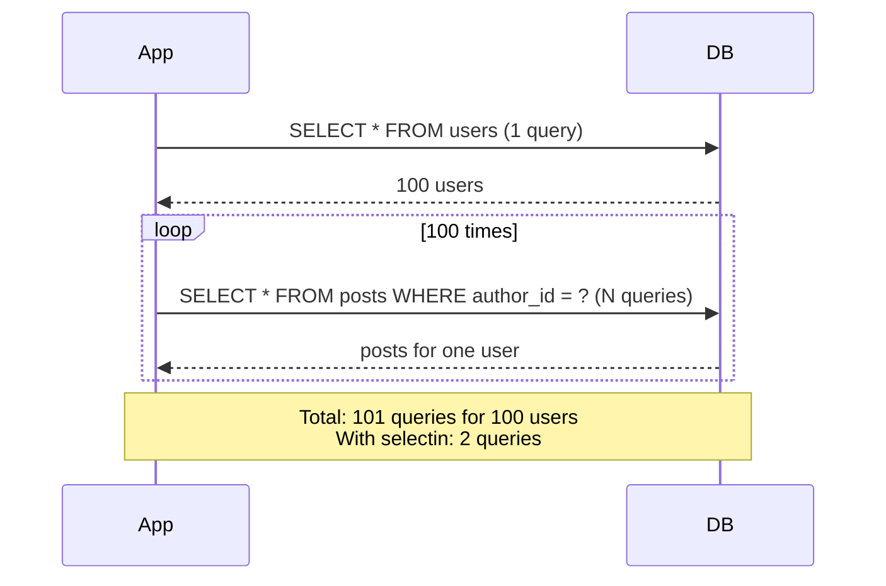

The fix: eager-load the posts in bulk.

#### Fix 1: `lazy='selectin'` on the relationship

```python
class User(db.Model):
    posts = db.relationship('Post', lazy='selectin')
```

Now `users = db.select(User).all()` runs:
1. `SELECT * FROM users` (1 query)
2. `SELECT * FROM posts WHERE author_id IN (1, 2, 3, ..., 100)` (1 query)

Total: **2 queries** for any number of users.

#### Fix 2: `joinedload` per-query

```python
from sqlalchemy.orm import joinedload

users = db.session.execute(
    db.select(User).options(joinedload(User.posts))
).scalars().unique().all()
```

Loads users and posts in a single JOIN:

```sql
SELECT users.*, posts.* FROM users
LEFT OUTER JOIN posts ON posts.author_id = users.id
```

One query. Downside: if a user has 100 posts, the user's row is duplicated 100 times in the result (the JOIN "fans out"). For one-to-many, `selectin` is usually better.

#### Fix 3: `selectinload` per-query

```python
from sqlalchemy.orm import selectinload

users = db.session.execute(
    db.select(User).options(selectinload(User.posts))
).scalars().all()
```

Like setting `lazy='selectin'` but only for this query. Best of both worlds: default lazy loading everywhere else, eager loading here.

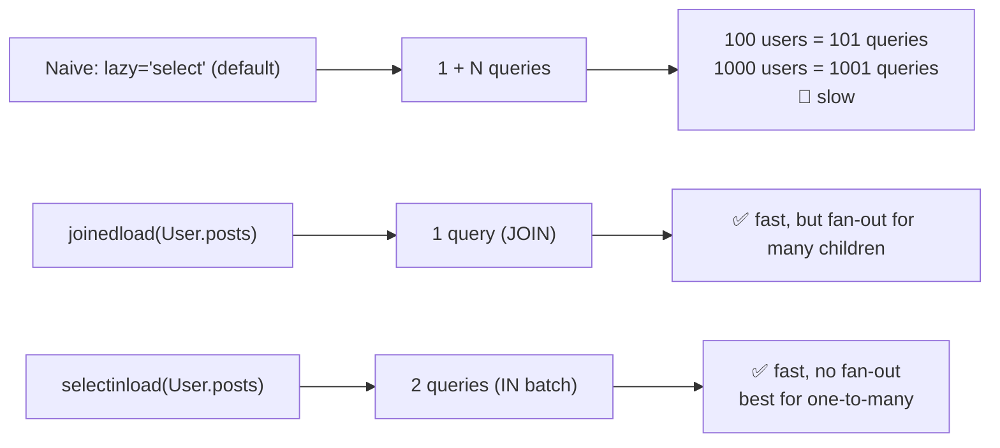

> [!question] Student asks: "How do I know if I have an N+1 problem?"
> Turn on SQL logging (Lesson 13, section 6.3) and watch the terminal. If you see one SELECT for the parents followed by N SELECTs for the children, you have N+1. The fix is always `selectinload` (preferred) or `joinedload`.

> [!question] Student asks: "Why isn't `lazy='selectin'` the default?"
> Because eager loading has a cost. If you're getting one user and don't need their posts, `selectin` runs an unnecessary extra query. The default `lazy='select'` is "lazy" — it loads related data only if you access it. The trade-off: lazy is fast for single objects, slow for lists. SQLAlchemy errs on the side of "load only what you ask for." For pages that list parents with children, add `selectinload` explicitly.

> [!try] Try this
> In the blog app, change `lazy='selectin'` to `lazy='select'` on all relationships. Restart and visit `/`. Count the SQL queries. Now add `.options(selectinload(Post.author), selectinload(Post.comments), selectinload(Post.tags))` to the index route query. Restart — count again. The drop should be dramatic.

### 5.6 Many-to-many — the association table

```python
post_tags = db.Table(
    'post_tags',
    db.Column('post_id', db.Integer, db.ForeignKey('posts.id'), primary_key=True),
    db.Column('tag_id', db.Integer, db.ForeignKey('tags.id'), primary_key=True),
)

class Post(db.Model):
    tags = db.relationship('Tag', secondary=post_tags, backref='posts')

class Tag(db.Model):
    # no FK here — the association table handles it
    name = db.Column(db.String(50), unique=True)
```

A many-to-many needs a third table — the **association table** — with foreign keys to both sides. Each row in `post_tags` says "post X has tag Y". The association table has no model class of its own; it's just two FK columns.

`db.relationship('Tag', secondary=post_tags, backref='posts')` says:
- Connect to `Tag`.
- Use `post_tags` as the link table.
- Add a `posts` attribute on `Tag` (the backref) returning all posts with that tag.

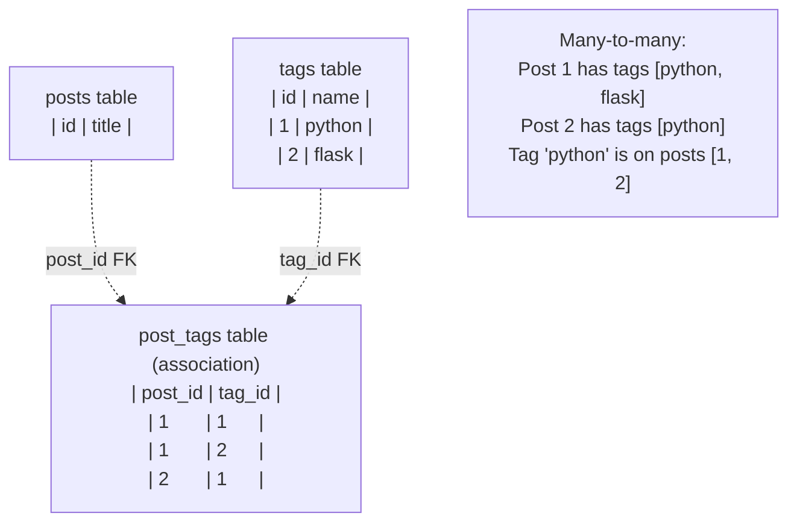

Using the relationship:

```python
post = db.session.get(Post, 1)
post.tags           # → [Tag('python'), Tag('flask')]

tag = db.session.get(Tag, 1)
tag.posts           # → [Post 1, Post 2]

# Adding a tag to a post:
post.tags.append(Tag.query.filter_by(name='web').first())
db.session.commit()
# INSERT INTO post_tags (post_id, tag_id) VALUES (1, 3)
```

> [!analogy] The association table as a wedding guest list
> Imagine you have a `people` table and a `parties` table. A person can attend many parties; a party has many people. How do you record "Alice attended the wedding"? You can't add a `person_id` column to parties (each party has many people) and you can't add a `party_id` column to people (each person attends many parties). You need a third table — `attendances` — with rows like `(person_id=1, party_id=42)`. That's the association table: a list of "who came to what."

> [!info] Why the association table has no model?
> In simple many-to-many (just two FKs), `db.Table` is sufficient — SQLAlchemy handles inserts/deletes on the association automatically when you append/remove from `post.tags`. If you need extra columns on the association (e.g., `tagged_at` timestamp), you need a full *model* class — see section 5.15.

### 5.7 One-to-one — `uselist=False`

```python
class User(db.Model):
    profile = db.relationship('Profile', backref='user', uselist=False)

class Profile(db.Model):
    user_id = db.Column(db.Integer, db.ForeignKey('users.id'), unique=True)
    bio = db.Column(db.Text)
    avatar_url = db.Column(db.String(500))
```

`uselist=False` tells SQLAlchemy: this is a one-to-one, not one-to-many. `user.profile` returns a single `Profile` object (or None), not a list.

The `unique=True` on the FK column enforces it at the database level — each user can have at most one profile (because `user_id` values must be unique in the `profiles` table).

```python
user = db.session.get(User, 1)
user.profile        # → Profile object (or None)
user.profile.bio    # → "Just a person"
# vs. one-to-many:
user.posts          # → list of Post objects (could be empty, could be many)
```

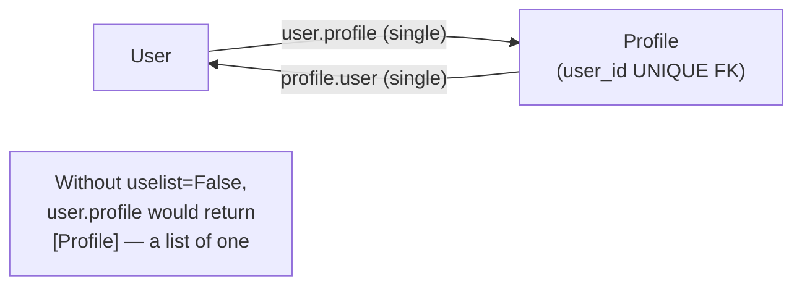

> [!question] Student asks: "Why not just put the profile columns (bio, avatar_url) directly on User?"
> Two reasons. First, *separation of concerns*: most pages don't need profile data — putting 10 columns on User bloats every user query. Second, *optional data*: if profile is filled out by 10% of users, a separate table keeps the 90% lean. This is called **vertical partitioning** — split rarely-used columns into a side table.

### 5.8 Self-referential relationships

A relationship where both sides are the same model. Classic examples:

- **User follows users** (Twitter-style follow graph)
- **Comments reply to comments** (Reddit-style threading)
- **Employees report to employees** (org chart)

```python
class User(db.Model):
    __tablename__ = 'users'
    id = db.Column(db.Integer, primary_key=True)
    username = db.Column(db.String(80))

    # Many-to-many with self
    follows = db.relationship(
        'User',
        secondary=followers,
        primaryjoin=(followers.c.follower_id == id),
        secondaryjoin=(followers.c.followed_id == id),
        backref=db.backref('followers', lazy='dynamic'),
        lazy='dynamic',
    )

followers = db.Table(
    'followers',
    db.Column('follower_id', db.Integer, db.ForeignKey('users.id'), primary_key=True),
    db.Column('followed_id', db.Integer, db.ForeignKey('users.id'), primary_key=True),
)
```

```python
alice.follows.append(bob)   # alice follows bob
db.session.commit()
alice.follows.all()         # → [bob]
bob.followers.all()         # → [alice]
```

Self-referential relationships need explicit `primaryjoin` and `secondaryjoin` because the association table has two FKs to the same table — SQLAlchemy needs to know which is which.

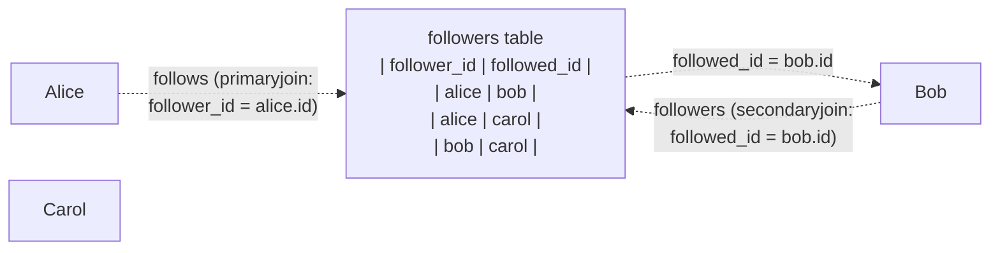

For **nested comments** (a comment has replies, which are also comments):

```python
class Comment(db.Model):
    id = db.Column(db.Integer, primary_key=True)
    body = db.Column(db.Text)
    parent_id = db.Column(db.Integer, db.ForeignKey('comments.id'), nullable=True)

    replies = db.relationship('Comment', backref='parent', remote_side=[id])
    # remote_side tells SQLAlchemy: 'parent' is the side with the higher id (the parent)
```

```python
top_comment = Comment(body='Top level')
reply1 = Comment(body='Reply 1', parent=top_comment)
reply2 = Comment(body='Reply 2', parent=top_comment)
db.session.add_all([top_comment, reply1, reply2])
db.session.commit()

top_comment.replies   # → [reply1, reply2]
reply1.parent         # → top_comment
```

### 5.9 Cascading deletes

```python
class User(db.Model):
    posts = db.relationship('Post', backref='author', cascade='all, delete-orphan')
```

`cascade='all, delete-orphan'` says: "when this User is deleted, delete their Posts too." Without it, deleting a User who has Posts would raise an IntegrityError (foreign key constraint violation).

Cascade options:

| Option | Effect |
|---|---|
| `save-update` | When parent is added to session, children are too (default) |
| `merge` | When parent is merged, children are too (default) |
| `delete` | When parent is deleted, children are deleted |
| `delete-orphan` | When a child is removed from parent.children, delete it (not just disassociate) |
| `all` | save-update + merge + delete + expire + refresh-expire |
| `all, delete-orphan` | The common pattern for "children belong to parent" |

```python
user = db.session.get(User, 1)
db.session.delete(user)
db.session.commit()
# DELETE FROM posts WHERE author_id = 1  (cascade)
# DELETE FROM users WHERE id = 1
```

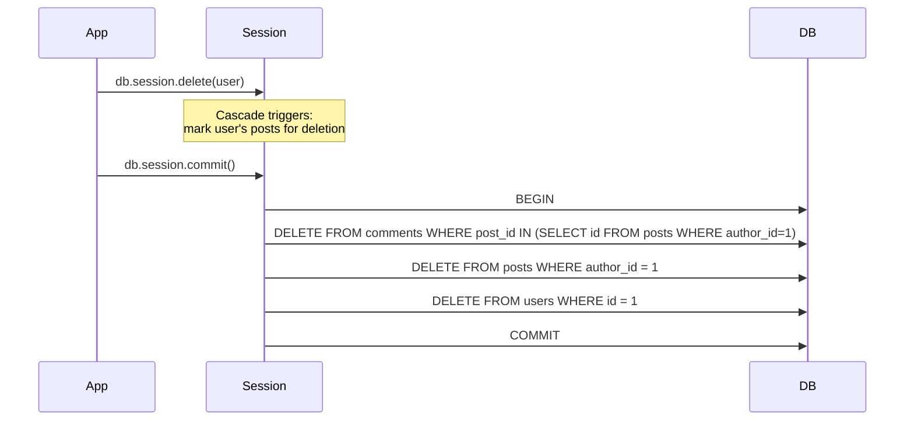

> [!warning] Cascade is ORM-side, not DB-side
> SQLAlchemy's `cascade` runs the DELETEs from Python. If you delete a User directly via SQL (`DELETE FROM users WHERE id = 1`), the cascade doesn't fire. For DB-level cascade, set `ondelete='CASCADE'` on the ForeignKey: `db.ForeignKey('users.id', ondelete='CASCADE')`. Best practice: set both, so cascade works regardless of how the delete happens.

> [!question] Student asks: "What's the difference between `delete` and `delete-orphan`?"
> `delete` cascades the DELETE from parent to child when you delete the parent. `delete-orphan` *also* deletes a child when you *remove it from the parent's collection* — `user.posts.remove(post)` deletes the post entirely, instead of just setting its `author_id` to NULL. Use `delete-orphan` when children can't exist without their parent (posts can't exist without an author). Use just `delete` (or no cascade) when children can be "re-parented" or stand alone.

### 5.10 Querying across relationships

```python
# Posts by alice
db.select(Post).where(Post.author.has(User.username == 'alice'))

# Posts with at least one comment
db.select(Post).where(Post.comments.any())

# Posts with a comment by 'bob'
db.select(Post).where(Post.comments.any(Comment.author_name == 'bob'))

# Posts with tag 'python'
db.select(Post).where(Post.tags.any(Tag.name == 'python'))

# Users who wrote at least one post
db.select(User).where(User.posts.any())

# Explicit JOIN
db.select(User).join(Post).where(Post.title.contains('Flask'))
```

`.any()` and `.has()` are shorthand for EXISTS subqueries. They're the cleanest way to filter on related data without writing JOINs.

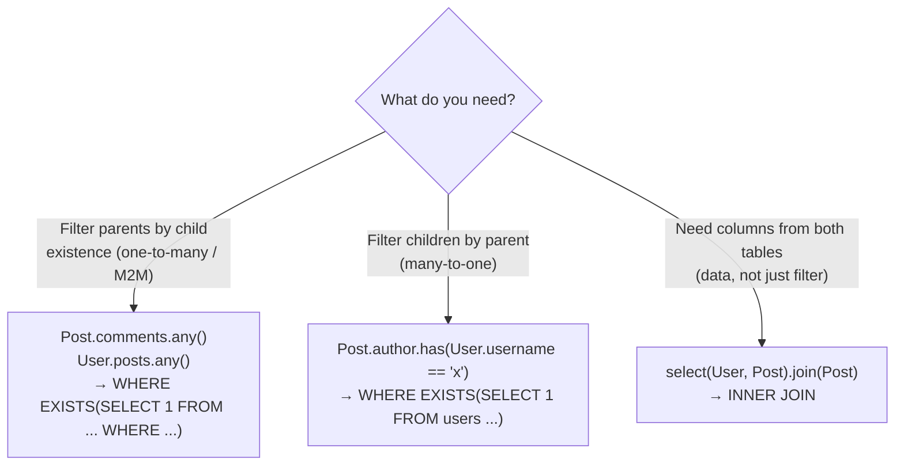

The compiled SQL for `.any()`:

```sql
-- Post.comments.any()
SELECT * FROM posts
WHERE EXISTS (
    SELECT 1 FROM comments
    WHERE comments.post_id = posts.id
)
```

For `.has()` (many-to-one):

```sql
-- Post.author.has(User.username == 'alice')
SELECT * FROM posts
WHERE EXISTS (
    SELECT 1 FROM users
    WHERE users.id = posts.author_id
    AND users.username = 'alice'
)
```

### 5.11 Setting relationships — three equivalent ways

```python
alice = db.session.get(User, 1)

# Way 1: set the FK column
post = Post(title='Hi', author_id=alice.id)

# Way 2: set the backref attribute
post = Post(title='Hi', author=alice)

# Way 3: append to the relationship list
post = Post(title='Hi')
alice.posts.append(post)
```

All three produce the same result. Use whichever reads best in context.

> [!try] Try this
> After running each of the three ways, check `post.author_id` and `alice.posts`. They should be consistent. Why? Because `back_populates` (or `backref`) tells SQLAlchemy to keep both sides in sync — when you set `post.author = alice`, SQLAlchemy also adds `post` to `alice.posts` automatically. Without `back_populates`, you'd have to set both sides manually.

### 5.12 The relationship vs column distinction (mental model)

This is the single most important concept in this lesson. Beginners constantly confuse them. Let's nail it down with a side-by-side:

| Aspect | Foreign Key Column | Relationship |
|---|---|---|
| What it is | A real column in the database table | A Python attribute calculated on access |
| Storage | Takes up space in the DB (INTEGER) | No storage — it's a property |
| Name | `author_id` (typically `<related>_id`) | `author` or `posts` (any name) |
| Returns | An integer (the related row's PK) | The actual related object(s) |
| SQL | `SELECT author_id FROM posts` returns `1` | `SELECT * FROM users WHERE id = 1` runs on access |
| Setting | `post.author_id = 1` | `post.author = alice` (or `alice.posts.append(post)`) |

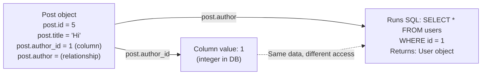

The relationship is built *on top of* the foreign key column. Without the FK column, the relationship has nothing to query. Without the relationship, you'd have to manually run `db.session.get(User, post.author_id)` every time — which is what the relationship does for you, transparently.

### 5.13 Backref vs back_populates — when to use which

Both create bidirectional relationships. The difference is style:

**`backref`** (compact):

```python
class User(db.Model):
    posts = db.relationship('Post', backref='author')
# Post.author is created automatically
```

**`back_populates`** (explicit):

```python
class User(db.Model):
    posts = db.relationship('Post', back_populates='author')

class Post(db.Model):
    author = db.relationship('User', back_populates='posts')
```

Use `backref` when:
- The relationship is simple.
- You don't need to configure the reverse side (no custom `lazy`, no `cascade` on the reverse).

Use `back_populates` when:
- You need different `lazy` settings on each side.
- You need cascade on one side but not the other.
- You have a complex graph (multiple paths between same models).
- You want the code to be self-documenting (every relationship visible in its own model).

In this lesson we use `backref` for brevity. In production code, `back_populates` is often clearer.

### 5.14 The `remote_side` parameter for self-references

In self-referential relationships, SQLAlchemy needs to know which side is the "parent" and which is the "child". For nested comments:

```python
class Comment(db.Model):
    id = db.Column(db.Integer, primary_key=True)
    parent_id = db.Column(db.Integer, db.ForeignKey('comments.id'))

    replies = db.relationship('Comment', backref='parent', remote_side=[id])
```

`remote_side=[id]` says: "the parent's `id` is the remote side." Without this, SQLAlchemy can't tell whether `parent_id` points to the parent or the child. For `replies`, the parent is the one whose `id` matches the child's `parent_id`.

The mnemonic: in `parent_id = FK('comments.id')`, the column being referenced (`comments.id`) is the remote side.

### 5.15 Many-to-many with extra columns

Sometimes the association table needs more than just two FKs. Example: a `Subscription` between User and Newsletter might have a `subscribed_at` timestamp:

```python
subscription = db.Table(
    'subscriptions',
    db.Column('user_id', db.Integer, db.ForeignKey('users.id'), primary_key=True),
    db.Column('newsletter_id', db.Integer, db.ForeignKey('newsletters.id'), primary_key=True),
    db.Column('subscribed_at', db.DateTime, default=datetime.utcnow),  # extra column
)
```

But if you need to *access* that extra column from Python, you need a full model for the association, not just a `db.Table`:

```python
class Subscription(db.Model):
    __tablename__ = 'subscriptions'
    user_id = db.Column(db.Integer, db.ForeignKey('users.id'), primary_key=True)
    newsletter_id = db.Column(db.Integer, db.ForeignKey('newsletters.id'), primary_key=True)
    subscribed_at = db.Column(db.DateTime, default=datetime.utcnow)

    user = db.relationship('User', backref='subscriptions')
    newsletter = db.relationship('Newsletter', backref='subscriptions')
```

Then access via `user.subscriptions[0].subscribed_at`. The trade-off: you write `subscription.user.newsletter` instead of `user.newsletters` directly. For complex association data, the model approach is worth it.

### 5.16 Polymorphic relationships (advanced)

Sometimes a Comment can belong to a Post, a Video, OR a Photo — different types of "commentable" things. This is **polymorphic association**, and relational databases don't support it natively. SQLAlchemy supports it via `mapper` configuration:

```python
class Comment(db.Model):
    id = db.Column(db.Integer, primary_key=True)
    body = db.Column(db.Text)
    parent_type = db.Column(db.String(50))   # 'post', 'video', 'photo'
    parent_id = db.Column(db.Integer)

    # Polymorphic relationship — belongs to Post/Video/Photo based on parent_type
```

This is advanced; you typically use one of two patterns:

1. **Single-table polymorphism**: One `comments` table with `parent_type` and `parent_id` columns. SQLAlchemy resolves the parent based on `parent_type`.
2. **Multiple FKs**: Comment has `post_id`, `video_id`, `photo_id` columns, only one of which is non-null per row.

For most apps, avoid polymorphism — model each relationship explicitly (`Post.comments`, `Video.comments`, `Photo.comments`). It's more verbose but clearer and easier to query.

### 5.17 Reading the SQL SQLAlchemy generates

When you access `user.posts` with `lazy='select'`, SQLAlchemy logs:

```sql
SELECT posts.id, posts.title, posts.body, posts.created_at, posts.author_id
FROM posts
WHERE ? = posts.author_id
[1]
```

The `?` is a parameter placeholder — SQLAlchemy passes `1` (the user's id) separately to avoid SQL injection. The `[1]` below the SQL is the parameter value.

For `lazy='selectin'`, when you list multiple users, the query is:

```sql
SELECT posts.id, posts.title, ..., posts.author_id
FROM posts
WHERE posts.author_id IN (?, ?, ?)
[1, 2, 3]
```

One query, batched for all three users. SQLAlchemy then matches the returned posts back to the correct user objects in Python.

For `lazy='joined'`:

```sql
SELECT users.id, users.username, users.email,
       posts_1.id AS posts_1_id, posts_1.title AS posts_1_title, ...
FROM users
LEFT OUTER JOIN posts AS posts_1 ON posts_1.author_id = users.id
```

One query, but each user row is duplicated for each post. SQLAlchemy deduplicates in Python.

### 5.18 The identity map and relationships

The session's **identity map** (Lesson 12) caches objects by primary key. This affects relationships in two ways:

1. **Back-references are free.** After `user = db.session.get(User, 1)` and `post = user.posts[0]`, accessing `post.author` doesn't hit the DB — it returns the cached `user`. SQLAlchemy knows the post's `author_id` is 1, and User 1 is already in the identity map.
2. **Relationships stay consistent.** If you do `post.author = alice`, then `alice.posts` automatically includes `post` (if `back_populates` is set). SQLAlchemy updates both sides of the relationship in memory.

```python
alice = db.session.get(User, 1)
post = Post(title='New', author=alice)
db.session.add(post)

# Even before commit, the relationship is consistent:
post in alice.posts  # True
post.author is alice # True
```

> [!info] Detached objects break relationships
> If you `db.session.expunge(user)` (or the session closes), `user` becomes *detached*. Its attributes are still readable, but the `.posts` relationship can't run a query anymore — it raises `DetachedInstanceError`. Re-attach with `db.session.merge(user)` or query fresh. Lesson 13 covers object states.

## 6. Running the Code

Save `app.py` and the four templates (not shown above for brevity — they're simple `extends base.html` + iterate `posts`/`comments`/`tags`).

```bash
python app.py
```

### 6.1 Seed some data via the Flask shell

```bash
flask shell
```

```python
>>> from app import db, User, Post, Comment, Tag
>>> alice = User(username='alice', email='alice@example.com')
>>> bob = User(username='bob', email='bob@example.com')
>>> db.session.add_all([alice, bob])
>>> db.session.commit()

>>> python_tag = Tag(name='python')
>>> flask_tag = Tag(name='flask')
>>> db.session.add_all([python_tag, flask_tag])

>>> p1 = Post(title='Hello Flask', body='First post!', author=alice)
>>> p1.tags.extend([python_tag, flask_tag])
>>> p2 = Post(title='Why I love Flask', body='...', author=alice)
>>> p2.tags.append(flask_tag)
>>> p3 = Post(title='Hi from Bob', body='...', author=bob)
>>> db.session.add_all([p1, p2, p3])
>>> db.session.commit()

>>> c1 = Comment(body='Great post!', author_name='bob', post=p1)
>>> c2 = Comment(body='Thanks!', author_name='alice', post=p1)
>>> db.session.add_all([c1, c2])
>>> db.session.commit()
>>> exit()
```

### 6.2 Visit `/`

```
Posts
  • Hello Flask — by alice — tags: python, flask — 2 comments
  • Why I love Flask — by alice — tags: flask — 0 comments
  • Hi from Bob — by bob — tags: — 0 comments
```

Open the SQL log. Notice: with `lazy='selectin'` on `comments` and `tags`, the index page runs 3 queries total (posts, then comments IN batch, then tags IN batch) — not 3 + N.

### 6.3 Visit `/posts/1`

```
Hello Flask
by alice

First post!

Comments:
  • Great post! — bob
  • Thanks! — alice

Tags: python, flask
```

### 6.4 Visit `/users/1`

```
alice (alice@example.com)

Posts by alice:
  • Hello Flask
  • Why I love Flask
```

### 6.5 Visit `/tags/1` (the `python` tag)

```
Tag: python

Posts tagged 'python':
  • Hello Flask
```

### 6.6 Test cascade — delete alice

```bash
flask shell
```

```python
>>> from app import db, User
>>> alice = db.session.get(User, 1)
>>> db.session.delete(alice)
>>> db.session.commit()
>>> exit()
```

Visit `/` — Alice's posts are gone too (cascade worked). Without `cascade='all, delete-orphan'`, you'd get an IntegrityError.

### 6.7 The N+1 demo

Temporarily change `lazy='selectin'` to `lazy='select'` on `User.posts`. Restart. Visit `/users/1`. The SQL log shows:

```
SELECT * FROM users WHERE id = 1   -- 1 query for the user
SELECT * FROM posts WHERE author_id = 1   -- 1 query for their posts
```

That's fine for one user. But if you had a page listing 100 users:

```
SELECT * FROM users LIMIT 100   -- 1 query
SELECT * FROM posts WHERE author_id = 1   -- user 1's posts
SELECT * FROM posts WHERE author_id = 2   -- user 2's posts
... 100 more ...
```

101 queries for 100 users. Restore `lazy='selectin'` and it becomes 2 queries regardless of user count.

### 6.8 ER diagram of the blog schema

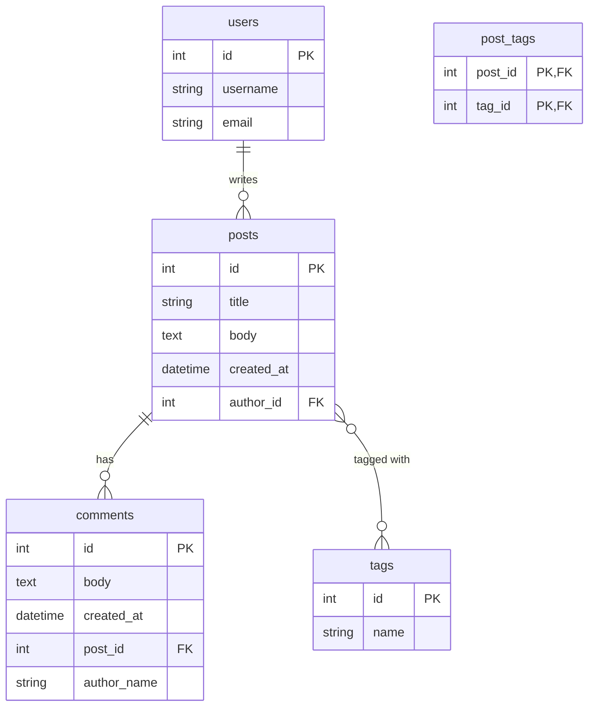

This is the canonical blog schema. Memorise it — every blog tutorial in every language uses something close to this.

### 6.9 Real-world: complex relationship graphs

Production apps have far more complex graphs than our blog. A typical SaaS app might have:

- `Organization` → many `User` (members)
- `User` → many `Project` (where they're owner)
- `Project` → many `Task` → many `Subtask`
- `Task` ↔ many `Tag` (M2M)
- `Task` → many `Comment` → many `Reaction`
- `User` → one `Profile` (one-to-one)
- `User` → many `User` (follows, self-ref M2M)

Designing such schemas takes practice. The principles don't change: each entity is a table, each "has many" is a FK on the child, each "many-to-many" is an association table. Draw the ER diagram first, then translate to models.

## 7. Common Mistakes

### 7.1 Missing the foreign key

```python
class Post(db.Model):
    # no author_id column!
    author = db.relationship('User')
```

`db.relationship()` alone doesn't create a column. You need both: the FK column (`author_id`) AND the relationship (`author`). The relationship is the Python attribute; the FK is the database column.

### 7.2 Class name in ForeignKey

```python
# WRONG
author_id = db.Column(db.Integer, db.ForeignKey('User.id'))

# RIGHT
author_id = db.Column(db.Integer, db.ForeignKey('users.id'))
```

`ForeignKey` takes the *table name* + *column name*, not the class name. Use `'users.id'`, not `'User.id'`.

### 7.3 Redundant `backref`

```python
class User(db.Model):
    posts = db.relationship('Post', backref='author')

class Post(db.Model):
    author = db.relationship('User', backref='posts')   # WRONG — backref already set this
```

Don't define both sides with `backref`. Use `backref` on one side and let it create the other, OR use `back_populates` on both sides.

### 7.4 The N+1 query problem

```python
users = db.session.execute(db.select(User)).scalars().all()
for user in users:
    print(len(user.posts))   # N+1!
```

Always use `selectinload` or `lazy='selectin'` when listing parents with children.

### 7.5 Deleting a parent with children

```python
user = db.session.get(User, 1)
db.session.delete(user)
db.session.commit()   # IntegrityError if user has posts!
```

Either set `cascade='all, delete-orphan'` on the relationship, or `ondelete='CASCADE'` on the FK, or manually delete the children first.

### 7.6 Many-to-many without `secondary`

```python
class Post(db.Model):
    tags = db.relationship('Tag')   # WRONG — needs secondary
```

A many-to-many needs `secondary=post_tags`. Without it, SQLAlchemy treats this as one-to-many and the relationship doesn't work.

### 7.7 Circular imports

```python
# models/user.py
from models.post import Post   # but Post imports User...
class User: posts = db.relationship('Post')
```

Use string references: `db.relationship('Post')` not `db.relationship(Post)`. SQLAlchemy resolves the string lazily, breaking the import cycle.

### 7.8 Forgetting `.unique()` after `joinedload`

```python
users = db.session.execute(
    db.select(User).options(joinedload(User.posts))
).scalars().all()   # may have duplicate User objects!
```

When you `joinedload` a one-to-many, the JOIN fans out — each user appears once per post. Use `.scalars().unique().all()` to deduplicate.

### 7.9 DetachedInstanceError in templates

```python
@app.route('/posts')
def posts():
    posts = db.session.execute(db.select(Post)).scalars().all()
    db.session.close()  # BAD — detaches all objects
    return render_template('posts.html', posts=posts)  # template accesses post.tags → error
```

Don't close the session before rendering the template. Lazy loading happens during template rendering; the session must still be open.

### 7.10 Setting only one side of a `back_populates` relationship

```python
class User(db.Model):
    posts = db.relationship('Post', back_populates='author')

class Post(db.Model):
    # forgot: author = db.relationship('User', back_populates='posts')
    author_id = db.Column(db.Integer, db.ForeignKey('users.id'))
```

With `back_populates`, *both* sides must be declared. If you forget one, you'll get a confusing error at first access. With `backref`, only one side needs declaration.

## 8. Exercises

> [!tip] The 20-minute rule
> Stuck for 20 minutes? Take a break.

1. **Add a `Category` model.** Posts belong to one category (one-to-many: Category → Posts). Add a `category_id` FK on Post, a `category` relationship, and a `posts` backref on Category. Add a `/categories/<id>` route.

2. **Add likes.** Users can like posts. This is many-to-many (a user likes many posts; a post is liked by many users). Create a `post_likes` association table and a `liked_posts` relationship on User.

3. **Nested comments with recursive macro.** Add a `parent_id` to Comment (self-referential). Build a recursive Jinja macro that renders a comment and its replies, indented. Hint: `...{{ render_comment(reply) }}`.

4. **Eager-load everything.** Add `selectinload` options to your `index` route so it loads posts, their authors, their comments, and their tags in 4 queries total (not N+1). Confirm via SQL log.

5. **Soft delete for posts.** Add a `deleted_at` column. Modify the delete route to set `deleted_at` instead of removing. Update all queries to filter `deleted_at IS NULL`. (Hint: use a query decorator or default filter.)

6. **Tag cloud.** Build a `/tags` page showing all tags with the number of posts for each. Use `func.count()` and `group_by`.

7. **User follows (self-referential M2M).** Add the `follows` self-referential relationship from section 5.8. Build a `/users/<id>/follow` POST route that adds the current user to the target's followers. Build a feed page showing posts from users the current user follows.

8. **Search across relationships.** Build a search that finds posts where the title contains the query OR the author's username contains the query OR any tag name contains the query. Use `or_` with `.has()` and `.any()`.

9. **Polymorphic comments.** Refactor Comment to be polymorphic — it can belong to a Post OR a Video. Use the "multiple FKs" pattern. Add a `video_id` column (nullable). Write queries that pull comments for a post and comments for a video.

10. **Migration rehearsal.** What happens to your data if you add a `views` column to Post tomorrow? `db.create_all()` won't update the existing table — that's Lesson 15. For now, drop the DB and recreate. Document the pain — that's why migrations exist.

11. **Performance comparison.** Create 1000 users, each with 10 posts. Time loading `/users` (list of all users with their posts) with `lazy='select'`, `lazy='selectin'`, `lazy='joined'`, and with `selectinload`. Use `time.perf_counter()` and the SQL log. Write up your findings.

12. **Cascade experimentation.** Create users with posts with comments. Try deleting a user with `cascade='all'` vs `cascade='all, delete-orphan'` vs no cascade. What happens to the posts when you remove them from `user.posts` in each case?

## 9. What We Learned

- **Relationships** connect rows across tables. Three types: one-to-many (most common), many-to-many (needs association table), one-to-one (FK with `unique=True` + `uselist=False`).
- **Foreign keys** (`db.ForeignKey('users.id')`) are the database-side connection. Always use the *table name*, not the class name.
- **`db.relationship()`** is the Python-side connection — a calculated attribute, not a column. `backref='author'` creates the reverse relationship automatically. `back_populates` is the explicit alternative.
- **The `lazy` parameter** controls when related data loads:
  - `'select'` (default): second SELECT on access — causes N+1 in loops
  - `'joined'`: one JOIN query — good for one-to-one
  - `'selectin'`: batched IN query — best for one-to-many lists
  - `'dynamic'`: returns a Query object — for filtering/paginating relationships
- **The N+1 problem** is when listing N parents triggers N+1 queries. Fix with `lazy='selectin'` (relationship-wide) or `selectinload` (per-query).
- **Many-to-many** uses an association table (`db.Table` with two FKs) and `secondary=assoc_table` on the relationship.
- **One-to-one** uses `uselist=False` on the relationship + `unique=True` on the FK.
- **Self-referential** relationships (follows, nested comments) use the same model on both sides, often needing explicit `primaryjoin`/`secondaryjoin` or `remote_side`.
- **Cascading deletes** (`cascade='all, delete-orphan'`) automatically delete children when parent is deleted. Also set `ondelete='CASCADE'` on the FK for DB-level cascade.
- **Querying across relationships**: `.any()` (one-to-many / many-to-many), `.has()` (many-to-one), or explicit `.join()`. These compile to EXISTS subqueries.
- You can set a relationship three ways: by FK column, by relationship attribute, or by appending to the parent's list.
- The **identity map** keeps relationship data consistent in memory — back-references are often free (no extra query).

## 10. Next Lesson

You have models, but they're frozen — once `db.create_all()` runs, you can't change them without dropping the database. The next lesson fixes that.

In [[Lesson-15-Flask-Migrate]] you'll learn:

- **What migrations are** — version control for your database schema.
- **Why `db.create_all()` isn't enough** — it doesn't update existing tables.
- **Alembic** — the engine under Flask-Migrate.
- **The migration workflow**: `init`, `migrate`, `upgrade`, `downgrade`.
- **Reading migration scripts** — `upgrade()` and `downgrade()` functions.
- **Common migration scenarios** — add column, remove column, add table, rename column.
- **The rename column problem** — Alembic may not auto-detect renames.
- **Data migrations** — moving data, not just schema.
- **Zero-downtime migrations** — the expand-and-contract pattern.
- **Migrations in production** — backup first, test on staging.

> [!quote] A note from your teacher
> Relationships are where the ORM earns its keep. Without an ORM, you'd write JOINs by hand, manage FK constraints in SQL, and watch helplessly as a forgotten JOIN turns a 50ms page into a 5-second page. The ORM makes relationships *Pythonic* — `user.posts` reads like attribute access, but underneath it's a JOIN or a batched IN query. The cost is the learning curve: lazy loading, N+1, cascades, identity maps. Once you internalise these, you can model any domain — blogs, e-commerce, social networks — and the code stays clean. The next lesson (migrations) is shorter but equally essential: it's how you change this schema without losing data.
