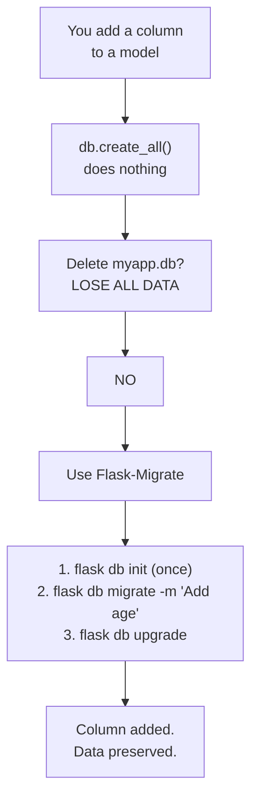
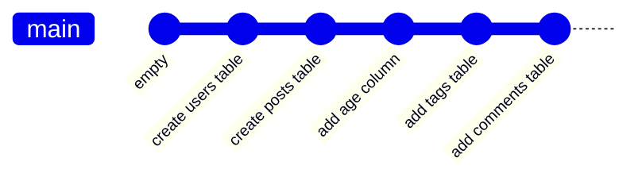
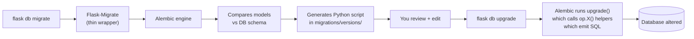
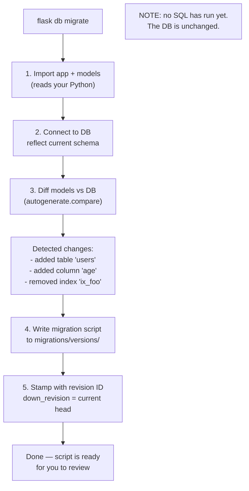
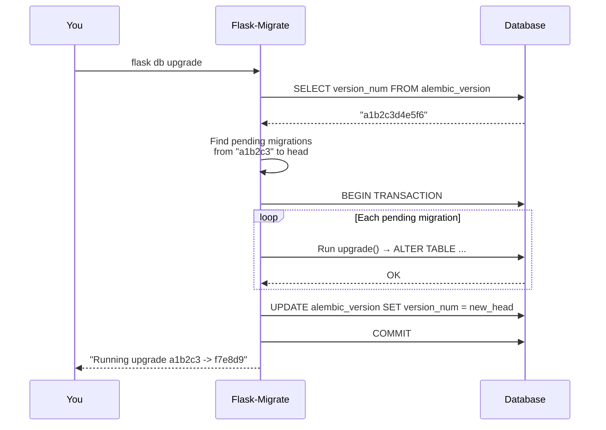
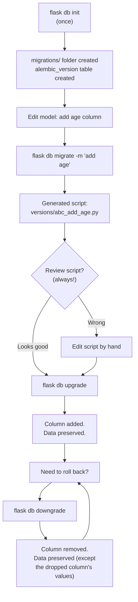
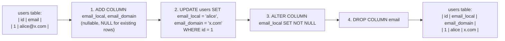
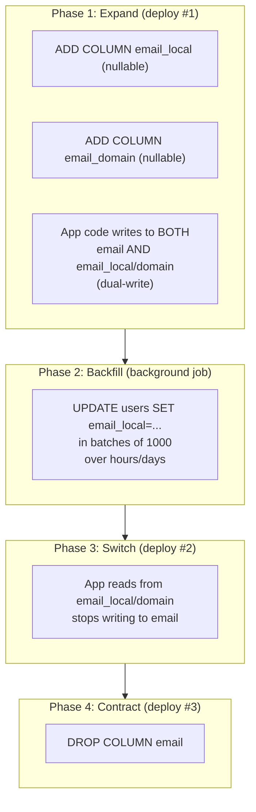
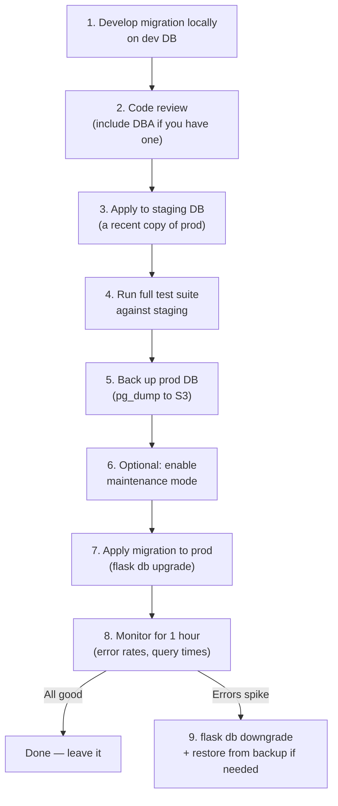

# Lesson 15 — Flask-Migrate: Version Control for Your Database

> [!success] Second and final lesson of Module 06 — Models & Relationships.
> You've added a column to your model. You run the app. The column isn't there. You remember: `db.create_all()` only creates missing tables; it doesn't update existing ones. You delete `myapp.db`, recreate, lose all your data. Today you fix that forever. Migrations let you evolve your database **without nuking your data** — and they let you do it safely on a production database with millions of rows.

## 1. Learning Objectives

By the end of this lesson you will be able to:

1. **Explain why `db.create_all()` is not enough** for evolving schemas in production.
2. **Describe what a migration is** — a script that alters the database in a known, reversible way.
3. **Install and configure Flask-Migrate** (Alembic under the hood) and explain what each piece does.
4. **Run the four-step migration workflow**: `init` → modify model → `migrate` → `upgrade`.
5. **Read a migration script** — the `upgrade()` and `downgrade()` functions, revision IDs, `down_revision`.
6. **Downgrade**: roll back a migration with `flask db downgrade`, and know what data is lost.
7. **Inspect migration history**: `flask db history`, `flask db current`, `flask db heads`.
8. **Set `FLASK_APP`** so the `flask` CLI commands find your app.
9. **Handle common scenarios**: add a column, remove a column, add a new table, rename a column (with manual editing), add a column with a default.
10. **Write data migrations** — moving data between columns, not just schema changes.
11. **Apply the expand-and-contract pattern** for zero-downtime migrations on production.
12. **Set up CI/CD for migrations** — backup, staging, rollback strategy.
13. **Walk through adding an `age` column to `User`** without losing any data.

## 2. Prerequisites

- **[[Lesson-14-Relationships]] completed.** You've built a multi-model app and are ready to evolve it.
- **[[Lesson-12-SQLAlchemy-Setup]] completed.** You understand `db.create_all()` and its limits.
- **Command line comfort.** You've run `flask --app app run` before. Today you'll run several more `flask` commands.

## 3. The Problem

Last lesson your blog had `User`, `Post`, `Comment`, `Tag`. What happens when you decide to add an `age` column to `User`?

```python
class User(db.Model):
    id = db.Column(db.Integer, primary_key=True)
    username = db.Column(db.String(80), unique=True, nullable=False)
    email = db.Column(db.String(120), unique=True, nullable=False)
    age = db.Column(db.Integer)   # NEW
```

You restart the app. You open the user page. `KeyError: 'age'` (or `OperationalError: no such column: users.age`). The column doesn't exist in the database.

You run `db.create_all()` again. Nothing changes. The `users` table already exists — `create_all` skips it. The `age` column is **not** added.

The traditional solution: delete `myapp.db`, recreate. But:

- **All your data is gone.** alice, bob, all their posts, all their comments — wiped.
- **In production this is impossible.** You have 100,000 users. You can't tell them "sorry, we added a column, please re-register."

What you need is a way to **alter the existing table without touching the data**. In raw SQL:

```sql
ALTER TABLE users ADD COLUMN age INTEGER;
```

That's a migration — an `ALTER TABLE` statement that changes the schema without losing rows. But writing these by hand is tedious and error-prone, especially as your schema grows. **Flask-Migrate** automates the process.



> [!analogy] Migrations as home renovations
> Imagine your database is a house. `db.create_all()` is building a new house from scratch — fine when the plot is empty, useless when people already live there. Migrations are *renovations*: adding a room (column), knocking down a wall (drop column), rewiring (change type) — all while the family keeps living inside. The family doesn't move out; the house evolves. Good migrations are like good renovations: planned, reviewed, and reversible.

### 3.1 What is a migration?

A **migration** is a Python script with two functions:

- `upgrade()` — applies a schema change (e.g. adds a column).
- `downgrade()` — reverses it (e.g. removes the column).

Each migration has a unique ID and a parent (the previous migration). They form a chain:

```
(empty) → 001_create_users → 002_add_age_to_users → 003_create_posts → ...
```

The database stores its **current revision** in a special table called `alembic_version`. To "upgrade", Flask-Migrate walks forward through the chain, running each migration's `upgrade()`. To "downgrade", it walks backward, running `downgrade()`.

This is exactly like **git for your database schema**. You commit schema changes, you can roll them back, you can see the history, you can branch and merge (though that last one is harder).



### 3.2 Alembic under the hood

**Alembic** is the migration tool written by the SQLAlchemy author (Mike Bayer). It's database-agnostic — write one migration, run it on SQLite, Postgres, MySQL, all the same. **Flask-Migrate** is a thin Flask wrapper around Alembic that:

- Reads your `app.config['SQLALCHEMY_DATABASE_URI']`.
- Loads your models (so Alembic can compare them to the database).
- Exposes commands as `flask db ...` instead of `alembic ...`.

You write `flask db migrate`; Flask-Migrate translates that to Alembic; Alembic generates a script; you review it; you run `flask db upgrade`; Alembic executes the SQL.



> [!info] Why "Alembic"?
> An alembic is a medieval distillation vessel — the forerunner of the modern still. Just as an alembic transforms raw material into purified essence, the Alembic tool transforms model definitions into SQL. The name is a chemistry nod from Mike Bayer, who's also a chemist by training.

## 4. The Code

### Step 1 — Install

```bash
pip install Flask-Migrate
```

Verify:

```bash
python -c "import flask_migrate; print(flask_migrate.__version__)"
# 4.0.7 (or whatever the latest is)
```

### Step 2 — Configure in `app.py`

```python
# app.py
from flask import Flask
from flask_sqlalchemy import SQLAlchemy
from flask_migrate import Migrate

app = Flask(__name__)
app.config['SQLALCHEMY_DATABASE_URI'] = 'sqlite:///myapp.db'
app.config['SQLALCHEMY_TRACK_MODIFICATIONS'] = False

db = SQLAlchemy(app)
migrate = Migrate(app, db)   # ← THIS LINE


class User(db.Model):
    __tablename__ = 'users'
    id = db.Column(db.Integer, primary_key=True)
    username = db.Column(db.String(80), unique=True, nullable=False)
    email = db.Column(db.String(120), unique=True, nullable=False)

    def __repr__(self):
        return f'<User {self.username}>'


if __name__ == '__main__':
    app.run(debug=True)
```

The single new line is `migrate = Migrate(app, db)`. It links your `app` and `db` to Alembic and registers the `flask db` command group.

### Step 3 — Initialise migrations (once per project)

```bash
export FLASK_APP=app.py      # Linux/macOS
set FLASK_APP=app.py         # Windows CMD
$env:FLASK_APP="app.py"     # Windows PowerShell

flask db init
```

Output:

```
Creating directory /home/z/my-project/lesson15/migrations ... done
Creating directory /home/z/my-project/lesson15/migrations/versions ... done
Generating /home/z/my-project/lesson15/migrations/script.py.mako ... done
Generating /home/z/my-project/lesson15/migrations/env.py ... done
Generating /home/z/my-project/lesson15/migrations/README ... done
Generating /home/z/my-project/lesson15/migrations/alembic.ini ... done
Please edit configuration/connection/logging settings in
'/home/z/my-project/lesson15/migrations/alembic.ini' before proceeding.
```

A new folder `migrations/` appears:

```
migrations/
├── alembic.ini       # Alembic config (rarely edited)
├── env.py            # Connects Alembic to Flask + your models
├── README            # Boilerplate
├── script.py.mako    # Template for migration scripts
└── versions/         # Empty folder where migration scripts will live
```

You only run `flask db init` **once per project**. Commit `migrations/` to git — it's part of your source code.

### Step 4 — Generate the first migration

Your `users` table doesn't exist yet (or it might, if you ran `db.create_all()` earlier — let's start fresh). Generate a migration:

```bash
flask db migrate -m "create users table"
```

Output:

```
INFO  [alembic.runtime.migration] Migration context will be loaded from SQLAlchemy URL: sqlite:///myapp.db
INFO  [alembic.runtime.migration] Will assume transactional DDL.
INFO  [alembic.autogenerate.compare] Detected added table 'users'
Generating /home/z/my-project/lesson15/migrations/versions/a1b2c3_create_users_table.py ... done
```

A new file appears in `migrations/versions/`. The filename has a random hash prefix and your message as the suffix.

### Step 5 — Review the migration script

Open `migrations/versions/a1b2c3_create_users_table.py`:

```python
"""create users table

Revision ID: a1b2c3d4e5f6
Revises:
Create Date: 2025-01-15 10:30:00.000000
"""
from alembic import op
import sqlalchemy as sa


# revision identifiers, used by Alembic.
revision = 'a1b2c3d4e5f6'
down_revision = None
branch_labels = None
depends_on = None


def upgrade():
    op.create_table(
        'users',
        sa.Column('id', sa.Integer(), nullable=False),
        sa.Column('username', sa.String(length=80), nullable=False),
        sa.Column('email', sa.String(length=120), nullable=False),
        sa.PrimaryKeyConstraint('id'),
        sa.UniqueConstraint('username'),
        sa.UniqueConstraint('email'),
    )


def downgrade():
    op.drop_table('users')
```

Let's dissect this:

- The **docstring** at the top is your message (`-m "create users table"`).
- `revision = 'a1b2c3d4e5f6'` — a unique ID for this migration (a random hex string).
- `down_revision = None` — this is the first migration, so it has no parent. Future migrations will point here.
- `upgrade()` — runs `op.create_table(...)` to create the `users` table with all columns and constraints.
- `downgrade()` — runs `op.drop_table('users')` to remove it.

> [!warning] Always review generated migrations!
> Alembic is good but not perfect. It can miss things (renames, server defaults, check constraints) or generate slightly wrong SQL. **Open every generated migration script and read it before upgrading.** If it's wrong, edit it by hand.

### Step 6 — Apply the migration

```bash
flask db upgrade
```

Output:

```
INFO  [alembic.runtime.migration] Running upgrade  -> a1b2c3d4e5f6, create users table
```

Now `myapp.db` exists with the `users` table. Verify:

```bash
sqlite3 myapp.db ".tables"
# alembic_version  users
sqlite3 myapp.db "SELECT * FROM alembic_version;"
# a1b2c3d4e5f6
sqlite3 myapp.db ".schema users"
# CREATE TABLE users (
#         id INTEGER NOT NULL,
#         username VARCHAR(80) NOT NULL,
#         email VARCHAR(120) NOT NULL,
#         PRIMARY KEY (id),
#         UNIQUE (username),
#         UNIQUE (email)
# );
```

Notice the `alembic_version` table — it has one row, the current migration's revision ID. That's how Flask-Migrate knows where your database is in the migration chain.

### Step 7 — Seed some data (so we can prove migrations preserve it)

```bash
python -c "from app import app, db, User; \
    app.app_context().push(); \
    [db.session.add(User(username=n, email=n+'@x.com')) for n in ['alice', 'bob', 'carol']]; \
    db.session.commit()"
```

Verify:

```bash
sqlite3 myapp.db "SELECT * FROM users;"
# 1|alice|alice@x.com
# 2|bob|bob@x.com
# 3|carol|carol@x.com
```

## 5. Line-by-Line Explanation

### 5.1 `migrate = Migrate(app, db)`

This is the magic line. It:

1. Creates a `Migrate` object that holds references to your `app` and `db`.
2. Registers a **CLI command group** called `db` with the Flask CLI. After this, `flask db ...` works.
3. Configures Alembic to use your `app.config['SQLALCHEMY_DATABASE_URI']` for its database connection.
4. Tells Alembic where to find your models (via the `db.Model` registry) so it can compare models to the database when generating migrations.

> [!tip] Application factory pattern
> In larger apps (Lesson 18) you'll write `migrate = Migrate()` (no args) at module level, then `migrate.init_app(app, db)` inside your factory function. Same effect, just deferred.

### 5.2 The `FLASK_APP` environment variable

```bash
export FLASK_APP=app.py
flask db init
```

The `flask` CLI needs to know **which file** contains your `app`. Three ways:

1. **Environment variable**: `export FLASK_APP=app.py` (Linux/macOS) or `set FLASK_APP=app.py` (Windows).
2. **Command-line flag**: `flask --app app.py db init`.
3. **Auto-detection**: if your file is named `app.py` or `wsgi.py` and contains an `app` variable, Flask finds it without `FLASK_APP`.

For migrations, set `FLASK_APP` once per terminal session. To make it permanent, add `export FLASK_APP=app.py` to your `venv/bin/activate` script, or create a `.flaskenv` file (requires `python-dotenv`):

```bash
# .flaskenv
FLASK_APP=app.py
FLASK_DEBUG=1
```

### 5.3 What `flask db init` actually does

It creates the `migrations/` directory with these files:

| File | Purpose |
|------|---------|
| `alembic.ini` | Alembic configuration. Rarely edited — Flask-Migrate overrides most settings. |
| `env.py` | The "environment" script. Runs before each migration. Imports your `app` and `db`, configures Alembic to compare models to the database. **You can edit this** to add custom behaviour. |
| `script.py.mako` | A Mako template for new migration scripts. Edit if you want every migration to start with boilerplate (imports, comments). |
| `versions/` | Empty folder. Each `flask db migrate` adds a file here. |
| `README` | Boilerplate text. |

> [!info] What's inside `env.py`?
> `env.py` is the brain of the migration system. When Alembic runs, it executes `env.py`, which:
> 1. Pushes the Flask application context (so `app.config` is accessible).
> 2. Sets up the database connection from `app.config['SQLALCHEMY_DATABASE_URI']`.
> 3. Tells Alembic about your models (`target_metadata = db.metadata`).
> 4. Configures how migrations run (online vs offline mode).
>
> If you ever need to customise migration behaviour — e.g. exclude a table from autogenerate, or use a different connection string for migrations — you edit `env.py`.

### 5.4 What `flask db migrate` does

This is the most important command. It:

1. **Imports your models** — by importing `app` (which imports `db` and all your model classes).
2. **Connects to the database** and reflects its current schema.
3. **Compares** the models to the database, finding differences: new tables, removed tables, new columns, removed columns, changed types, new indexes, new foreign keys.
4. **Generates a Python script** in `migrations/versions/` with `upgrade()` and `downgrade()` functions that would bring the database in line with the models.
5. **Stamps the script** with a unique revision ID and `down_revision` pointing at the current head.



> [!warning] `migrate` does NOT apply the changes
> It only **generates a script**. You still need to run `flask db upgrade` to actually apply the changes. This two-step process gives you a chance to **review the script** before it touches your data.

> [!question] Student asks: "How does Alembic detect what changed?"
> Two sources of truth: (1) your **models** — what the schema *should* be, and (2) the **database** — what the schema *is*. Alembic loads both, computes the difference, and emits operations to bring DB into line with models. It uses SQLAlchemy's `MetaData` to read your models and `Inspector` to read the DB. The diff is conservative — it tends to detect additive changes (new columns, new tables) well, but struggles with renames (treats as drop+add) and some constraint changes.

### 5.5 What `flask db upgrade` does

1. Reads the current revision from `alembic_version` in the database.
2. Walks forward through the migration chain — for each pending migration, runs its `upgrade()` function.
3. Updates `alembic_version` to the new head.

If multiple migrations are pending, they all run in order. If the database is already at the head, `upgrade` does nothing.



> [!info] Transactional DDL
> Alembic wraps migrations in a transaction. If migration 3 of 5 fails, the entire transaction rolls back — the DB ends up at the state before migration 3, not stuck half-applied. This works on PostgreSQL and MySQL but **not SQLite** (SQLite doesn't support transactional DDL — schema changes are immediate). For SQLite, be extra careful: a failed migration may leave the DB in a weird state.

### 5.6 What `flask db downgrade` does

```bash
flask db downgrade        # roll back ONE migration
flask db downgrade -2     # roll back TWO migrations
flask db downgrade <rev>  # roll back to a specific revision
```

Runs the `downgrade()` function of the most recent migration, then updates `alembic_version` to point at its parent. **Your data is at the mercy of the downgrade script** — if `downgrade()` drops a column, the column's data is lost. Always test downgrades on a backup.

### 5.7 `flask db history` and `flask db current`

```bash
flask db current
# a1b2c3d4e5f6 (head)

flask db history
# a1b2c3d4e5f6 -> (head), create users table
# <base> -> a1b2c3d4e5f6, create users table
```

- `current` prints the revision your database is at right now.
- `history` prints the full chain, oldest first.

These are your "where am I" and "what's the chain" commands.

### 5.8 The `op` helpers — what Alembic gives you

Inside a migration script, you use the `op` object (from `from alembic import op`) to issue schema changes. Common operations:

| Helper | SQL equivalent |
|---|---|
| `op.create_table('users', ...)` | `CREATE TABLE users (...)` |
| `op.drop_table('users')` | `DROP TABLE users` |
| `op.add_column('users', sa.Column('age', sa.Integer))` | `ALTER TABLE users ADD COLUMN age INTEGER` |
| `op.drop_column('users', 'age')` | `ALTER TABLE users DROP COLUMN age` |
| `op.alter_column('users', 'age', new_column_name='user_age')` | `ALTER TABLE users RENAME COLUMN age TO user_age` |
| `op.create_index('ix_users_email', 'users', ['email'])` | `CREATE INDEX ix_users_email ON users (email)` |
| `op.drop_index('ix_users_email', table_name='users')` | `DROP INDEX ix_users_email` |
| `op.create_foreign_key('fk_post_user', 'posts', 'users', ['user_id'], ['id'])` | `ALTER TABLE posts ADD CONSTRAINT fk_post_user FOREIGN KEY (user_id) REFERENCES users(id)` |
| `op.execute('UPDATE users SET active = 1')` | Raw SQL — for data migrations |

The `op` helpers are database-agnostic — they generate the right SQL for whatever DB you're connected to.

> [!try] Try this
> Open one of your generated migration scripts and add `print(op)` inside `upgrade()`. Run `flask db upgrade` — you'll see `<alembic.operations.operations.Operations object at 0x...>`. That's the `op` instance, generated fresh for each migration run. Each method on it returns a SQL operation queued for execution.

## 6. Running the Code — Adding an `age` Column

Let's do the full exercise. You have `User` with `id`, `username`, `email`, and three rows of data. You want to add an `age` column **without losing those rows**.

### 6.1 Modify the model

Edit `app.py`:

```python
class User(db.Model):
    __tablename__ = 'users'
    id = db.Column(db.Integer, primary_key=True)
    username = db.Column(db.String(80), unique=True, nullable=False)
    email = db.Column(db.String(120), unique=True, nullable=False)
    age = db.Column(db.Integer)   # NEW
```

### 6.2 Generate the migration

```bash
flask db migrate -m "add age column to users"
```

Output:

```
INFO  [alembic.runtime.migration] Migration context will be loaded from SQLAlchemy URL: sqlite:///myapp.db
INFO  [alembic.runtime.migration] Will assume transactional DDL.
INFO  [alembic.autogenerate.compare] Detected added column 'age'
Generating /home/z/my-project/lesson15/migrations/versions/f7e8d9_add_age_column_to_users.py ... done
```

### 6.3 Review the generated script

Open `migrations/versions/f7e8d9_add_age_column_to_users.py`:

```python
"""add age column to users

Revision ID: f7e8d9a1b2c3
Revises: a1b2c3d4e5f6
Create Date: 2025-01-15 11:00:00.000000
"""
from alembic import op
import sqlalchemy as sa


revision = 'f7e8d9a1b2c3'
down_revision = 'a1b2c3d4e5f6'
branch_labels = None
depends_on = None


def upgrade():
    op.add_column('users', sa.Column('age', sa.Integer(), nullable=True))


def downgrade():
    op.drop_column('users', 'age')
```

Look at this carefully:

- `down_revision = 'a1b2c3d4e5f6'` — this migration comes **after** the `create users table` one.
- `upgrade()` calls `op.add_column('users', sa.Column('age', sa.Integer(), nullable=True))`. That's `ALTER TABLE users ADD COLUMN age INTEGER`.
- `nullable=True` — the column allows NULL. This is critical: your existing rows (alice, bob, carol) don't have an age, so they'll get `NULL`. If you made it `nullable=False`, the migration would fail because there's no default value for existing rows.

### 6.4 Apply the migration

```bash
flask db upgrade
```

Output:

```
INFO  [alembic.runtime.migration] Running upgrade a1b2c3d4e5f6 -> f7e8d9a1b2c3, add age column to users
```

### 6.5 Verify the data is preserved

```bash
sqlite3 myapp.db ".schema users"
# CREATE TABLE users (
#         id INTEGER NOT NULL,
#         username VARCHAR(80) NOT NULL,
#         email VARCHAR(120) NOT NULL,
#         age INTEGER,
#         PRIMARY KEY (id),
#         UNIQUE (username),
#         UNIQUE (email)
# );

sqlite3 myapp.db "SELECT * FROM users;"
# 1|alice|alice@x.com|
# 2|bob|bob@x.com|
# 3|carol|carol@x.com|
```

The `age` column is there. The three users are still there. Their `age` is `NULL` (the empty field at the end of each row). **No data lost.** This is the win.

### 6.6 Test it in the app

Start the Flask shell and use the new column:

```bash
python
```

```python
>>> from app import app, db, User
>>> with app.app_context():
...     alice = User.query.get(1)
...     alice.age = 30
...     bob = User.query.get(2)
...     bob.age = 25
...     db.session.commit()
...     for u in User.query.all():
...         print(u.username, u.age)
...
alice 30
bob 25
carol None
```

### 6.7 Try a downgrade

Suppose you decide you don't want the `age` column after all. Roll back:

```bash
flask db downgrade
```

Output:

```
INFO  [alembic.runtime.migration] Running downgrade f7e8d9a1b2c3 -> a1b2c3d4e5f6, add age column to users
```

```bash
sqlite3 myapp.db ".schema users"
# CREATE TABLE users (
#         id INTEGER NOT NULL,
#         username VARCHAR(80) NOT NULL,
#         email VARCHAR(120) NOT NULL,
#         PRIMARY KEY (id),
#         UNIQUE (username),
#         UNIQUE (email)
# );

sqlite3 myapp.db "SELECT * FROM users;"
# 1|alice|alice@x.com
# 2|bob|bob@x.com
# 3|carol|carol@x.com
```

The `age` column is gone. The users are still there. **The `age` data (30, 25) is lost** — that's the cost of downgrading a column-drop migration. Always back up before downgrading in production.

To redo the migration, just `flask db upgrade` again.



## 7. Common Scenarios

### 7.1 Add a new model (table)

```python
class Post(db.Model):
    __tablename__ = 'posts'
    id = db.Column(db.Integer, primary_key=True)
    title = db.Column(db.String(120), nullable=False)
    body = db.Column(db.Text)
    user_id = db.Column(db.Integer, db.ForeignKey('users.id'), nullable=False)
```

```bash
flask db migrate -m "add posts table"
flask db upgrade
```

The generated `upgrade()` will call `op.create_table('posts', ...)` with all columns and the foreign key.

### 7.2 Remove a column

Delete the column from your model:

```python
class User(db.Model):
    id = db.Column(db.Integer, primary_key=True)
    username = db.Column(db.String(80), unique=True, nullable=False)
    email = db.Column(db.String(120), unique=True, nullable=False)
    # age removed
```

```bash
flask db migrate -m "remove age column"
flask db upgrade
```

The generated `upgrade()` calls `op.drop_column('users', 'age')`. **The data in that column is lost.** Make sure that's what you want.

> [!warning] Dropping a column on PostgreSQL < 9.2 — not supported!
> Some databases (old PostgreSQL, MySQL with certain configurations) don't support `DROP COLUMN` natively. Alembic has workarounds (rename table, recreate without the column, copy data, drop old, rename new) — but it's slow on large tables. Always test on a copy of production data first.

### 7.3 Rename a column (Alembic won't auto-detect)

If you rename `email` to `email_address` in your model, Alembic sees it as **two operations**: drop `email`, add `email_address`. It generates:

```python
def upgrade():
    op.add_column('users', sa.Column('email_address', sa.String(length=120), nullable=False))
    op.drop_column('users', 'email')
```

But this loses all your email data! The correct SQL is `ALTER TABLE users RENAME COLUMN email TO email_address`. **You must edit the migration by hand:**

```python
def upgrade():
    op.alter_column('users', 'email', new_column_name='email_address')


def downgrade():
    op.alter_column('users', 'email_address', new_column_name='email')
```

This is why you **always review generated migrations**. Alembic is good at additive changes (new columns, new tables), bad at renames.

> [!question] Student asks: "Why can't Alembic detect renames?"
> A rename looks identical to a drop+add at the schema level. Alembic sees `email` is gone and `email_address` is new — it can't read your mind to know they're the "same" column. Some tools (like Rails' `migrate`) ask you to declare renames explicitly. Alembic's autogenerate just does the safe thing (drop+add) and lets you fix it. Future versions may add rename detection, but for now: review your migrations.

### 7.4 Add a column with a default

```python
class User(db.Model):
    is_active = db.Column(db.Boolean, default=True, nullable=False)
```

Generated migration:

```python
def upgrade():
    op.add_column('users', sa.Column('is_active', sa.Boolean(),
                                     nullable=False, server_default=sa.text('true')))
```

Note the `server_default` — this is what gets applied to **existing rows**. Without it, the migration fails because existing rows would have NULL in a `NOT NULL` column. Flask-Migrate usually adds `server_default` automatically when it sees a Python `default=`, but double-check.

> [!info] `default` vs `server_default` — recap
> `default=True` is a Python-side default: when you create a new `User()` without specifying `is_active`, it gets `True`. But this doesn't affect existing rows in the DB. `server_default=sa.text('true')` is a SQL-side default: the column gets `DEFAULT true` in the schema, applied to existing rows during `ALTER TABLE`. For migrations on existing data, you need `server_default`.

### 7.5 Multiple models in one migration

You can change several models and generate one migration for all of them:

```bash
# Edit User: add age
# Edit Post: add created_at
# Add new Comment model
flask db migrate -m "add age to users, created_at to posts, add comments table"
flask db upgrade
```

The generated script will contain multiple `op` calls. This is normal — group related changes into a single migration.

### 7.6 Starting from an existing database

If you have an existing database with tables but no migration history (e.g. you used `db.create_all()` for years), you can't start migrating from scratch — `flask db migrate` would try to **create** all your existing tables.

The fix: **stamp** the database at the current state without running any migration:

```bash
flask db stamp head
```

This writes the latest revision ID into `alembic_version` without applying any `upgrade()`. Future migrations start from here.

> [!analogy] `stamp` as marking a trail
> Imagine you're hiking a long trail with mile markers. You join the trail at mile 12 — you didn't walk miles 0-12, but you want future progress to count from 12. `flask db stamp head` is like writing "I'm at mile 12" in your logbook without actually walking those miles. Future migrations will count from 12 onward.

### 7.7 Data migrations — moving data, not just schema

Sometimes you need to move data *between* columns as part of a migration. Example: split `email` into `email_local` and `email_domain`. Schema migration alone won't do this; you need to run `UPDATE` statements inside the migration.

```python
"""split email into local and domain parts

Revision ID: g8f9e0b1c2d3
Revises: f7e8d9a1b2c3
"""
from alembic import op
import sqlalchemy as sa


revision = 'g8f9e0b1c2d3'
down_revision = 'f7e8d9a1b2c3'


def upgrade():
    # 1. Add the new columns (nullable, so existing rows get NULL)
    op.add_column('users', sa.Column('email_local', sa.String(120), nullable=True))
    op.add_column('users', sa.Column('email_domain', sa.String(120), nullable=True))

    # 2. Populate them from the existing email column
    bind = op.get_bind()
    bind.execute(sa.text(
        "UPDATE users SET "
        "email_local = substr(email, 1, instr(email, '@') - 1), "
        "email_domain = substr(email, instr(email, '@') + 1)"
    ))

    # 3. (Optional) Make them non-nullable now that they're populated
    op.alter_column('users', 'email_local', nullable=False)
    op.alter_column('users', 'email_domain', nullable=False)

    # 4. Drop the old email column
    op.drop_column('users', 'email')


def downgrade():
    # Reverse: add email back, populate from local@domain, drop the parts
    op.add_column('users', sa.Column('email', sa.String(120), nullable=True))
    bind = op.get_bind()
    bind.execute(sa.text(
        "UPDATE users SET email = email_local || '@' || email_domain"
    ))
    op.alter_column('users', 'email', nullable=False)
    op.drop_column('users', 'email_local')
    op.drop_column('users', 'email_domain')
```

Key points:

- **Use `op.get_bind()`** to get a SQLAlchemy `Connection` for running raw SQL.
- **Use `sa.text(...)`** for raw SQL strings (don't use f-strings — risk of SQL injection if you interpolate values; use bound parameters instead).
- **Order matters**: add nullable column → populate → make non-nullable → drop old. This way each step succeeds on the existing data.



> [!info] Why split into multiple steps?
> If you did `ADD COLUMN ... NOT NULL` in one step, the DB would refuse — existing rows have no value. The pattern "add nullable, populate, alter to not-null" works on every database. It's also safer: if step 2 fails, you've still got the old data intact in `email`.

### 7.8 The expand-and-contract pattern (zero-downtime migrations)

On a production database with millions of rows and 24/7 traffic, you can't take the DB down for a migration. The **expand-and-contract** pattern lets you evolve the schema with zero downtime:



**Phase 1 (expand)**: Add new columns as nullable. App code now writes to *both* old and new columns (dual-write). Reads still come from old column. No data loss because new columns are populated for new/updated rows.

**Phase 2 (backfill)**: Run a background job that copies old column to new columns in batches (`UPDATE ... WHERE id BETWEEN 1 AND 1000`). This can take hours on a billion-row table — but the app stays up.

**Phase 3 (switch)**: Deploy code that reads from new columns. Stop writing to old column. Monitor for issues; if anything breaks, roll back the deploy — old column still has the data.

**Phase 4 (contract)**: After monitoring for a week with no issues, drop the old column. This is the only destructive step.

> [!analogy] Renaming a freeway without closing it
> You can't just rename Highway 101 to Highway 1 overnight — every GPS, sign, and map would be wrong. Instead, you: (1) put up new signs saying "Highway 1 (formerly 101)" — both names valid. (2) Update maps over months. (3) Eventually, remove the old "101" signs. The freeway never closes; the rename happens gradually. Expand-and-contract is the same idea: add the new shape, transition reads/writes, remove the old shape — all without downtime.

### 7.9 Migrations in production — the safe path

For a real production database:



Concrete production tips:

- **Back up first. Always.** `pg_dump myapp > backup_$(date +%Y%m%d).sql` before any migration. Test restoring the backup *before* you need it.
- **Test on staging.** Staging should be a recent copy of prod (same schema, similar data volume). A migration that takes 1 second on dev might take 1 hour on a 100M-row prod table.
- **Watch for table rewrites.** Some `ALTER` operations rewrite the entire table: changing a column type, adding a `NOT NULL` constraint without a default, changing collation. On a 100M-row table, this can lock the table for minutes. Use expand-and-contract instead.
- **Set `lock_timeout`** on PostgreSQL: `SET lock_timeout = '3s'` — if a migration can't acquire a lock in 3 seconds, it aborts instead of queuing behind user queries. Better to abort than to lock out the app.
- **Run migrations as a deploy step**, not at app startup. CI/CD pipelines run `flask db upgrade` after pulling new code, before switching the load balancer.
- **One migration per deploy.** Don't bundle 5 schema changes into one deploy — if one fails, you can't easily roll back just that one.

> [!question] Student asks: "Can I run migrations while the app is serving traffic?"
> Usually yes, *if* the migration is purely additive (new table, new nullable column, new index created with `CONCURRENTLY` on PostgreSQL). For destructive or table-rewriting operations, use expand-and-contract. The rule of thumb: if `flask db upgrade` takes <1 second, you're fine; if it takes minutes, you need a planned migration window or expand-and-contract.

> [!try] Try this
> In your `env.py`, add `connection.execute(text('SET lock_timeout = 3000'))` (3 seconds) before migrations run. Now any migration that can't get a lock in 3 seconds aborts. This is *invaluable* in production — saves you from accidentally queuing behind long-running user queries.

### 7.10 Migrations in CI/CD

A typical CI/CD pipeline for migrations:

```yaml
# .github/workflows/deploy.yml (simplified)
name: Deploy
on: [push]
jobs:
  test:
    runs-on: ubuntu-latest
    services:
      postgres: ...
    steps:
      - run: pip install -r requirements.txt
      - run: flask db upgrade  # Apply migrations to test DB
      - run: pytest            # Run tests against migrated schema

  deploy:
    needs: test
    if: github.ref == 'refs/heads/main'
    steps:
      - run: pip install -r requirements.txt
      - name: Backup prod DB
        run: pg_dump $DATABASE_URL > backup.sql && aws s3 cp backup.sql s3://backups/
      - name: Apply migrations
        run: flask db upgrade
        env:
          DATABASE_URL: ${{ secrets.PROD_DATABASE_URL }}
      - name: Deploy app
        run: ./deploy.sh
```

The migration runs *before* the new app code goes live. This way, when the new code starts, the schema is already updated. If the migration fails, the deploy aborts — old code keeps running against the old schema.

## 8. Common Mistakes

### 8.1 Forgetting to commit `migrations/` to git

The `migrations/` folder is **source code**. Commit it. Your teammates need the same migration scripts you have. Without them, `flask db upgrade` on their machine does nothing.

```
# .gitignore
myapp.db          # ← IGNORE the database file
# migrations/     ← DO NOT IGNORE — it's source code
```

### 8.2 Running `flask db migrate` and `flask db upgrade` as one command

```bash
flask db migrate -m "..." && flask db upgrade   # NO!
```

This skips the review step. Always inspect the generated script between `migrate` and `upgrade`. Alembic gets things wrong sometimes.

### 8.3 Editing a migration after applying it

You ran `upgrade`. You notice a typo in the migration script. You edit the script. **Your change has no effect** — the migration is already applied. The database is in the state the script was **when it ran**, not in the state the script is **now**.

**Fix:** Downgrade first, then edit, then upgrade again:

```bash
flask db downgrade
# edit the migration script
flask db upgrade
```

Or, for a migration that hasn't been pushed to git yet, you can delete the migration file, fix your model, and `flask db migrate` again to regenerate.

### 8.4 Two developers creating migrations at the same time

Alice creates migration `abc` from `head_a`. Bob creates migration `def` from `head_a` (same parent). Both push to git. Now there are two migrations with the same `down_revision` — a "branch".

**Fix:** One of them (say Bob) rebases:

```bash
git pull  # gets Alice's migration
flask db merge -m "merge alice and bob migrations"
# This creates a "merge migration" with two down_revisions.
```

Or, simpler: communicate with your team. Don't have two people changing the schema simultaneously.

### 8.5 Forgetting `FLASK_APP`

```bash
flask db init
# Usage: flask [OPTIONS] COMMAND [ARGS]...
# Try 'flask --help' for help.
# Error: No such command 'db'.
```

The `db` command group is registered by `Migrate(app, db)`. If Flask can't find your `app`, the group isn't registered. Set `FLASK_APP=app.py` or use `flask --app app.py db init`.

### 8.6 Modifying models but forgetting to migrate

```python
# You added `age` to the model...
class User(db.Model):
    age = db.Column(db.Integer)
```

```python
# ...but never ran flask db migrate
alice.age = 30   # OperationalError: no such column: users.age
```

**Fix:** Run `flask db migrate -m "..."` and `flask db upgrade` after every model change. Make it a habit.

### 8.7 Treating migrations as automatic

Alembic autogenerate is **a starting point, not a final answer**. It can miss:

- Column renames (treats as drop+add)
- Server-side defaults
- Check constraints
- Some index changes
- Data migrations (moving data between columns)

Always review. Always test on a copy of production data before deploying.

### 8.8 Long-running migrations on prod

```python
def upgrade():
    op.add_column('users', sa.Column('email_local', sa.String(120), nullable=False))
    # On a 100M-row table, this fails: existing rows have no value!
```

For large tables, use the expand-and-contract pattern (section 7.8). Add the column nullable, backfill in batches, then alter to non-nullable.

### 8.9 Using f-strings in raw SQL inside migrations

```python
def upgrade():
    op.get_bind().execute(f"UPDATE users SET domain = '{domain}'")  # SQL INJECTION!
```

Even in migrations, use parameterised queries:

```python
op.get_bind().execute(sa.text("UPDATE users SET domain = :d"), {'d': domain})
```

### 8.10 Forgetting the `downgrade()`

```python
def upgrade():
    op.add_column('users', sa.Column('age', sa.Integer()))

# No downgrade()!
```

If you can't reverse a migration, you can't roll back a bad deploy. Always write a `downgrade()`. If it's truly impossible (e.g., you dropped a column with data), at least document it: `raise NotImplementedError("Cannot downgrade — data was destroyed")`.

## 9. Exercises

### Exercise 1 — Add a `created_at` column (easy)

Add `created_at = db.Column(db.DateTime, default=datetime.utcnow)` to `User`. Generate and apply the migration. Verify existing users get a `NULL` `created_at`. Add a new user and check their `created_at` is populated.

### Exercise 2 — Add a new model (easy)

Add a `Post` model with `id`, `title`, `body`, `user_id` (FK to users). Generate and apply the migration. Insert a post. Verify in `sqlite3`.

### Exercise 3 — Remove a column (medium)

Remove the `age` column you added. Generate and apply the migration. Verify the column is gone but the users are still there.

### Exercise 4 — Rename a column (medium)

Rename `email` to `email_address` in your model. Run `flask db migrate` — see the broken script. Edit it by hand to use `op.alter_column(..., new_column_name='email_address')`. Apply. Verify data is preserved.

### Exercise 5 — Add a `bio` column with a default (medium)

Add `bio = db.Column(db.Text, default='')`. The generated migration should add `server_default=sa.text('')`. Apply and verify existing users get `''` (empty string) instead of `NULL`.

### Exercise 6 — Downgrade and re-upgrade (easy)

After applying a migration, run `flask db downgrade`, then `flask db upgrade`. Verify the database ends up in the same state. Use `flask db history` and `flask db current` to track where you are.

### Exercise 7 — Data migration (hard)

Write a migration that adds an `email_domain` column to `User` and populates it from the existing `email` column (extract the part after `@`). The `upgrade()` function should:
1. Add the column (nullable).
2. Run an `UPDATE` statement to populate it.
3. (Optional) Make it non-nullable.

Hint: use `op.get_bind().execute("UPDATE users SET email_domain = ...")`.

### Exercise 8 — Stamp an existing database (medium)

Create a database with `db.create_all()` and some data. Initialise migrations (`flask db init`). Don't run `flask db migrate` — instead, run `flask db stamp head` (after generating a baseline migration). Verify `alembic_version` is populated and future migrations work. This is what you'd do for a legacy database.

### Exercise 9 — Expand-and-contract (hard)

Simulate a zero-downtime rename of `email` to `email_address` using the expand-and-contract pattern:
1. Migration 1: add `email_address` (nullable). Deploy app code that writes to *both* `email` and `email_address`.
2. Migration 2: backfill `email_address` from `email` (data migration).
3. Migration 3: make `email_address` non-nullable. Deploy app code that reads from `email_address` only.
4. Migration 4: drop `email`.

Verify at each step that the app still works.

### Exercise 10 — CI/CD dry-run (medium)

Set up a GitHub Actions (or equivalent) workflow that:
1. Spins up a Postgres container.
2. Applies your migrations.
3. Runs a simple test that inserts and queries a user.

Verify that the workflow passes when migrations are correct, and fails (and aborts) when a migration has a typo.

### Exercise 11 — Merge conflicts (medium)

Simulate two developers creating migrations from the same parent:
1. Check out a branch `alice`, create migration A.
2. Check out a branch `bob` from the same point, create migration B (different change).
3. Merge both branches. You'll have two migrations with the same `down_revision`.
4. Run `flask db merge -m "merge alice and bob"` to create a merge migration.
5. Apply. Verify both Alice's and Bob's changes are in the DB.

### Exercise 12 — Read Alembic's `op` source (research)

Open the Alembic source code (in your site-packages). Find the `Operations` class — that's what `op` is. List 5 methods you didn't know about. Write a one-line description of each.

## 10. What We Learned

- **`db.create_all()`** only creates missing tables. It **does not** update existing ones — you need migrations for that.
- **A migration** is a Python script with `upgrade()` and `downgrade()` functions. It's like a git commit for your schema.
- **Flask-Migrate** is a Flask wrapper around **Alembic**, the SQLAlchemy migration tool.
- Install with `pip install Flask-Migrate`. Configure with `migrate = Migrate(app, db)`.
- **The workflow**: `flask db init` (once) → modify model → `flask db migrate -m "..."` → review the script → `flask db upgrade`.
- **`flask db downgrade`** rolls back one migration. Always back up first — downgrades can lose data.
- **`flask db history`** shows the migration chain. **`flask db current`** shows your database's current revision.
- **Always review generated migrations** — Alembic is good at additive changes, bad at renames.
- **`FLASK_APP`** env variable (or `--app` flag) tells Flask which file contains your app.
- **`flask db stamp head`** marks the current database state as "at the latest migration" without running any upgrades — useful for adopting migrations on a legacy database.
- **Commit `migrations/`** to git. It's source code, not a build artifact.
- **Don't edit applied migrations** — downgrade first, edit, re-upgrade.
- **Data migrations** use `op.get_bind().execute()` to run `UPDATE`/`INSERT` statements inside a migration. Pattern: add nullable column → backfill → make non-nullable.
- **Expand-and-contract** is the zero-downtime migration pattern: add new shape, dual-write, backfill, switch reads, drop old shape.
- **Production migrations**: backup first, test on staging, watch for table rewrites, set `lock_timeout`, run as a deploy step, one migration per deploy.

## 11. Next Lesson

Module 06 is done. You can now define models, perform CRUD, express relationships, and evolve your schema without losing data. You have the persistence layer of a real web app.

In [[Lesson-16-User-Model-Password-Hashing]] (Module 07 — Authentication) you'll learn:

- The **User model** in depth — what columns a real User table needs (`password_hash`, `is_active`, `last_login`).
- **Why you must never store plaintext passwords** — and what to do instead.
- **Password hashing** with `werkzeug.security.generate_password_hash` and `check_password_hash`.
- Building a **registration form** that hashes passwords on signup.
- The difference between **encryption** (reversible) and **hashing** (one-way).

After Lesson 16, your app will store users safely. After Lesson 17, they'll be able to log in. The database work you've done in Modules 05 and 06 is the foundation — every authentication system needs a `users` table, and every `users` table needs migrations to evolve.

> [!quote] A note from your teacher
> Migrations feel like ceremony when you start. "Why can't I just delete the database and start over?" you'll think. The answer comes the day you have real users. The day a column rename means losing 10,000 customer records. The day you push a migration to production and it just works. That's when you understand: migrations aren't bureaucracy, they're safety. They're the seatbelt you put on before the crash. Wear it always. Run `flask db migrate` after every model change. Review the script. Apply it. Roll on to the next feature with confidence that your data is safe.
