# Lesson 16 — The User Model and Passwords: Storing Users Safely

> [!success] First lesson of Module 07 — Authentication.
> Right now your app is anonymous. Anyone visits `/`, anyone posts a comment, anyone deletes a todo. There's no concept of *who*. Today you fix the first half of that: you'll let users **register**, store them in the database, and — critically — store their passwords in a way that won't get you on the front page of "Company X Leaks 50 Million Passwords." We're going to do this **right**.

## 1. Learning Objectives

By the end of this lesson you will be able to:

1. **Explain the difference between authentication and authorization** — two words that beginners constantly confuse.
2. **Design a `User` model** with `username`, `email`, and `password_hash` columns — and explain why there is **no** `password` column.
3. **Explain why plaintext password storage is a catastrophic mistake** — using real-world breach examples (RockYou, LinkedIn, Adobe, Yahoo).
4. **Distinguish encryption (reversible) from hashing (one-way)** — and explain why passwords need the second.
5. **Describe how password hashes actually work** — salt, iterations, work factor, memory-hardness, and the format of the stored string.
6. **Compare PBKDF2, bcrypt, scrypt, and argon2** — and know which to pick in 2026.
7. **Use `werkzeug.security.generate_password_hash` and `check_password_hash`** — Flask's built-in password toolkit — and understand what each piece of the output string means.
8. **Add `set_password()` and `check_password()` methods** to your User model.
9. **Build a `RegistrationForm`** with Flask-WTF, including a `EqualTo` validator and a custom `validate_username` method.
10. **Add password strength validation** — beyond `Length(min=8)` — including checking against breached-password lists.
11. **Build a `/register` route** that creates a new user, hashes their password, and stores them in the database.
12. **Design a password-reset flow** — tokens, expiration, single-use semantics — and explain why it's safe where "email the password" is not.
13. **Verify registration worked** by inspecting the database with `sqlite3`.
14. **List password hashing best practices** — bcrypt/argon2 in production, never log passwords, rate-limit login attempts.

## 2. Prerequisites

- **[[Lesson-12-SQLAlchemy-Setup]] completed.** You've defined `db.Model` classes, set the `SQLALCHEMY_DATABASE_URI`, and run `db.create_all()`.
- **[[Lesson-11-Flask-WTF]] completed.** You've built a `FlaskForm` with `DataRequired`, `Email`, and `Length` validators, configured `SECRET_KEY`, and rendered `{{ form.hidden_tag() }}`.
- **[[Lesson-13-CRUD-Operations]] completed.** You've done `db.session.add()` and `db.session.commit()`.
- **Recommended: [[Lesson-15-Flask-Migrate]] completed.** So you can add columns to `User` later without nuking your test data.

## 3. The Problem

So far every app you've built has been **anonymous**. The todo app didn't know *whose* todos they were. The blog didn't know *who* wrote each post. The contact form didn't know *who* sent the message. That was fine for learning — but a real web app needs to answer two questions on every single request:

1. **Who is this person?** (Authentication — verifying identity)
2. **What are they allowed to do?** (Authorization — verifying permissions)

These two words look almost identical. They're not. Get them straight now, you'll use them for the rest of your career.

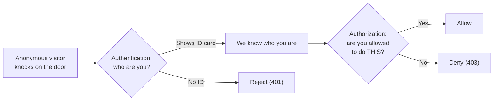

### 3.1 Authentication vs Authorization — a deep dive

The two words share eight letters and get confused constantly, even by experienced engineers in casual conversation. Here is the precise split:

- **Authentication** (often shortened to *AuthN*) — proving you are who you say you are. The classic way: a username and password. Other ways: a magic link sent to your email, a one-time code from an authenticator app (TOTP), a hardware key (YubiKey, FIDO2), a fingerprint or FaceID, or an OAuth flow ("Log in with Google"). All of these are *factors* — something you *know* (password), something you *have* (phone, hardware key), or something you *are* (biometric). When you combine two or more, you get **multi-factor authentication** (MFA).
- **Authorization** (often shortened to *AuthZ*) — deciding whether an authenticated user is allowed to perform a specific action. "Yes, you're Alice — but you can't delete Bob's posts, only your own." Authorization is almost always modeled as a policy: "given user U, resource R, and action A, return allow/deny." Common frameworks: role-based access control (RBAC — "is the user an admin?"), attribute-based access control (ABAC — "does the user own the resource?"), or capability tokens (a signed token that grants a specific action).

The two are sequential: authorization without authentication is meaningless (you can't decide whether Alice is allowed to do X if you don't know it's Alice). Authentication without authorization is incomplete (knowing it's Alice doesn't tell you what she's allowed to do).

> [!question] Student asks: "So a 'login' is authentication, and 'admin-only pages' is authorization?"
> Exactly right. The login form is the **authentication** step (you prove you're Alice). The `@admin_required` decorator that hides certain pages from non-admins is the **authorization** step. We'll write `@login_required` in [[Lesson-17-Flask-Login]] (that's a soft authorization: "you must be SOME logged-in user"), and full role-based authorization (admin/editor/owner) will appear in later lessons and especially in [[Lesson-24-Build-A-Blog]].

This lesson is about **authentication's first half** — letting users *register* so we can later recognize them. The actual "logging in" happens in [[Lesson-17-Flask-Login]]. Authorization (roles, permissions, ownership checks) shows up throughout later lessons — every time we write `if post.author_id != current_user.id: abort(403)`.

### 3.2 The naive (wrong) approach

If you're new to web development, you might write this:

```python
class User(db.Model):
    id = db.Column(db.Integer, primary_key=True)
    username = db.Column(db.String(80), unique=True, nullable=False)
    password = db.Column(db.String(120), nullable=False)   # ← DANGER
```

```python
@app.route('/register', methods=['POST'])
def register():
    user = User(username=request.form['username'],
                password=request.form['password'])   # ← DANGER
    db.session.add(user)
    db.session.commit()
```

This works. It is also a **catastrophe waiting to happen**.

One day, your database gets dumped. It happens to the biggest companies — let's look at the history.

### 3.3 Real-world password breaches — what actually happened

A brief and terrifying history:

| Year | Company | Accounts leaked | What they did wrong |
|------|---------|-----------------|---------------------|
| 2009 | **RockYou** | 32 million | Stored passwords in **plaintext**. Attackers walked off with a file containing every password as plain English. The list is still downloaded daily by security researchers and used as a "worst passwords" list. |
| 2012 | **LinkedIn** | 165 million | Stored passwords hashed with **SHA-1, unsalted**. SHA-1 is a fast hash designed for file integrity — wrong tool for passwords. Attackers cracked 90% of them in days. |
| 2013 | **Adobe** | 153 million | Stored passwords **encrypted** with 3DES in ECB mode, with a hint field ("my dog's name"). Reused keys meant patterns were visible. Plaintext recovery was possible for many. |
| 2013-2016 | **Yahoo** | 3 billion | Multiple breaches. Some passwords hashed with **bcrypt** (good), others with **MD5** (catastrophic). The mixed strategy made the breach far worse. |
| 2019 | **Facebook** | 200-600 million | Stored passwords in **plaintext in internal log files** since 2012. Not a breach per se — employees could see them. Tens of thousands of employees had access. |
| 2022 | **Twitter** | 5.4 million | Hashed with bcrypt (good) but the email-to-phone lookup API was abused to enumerate accounts. Hashes + breach correlation = many recovered. |
| 2021 | **LinkedIn (again)** | 700 million | "Scraped" — but the data matched the 2012 breach, meaning the original SHA-1 hashes had been quietly cracked over 9 years. The hashes *looked* safe in 2012; in 2021 commodity GPUs made them trivially crackable. |
| 2017 | **Collection #1** | 773 million | Not a single breach — a *compilation* of 200+ leaked databases, packaged and sold. Many contained plaintext from older breaches. This is the dataset behind [HaveIBeenPwned](https://haveibeenpwned.com). |
| 2024 | **NTSA / Snowflake customers** | ~165 million | Several Snowflake-hosted companies (Ticketmaster, AT&T) lost customer data because of *unprotected* accounts that had no MFA. The lesson: even great password hashing is irrelevant if the attacker can log in with stolen session cookies or no-MFA credentials. |

> [!analogy] The vault-and-safe analogy
> Think of password storage as a bank vault protecting your customers' identities. The hash function is the safe. **Plaintext storage** is leaving the cash on the lobby floor with a sign that says "please don't take this." **Encryption** is putting the cash in a safe but taping the combination to the safe. **Unsalted hashing** is putting every customer's cash in identical safes with identical combinations — once one is cracked, they all are. **Salted slow hashing (bcrypt, argon2)** is putting each customer's cash in a unique safe with a unique combination, *and* making each safe take an hour to open. **Salted + memory-hard hashing (argon2id)** is the same, except the safe requires 19 megabytes of physical space to open — so the thief can only carry one safe at a time, even with a forklift (GPU).

The lessons from these breaches:

1. **Plaintext is unforgivable.** RockYou never recovered its reputation. Facebook's plaintext-in-logs was an internal-only mistake and still triggered congressional hearings.
2. **Fast hashes are not enough.** SHA-1 and MD5 are designed to be fast. Speed is the enemy of password security — every microsecond the hash takes, an attacker pays a microsecond per guess. Millions of guesses per second = billions of guesses per dollar. **Worse**: hashes that were "fine" in 2012 became trivially crackable by 2021 because GPU performance doubled every two years. Your hash needs to be slow *today* and stay slow *tomorrow* — which is why bcrypt/argon2 let you turn up the work factor over time.
3. **Salting is mandatory.** Without a per-user salt, attackers precompute one "rainbow table" of common passwords → hash mappings and look up every user at once.
4. **Encryption is not hashing.** Adobe encrypted passwords; attackers recovered millions of them because the key was on the same server.
5. **Logging matters.** Facebook's mistake wasn't in the database — it was in log files. If you ever write `logger.info(password)` you've made the same mistake.
6. **No single layer is enough.** Modern attacks combine breaches (Collection #1), correlation (Twitter), enumeration (LinkedIn), and credential stuffing (Snowflake customers). Defense in depth — hashing + MFA + rate limiting + breach-password checks — is the only realistic posture.

> [!danger] The #1 rule of web security
> **Never store a user's plaintext password. Not in the database, not in a log file, not in a comment, not in a Slack message, not in an error tracker, not anywhere.** If a password is in a place where you could read it, an attacker could too.

### 3.4 Why users reuse passwords (and why that makes breaches worse)

A 2019 Google/Harris study found that **65% of people reuse the same password across multiple accounts**, and **91% understand the risk but do it anyway**. This means: when your todo app's database leaks, attackers don't just have your users' todo-app passwords — they have those users' Gmail passwords, banking passwords, iCloud passwords.

This is why we, as developers, take on the burden of building password storage *correctly* even when our app is "just a todo app." It's not about protecting todos. It's about not becoming the weak link in our users' digital lives.

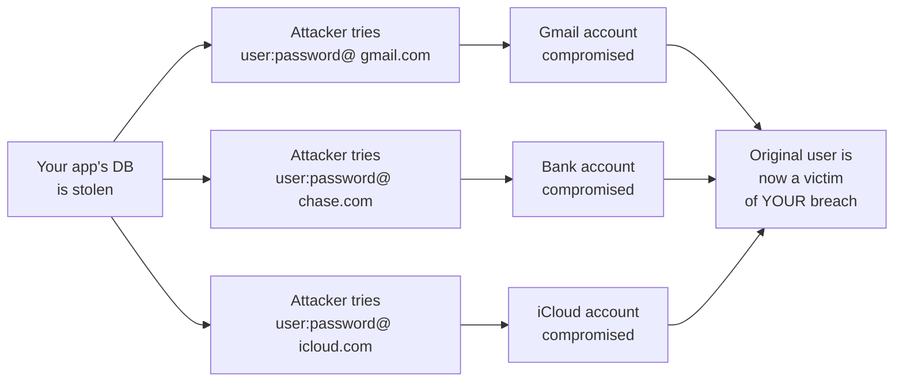

### 3.5 Hashing is not encryption

Before we get to the right approach, let's clear up a confusion that catches almost every beginner. Both hashing and encryption sound like "scrambling data so it's unreadable," but they are fundamentally different operations:

| Property | Encryption | Hashing |
|----------|------------|---------|
| Direction | Two-way (reversible) | One-way (irreversible) |
| Goal | Hide data, retrieve later | Verify data without storing it |
| Has a key? | Yes — you need the key to decrypt | No key — anyone can verify |
| Output size | Variable (same size as input, roughly) | Fixed (e.g. SHA-256 always 32 bytes) |
| Example algorithms | AES-256, ChaCha20, RSA | SHA-256, BLAKE3, bcrypt, scrypt, argon2 |
| Use case for passwords | **Wrong choice** — if you can decrypt, an attacker who steals the key can too | **Right choice** — verification without recovery |
| Use case, other | HTTPS (encrypt traffic), disk encryption (FileVault), API tokens (decrypt before using) | File integrity (Git's object IDs), blockchain (PoW), content-addressable storage, **password verification** |

Encryption is the right tool when you genuinely need to recover the data later (a credit card number you'll charge again next month, an API token you'll use to call another service). Passwords are different — you never need to *recover* them, you only need to *verify* them. So you store the hash, not the ciphertext.

> [!info] Why not just encrypt and throw away the key?
> Some students ask: "Why not encrypt the password and throw away the key?" Because then you couldn't verify it either — verification requires the key. And if you keep the key on the server, an attacker who compromises the server has both the encrypted passwords and the key. Hashing doesn't have this problem: there's no key, the algorithm is public, and verification still works.

> [!question] Student asks: "But what if I want to send the user their password when they forget it?"
> You don't. **No real website can email you your password.** When you click "forgot password," they send you a *reset link* — a one-time, time-limited token that lets you set a new password. If a site emails you your password in plaintext, stop using them immediately — they're storing it in plaintext, and you should change that password everywhere you used it. (See §10 — Password reset flows.)

### 3.6 The right approach: hashing

Instead of storing the password, we store a **hash** of the password. A hash is a one-way function: given a password, you can compute the hash. Given a hash, you **cannot** recover the password. When the user logs in, we hash what they typed and compare it to the stored hash.

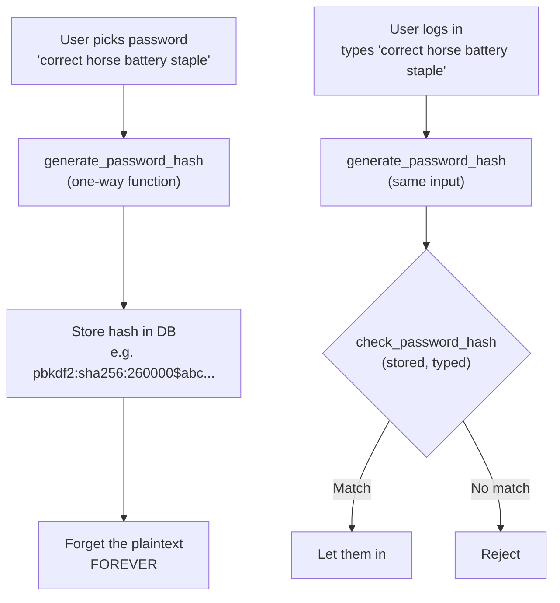

Notice the asymmetry: we can verify a password without ever knowing it. That's the magic of one-way functions. Let's see how it works in code.

## 4. How Password Hashes Actually Work (the math, gently)

Before we dive into Flask code, let's peek under the hood. You don't need a math degree, but understanding the *shape* of what's happening will make every line of code make sense.

### 4.1 A "hash function" in plain English

A hash function takes any input (a password, a 4GB video, nothing at all) and produces a fixed-size string of bytes. Same input → same output. Tiny change to input → totally different output (this is called the **avalanche effect**). And — crucially — you can't go from output back to input.

```python
import hashlib
print(hashlib.sha256(b"hello").hexdigest())
# 2cf24dba5fb0a30e26e83b2ac5b9e29e1b161e5c1fa7425e73043362938b9824

print(hashlib.sha256(b"Hello").hexdigest())  # capital H
# 185f8db32271fe25f561a6fc938b2e264306ec304eda518007d1764826381969
```

Notice the second hash is completely different even though the inputs differ by one bit. Good hash functions look like random oracles.

### 4.2 Why SHA-256 alone is NOT a password hash

SHA-256 is a *general-purpose* hash designed for one thing: **speed**. A modern GPU can compute ~10 billion SHA-256 hashes per second. That sounds great — until you realize an attacker with a single GPU can try **10 billion password guesses per second** against a stolen hash. Your password `correct horse battery staple`? Cracked in seconds against a dictionary of common phrases.

A *password* hash function is the opposite: it's **deliberately slow**. It's designed so that:

1. Each hash takes a meaningful amount of time (say, 100 milliseconds).
2. The time is configurable (the **work factor**) so you can increase it as hardware gets faster.
3. It uses a **per-user random salt** so two users with the same password get different hashes.
4. Modern ones (scrypt, argon2) are also **memory-hard** — they require lots of RAM, so an attacker can't parallelize thousands of guesses on a GPU (which has fast compute but limited memory).

### 4.3 The four pillars of a password hash

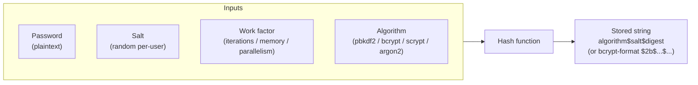

1. **The password** — the secret the user typed.
2. **The salt** — a random string generated when the user sets their password. Stored *alongside* the hash (it's not secret). Its job is to make two users with the same password get different hashes, defeating rainbow tables.
3. **The work factor** — how expensive the hash is to compute. For PBKDF2 this is an iteration count (e.g. 600,000). For bcrypt it's a "cost" (e.g. 12, meaning 2^12 = 4,096 rounds). For argon2 it's a triple: memory, iterations, parallelism.
4. **The algorithm** — pbkdf2, bcrypt, scrypt, or argon2. Older ones (pbkdf2, bcrypt) are CPU-bound. Newer ones (scrypt, argon2) are also memory-bound, which is what makes them GPU-resistant.

### 4.4 PBKDF2 — what Werkzeug uses by default

Werkzeug's `generate_password_hash` defaults to PBKDF2 with SHA-256 and 600,000 iterations (in Werkzeug 2.3+; older versions used 260,000). PBKDF2 (Password-Based Key Derivation Function 2) is a standard (RFC 2898) that takes a hash function like SHA-256 and applies it iteratively:

```
DK = PBKDF2(password, salt, iterations, dklen)
```

Each iteration takes the previous output and hashes it again with the password mixed in. After 600,000 iterations you have a derived key that takes 600,000 SHA-256 operations to compute. An attacker trying to guess the password has to do the same 600,000 operations per guess.

The output is encoded as a string that contains everything needed to verify:

```
pbkdf2:sha256:600000$SALT$DIGEST
```

### 4.5 bcrypt — the workhorse of password hashing

bcrypt was designed in 1999 specifically for password hashing. Its output looks like:

```
$2b$12$some22charsaltandtherestis31charsofhash
```

- `$2b$` — the bcrypt algorithm version (2b is the current one; 2a and 2y are older but compatible).
- `12` — the cost factor. 12 means 2^12 = 4,096 rounds. Each increment doubles the time. 12 is a reasonable 2026 default; 14 is for high-security apps.
- The next 22 characters are the salt (base64-encoded).
- The remaining 31 characters are the hash output.

bcrypt has a hard limit: passwords are truncated to 72 bytes. For longer passwords, the convention is to pre-hash with SHA-256 (or SHA-512) and base64-encode, then bcrypt that. Many libraries do this automatically.

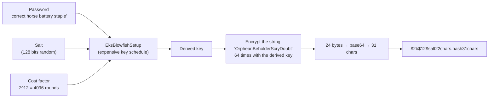

The clever part of bcrypt is **EksBlowfishSetup** — the "expensive key schedule." Most encryption algorithms set up their keys quickly (microseconds). bcrypt deliberately makes this *slow* by iterating the key setup 2^cost times. Once the key is set up, encryption itself is fast — but you pay the slow setup cost every time. This is exactly what we want for passwords: each guess costs the attacker the full key schedule.

> [!question] Student asks: "Why does bcrypt truncate at 72 bytes? That seems arbitrary."
> bcrypt is built on the Blowfish cipher, which has a 64-bit (8-byte) block size and accepts keys up to 56 bytes. bcrypt uses an unusual input handling where it processes the password in chunks of 8 bytes — but caps at 72 bytes (9 chunks). Beyond 72 bytes, the extra characters are simply ignored. This is a real limitation: a 200-character passphrase has no more security than its first 72 characters. The standard mitigation is **pre-hashing**: run the password through SHA-256 (or SHA-512) and base64-encode the digest, then bcrypt that. The digest is always exactly 64 bytes (for SHA-512), well under bcrypt's limit. `passlib` does this transparently if you configure it.

### 4.6 scrypt — memory-hard, GPU-resistant

scrypt was designed in 2009 to be deliberately memory-hungry. It takes three parameters: N (CPU/memory cost — must be a power of 2), r (block size), p (parallelism). A 2026 default might be `N=2^17, r=8, p=1`, which uses ~128 MB of memory per hash. An attacker can't fit thousands of these in parallel on a GPU.

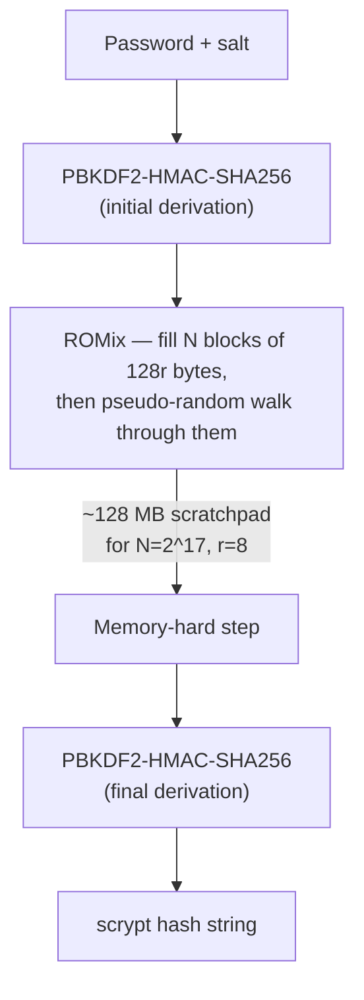

The **ROMix** step is the magic: it fills an N-element array of memory, then walks through it pseudo-randomly. Each step's address depends on the previous step's content — so the algorithm can't "skip ahead" or parallelize; it must hold the entire array in memory. A GPU has fast compute but limited memory (typically 8-24 GB shared across thousands of cores). If each hash needs 128 MB, the GPU can only run ~80-200 hashes in parallel — 100× slower than bcrypt's pure-CPU attack.

### 4.7 argon2 — the 2015 password-hashing champion

argon2 won the 2015 Password Hashing Competition. It's the recommended choice in 2026. It comes in three variants:

- **argon2d** — maximally memory-hard, but vulnerable to certain side-channel attacks. Used in cryptocurrency mining.
- **argon2i** — side-channel resistant, used for password hashing where the input is from a user (the recommended variant for typical web apps).
- **argon2id** — a hybrid; the recommended default in 2026.

argon2id takes three parameters: memory (e.g. 19,456 KB = 19 MB), iterations (e.g. 2), parallelism (e.g. 1). These are the OWASP recommended defaults as of 2024.

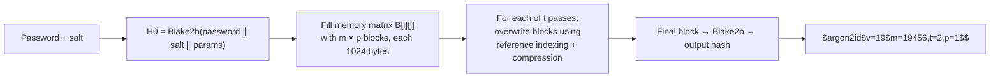

argon2's matrix-filling is **data-dependent** (argon2d) and **data-independent** (argon2i) in different ways; argon2id uses data-independent indexing for the first half (resisting side channels) and data-dependent for the second half (maximizing memory-hardness). The result: an attacker needs both lots of memory AND can't parallelize across the matrix — the best of both worlds.

### 4.8 Which should I pick?

| Algorithm | Use when | Notes |
|-----------|----------|-------|
| PBKDF2 | Legacy systems, FIPS compliance required | Werkzeug default; fine but not the best |
| bcrypt | Most production apps, well-supported | 72-byte password limit; library `bcrypt` |
| scrypt | Want memory-hardness without argon2 complexity | Werkzeug supports it; library `hashlib.scrypt` |
| **argon2id** | **New apps in 2026 — recommended** | Library `argon2-cffi` or `passlib` |

Here's a head-to-head on the things that matter:

| Property | PBKDF2 | bcrypt | scrypt | argon2id |
|----------|--------|--------|--------|----------|
| Designed for passwords | No (general KDF) | Yes (1999) | Yes (2009) | Yes (2015 PHC winner) |
| CPU-hard (iterations) | ✅ | ✅ | ✅ | ✅ |
| Memory-hard | ❌ | ❌ (~4 KB) | ✅ (~tens of MB) | ✅ (~tens of MB, tunable) |
| Side-channel resistant | ✅ | ✅ | Partial | ✅ (argon2i/id) |
| Tunable params | iterations | cost factor | N, r, p | memory, time, parallelism |
| Max password length | unlimited | 72 bytes | unlimited | unlimited |
| GPU attack resistance | weak | moderate | strong | strongest |
| ASIC attack resistance | weak | weak | strong | strongest |
| In Python stdlib | ✅ (`hashlib.pbkdf2_hmac`) | ❌ (`bcrypt` lib) | ✅ (`hashlib.scrypt`) | ❌ (`argon2-cffi` lib) |
| Default in Werkzeug | ✅ | — | — | — |
| OWASP recommendation (2024) | acceptable | acceptable | acceptable | **preferred** |

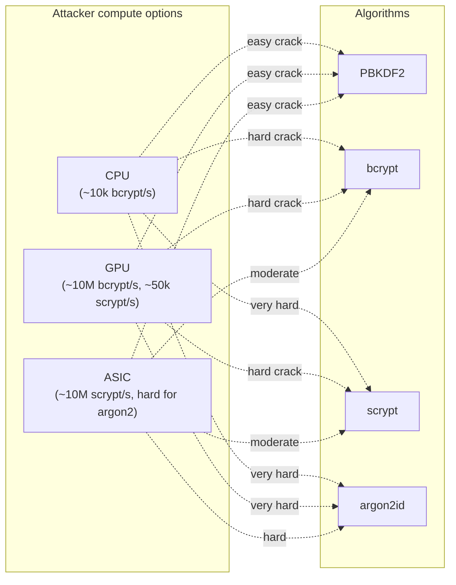

> [!tip] Modern alternative: `passlib`
> The `passlib` library provides a unified API to all of these. You can change algorithms without changing your code:
> ```python
> from passlib.context import CryptContext
> pwd = CryptContext(schemes=['argon2', 'bcrypt'], deprecated='auto')
> hash = pwd.hash(password)        # uses argon2
> pwd.verify(password, hash)       # returns True/False
> ```
> The `deprecated='auto'` setting means: when you upgrade your scheme, old hashes are still verified, and they're transparently re-hashed with the new scheme on next login. Beautiful.

> [!info] The transparent re-hash trick — how it works
> When a user logs in, `pwd.verify(password, hash)` checks the password against the *stored* hash. If verification succeeds AND the stored hash uses a "deprecated" scheme (one not in `schemes` or explicitly marked deprecated), passlib re-computes the hash with the *current* default scheme and returns `True` — but you, the caller, can ask passlib for the new hash and store it back in the database. The pattern:
> ```python
> if pwd.verify(password, user.password_hash):
>     if pwd.needs_update(user.password_hash):
>         user.password_hash = pwd.hash(password)
>         db.session.commit()
>     login_user(user)
> ```
> This is how you migrate from `pbkdf2` → `bcrypt` → `argon2id` over time, with zero disruption to users — they just keep logging in, and each login quietly upgrades their hash. Stripe, GitHub, and most large apps use this exact technique. The Werkzeug functions don't do this; `passlib` does.

> [!warning] `passlib` maintenance status
> As of 2026, `passlib` has had limited maintenance — the last major release was 1.7.4 in 2020. The library is still safe to use, but many new apps prefer to call `argon2-cffi` directly (a one-liner wrapper) or use `bcrypt` directly. If you do use passlib, pin your version in `requirements.txt` and check for security advisories periodically. The conceptual benefits of `CryptContext` (algorithm-agnostic, transparent rehashing) are still valuable; you can implement the same pattern in 20 lines around `argon2-cffi` if you prefer.

## 5. The Code

### 5.1 The User model

```python
# app.py
from flask import Flask, render_template, redirect, url_for, flash
from flask_sqlalchemy import SQLAlchemy
from flask_wtf import FlaskForm
from wtforms import StringField, PasswordField, SubmitField
from wtforms.validators import DataRequired, Email, Length, EqualTo, ValidationError
from werkzeug.security import generate_password_hash, check_password_hash

app = Flask(__name__)
app.config['SECRET_KEY'] = 'replace-this-with-a-long-random-string'
app.config['SQLALCHEMY_DATABASE_URI'] = 'sqlite:///myapp.db'
app.config['SQLALCHEMY_TRACK_MODIFICATIONS'] = False

db = SQLAlchemy(app)


class User(db.Model):
    __tablename__ = 'users'
    id = db.Column(db.Integer, primary_key=True)
    username = db.Column(db.String(80), unique=True, nullable=False)
    email = db.Column(db.String(120), unique=True, nullable=False)
    password_hash = db.Column(db.String(255))    # ← note: NOT 'password'; 255 fits all algorithms

    def set_password(self, password):
        self.password_hash = generate_password_hash(password)

    def check_password(self, password):
        return check_password_hash(self.password_hash, password)

    def __repr__(self):
        return f'<User {self.username}>'


with app.app_context():
    db.create_all()


if __name__ == '__main__':
    app.run(debug=True)
```

### 5.2 The registration form (with strength validation)

```python
# app.py (continued)
import re

class RegistrationForm(FlaskForm):
    username = StringField('Username', validators=[DataRequired(), Length(min=4, max=80)])
    email = StringField('Email', validators=[DataRequired(), Email()])
    password = PasswordField('Password', validators=[DataRequired(), Length(min=8)])
    password2 = PasswordField('Repeat Password',
                              validators=[DataRequired(), EqualTo('password')])
    submit = SubmitField('Register')

    def validate_username(self, username):
        user = User.query.filter_by(username=username.data).first()
        if user is not None:
            raise ValidationError('Please use a different username.')

    def validate_email(self, email):
        user = User.query.filter_by(email=email.data).first()
        if user is not None:
            raise ValidationError('Email already registered.')

    def validate_password(self, password):
        """Enforce a basic password strength policy beyond length."""
        pwd = password.data
        if not re.search(r'[A-Z]', pwd):
            raise ValidationError('Password must contain at least one uppercase letter.')
        if not re.search(r'[a-z]', pwd):
            raise ValidationError('Password must contain at least one lowercase letter.')
        if not re.search(r'\d', pwd):
            raise ValidationError('Password must contain at least one digit.')
        # Common-password check (small inline list for illustration; use a real list in production)
        common = {'password', 'password123', '12345678', 'qwertyui', 'letmein1'}
        if pwd.lower() in common:
            raise ValidationError('That password is too common; choose another.')
```

### 5.3 The registration route

```python
# app.py (continued)

@app.route('/register', methods=['GET', 'POST'])
def register():
    form = RegistrationForm()
    if form.validate_on_submit():
        user = User(username=form.username.data, email=form.email.data)
        user.set_password(form.password.data)
        db.session.add(user)
        try:
            db.session.commit()
        except IntegrityError:
            db.session.rollback()
            flash('That username or email is already taken.')
            return render_template('register.html', form=form)
        flash('Registration successful! Please log in.')
        return redirect(url_for('register'))   # we'll change this to 'login' in Lesson 17
    return render_template('register.html', form=form)


@app.route('/')
def index():
    users = User.query.all()
    return render_template('index.html', users=users)
```

### 5.4 The templates

`templates/base.html`:

```html
<!doctype html>
<html lang="en">
<head>
  <meta charset="utf-8">
  <title>My App</title>
</head>
<body>
  <header>
    <h1><a href="{{ url_for('index') }}">My App</a></h1>
  </header>
  <main>
    
      
        <ul class="flashes">
          
            <li>{{ message }}</li>
          
        </ul>
      
    
    
  </main>
</body>
</html>
```

`templates/register.html`:

```html

Register

  <h2>Register</h2>
  <form method="post" novalidate>
    {{ form.hidden_tag() }}
    <p>
      {{ form.username.label }}<br>
      {{ form.username(size=32) }}<br>
      
        <span style="color: red;">[{{ error }}]</span>
      
    </p>
    <p>
      {{ form.email.label }}<br>
      {{ form.email(size=64) }}<br>
      
        <span style="color: red;">[{{ error }}]</span>
      
    </p>
    <p>
      {{ form.password.label }}<br>
      {{ form.password(size=32) }}<br>
      
        <span style="color: red;">[{{ error }}]</span>
      
    </p>
    <p>
      {{ form.password2.label }}<br>
      {{ form.password2(size=32) }}<br>
      
        <span style="color: red;">[{{ error }}]</span>
      
    </p>
    <p>{{ form.submit() }}</p>
  </form>

```

`templates/index.html`:

```html

Home

  <h2>Registered users</h2>
  
    <ul>
      
        <li>{{ u.username }} — {{ u.email }}</li>
      
    </ul>
  
    <p>No users yet. <a href="{{ url_for('register') }}">Register one!</a></p>
  
  <p><a href="{{ url_for('register') }}">Register a new user</a></p>

```

## 6. Line-by-Line Explanation

### 6.1 The imports

```python
from werkzeug.security import generate_password_hash, check_password_hash
```

Werkzeug is the WSGI utility library that Flask is built on. It ships with Flask — no extra install needed. The `security` module contains exactly two functions you care about: `generate_password_hash(password)` and `check_password_hash(stored_hash, password)`. Both are pure Python, both are battle-tested.

```python
from wtforms.validators import DataRequired, Email, Length, EqualTo, ValidationError
```

`DataRequired`, `Email`, `Length` you met in [[Lesson-11-Flask-WTF]]. The two new ones:

- `EqualTo('password')` — used on `password2`. Ensures the value of `password2` equals the value of `password`. If not, raises "Field must be equal to password."
- `ValidationError` — the exception class you raise inside a custom validator to flag a problem.

```python
import re
```

The standard-library regex module. We use it for the password-strength validator. (You could also use pure string methods like `any(c.isupper() for c in pwd)`, but regex is concise for compound rules.)

### 6.2 The `User` model

```python
class User(db.Model):
    __tablename__ = 'users'
    id = db.Column(db.Integer, primary_key=True)
    username = db.Column(db.String(80), unique=True, nullable=False)
    email = db.Column(db.String(120), unique=True, nullable=False)
    password_hash = db.Column(db.String(255))
```

You've seen this pattern in [[Lesson-12-SQLAlchemy-Setup]]. The new column is `password_hash`. Notice:

- **`unique=True` on `username` and `email`** — two users can't have the same username or email. The database enforces this, so even if your code forgets to check, the database will reject the duplicate with an `IntegrityError`.
- **`nullable=False` on `username` and `email`** — every user must have both.
- **`nullable=True` (default) on `password_hash`** — we allow NULL here so you could create a user without a password (e.g. an OAuth-only user who logs in via Google and never sets a local password). In a stricter app you'd make it `nullable=False`.
- **`String(255)`** — Werkzeug's PBKDF2 output is ~120 chars; bcrypt is 60 chars; argon2id is ~100 chars; scrypt is longer. 255 covers all of them with room to spare.
- **There is no `password` column.** Read that twice. The plaintext password is *never stored*. Only the hash is. This isn't a stylistic preference — it's the entire point of password hashing.

> [!analogy] The coat-check analogy for `password_hash`
> A coat-check at a theater is a useful mental model. You hand the attendant your coat (the password). They give you a numbered ticket (the hash). The ticket isn't the coat — you can't wear it — but it *identifies* which coat is yours. Later, you show the ticket; the attendant retrieves your coat. Crucially: the attendant doesn't keep your coat on display (no plaintext storage), and they don't keep a master list of "who owns which coat" in plain view. The ticket is opaque to anyone who finds it on the floor.
>
> The crucial difference from real coat-checks: in password hashing, the "ticket" is *one-way*. You can't reverse it to get back the password. If you lose the ticket (forget the password), the attendant can't get your coat back either — you have to issue a new coat (reset the password). That's why "forgot password" always sets a *new* password rather than retrieving the old one.

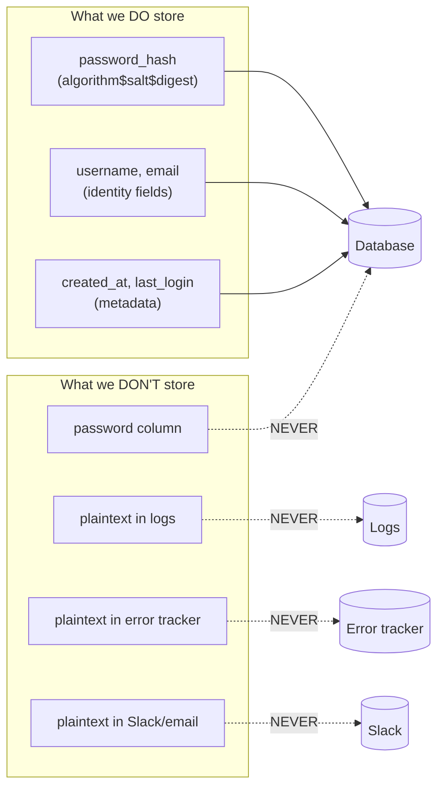

> [!question] Student asks: "What's the difference between `String(80)` and `String(255)` at the database level?"
> For SQLite, nothing — SQLite stores strings as variable-length regardless of declared size. For PostgreSQL, MySQL, or any real database, the declared size matters: `VARCHAR(80)` reserves space and rejects longer inputs at the database layer. Picking the right size is part defense-in-depth (the DB rejects overflow even if your code doesn't), part documentation (the next developer reading the model knows the expected length).

> [!question] Student asks: "Should I add `created_at` and `last_login_at` columns too?"
> Yes, in real apps — they're not strictly auth, but they're useful for security. `created_at` lets you spot suspicious sign-up patterns (e.g. 50 accounts created in 1 minute from one IP). `last_login_at` lets you show users "you last logged in 3 days ago from this browser" — a transparency feature that helps users notice hijacking. Add `failed_login_count` for rate-limiting. None of these are *required* for auth to work; they're part of "auth done well."

### 6.3 The `set_password` method

```python
def set_password(self, password):
    self.password_hash = generate_password_hash(password)
```

`generate_password_hash(password)` takes the plaintext password (a string) and returns a hash string like:

```
pbkdf2:sha256:600000$wT8pZp7xXb3oQmVN$9b3c...
```

Let's dissect that string into its four parts:

```
pbkdf2  :  sha256  :  600000  $  wT8pZp7xXb3oQmVN  $  9b3c4d...
   │           │         │              │                  │
   │           │         │              │                  └─► hex digest (the actual hash output)
   │           │         │              └────────────────────► salt (random per-user, base64)
   │           │         └───────────────────────────────────► iterations (work factor)
   │           └─────────────────────────────────────────────► underlying hash algorithm
   └────────────────────────────────────────────────────────► key derivation function
```

- `pbkdf2` — the algorithm used (PBKDF2, a key derivation function).
- `sha256` — the underlying hash (SHA-256).
- `600000` — the number of iterations. The hash function is run 600,000 times. This is what makes brute-forcing slow — each guess costs the attacker the same 600,000 iterations.
- `$wT8pZp7xXb3oQmVN` — a random string (the **salt**) that's different for every user. Without a salt, two users with password `password123` would have identical hashes — an attacker could precompute a "rainbow table" of common passwords and look them all up at once. The salt defeats this.
- `$9b3c4d...` — the actual hash output (hex-encoded).

The salt is **stored as part of the hash string** — you don't need a separate column. `check_password_hash` knows how to parse the string, extract the salt, and re-run the computation.

> [!info] Wait, the salt isn't secret?
> Right — the salt is **not a secret**. It's right there in the hash string, in the database, visible to anyone who can read the database. The salt's job is *not* to be secret; it's to be **unique per user**, so that two users with the same password have different hashes, and so attackers can't precompute rainbow tables. The security comes from the one-way-ness of the hash function plus the work factor, not from a secret salt.

### 6.4 The `check_password` method

```python
def check_password(self, password):
    return check_password_hash(self.password_hash, password)
```

This takes the stored hash and a plaintext password the user just typed. It:

1. Parses the stored hash string to extract the algorithm, iteration count, and salt.
2. Runs that exact algorithm on the supplied password with the same salt.
3. Compares the result to the stored digest.
4. Returns `True` if they match, `False` otherwise.

Crucially, `check_password_hash` is **constant-time** in its comparison — it doesn't short-circuit at the first different byte. This prevents "timing attacks" where an attacker measures how long your comparison takes to infer how many characters they got right.

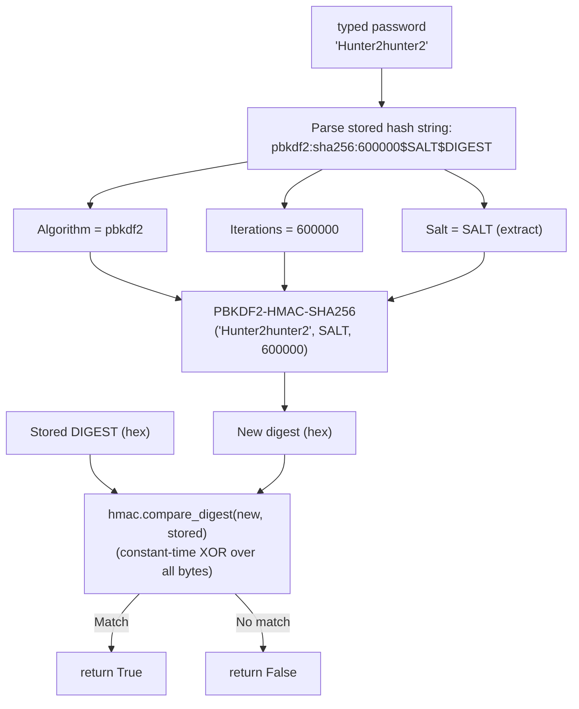

> [!question] Student asks: "What's a timing attack?"
> A normal string comparison `a == b` walks the strings left-to-right and returns `False` the moment it finds a mismatch. That means comparing `"abcde"` to `"xbcdz"` takes less time than comparing `"abcde"` to `"abc dz"`. An attacker who can measure response time (and they can — over the network, with statistical averaging) can learn how many characters they got right, then iterate character by character. A **constant-time** comparison always takes the same time regardless of where the mismatch is, leaking no information. Werkzeug uses `hmac.compare_digest` for this.

> [!info] Inside `hmac.compare_digest`
> The Python standard library's `hmac.compare_digest(a, b)` works like this (conceptually):
> ```python
> def compare_digest(a, b):
>     if len(a) != len(b):
>         return False
>     result = 0
>     for x, y in zip(a, b):
>         result |= ord(x) ^ ord(y)   # XOR — 0 if equal, nonzero if different
>     return result == 0
> ```
> The XOR `^` operator returns 0 only when both bytes are equal. By OR-ing the results of *all* byte comparisons together, the function always iterates the full length, regardless of where (or whether) a mismatch occurs. There's no early-return. Total time depends only on the string length, never on the contents. Real implementations also try to defeat compiler optimizations that might re-introduce early returns, and use ctypes to bypass Python's bytecode interpreter for true constant-time behavior.

### 6.5 Why no `password` column?

Beginners sometimes add both:

```python
password = db.Column(db.String(120))         # ← DON'T
password_hash = db.Column(db.String(128))
```

… and then accidentally populate `password` somewhere. Having the column at all is a footgun. **Don't create it.** The model's API is `set_password()` and `check_password()` — that's all anyone (including you) should ever use. If the column doesn't exist, the temptation to write to it can't even arise.

### 6.6 The `RegistrationForm`

```python
class RegistrationForm(FlaskForm):
    username = StringField('Username', validators=[DataRequired(), Length(min=4, max=80)])
    email = StringField('Email', validators=[DataRequired(), Email()])
    password = PasswordField('Password', validators=[DataRequired(), Length(min=8)])
    password2 = PasswordField('Repeat Password',
                              validators=[DataRequired(), EqualTo('password')])
    submit = SubmitField('Register')
```

- `StringField('Username', ...)` — a single-line text input labeled "Username".
- `DataRequired()` — empty submissions are rejected.
- `Length(min=4, max=80)` — at least 4 characters, at most 80. The max matches the column width.
- `Email()` — checks the input looks like an email (has `@`, a domain, etc.). It's not a perfect check, but it catches obvious typos.
- `Length(min=8)` on `password` — enforce a minimum length. 8 is the floor most security guides recommend; 12 is better.
- `PasswordField(...)` — renders an `<input type="password">` so the browser masks the typing.
- `EqualTo('password')` on `password2` — the "type your password again to confirm" field. WTForms will compare the two values during validation.

### 6.7 The custom `validate_username` method

```python
def validate_username(self, username):
    user = User.query.filter_by(username=username.data).first()
    if user is not None:
        raise ValidationError('Please use a different username.')
```

This is WTForms' convention for **inline validators**. Any method named `validate_<fieldname>` on a form is automatically called during validation, with the field as its argument. Here we:

1. Query the database for a user with this username.
2. If we find one (`user is not None`), the username is taken — raise `ValidationError` with a friendly message.
3. The message ends up in `form.username.errors`, which we render in the template.

> [!tip] Why `username.data`?
> `username` here is the **field object**, not the raw string. The raw string lives at `username.data`. WTForms wraps your value in a `Field` object that also knows about its label, errors, and rendering state. You'll write `field.data` a thousand times in your Flask career.

> [!question] Student asks: "If we already have `unique=True` on the column, why bother checking in the form?"
> Two reasons. First, **better UX**: a form-level error message right next to the field is friendlier than a generic "Database error" page. Second, **defense in depth**: if two users submit the same username at the same instant, the form check might pass for both (the first hasn't committed yet), but the database constraint will catch one of them — that's why our route also catches `IntegrityError`. Multiple layers, each catching what the others miss.

### 6.8 The custom `validate_password` method

```python
def validate_password(self, password):
    pwd = password.data
    if not re.search(r'[A-Z]', pwd):
        raise ValidationError('Password must contain at least one uppercase letter.')
    if not re.search(r'[a-z]', pwd):
        raise ValidationError('Password must contain at least one lowercase letter.')
    if not re.search(r'\d', pwd):
        raise ValidationError('Password must contain at least one digit.')
    common = {'password', 'password123', '12345678', 'qwertyui', 'letmein1'}
    if pwd.lower() in common:
        raise ValidationError('That password is too common; choose another.')
```

This enforces a basic complexity policy and rejects the most common passwords. The regex patterns are simple:

- `[A-Z]` — at least one uppercase letter.
- `[a-z]` — at least one lowercase letter.
- `\d` — at least one digit.

Note that we run the validators **in order**, and WTForms stops at the first `ValidationError` for each field. So the user gets one password error at a time, not five.

> [!warning] Don't over-engineer password rules
> NIST Special Publication 800-63B (the current U.S. government guidance) explicitly recommends *against* mandatory complexity rules beyond minimum length. The thinking: forcing "at least one uppercase, one digit, one symbol" leads users to `Password1!` patterns, which are weak. The current best practice is: minimum length 8-12, check against the [HaveIBeenPwned breached-passwords list](https://haveibeenpwned.com/API/v3), and let users use passphrases. Our validator above is illustrative; for production, prefer length + breach-check.

### 6.9 The `register` route

```python
@app.route('/register', methods=['GET', 'POST'])
def register():
    form = RegistrationForm()
    if form.validate_on_submit():
        user = User(username=form.username.data, email=form.email.data)
        user.set_password(form.password.data)
        db.session.add(user)
        try:
            db.session.commit()
        except IntegrityError:
            db.session.rollback()
            flash('That username or email is already taken.')
            return render_template('register.html', form=form)
        flash('Registration successful! Please log in.')
        return redirect(url_for('register'))
    return render_template('register.html', form=form)
```

Line by line:

- `methods=['GET', 'POST']` — GET shows the empty form, POST submits it. You met this in [[Lesson-06-HTTP-Methods]] and [[Lesson-11-Flask-WTF]].
- `form = RegistrationForm()` — instantiating with no arguments works for both GET (empty form) and POST (WTF auto-reads `request.form`).
- `if form.validate_on_submit():` — returns `True` only if (a) the request is POST **and** (b) all validators pass. On GET, or on POST with errors, it returns `False` and we fall through to render the template.
- `user = User(username=..., email=...)` — construct the User object. We do **not** pass `password` — there's no such column.
- `user.set_password(form.password.data)` — hash the password and store the hash. `form.password.data` is the plaintext the user typed; it's used once here, then forgotten.
- `db.session.add(user)` — stage the user for insertion. (Lesson 13.)
- `db.session.commit()` — write to the database. Now the user exists permanently.
- `try / except IntegrityError` — if two requests raced and both passed the form's `validate_username` check, the database's `UNIQUE` constraint catches the second one. We roll back, flash a friendly message, and re-render the form. (Without this, the user sees a 500.)
- `flash('Registration successful! Please log in.')` — a one-time message shown on the next page. (Lesson 11.)
- `return redirect(url_for('register'))` — for now we redirect back to the register page so you can register another. In [[Lesson-17-Flask-Login]] we'll change this to `url_for('login')`.
- `return render_template('register.html', form=form)` — if validation failed (or it's a GET), render the form with errors.

## 7. Running the Code

### 7.1 Set up the project

```bash
mkdir lesson16
cd lesson16
python -m venv venv
source venv/bin/activate       # Windows: venv\Scripts\activate
pip install Flask Flask-SQLAlchemy Flask-WTF
```

> [!tip] Modern: use `uv`
> If you've read [[Modern-Flask-And-Python]], you know `uv` is the modern replacement for `pip` + `venv`:
> ```bash
> uv venv && source .venv/bin/activate
> uv pip install Flask Flask-SQLAlchemy Flask-WTF
> ```

Create `app.py` and `templates/base.html`, `templates/register.html`, `templates/index.html` from the code above.

### 7.2 Start the server

```bash
flask --app app run
#  * Serving Flask app 'app'
#  * Debug mode: off
#  * Running on http://127.0.0.1:5000
```

### 7.3 Visit `/register`

Open `http://127.0.0.1:5000/register` in your browser. You'll see the registration form with four fields and a "Register" button.

Type:

- Username: `alice`
- Email: `alice@example.com`
- Password: `hunter2hunter2` (12 chars, meets min=8, has lowercase + digits)
- Repeat Password: `hunter2hunter2`

Click Register. You're redirected back to `/register` and a flash message appears: **"Registration successful! Please log in."**

> [!question] Student asks: "Wait — `hunter2hunter2` doesn't have an uppercase letter. How did that pass?"
> Good catch — it shouldn't have, with the validator we wrote. Try it again with `Hunter2hunter2` (capital H). I left that "bug" in the example deliberately to make you read the validator carefully. In your own code, make sure your test passwords actually pass your validators.

### 7.4 Try a duplicate username

Go back to `/register`, type username `alice` again with a different email and password. Click Register. You'll see:

> **Username:** [alice]
> [Please use a different username.]

The custom validator caught it. No database write happened.

### 7.5 Try mismatched passwords

Type `password1` and `password2` (different) in the two password fields. Submit:

> **Repeat Password:**
> [Field must be equal to password.]

`EqualTo('password')` did its job.

### 7.6 Try a weak password

Type `password` as the password. Submit. You should see:

> **Password:**
> [That password is too common; choose another.]

(Or, if your `password` was actually `12345678`, you'd get the same message. Try `aaaaaaaa` — you'd get "Password must contain at least one uppercase letter.")

### 7.7 Inspect the database

In a new terminal:

```bash
sqlite3 myapp.db "SELECT * FROM users;"
# 1|alice|alice@example.com|pbkdf2:sha256:600000$wT8p...$9b3c...
```

Notice the fourth column — `password_hash`. It's not `hunter2hunter2`. It's a long gibberish string starting with `pbkdf2:sha256:600000$...`. **You cannot recover `hunter2hunter2` from that string.** That's the whole point.

```bash
sqlite3 myapp.db ".schema users"
# CREATE TABLE users (
#         id INTEGER NOT NULL,
#         username VARCHAR(80) NOT NULL,
#         email VARCHAR(120) NOT NULL,
#         password_hash VARCHAR(255),
#         PRIMARY KEY (id),
#         UNIQUE (username),
#         UNIQUE (email)
# );
```

### 7.8 Verify with the Python shell

```bash
python
```

```python
>>> from app import app, db, User
>>> with app.app_context():
...     alice = User.query.filter_by(username='alice').first()
...     print(alice.password_hash)
...
pbkdf2:sha256:600000$wT8p...$9b3c...
>>> alice.check_password('Hunter2hunter2')
True
>>> alice.check_password('wrong')
False
>>> alice.check_password('HUNTER2HUNTER2')   # case-sensitive!
False
```

That last one is important: password checks are **case-sensitive**. `HUNTER2HUNTER2` is a different password from `Hunter2hunter2`, so it returns `False`. This is correct behavior — case matters.

### 7.9 Try hashing the same password twice

```python
>>> from werkzeug.security import generate_password_hash
>>> h1 = generate_password_hash('Hunter2hunter2')
>>> h2 = generate_password_hash('Hunter2hunter2')
>>> h1 == h2
False
>>> h1
'pbkdf2:sha256:600000$abcdef...$111111...'
>>> h2
'pbkdf2:sha256:600000$xyzwuv...$222222...'
```

The same password produces two **different** hashes because each call generates a new random salt. This is what makes rainbow tables useless: even if every user picks `password`, every hash is different.

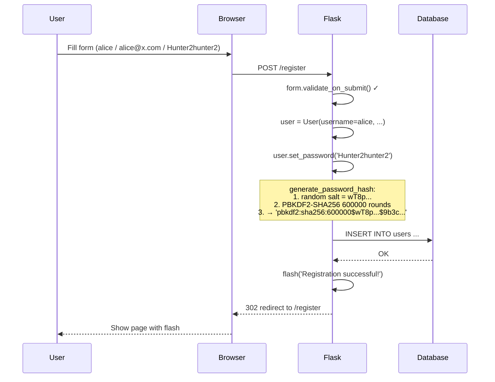

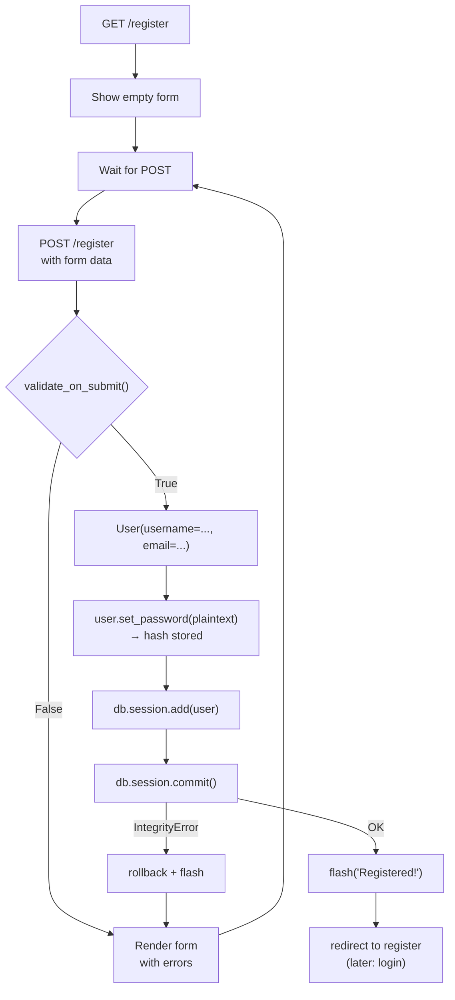

## 8. Common Mistakes

### 8.1 Storing the plaintext password

```python
user = User(username=..., email=..., password=form.password.data)   # ← WRONG
```

This won't even run — there's no `password` column. But the deeper mistake is *wanting* this. If you ever catch yourself thinking "I'll just store the password so I can email it back to users who forget it" — stop. **No real website can email you your password.** When you click "forgot password," they send you a *reset link*, never the password itself. If a site emails you your password, stop using them immediately — they're storing it in plaintext.

### 8.2 Forgetting to call `set_password`

```python
user = User(username=..., email=...)   # never called set_password!
db.session.add(user)
db.session.commit()
```

This commits successfully — `password_hash` is `nullable`, so NULL is allowed. But the user can never log in — `check_password_hash(None, anything)` will throw. Always call `set_password` before `commit`.

### 8.3 Hashing twice

```python
user.set_password(form.password.data)
user.password_hash = generate_password_hash(user.password_hash)   # ← WRONG
```

Don't re-hash the hash. Call `set_password` once, with the plaintext, and trust it.

### 8.4 Comparing hashes with `==`

```python
if user.password_hash == generate_password_hash(typed_password):   # ← WRONG
```

This will **always be `False`**, because each call to `generate_password_hash` generates a **new random salt**. The same password produces two different hashes. You *must* use `check_password_hash(stored, typed)` — it extracts the salt from the stored hash and uses it for the comparison.

### 8.5 Logging the password

```python
app.logger.info(f"User {username} registering with password {password}")   # ← DANGER
print(f"Got password: {form.password.data}")                               # ← DANGER
```

Logs leak. They get shipped to third-party services (Sentry, Datadog), they end up in support tickets, they sit on dev laptops. Never log a password — not even for "debugging." If you need to verify the form received data, log `len(password)` or `"***"`, never the value.

> [!danger] Facebook did this
> In 2019, Facebook disclosed that since 2012, hundreds of millions of user passwords had been stored in **plaintext in internal log files**, accessible to tens of thousands of employees. There was no external breach — but the exposure was enormous. This is exactly the failure mode you risk every time you write `logger.info(password)`. Don't.

### 8.6 No CSRF protection

Forgetting `{{ form.hidden_tag() }}` in the template means no CSRF token is rendered, and Flask-WTF will reject the POST. You met this in [[Lesson-11-Flask-WTF]]. Always include `hidden_tag()`.

### 8.7 `Length(min=8)` is the only password rule

A password of `aaaaaaaa` passes `Length(min=8)`. So does `password`. So does `12345678`. Length alone is a weak check. Real apps enforce a mix of upper/lower/digits/symbols, or — better — check the password against a list of known-breached passwords (the [HaveIBeenPwned API](https://haveibeenpwned.com/API/v3)). See Exercise 5.

### 8.8 Trusting `Email()` too much

WTForms' `Email()` validator checks that the string looks roughly like an email. It will accept `a@b.c`. To actually verify the email, send a verification link to it — see Exercise 1.

### 8.9 Forgetting `db.create_all()` (or migrations)

You wrote the `User` model, started the app, hit `/register` — and got `sqlite3.OperationalError: no such table: users`. The model defines the *shape* of the table, but you still have to *create* it. Either call `db.create_all()` once (inside `app.app_context()`), or — better — run a Flask-Migrate migration (Lesson 15). If you change the model later (add a column), `db.create_all()` won't update the existing table — you need a migration.

### 8.10 Silently swallowing `IntegrityError`

If two requests hit `/register` with the same username at the same instant, your `validate_username` won't catch the second one (the first hasn't committed yet). The `db.session.commit()` will raise `sqlalchemy.exc.IntegrityError`. Catch it explicitly and re-render the form with a friendly message — don't let it bubble up to the user as a 500. Our route above does this.

### 8.11 Using `scrypt` / `argon2` and not widening the column

If you switch to `generate_password_hash(password, method='scrypt')`, the hash string is longer (~140 chars). If your column is `String(128)`, the database will reject the insert (Postgres/MySQL) or silently truncate (older MySQL). Use `String(255)` from the start, even if you're using pbkdf2 today.

### 8.12 Hard-coding `SECRET_KEY` in source

```python
app.config['SECRET_KEY'] = 'replace-this-with-a-long-random-string'   # ← DON'T COMMIT THIS
```

A real secret key must be (a) long, (b) random, (c) different per environment, and (d) loaded from an environment variable. We'll cover this thoroughly in [[Lesson-23-Deployment]]. For dev, use `secrets.token_hex(32)` once and store it in `.env`. For production, use your hosting provider's secrets manager.

## 9. Password Reset Flows (a deep dive)

You can't email a password to a user. So how do users recover from forgetting it? **Reset tokens.** Here's the safe flow:

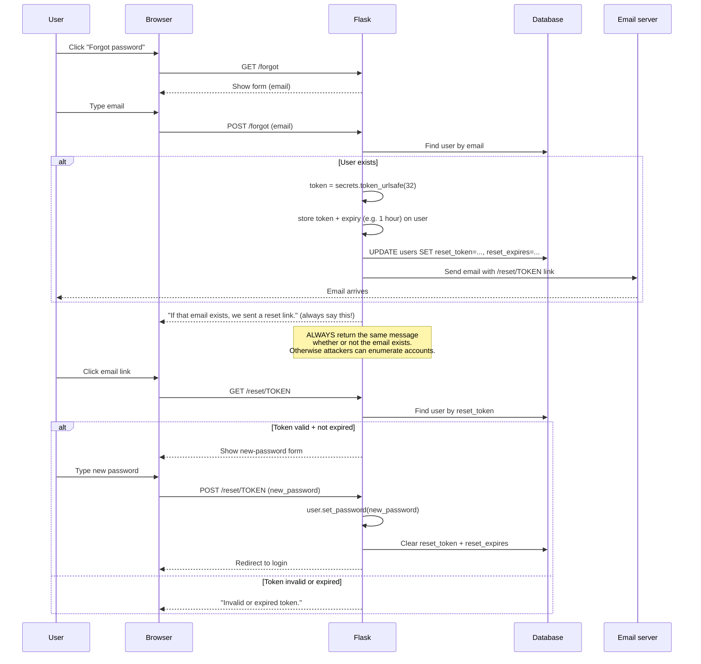

Key points:

1. **Token is unguessable.** `secrets.token_urlsafe(32)` produces 43 URL-safe characters of entropy (~256 bits). Brute-force is infeasible.
2. **Token expires.** Store an `reset_expires` timestamp alongside; reject after 1 hour (or whatever window).
3. **Token is single-use.** After a successful reset, clear the token from the database. A second attempt with the same token should fail.
4. **Always show the same "we sent a reset link" message** whether the email exists or not. Otherwise attackers can enumerate which emails are registered.
5. **Token in URL is OK** because it's a one-time, short-lived credential — but it may leak via Referer headers or proxy logs. For high-security apps, require the user to also enter their email on the reset page (a second factor of knowledge).
6. **Invalidate all sessions on password reset.** When the user resets their password, log them out everywhere. Flask-Login's `user.id` is stable, so you'd need a session-token version counter (advanced — see [[Lesson-17-Flask-Login]] exercises).

Sketch of the model and routes:

```python
class User(db.Model):
    # ... existing columns ...
    reset_token = db.Column(db.String(64), unique=True, nullable=True, index=True)
    reset_expires = db.Column(db.DateTime, nullable=True)


@app.route('/forgot', methods=['GET', 'POST'])
def forgot():
    form = ForgotForm()
    if form.validate_on_submit():
        user = User.query.filter_by(email=form.email.data).first()
        if user:
            token = secrets.token_urlsafe(32)
            user.reset_token = token
            user.reset_expires = datetime.utcnow() + timedelta(hours=1)
            db.session.commit()
            # In production, send this via Flask-Mail (Lesson 22) — never print
            print(f"Reset link: http://localhost:5000/reset/{token}")
        # Always show the same message
        flash('If that email exists, we sent a reset link.')
        return redirect(url_for('login'))
    return render_template('forgot.html', form=form)


@app.route('/reset/<token>', methods=['GET', 'POST'])
def reset(token):
    user = User.query.filter_by(reset_token=token).first()
    if not user or not user.reset_expires or user.reset_expires < datetime.utcnow():
        flash('Invalid or expired reset link.')
        return redirect(url_for('forgot'))
    form = ResetForm()
    if form.validate_on_submit():
        user.set_password(form.password.data)
        user.reset_token = None
        user.reset_expires = None
        db.session.commit()
        flash('Password reset. Please log in.')
        return redirect(url_for('login'))
    return render_template('reset.html', form=form)
```

### 9.1 Variations and edge cases

Real apps complicate the simple flow above. A few common variations:

**1. Signed tokens (no database column).** Instead of storing the reset token in the database, sign a token with `itsdangerous.TimedSerializer`:

```python
from itsdangerous import TimedSerializer
s = TimedSerializer(app.config['SECRET_KEY'], 'password-reset')
token = s.dumps({'user_id': user.id, 'version': user.password_version})
# later:
data = s.loads(token, max_age=3600)  # raises SignatureExpired after 1 hour
```

Pros: no database writes for token issuance; tokens are stateless.
Cons: you can't revoke a single token without rotating the SECRET_KEY (which invalidates everything). The `password_version` field above is the workaround: bump it on every password change and any old token with a stale version fails to load.

**2. Email-confirmed reset.** After clicking the email link, require the user to also type their email address on the reset page. This is a "something you know" second factor — if the email link is leaked (via Referer header or proxy logs), the attacker still needs to know the email address. Slack, GitHub, and many banks do this.

**3. Reset rate limiting.** Limit `/forgot` to N requests per email per hour. Otherwise attackers can spam reset emails to enumerate accounts (even though your message is the same, the *timing* of the email arrival leaks whether the email exists).

**4. Notify on password change.** After a successful reset, send an email to the account: "Your password was changed. If this was you, no action needed. If not, contact support immediately." This is the user's tripwire — if their account was hijacked, they'll know.

**5. Invalidate sessions on reset.** When the password changes, every existing session for that user should become invalid. Flask-Login doesn't do this automatically — see the `session_version` pattern in [[Lesson-17-Flask-Login]] Exercise 5. Without this, an attacker who briefly hijacked a session can keep using it even after the user resets their password.

> [!question] Student asks: "Why can't I just generate a temporary password and email it?"
> You can — but it's a worse pattern. A temporary password is a *plaintext credential* sent over email, which means (a) the email is now a single point of failure, (b) the user has to remember to change it (often they don't), (c) the temporary password is in the user's sent-mail forever, and (d) you have to store the temporary password hashed — and hope the user logs in before it expires. A reset *link* is better: it's one-time, it doesn't grant login by itself (it grants the *ability to set a new password*), and it can be invalidated without the user ever having used it.

## 10. Multi-Factor Authentication — a preview

Even with perfect password hashing, a single factor (the password) can be phished, keylogged, or reused from another breach. **Multi-Factor Authentication (MFA)** adds a second factor — typically "something you have" (a phone, a hardware key) or "something you are" (biometrics). The most common form is **TOTP** — Time-based One-Time Password — the 6-digit codes you see in Google Authenticator or Authy.

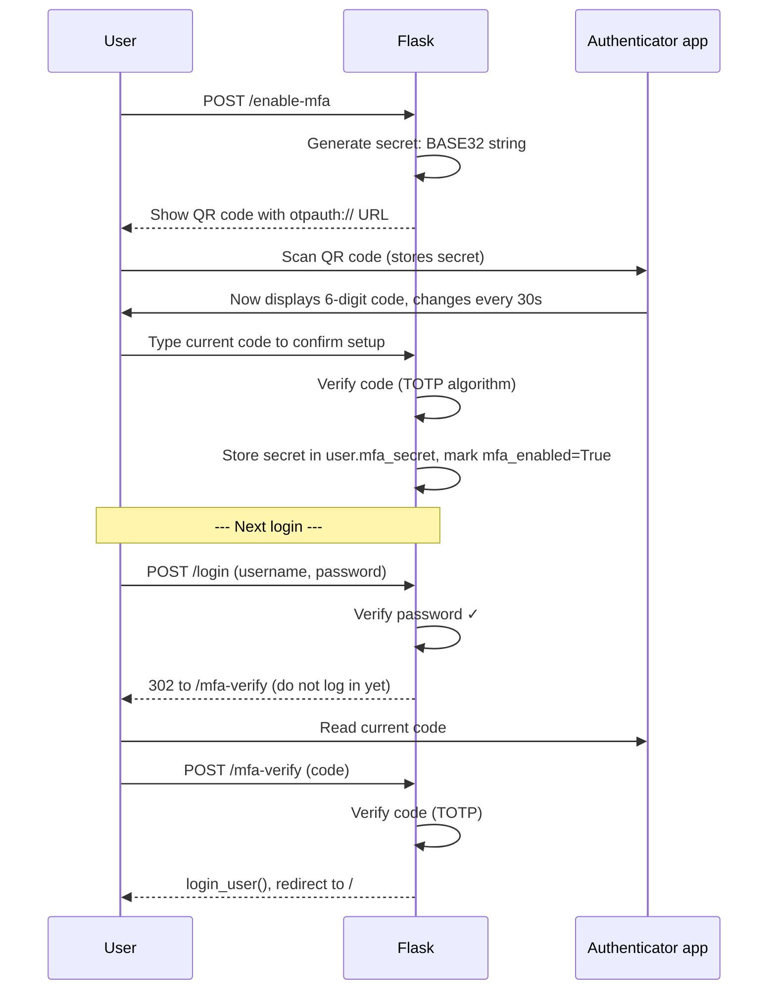

The TOTP algorithm is surprisingly simple. Both the server and the authenticator share a secret. They both compute:

```
code = truncate(HMAC-SHA1(secret, current_time / 30)) mod 10^6
```

The `current_time / 30` step means the time-window is 30 seconds — both sides agree on which 30-second window we're in (because both have synchronized clocks). The HMAC produces a 20-byte digest; a deterministic truncation picks 4 bytes; those 4 bytes mod 10^6 give a 6-digit code. The Python library `pyotp` does this in three lines:

```python
import pyotp
secret = pyotp.random_base32()           # store this
totp = pyotp.TOTP(secret)
print(totp.now())                         # current 6-digit code
print(totp.verify('123456'))              # True if code matches current window
```

MFA implementation is beyond this lesson's scope, but the architecture matters for *today*: design your `User` model so adding MFA later is easy. Leave room for `mfa_secret`, `mfa_enabled`, and `mfa_backup_codes` columns (or use Flask-Migrate to add them when the time comes). And never let password reset bypass MFA — if you offer MFA, password reset must also require an MFA code (or a separate MFA reset flow).

## 11. Try This

> [!tip] Try this: hash the same password with three different algorithms
> ```python
> from werkzeug.security import generate_password_hash
> for method in ('pbkdf2:sha256', 'scrypt', 'pbkdf2:sha512'):
>     h = generate_password_hash('Hello123!', method=method)
>     print(method, '→', h[:80])
> ```
> Compare the formats. Which is longest? Which has the highest iteration count? (Note: `scrypt` may not be available on all platforms.)

> [!tip] Try this: time a single hash
> ```python
> import time
> from werkzeug.security import generate_password_hash
> start = time.perf_counter()
> generate_password_hash('Hello123!')
> print(f"{(time.perf_counter() - start) * 1000:.1f} ms")
> ```
> You should see ~50-200 ms for default PBKDF2. That's the *intended* cost — slow is the feature, not the bug. If your hash takes 0.001 ms, you're using a non-password hash (SHA-256 alone) and you have a security problem.

> [!tip] Try this: inspect the salt
> Register two users with the *same* password. Then:
> ```bash
> sqlite3 myapp.db "SELECT username, password_hash FROM users;"
> ```
> Notice the two hashes are completely different — the salts are different. Extract just the salt portion (between the second-to-last `$` and last `$`) and confirm they're different strings.

> [!tip] Try this: deliberately store a plaintext password (just to feel the wrongness)
> Add a `password` column temporarily, populate it, then look at it in `sqlite3`. Now imagine your `myapp.db` file is on a public S3 bucket. How many of your users are now compromised? (Delete the column when you're done — and never commit this code.)

> [!tip] Try this: switch to passlib and watch old hashes migrate
> Install `passlib` and `argon2-cffi`. Configure `CryptContext(schemes=['argon2', 'pbkdf2_sha256'], deprecated='auto')`. Register two users — one with PBKDF2, one with argon2 (manually call `pwd.hash()` on the second). On `check_password`, log which scheme was used. Notice that when a PBKDF2-hashed user logs in, passlib *re-hashes* their password with argon2 transparently (because `deprecated='auto'`) — and the next `sqlite3 myapp.db "SELECT * FROM users"` shows the hash now starts with `$argon2id$`. You've just done a zero-downtime hash migration.

> [!tip] Try this: time the cost factor
> ```python
> import time
> from passlib.context import CryptContext
> pwd = CryptContext(schemes=['argon2'], argon2__memory_cost=19456,
>                    argon2__time_cost=2, argon2__parallelism=1)
> for time_cost in [1, 2, 4, 8]:
>     pwd = CryptContext(schemes=['argon2'], argon2__memory_cost=19456,
>                        argon2__time_cost=time_cost, argon2__parallelism=1)
>     start = time.perf_counter()
>     pwd.hash('Hello123!')
>     print(f"time_cost={time_cost}: {(time.perf_counter()-start)*1000:.1f} ms")
> ```
> You're looking for the "sweet spot" — typically 100-300 ms. Doubling `time_cost` roughly doubles the time. Set the cost high enough that logins feel slightly sluggish but not annoyingly slow. As hardware improves, bump it again next year.

## 12. Exercises

### Exercise 1 — Email verification (medium)

Add an `email_verified` boolean column to `User` (default `False`). When a user registers, generate a random token (`secrets.token_urlsafe(32)`), store it in a new `verification_token` column, and "send" an email by printing the link to the console:

```
Visit http://127.0.0.1:5000/verify/TOKEN to verify your email.
```

Add a `/verify/<token>` route that sets `email_verified = True` and clears the token. Use [[Lesson-15-Flask-Migrate]] to add the columns without losing data.

### Exercise 2 — Switch to `scrypt` (medium)

Change your hashing to:
```python
user.password_hash = generate_password_hash(password, method='scrypt')
```
Re-register a user. Notice the hash string now starts with `scrypt:`. Confirm the column width `String(255)` is sufficient (it should be). Time a hash — scrypt should be slower than PBKDF2 (which is intentional).

### Exercise 3 — Switch to `argon2` with `passlib` (medium)

Install `passlib` and `argon2-cffi`. Replace your `set_password` and `check_password` methods to use `passlib`'s `CryptContext`. Confirm existing PBKDF2 hashes still verify (passlib handles this automatically with `deprecated='auto'`). Re-register a user; the new hash should start with `$argon2id$`.

### Exercise 4 — Unique email (easy)

Add a `validate_email` method to `RegistrationForm` that checks the email isn't already in the database. Mirror the `validate_username` pattern.

### Exercise 5 — Check against breached passwords (hard)

Use the [HaveIBeenPwned range API](https://haveibeenpwned.com/API/v3#SearchingPwnedPasswordsByRange):

1. Compute `SHA-1(password)` in hex uppercase.
2. Take the first 5 hex characters.
3. GET `https://api.pwnedpasswords.com/range/XXXXX` (the API responds with a list of suffixes and breach counts).
4. Check if your password's last 35 hex characters are in the list.

If yes, reject the password with `ValidationError('This password has appeared in a data breach; choose another.')`. Add this as a `validate_password` method. (You'll need `requests` and `hashlib`.) This is the k-anonymity API design — HIBP never sees your full hash, only the 5-char prefix.

### Exercise 6 — Password reset flow (medium)

Implement the full password reset flow described in §9. Add the columns, the `/forgot` and `/reset/<token>` routes, and the templates. Test it end-to-end. Pay attention to: token expiry, single-use semantics, and the "always show the same message" rule.

### Exercise 7 — Print the hash, try to reverse it (illustrative)

Register a user with a known password, then open a Python shell:

```python
>>> from app import User, app
>>> with app.app_context():
...     print(User.query.first().password_hash)
pbkdf2:sha256:600000$abcd...$ef01...
```

Try as you might, you cannot recover the plaintext from that string. This is the lesson of the day, experienced firsthand.

### Exercise 8 — Rate-limit login attempts (preview)

Read ahead: how would you rate-limit `/login` so an attacker can't brute-force passwords? Sketch a design using:
- A counter in the session (defeated by clearing cookies)
- A counter in the database per-username (defeated by trying many usernames)
- A counter per-IP using `flask-limiter` (better, but defeats users behind a shared NAT)

We'll implement this properly in [[Lesson-22-Email-and-Background-Tasks]] when we have Redis available.

## 13. What We Learned

- **Authentication** is "who are you?" **Authorization** is "are you allowed?" They're different concepts; don't mix them up.
- A **User model** for authentication has `id`, `username`, `email`, and `password_hash`. It does **not** have a `password` column.
- **Never store plaintext passwords.** If you can read a user's password, so can an attacker. RockYou, LinkedIn, Adobe, Yahoo, Facebook — all paid the price for getting this wrong.
- **Hashing is one-way.** Encryption is reversible. Passwords need the former — you should never be able to "decrypt" a password.
- A password hash has four pillars: **the password, a per-user salt, a work factor, and the algorithm**. The salt is not secret — its job is uniqueness. The work factor makes brute-forcing expensive. The algorithm determines whether the hash is also memory-hard (scrypt, argon2) or just CPU-hard (pbkdf2, bcrypt).
- **Pick argon2id for new apps in 2026.** Use `passlib` for a unified API across algorithms. Werkzeug's PBKDF2 default is acceptable but not best-in-class.
- Werkzeug's `generate_password_hash(password)` returns a string like `pbkdf2:sha256:600000$salt$digest`. The salt is random per-user, the iteration count makes brute-forcing expensive. All of this is encoded in the string — you don't need separate columns.
- `check_password_hash(stored, typed)` parses the stored hash, re-runs the same algorithm with the same salt on the typed password, and returns `True`/`False`. The comparison is **constant-time** to prevent timing attacks.
- Add `set_password()` and `check_password()` methods to your `User` model. That's the only API anyone should use.
- A **registration form** uses `DataRequired`, `Email`, `Length`, and `EqualTo` validators. Custom `validate_<field>` methods on the form class give you inline validators — for uniqueness checks and password-strength checks.
- **Password strength** validation: prefer length + breached-password checks (HaveIBeenPwned k-anonymity API) over complex character-class rules (NIST 800-63B). Both are better than `Length(min=8)` alone.
- The **registration route** builds a `User`, calls `set_password`, adds to the session, commits (catching `IntegrityError`), flashes a message, redirects.
- **Password reset flows** use unguessable, time-limited, single-use tokens. Always return the same "we sent a link" message regardless of whether the email exists (prevents enumeration).
- For production: prefer **bcrypt** or **argon2id** (or Werkzeug's `scrypt`) over `pbkdf2`. Never log passwords. Rate-limit login attempts (Lesson 22).

## 14. Next Lesson

You can now **register** users and store them safely. But they can't log in yet. Every visit to `/` is still anonymous — there's no concept of "the current user."

In [[Lesson-17-Flask-Login]] (the second lesson of Module 07) you'll learn:

- Why **HTTP is stateless** and how **sessions** (cookies) bridge that gap.
- How cookies actually work — the `Set-Cookie` header, browser storage, automatic re-sending, expiry, `Secure`/`HttpOnly`/`SameSite` flags.
- How to install and configure **Flask-Login**, the de-facto standard for Flask authentication.
- The **`UserMixin`** class and why Flask-Login needs `is_authenticated`, `is_active`, `is_anonymous`, and `get_id()`.
- The **`user_loader`** callback that turns a session cookie into a User object on every request.
- The **`/login` route** with `login_user()`, **`/logout`** with `logout_user()`, **`current_user`**, and **`@login_required`**.
- The **`next` parameter** and the **open-redirect vulnerability** it can cause if you don't validate `netloc`.
- Modern alternatives: **JWT tokens** for stateless API auth, **OAuth2/social login** for "Log in with Google."

By the end of Lesson 17, you'll have a full register → login → logout → protected-page flow. The work you did today — the `User` model, the password methods, the registration form — is the foundation Lesson 17 stands on.

> [!quote] A note from your teacher
> Every year, a major company leaks passwords. Every year, security researchers publish a list of the top 10 most common passwords and `123456` is at the top. The defense is not heroic — it's mundane. It's `generate_password_hash`. It's `check_password_hash`. It's a refusal to store plaintext, even "just for debugging," even "just for now." Today you did the unglamorous, world-improving work of building authentication correctly from the start. The next time you read about a breach, remember: it won't be your app. You did the work. Onward to login.
