# Lesson 17 — Flask-Login: Sessions, Login, Logout, and Protected Routes

> [!success] Second and final lesson of Module 07 — Authentication.
> Last lesson you built a `User` model and a registration form. Users can sign up. But they can't *sign in* — every page is still anonymous, every visitor is a stranger. Today you fix that. By the end of this lesson your app will remember who is logged in across requests, will protect pages from anonymous visitors, and will give your users a way to log out. We're going to use the most popular Flask authentication library: **Flask-Login**.

## 1. Learning Objectives

By the end of this lesson you will be able to:

1. **Explain why HTTP is stateless** and why that makes "remembering the user" a non-trivial problem.
2. **Describe how cookies actually work** — the `Set-Cookie` response header, browser storage, automatic re-sending, expiry, and the security flags `Secure` / `HttpOnly` / `SameSite`.
3. **Explain Flask's session mechanism** — signed cookies, `SECRET_KEY`, why tampering is detectable, and the trade-offs vs. server-side sessions.
4. **Install and configure Flask-Login** — `LoginManager(app)` and `login.login_view`.
5. **Mix `UserMixin` into your User model** and explain the four attributes it provides (`is_authenticated`, `is_active`, `is_anonymous`, `get_id`).
6. **Write a `user_loader` callback** that turns a session-stored ID into a `User` object on every request — and understand the per-request cost.
7. **Build a `LoginForm`** with username, password, and "Remember Me" fields.
8. **Build a `/login` route** with `login_user()` and the "already authenticated?" guard.
9. **Build a `/logout` route** with `logout_user()` and explain what it clears.
10. **Use `current_user`** in templates and routes — and explain how Flask-Login makes it always-available via a proxy.
11. **Protect routes with `@login_required`** and explain what it does when the user is anonymous — including the `next` parameter and the **open-redirect vulnerability** that the `netloc` check defends against.
12. **Implement "Remember Me"** with long-lived cookies.
13. **Compare sessions to JWT tokens** — when to use which in 2026.
14. **Sketch an OAuth2/social-login flow** — "Log in with Google" preview.
15. **Build a complete register → login → protected page → logout flow** end-to-end.

## 2. Prerequisites

- **[[Lesson-16-User-Model-AndPasswords]] completed.** You have a `User` model with `set_password` / `check_password` and a working `/register` route. This lesson builds directly on that code.
- **[[Lesson-11-Flask-WTF]] completed.** You can build a `FlaskForm`, render it, handle `validate_on_submit()`, and show validation errors.
- **[[Lesson-06-HTTP-Methods]] completed.** You understand GET vs POST, redirects, and the request/response cycle.

## 3. The Problem

You finished Lesson 16 with a working registration form. Users exist in the database. They have hashed passwords. But there's no way for a returning user to *prove* they're alice — and even if there were, the app has no way to *remember* that fact across requests.

Here's the deep issue: **HTTP is stateless.** Every request your Flask app handles is independent. Request #1 (login) and request #2 (view profile) are, as far as the protocol is concerned, completely unrelated. There is no built-in mechanism for "this is the same person who logged in a moment ago."

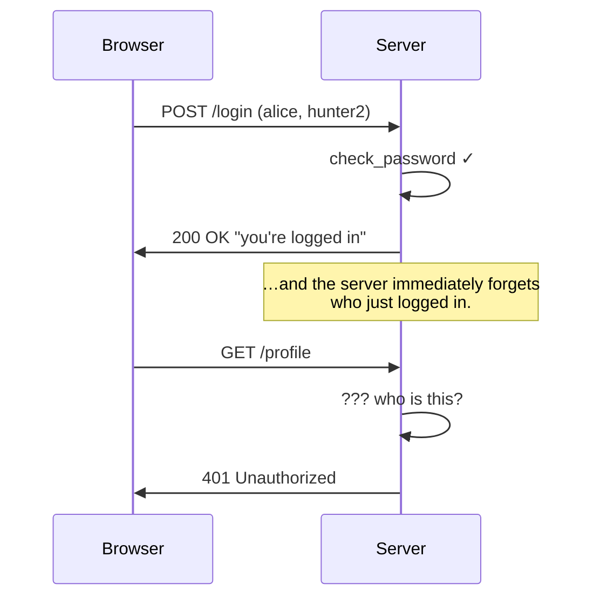

Without something extra, every page is anonymous. So how do real websites do it? **Cookies.**

### 3.1 What is HTTP statelessness, really?

HTTP/1.1, as specified in RFC 7230, is a **stateless** protocol: "each request from a client to a server is independent of any previous request." The server is allowed to forget everything about the previous request the instant it sends a response. There is no `conversation_id`, no implicit session, no "the same client" concept — only requests and responses.

This is a deliberate design choice. Stateless protocols are:
- **Scalable** — any server can handle any request, so you can add more servers behind a load balancer without coordination.
- **Cacheable** — proxies and CDNs can cache responses without worrying about per-user state.
- **Simple** — no state machine on the server, no "what happens if the connection drops mid-conversation."

But statelessness makes "remember who's logged in" impossible without extra machinery. That machinery is **cookies**, added by Netscape in 1994 (RFC 2109, now RFC 6265).

### 3.2 How cookies actually work — a deep dive

A cookie is a small piece of data the server asks the browser to remember and send back on subsequent requests. The mechanism is two HTTP headers:

1. **`Set-Cookie`** (response header) — sent from server to browser. Says "remember this."
2. **`Cookie`** (request header) — sent from browser to server. Says "here's what you told me to remember."

Here's the raw HTTP for a login that sets a cookie:

```
# Request from browser to server
POST /login HTTP/1.1
Host: example.com
Content-Type: application/x-www-form-urlencoded

username=alice&password=hunter2

# Response from server
HTTP/1.1 302 Found
Location: /profile
Set-Cookie: session=eyJ1c2VyX2lkIjoxfQ.XnV1mQ.signature; HttpOnly; Secure; SameSite=Lax; Path=/
```

The browser stores that cookie. On every subsequent request to `example.com`, the browser automatically attaches:

```
GET /profile HTTP/1.1
Host: example.com
Cookie: session=eyJ1c2VyX2lkIjoxfQ.XnV1mQ.signature
```

The server reads the cookie, looks up (or decrypts) the session, identifies the user, and serves the page.

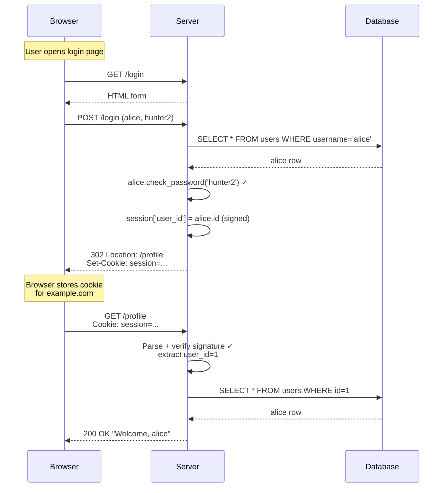

### 3.3 Cookie attributes — the security flags

A `Set-Cookie` header can carry attributes that control the cookie's lifetime and visibility:

| Attribute | What it does | Why you care |
|-----------|--------------|--------------|
| `HttpOnly` | Browser forbids JavaScript from reading the cookie (`document.cookie`) | Prevents cookie theft via XSS |
| `Secure` | Browser only sends the cookie over HTTPS | Prevents cookie theft via network sniffing |
| `SameSite=Strict` | Browser only sends the cookie when the request originates from your site | Prevents CSRF (cross-site request forgery) |
| `SameSite=Lax` | Browser sends the cookie on top-level navigations (link clicks) but not cross-site POSTs | Default in modern browsers; balances CSRF protection with usability |
| `SameSite=None; Secure` | Browser sends the cookie on all requests, including cross-site | Required for third-party cookies (e.g. embedded widgets); must be Secure |
| `Path=/` | Cookie applies to all paths under the domain | Default; restrict to `Path=/admin` for admin-only cookies |
| `Domain=example.com` | Cookie applies to subdomains too | Sharing cookies across `app.example.com` and `api.example.com` |
| `Max-Age=3600` | Cookie expires after 3600 seconds | Used for "Remember me" |
| `Expires=Thu, 01 Jan 2026 00:00:00 GMT` | Cookie expires at a specific time | Old-style alternative to Max-Age |

Flask's session cookie is `HttpOnly` by default, and you should set `SESSION_COOKIE_SECURE = True` and `SESSION_COOKIE_SAMESITE = 'Lax'` in production. We'll cover production hardening in [[Lesson-23-Deployment]].

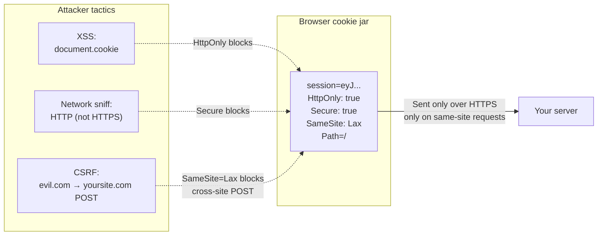

> [!question] Student asks: "If JavaScript can't read an HttpOnly cookie, how does my frontend send it?"
> The browser sends HttpOnly cookies **automatically** on every request to the domain — you don't need JavaScript. This is exactly why cookies are great for auth: the browser handles the bookkeeping. The downside is cookies are sent on **every** request, including image requests, which is why some SPAs prefer bearer tokens in `Authorization` headers (sent only when the app explicitly attaches them).

> [!question] Student asks: "What's the difference between `SameSite=Strict` and `SameSite=Lax`? When do I pick which?"
> - **`Strict`** never sends the cookie on cross-site requests, *including* when the user clicks a link from another site to your site. So if a user is logged in to your site, then clicks a link to your site from their email, they arrive *logged out* — the session cookie wasn't sent. This is annoying.
> - **`Lax`** sends the cookie on **top-level navigations** (link clicks, address-bar entries) but **not** on cross-site POSTs or background requests (fetch, iframes, images). This balances CSRF protection (POST is still safe) with usability (links work).
>
> Almost every web app uses `Lax`. `Strict` is for very high-security apps (banking). `None` (with `Secure`) is for third-party cookie scenarios (embedded widgets, SSO redirects) which are increasingly blocked by browsers anyway.

> [!info] The browser cookie jar — where cookies actually live
> When the browser sees `Set-Cookie: session=...; HttpOnly; Path=/`, it stores the cookie in an internal data structure called the **cookie jar** — typically a SQLite database on disk (`cookies.sqlite` in Firefox, `Cookies` SQLite file in Chrome's profile directory). The cookie is keyed by `(domain, path, name)`. On every subsequent request, the browser iterates the cookie jar, finds all cookies matching the request's domain and path, and attaches them as `Cookie: name1=value1; name2=value2`. The `HttpOnly`, `Secure`, and `SameSite` flags are *enforcement logic* the browser applies when *deciding whether to send* the cookie — they don't appear in the outgoing `Cookie` header.
>
> This means: if your `SECRET_KEY` leaks, an attacker doesn't even need to *steal* a cookie — they can craft one from scratch. The browser's protections (HttpOnly, etc.) protect against *theft*; they don't protect against *forgery*. Only your `SECRET_KEY` does that.

### 3.4 Flask's session mechanism — signed cookies

Flask's `session` object is a dict-like object that gets serialized to a cookie at the end of each request. Crucially, the cookie is **signed with your `SECRET_KEY`** but **not encrypted**. That means:

- The user can read the contents of their own session cookie (it's just base64 + a signature).
- The user **cannot modify** the session without invalidating the signature — Flask will reject a tampered cookie.

Let's see this concretely. If `session['user_id'] = 1`, the cookie sent to the browser is something like:

```
eyJ1c2VyX2lkIjoxfQ.XnV1mQ.aBcDeFgHiJkLmNoPqRsTuVwXyZ
```

That's three parts separated by `.`:

1. **Payload** (`eyJ1c2VyX2lkIjoxfQ` — base64 of `{"user_id":1}`) — readable by anyone with the cookie.
2. **Timestamp** (`XnV1mQ`) — when the cookie was issued (Flask uses this to expire old sessions).
3. **Signature** (`aBcDeFgHiJkLmNoPqRsTuVwXyZ`) — HMAC-SHA256 of (payload + timestamp) using your `SECRET_KEY`.

If anyone flips a bit in the payload, the signature no longer matches, and Flask throws the cookie away.

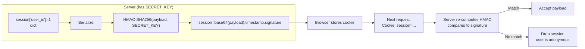

> [!danger] Why `SECRET_KEY` is critical
> If an attacker learns your `SECRET_KEY`, they can forge session cookies — `session['user_id'] = 1` becomes them, instantly, without a password. Treat `SECRET_KEY` like a database password: long, random, different per environment, stored in an environment variable, **never** committed to git. If it leaks, rotate it (which invalidates all sessions — annoying but safe).

> [!info] Signed, not encrypted — what about confidentiality?
> Anyone with the cookie can base64-decode the payload and see `{"user_id": 1}`. That's why you should **never put sensitive data in the Flask session** — no passwords, no API keys, no PII. If you need confidentiality (server-side session storage, encrypted JWTs), use Flask-Session with Redis, or sign+encrypt tokens with `itsdangerous` plus `cryptography`. For most web apps, "signed but readable" is fine — the session contains `user_id`, maybe a CSRF token, maybe a flash message, none of which are secret.

> [!info] Inside `itsdangerous` — the signing library Flask uses
> Flask's session cookies are signed by a library called `itsdangerous` (also by Armin Ronacher, also part of the Pallets ecosystem). The signing algorithm is HMAC — Hash-based Message Authentication Code. Here's the conceptual flow:
>
> ```python
> import hmac, hashlib, base64, json, time
>
> def sign(payload, secret):
>     # 1. Serialize the payload
>     body = json.dumps(payload, separators=(',', ':')).encode()
>     body_b64 = base64.urlsafe_b64encode(body).decode().rstrip('=')
>     # 2. Add a timestamp (so old cookies can be expired)
>     timestamp = base64.urlsafe_b64encode(int(time.time()).to_bytes(4, 'big')).decode()
>     # 3. Compute the signature: HMAC-SHA512(secret, body + '.' + timestamp)
>     msg = f"{body_b64}.{timestamp}".encode()
>     sig = hmac.new(secret.encode(), msg, hashlib.sha512).digest()
>     sig_b64 = base64.urlsafe_b64encode(sig).decode().rstrip('=')
>     # 4. Final cookie value: body.timestamp.signature
>     return f"{body_b64}.{timestamp}.{sig_b64}"
>
> def verify(cookie_value, secret, max_age=None):
>     body_b64, timestamp_b64, sig_b64 = cookie_value.split('.')
>     # Recompute signature, compare in constant time
>     msg = f"{body_b64}.{timestamp_b64}".encode()
>     expected_sig = hmac.new(secret.encode(), msg, hashlib.sha512).digest()
>     actual_sig = base64.urlsafe_b64decode(sig_b64 + '==')
>     if not hmac.compare_digest(expected_sig, actual_sig):
>         raise BadSignature('Signature mismatch')
>     # Check timestamp if max_age given
>     if max_age:
>         timestamp = int.from_bytes(base64.urlsafe_b64decode(timestamp_b64 + '=='), 'big')
>         if time.time() - timestamp > max_age:
>             raise SignatureExpired('Too old')
>     body = base64.urlsafe_b64decode(body_b64 + '==')
>     return json.loads(body)
> ```
>
> The crucial property: `verify` recomputes the HMAC and compares it to the cookie's signature. Any change to the body (even a single bit) produces a different signature, so tampering is detected. The comparison uses `hmac.compare_digest` (constant-time) to prevent timing attacks. The timestamp lets you enforce max-age without storing state server-side.
>
> Why HMAC-SHA512 and not just SHA-512? Because SHA-512 alone is a hash — anyone can compute it. HMAC mixes in a secret key, so only someone with the `SECRET_KEY` can produce a valid signature. That's what makes it an *authentication* code, not just a checksum.

### 3.5 What Flask-Login does (and doesn't do)

Flask-Login handles:

- **Session management** — storing and retrieving the user ID in the Flask session.
- **`current_user`** — a proxy that gives you the logged-in user (or an `AnonymousUserMixin`) in any view or template.
- **`@login_required`** — a decorator that redirects anonymous users to your login page.
- **"Remember me"** — long-lived cookies for users who check the box.
- **`user_loader`** — your hook to convert a stored ID into a User object.

Flask-Login does **not** handle:

- **User storage.** That's your database and your `User` model.
- **Password hashing.** That's `werkzeug.security` (Lesson 16).
- **Registration.** That's your form and your route.
- **Permissions / roles.** That's authorization — see [[Lesson-18-Blueprints]] and beyond.

Flask-Login is *only* the "remembering who is logged in" layer. Everything else you bring yourself. This separation of concerns is what makes Flask-Login composable with any user model and any database.

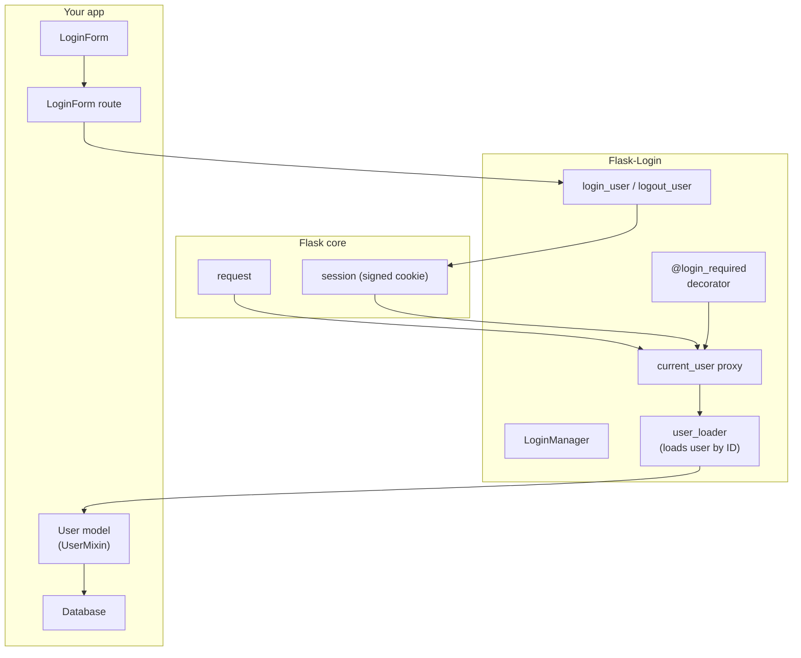

## 4. The Code

### 4.1 Install

```bash
pip install Flask-Login
```

Verify:

```bash
python -c "import flask_login; print(flask_login.__version__)"
# 0.6.3 (or similar)
```

### 4.2 The complete `app.py`

```python
# app.py
from flask import Flask, render_template, redirect, url_for, flash, request
from flask_sqlalchemy import SQLAlchemy
from flask_wtf import FlaskForm
from flask_login import (LoginManager, UserMixin, login_user, logout_user,
                         current_user, login_required)
from wtforms import StringField, PasswordField, BooleanField, SubmitField
from wtforms.validators import DataRequired, Email, Length, EqualTo, ValidationError
from werkzeug.security import generate_password_hash, check_password_hash
from urllib.parse import urlparse

app = Flask(__name__)
app.config['SECRET_KEY'] = 'a-long-random-string-replace-me'
app.config['SQLALCHEMY_DATABASE_URI'] = 'sqlite:///myapp.db'
app.config['SQLALCHEMY_TRACK_MODIFICATIONS'] = False
# Production hardening (covered in Lesson 23)
app.config['SESSION_COOKIE_SECURE'] = True     # only over HTTPS
app.config['SESSION_COOKIE_HTTPONLY'] = True   # JS can't read
app.config['SESSION_COOKIE_SAMESITE'] = 'Lax'  # CSRF mitigation

db = SQLAlchemy(app)
login = LoginManager(app)
login.login_view = 'login'        # redirect target when @login_required fails
login.login_message_category = 'info'  # bootstrap-style category for the flash


class User(UserMixin, db.Model):
    __tablename__ = 'users'
    id = db.Column(db.Integer, primary_key=True)
    username = db.Column(db.String(80), unique=True, nullable=False)
    email = db.Column(db.String(120), unique=True, nullable=False)
    password_hash = db.Column(db.String(255))

    def set_password(self, password):
        self.password_hash = generate_password_hash(password)

    def check_password(self, password):
        return check_password_hash(self.password_hash, password)

    def __repr__(self):
        return f'<User {self.username}>'


@login.user_loader
def load_user(id):
    return db.session.get(User, int(id))


class RegistrationForm(FlaskForm):
    username = StringField('Username', validators=[DataRequired(), Length(min=4, max=80)])
    email = StringField('Email', validators=[DataRequired(), Email()])
    password = PasswordField('Password', validators=[DataRequired(), Length(min=8)])
    password2 = PasswordField('Repeat Password',
                              validators=[DataRequired(), EqualTo('password')])
    submit = SubmitField('Register')

    def validate_username(self, username):
        user = User.query.filter_by(username=username.data).first()
        if user is not None:
            raise ValidationError('Please use a different username.')


class LoginForm(FlaskForm):
    username = StringField('Username', validators=[DataRequired()])
    password = PasswordField('Password', validators=[DataRequired()])
    remember_me = BooleanField('Remember Me')
    submit = SubmitField('Sign In')


@app.route('/')
def index():
    return render_template('index.html')


@app.route('/register', methods=['GET', 'POST'])
def register():
    if current_user.is_authenticated:
        return redirect(url_for('index'))
    form = RegistrationForm()
    if form.validate_on_submit():
        user = User(username=form.username.data, email=form.email.data)
        user.set_password(form.password.data)
        db.session.add(user)
        db.session.commit()
        flash('Registration successful! Please log in.')
        return redirect(url_for('login'))
    return render_template('register.html', form=form)


@app.route('/login', methods=['GET', 'POST'])
def login():
    if current_user.is_authenticated:
        return redirect(url_for('index'))
    form = LoginForm()
    if form.validate_on_submit():
        user = User.query.filter_by(username=form.username.data).first()
        if user is None or not user.check_password(form.password.data):
            flash('Invalid username or password')
            return redirect(url_for('login'))
        login_user(user, remember=form.remember_me.data)
        next_page = request.args.get('next')
        if not next_page or urlparse(next_page).netloc != '':
            next_page = url_for('index')
        return redirect(next_page)
    return render_template('login.html', form=form)


@app.route('/logout')
@login_required
def logout():
    logout_user()
    return redirect(url_for('index'))


@app.route('/profile')
@login_required
def profile():
    return render_template('profile.html', user=current_user)


with app.app_context():
    db.create_all()


if __name__ == '__main__':
    app.run(debug=True)
```

### 4.3 The templates

`templates/base.html`:

```html
<!doctype html>
<html lang="en">
<head>
  <meta charset="utf-8">
  <title>My App</title>
</head>
<body>
  <nav>
    <a href="{{ url_for('index') }}">Home</a> |
    
      <a href="{{ url_for('profile') }}">Profile</a> |
      <a href="{{ url_for('logout') }}">Logout ({{ current_user.username }})</a>
    
      <a href="{{ url_for('login') }}">Login</a> |
      <a href="{{ url_for('register') }}">Register</a>
    
  </nav>
  <main>
    
      
        <ul class="flashes">
          
            <li>{{ message }}</li>
          
        </ul>
      
    
    
  </main>
</body>
</html>
```

`templates/index.html`:

```html

Home

  <h2>Welcome</h2>
  
    <p>Hello, {{ current_user.username }}! You are logged in.</p>
    <p>Visit your <a href="{{ url_for('profile') }}">profile</a>.</p>
  
    <p>You are not logged in.</p>
    <p><a href="{{ url_for('login') }}">Log in</a> or <a href="{{ url_for('register') }}">register</a>.</p>
  

```

`templates/login.html`:

```html

Login

  <h2>Sign In</h2>
  <form method="post" novalidate>
    {{ form.hidden_tag() }}
    <p>
      {{ form.username.label }}<br>
      {{ form.username(size=32) }}
      
        <span style="color: red;">[{{ error }}]</span>
      
    </p>
    <p>
      {{ form.password.label }}<br>
      {{ form.password(size=32) }}
      
        <span style="color: red;">[{{ error }}]</span>
      
    </p>
    <p>{{ form.remember_me() }} {{ form.remember_me.label }}</p>
    <p>{{ form.submit() }}</p>
  </form>
  <p>New here? <a href="{{ url_for('register') }}">Register an account</a>.</p>

```

`templates/register.html` — same as Lesson 16 (form with username, email, password, password2).

`templates/profile.html`:

```html

Profile

  <h2>Your Profile</h2>
  <p><strong>Username:</strong> {{ user.username }}</p>
  <p><strong>Email:</strong> {{ user.email }}</p>
  <p><strong>User ID:</strong> {{ user.id }}</p>

```

## 5. Line-by-Line Explanation

### 5.1 Setting up the `LoginManager`

```python
from flask_login import LoginManager
login = LoginManager(app)
login.login_view = 'login'
```

- `login = LoginManager(app)` — creates the manager and binds it to `app`. This registers a `before_request` hook that loads the user from the session, a context processor that injects `current_user` into templates, and a teardown handler.
- `login.login_view = 'login'` — the **endpoint name** (not the URL!) that Flask-Login redirects to when an anonymous user hits a `@login_required` route. Without this, you'd get a 401 instead of a redirect. With it, an anonymous user visiting `/profile` is sent to `/login?next=/profile`.

> [!tip] Endpoint name, not URL
> `login_view` is the endpoint name — the function name you'd pass to `url_for()`. If your login function is `def sign_in():`, then `login.login_view = 'sign_in'`. We covered endpoint-vs-URL in [[Lesson-04-Routes]].

You can also configure `login.login_message = 'Please log in to access this page.'` to customize the flash message Flask-Login shows on redirect. The default is fine for now.

### 5.2 `UserMixin`

```python
from flask_login import UserMixin

class User(UserMixin, db.Model):
    ...
```

Flask-Login needs your User class to provide four things:

| Method/attribute | What it returns | Why Flask-Login needs it |
|------------------|-----------------|--------------------------|
| `is_authenticated` | `True` if the user has logged in | Distinguishes "real" users from anonymous visitors |
| `is_active` | `True` if the user's account is active (not banned, not pending) | Lets you ban users without deleting them |
| `is_anonymous` | `True` if this is the special "anonymous" placeholder | Lets `current_user` work uniformly for both logged-in and anonymous visitors |
| `get_id()` | A unicode string uniquely identifying the user | Stored in the session cookie; passed back to `user_loader` |

`UserMixin` provides sensible defaults for all four:

```python
# Pseudocode of UserMixin
class UserMixin:
    @property
    def is_authenticated(self):
        return True              # If we have a User object, they're authenticated

    @property
    def is_active(self):
        return True              # Default: account is active

    @property
    def is_anonymous(self):
        return False             # This is a real user, not anonymous

    def get_id(self):
        try:
            return str(self.id)  # The primary key, as a string
        except AttributeError:
            raise NotImplementedError('No `id` attribute — override get_id()')
```

When you inherit from `UserMixin`, all four are correct for a typical user with an `id` primary key. You only need to override them if your model is unusual — e.g. if you have a `banned_at` column, override `is_active` to return `self.banned_at is None`.

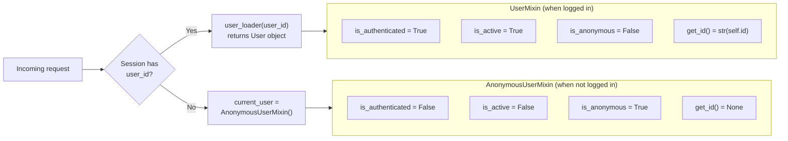

### 5.3 The `user_loader` callback

```python
@login.user_loader
def load_user(id):
    return db.session.get(User, int(id))
```

This is the most important line in the whole lesson. Here's what it does:

1. **On every request**, Flask-Login's `before_request` hook checks the session for a `user_id`.
2. **If found**, Flask-Login calls `load_user(id)` — your function — to convert the ID back into a `User` object.
3. **The User object** is then stored on `current_user`, available throughout the request.
4. **If `load_user` returns `None`** (the user was deleted, the ID is invalid), Flask-Login treats the user as anonymous.

> [!warning] This runs on every authenticated request
> That's potentially every page load for a logged-in user. If your `user_loader` does a database query (which it almost always does), that's one DB hit per request just for auth. Two ways to mitigate:
> 1. **Cache the user** in Redis with a TTL of a few seconds. Faster lookups, slightly stale data on ban.
> 2. **Store more in the session** (e.g. username) so you can render the nav bar without loading the user. But this means `current_user` is partial — you still need a DB hit when the user does something that needs fresh data.
> Most apps accept the per-request DB hit. Modern Postgres can do primary-key lookups in well under 1 ms.

> [!question] Student asks: "Why `db.session.get(User, int(id))` instead of `User.query.get(int(id))`?"
> `User.query.get()` is the **legacy** API in Flask-SQLAlchemy 2.x. The modern equivalent is `db.session.get(User, id)`, which is part of SQLAlchemy 2.0's unified API. They do the same thing under the hood. `query.get()` is deprecated in SQLAlchemy 2.x; prefer `session.get()` for new code.

> [!info] Why is `id` a string?
> The session cookie stores strings (it's serialized text). Flask-Login stores `str(user.id)` and passes the string back to `user_loader`. We `int(id)` it to convert back to integer for the DB lookup. Forgetting the `int()` would still work in SQLite (it's lenient about types) but break in Postgres (which is strict). Always convert.

### 5.4 The `LoginForm`

```python
class LoginForm(FlaskForm):
    username = StringField('Username', validators=[DataRequired()])
    password = PasswordField('Password', validators=[DataRequired()])
    remember_me = BooleanField('Remember Me')
    submit = SubmitField('Sign In')
```

No new validators here — `DataRequired()` is the only one. We don't enforce `Length(min=8)` on the password because we want to give the same error message ("invalid username or password") whether the password is empty, too short, or just wrong. Telling the user "password must be at least 8 characters" leaks the fact that the username exists.

`BooleanField` renders a checkbox. Its `.data` will be `True` if the box was checked, `False` otherwise.

### 5.5 The `login` route — step by step

```python
@app.route('/login', methods=['GET', 'POST'])
def login():
    if current_user.is_authenticated:
        return redirect(url_for('index'))
    form = LoginForm()
    if form.validate_on_submit():
        user = User.query.filter_by(username=form.username.data).first()
        if user is None or not user.check_password(form.password.data):
            flash('Invalid username or password')
            return redirect(url_for('login'))
        login_user(user, remember=form.remember_me.data)
        next_page = request.args.get('next')
        if not next_page or urlparse(next_page).netloc != '':
            next_page = url_for('index')
        return redirect(next_page)
    return render_template('login.html', form=form)
```

Walk-through:

- **`if current_user.is_authenticated: return redirect(url_for('index'))`** — if the user is already logged in, sending them to the login page makes no sense. Bounce them to home. (Otherwise a logged-in user could log in as someone else by just submitting the form — usually not what you want.)
- **`form = LoginForm()`** — empty form for GET, populated form for POST.
- **`if form.validate_on_submit():`** — POST and validators pass.
- **`user = User.query.filter_by(username=...).first()`** — find the user by username. `.first()` returns `None` if no match.
- **`if user is None or not user.check_password(...):`** — **the critical line.** Two conditions, combined with `or`:
  - If `user is None`, the username doesn't exist. We don't even call `check_password`.
  - If the user exists but the password is wrong, `check_password` returns `False`.
  - In **either case**, we flash the **same error**: "Invalid username or password." We do NOT say "user not found" vs "wrong password" — that would let attackers enumerate usernames.
- **`flash('Invalid username or password')`** — the same message regardless of which condition failed.
- **`return redirect(url_for('login'))`** — redirect back to the login page (PRG pattern, Lesson 10).
- **`login_user(user, remember=form.remember_me.data)`** — Flask-Login stores `user.get_id()` (i.e. `str(user.id)`) in the session. If `remember=True`, it also sets a separate, long-lived "remember me" cookie.
- **`next_page = request.args.get('next')`** — read the `?next=/profile` query parameter that `@login_required` added when it bounced an anonymous user here.
- **`if not next_page or urlparse(next_page).netloc != '':`** — open-redirect defense (see below).
- **`return redirect(next_page)`** — send the user to the page they originally wanted.

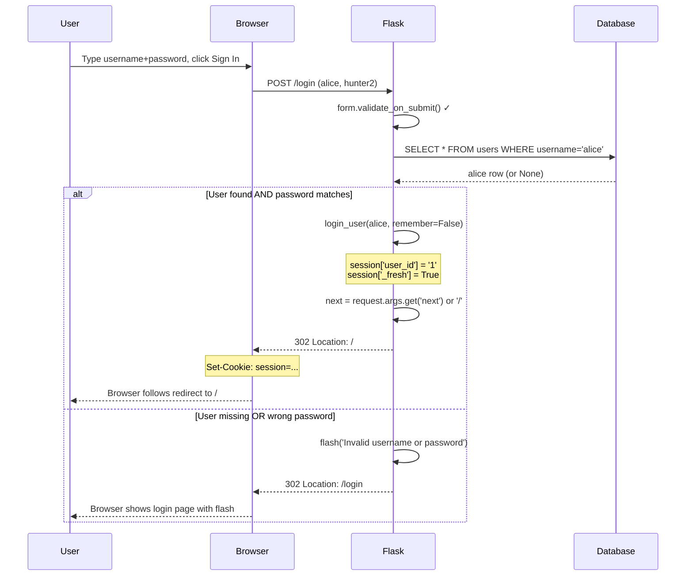

### 5.6 The open-redirect vulnerability

This is the most subtle and important security check in the whole login flow:

```python
next_page = request.args.get('next')
if not next_page or urlparse(next_page).netloc != '':
    next_page = url_for('index')
return redirect(next_page)
```

Imagine the attacker sends a victim a link:

```
https://yourapp.com/login?next=https://evil.com/phish
```

The victim visits it, sees the legitimate login page, logs in — and your app dutifully `redirect(next_page)`s them to `https://evil.com/phish`. The victim, having just logged into your site, assumes the redirect is from you. They click "log in again" on the phishing page, hand their password to the attacker. This is an **open redirect attack**.

The defense: **only allow `next` to be a relative URL** (no domain). `urlparse('//evil.com').netloc` is `'evil.com'`. `urlparse('https://evil.com').netloc` is `'evil.com'`. `urlparse('/profile').netloc` is `''` (empty). So the check `urlparse(next_page).netloc != ''` is `True` for any URL with a domain — and we replace those with `/`. Only relative URLs survive.

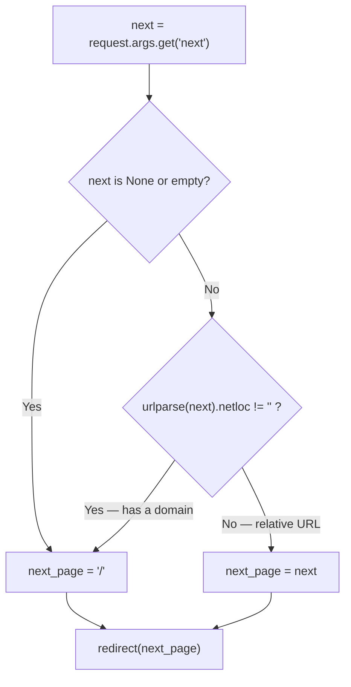

> [!danger] Don't roll your own check
> A naive check like `if next.startswith('/')` is **wrong**: `//evil.com` starts with `/` but is a protocol-relative URL — the browser interprets it as `https://evil.com`. Always use `urlparse(next).netloc != ''`. This is one of those places where the standard library is smarter than you; trust it.

### 5.7 The `logout` route

```python
@app.route('/logout')
@login_required
def logout():
    logout_user()
    return redirect(url_for('index'))
```

`logout_user()` does three things:

1. Removes `user_id` and `_fresh` from the session.
2. Deletes the "remember me" cookie (if it was set).
3. Sets `current_user` to an `AnonymousUserMixin` for the rest of the request.

Note: `@login_required` on logout is optional — logging out an anonymous user is a no-op — but it's good practice because it ensures the logout link is only shown to logged-in users.

### 5.8 The `profile` route — `@login_required` in action

```python
@app.route('/profile')
@login_required
def profile():
    return render_template('profile.html', user=current_user)
```

`@login_required` is a decorator from Flask-Login. Behind the scenes, it does roughly:

```python
# Pseudocode of @login_required
def login_required(f):
    @wraps(f)
    def decorated(*args, **kwargs):
        if not current_user.is_authenticated:
            # Where should we send them?
            login_manager.login_view  # 'login'
            # Save the URL they wanted, so we can come back after login
            next_url = request.full_path
            flash(login_manager.login_message)
            return redirect(url_for(login_manager.login_view, next=next_url))
        return f(*args, **kwargs)
    return decorated
```

So when an anonymous user visits `/profile`:

1. `@login_required` checks `current_user.is_authenticated` — it's `False`.
2. Flask-Login flashes "Please log in to access this page."
3. It redirects to `url_for('login', next='/profile')` — i.e. `/login?next=/profile`.
4. The user logs in. The login route reads `?next=/profile`, validates it's relative, and redirects there.

### 5.9 `current_user` — the always-available proxy

`current_user` is a **proxy** — an object that looks like a `User` but actually delegates to whatever the current request's user is. It works in templates and in view functions without you having to pass it explicitly.

```python
from flask_login import current_user

@app.route('/some-route')
def some_route():
    if current_user.is_authenticated:
        print(f"Hello, {current_user.username}")
    else:
        print("Hello, stranger")
    return "ok"
```

In templates, `current_user` is automatically available — Flask-Login registers a context processor that injects it. So you can write `` directly in any template.

> [!info] What's a "proxy"?
> A proxy is an object that wraps another object and forwards attribute access to it. `current_user` is a `LocalProxy` — Werkzeug's thread-safe proxy. At any point in the request, `current_user.username` actually calls `_get_user().username`, where `_get_user()` looks up the user for this request (set by the `before_request` hook). This means `current_user` is always "the user for the current request," even in a multi-threaded server where many requests are being handled at once.

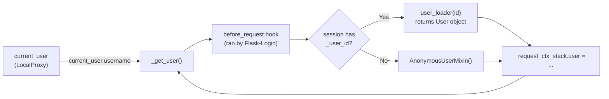

### 5.10 "Remember me" — how it works

When the user checks "Remember me" and logs in, `login_user(user, remember=True)` does two things:

1. Sets the regular session cookie (which expires when the browser closes).
2. Sets a **separate, long-lived cookie** (default 365 days) containing a signed token. The token has two parts: a user ID and a random "remember code." Both are stored in the database on the user (Flask-Login uses two columns: `remember_token` and `remember_token_hash`... actually, the implementation is more nuanced — Flask-Login stores the hash of the token server-side so a database leak doesn't grant login).

If a user visits your site with no session cookie but a valid remember-me cookie, Flask-Login:

1. Reads the cookie.
2. Looks up the user by ID.
3. Verifies the cookie's token against the stored hash.
4. If valid, logs the user in (with `is_authenticated=True` but `_fresh=False` — this distinction lets you require fresh login for sensitive operations like changing the password).

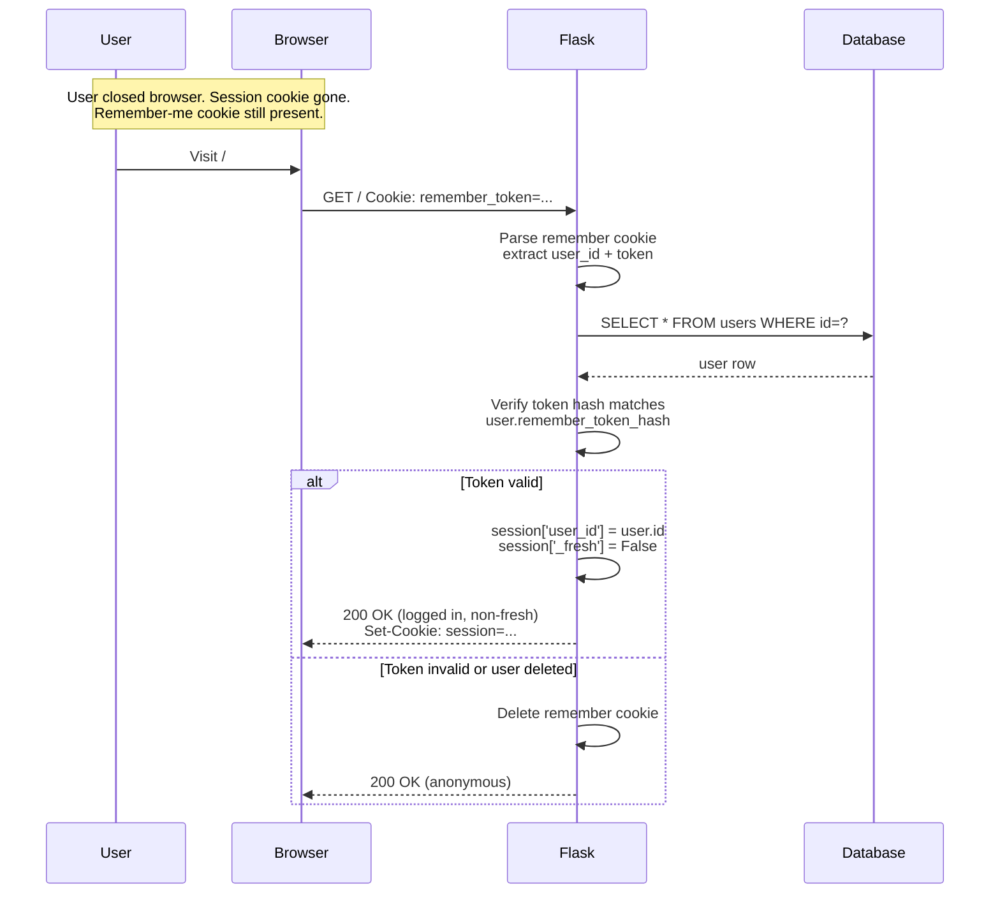

> [!tip] "Fresh" vs "non-fresh" logins
> Flask-Login tracks whether the user just typed their password (`_fresh=True`) or was logged in via a remember-me cookie (`_fresh=False`). You can require fresh login for sensitive operations:
> ```python
> from flask_login import fresh_login_required
>
> @app.route('/change-password')
> @fresh_login_required
> def change_password():
>     ...
> ```
> If the user is non-fresh, they're bounced to re-enter their password. This is the "for security, please re-enter your password" pattern you've seen on GitHub, Google, and AWS.

> [!info] The two-part remember-me cookie — why hash the token?
> Flask-Login's remember-me cookie contains `user_id|token`. The `token` is a random string unique to that login. Flask-Login stores `hash(token)` in the user's `remember_token_hash` column (not the token itself). Why? Because **if your database leaks, the attacker has the hashes but not the tokens** — they can't forge the remember-me cookie without the plaintext token (which is only in the browser's cookie jar, not the DB). The hash is one-way; the cookie is the only place the plaintext exists. This is the same principle as password hashing, applied to a different credential.
>
> The trade-off: every remember-me verification requires (a) a DB lookup for the user, (b) a hash computation, (c) a constant-time compare. That's slower than stateless JWT verification (no DB lookup) — but it's *revocable*: delete `user.remember_token_hash` from the DB and the next request from that browser logs them out. You can't do that with a JWT without a server-side revocation list.

## 6. The `current_user` Proxy — Deep Dive

`current_user` is one of those "magical" Flask-Login features that beginners use without understanding. Let's demystify it.

### 6.1 What is a proxy?

A **proxy** is an object that *looks like* another object but actually forwards attribute access to it. When you write `current_user.username`, you're not accessing a `User` object directly — you're accessing a `LocalProxy` that *forwards* the `.username` lookup to whatever the current request's user is.

```python
# Conceptually, this is what current_user does:
class LocalProxy:
    def __init__(self, lookup_func):
        self._lookup = lookup_func

    def __getattr__(self, name):
        # Every attribute access is forwarded to the looked-up object
        target = self._lookup()  # returns the real User for this request
        return getattr(target, name)
```

Flask-Login's `current_user` is a `LocalProxy` whose lookup function calls `_get_user()`, which returns the User object that the `user_loader` callback set up at the start of the request.

### 6.2 Why a proxy? Why not just store the user in a global?

You might wonder: why not just have a global `current_user` variable that gets set at the start of each request? Because Flask apps run in **multi-threaded** servers (the default `app.run()` uses threading; gunicorn uses worker processes, each with many threads). If `current_user` were a global variable, two simultaneous requests from different users would overwrite each other.

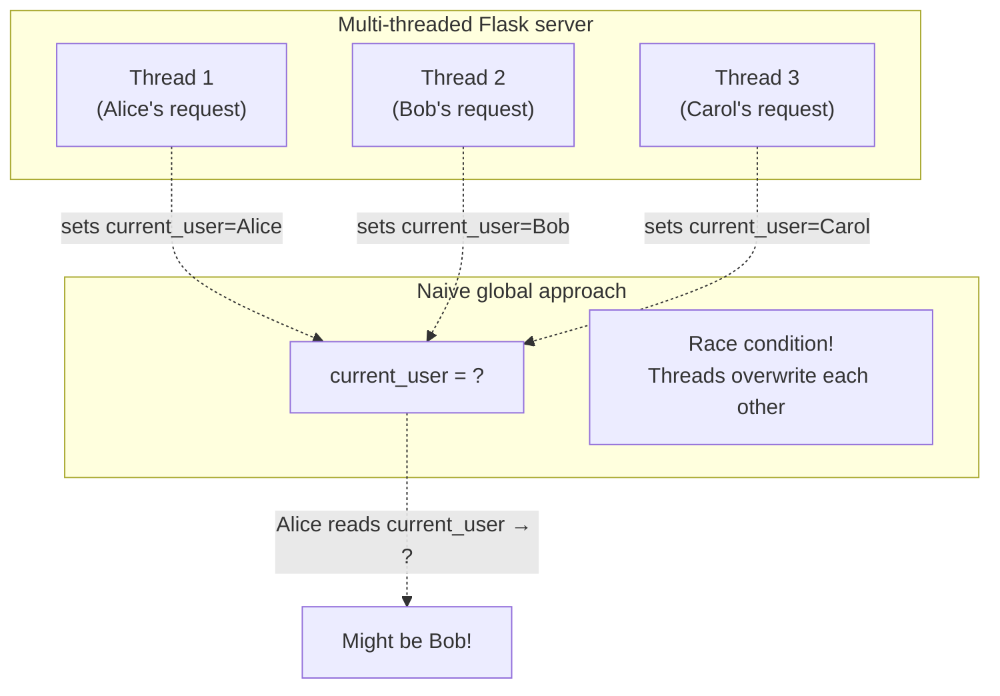

The proxy solves this with **thread-local storage**. Each thread has its own copy of "the current user." When thread 1 reads `current_user.username`, the proxy looks up thread 1's user (Alice). Thread 2 reads `current_user.username` and gets thread 2's user (Bob). No interference.

### 6.3 Werkzeug's `LocalProxy` and `LocalStack`

Under the hood, Flask-Login uses Werkzeug's `LocalProxy` and `LocalStack`. These are thread-local primitives:

- **`werkzeug.local.Local`** — like a Python `threading.local`, but works with both threads and *greenlets* (used by gevent/eventlet async servers). Each thread/greenlet sees its own value.
- **`werkzeug.local.LocalStack`** — a stack of `Local`s. Flask uses this for the request/app context stack: pushing a request context onto the stack at the start of each request, popping it at the end.
- **`werkzeug.local.LocalProxy`** — wraps a callable that returns the "top" of a `LocalStack` (or any thread-local object). Attribute access is forwarded to whatever the callable returns.

```python
# Simplified Werkzeug internals
from werkzeug.local import LocalStack, LocalProxy

_request_ctx_stack = LocalStack()

def _find_user():
    ctx = _request_ctx_stack.top  # the current request's context
    if ctx is None:
        return AnonymousUserMixin()
    return ctx.user  # set by Flask-Login's before_request hook

current_user = LocalProxy(_find_user)
```

So when you write `current_user.username`:

1. Python calls `current_user.__getattr__('username')`.
2. `LocalProxy.__getattr__` calls the lookup function `_find_user()`.
3. `_find_user` looks at the *current thread's* top of `_request_ctx_stack`.
4. It returns `ctx.user`, which was set by Flask-Login's `before_request` hook.
5. The proxy then does `getattr(ctx.user, 'username')` and returns the result.

All of this is transparent to you — `current_user.username` *just works* in any thread, in any view, in any template. The proxy is doing the heavy lifting.

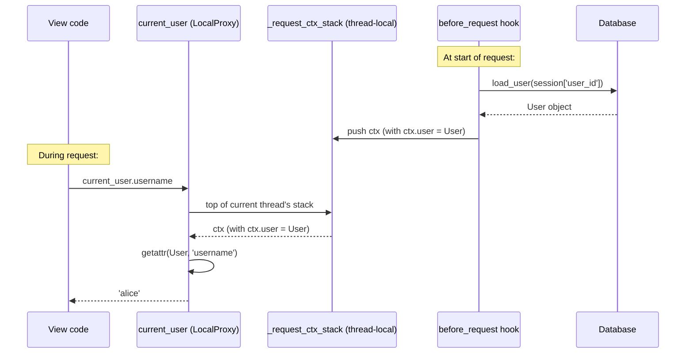

### 6.4 Templates: `current_user` is always available

In templates, you never have to pass `current_user` explicitly — Flask-Login registers a **context processor** that injects it into every template render:

```python
# Flask-Login's setup, simplified:
@app.context_processor
def inject_user():
    return {'current_user': current_user}
```

This means in any Jinja2 template, `` works without any setup. (Context processors are covered in detail in [[Lesson-08-Template-Logic]] — they're how Flask lets you inject global template variables.)

### 6.5 The cost of `current_user`

`current_user` isn't free — each attribute access goes through the proxy's lookup function. For most code this doesn't matter (microseconds per access), but in tight loops you should cache the result:

```python
# Slow — proxy lookup on every iteration
for post in posts:
    if post.author_id == current_user.id:  # proxy lookup per iteration
        ...

# Faster — cache the value
uid = current_user.id
for post in posts:
    if post.author_id == uid:
        ...
```

This is a minor optimization, but worth knowing about if you're processing thousands of items in a request.

## 7. Running the Code

### 7.1 Set up

```bash
mkdir lesson17
cd lesson17
python -m venv venv
source venv/bin/activate
pip install Flask Flask-SQLAlchemy Flask-WTF Flask-Login
```

Copy `app.py` and the templates from above. (You can keep your `myapp.db` from Lesson 16 if you want your existing users.)

### 7.2 Start the server

```bash
flask --app app run
#  * Running on http://127.0.0.1:5000
```

### 7.3 Register a user

Visit `http://127.0.0.1:5000/register`, register `alice` with password `Hunter2hunter2`. You're redirected to `/login`.

### 7.4 Log in

Visit `http://127.0.0.1:5000/login`. Type `alice` / `Hunter2hunter2`. Click Sign In.

You're redirected to `/` and the nav bar now shows "Logout (alice)" instead of "Login / Register".

### 7.5 Inspect the session cookie

Open your browser's DevTools (F12), Application tab → Cookies → http://127.0.0.1:5000. You'll see a cookie named `session`. Its value looks like:

```
eyJ1c2VyX2lkIjoxfQ.ZxYzWv.UtSrQpOnMlKjHiGfEdSaBc
```

You can decode the first part — paste it into a base64 decoder:

```
$ echo "eyJ1c2VyX2lkIjoxfQ" | base64 -d
{"user_id":1}
```

There it is — your user ID, in plaintext, on the user's computer. That's fine: it's signed, so they can't change it to `{"user_id":2}` without invalidating the signature.

### 7.6 Try to tamper with the cookie

In DevTools, edit the `session` cookie. Change the first character from `e` to `f`. Reload the page. You're now logged out — Flask detected the tampered signature and discarded the session.

### 7.7 Try to access `/profile` while logged out

Log out. Visit `http://127.0.0.1:5000/profile` directly. You're redirected to `/login?next=/profile` with a flash message "Please log in to access this page." After logging in, you're redirected back to `/profile`.

### 7.8 Try the open-redirect defense

While logged out, visit:

```
http://127.0.0.1:5000/login?next=https://evil.com
```

Log in. Notice you're redirected to `/`, not to `evil.com`. The `urlparse(next).netloc != ''` check fired.

### 7.9 Try "Remember me"

Log out. Visit `/login`, check "Remember me", and log in. Close your browser entirely (not just the tab). Reopen it. Visit `http://127.0.0.1:5000/`. You should still be logged in — the remember-me cookie persisted across browser restarts. (Without "Remember me", closing the browser ends the session.)

## 8. Common Mistakes

### 8.1 Storing the password in the session

```python
session['password'] = form.password.data   # ← NEVER
```

The session cookie is signed but **not encrypted** — the user can read it. Storing the password there means the user can read their own password (bad) and so can anyone who steals the cookie (very bad). The session should contain `user_id`, nothing more.

### 8.2 Different error messages for "user not found" vs "wrong password"

```python
if user is None:
    flash('No such user')                    # ← WRONG
elif not user.check_password(...):
    flash('Wrong password')                  # ← WRONG
```

This lets attackers enumerate usernames — they try `alice`, see "No such user"; try `bob`, see "Wrong password" — now they know `bob` exists. Always use the same message: "Invalid username or password."

### 8.3 Forgetting `current_user.is_authenticated` on `/login` and `/register`

Without this check, a logged-in user can visit `/login` and log in as someone else. That's usually not desired — log them out first. We add:

```python
if current_user.is_authenticated:
    return redirect(url_for('index'))
```

… at the top of both routes.

### 8.4 Not validating `next` — the open redirect

If you do `return redirect(request.args.get('next', '/'))` without the `urlparse().netloc` check, you're vulnerable to the open-redirect attack described in §5.6. Always validate.

### 8.5 Putting `@login_required` in the wrong order

```python
@app.route('/profile')
@login_required
def profile():
    ...
```

Decorators apply bottom-up. So `@login_required` wraps `profile` first, then `@app.route('/profile')` registers the wrapped function. This is correct. If you reverse them:

```python
@login_required
@app.route('/profile')
def profile():
    ...
```

… `@app.route` would register the *un-decorated* function (because `app.route` returns the original function), and `@login_required` would wrap nothing useful. Your route would be public. Always put `@app.route` on top.

### 8.6 Forgetting the `int(id)` cast in `user_loader`

```python
@login.user_loader
def load_user(id):
    return User.query.get(id)   # ← string, not int
```

This works in SQLite (which is lenient about types) but **fails in PostgreSQL** (which is strict). Always cast: `User.query.get(int(id))` or `db.session.get(User, int(id))`.

### 8.7 Not handling deleted users

If you delete a user from the database while they have an active session, `load_user(id)` returns `None`. Flask-Login handles this gracefully (treats them as anonymous), but if your code assumes `current_user` is always a real User (e.g. `current_user.email` on a "deleted" user), you'll get an `AttributeError`. The fix is either: always use `current_user.is_authenticated` first, or override `user_loader` to log the user out if their account is gone.

### 8.8 Mixing authentication with authorization

`@login_required` checks **authentication** (is this person anyone?). It does **not** check authorization (are they allowed to do *this*?). For authorization, you need separate checks:

```python
@app.route('/admin')
@login_required
def admin_panel():
    if not current_user.is_admin:
        abort(403)
    return render_template('admin.html')
```

We'll build a proper `@admin_required` decorator in [[Lesson-18-Blueprints]].

### 8.9 Insecure `SECRET_KEY` in production

If `SECRET_KEY` is short, predictable, or committed to git, attackers can forge session cookies. Use `secrets.token_hex(32)` and load from environment. We'll cover this in [[Lesson-23-Deployment]].

### 8.10 Not setting `SESSION_COOKIE_SECURE` in production

Without `Secure`, the browser sends the session cookie over plain HTTP — and anyone on the same Wi-Fi can sniff it. In production (HTTPS), always set:

```python
app.config['SESSION_COOKIE_SECURE'] = True
app.config['SESSION_COOKIE_HTTPONLY'] = True
app.config['SESSION_COOKIE_SAMESITE'] = 'Lax'
```

## 9. Modern: Sessions vs. JWT vs. OAuth2

### 9.1 Sessions (what we just built)

**How it works:** Server stores user state (the session dict); a session ID is sent to the browser as a cookie; on each request the server looks up the session by ID.

**Pros:** Trivial to revoke (delete the session). Works automatically in browsers (cookies are sent on every request). Mature, well-understood.

**Cons:** Server must store session state (in memory, in Redis, or in the database). Doesn't work great for cross-domain auth (cookies are per-domain). Doesn't work great for mobile apps (which often prefer bearer tokens).

### 9.2 JWT (JSON Web Tokens)

**How it works:** Server issues a signed token containing the user ID (and optionally claims like roles). The token is stored client-side (often in `localStorage`) and sent in the `Authorization: Bearer <token>` header on each request. The server verifies the signature (no database lookup needed for auth).

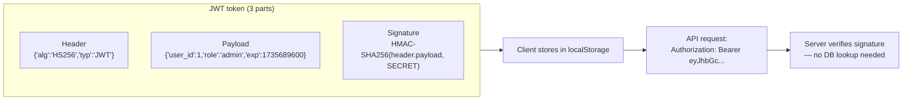

**Pros:** Stateless (no server-side session storage). Works for cross-domain APIs. Self-contained (token includes claims like roles). Mobile-app friendly.

**Cons:** **Cannot be revoked easily** — a JWT is valid until it expires. (You need a server-side revocation list, which kills the statelessness.) Bigger tokens than session IDs. Easy to misuse (don't put secrets in the payload — it's just base64, not encrypted). Storing JWTs in `localStorage` is XSS-vulnerable.

**When to use JWTs:** Stateless APIs with short token lifetimes (5-15 minutes) plus a refresh-token flow. Mobile apps. Cross-domain SSO.

**When NOT to use JWTs:** Browser-based web apps (use sessions). Long-lived tokens. Apps where you need to revoke sessions instantly (just-logged-out, just-banned users).

> [!question] Student asks: "So which should I use for my Flask app?"
> For a typical browser-based web app (HTML pages, forms, redirects): **sessions**. Flask-Login is the right tool. For a JSON API consumed by a mobile app or SPA: **JWTs** (or session-cookie auth if the SPA is on the same domain). For "log in with Google": **OAuth2** (see below).

### 9.3 OAuth2 / social login

**How it works:** Instead of building your own login, you let a third party (Google, GitHub, Apple, Microsoft) authenticate the user. The third party gives you a token proving "this person is alice@example.com." You create a user in your database with that email, or link the third-party identity to an existing user.

The flow (simplified):

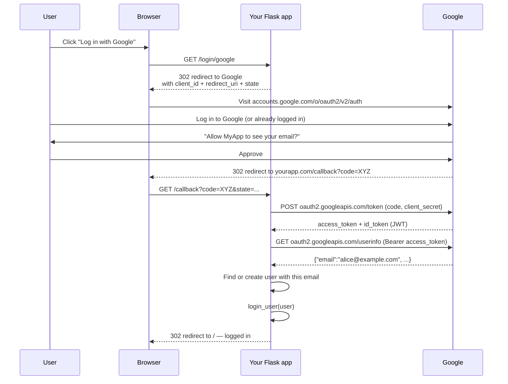

Libraries: `Authlib` (modern, recommended), `authlib-flask`, `flask-dance` (older but solid). All handle the OAuth2 dance for you; you just configure your client ID/secret and provide the callback route.

> [!question] Student asks: "What stops an attacker from intercepting the `code` in the redirect URL?"
> Three things. **First**, the redirect happens over HTTPS — the URL (including `?code=XYZ`) is encrypted between Google and the user's browser. **Second**, the `state` parameter. When Flask sends the user to Google, it includes a random `state` value and stores it in the session. When Google redirects back, it includes the same `state`. Flask checks they match — if not, the request is rejected. This prevents CSRF-style attacks where an attacker tricks a victim into completing *their* OAuth flow. **Third**, the `code` is single-use and bound to your `client_id` and `redirect_uri`. Even if an attacker steals the code, they can't redeem it without your `client_secret` (which never leaves your server).
>
> Note also that the `client_secret` is *only* known to your server — it's never in the browser, never in the redirect URL, never in JavaScript. That's why the token exchange (step 6 above) happens server-to-server. If your `client_secret` leaks, attackers can impersonate your app — treat it like a password.

> [!question] Student asks: "What's the difference between OAuth2 and OpenID Connect?"
> OAuth2 is for **authorization** — granting a third-party app access to your data in another service ("let Strava read my Google Fit data"). OpenID Connect (OIDC) is built *on top of* OAuth2 and adds **authentication** — proving who you are ("log me in with Google"). When you see "Log in with Google," it's actually OIDC. The difference shows up in the response: OAuth2 returns an `access_token` (use to call APIs); OIDC additionally returns an `id_token` — a JWT containing the user's identity (email, name, picture). When you implement social login, you want OIDC; when you implement "let this app read my Gmail," you want OAuth2.

> [!info] The "social login" anti-pattern: trusting the email without verification
> A common mistake: implement Google login, get back `alice@example.com` from Google, find-or-create a user with that email. The flaw: if `example.com` is a G Suite domain where *anyone* can register an email, an attacker can register `alice@example.com` at Google, log in with Google, and now they're "Alice" in your app — even though they're not the original Alice.
>
> The fix: store the OAuth provider + provider-issued user ID alongside your user (e.g. `google_123456789`), not just the email. Only link a new OAuth identity to an *existing* user if that user has already verified the email (clicked a verification link). And if a user logs in with Google for the first time, treat the email as verified *only* if you trust the provider to have verified it — Google verifies emails on signup, but not all providers do.

### 9.4 Passkeys / WebAuthn (the 2026 frontier)

The newest standard replaces passwords entirely. The user's device (phone, laptop with Touch ID, hardware key) holds a private key; the public key is registered with your server. On login, the server sends a challenge; the device signs it (after biometric unlock); the server verifies the signature. No password ever transmitted. No password to leak.

Libraries: `fido2` (Yubico's library), `webauthn` (Python package). Browser support: all modern browsers since 2022. We won't implement passkeys in this course, but you should know they exist and are the future of auth.

## 10. Try This

> [!tip] Try this: decode your session cookie
> After logging in, open DevTools → Application → Cookies. Copy the `session` cookie value. Split on `.` (there should be three parts). Base64-decode the first part:
> ```bash
> echo "eyJ1c2VyX2lkIjoxfQ" | base64 -d
> ```
> You should see `{"user_id":1}`. Now you understand: anyone with the cookie can read this. They just can't *change* it.

> [!tip] Try this: tamper with the cookie
> In DevTools, edit the `session` cookie. Change the `1` in the payload to `2` (you may need to re-encode the base64). Reload the page. You should be logged out — the signature no longer matches. (You didn't actually become user 2.)

> [!tip] Try this: watch the redirect chain
> Open DevTools → Network. While logged out, visit `http://127.0.0.1:5000/profile`. You should see: 302 → `/login?next=/profile`. Now log in. You should see: 302 → `/profile` (the original destination). The `next` parameter carried the original URL through the login flow.

> [!tip] Try this: time the `user_loader`
> Add a print statement inside your `user_loader` to confirm it runs on every request:
> ```python
> @login.user_loader
> def load_user(id):
>     print(f"Loading user {id} from DB")
>     return db.session.get(User, int(id))
> ```
> Reload any page while logged in. You'll see the print on every request — that's the per-request DB hit you take for auth.

> [!tip] Try this: add a `fresh_login_required` route
> Add a `/change-password` route decorated with `@fresh_login_required`. Log in with "Remember me", close the browser, reopen, visit `/change-password`. You should be bounced to re-enter your password — the remember-me login is non-fresh.

> [!tip] Try this: implement a "log out everywhere" button
> Add a `session_version` integer column to `User` (default 0). Store that version in the session at login: `session['session_version'] = user.session_version`. In the `user_loader`, compare `session['session_version']` to `user.session_version` — if they differ, call `logout_user()` (someone called "log out everywhere" since this session was created). Add a button on `/profile` that increments `user.session_version` and commits. After clicking it, all your other browser tabs/sessions should be logged out on their next request.

> [!tip] Try this: build a session inspector route
> Add a temporary `/debug-session` route (login_required) that returns `dict(session)` as JSON. Notice what's in there: `user_id`, `_fresh`, `_id` (CSRF token), `_flashes` (pending flash messages), maybe `session_version` from the previous exercise. Now you understand *exactly* what's in the cookie on the user's computer. Delete this route before deploying — it's a security leak in production.

> [!tip] Try this: see what happens when `SECRET_KEY` changes
> Log in to your app. Now change `SECRET_KEY` to a different value in `app.py`. Restart the server. Reload any page. You should be logged out — the session cookie's signature no longer matches the new `SECRET_KEY`, so Flask discards it. This is why rotating `SECRET_KEY` invalidates all sessions: every user has to log in again. (In production, you can rotate gracefully by setting `SECRET_KEY` to the new value and `SECURITY_PASSWORD_SALT` / `PREVIOUS_SECRET_KEYS` to the old one for a transition period — but that's an advanced topic for Lesson 23.)

## 11. Exercises

### Exercise 1 — Profile editing (easy)

Add a `/profile/edit` route (login_required) with a form to update `email` and `username`. Validate uniqueness. After saving, flash "Profile updated" and redirect to `/profile`.

### Exercise 2 — User list (easy)

Add an `/users` route that lists all registered users. Make it `@login_required` so only logged-in users can see it. (Yes, this is a privacy concern in real apps — it's just for exercise.)

### Exercise 3 — Admin role (medium)

Add an `is_admin` boolean column to `User` (default `False`). Set one user's `is_admin = True` in the shell. Write an `@admin_required` decorator that wraps `@login_required` and also checks `current_user.is_admin` (returning 403 if not). Apply it to a `/admin` route.

### Exercise 4 — Rate-limit login attempts (medium)

Without Redis (yet), use the session to track failed login attempts per username. After 5 failures, lock the account for 60 seconds. (This is defeated by clearing cookies, but it's a start. We'll do this properly with Redis in Lesson 22.)

### Exercise 5 — Session version counter (hard)

Add a `session_version` column to `User` (default 0). Store the version in the session at login. On each request, check the session version matches the user's current version — if not, log them out. Add a "log out all other sessions" button that increments the version. (This is how Twitter, GitHub, etc. implement "log out everywhere.")

### Exercise 6 — Implement "Log in with Google" (medium-hard)

Install `Authlib`. Register a Google OAuth client (free at console.cloud.google.com). Implement the `/login/google` and `/callback` routes. On callback, look up the user by email; if not found, create them with a random password (they'll never use it). Log them in.

### Exercise 7 — JWT API auth (medium)

Build a `/api/login` endpoint that accepts username + password and returns a JWT (use `PyJWT`). Build a `/api/me` endpoint that requires the JWT in the `Authorization: Bearer` header and returns the user's profile as JSON. Compare the experience to cookie-based auth.

### Exercise 8 — Add a "fresh login required" route (easy)

Add a `/change-password` route decorated with `@fresh_login_required`. Verify that remember-me logins are bounced to re-enter their password.

## 12. What We Learned

- **HTTP is stateless** — every request is independent. Cookies (RFC 6265) add the missing "memory."
- **Cookies** work via two headers: `Set-Cookie` (server → browser, "remember this") and `Cookie` (browser → server, "here's what you told me").
- Cookie security flags: **`HttpOnly`** (no JS access — XSS defense), **`Secure`** (HTTPS only), **`SameSite=Lax/Strict`** (CSRF defense), **`Max-Age`/`Expires`** (lifetime).
- Flask's **session** is a *signed* (not encrypted) cookie. The user can read it but not modify it — the signature is HMAC-SHA256 with your `SECRET_KEY`. Never put secrets in the session; never commit `SECRET_KEY` to git.
- **Flask-Login** is the de-facto auth library. It handles: session storage of user ID, `current_user` proxy, `@login_required`, "remember me", and `user_loader`. It does **not** handle user storage, password hashing, registration, or permissions.
- **`UserMixin`** provides `is_authenticated`, `is_active`, `is_anonymous`, and `get_id()` — the four things Flask-Login needs from your User class.
- **`user_loader`** runs on every authenticated request, converting the session-stored ID back into a User object. It's a per-request DB hit. Cache it in Redis for high-traffic apps.
- The **`/login` route** checks the username exists and the password matches, with a single error message for both failure cases (to prevent username enumeration).
- **`@login_required`** redirects anonymous users to `login_view` with `?next=...`. The `next` parameter must be validated with `urlparse(next).netloc != ''` to prevent **open-redirect attacks**.
- **`current_user`** is a `LocalProxy` — it always refers to "the user for the current request." Available in views and templates automatically.
- **"Remember me"** sets a separate, long-lived cookie. Remember-me logins are non-fresh; `@fresh_login_required` requires a fresh login for sensitive operations.
- **Modern alternatives:**
  - **JWTs** for stateless API auth (especially mobile/SPA) — but revocation is hard.
  - **OAuth2** for "Log in with Google/GitHub" — `Authlib` is the recommended library.
  - **Passkeys / WebAuthn** (2026 frontier) — passwordless, biometric-unlocked, no passwords ever transmitted.

## 13. Next Lesson

You now have a complete authentication system: register, login, logout, protected pages, remember-me. But your `app.py` is starting to get long — it has the User model, the forms, the auth routes, the home route, and the profile route all in one file. Real apps have *hundreds* of routes. One file won't cut it.

In [[Lesson-18-Blueprints]] (first lesson of Module 08) you'll learn:

- **Why Blueprints exist** — the "God app.py" problem.
- **Blueprint anatomy** — name, routes, templates, static files.
- **Creating and registering blueprints** with `Blueprint()` and `app.register_blueprint()`.
- **`url_prefix`** — scoping URLs so `auth.login` becomes `/login` while `blog.create` becomes `/blog/create`.
- **`url_for` with blueprints** — `'blueprint.function'`.
- The **Application Factory pattern** — `create_app()` — and why it's the modern standard.
- **Deferred initialization** — `db.init_app(app)`, `login.init_app(app)`.
- **Avoiding circular imports** — the classic Flask problem, solved.
- Real-world: organizing a large app into **auth, blog, api, admin** blueprints.
- Modern: 2026 Flask project structure best practices.

> [!quote] A note from your teacher
> Authentication is the part of web development where the consequences of getting it wrong are highest. A bug in your to-do list loses someone a task; a bug in your auth loses someone their identity. Today you learned the standard pattern: a signed cookie identifies the user, a `user_loader` turns it back into a model object, `@login_required` gates your protected routes, and `current_user` makes the user available everywhere. You learned why "Invalid username or password" beats "No such user" — because information is an attacker's fuel. You learned why `urlparse(next).netloc != ''` matters — because open redirects are how phishers weaponize your trust. These are the small, careful, paranoid habits that separate a working app from a safe one. Next, we'll structure the app itself — blueprints. Onward.
