# Lesson 18 — Blueprints: Organizing a Growing Flask App

> [!success] First lesson of Module 08 — Blueprints.
> Up to now, every app you've built has lived in a single `app.py`. That was fine when apps were 100 lines. But the Lesson 17 auth app is already pushing 80 lines of routes plus models plus forms plus templates — and we haven't even built the blog yet. Today you'll learn **Blueprints**: Flask's mechanism for splitting an app into modular components. By the end of this lesson, you'll have restructured your auth app into `auth/`, `main/`, and `errors/` blueprints, learned the **Application Factory pattern** that every production Flask app uses, and solved the classic Flask problem of **circular imports**.

## 1. Learning Objectives

By the end of this lesson you will be able to:

1. **Explain the "God app.py" problem** and why every growing Flask app needs to be split.
2. **Describe what a Blueprint is** — a "mini-app" with its own routes, templates, static files, and error handlers.
3. **Create a Blueprint** with `Blueprint('name', __name__)` and register it with `app.register_blueprint(bp)`.
4. **Use `url_prefix`** to scope a blueprint's URLs (e.g. all `/auth/...` routes in the auth blueprint).
5. **Use `url_for` with blueprints** — the `'blueprint.endpoint'` syntax.
6. **Implement the Application Factory pattern** — `create_app()` returning a configured app.
7. **Use deferred initialization** — `db.init_app(app)`, `login.init_app(app)` — so extensions work without a global `app`.
8. **Solve the circular-import problem** that bites every Flask beginner.
9. **Register blueprint-specific error handlers, `before_request`, and `after_request`** hooks.
10. **Lay out a real project** with `auth/`, `blog/`, `api/`, `admin/` blueprints.
11. **Apply 2026 best practices** for Flask project structure.

## 2. Prerequisites

- **[[Lesson-17-Flask-Login]] completed.** You have a working `app.py` with `LoginManager`, `User` model, `/login`, `/logout`, `/register`, and `/profile`.
- **[[Lesson-12-SQLAlchemy-Setup]] completed.** You've used `db = SQLAlchemy(app)`.
- **[[Lesson-09-Static-Files]] completed.** You understand `url_for('static', filename='...')`.

## 3. The Problem

### 3.1 The "God app.py" problem

Here's your Lesson 17 `app.py`, summarized:

```python
# 80 lines of imports + app setup + config
# 20 lines of User model + set_password/check_password
# 30 lines of RegistrationForm + LoginForm
# 10 lines of index route
# 20 lines of register route
# 25 lines of login route
# 5 lines of logout route
# 5 lines of profile route
# 5 lines of create_all + run

# Total: ~200 lines, all in one file.
```

Add a blog (Lesson 24) and you'll have:

```python
# + 30 lines of Post model
# + 30 lines of Comment model
# + 30 lines of Tag model
# + 20 lines of PostForm + CommentForm
# + 20 lines of post_list route
# + 25 lines of post_view route
# + 25 lines of post_create route
# + 25 lines of post_edit route
# + 15 lines of post_delete route
# + 20 lines of comment_create route

# Total: ~400+ lines, still one file.
```

Add an API, an admin panel, a user-profile page, search, password reset, email… you'll be at 1000+ lines. **One file.** This is the "God app.py" anti-pattern.

Symptoms:

- **Hard to navigate.** Find-the-route-buried-in-line-743 is exhausting.
- **Merge conflicts.** Two developers editing `app.py` at once = constant conflict.
- **Hard to test.** Importing `app.py` executes every model definition, every route, every config setting — you can't isolate anything.
- **Tight coupling.** The auth code knows about the blog code knows about the API code. Change one, risk breaking the others.
- **Can't run multiple apps.** Tests, migrations, and a production app might need different configurations of the same code — but `app = Flask(__name__)` at module level locks you in.

### 3.2 What is a Blueprint?

A Blueprint is a **mini-app** — a self-contained set of routes, templates, static files, error handlers, and request hooks that you register onto the real app at startup.

Think of it like a **plugin**. You write the blueprint once (e.g. an "auth" blueprint with `/login`, `/logout`, `/register`), then "plug it in" to any app. Flask's own documentation describes blueprints as "a set of operations which can be registered on the application later."

> [!info] The history of Blueprints
> Blueprints were added in Flask 0.7 (July 2012). Before that, Flask apps were genuinely one-file affairs, and the only way to split them was a slightly hacky pattern of importing view functions from submodules. Armin Ronacher (Flask's creator) introduced Blueprints with the explicit goal of making Flask apps modular enough to ship as **reusable distributions** — a `company-auth-flask` package you could `pip install` and `register_blueprint()` into any app. That's still a valid use case today, though it's more common to keep blueprints in-repo and use them as **organizational units** within a single app.

> [!question] Student asks: "Why not just split one app.py into multiple files and import them?"
> You can — but it creates circular imports. `app.py` does `from auth import login_route`, and `auth.py` does `from app import app, db`. Each module imports the other at import time; Python's import machinery can't resolve this. You can break the cycle by importing inside functions (deferred imports) or by passing `app` and `db` as arguments — but at that point you've reinvented blueprints badly. Blueprints formalize the pattern: the blueprint object holds a *reference* to its routes (deferred), and the app factory binds them at runtime. Use blueprints — they're the supported solution.

> [!question] Student asks: "Can a blueprint access another blueprint's routes or models?"
> Yes. Blueprints are an *organizational* concept, not a security boundary. The `auth` blueprint can import `Post` from `app.models`, can call `url_for('blog.show_post', post_id=5)`, can query the same database. There's no isolation between blueprints — they all live in the same Python process, share the same `db`, see the same `app`. If you want isolation, you want separate processes or separate apps entirely (e.g. microservices).

> [!question] Student asks: "Should every feature be its own blueprint?"
> No — premature modularity is as bad as no modularity. A 5-route app doesn't need 5 blueprints. A good rule of thumb: split into a new blueprint when (a) the routes share a URL prefix and you find yourself writing it repeatedly, (b) they need a shared `before_request` hook, (c) they're a different *kind* of surface (HTML pages vs JSON API vs admin panel), or (d) a different team owns them. Otherwise, group related routes in one blueprint (`blog` for posts+comments+tags is fine).

### 3.3 What a Blueprint is NOT

A few common misconceptions to clear up:

- A blueprint is **not a separate app**. It can't run on its own; it must be registered onto an `app`. There's no `Blueprint.run()`.
- A blueprint is **not a process or a service**. It's just a registry of routes, templates, etc. There's no `auth_worker` process.
- A blueprint is **not a security boundary**. Code in one blueprint can import code from another blueprint. If you want isolation, use separate apps (or separate processes).
- A blueprint is **not a database boundary**. All blueprints share the same `db` (and the same database). If you want separate databases, that's a different problem (multitenancy — usually solved with schema-per-tenant or database-per-tenant patterns).

A blueprint is purely an **organizational tool**: it groups related routes together, lets them share a URL prefix and request hooks, and makes the codebase easier to navigate.

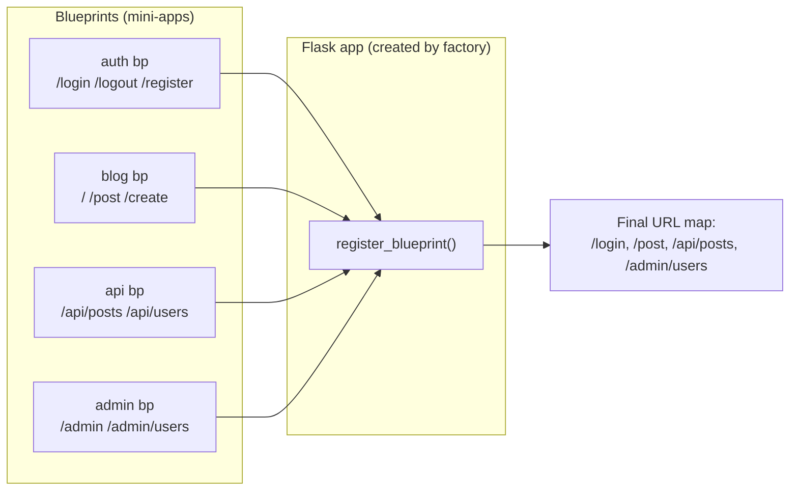

### 3.4 The real-world analogy: a department store

Imagine a department store. There's a single building (your Flask app), but inside are departments (blueprints): cosmetics, electronics, clothing, grocery. Each department has its own:

- **Signage and branding** (its own templates and static files).
- **Staff** (its own routes / view functions).
- **Layout** (its own `url_prefix`: cosmetics on the ground floor, electronics on the second).
- **Policies** (its own `before_request` — e.g. the grocery department requires a temperature check).

But they all share the building's central services: HVAC (the database), electricity (the session), security (the login system). The store manager (the application factory) wires each department into the building.

That's blueprints. You build small, focused departments, then the factory assembles them into a complete store.

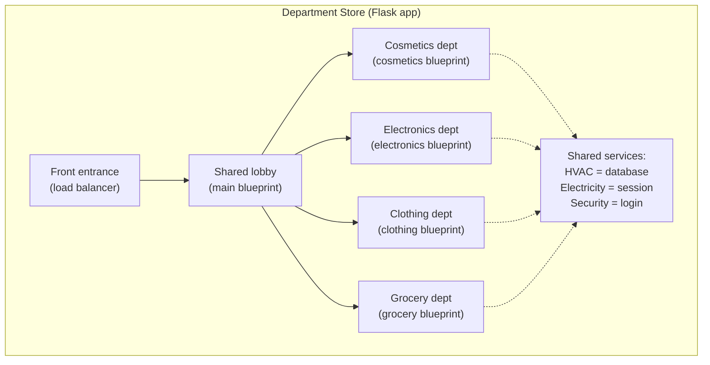

### 3.5 Anatomy of a Blueprint — what's actually inside?

When you write `auth = Blueprint('auth', __name__)`, you're creating a `Blueprint` object. Let's peek inside it. The Blueprint class is essentially a *recording device* — it records the operations you'd normally do on `app`, then replays them when you `register_blueprint()`.

```python
# Simplified from Flask's source
class Blueprint:
    def __init__(self, name, import_name, **kwargs):
        self.name = name
        self.import_name = import_name
        self.url_prefix = kwargs.get('url_prefix')
        self.deferred_functions = []  # ← the key: list of "things to do later"
        self.blueprint_specifics = {}

    def route(self, rule, **options):
        # Like @app.route — but instead of registering immediately,
        # we APPEND a deferred function to be run later.
        def decorator(f):
            self.add_url_rule(rule, f, **options)
            return f
        return decorator

    def add_url_rule(self, rule, view_func, **options):
        # Defer the actual registration
        self.deferred_functions.append(
            lambda state: state.add_url_rule(rule, view_func, **options)
        )

    def register(self, app, options):
        # Called by app.register_blueprint(bp). Replays the deferred functions.
        state = BlueprintSetupState(self, app, options)
        for deferred in self.deferred_functions:
            deferred(state)
```

The crucial pattern: **`@auth.route(...)` doesn't register anything with the app** — it stores a lambda in `deferred_functions`. Only when you call `app.register_blueprint(auth_bp)` are those lambdas invoked, one by one, against the real `app`. This is what makes blueprints importable without an app existing.

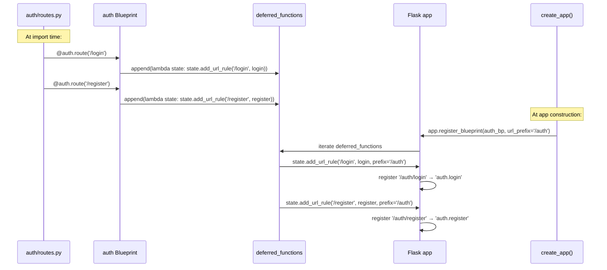

> [!info] Why "deferred" matters
> This deferred-registration pattern is the *only* reason the application factory pattern works. If `@auth.route` immediately called `app.url_map.add(...)`, then `auth/routes.py` would need `app` to exist at import time — and we're back to the circular-import problem. By deferring registration, the blueprint can be imported *anywhere*, and the actual binding to `app` happens later, inside `create_app()`. The same deferred pattern is used by `db = SQLAlchemy()` (no app yet) + `db.init_app(app)` (bind later).

## 4. The Code

### 4.1 Project structure

```
myapp/
├── app/
│   ├── __init__.py          # create_app() factory
│   ├── extensions.py        # db, login, etc. — no app yet
│   ├── models.py            # User, Post, etc.
│   ├── auth/
│   │   ├── __init__.py      # creates the 'auth' blueprint
│   │   ├── routes.py        # /login, /logout, /register
│   │   ├── forms.py         # LoginForm, RegistrationForm
│   │   ├── templates/
│   │   │   └── auth/
│   │   │       ├── login.html
│   │   │       └── register.html
│   │   └── email.py         # send_password_reset_email (Lesson 22)
│   ├── blog/
│   │   ├── __init__.py      # creates the 'blog' blueprint
│   │   ├── routes.py        # /, /post/<id>, /create, /edit/<id>
│   │   ├── forms.py         # PostForm
│   │   └── templates/
│   │       └── blog/
│   │           ├── index.html
│   │           └── post.html
│   ├── main/
│   │   ├── __init__.py
│   │   └── routes.py        # / (home), /about, /favicon
│   ├── errors/
│   │   ├── __init__.py
│   │   ├── handlers.py      # 404, 500 handlers
│   │   └── templates/
│   │       └── errors/
│   │           ├── 404.html
│   │           └── 500.html
│   ├── templates/
│   │   └── base.html        # shared base template
│   └── static/
│       └── style.css
├── config.py                # Config classes (Dev, Prod, Test)
├── run.py                   # python run.py to start
└── requirements.txt
```

This is the standard Flask layout. Let's build it up.

### 4.2 `extensions.py` — extensions without an app

The trick to the application factory pattern: extensions are created at module level, but they're not bound to any app yet. They get bound later, inside the factory.

```python
# app/extensions.py
from flask_sqlalchemy import SQLAlchemy
from flask_login import LoginManager
from flask_wtf import CSRFProtect

# These exist as standalone objects, not yet bound to any app.
db = SQLAlchemy()
login = LoginManager()
csrf = CSRFProtect()

login.login_view = 'auth.login'   # NOTE: blueprint-qualified endpoint
login.login_message_category = 'info'
```

Why this matters: any module can `from app.extensions import db` without needing an `app` to exist. The User model uses `db.Model` — that works because `db` is a real `SQLAlchemy()` instance, just one that hasn't been told which app to use yet. The binding happens in `db.init_app(app)` inside the factory.

### 4.3 `models.py` — models defined once

```python
# app/models.py
from app.extensions import db, login
from flask_login import UserMixin
from werkzeug.security import generate_password_hash, check_password_hash


class User(UserMixin, db.Model):
    __tablename__ = 'users'
    id = db.Column(db.Integer, primary_key=True)
    username = db.Column(db.String(80), unique=True, nullable=False)
    email = db.Column(db.String(120), unique=True, nullable=False)
    password_hash = db.Column(db.String(255))

    def set_password(self, password):
        self.password_hash = generate_password_hash(password)

    def check_password(self, password):
        return check_password_hash(self.password_hash, password)


@login.user_loader
def load_user(id):
    return db.session.get(User, int(id))
```

Notice: `db.Model` works, even though `db` has no app yet. That's because `SQLAlchemy()` (without an app) still provides the `Model` base class. The actual database connection is only needed at runtime; the class definition is just metadata.

The `user_loader` is registered on `login` (the LoginManager), not on an app — but it's a callback that runs per-request, so it's fine to register at import time.

### 4.4 The auth blueprint

```python
# app/auth/__init__.py
from flask import Blueprint

auth = Blueprint('auth', __name__)

from app.auth import routes   # noqa: E402,F401  (import at bottom to avoid circular)
```

```python
# app/auth/routes.py
from flask import render_template, redirect, url_for, flash, request
from urllib.parse import urlparse
from app.auth import auth
from app.auth.forms import LoginForm, RegistrationForm
from app.extensions import db, login
from app.models import User
from flask_login import login_user, logout_user, current_user, login_required


@auth.route('/login', methods=['GET', 'POST'])
def login():
    if current_user.is_authenticated:
        return redirect(url_for('main.index'))
    form = LoginForm()
    if form.validate_on_submit():
        user = User.query.filter_by(username=form.username.data).first()
        if user is None or not user.check_password(form.password.data):
            flash('Invalid username or password')
            return redirect(url_for('auth.login'))
        login_user(user, remember=form.remember_me.data)
        next_page = request.args.get('next')
        if not next_page or urlparse(next_page).netloc != '':
            next_page = url_for('main.index')
        return redirect(next_page)
    return render_template('auth/login.html', form=form)


@auth.route('/logout')
@login_required
def logout():
    logout_user()
    return redirect(url_for('main.index'))


@auth.route('/register', methods=['GET', 'POST'])
def register():
    if current_user.is_authenticated:
        return redirect(url_for('main.index'))
    form = RegistrationForm()
    if form.validate_on_submit():
        user = User(username=form.username.data, email=form.email.data)
        user.set_password(form.password.data)
        db.session.add(user)
        db.session.commit()
        flash('Registration successful! Please log in.')
        return redirect(url_for('auth.login'))
    return render_template('auth/register.html', form=form)
```

```python
# app/auth/forms.py
from flask_wtf import FlaskForm
from wtforms import StringField, PasswordField, BooleanField, SubmitField
from wtforms.validators import DataRequired, Email, Length, EqualTo, ValidationError
from app.models import User


class LoginForm(FlaskForm):
    username = StringField('Username', validators=[DataRequired()])
    password = PasswordField('Password', validators=[DataRequired()])
    remember_me = BooleanField('Remember Me')
    submit = SubmitField('Sign In')


class RegistrationForm(FlaskForm):
    username = StringField('Username', validators=[DataRequired(), Length(min=4, max=80)])
    email = StringField('Email', validators=[DataRequired(), Email()])
    password = PasswordField('Password', validators=[DataRequired(), Length(min=8)])
    password2 = PasswordField('Repeat Password',
                              validators=[DataRequired(), EqualTo('password')])
    submit = SubmitField('Register')

    def validate_username(self, username):
        user = User.query.filter_by(username=username.data).first()
        if user is not None:
            raise ValidationError('Please use a different username.')
```

### 4.5 The main blueprint

```python
# app/main/__init__.py
from flask import Blueprint

main = Blueprint('main', __name__)

from app.main import routes   # noqa: E402,F401
```

```python
# app/main/routes.py
from flask import render_template
from app.main import main


@main.route('/')
def index():
    return render_template('index.html')


@main.route('/about')
def about():
    return render_template('about.html')
```

### 4.6 The errors blueprint

```python
# app/errors/__init__.py
from flask import Blueprint

errors = Blueprint('errors', __name__)

from app.errors import handlers   # noqa: E402,F401
```

```python
# app/errors/handlers.py
from flask import render_template
from app.errors import errors


@errors.app_errorhandler(404)
def not_found_error(e):
    return render_template('errors/404.html'), 404


@errors.app_errorhandler(500)
def internal_error(e):
    return render_template('errors/500.html'), 500
```

Note: `app_errorhandler` (not just `errorhandler`) registers the handler at the app level, even when defined in a blueprint. Plain `errorhandler` would only catch errors raised *within* blueprint routes.

### 4.7 The application factory

```python
# app/__init__.py
import os
from flask import Flask
from config import Config


def create_app(config_class=Config):
    app = Flask(__name__)
    app.config.from_object(config_class)

    # Bind extensions to this app
    from app.extensions import db, login, csrf
    db.init_app(app)
    login.init_app(app)
    csrf.init_app(app)

    # Register blueprints
    from app.main import main as main_bp
    from app.auth import auth as auth_bp
    from app.errors import errors as errors_bp
    app.register_blueprint(main_bp)
    app.register_blueprint(auth_bp, url_prefix='/auth')   # all auth routes become /auth/...
    app.register_blueprint(errors_bp)

    # Make sure tables exist (dev only — use migrations in prod)
    with app.app_context():
        db.create_all()

    return app
```

```python
# run.py
from app import create_app

app = create_app()

if __name__ == '__main__':
    app.run(debug=True)
```

```python
# config.py
import os
basedir = os.path.abspath(os.path.dirname(__file__))


class Config:
    SECRET_KEY = os.environ.get('SECRET_KEY') or 'dev-only-secret-key-change-in-prod'
    SQLALCHEMY_DATABASE_URI = os.environ.get('DATABASE_URL') or \
        'sqlite:///' + os.path.join(basedir, 'app.db')
    SQLALCHEMY_TRACK_MODIFICATIONS = False
```

### 4.8 Templates — blueprint-scoped

`app/auth/templates/auth/login.html`:

```html

Login

  <h2>Sign In</h2>
  <form method="post" novalidate>
    {{ form.hidden_tag() }}
    <p>{{ form.username.label }} {{ form.username(size=32) }}</p>
    <p>{{ form.password.label }} {{ form.password(size=32) }}</p>
    <p>{{ form.remember_me() }} {{ form.remember_me.label }}</p>
    <p>{{ form.submit() }}</p>
  </form>

```

`app/templates/base.html`:

```html
<!doctype html>
<html>
<head><title>MyApp</title></head>
<body>
  <nav>
    <a href="{{ url_for('main.index') }}">Home</a> |
    
      <a href="{{ url_for('auth.logout') }}">Logout ({{ current_user.username }})</a>
    
      <a href="{{ url_for('auth.login') }}">Login</a>
      <a href="{{ url_for('auth.register') }}">Register</a>
    
  </nav>
  
</body>
</html>
```

Notice the `url_for` calls now use **blueprint-qualified endpoints**: `auth.login`, `auth.logout`, `main.index`. This is the key change when you adopt blueprints.

## 5. Line-by-Line Explanation

### 5.1 `Blueprint('auth', __name__)`

```python
auth = Blueprint('auth', __name__)
```

- `'auth'` — the **name** of the blueprint. This name becomes the prefix in `url_for`: `url_for('auth.login')`. It must be unique across the app.
- `__name__` — the import name. Flask uses this to locate the blueprint's templates folder (it looks in `templates/` next to the file that called `Blueprint()`), its static folder, and to resolve relative imports. Always pass `__name__`.

Optional arguments:

- `template_folder='templates'` — override the templates location (default is `templates`).
- `static_folder='static'` — override the static files location.
- `static_url_path='/auth-static'` — the URL path for static files (default is `/blueprint_name/static`).
- `url_prefix='/auth'` — a prefix added to all the blueprint's URLs. You can also pass this to `register_blueprint`.
- `subdomain='api'` — restrict the blueprint to a specific subdomain (e.g. `api.example.com`).

### 5.2 `app.register_blueprint(auth_bp, url_prefix='/auth')`

```python
app.register_blueprint(auth_bp, url_prefix='/auth')
```

This plugs the blueprint into the app. After this:

- Routes defined as `@auth.route('/login')` are accessible at `/auth/login`.
- `url_for('auth.login')` returns `/auth/login`.
- Templates in `app/auth/templates/auth/` are found when you `render_template('auth/login.html')`.
- Static files in `app/auth/static/` are served at `/auth/static/...`.

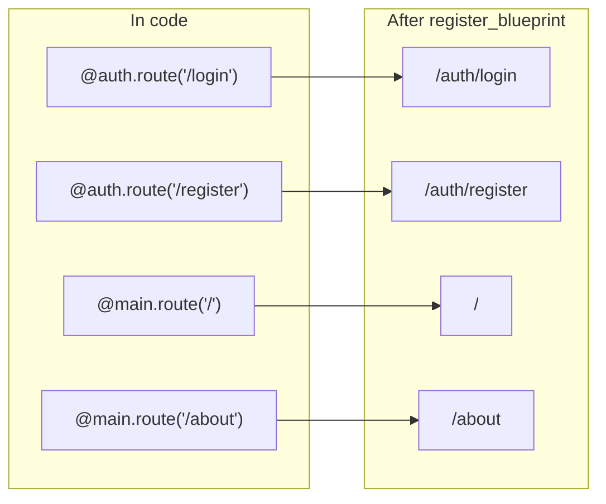

### 5.3 `url_for` with blueprints

Before blueprints, you wrote `url_for('login')` — just the function name. With blueprints, you write `url_for('auth.login')` — `<blueprint_name>.<function_name>`. This is the only required change to existing `url_for` calls when you adopt blueprints.

```python
url_for('main.index')         # → '/'
url_for('auth.login')         # → '/auth/login'
url_for('auth.register')      # → '/auth/register'
url_for('auth.logout')        # → '/auth/logout'
url_for('main.about')         # → '/about'
url_for('static', filename='style.css')   # → '/static/style.css' (special, no blueprint)
```

If you forget the blueprint prefix and write `url_for('login')`, you get `BuildError: Could not build url for endpoint 'login'`. Flask is telling you "I don't know which blueprint's login you mean."

### 5.4 The application factory — `create_app()`

```python
def create_app(config_class=Config):
    app = Flask(__name__)
    app.config.from_object(config_class)
    # ... init extensions, register blueprints ...
    return app
```

The factory is a function that **constructs and returns** a Flask app. Every step that used to happen at module level (`app = Flask(__name__)`, `db = SQLAlchemy(app)`, `app.register_blueprint(...)`) now happens *inside* the factory.

Benefits:

1. **Multiple configurations.** `create_app(DevelopmentConfig)` for dev, `create_app(ProductionConfig)` for prod, `create_app(TestConfig)` for tests. Same code, different config.
2. **Multiple apps.** `app1 = create_app(); app2 = create_app()` — useful for testing, for running multiple instances in one process, for blueprints-as-apps.
3. **Lazy initialization.** Extensions and blueprints are imported *inside* the factory, so importing `app/__init__.py` doesn't trigger a flood of side effects. Tests can patch config before the app is built.
4. **Avoids circular imports.** Models import `db` from `extensions.py`. Routes import models. The factory imports routes. No cycle.

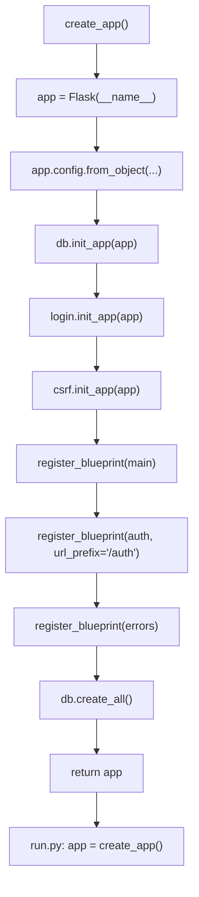

> [!info] Why `app = Flask(__name__)` inside the factory?
> `__name__` inside `app/__init__.py` is `"app"` (the package name). Flask uses this as the **import name** — it tells Flask where to find the `templates/` and `static/` folders (next to `app/__init__.py`), and it's the root for resolving blueprint import paths. If you accidentally pass `'app'` as a string instead of `__name__`, you'll get weird import errors when blueprints try to import their routes.

> [!question] Student asks: "Why import blueprints inside the factory instead of at the top of `__init__.py`?"
> Two reasons. **First**, importing blueprints at the top of `__init__.py` would re-trigger blueprint route imports every time `app/__init__.py` is imported — and blueprint routes import models, which import extensions, which... the order matters. **Second**, lazy imports inside the factory mean that *importing the `app` package* doesn't construct an app object — only *calling* `create_app()` does. That's important for testing: you can patch config values, monkey-patch modules, etc., before any app exists. Then you call `create_app(TestConfig)` and get a clean, isolated test app.

### 5.5 Deferred initialization — `db.init_app(app)`

```python
# extensions.py
db = SQLAlchemy()              # no app

# __init__.py
db.init_app(app)               # bind to app, inside factory
```

The `init_app` pattern is the **deferred binding** mechanism used by every modern Flask extension. It works like this:

1. `db = SQLAlchemy()` creates an extension instance with no app. The `Model` base class works (you can define models), but `db.session` doesn't (there's no engine yet).
2. `db.init_app(app)` reads `app.config['SQLALCHEMY_DATABASE_URI']`, creates a SQLAlchemy engine, registers a `before_request` hook to provide a session, and registers a `teardown_appcontext` hook to clean up.
3. After `init_app`, `db.session` works inside the app's context.

The same pattern applies to `LoginManager.init_app(app)`, `CSRFProtect.init_app(app)`, `Mail.init_app(app)`, `Migrate.init_app(app, db)`, etc. Every Flask extension worth using supports it.

Let's peek at what `init_app` actually does (conceptually — the real code is more involved):

```python
# Pseudocode of SQLAlchemy.init_app
class SQLAlchemy:
    def __init__(self, app=None):
        self.Model = self._make_model_class()   # works without an app
        self._engines = {}                      # empty until init_app
        if app is not None:
            self.init_app(app)

    def init_app(self, app):
        # 1. Read config
        uri = app.config['SQLALCHEMY_DATABASE_URI']
        # 2. Create engine
        self._engines[uri] = create_engine(uri)
        # 3. Register hooks so db.session works inside requests
        app.before_request(self._request_begin)
        app.teardown_appcontext(self._request_end)
        # 4. Stash self on app.extensions so other code can find it
        app.extensions['sqlalchemy'] = self
```

The key insight: `db.Model` is a class you can subclass **without** an app. The class definition just records column metadata. The actual database engine is only needed when you query — which only happens inside a request (or an app context). So defining models at import time is safe; using them requires the app context.

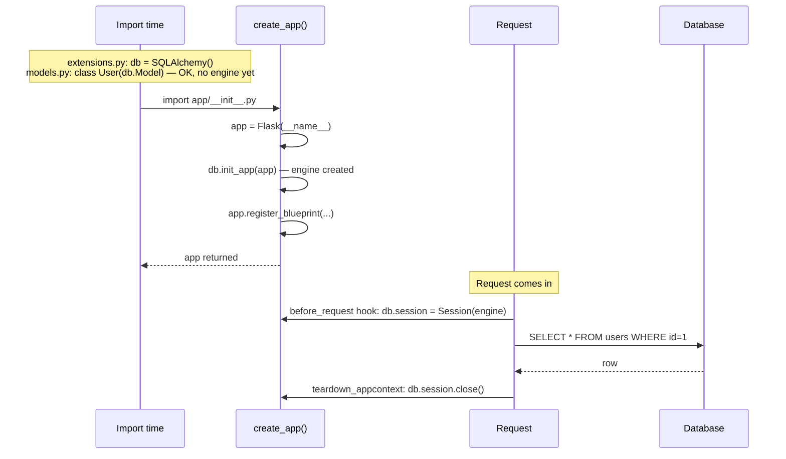

### 5.6 The circular-import problem — and how the factory solves it

Here's the classic Flask circular import:

```
app.py:
    from models import User
    app = Flask(__name__)
    db = SQLAlchemy(app)

models.py:
    from app import db, app     # ← circular!
    class User(db.Model):
        ...
```

When Python imports `app.py`, it hits `from models import User`, which starts importing `models.py`. `models.py` then hits `from app import db, app` — but `app` is still being imported (we're stuck on its first line). Result: `ImportError: cannot import name 'db' from partially initialized module 'app'`.

The factory pattern solves this by separating the extension objects from the app:

```
extensions.py:    db = SQLAlchemy()       # no app dependency
models.py:        from extensions import db   # safe — extensions.py has no app
auth/routes.py:   from extensions import db, from models import User  # safe
app/__init__.py:  def create_app(): ...   # imports everything, but lazily
```

Nothing imports `app` directly. Everything imports `extensions` or `models`. The factory is the only thing that ties them together, and it does so at runtime, not import time.

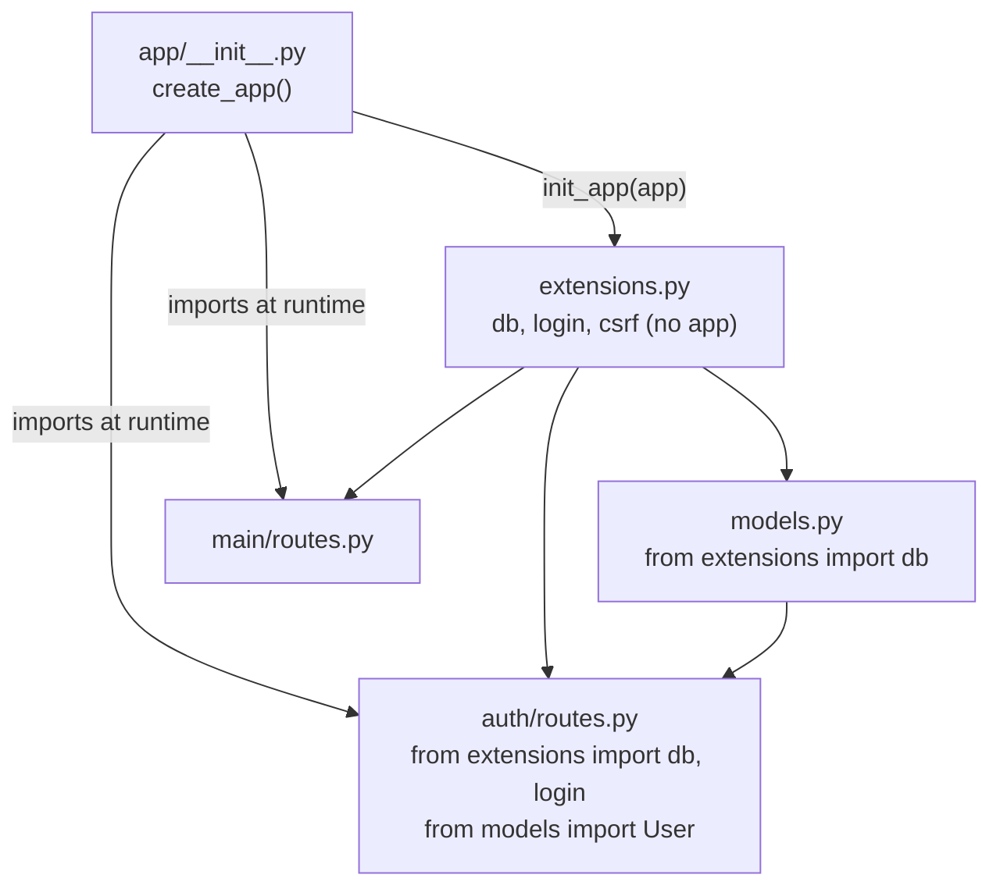

### 5.7 Blueprint-specific `before_request` and `after_request`

You can register request hooks on a blueprint, and they only run for that blueprint's routes:

```python
# app/api/__init__.py
from flask import Blueprint, g, jsonify
from flask_httpauth import HTTPBasicAuth

api = Blueprint('api', __name__)
auth = HTTPBasicAuth()

@api.before_request
def require_auth():
    # Runs before every route in the api blueprint
    if not auth.current_user():
        return jsonify({'error': 'unauthorized'}), 401

@api.after_request
def add_rate_limit_headers(response):
    response.headers['X-RateLimit-Limit'] = '100'
    return response

from app.api import routes   # noqa
```

This is enormously useful for the API blueprint (every route needs auth, every response needs CORS headers), the admin blueprint (every route needs admin role), etc. You'd never want these hooks on the public `main` blueprint.

```mermaid
flowchart TB
    subgraph Request["Incoming request: GET /api/posts"]
        Match["Flask URL matcher<br/>finds endpoint 'api.list_posts'"]
        Match --> GlobalBR["Global @app.before_request hooks<br/>(all requests)"]
        GlobalBR --> BpBR["api.before_request hooks<br/>(only for api blueprint)"]
        BpBR --> View["api.list_posts() view function"]
        View --> BpAR["api.after_request hooks"]
        BpAR --> GlobalAR["Global @app.after_request hooks"]
        GlobalAR --> Response["Response sent"]
    end
    subgraph OtherRequest["Incoming request: GET /"]
        Match2["endpoint 'main.index'"]
        Match2 --> GlobalBR2["Global @app.before_request"]
        GlobalBR2 --> View2["main.index()"]
        View2 --> GlobalAR2["Global @app.after_request"]
        GlobalAR2 --> Response2["Response sent"]
    end
```

> [!question] Student asks: "When does `@bp.before_request` run vs `@app.before_request`?"
> Flask runs all `@app.before_request` hooks first (in registration order), then the `@bp.before_request` hooks for the matching blueprint. If a `before_request` hook returns a value (a Response object), Flask short-circuits — the view function is never called, and the response is sent through the `after_request` chain. This is exactly how `@login_required` could be implemented as a `before_request` hook: return a redirect Response if not authenticated, `None` otherwise.

> [!question] Student asks: "What about `teardown_request`?"
> `@bp.teardown_request` runs at the *end* of every request that hit this blueprint — even if an exception was raised. It's the blueprint equivalent of `@app.teardown_request`. Use it for cleanup that must happen regardless of success/failure: closing DB connections, releasing locks, logging request duration. The hook receives the exception (if any) as its argument.

> [!info] Blueprint hooks vs Flask-Login's `user_loader`
> A common point of confusion: Flask-Login registers a `@login_manager.user_loader` callback, but it *also* installs a `before_request` hook internally to call that callback. So Flask-Login's per-request user loading is implemented as a global `@app.before_request` hook (registered when you do `LoginManager(app)` or `login.init_app(app)`). Your blueprint-specific `@api.before_request` hooks run *after* Flask-Login's hook — which is why `current_user` is available inside your `require_auth` check.

### 5.8 Blueprint-specific error handlers

```python
# app/api/errors.py
from app.api import api

@api.app_errorhandler(404)
def api_not_found(e):
    return {'error': 'not found'}, 404
```

For an API blueprint, you want JSON errors; for a browser blueprint, you want HTML errors. Blueprint error handlers (or `app_errorhandler`) let you customize per-blueprint.

### 5.9 Blueprint-specific templates and static files

Each blueprint can have its own `templates/` folder:

```
app/auth/templates/auth/login.html
app/blog/templates/blog/index.html
app/main/templates/index.html
```

Flask's template loader searches the app's `templates/` first, then each blueprint's `templates/`. To avoid name collisions, the convention is to namespace blueprint templates by a subdirectory matching the blueprint name (`auth/login.html`, not `login.html`).

Static files work similarly: `app/auth/static/` is served at `/auth/static/...`. Useful for blueprint-specific CSS or JS.

### 5.10 Nested blueprints — for API versioning and sub-apps

Flask 2.0+ supports **nested blueprints**: a blueprint registered onto another blueprint. This is hugely useful for API versioning:

```python
# app/api/v1/__init__.py
from flask import Blueprint
api_v1 = Blueprint('api_v1', __name__, url_prefix='/v1')
from app.api.v1 import posts, users, comments  # noqa

# app/api/v2/__init__.py
api_v2 = Blueprint('api_v2', __name__, url_prefix='/v2')
from app.api.v2 import posts, users, comments  # noqa

# app/api/__init__.py
from flask import Blueprint
api = Blueprint('api', __name__, url_prefix='/api')
from app.api import v1, v2
api.register_blueprint(v1.api_v1)
api.register_blueprint(v2.api_v2)

# app/__init__.py — inside create_app()
from app.api import api as api_bp
app.register_blueprint(api_bp)
```

After this, `/api/v1/posts` and `/api/v2/posts` both work — and you can change the v2 response shape without breaking v1 clients. The endpoint names are dot-separated: `api_v1.list_posts`, `api_v2.list_posts`. `url_for('api_v1.list_posts')` returns `/api/v1/posts`.

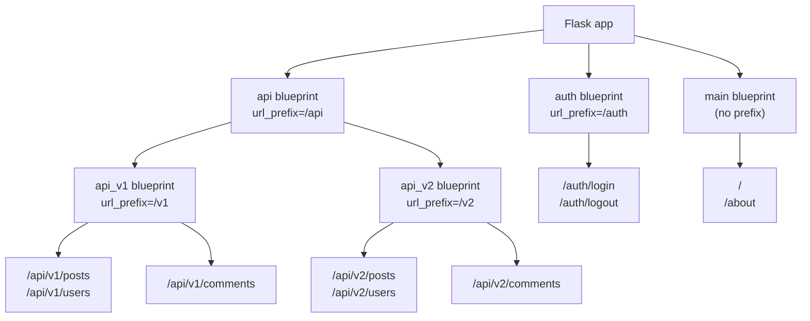

> [!info] Nesting before Flask 2.0
> Before Flask 2.0, nested blueprints weren't supported. People worked around it with `url_prefix` concatenation: register `api_v1` directly on the app with `url_prefix='/api/v1'`. That works, but you lose the logical grouping (you can't ask "what blueprints are inside `api`?"). Nested blueprints give you the grouping for free, and make it easy to register the whole `api` blueprint with one line in `create_app()`.

### 5.11 Blueprint resources — `@bp.record_once`

Sometimes you need to run setup code when the blueprint is registered (not when it's imported). Flask provides `@bp.record_once` for this:

```python
# app/admin/__init__.py
admin = Blueprint('admin', __name__)

@admin.record_once
def init_admin(state):
    # state.app is the real Flask app, available at registration time
    state.app.config.setdefault('ADMIN_THEME', 'default')

from app.admin import routes  # noqa
```

`record_once` runs *exactly once* per app — even if you register the blueprint on multiple apps in tests. It's the blueprint equivalent of `init_app`. Most Flask extensions use this internally to register their `before_request` hooks, context processors, and teardown handlers.

## 6. Running the Code

### 6.1 Set up

```bash
mkdir lesson18
cd lesson18
python -m venv venv
source venv/bin/activate
pip install Flask Flask-SQLAlchemy Flask-WTF Flask-Login
```

Create the project structure from §4.1. Copy each file from §4.2-4.7.

> [!tip] Modern: `uv` and `pyproject.toml`
> In 2026 the modern equivalent is `uv init && uv add Flask Flask-SQLAlchemy Flask-WTF Flask-Login`, which creates a `pyproject.toml` and a `.venv` automatically. See [[Modern-Flask-And-Python]] for the full modern workflow.

### 6.2 Start the app

```bash
flask --app run.py run
#  * Serving Flask app 'run.py'
#  * Running on http://127.0.0.1:5000
```

Or:

```bash
python run.py
```

### 6.3 Verify routes

```bash
flask --app run.py routes
# Endpoint      Methods  Rule
# ------------  -------  -----------------------
# auth.login    GET/POST /auth/login
# auth.logout   GET      /auth/logout
# auth.register GET/POST /auth/register
# errors.404            /none
# main.about    GET      /about
# main.index    GET      /
# static        GET      /static/<path:filename>
```

The endpoint names are now blueprint-qualified. This `flask routes` command is your friend — use it whenever a route 404s and you can't figure out why.

### 6.4 Test the flow

- Visit `http://127.0.0.1:5000/` — main blueprint renders `index.html`.
- Visit `http://127.0.0.1:5000/auth/register` — auth blueprint renders `auth/register.html`.
- Register a user, then log in via `http://127.0.0.1:5000/auth/login`.
- Visit `http://127.0.0.1:5000/this-doesnt-exist` — errors blueprint renders `errors/404.html`.

### 6.5 Inspect the URL map from Python

```bash
python -c "from run import app; print(app.url_map)"
```

You'll see each rule, its endpoint, and its methods. The blueprint structure is visible in the endpoint names. Even more useful:

```python
for rule in app.url_map.iter_rules():
    print(f"{rule.endpoint:30s} {','.join(rule.methods):20s} {rule.rule}")
```

This is what `flask routes` does under the hood.

### 6.6 Watch the request lifecycle across blueprints

Add a temporary print to each blueprint's routes to see which blueprint handles a request:

```python
# main/routes.py
@main.route('/')
def index():
    print("Handled by main blueprint")
    return render_template('index.html')

# auth/routes.py
@auth.route('/login')
def login():
    print("Handled by auth blueprint")
    ...
```

Visit `/` and `/auth/login` in turn; you'll see exactly which blueprint's code ran for each request. This is the mental model: each request is routed to exactly one blueprint's view function.

## 7. Common Mistakes

### 7.1 Importing routes at the top of `auth/__init__.py`

```python
# auth/__init__.py — WRONG
from flask import Blueprint
auth = Blueprint('auth', __name__)

from app.auth.routes import *   # ← at top: works, but fragile
```

This usually works, but causes problems if `routes.py` imports anything from `auth/__init__.py` itself (circular). The convention is to import at the **bottom**:

```python
auth = Blueprint('auth', __name__)

from app.auth import routes   # at bottom
```

The `# noqa: E402,F401` comment silences linters that complain about (a) imports not at the top and (b) unused imports.

### 7.2 Forgetting the blueprint prefix in `url_for`

```python
# Wrong:
return redirect(url_for('login'))

# Right:
return redirect(url_for('auth.login'))
```

The error you'll see: `BuildError: Could not build url for endpoint 'login'. Did you mean 'auth.login'?`

### 7.3 Naming the blueprint the same as a route function

```python
auth = Blueprint('auth', __name__)

@auth.route('/login')
def auth():     # ← SAME NAME as blueprint — confusion
    ...
```

Don't do this. The blueprint name becomes a namespace; the function name becomes the endpoint. If they collide, `url_for('auth.auth')` is confusing and `auth` becomes ambiguous in the module.

### 7.4 Putting `db = SQLAlchemy(app)` at module level

The old pattern (Lesson 12) was:

```python
app = Flask(__name__)
db = SQLAlchemy(app)
```

This works for a single-file app, but it makes `db` depend on a specific `app` instance — which means you can't have multiple apps (e.g. for testing). The factory pattern decouples them.

### 7.5 Calling `db.create_all()` outside `app.app_context()`

```python
db.create_all()    # ← WRONG: no app context
```

`db.create_all()` needs to know which app's database to use. Wrap it:

```python
with app.app_context():
    db.create_all()
```

Inside the factory, `app.app_context()` is implicit because we're inside `create_app()`. But anywhere else — scripts, tests, REPL — you need to push the context explicitly.

### 7.6 Using `errorhandler` instead of `app_errorhandler` in a blueprint

```python
@errors.errorhandler(404)   # ← WRONG
def not_found(e): ...

@errors.app_errorhandler(404)   # ← RIGHT
def not_found(e): ...
```

`errorhandler` on a blueprint only catches errors raised *within* that blueprint's routes. A 404 from a missing URL isn't raised within any blueprint — it's raised by Flask's URL matcher. Use `app_errorhandler` to register app-wide handlers from a blueprint.

### 7.7 Templates in the wrong folder

```
app/auth/templates/login.html       # ← WRONG: name collision risk
app/auth/templates/auth/login.html  # ← RIGHT: namespaced
```

If two blueprints both have `templates/login.html`, the loader picks one — and you'll spend an hour debugging why your changes aren't showing up. Always namespace: `templates/<blueprint_name>/...`.

### 7.8 Forgetting to register the blueprint

You wrote the blueprint, you imported it, you `register_blueprint()` forgot it… and now `/auth/login` 404s. Always check `flask routes` to confirm your routes are registered. The output of `flask routes` is your source of truth — if a URL isn't there, the request will 404.

### 7.9 Circular import from `app` in a model

```python
# models.py
from app import db          # ← WRONG (circular)
```

The fix is `from app.extensions import db`. The extensions module has no app dependency.

### 7.10 Putting `create_all()` before `register_blueprint()`

In the factory, if you call `db.create_all()` before importing the blueprints (which import models), the tables for blueprint-specific models won't exist. Always import blueprints **before** `db.create_all()`. The order in our factory template is correct — when in doubt, follow it.

## 8. Modern (2026) Flask Project Structure

The community has converged on a fairly standard layout. Here's the **2026 best-practice** structure for a serious Flask app:

```
myapp/
├── pyproject.toml             # PEP 621 metadata, deps, build config
├── uv.lock                    # uv lockfile (deterministic installs)
├── Dockerfile                 # multi-stage build
├── docker-compose.yml         # local dev with Postgres + Redis
├── .env.example               # template for environment variables
├── README.md
├── app/
│   ├── __init__.py            # create_app()
│   ├── extensions.py          # db, login, csrf, mail, limiter, etc.
│   ├── models.py              # or split per-domain: models/user.py, models/post.py
│   ├── config.py              # Config classes
│   ├── main/                  # one folder per blueprint
│   ├── auth/
│   ├── blog/
│   ├── api/
│   │   └── v1/                # versioned API as nested blueprints
│   ├── admin/
│   ├── errors/
│   ├── templates/
│   │   └── base.html          # shared
│   ├── static/
│   └── cli.py                 # custom flask CLI commands
├── migrations/                # Alembic
├── tests/
│   ├── conftest.py            # fixtures
│   ├── unit/
│   ├── integration/
│   └── factories.py           # factory-boy factories
├── scripts/                   # one-off ops scripts
└── deploy/                    # k8s manifests, terraform, etc.
```

A few notes on this layout:

- **`pyproject.toml` over `requirements.txt`** — modern Python packaging (PEP 621). Use `uv` for fast dependency management.
- **`uv.lock` over `requirements.txt` checksums** — reproducible installs across machines and Docker builds.
- **`.env.example` committed, `.env` gitignored** — security best practice.
- **Blueprint-per-feature** — even small apps benefit from this. Don't put off the split.
- **`tests/` mirrors `app/`** — `tests/unit/auth/test_login.py` tests `app/auth/routes.py`.
- **`migrations/` checked into git** — migrations are part of the codebase, not generated on the server.
- **`cli.py` for custom commands** — `flask users:create-admin alice@example.com` is a CLI command, defined with `@app.cli.command()`.

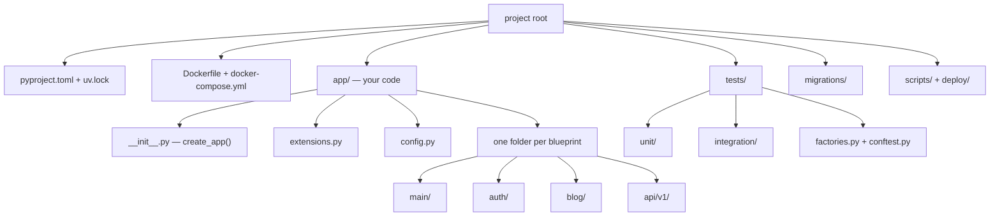

> [!tip] Don't over-engineer
> If your app has 3 routes, you don't need 4 blueprints. Start simple (one `main` blueprint) and split when (a) you have >10 routes in one place, (b) different feature areas need different `before_request` hooks, or (c) multiple developers are working on different areas. Premature abstraction is as bad as no abstraction.

> [!info] The "blueprint-per-feature" heuristic — how to decide what's a blueprint
> When you're starting a new app, ask: "If this were a SaaS company, what teams would own what?" The answer is your blueprint list.
>
> - The **marketing site** (/, /pricing, /about) → `main` blueprint.
> - The **accounts team** (/login, /register, /forgot, /reset) → `auth` blueprint.
> - The **product team** (/dashboard, /projects, /settings) → `app` blueprint (or whatever your product is called).
> - The **API team** (/api/v1/...) → `api` blueprint.
> - The **admin/internal-tools team** (/admin/...) → `admin` blueprint.
> - The **billing team** (/billing, /invoices, /checkout) → `billing` blueprint.
>
> Each "team" would have its own engineers, its own code review ownership, its own deploy cadence. In a monorepo Flask app, those become blueprints. In a microservices architecture, they'd become separate services. Blueprints are the "monolith done right."

> [!info] Modern (2026) signals you might be over-blueprinting
> Watch out for these anti-patterns:
> - A blueprint with **one route**. Usually that route belongs in `main` or a sibling blueprint.
> - Blueprints that **import each other's view functions**. That's tight coupling — they should be one blueprint, or you should extract the shared logic into a service module (`app/services/...`).
> - Blueprints whose **names don't match their URL prefix**. `auth` blueprint at `/auth` is clear; `users_bp` at `/accounts` is confusing.
> - Blueprints with **only templates, no routes**. Templates don't need blueprints — put them in `app/templates/`.
> - `create_app()` with **20 `register_blueprint` calls**. You probably want one `app/blueprints.py` module that registers them all, called from `create_app()`.

## 9. Real-World: A Four-Blueprint App

Here's the layout of a real blog app (which we'll build fully in [[Lesson-24-Build-A-Blog]]):

```
myapp/
├── app/
│   ├── __init__.py          # create_app()
│   ├── extensions.py        # db, login, csrf, mail, migrate
│   ├── models.py            # User, Post, Comment, Tag
│   ├── email.py             # send_email helpers
│   ├── main/                # public pages
│   │   ├── __init__.py
│   │   └── routes.py        # /, /about, /search
│   ├── auth/                # authentication
│   │   ├── __init__.py
│   │   ├── routes.py        # /auth/login, /auth/logout, /auth/register
│   │   ├── forms.py
│   │   ├── email.py         # password-reset emails
│   │   └── templates/auth/
│   ├── blog/                # blog CRUD
│   │   ├── __init__.py
│   │   ├── routes.py        # /post, /post/<id>, /create, /edit/<id>, /delete/<id>
│   │   ├── forms.py
│   │   └── templates/blog/
│   ├── api/                 # JSON API
│   │   ├── __init__.py
│   │   ├── routes.py        # /api/posts, /api/posts/<id>, etc.
│   │   ├── errors.py        # JSON error handlers
│   │   └── auth.py          # token-based auth
│   └── admin/               # admin panel
│       ├── __init__.py
│       ├── routes.py        # /admin/users, /admin/posts
│       └── templates/admin/
├── migrations/              # Alembic (Lesson 15)
├── tests/                   # pytest (Lesson 24)
├── config.py
├── run.py
├── Dockerfile
└── requirements.txt
```

Each blueprint is independently testable, independently routeable, and could even be packaged as a separate Python package and reused across projects. (Some Flask shops extract their `auth` blueprint into a private `company-auth-flask` package and reuse it across products.)

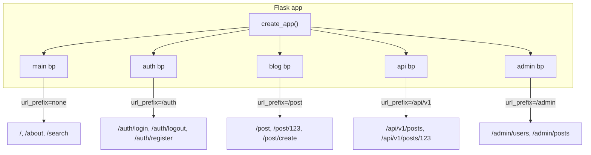

## 10. Try This

> [!tip] Try this: split your Lesson 17 app into blueprints
> Take the Lesson 17 `app.py` (single file) and refactor it into `app/main/`, `app/auth/`, and `app/errors/` blueprints with an application factory. Don't add any new features — just restructure. Run it; everything should still work.

> [!tip] Try this: inspect `flask routes`
> After running the refactored app, run `flask --app run.py routes`. Notice how each endpoint is now `blueprint_name.function_name`. The blueprint structure is right there in the URL map.

> [!tip] Try this: add a `/api` blueprint
> Create `app/api/__init__.py` and `app/api/routes.py`. Add a single route `/api/health` that returns `{"status": "ok"}`. Register it with `url_prefix='/api'`. Test with `curl http://127.0.0.1:5000/api/health`. You've just built the skeleton of your JSON API (next lesson).

> [!tip] Try this: add a `before_request` hook to the api blueprint
> ```python
> @api.before_request
> def log_api_call():
>     print(f"API call: {request.method} {request.path}")
> ```
> Hit `/api/health` — you should see the print. Hit `/` — you should not. Blueprint hooks only fire for blueprint routes.

> [!tip] Try this: inspect `app.blueprints` and `app.url_map`
> After running your factory-built app, open a Python shell:
> ```python
> from run import app
> print(list(app.blueprints.keys()))  # ['main', 'auth', 'errors', ...]
> for rule in app.url_map.iter_rules():
>     print(f"{rule.endpoint:30s} {','.join(rule.methods - {'HEAD','OPTIONS'}):15s} {rule.rule}")
> ```
> You'll see every endpoint, every method, every URL. This is what `flask routes` does — and it's the source of truth when a route 404s unexpectedly.

> [!tip] Try this: convert a route to a nested blueprint
> Take your `api` blueprint and split it into `api/v1/` and `api/v2/`. Have `v1.posts_list` return posts in the original format and `v2.posts_list` add a `summary` field. Register both under `api`. Test both URLs in `curl`. You've just implemented API versioning with nested blueprints — the same pattern GitHub and Stripe use.

> [!tip] Try this: break a blueprint on purpose — and watch the helpful error
> In `create_app()`, comment out the line `app.register_blueprint(auth_bp)`. Restart the server. Visit `/auth/login`. You'll get a 404. Now visit `/` and click "Login" — the `url_for('auth.login')` will raise `BuildError: Could not build url for endpoint 'auth.login'`. The error is telling you: that endpoint doesn't exist because the blueprint isn't registered. This is the #1 debugging tool for "why is my route missing?"

## 11. Exercises

### Exercise 1 — Add a blog blueprint (medium)

Create `app/blog/` with `__init__.py`, `routes.py`, and `forms.py`. Add a `Post` model. Add routes `/post` (list), `/post/<id>` (view), `/post/create` (login_required). Register with `url_prefix='/post'`.

### Exercise 2 — Blueprint-specific `before_request` (easy)

Add a `@main.before_request` hook that logs every request to `main` routes. Compare to a global `@app.before_request` hook (defined in the factory).

### Exercise 3 — Multiple configurations (easy)

Create `config.py` with `DevelopmentConfig`, `ProductionConfig`, and `TestConfig` classes. Modify `create_app` to take a config class. Make `run.py` choose based on `FLASK_ENV`. Make `tests/conftest.py` use `TestConfig`.

### Exercise 4 — Admin blueprint with `@admin_required` (medium)

Create `app/admin/`. Add an `is_admin` boolean to `User`. Write an `@admin_required` decorator that wraps `@login_required` and checks `current_user.is_admin`. Apply to all admin routes. Register with `url_prefix='/admin'`.

### Exercise 5 — Custom blueprint static folder (easy)

Add `app/static/` per-blueprint: `app/blog/static/blog.css`. Include it in your blog templates with `<link rel="stylesheet" href="{{ url_for('blog.static', filename='blog.css') }}">`. Verify it loads at `/blog/static/blog.css`.

### Exercise 6 — Blueprint as a separate package (hard)

Extract `app/auth/` into a standalone Python package (`mycompany-auth-flask`). Install it via `pip install -e .` in another project. Register it there. This is how reusable Flask components are shipped.

### Exercise 7 — API versioning with blueprints (medium)

Create `app/api_v1/` and `app/api_v2/` blueprints. Register one at `/api/v1`, the other at `/api/v2`. Have `/api/v1/posts` return posts in one format and `/api/v2/posts` in another. This is a real-world API versioning strategy.

### Exercise 8 — Application factory testing (medium)

Write `tests/conftest.py` that creates a fresh app for each test using `create_app(TestConfig)`. Use a temporary SQLite database (in `/tmp`). Verify tests run in isolation.

### Exercise 9 — Convert a legacy single-file app (hard)

Find any Flask app you've written in this course so far (Lessons 1-17) and refactor it into the factory + blueprints structure. The goal: zero behavior change, but the code is now modular. This is the most realistic exercise — most working Flask developers do this kind of refactor regularly.

### Exercise 10 — Blueprint ordering matters? (exploratory)

In the factory, register the `errors` blueprint **before** the `auth` blueprint. Does the order matter? Try registering the same URL in two blueprints (e.g. both `main` and `auth` define `/test`) — which one wins? Read about Werkzeug's `Rule.match_priority` to understand. Document your findings.

## 12. What We Learned

- **The "God app.py" problem**: a single file doesn't scale. Symptoms: hard to navigate, frequent merge conflicts, hard to test, tight coupling.
- A **Blueprint** is a "mini-app": routes, templates, static files, error handlers, request hooks — packaged for reuse. Created with `Blueprint('name', __name__)`, registered with `app.register_blueprint(bp, url_prefix='/...')`.
- **`url_prefix`** scopes a blueprint's URLs. `@auth.route('/login')` + `url_prefix='/auth'` → `/auth/login`.
- **`url_for` with blueprints** uses `'blueprint.function'` syntax: `url_for('auth.login')`. The most common mistake is forgetting the blueprint prefix.
- The **Application Factory pattern** is a `create_app()` function that constructs and returns a Flask app. It enables multiple configurations, multiple app instances, lazy initialization, and avoids circular imports.
- **Deferred initialization** (`db.init_app(app)`) separates extension creation from app binding. Extensions live in `extensions.py` with no app; models import from there; the factory binds them at runtime.
- **Circular imports** are solved by separating the extension objects (`extensions.py`) from the app factory (`__init__.py`). Models and routes never import the app directly.
- **Blueprint-specific hooks** (`@bp.before_request`, `@bp.after_request`) only run for that blueprint's routes — perfect for API auth, admin role checks, CORS headers.
- **`app_errorhandler`** (not `errorhandler`) registers handlers at the app level even from a blueprint.
- **Templates and static files** can be blueprint-specific. Convention: namespace templates by blueprint name (`auth/login.html`, not `login.html`) to avoid collisions.
- **Modern (2026) best practices**: factory pattern, extensions in `extensions.py`, blueprints per feature, config in `config.py`, run script in `run.py`, tests in `tests/`, migrations in `migrations/`. This is the structure every production Flask app uses.

## 13. Next Lesson

Your app is now well-structured. You have a clean separation of concerns, blueprints for each feature area, and a factory that lets you create apps with different configurations. Time to add a JSON API.

In [[Lesson-19-Building-JSON-API]] (first lesson of Module 09 — REST API) you'll learn:

- What an **API** actually is, and why JSON APIs are the lingua franca of the modern web.
- What **JSON** is, including its syntax, data types, and how it differs from Python dicts.
- **`jsonify()`** — what it does (dict → JSON, sets Content-Type).
- **`request.get_json()`** — parsing JSON request bodies.
- HTTP **status codes in depth** — 1xx, 2xx, 3xx, 4xx, 5xx — what each means and when to use it.
- **API design principles** — RESTful URLs, consistent responses, pagination.
- **Error handling for APIs** — consistent error format.
- **API versioning strategies** — URL (`/v1/`), header (`Accept: application/vnd.api+json; version=1`), query (`?version=1`).
- **Testing APIs** with `curl` and `httpie`.
- Modern: **OpenAPI/Swagger** docs, **Pydantic** for response models.

> [!quote] A note from your teacher
> There's a moment in every Flask developer's life when their `app.py` crosses 500 lines and they realize the single-file approach is unsustainable. Blueprints are the answer — but the deeper lesson is the **application factory pattern**, which is the difference between "a Flask script" and "a Flask application." The factory makes your code testable, configurable, and reusable. It's how every production Flask app is structured. Once you internalize the factory, you stop writing scripts and start writing applications. Today you crossed that line. Next, we'll add a JSON API to this well-structured app. Onward.
