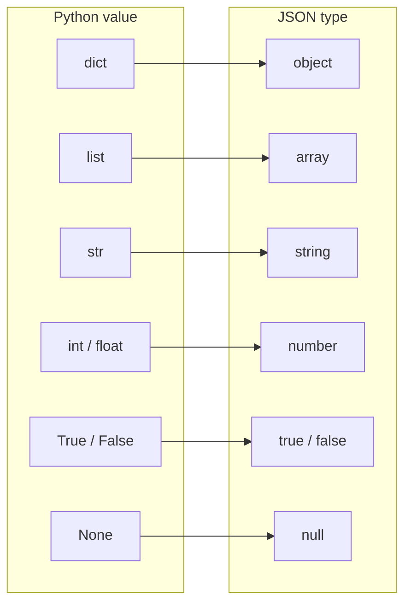
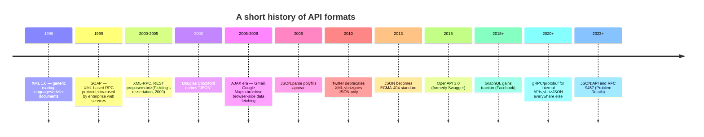
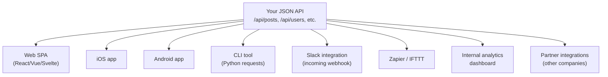
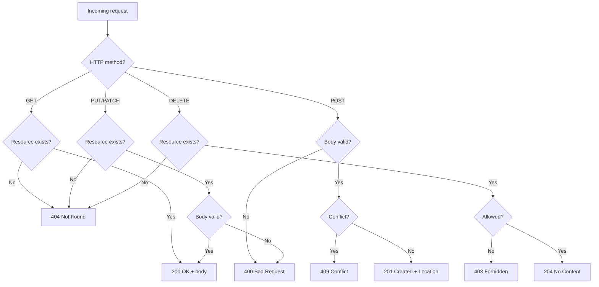
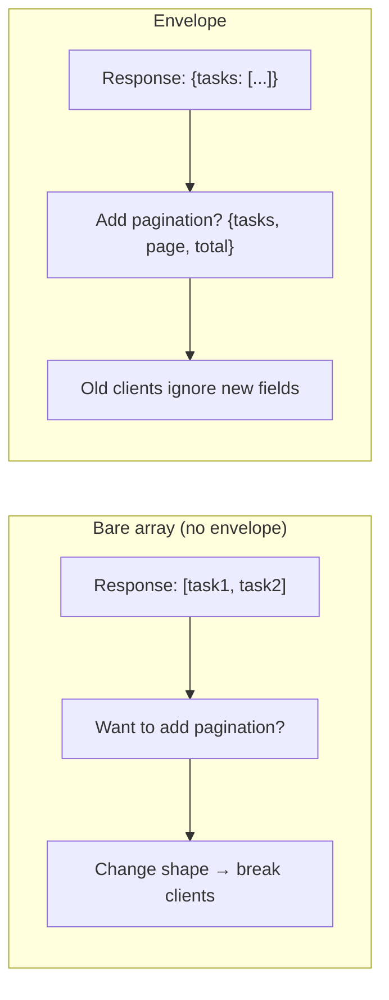
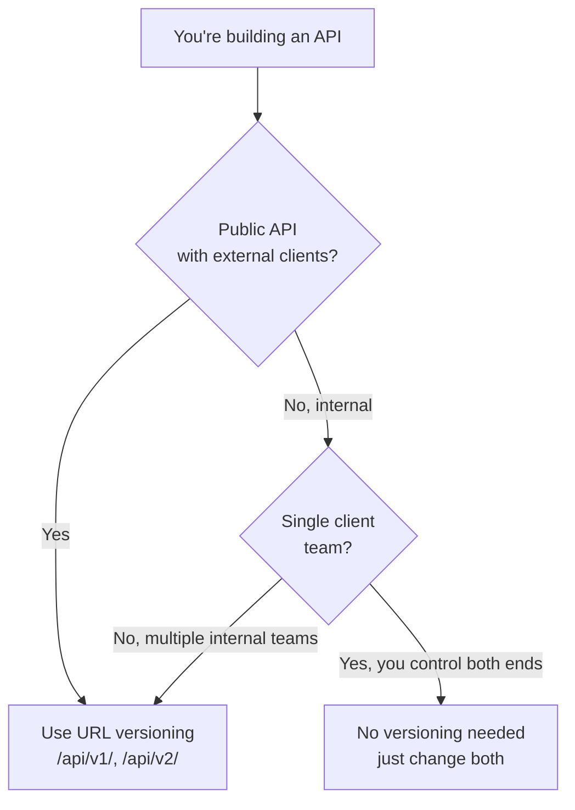

# Lesson 19 — Building a JSON API: Flask Speaks to Machines

> [!success] First lesson of Module 09 — REST API.
> Up to now, every response your Flask app has sent was HTML — pages for humans to read in a browser. But the modern web is full of machines that need to talk to your app too: the iOS app, the React frontend, the marketing-site CMS, the analytics dashboard, the Slack integration. They don't want HTML; they want **data**. Today you'll learn to make Flask return JSON instead of HTML — the foundation of every modern web API. By the end of this lesson, you'll have a working JSON API for a list of "tasks," understand every HTTP status code you'll ever use, and know how to test your API with `curl` and `httpie`.

## 1. Learning Objectives

By the end of this lesson you will be able to:

1. **Explain what an API is** and distinguish a web API from a language API.
2. **Explain what JSON is** — its syntax, its data types, its relationship to Python dicts and JavaScript objects.
3. **List the reasons JSON won the API format wars** over XML, SOAP, and YAML.
4. **Use `jsonify()`** to convert Python dicts into JSON responses — and explain what `Content-Type` it sets.
5. **Use `request.get_json()`** to parse incoming JSON request bodies.
6. **Choose the right HTTP status code** for each situation — covering all five status classes (1xx, 2xx, 3xx, 4xx, 5xx).
7. **Design API URLs** following RESTful principles — nouns, not verbs.
8. **Wrap responses in a consistent envelope** so every endpoint looks the same to clients.
9. **Handle errors consistently** with a structured error format.
10. **Choose an API versioning strategy** — URL, header, or Accept header — and explain the trade-offs.
11. **Test APIs with `curl` and `httpie`** — including POST, PUT, DELETE, custom headers, and JSON bodies.
12. **Document an API with OpenAPI/Swagger** so clients can integrate without reading your source.
13. **Use Pydantic** to validate request bodies and serialize responses with typed models.

## 2. Prerequisites

- **[[Lesson-18-Blueprints]] completed.** You understand blueprints and can add an `api` blueprint to your app.
- **[[Lesson-13-CRUD-Operations]] completed.** You can query, insert, update, and delete with SQLAlchemy.
- **[[Lesson-06-HTTP-Methods]] completed.** You understand GET, POST, and the basic HTTP request/response cycle.

## 3. The Problem

### 3.1 What is an API?

"API" stands for **Application Programming Interface**. The phrase has two parts:

- **Interface** — a defined surface through which two things communicate. A power outlet is an interface: any plug that matches the shape gets electricity. The shape (voltage, frequency, prong layout) is the *contract*.
- **Application Programming** — communication between programs, not between a program and a human.

So an API is a defined surface through which programs communicate. You've used many:

- **Python's `len()` function** — a language API. The contract: pass any sequence, get its length as an integer.
- **The `requests` library** — `requests.get(url)` returns a `Response` object with `.status_code` and `.json()`. That's the API.
- **The Linux file system** — `open('/path/to/file')`. The OS exposes a file-handle API.
- **Stripe's API** — `POST https://api.stripe.com/v1/charges` creates a charge. Web API.

This lesson is about the last kind: **web APIs** — interfaces exposed over HTTP, usually returning JSON, consumed by other programs.

### 3.2 What is JSON?

**JSON** (JavaScript Object Notation, RFC 8259) is a text format for representing structured data. It was originally derived from JavaScript's object literal syntax, but it's language-independent — every modern language has a JSON parser.

Here's a JSON document:

```json
{
  "id": 1,
  "username": "alice",
  "email": "alice@example.com",
  "is_admin": false,
  "tags": ["premium", "verified"],
  "last_login": null,
  "profile": {
    "bio": "I build things.",
    "location": "NYC"
  }
}
```

JSON has exactly **six data types**:

| Type | Example | Python equivalent |
|------|---------|-------------------|
| Object | `{"key": "value"}` | `dict` |
| Array | `[1, 2, 3]` | `list` |
| String | `"hello"` (double quotes only) | `str` |
| Number | `42` or `3.14` | `int` or `float` |
| Boolean | `true` or `false` (lowercase) | `True` / `False` |
| Null | `null` | `None` |

That's it. No dates, no timestamps, no binary, no decimals, no sets. Anything not in this list has to be encoded as a string (dates as ISO 8601, binary as base64, decimals as strings to preserve precision).



> [!question] Student asks: "Why does JSON use double quotes only? Python lets me use single quotes."
> JSON is a *specification*, not a programming language. The spec says strings are `"`-quoted. That makes parsers simpler (one rule, no ambiguity). Python accepts both `'` and `"` because Python is a language designed for human convenience; JSON is a wire format designed for parser simplicity. When in doubt, follow the spec — `json.dumps` always uses double quotes.

> [!question] Student asks: "Why no Date type in JSON?"
> Because the JSON spec is intentionally minimal. Dates are represented as ISO 8601 strings (`"2026-01-15T12:34:56Z"`), and the application code on both ends agrees on the format. This avoids the "what timezone?" and "what precision?" problems that would come with a built-in date type.

### 3.3 Why JSON won the API format wars

In the 2000s, **XML** and **SOAP** were the dominant API formats. Today, JSON dominates. Why?

| Factor | XML / SOAP | JSON |
|--------|-----------|------|
| Verbosity | Very verbose (`<user><id>1</id><name>alice</name></user>`) | Compact (`{"id":1,"name":"alice"}`) |
| Parsing speed | Slow (XML parsers are complex) | Fast (regex-simple grammar) |
| Human readability | Readable but noisy | Readable and clean |
| Native to JavaScript | No (needed `XMLHttpRequest` + DOM parsing) | Yes (`JSON.parse()` is built-in) |
| Schema support | Built-in (XSD) | bolted-on (JSON Schema) |
| Type system | Everything is a string | Six clear types |

The JavaScript native support was the killer feature. When AJAX took off in the mid-2000s (Gmail, Google Maps), JavaScript needed a data format it could parse without a library. JSON was already valid JavaScript — `eval(json_string)` worked (don't do this; use `JSON.parse`). The browser ecosystem standardized on JSON; the server followed.

**YAML** is sometimes used for config files (it supports comments and is more compact) but rarely for APIs because it's harder to parse (the spec is famously complex) and indentation-sensitive.

**Protocol Buffers** and **gRPC** are alternatives for high-performance internal APIs — they're binary, smaller, and faster, but require code generation. JSON remains the lingua franca for public APIs.



> [!info] Why SOAP lost
> SOAP (Simple Object Access Protocol) was the dominant API format for enterprise apps in the early 2000s. It used XML envelopes with namespaces, had a strict spec (WS-*), and required code generation for clients (WSDL → Java classes). It worked, but it was *heavy* — every request had kilobytes of XML metadata. When mobile apps and SPAs needed lightweight APIs, SOAP's verbosity was unacceptable. JSON's "6 types, no namespaces, no code generation" approach won. Today, SOAP is mostly in legacy enterprise systems (banking, healthcare) where the WSDL contracts are still useful.

### 3.4 Why build a JSON API?

You might build a JSON API because:

1. **You have a mobile app.** iOS and Android apps don't render HTML — they fetch JSON and render native UI.
2. **You have a SPA.** A React/Vue/Svelte frontend fetches JSON from your API and renders in the browser.
3. **You have multiple frontends.** Web, iOS, Android, CLI — all hit the same `/api/...` endpoints.
4. **You want to be integrable.** Other companies can build on your data (Slack integrations, Zapier, etc.).
5. **You're splitting a monolith.** Multiple services communicate via APIs.
6. **You want a public API.** Stripe, GitHub, Twitter — they all expose JSON APIs that power entire businesses.

Even if you're "just" building a blog, exposing a JSON API lets you build a mobile app later, lets others build tools on top of your data, and forces you to separate your data layer from your presentation layer. That separation makes every part of your codebase cleaner.



> [!question] Student asks: "Why not just serve HTML to everything? Browsers render HTML."
> Because not every client is a browser. A Python script fetching your data with `requests.get(url).json()` would have to parse HTML — fragile, slow, and bandwidth-wasteful. A mobile app needs native UI components, not HTML. The "machine-readable" format is JSON; HTML is for "human-readable in a browser." APIs serve machines; web pages serve humans. A modern app typically has both: HTML routes for the browser UI, JSON routes for everything else.

## 4. The Code

### 4.1 A minimal JSON API

```python
# app/api/__init__.py
from flask import Blueprint

api = Blueprint('api', __name__)

from app.api import routes   # noqa: E402,F401
```

```python
# app/api/routes.py
from flask import jsonify, request, url_for
from app.api import api


# In-memory data store for the demo. In a real app, this would be SQLAlchemy.
tasks = [
    {"id": 1, "title": "Learn Flask", "done": True},
    {"id": 2, "title": "Build an API", "done": False},
    {"id": 3, "title": "Profit", "done": False},
]
next_id = 4


@api.route('/tasks')
def list_tasks():
    return jsonify({'tasks': tasks})


@api.route('/tasks/<int:task_id>')
def get_task(task_id):
    task = next((t for t in tasks if t['id'] == task_id), None)
    if task is None:
        return jsonify({'error': 'task not found'}), 404
    return jsonify({'task': task})


@api.route('/tasks', methods=['POST'])
def create_task():
    global next_id
    data = request.get_json() or {}
    if 'title' not in data:
        return jsonify({'error': 'title is required'}), 400
    task = {
        'id': next_id,
        'title': data['title'],
        'done': data.get('done', False),
    }
    next_id += 1
    tasks.append(task)
    response = jsonify({'task': task})
    response.status_code = 201
    response.headers['Location'] = url_for('api.get_task', task_id=task['id'])
    return response


@api.route('/tasks/<int:task_id>', methods=['PUT'])
def update_task(task_id):
    data = request.get_json() or {}
    task = next((t for t in tasks if t['id'] == task_id), None)
    if task is None:
        return jsonify({'error': 'task not found'}), 404
    task['title'] = data.get('title', task['title'])
    task['done'] = data.get('done', task['done'])
    return jsonify({'task': task})


@api.route('/tasks/<int:task_id>', methods=['DELETE'])
def delete_task(task_id):
    global tasks
    task = next((t for t in tasks if t['id'] == task_id), None)
    if task is None:
        return jsonify({'error': 'task not found'}), 404
    tasks = [t for t in tasks if t['id'] != task_id]
    return '', 204
```

Register the blueprint with a URL prefix:

```python
# app/__init__.py — inside create_app()
from app.api import api as api_bp
app.register_blueprint(api_bp, url_prefix='/api')
```

That's it. You now have a working JSON API at `/api/tasks`.

## 5. Line-by-Line Explanation

### 5.1 `jsonify()` — what it does

```python
from flask import jsonify
return jsonify({'tasks': tasks})
```

`jsonify(dict)` does three things:

1. **Serializes** the dict (or list, or other JSON-serializable object) to a JSON string using Flask's JSON encoder.
2. **Wraps** the string in a `Response` object with `Content-Type: application/json` and `charset=utf-8`.
3. Returns the `Response`, which Flask sends to the client.

Compare to the lower-level approach:

```python
import json
from flask import Response

return Response(
    json.dumps({'tasks': tasks}),
    content_type='application/json'
)
```

`jsonify` is just a convenience wrapper around this. But it also handles some edge cases:

- It pretty-prints in debug mode and minifies in production.
- It escapes `</script>` and `<!--` to prevent XSS when JSON is embedded in HTML.
- It supports serializing datetime objects (as RFC 8239 strings).
- It supports serializing UUIDs, Sets, and other common Python types.

```mermaid
flowchart LR
    D["Python dict<br/>{'tasks': [...]}"]
    D --> J["json.dumps()"]
    J --> S["JSON string<br/>{\"tasks\":[...]}"]
    S --> R["Response object"]
    R --> H["Content-Type: application/json"]
    R --> B["Body: JSON string"]
    H --> Client["Sent to client"]
    B --> Client
```

> [!question] Student asks: "What's the difference between `jsonify` and `json.dumps`?"
> `json.dumps` is the standard-library function that turns a Python object into a JSON **string**. It doesn't know about Flask — it just produces text. `jsonify` is Flask's wrapper: it calls `json.dumps` (or a Flask-specific encoder) and wraps the result in a Flask `Response` with the right `Content-Type`. Use `jsonify` in routes; use `json.dumps` when you need the raw string (e.g. storing JSON in a database column).

> [!info] Inside `jsonify` — what really happens
> Flask's `jsonify` is built on top of `flask.json.provider.DefaultJSONProvider`. The provider has a `dumps` method that:
> 1. Walks the Python object recursively.
> 2. For each value, checks its type. If it's `dict`/`list`/`str`/`int`/`float`/`bool`/`None`, it serializes directly.
> 3. If it's a `datetime`, it calls `.isoformat()` and returns the ISO 8601 string.
> 4. If it's a `UUID`, it calls `str(uuid)`.
> 5. If it's a `set`, it converts to a list (JSON has no sets).
> 6. If it's a SQLAlchemy model (custom class), it falls back to `default()` — which by default raises `TypeError`. This is why you need `to_dict()` methods on your models.
> 7. The result is a JSON string, which is wrapped in a `Response` with `Content-Type: application/json`.
>
> Flask 2.3+ uses *provider classes* instead of the older `JSONEncoder` subclass approach. If you need custom serialization (e.g. your `Money` class), subclass `DefaultJSONProvider` and override `default()`:

> ```python
> from flask.json.provider import DefaultJSONProvider
>
> class MyJSONProvider(DefaultJSONProvider):
>     def default(self, obj):
>         if isinstance(obj, Money):
>             return {'amount': obj.amount, 'currency': obj.currency}
>         return super().default(obj)
>
> app.json = MyJSONProvider(app)
> ```
>
> Now any `Money` object in a `jsonify` response is serialized automatically.

### 5.2 `request.get_json()` — parsing the request body

```python
data = request.get_json() or {}
```

`request.get_json()` does the opposite of `jsonify`: it parses the JSON body of the incoming request and returns a Python dict (or list, or whatever the JSON's top-level value is).

Things to know:

- It only works if the request has `Content-Type: application/json` (or `application/vnd.api+json`, etc.). If the client didn't set that header, `get_json()` returns `None` by default.
- The `or {}` fallback handles the case where the body is missing or empty — we treat it as an empty dict so `data.get('title')` doesn't crash.
- In Flask 3.x, `get_json()` returns `None` if parsing fails. (Older versions raised `BadRequest`.)
- You can pass `silent=True` to suppress parse errors and `force=True` to parse even if the Content-Type isn't JSON. Don't use `force=True` in production — it can mask client bugs.

> [!warning] Never assume `get_json()` returns a dict
> If the client sends `[1, 2, 3]` (a JSON array), `get_json()` returns a list. If they send `"hello"` (a JSON string), it returns a string. If they send `null`, it returns `None`. Always validate the type before accessing fields:
> ```python
> data = request.get_json()
> if not isinstance(data, dict):
>     return jsonify({'error': 'expected a JSON object'}), 400
> ```

### 5.3 HTTP status codes — a deep dive

HTTP status codes are three-digit numbers. They're grouped by class:

| Class | Meaning | When you use it |
|-------|---------|------------------|
| 1xx | Informational | Almost never. (101 Switching Protocols is used for WebSocket upgrades.) |
| 2xx | Success | Every successful request. |
| 3xx | Redirection | URL moves, cache hits. |
| 4xx | Client error | The client messed up. |
| 5xx | Server error | You messed up. |

The codes you'll actually use:

| Code | Name | When to return it |
|------|------|-------------------|
| **200** | OK | Successful GET, PUT, DELETE-with-body. The default if you don't set one. |
| **201** | Created | Successful POST that created a resource. **Always include a `Location` header** with the URL of the new resource. |
| **204** | No Content | Successful DELETE, or PUT that updated without returning the new state. The response body is empty. |
| **301** | Moved Permanently | The resource has a new URL; clients should update their bookmarks. |
| **302** | Found | Temporary redirect. (Flask's `redirect()` returns 302 by default.) |
| **304** | Not Modified | The client's cached copy is still valid. (Used with ETags / `If-None-Match`.) |
| **400** | Bad Request | The client sent malformed JSON, missing required fields, or invalid values. |
| **401** | Unauthorized | The client didn't authenticate. (Should be called "Unauthenticated," but the name stuck.) |
| **403** | Forbidden | The client authenticated but isn't allowed to do this. |
| **404** | Not Found | The resource doesn't exist. |
| **405** | Method Not Allowed | The URL exists but doesn't accept this method (e.g. POST to a GET-only route). Flask sets this automatically. |
| **409** | Conflict | The request conflicts with current state (e.g. creating a user with a username that already exists). |
| **422** | Unprocessable Entity | The JSON is syntactically valid but semantically wrong (e.g. negative age). Some APIs use 400 for this. |
| **429** | Too Many Requests | The client hit a rate limit. Include `Retry-After` header. |
| **500** | Internal Server Error | Your code raised an exception. The client can't do anything about it. |
| **502** | Bad Gateway | You're behind a proxy and the upstream service failed. |
| **503** | Service Unavailable | You're temporarily down (maintenance, overload). |
| **504** | Gateway Timeout | The upstream service didn't respond in time. |



> [!tip] When in doubt, use the simplest correct code
> - Success without body: `204`
> - Success with body: `200`
> - Created something: `201` + `Location` header
> - Client input wrong: `400`
> - Missing auth: `401`
> - Authenticated but not allowed: `403`
> - Resource missing: `404`
> - Server crash: `500`
> That covers 90% of real-world cases. Don't get fancy with `451 Unavailable For Legal Reasons` unless you really mean it.

> [!question] Student asks: "Why is `401` called 'Unauthorized' if it actually means 'Unauthenticated'?"
> History. The original HTTP/1.0 spec (RFC 1945, 1996) named it "Unauthorized" and the name stuck. RFC 7235 clarified that 401 means "no authentication or authentication failed" and 403 means "authenticated but not allowed." The names are misleading but the spec is clear. Use 401 for "who are you?" and 403 for "I know who you are, but no."

### 5.4 Returning status codes from a Flask view

Flask lets you return a tuple of `(response, status_code)`:

```python
return jsonify({'error': 'task not found'}), 404
```

Or set it on the response object:

```python
response = jsonify({'task': task})
response.status_code = 201
response.headers['Location'] = url_for('api.get_task', task_id=task['id'])
return response
```

The tuple form is more concise for simple cases. The response-object form is necessary when you want to set headers (like `Location`).

### 5.5 The `Location` header on 201 responses

```python
response.headers['Location'] = url_for('api.get_task', task_id=task['id'])
```

When you `POST /api/tasks` and create a task, the client wants to know "where did you put it?" The HTTP convention is: return `201 Created` and set the `Location` header to the URL of the newly-created resource. The client can `GET` that URL to fetch the new task. This is part of the HTTP spec (RFC 7231 §6.5.1) and most API clients know to look for it.

### 5.6 URL design — nouns, not verbs

RESTful API URLs describe **resources** (nouns), not actions (verbs). The HTTP method is the verb.

| Bad (RPC-style) | Good (REST-style) |
|------------------|-------------------|
| `POST /createTask` | `POST /tasks` |
| `POST /deleteTask?id=1` | `DELETE /tasks/1` |
| `POST /getTask?id=1` | `GET /tasks/1` |
| `POST /updateTask` | `PUT /tasks/1` |
| `GET /listTasks` | `GET /tasks` |

The REST-style URLs are:

- **Predictable.** A client who knows the resource name (`tasks`) can guess the URL pattern.
- **Cacheable.** `GET /tasks/1` is the same URL every time, so caches work.
- **Stateless.** Each request contains everything needed — no server-side session state.
- **Uniform.** Every resource behaves the same way: `GET` reads, `POST` creates, `PUT` updates, `DELETE` deletes.

### 5.7 Response envelope — consistency matters

Notice that every response in our API is wrapped in an object:

```json
{"task": {...}}          # single
{"tasks": [...]}         # list
{"error": "task not found"}   # error
```

This is called an **envelope**. The alternative is to return raw values:

```json
{...}                    # single (no key)
[{...}, {...}]           # list (just an array)
```

The bare-array form is seductively simple but **dangerous**: if you ever want to add pagination metadata, you have to change the response shape, breaking every client. The envelope form lets you add fields later:

```json
{
  "tasks": [...],
  "page": 1,
  "per_page": 20,
  "total": 53
}
```

Old clients ignore the new fields; new clients use them. No breakage.



> [!info] When the bare-array form is OK
> Some large APIs (notably GitHub's) do return bare arrays at the top level. They make it work by putting metadata in HTTP headers (`Link: <...>; rel="next"`, `X-Total-Count: 53`). This is elegant — the body is purely data, the metadata is transport-layer — but it requires clients to read headers, which many don't. For new APIs, the envelope approach is safer and more discoverable. You can always switch to header-based metadata later if you need to.
>
> **Stripe's envelope** is a nice model: every list response is `{"object": "list", "data": [...], "has_more": true, "url": "/v1/charges"}`. The `object` field tells clients the type, `data` is the array, `has_more` is the pagination hint, and `url` is a self-link. Consistent, discoverable, future-proof.

> [!info] The JSON:API specification
> If you want a strict standard for response shapes, look at [JSON:API](https://jsonapi.org/), which specifies a precise envelope format with `data`, `errors`, `meta`, `included`, and `relationships` keys. Many large APIs (Discourse, Strapi) follow it. It's opinionated but very consistent.

### 5.8 Error responses — consistent format

```python
return jsonify({'error': 'task not found'}), 404
```

A simple `{"error": "..."}` works for tiny APIs. For real APIs, a richer error format helps clients display helpful messages:

```json
{
  "error": {
    "code": "task_not_found",
    "message": "Task with id 99 does not exist.",
    "details": {"task_id": 99}
  }
}
```

Or following RFC 9457 (Problem Details for HTTP APIs):

```json
{
  "type": "https://api.example.com/errors/task-not-found",
  "title": "Task Not Found",
  "status": 404,
  "detail": "Task with id 99 does not exist.",
  "instance": "/api/tasks/99"
}
```

RFC 9457 is an IETF standard (formerly RFC 7807). The `type` field is a URL pointing to documentation for that error class — brilliant for client developers who need to understand what went wrong.

### 5.9 API versioning strategies

APIs change. Fields get renamed, removed, or restructured. Without versioning, every change breaks clients. Three common strategies:

**1. URL versioning** — most common, easiest to understand:
```
GET /api/v1/tasks
GET /api/v2/tasks
```
Pro: trivially obvious which version you're calling. Cacheable by URL.
Con: URLs are supposed to be stable; "v1" and "v2" leak the versioning into the resource identity.

**2. Header versioning** — elegant but harder to test:
```
GET /api/tasks
Accept: application/vnd.api+json; version=1
```
Pro: URLs stay clean.
Con: harder to test in a browser, harder to discover, easy to forget.

**3. Query parameter versioning**:
```
GET /api/tasks?version=1
```
Pro: trivial.
Con: pollutes the query string, easy to forget, conflicts with filter parameters.

For most apps, **URL versioning is the right choice**. It's what GitHub, Stripe, and Twitter use. The minor ugliness of `/v1/` is worth the clarity.



### 5.10 Testing with `curl`

`curl` is a command-line HTTP client. Available on every Mac, Linux, and modern Windows. Let's test our API:

```bash
# GET list of tasks
curl http://127.0.0.1:5000/api/tasks
# {"tasks":[{"id":1,"title":"Learn Flask","done":true},...]}

# GET single task
curl http://127.0.0.1:5000/api/tasks/1
# {"task":{"id":1,"title":"Learn Flask","done":true}}

# GET non-existent task
curl -i http://127.0.0.1:5000/api/tasks/99
# HTTP/1.0 404 NOT FOUND
# Content-Type: application/json
# {"error":"task not found"}

# POST a new task
curl -X POST http://127.0.0.1:5000/api/tasks \
  -H "Content-Type: application/json" \
  -d '{"title":"Buy milk","done":false}'
# HTTP/1.0 201 CREATED
# Location: http://127.0.0.1:5000/api/tasks/4
# {"task":{"id":4,"title":"Buy milk","done":false}}

# PUT (update) a task
curl -X PUT http://127.0.0.1:5000/api/tasks/4 \
  -H "Content-Type: application/json" \
  -d '{"done":true}'
# {"task":{"id":4,"title":"Buy milk","done":true}}

# DELETE a task
curl -X DELETE http://127.0.0.1:5000/api/tasks/4 -i
# HTTP/1.0 204 NO CONTENT
# (empty body)
```

Useful `curl` flags:

| Flag | Meaning |
|------|---------|
| `-X METHOD` | Set HTTP method (POST, PUT, DELETE, etc.). For GET, you don't need this. |
| `-H "Header: value"` | Add a request header. Repeat for multiple headers. |
| `-d 'data'` | Send data in the request body (sets method to POST by default). |
| `-d @file.json` | Send the contents of `file.json` as the body. |
| `-i` | Include response headers in the output. |
| `-I` | Fetch headers only (HEAD request). |
| `-s` | Silent (suppress progress bar). |
| `-v` | Verbose (show all headers, request and response). |

### 5.11 Testing with `httpie`

`httpie` is a more user-friendly alternative to `curl`, designed for humans. Install with `pip install httpie` (or `brew install httpie`).

```bash
# GET
http http://127.0.0.1:5000/api/tasks

# POST with JSON
http POST http://127.0.0.1:5000/api/tasks title="Buy milk" done:=false
# Note: = means string, := means raw JSON (so false is boolean, not string)

# PUT
http PUT http://127.0.0.1:5000/api/tasks/4 done:=true

# DELETE
http DELETE http://127.0.0.1:5000/api/tasks/4

# Custom headers
http http://127.0.0.1:5000/api/tasks Authorization:"Bearer abc123"
```

`httpie` colorizes output, formats JSON nicely, and uses intuitive syntax for JSON bodies. It's worth learning.

### 5.12 Documenting with OpenAPI / Swagger

An API without docs is useless. **OpenAPI** (formerly Swagger) is the standard for describing HTTP APIs in a machine-readable format (YAML or JSON). A client can read the spec and generate:

- Interactive documentation (try requests in a browser).
- Client libraries in any language.
- Mock servers for testing.
- Server stubs (scaffolding for your routes).

A minimal OpenAPI spec for our `/api/tasks` endpoint:

```yaml
# openapi.yaml
openapi: 3.1.0
info:
  title: Tasks API
  version: 1.0.0
paths:
  /api/tasks:
    get:
      summary: List all tasks
      responses:
        '200':
          description: A list of tasks
          content:
            application/json:
              schema:
                type: object
                properties:
                  tasks:
                    type: array
                    items:
                      $ref: '#/components/schemas/Task'
    post:
      summary: Create a task
      requestBody:
        required: true
        content:
          application/json:
            schema:
              type: object
              properties:
                title:
                  type: string
                done:
                  type: boolean
      responses:
        '201':
          description: Created
          headers:
            Location:
              schema:
                type: string
components:
  schemas:
    Task:
      type: object
      properties:
        id:
          type: integer
        title:
          type: string
        done:
          type: boolean
```

Drop this file into a tool like [Swagger UI](https://swagger.io/tools/swagger-ui/) or [Redoc](https://redocly.com/redoc) and you get beautiful interactive docs.

For Flask, the [flask-smorest](https://flask-smorest.readthedocs.io/) library generates OpenAPI from your code automatically using Marshmallow schemas. [APISpec](https://apispec.readthedocs.io/) is another option.

> [!info] OpenAPI in 2026 — what the spec really covers
> An OpenAPI document describes your entire API in YAML or JSON. The 3.1.0 spec (current as of 2024) covers:
>
> - **Paths** — every URL (`/api/tasks`, `/api/tasks/{id}`) and the methods supported on each.
> - **Operations** — for each (path, method), the parameters, request body, responses, and tags.
> - **Schemas** — the shape of request/response bodies, defined once and referenced by `$ref`.
> - **Security schemes** — API keys, OAuth2, JWT — and which operations require them.
> - **Servers** — base URLs for dev, staging, prod.
> - **Examples** — sample requests/responses for each operation.
> - **Tags** — for grouping operations in the docs UI.
>
> Tools that consume OpenAPI:
> - **Swagger UI** / **Redoc** — interactive HTML docs with "try it out" buttons.
> - **openapi-generator** — generate client libraries in 50+ languages (Python, TypeScript, Go, Swift, ...).
> - **Schemathesis** / **Dredd** — auto-generate contract tests from the spec.
> - **Postman** — import the spec into Postman, get a complete request collection.
> - **Mock servers** — `prism mock openapi.yaml` runs a fake server that responds per the spec, before your backend exists.
>
> The killer feature: when clients generate their TypeScript types from your OpenAPI spec, **changes to your API surface as TypeScript compile errors in the client**. You can't ship a breaking change without the client knowing. This is how serious API teams work.

> [!question] Student asks: "Do I write the OpenAPI spec by hand or generate it from code?"
> Both approaches work, and they have different trade-offs. **Spec-first** (write the YAML, generate server stubs and client SDKs): forces you to design before coding, makes the spec the source of truth, but requires discipline to keep code in sync. **Code-first** (use `flask-smorest` or `apispec` with decorators/schemas to generate the spec from your code): spec is always in sync with code, but you might design sloppily because there's no upfront design step. **Hybrid**: write the spec first, then add code annotations that confirm the spec — tools like `schemathesis` will test that your code matches the spec.
>
> For solo or small-team projects: code-first (`flask-smorest`) is faster. For public APIs with external clients: spec-first — the spec is your contract with the world, and breaking it is expensive.

### 5.13 Modern: Pydantic for request/response validation

Pydantic is the modern way to validate JSON in Python (it's what FastAPI uses). Define a typed model, and Pydantic both validates incoming JSON and serializes outgoing responses.

```python
# pip install pydantic
from pydantic import BaseModel, Field
from typing import Optional


class TaskCreate(BaseModel):
    title: str = Field(..., min_length=1, max_length=200)
    done: bool = False


class TaskOut(BaseModel):
    id: int
    title: str
    done: bool


@api.route('/tasks', methods=['POST'])
def create_task():
    try:
        data = TaskCreate.model_validate(request.get_json() or {})
    except ValidationError as e:
        return jsonify({'error': e.errors()}), 422
    task = {'id': next_id, 'title': data.title, 'done': data.done}
    next_id += 1
    tasks.append(task)
    response = jsonify(TaskOut(**task).model_dump())
    response.status_code = 201
    return response
```

Pydantic benefits:

- **Type validation** — wrong types (string where int expected) raise errors.
- **Constraint validation** — `min_length`, `max_length`, `ge`, `le`, regex patterns.
- **Automatic error messages** — Pydantic returns detailed error objects.
- **Serialization** — `model_dump()` outputs a dict ready for `jsonify`.
- **Documentation** — your types can be auto-converted to OpenAPI schemas.

For Flask apps in 2026, Pydantic v2 is the recommended way to handle request/response validation. It's faster than Marshmallow, has better type hints, and integrates cleanly with mypy/pyright.

## 6. Running the Code

### 6.1 Set up

```bash
mkdir lesson19
cd lesson19
# (assume you have a Flask app with the application factory from Lesson 18)
```

Add the `api` blueprint to your app (from §4.1). Register it with `url_prefix='/api'`:

```python
# app/__init__.py
def create_app():
    app = Flask(__name__)
    # ... existing setup ...
    from app.api import api as api_bp
    app.register_blueprint(api_bp, url_prefix='/api')
    return app
```

### 6.2 Start the server

```bash
flask --app run.py run
#  * Running on http://127.0.0.1:5000
```

### 6.3 Test with curl

```bash
# List all tasks
curl -s http://127.0.0.1:5000/api/tasks | python -m json.tool
{
    "tasks": [
        {"id": 1, "title": "Learn Flask", "done": true},
        {"id": 2, "title": "Build an API", "done": false},
        {"id": 3, "title": "Profit", "done": false}
    ]
}

# Create a task
curl -s -X POST http://127.0.0.1:5000/api/tasks \
  -H "Content-Type: application/json" \
  -d '{"title":"Buy milk"}' -i
# HTTP/1.0 201 CREATED
# Location: http://127.0.0.1:5000/api/tasks/4
# Content-Type: application/json
#
# {"task":{"id":4,"title":"Buy milk","done":false}}

# Get the new task
curl -s http://127.0.0.1:5000/api/tasks/4
# {"task":{"id":4,"title":"Buy milk","done":false}}

# Update it
curl -s -X PUT http://127.0.0.1:5000/api/tasks/4 \
  -H "Content-Type: application/json" \
  -d '{"done":true}'
# {"task":{"id":4,"title":"Buy milk","done":true}}

# Delete it
curl -s -X DELETE http://127.0.0.1:5000/api/tasks/4 -i
# HTTP/1.0 204 NO CONTENT
# (empty body)
```

### 6.4 Test in the browser

Open `http://127.0.0.1:5000/api/tasks` in a browser. Modern browsers (Chrome, Firefox) format JSON nicely. Or install a browser extension like JSONView for syntax highlighting.

You'll see the JSON response. Note that `POST`, `PUT`, `DELETE` aren't easy to test in a browser — that's why `curl` and `httpie` are essential API-development tools.

## 7. Common Mistakes

### 7.1 Returning a Python dict directly

```python
return {'tasks': tasks}   # Works in Flask 1.1+, but...
```

Flask 1.1+ auto-converts dicts to JSON responses. But:

- It doesn't set `Content-Type: application/json` consistently in older versions.
- It doesn't support custom JSON encoders.
- You can't set a status code or headers alongside it.

Prefer `jsonify(...)` explicitly. The auto-conversion is convenient but obscures what's happening.

### 7.2 Forgetting `Content-Type: application/json` on the request

```bash
# Wrong — server returns None from get_json()
curl -X POST http://127.0.0.1:5000/api/tasks -d '{"title":"x"}'

# Right
curl -X POST http://127.0.0.1:5000/api/tasks -H "Content-Type: application/json" -d '{"title":"x"}'
```

`request.get_json()` checks the Content-Type. If it's `application/x-www-form-urlencoded` (curl's default for `-d`), the JSON body is treated as a form. Always send the header.

### 7.3 Status code `200` for created resources

```python
return jsonify({'task': task})   # implicit 200
```

Should be `201 Created` with a `Location` header. Some clients (and the HTTP spec) care.

### 7.4 Returning a body with `204`

```python
return jsonify({'message': 'deleted'}), 204   # ← WRONG
```

`204 No Content` means *no body*. If you return a body, the client may discard it (per spec) or get confused. Return `200` if you want to send a body, or `204` with an empty body.

### 7.5 Bare array responses

```python
return jsonify(tasks)   # returns [task1, task2, ...]
```

Returns a bare JSON array. As discussed in §5.7, this locks you out of adding metadata later. Wrap in an envelope: `jsonify({'tasks': tasks})`.

### 7.6 Mixing verbs and nouns in URLs

```
POST /api/createTask       # ← BAD
GET  /api/getTask/1        # ← BAD
POST /api/tasks/create     # ← BAD
```

The verb is in the HTTP method. The URL is just the noun: `/api/tasks`, `/api/tasks/1`.

### 7.7 Using `force=True` with `get_json()`

```python
data = request.get_json(force=True)   # parses even without Content-Type
```

`force=True` parses the body as JSON regardless of Content-Type. This sounds convenient but masks client bugs (the client thinks they sent form data, you parse it as JSON). Make clients send the right Content-Type.

### 7.8 No versioning from the start

You launch `/api/tasks` without a version. Six months later, you need to change the response shape. You can't — every client depends on the current shape. Add `/api/v1/` from day one, even if there's no `/v2/` yet. The cost is one extra URL segment; the benefit is the ability to evolve.

### 7.9 No error envelope

Some endpoints return `{"error": "msg"}`, others return `{"errors": [...]}`, others return `{"message": "msg"}`. Clients have to write custom parsing per endpoint. Pick one format and use it everywhere. RFC 9457 is a good default.

### 7.10 Not returning JSON for errors

```python
@api.route('/tasks/<int:task_id>')
def get_task(task_id):
    task = ...
    if task is None:
        abort(404)   # ← returns HTML, not JSON!
    return jsonify(...)
```

`abort(404)` returns Flask's default HTML 404 page. API clients parsing JSON will choke. Either return JSON explicitly:

```python
return jsonify({'error': 'task not found'}), 404
```

Or register a JSON 404 handler:

```python
@api.app_errorhandler(404)
def api_not_found(e):
    return jsonify({'error': 'not found'}), 404
```

## 8. Try This

> [!tip] Try this: `curl -v` to see all the headers
> Run `curl -v http://127.0.0.1:5000/api/tasks`. The `-v` (verbose) flag shows every header, both request and response. You'll see `Content-Type: application/json` in the response, plus all the standard HTTP headers (Date, Server, Content-Length). This is the most useful debugging tool for API work.

> [!tip] Try this: send invalid JSON
> ```bash
> curl -X POST http://127.0.0.1:5000/api/tasks \
>   -H "Content-Type: application/json" \
>   -d '{"title": "missing close quote}'
> ```
> Watch Flask return a 400. Try without the Content-Type header — `get_json()` returns `None`, your code returns "title is required." Two different errors for two different client mistakes.

> [!tip] Try this: install httpie
> `pip install httpie`. Then:
> ```bash
> http POST http://127.0.0.1:5000/api/tasks title="Write docs" done:=false
> ```
> Note the `:=` syntax for non-string JSON values. Compare to `curl`'s `-d '{"title":"Write docs","done":false}'`. Which feels more natural?

> [!tip] Try this: write an OpenAPI spec
> Take the YAML in §5.12 and paste it into [editor.swagger.io](https://editor.swagger.io/). You'll see interactive docs rendered from your spec. Click "Try it out" — you can fire real requests from the docs page. This is what your API consumers will love.

> [!tip] Try this: add Pydantic validation
> Install Pydantic. Add a `TaskCreate` model with `title: str = Field(min_length=1, max_length=200)`. Try to create a task with an empty title — Pydantic rejects it with a clear error. Now try a title of 500 characters — same. Validation for free.

> [!tip] Try this: explore status codes with `-i`
> Run `curl -i http://127.0.0.1:5000/api/tasks/99`. The `-i` flag shows the response headers — including the status line. You should see `HTTP/1.0 404 NOT FOUND` at the top. Now try `curl -i http://127.0.0.1:5000/api/tasks` — status `200 OK`. Try `curl -i -X POST http://127.0.0.1:5000/api/tasks -H "Content-Type: application/json" -d '{}'` — you should see `400 Bad Request` (missing title). Seeing the status code on every response is the most important debugging habit for API work.

> [!tip] Try this: write a contract test
> Pick a status code (e.g. 404). Write a test that hits an unknown endpoint and asserts the response status, content-type, and JSON shape match your error envelope. Run it against every endpoint. This is the start of a "contract test suite" — tests that verify your API matches its own contract. Tools like `schemathesis` can auto-generate these from your OpenAPI spec.

> [!tip] Try this: simulate a slow client with `--limit-rate`
> ```bash
> curl --limit-rate 10K http://127.0.0.1:5000/api/tasks
> ```
> This downloads at 10 KB/s. You can see how Flask streams the response (or doesn't). For large responses, streaming with `Response(stream_with_context(...))` is faster to first byte than buffering the whole thing in memory.

> [!tip] Try this: compare `jsonify` to `return dict`
> In Flask 2.0+, `return {'tasks': tasks}` also returns JSON — Flask auto-converts dicts. Try it. Then check the response headers with `curl -i`. You should see `Content-Type: application/json`. So why prefer `jsonify`? Because (a) it's explicit (other readers know you're returning JSON), (b) you can set status codes and headers cleanly: `jsonify({...}), 201`, and (c) you can pass kwargs that get collected into a dict: `jsonify(tasks=tasks, total=3)` (older syntax, but supported). The auto-conversion is convenient but obscures intent.

## 9. Exercises

### Exercise 1 — Pagination (easy)

Add `?page=1&per_page=20` query parameters to `GET /api/tasks`. Return only the requested page, plus metadata: `{"tasks": [...], "page": 1, "per_page": 20, "total": 53}`.

### Exercise 2 — Filtering and sorting (medium)

Add `?done=true` to filter by status, and `?sort=created_at` to sort by a field. Make sort orderable with `?sort=-created_at` (descending). Document the supported parameters in an OpenAPI spec.

### Exercise 3 — Error envelope (easy)

Refactor every error response to follow RFC 9457 Problem Details. Write a helper `api_error(status, title, detail, code=None)` that builds the response. Use it everywhere.

### Exercise 4 — Authentication with API keys (medium)

Add an `X-API-Key` header check. Generate keys, store them in a `ApiKey` model. Reject requests without a valid key with `401 Unauthorized`. Document the header in your OpenAPI spec.

### Exercise 5 — Pydantic everywhere (medium)

Refactor all endpoints to use Pydantic models for both request validation and response serialization. Define `TaskCreate`, `TaskUpdate`, `TaskOut`. Use `model_validate` for input and `model_dump` for output. Compare the code to the unvalidated version.

### Exercise 6 — Rate limiting (medium)

Install `flask-limiter`. Add a rate limit of 100 requests per minute per API key. Test by hammering the API with `for i in $(seq 1 200); do curl ...; done` — you should start getting 429 after 100.

### Exercise 7 — OpenAPI generation (hard)

Install `flask-smorest`. Rewrite your API using `Blueprint` from flask-smorest, with Marshmallow schemas. flask-smorest will auto-generate the OpenAPI spec at `/api/openapi.json` and serve Swagger UI at `/api/docs`. Compare to hand-writing the YAML.

### Exercise 8 — Hypermedia links (medium)

Add a `_links` field to each task response, with `self`, `update`, `delete` links (URLs the client can call). This is a gentle introduction to HATEOAS (Hypermedia As The Engine Of Application State).

### Exercise 9 — CORS (easy)

Your API is at `api.example.com`, your frontend at `app.example.com`. The browser will block cross-origin requests. Install `flask-cors` and enable `CORS(app, resources={r"/api/*": {"origins": "https://app.example.com"}})`. Test with a simple HTML page making a `fetch()` call.

## 10. What We Learned

- An **API** is a defined interface for program-to-program communication. A **web API** is one exposed over HTTP, returning data (usually JSON) instead of HTML.
- **JSON** has six data types: object, array, string, number, boolean, null. No dates, no binary, no decimals — those are encoded as strings.
- JSON won the API format wars because it's compact, fast to parse, natively supported in JavaScript, and has a clear type system. XML/SOAP and YAML are alternatives but lost for APIs.
- **`jsonify()`** serializes a Python object to JSON, sets `Content-Type: application/json`, and returns a Flask `Response`. It's the standard way to return JSON from a Flask view.
- **`request.get_json()`** parses the incoming request body as JSON. Requires `Content-Type: application/json`. Returns `None` on missing body or wrong content type. Always validate the result.
- **HTTP status codes** are grouped: 2xx success, 3xx redirect, 4xx client error, 5xx server error. Use `201 Created` (with `Location` header) for POSTs, `204 No Content` for empty-body responses, `400` for bad input, `401` for missing auth, `403` for forbidden, `404` for missing, `422` for semantic errors, `429` for rate-limited, `500` for server crashes.
- **RESTful URL design** uses nouns for resources (`/tasks`) and HTTP methods for verbs (`GET` read, `POST` create, `PUT` replace, `PATCH` update, `DELETE` delete). Don't put verbs in URLs.
- **Response envelopes** (`{"tasks": [...]}` not bare arrays) let you add metadata (pagination, etc.) later without breaking clients.
- **Error responses** should follow a consistent format. RFC 9457 Problem Details is the standard.
- **API versioning** is best done with URL prefixes (`/api/v1/`) for public APIs. Header versioning is more elegant but harder to discover. Start versioning from day one.
- **`curl` and `httpie`** are the standard tools for testing APIs. `curl` is universal; `httpie` is more human-friendly.
- **OpenAPI/Swagger** is the standard for documenting APIs. Tools like `flask-smorest` can generate it from your code.
- **Pydantic v2** is the modern way to validate request bodies and serialize responses. It's typed, fast, and integrates with mypy/pyright. Use it for any serious API.

## 11. Next Lesson

You now have a working JSON API. But it's just a single resource (`/tasks`). Real APIs have many resources, related to each other, with complex query needs.

In [[Lesson-20-RESTful-Resources]] (second lesson of Module 09 — REST API) you'll learn:

- The **six REST principles** in depth — client-server, stateless, cacheable, uniform interface, layered, code-on-demand.
- **HTTP methods as verbs** — GET, POST, PUT, PATCH, DELETE — with **idempotency** (which methods can be safely retried) and **safety** (which methods don't change state).
- **URL design for resources** — `/users`, `/users/1`, `/users/1/posts`, `/users/1/posts/5/comments`.
- **The complete REST API for a blog** — users + posts + comments, all CRUD operations.
- **Pagination** strategies — offset, cursor, keyset.
- **Filtering, sorting, sparse fieldsets**.
- **ETags and conditional requests** — `If-None-Match`, `If-Modified-Since`.
- **Rate limiting** — `X-RateLimit-Limit`, `X-RateLimit-Remaining`, `Retry-After`.
- **HATEOAS** — hypermedia as the engine of application state.
- Modern: **API authentication** — JWT, API keys, OAuth2.

> [!quote] A note from your teacher
> Building a JSON API is the moment many Flask developers fall in love with the framework. HTML templates are messy — CSS, JavaScript, browser quirks, accessibility. JSON APIs are pure: data in, data out, status codes, headers. The whole thing feels like writing a clean function. Today you learned the verbs (`GET`, `POST`, `PUT`, `DELETE`), the nouns (`/tasks`, `/tasks/1`), the envelopes (`{"tasks": [...]}`), and the codes (`200`, `201`, `204`, `400`, `404`). You can build a working API with what you know now. Next lesson, we'll go deeper into REST theory — idempotency, safety, status codes for every operation, and the complete blog API. Onward.
