# Lesson 20 — RESTful Resources: Designing APIs That Last

> [!success] Second lesson of Module 09 — REST API.
> Last lesson you built a JSON API for tasks. It worked — but you didn't think much about *why* `POST /tasks` creates and `DELETE /tasks/1` deletes, or why those are the "right" verbs and URLs. Today we go deep on **REST** — the architectural style that gave us the URL patterns you used without thinking. By the end of this lesson, you'll understand the six REST principles, the precise semantics of every HTTP method (including the subtle distinction between `PUT` and `PATCH`), how to design a complete blog API with users, posts, and comments, and the production-grade features (pagination, filtering, ETags, rate limiting) that separate toy APIs from real ones.

## 1. Learning Objectives

By the end of this lesson you will be able to:

1. **State the six REST architectural principles** — client-server, stateless, cacheable, uniform interface, layered system, code-on-demand.
2. **Explain the uniform interface constraints** — identification of resources, manipulation of resources through representations, self-descriptive messages, HATEOAS.
3. **Map HTTP methods to CRUD operations** — GET (read), POST (create), PUT (replace), PATCH (update), DELETE (delete).
4. **Define idempotency and safety** — and identify which HTTP methods have which property.
5. **Design resource URLs** for nested and related resources — `/users/1/posts`, `/posts/5/comments`.
6. **Choose the correct status code** for every CRUD outcome — 200, 201, 204, 400, 404, 409, 422.
7. **Build a complete REST API for a blog** — users, posts, comments, with all CRUD operations.
8. **Implement pagination** with offset, cursor, and keyset strategies — and know which to use when.
9. **Implement filtering, sorting, and sparse fieldsets**.
10. **Use ETags and conditional requests** — `If-None-Match`, `If-Modified-Since`, `304 Not Modified`.
11. **Implement rate limiting** with proper headers — `X-RateLimit-Limit`, `X-RateLimit-Remaining`, `Retry-After`.
12. **Explain HATEOAS** and decide whether to implement it.
13. **Choose an API authentication strategy** — JWT, API keys, OAuth2 — and explain when each is appropriate.

## 2. Prerequisites

- **[[Lesson-19-Building-JSON-API]] completed.** You can build a JSON API with `jsonify`, `request.get_json()`, and proper status codes.
- **[[Lesson-13-CRUD-Operations]] completed.** You can do CRUD with SQLAlchemy.
- **[[Lesson-14-Models-And-Relationships]] completed.** You understand one-to-many and many-to-many relationships.

## 3. What is REST?

REST stands for **Representational State Transfer**. It's an **architectural style** for distributed systems, introduced by Roy Fielding in his 2000 PhD dissertation. REST isn't a protocol (HTTP is), it isn't a format (JSON is), and it isn't a library — it's a set of design principles for building web APIs.

The most important thing to understand: **REST is not the same as "a JSON API."** You can build a JSON API that isn't RESTful (RPC-style endpoints like `POST /createTask`), and you can build a RESTful API that uses XML (most early REST APIs did). REST is about the *design* — the resource-oriented URLs, the use of HTTP methods as verbs, the statelessness.

### 3.1 The six REST principles

Fielding defined six constraints. An API that satisfies all six is "RESTful."

| # | Principle | What it means |
|---|-----------|---------------|
| 1 | **Client-Server** | UI (client) and data (server) are separate. They evolve independently. |
| 2 | **Stateless** | Each request contains everything the server needs. No server-side session state. |
| 3 | **Cacheable** | Responses are explicitly marked cacheable or not. Clients and intermediaries can cache. |
| 4 | **Uniform Interface** | Resources are identified by URLs; manipulated through representations; messages are self-descriptive; HATEOAS. (Four sub-constraints.) |
| 5 | **Layered System** | The client can't tell if it's talking to the origin server or a proxy/CDN/load balancer. |
| 6 | **Code-on-Demand** (optional) | Servers can ship executable code (JavaScript) to clients. Rarely relevant to APIs. |

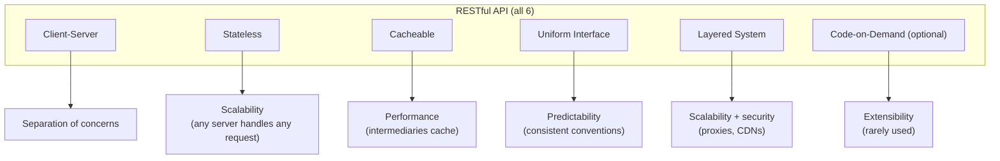

### 3.2 The four "uniform interface" sub-constraints

This is where most APIs fail the REST test:

1. **Identification of resources** — resources are identified by URLs (`https://api.example.com/users/1`). The URL is the resource's identity.
2. **Manipulation of resources through representations** — clients don't edit resources directly; they send a *representation* (e.g. a JSON object) and the server applies it.
3. **Self-descriptive messages** — each message includes everything needed to understand it: Content-Type, Content-Length, etc. No "you had to be there" assumptions.
4. **HATEOAS** (Hypermedia As The Engine Of Application State) — responses include links to related actions, so clients can navigate the API without out-of-band knowledge. (Most "REST" APIs skip this, leading REST purists to call them "RESTish.")

> [!question] Student asks: "If most APIs skip HATEOAS, are they really RESTful?"
> Strictly speaking, no. Roy Fielding himself has said: "If a service doesn't follow HATEOAS, it's not RESTful." But in practice, the industry uses "RESTful" to mean "resource-oriented URLs with HTTP methods." Don't get hung up on purity. The principles are useful even if you don't implement all of them.

### 3.3 REST vs. RPC vs. GraphQL

Three common API styles:

| Style | Example | When to use |
|-------|---------|-------------|
| **REST** | `DELETE /tasks/1` | Resource-oriented CRUD. The default choice for public APIs. |
| **RPC** (Remote Procedure Call) | `POST /deleteTask {"id":1}` | Action-oriented ("send email," "cancel order"). gRPC is modern RPC. |
| **GraphQL** | `POST /graphql {"query": "{ tasks { id title } }"}` | When clients need flexible queries (mobile apps, complex UIs). |

Most public APIs are REST because REST is the most discoverable, cacheable, and HTTP-friendly. RPC is fine for internal services. GraphQL is great when clients need to fetch exactly the fields they want.

```mermaid
flowchart TB
    Start["You're designing an API"]
    Start --> Q1{"Operations are<br/>mostly CRUD on resources?"}
    Q1 -->|Yes| REST["REST<br/>/tasks, /tasks/1"]
    Q1 -->|No, mostly actions<br/>(send, cancel, refund)| RPC["RPC<br/>/send-email, /cancel-order"]
    REST --> Q2{"Multiple clients with<br/>different field needs?"}
    Q2 -->|Yes, mobile/web differ a lot| GQL["Consider GraphQL<br/>on top of REST, or instead"]
    Q2 -->|No, similar needs| REST2["Stick with REST"]
    RPC --> Q3{"Internal or<br/>performance-critical?"}
    Q3 -->|Yes| GRPC["gRPC + protobuf<br/>(binary, fast, typed)"]
    Q3 -->|No| RPC2["JSON-RPC over HTTP"]
```

> [!question] Student asks: "Why not just use GraphQL for everything?"
> GraphQL is great, but it has real costs. **(1) Caching is harder** — GraphQL uses one endpoint (`POST /graphql`) for everything, so HTTP-level caching (by URL) doesn't work; you need client-side caching libraries (Apollo Client, urql). **(2) Authorization is more complex** — every field resolver needs to check permissions, not just every endpoint. **(3) N+1 queries are easy** — a query like `{ users { posts { comments { author } } } }` can trigger thousands of DB queries if you're not careful (use DataLoader). **(4) Rate-limiting is harder** — a single GraphQL query can do the work of 10 REST requests; "100 requests per minute" doesn't mean the same thing. **(5) Tooling is younger** than REST's.
>
> When GraphQL shines: many clients with different needs (Facebook's news feed on web vs. mobile), or when the data is a graph (social networks). When REST shines: resource-oriented CRUD, public APIs with caching requirements, simple apps.

> [!question] Student asks: "Is REST really 'stateless'? My Flask app has sessions."
> REST's statelessness constraint says: **each request contains everything the server needs to fulfill it.** That includes authentication — the auth token (cookie, JWT, API key) is in the request, not in some server-side "current user" state that the request references. Flask sessions fit this: the session cookie *is* in the request, so the request is self-contained. (Whether you call that "stateless" is a religious argument; some say cookies are server-side state by proxy. The practical point is: any server can handle any request, because the auth info is in the request itself. That's what enables load balancing and horizontal scaling.)

### 3.4 REST maturity model — the Richardson Maturity Model

Leonard Richardson defined a "maturity model" for REST APIs, with four levels:

| Level | What it is | Example |
|-------|-----------|---------|
| **0** | One endpoint, one method (POST), everything in the body | SOAP, XML-RPC: `POST /api` with `{"action": "getTask", "id": 1}` |
| **1** | Multiple endpoints (resources), but still one method | `POST /tasks/1`, `POST /tasks` |
| **2** | Multiple endpoints + HTTP methods + status codes | `GET /tasks/1`, `DELETE /tasks/1`, `201 Created` |
| **3** | Level 2 + HATEOAS (hypermedia links in responses) | Responses include `_links` to next actions |

Most "REST" APIs in the wild are at Level 2. Level 3 (true REST, per Fielding) is rare. The jump from Level 0 to Level 2 gives you 90% of the practical benefits (caching, status codes, HTTP-correctness). Level 3 adds discoverability but most clients don't use it.

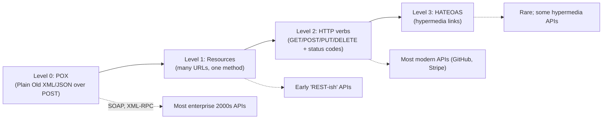

Don't get too hung up on the levels — they're a useful vocabulary, not a grade. Level 2 is "RESTful" in common industry usage, even if Fielding purists disagree.

## 4. HTTP Methods — the Verbs

### 4.1 Methods and their CRUD mapping

| Method | CRUD | What it does | Has body? | Response body? |
|--------|------|--------------|-----------|-----------------|
| GET | Read | Fetch a representation of a resource | No | Yes |
| POST | Create | Create a new resource (or trigger an action) | Yes (for create) | Yes (the created resource) |
| PUT | Update (replace) | Replace the entire resource with the provided representation | Yes | Optional |
| PATCH | Update (partial) | Apply partial modifications to a resource | Yes | Optional |
| DELETE | Delete | Remove a resource | No | Usually no (204) |
| HEAD | Read (headers only) | Like GET but return only headers | No | No |
| OPTIONS | Discovery | Describe the communication options for the target | No | Yes (Allowed headers) |

### 4.2 Safety and idempotency — the two properties

Two terms you must understand:

- **Safe** — the method doesn't change server state. GET, HEAD, OPTIONS are safe. (A safe method can have *side effects* like logging, but the resource state is unchanged.)
- **Idempotent** — calling the method N times has the same effect as calling it once. GET, PUT, DELETE, HEAD are idempotent. POST and PATCH are not (in general).

| Method | Safe? | Idempotent? |
|--------|-------|-------------|
| GET | ✅ | ✅ |
| HEAD | ✅ | ✅ |
| OPTIONS | ✅ | ✅ |
| PUT | ❌ | ✅ |
| DELETE | ❌ | ✅ |
| POST | ❌ | ❌ |
| PATCH | ❌ | ❌ (usually) |

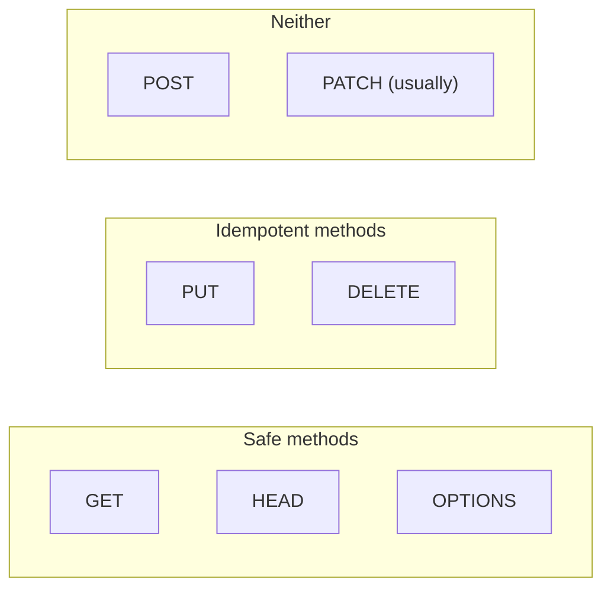

### 4.3 Why idempotency matters

If a network connection drops mid-request, the client doesn't know if the server received it. With an idempotent method, the client can safely retry. With a non-idempotent method, retrying could cause double-charges, double-emails, etc.

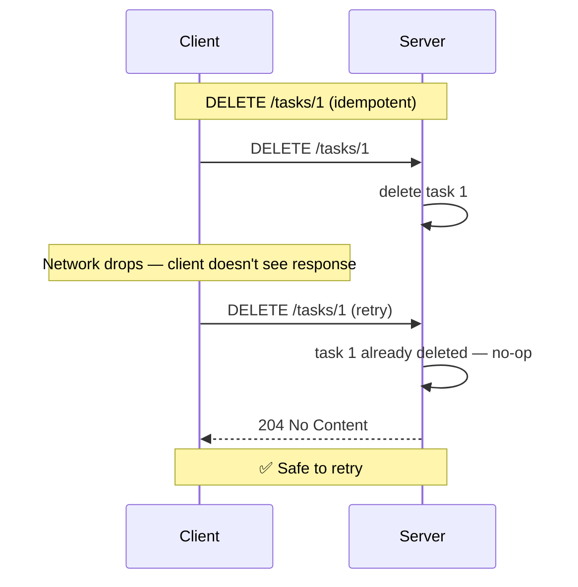

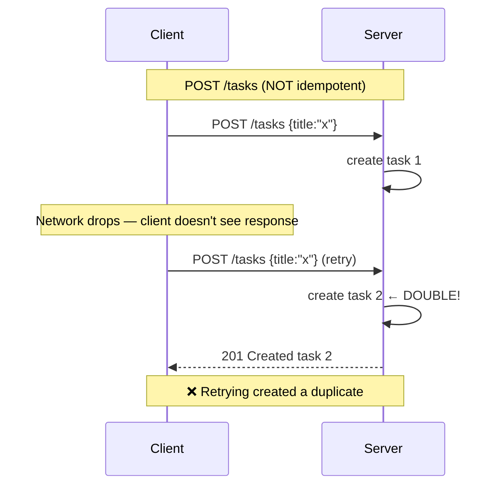

The fix for non-idempotent POSTs: **idempotency keys**. The client generates a unique UUID, sends it in a header (`Idempotency-Key: <uuid>`), and the server stores it. On retry, the server recognizes the key and returns the original response instead of creating a duplicate. Stripe's API uses this pattern.

### 4.4 PUT vs. PATCH — the subtle distinction

These two are the most-confused methods in HTTP.

**PUT** — **replace** the entire resource. The client sends the full new representation; missing fields are set to their default values (or removed).

```http
PUT /tasks/1
Content-Type: application/json

{"title": "Updated title"}
```

If the original task was `{"id":1,"title":"Old","done":false}`, after this PUT it's `{"id":1,"title":"Updated title","done":false}` (the `done` field gets reset to its default — `False`).

**PATCH** — **partially update** the resource. Only the provided fields are changed.

```http
PATCH /tasks/1
Content-Type: application/json

{"title": "Updated title"}
```

After this PATCH, the task is `{"id":1,"title":"Updated title","done":false}` — only `title` changed; `done` is preserved.

> [!question] Student asks: "So PATCH is what most people actually want, right?"
> Yes. Most "update" operations in real apps are partial — the user edited one field in a form, you send that field. PATCH is the right method. PUT is for the rarer case where you want to replace the whole resource (e.g. a config file you're overwriting). Many APIs use PUT loosely to mean "update," but the spec is clear.

There are two PATCH formats:

- **JSON Patch (RFC 6902)** — a list of operations: `[{"op":"replace","path":"/title","value":"new"}]`. Precise, but verbose.
- **JSON Merge Patch (RFC 7382)** — just send the fields to change: `{"title":"new"}`. Simpler. Most APIs use this.

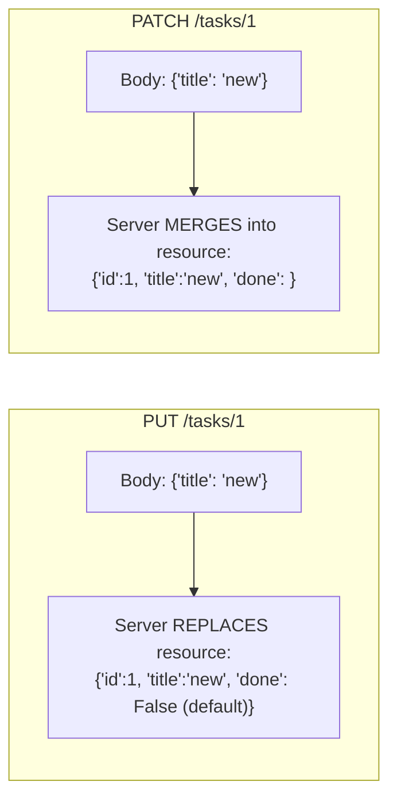

> [!info] A subtle PATCH gotcha: `null` vs. "field absent"
> In JSON Merge Patch (RFC 7382), there's a difference between `"title": null` and not including `title` at all:
> - `{"title": null}` → **delete** the `title` field (set to null/undefined on the server).
> - `{}` (no `title` key) → **leave** `title` unchanged.
>
> This surprises developers. If your form sends `"title": null` when the user clears the field, you're telling the server to remove the title. If you want "don't change," omit the key entirely. JSON Patch (RFC 6902) is more explicit: every operation is named (`replace`, `add`, `remove`, `move`, `copy`, `test`), so there's no ambiguity. The cost is verbosity.

### 4.5 DELETE — idempotent but special

DELETE is idempotent: deleting the same resource twice has the same effect as deleting it once (it's gone). But there's a subtlety:

- First `DELETE /tasks/1` → `204 No Content` (deleted)
- Second `DELETE /tasks/1` → `404 Not Found` (it's already gone) OR `204 No Content` (treat as success)

The spec allows either. Many APIs return 404 on the second delete to be precise; others return 204 for idempotency-friendly behavior. Pick one and document it.

## 5. URL Design for Resources

### 5.1 The resource hierarchy

REST URLs reflect the resource hierarchy:

```
/users                          → list of users
/users/1                        → user with id 1
/users/1/posts                  → list of posts by user 1
/users/1/posts/5                → post 5 by user 1
/users/1/posts/5/comments       → comments on post 5 (by user 1)
/users/1/posts/5/comments/12    → comment 12 on post 5 by user 1
```

Each segment is a resource; each ID narrows the scope. The hierarchy implies ownership: `/users/1/posts/5` is "post 5 *as authored by user 1*" — if post 5 isn't owned by user 1, return 404.

### 5.2 When to nest vs. when to flatten

You could model comments two ways:

- Nested: `GET /posts/5/comments` — "give me the comments on post 5"
- Flat: `GET /comments?post_id=5` — "give me comments filtered by post_id=5"

Both are valid. The trade-off:

- **Nested URLs** are more discoverable and read naturally. They're great for "the canonical way to access this."
- **Flat URLs with filters** are more flexible — you can also `GET /comments?user_id=1` or `GET /comments?created_after=2026-01-01`.

A common pattern: expose **both**. `GET /posts/5/comments` for the common case; `GET /comments?post_id=5` for advanced filtering.

### 5.3 URL conventions

| Convention | Example | Why |
|------------|---------|-----|
| Plural nouns for collections | `/users` not `/user` | Consistency; matches database table names |
| Lowercase | `/users` not `/Users` | URLs are case-sensitive (technically); lowercase avoids confusion |
| Hyphens, not underscores | `/user-profiles` not `/user_profiles` | Easier to read in a browser address bar |
| IDs as path segments | `/users/1` not `/users?id=1` | Path = identity, query = filter |
| Query params for filtering/sorting | `?status=active&sort=created_at` | The query string is for non-identifying info |
| Trailing slash or not — pick one | `/users/` OR `/users` (not both) | They're technically different URLs; pick one and redirect the other |

### 5.4 What goes in the path vs. the query

A useful mental model: **the path identifies the resource; the query string filters or scopes it.**

- `/users/1` — identifies user 1. The path *is* the resource.
- `/users?status=active` — identifies "the collection of users," filtered to active ones. The path identifies the collection; the query narrows it.
- `/users/1/posts` — identifies "the collection of posts by user 1." The path identifies a sub-collection.
- `/posts?author_id=1` — same data, different model: identifies "the collection of posts," filtered to author=1.

When in doubt, ask: "would I cache this response under this URL?" If yes, the URL should fully identify the resource. If the URL changes based on filters, the filters belong in the query string.

### 5.5 When URLs change

URLs are a contract with your clients. **Don't break them.** If you must change a URL:

1. Keep the old one working (with a 301 redirect to the new one) for as long as you have clients using it.
2. Announce the deprecation in your docs and via `Deprecation` and `Sunset` HTTP headers (RFC 8594 / RFC 2146 draft).
3. Eventually remove the old URL — but give clients months, not days.

```http
HTTP/1.1 200 OK
Deprecation: Sun, 30 Jun 2026 00:00:00 GMT
Sunset: Sat, 31 Dec 2026 00:00:00 GMT
Link: <https://api.example.com/v2/users>; rel="successor-version"
```

This is how serious APIs handle deprecation. The `Link` header tells clients where the new endpoint is.

## 6. The Complete Blog API

Let's design a complete REST API for a blog. Resources: Users, Posts, Comments, Tags.

### 6.1 The endpoints

| Method | URL | What it does |
|--------|-----|--------------|
| POST | `/users` | Register a new user |
| GET | `/users` | List users (paginated) |
| GET | `/users/<id>` | Get a specific user |
| PATCH | `/users/<id>` | Update user (auth required, self or admin) |
| DELETE | `/users/<id>` | Delete user (auth required, self or admin) |
| POST | `/posts` | Create a post (auth required) |
| GET | `/posts` | List posts (paginated, filterable) |
| GET | `/posts/<id>` | Get a specific post |
| PATCH | `/posts/<id>` | Update post (auth required, author only) |
| DELETE | `/posts/<id>` | Delete post (auth required, author or admin) |
| GET | `/posts/<id>/comments` | List comments on a post |
| POST | `/posts/<id>/comments` | Add a comment to a post (auth required) |
| GET | `/comments/<id>` | Get a specific comment |
| PATCH | `/comments/<id>` | Update comment (auth required, author only) |
| DELETE | `/comments/<id>` | Delete comment (auth required, author or admin) |
| GET | `/tags` | List all tags |
| GET | `/tags/<slug>` | Get a specific tag |
| GET | `/tags/<slug>/posts` | List posts with this tag |

### 6.2 Status codes for each operation

| Operation | Success | Not found | Not authorized | Not allowed | Validation error |
|-----------|---------|-----------|----------------|-------------|------------------|
| GET (single) | 200 | 404 | 401 | 403 | — |
| GET (list) | 200 | — | 401 | 403 | 400 (bad query) |
| POST (create) | 201 + Location | — | 401 | 403 | 400 or 422 |
| PUT/PATCH (update) | 200 | 404 | 401 | 403 | 400 or 422 |
| DELETE | 204 | 404 | 401 | 403 | — |
| (any) | — | — | — | — | 409 (conflict, e.g. duplicate) |

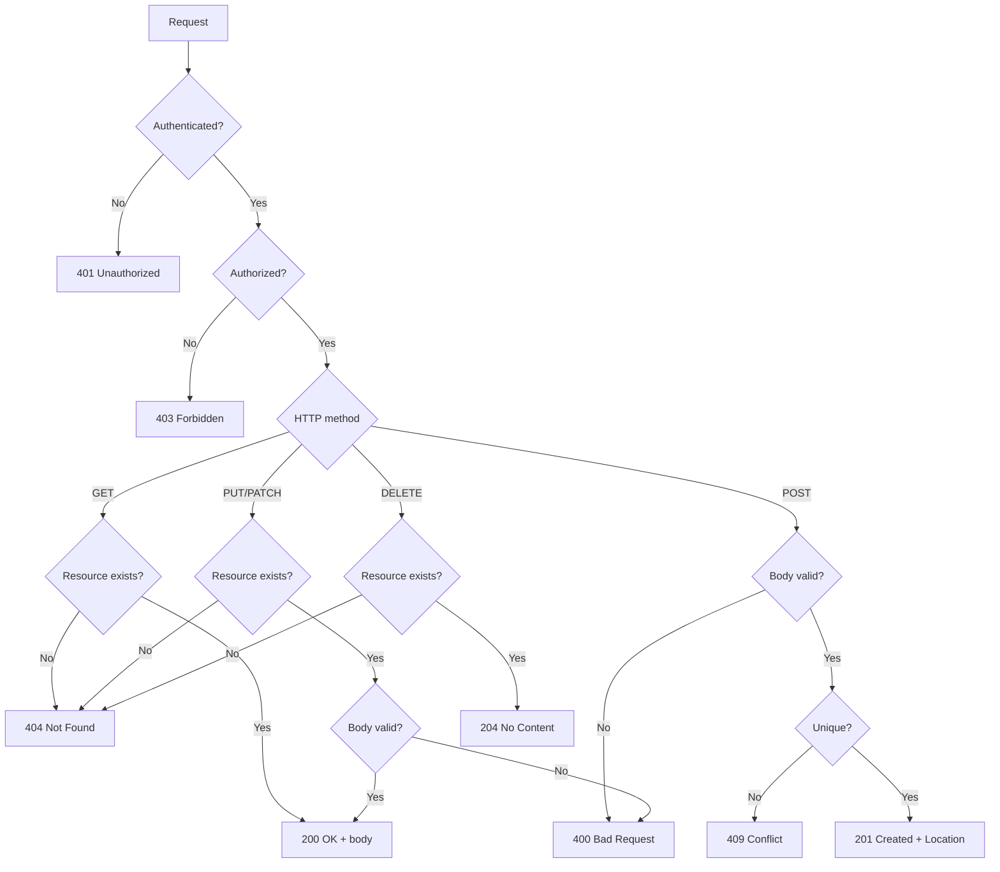

### 6.3 The Flask code (excerpt — full project in Lesson 24)

```python
# app/api/v1/posts.py
from flask import Blueprint, request, jsonify, url_for, g
from flask_login import current_user, login_required
from app.extensions import db
from app.models import User, Post, Comment, Tag
from app.api.errors import error_response, bad_request

posts_bp = Blueprint('api_posts', __name__, url_prefix='/api/v1/posts')


@posts_bp.route('', methods=['GET'])
def list_posts():
    page = request.args.get('page', 1, type=int)
    per_page = min(request.args.get('per_page', 20, type=int), 100)
    query = Post.query
    # Filtering
    if 'author_id' in request.args:
        query = query.filter_by(author_id=request.args['author_id'])
    if 'tag' in request.args:
        query = query.filter(Post.tags.any(slug=request.args['tag']))
    # Sorting
    sort = request.args.get('sort', 'created_at')
    if sort.startswith('-'):
        query = query.order_by(getattr(Post, sort[1:]).desc())
    else:
        query = query.order_by(getattr(Post, sort).asc())
    # Paginate
    pag = query.paginate(page=page, per_page=per_page, error_out=False)
    return jsonify({
        'posts': [post.to_dict() for post in pag.items],
        'pagination': {
            'page': page, 'per_page': per_page,
            'total': pag.total, 'pages': pag.pages,
            'has_next': pag.has_next, 'has_prev': pag.has_prev,
        }
    })


@posts_bp.route('/<int:post_id>', methods=['GET'])
def get_post(post_id):
    post = db.session.get(Post, post_id)
    if post is None:
        return error_response(404, 'Post not found')
    return jsonify({'post': post.to_dict()})


@posts_bp.route('', methods=['POST'])
@login_required
def create_post():
    data = request.get_json() or {}
    if 'title' not in data or 'body' not in data:
        return bad_request('title and body are required')
    post = Post(title=data['title'], body=data['body'], author_id=current_user.id)
    db.session.add(post)
    db.session.commit()
    response = jsonify({'post': post.to_dict()})
    response.status_code = 201
    response.headers['Location'] = url_for('api_posts.get_post', post_id=post.id)
    return response


@posts_bp.route('/<int:post_id>', methods=['PATCH'])
@login_required
def update_post(post_id):
    post = db.session.get(Post, post_id)
    if post is None:
        return error_response(404, 'Post not found')
    if post.author_id != current_user.id and not current_user.is_admin:
        return error_response(403, 'You can only edit your own posts')
    data = request.get_json() or {}
    if 'title' in data:
        post.title = data['title']
    if 'body' in data:
        post.body = data['body']
    db.session.commit()
    return jsonify({'post': post.to_dict()})


@posts_bp.route('/<int:post_id>', methods=['DELETE'])
@login_required
def delete_post(post_id):
    post = db.session.get(Post, post_id)
    if post is None:
        return error_response(404, 'Post not found')
    if post.author_id != current_user.id and not current_user.is_admin:
        return error_response(403, 'You can only delete your own posts')
    db.session.delete(post)
    db.session.commit()
    return '', 204
```

### 6.4 Testing every CRUD operation with curl

```bash
# List posts
curl -s http://localhost:5000/api/v1/posts | python -m json.tool

# Get a specific post
curl -s http://localhost:5000/api/v1/posts/1

# Create a post (requires auth — get a token first)
TOKEN=$(curl -s -X POST http://localhost:5000/api/v1/auth/login \
  -H "Content-Type: application/json" \
  -d '{"username":"alice","password":"Hunter2hunter2"}' | python -c "import sys,json; print(json.load(sys.stdin)['access_token'])")

curl -s -X POST http://localhost:5000/api/v1/posts \
  -H "Authorization: Bearer $TOKEN" \
  -H "Content-Type: application/json" \
  -d '{"title":"My first post","body":"Hello, world!"}'

# Update a post
curl -s -X PATCH http://localhost:5000/api/v1/posts/1 \
  -H "Authorization: Bearer $TOKEN" \
  -H "Content-Type: application/json" \
  -d '{"title":"Updated title"}'

# Delete a post
curl -s -X DELETE http://localhost:5000/api/v1/posts/1 \
  -H "Authorization: Bearer $TOKEN" -i
# HTTP/1.0 204 NO CONTENT
```

## 7. Pagination — Three Strategies

Returning all 50,000 posts in one response is a terrible idea. APIs paginate.

### 7.1 Offset pagination

```
GET /posts?page=3&per_page=20
```

The server uses SQL `LIMIT 20 OFFSET 40`. Simple to implement, simple to use.

```python
@posts_bp.route('', methods=['GET'])
def list_posts():
    page = request.args.get('page', 1, type=int)
    per_page = min(request.args.get('per_page', 20, type=int), 100)
    pag = Post.query.paginate(page=page, per_page=per_page, error_out=False)
    return jsonify({
        'posts': [p.to_dict() for p in pag.items],
        'pagination': {
            'page': page, 'per_page': per_page,
            'total': pag.total, 'pages': pag.pages,
        }
    })
```

**Pros:** Simple. Lets you jump to any page. The client knows the total.

**Cons:** Slow for large offsets — the database has to scan all skipped rows. New items inserted during pagination cause items to shift between pages (you might see duplicates or skips).

### 7.2 Cursor pagination

```
GET /posts?cursor=eyJpZCI6MTAwfQ&per_page=20
```

The server returns a cursor — an opaque token pointing to the last item. To get the next page, the client includes the cursor:

```
GET /posts?cursor=eyJpZCI6MTIwfQ&per_page=20   # next 20 after item 120
```

The cursor is typically base64-encoded JSON: `{"id": 120}`.

```python
import base64, json

@posts_bp.route('', methods=['GET'])
def list_posts():
    per_page = min(request.args.get('per_page', 20, type=int), 100)
    cursor = request.args.get('cursor')
    query = Post.query.order_by(Post.id.asc())
    if cursor:
        last_id = json.loads(base64.b64decode(cursor))['id']
        query = query.filter(Post.id > last_id)
    posts = query.limit(per_page).all()
    next_cursor = None
    if len(posts) == per_page:
        next_cursor = base64.b64encode(json.dumps({'id': posts[-1].id}).encode()).decode()
    return jsonify({
        'posts': [p.to_dict() for p in posts],
        'next_cursor': next_cursor,
    })
```

**Pros:** Stable under inserts (no duplicates/skips). Fast even for large offsets.

**Cons:** Can't jump to a specific page. Can't go backwards (without a separate `prev_cursor`). Client doesn't know the total.

### 7.3 Keyset pagination

A variant of cursor pagination where the cursor is a tuple (e.g. `(created_at, id)`). Useful when sorting by a non-unique field:

```
GET /posts?per_page=20
GET /posts?per_page=20&last_created_at=2026-01-15T12:34:56&last_id=42
```

```sql
SELECT * FROM posts
WHERE (created_at, id) < ('2026-01-15 12:34:56', 42)
ORDER BY created_at DESC, id DESC
LIMIT 20
```

This is the gold standard for paginating large datasets, especially when sorted by time.

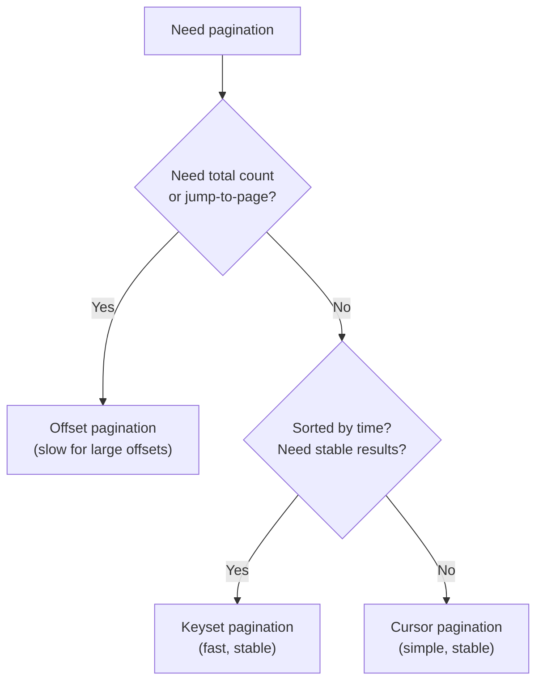

> [!info] Why offset pagination is slow at scale
> SQL's `OFFSET 100000 LIMIT 20` doesn't "skip 100,000 rows efficiently" — the database still scans all 100,000 rows, then returns the next 20. On a 1-million-row table, page 50,000 takes seconds. Worse, the scan time grows linearly with offset. Keyset (cursor) pagination avoids this: `WHERE id > 100020 ORDER BY id LIMIT 20` uses the primary-key index and is constant-time regardless of how deep you are. For real apps with millions of rows, keyset is the only sane choice. For admin UIs that need "jump to page 47," offset is fine — admins are OK waiting a second.

> [!question] Student asks: "Why does my offset pagination show duplicates?"
> Imagine you're on page 1 (posts 1-20), and a new post is created. Now you request page 2 (offset 20, limit 20). The new post pushed everything down by one — so post 20 (which was on page 1) is now at position 21, on page 2. You see it again. This is the "shifting window" problem with offset pagination. **Cursor/keyset pagination doesn't have this problem** because it uses `WHERE id > X` — new posts with IDs > X appear at the end of the result set, not in the middle.

> [!info] GraphQL's "connection" pattern
> If you ever use GraphQL, you'll see pagination expressed as `edges` and `pageInfo`:
> ```json
> {
>   "posts": {
>     "edges": [
>       {"node": {"id": 1, "title": "..."}, "cursor": "abc"},
>       {"node": {"id": 2, "title": "..."}, "cursor": "def"}
>     ],
>     "pageInfo": {
>       "hasNextPage": true,
>       "endCursor": "def"
>     }
>   }
> }
> ```
> This is cursor pagination with extra structure. The same pattern works in REST — the cursor is just an opaque string in the response, and the client passes it back as `?cursor=def`. The "edge/node" naming is GraphQL-specific (from the Relay spec), but the underlying pattern is universal.

## 8. Filtering, Sorting, Sparse Fieldsets

### 8.1 Filtering

Query parameters are the standard. Conventions:

```
GET /posts?status=published           # exact match
GET /posts?author_id=1                # exact match (foreign key)
GET /posts?created_after=2026-01-01   # range filter
GET /posts?tag=python                 # many-to-many filter
GET /posts?q=flask                    # full-text search
```

For more complex filters, some APIs use a query language:

```
GET /posts?filter=created_at gt 2026-01-01 AND status eq 'published'
```

This is harder to parse but very expressive. JSON:API standardizes this format.

Let's look at a real Flask implementation that handles all these cases:

```python
@posts_bp.route('', methods=['GET'])
def list_posts():
    query = Post.query
    # Exact-match filters
    for field in ('status', 'author_id'):
        if field in request.args:
            query = query.filter(getattr(Post, field) == request.args[field])
    # Range filters
    if 'created_after' in request.args:
        query = query.filter(Post.created_at >= request.args['created_after'])
    if 'created_before' in request.args:
        query = query.filter(Post.created_at <= request.args['created_before'])
    # Many-to-many filter
    if 'tag' in request.args:
        query = query.filter(Post.tags.any(Tag.slug == request.args['tag']))
    # Full-text search (Postgres-specific)
    if 'q' in request.args:
        query = query.filter(Post.__tsvector__.match(request.args['q']))
    return jsonify({'posts': [p.to_dict() for p in query.all()]})
```

Notice the **whitelist pattern**: we only allow filtering on fields we explicitly name. A naive `for field in request.args: query = query.filter(getattr(Post, field) == ...)` would let attackers filter on internal fields like `password_hash` or attempt SQL injection through field names. Always whitelist.

### 8.2 Sorting

```
GET /posts?sort=created_at            # ascending
GET /posts?sort=-created_at           # descending (minus prefix)
GET /posts?sort=author,created_at     # multi-field sort
```

The minus-prefix convention (from JSON:API) is widely used. Implementation:

```python
def apply_sort(query, sort_param, allowed_fields):
    for field in sort_param.split(','):
        descending = field.startswith('-')
        name = field.lstrip('-')
        if name not in allowed_fields:
            abort(400, f"Cannot sort by {name}")
        column = getattr(Post, name)
        query = query.order_by(column.desc() if descending else column.asc())
    return query

@posts_bp.route('', methods=['GET'])
def list_posts():
    query = Post.query
    if 'sort' in request.args:
        query = apply_sort(query, request.args['sort'],
                          allowed_fields={'created_at', 'title', 'author_id'})
    ...
```

Again the **whitelist** — never let the client sort on arbitrary fields. Some fields (like `password_hash`) shouldn't be sortable. Some columns don't have indexes and will trigger a full table scan.

### 8.3 Sparse fieldsets

Mobile clients may want only `id` and `title`, not the full `body`. Let them request only the fields they need:

```
GET /posts?fields=id,title
GET /posts?fields=id,title,author(name)
```

This saves bandwidth. GraphQL is the extreme version of this — every query specifies exactly the fields wanted.

Implementation in your `to_dict`:

```python
class Post(db.Model):
    def to_dict(self, fields=None):
        all_fields = {
            'id': self.id,
            'title': self.title,
            'body': self.body,
            'author_id': self.author_id,
            'created_at': self.created_at.isoformat(),
        }
        if fields is None:
            return all_fields
        return {k: v for k, v in all_fields.items() if k in fields}

@posts_bp.route('', methods=['GET'])
def list_posts():
    fields = request.args.get('fields')
    field_set = set(fields.split(',')) if fields else None
    posts = Post.query.all()
    return jsonify({'posts': [p.to_dict(field_set) for p in posts]})
```

For nested sparse fieldsets (`fields=author(name)`), the syntax gets more complex — JSON:API has a complete spec for this. For most APIs, top-level fieldsets are enough.

## 9. ETags and Conditional Requests

### 9.1 What is an ETag?

An **ETag** (entity tag) is a hash of the resource's content. The server includes it in the response:

```
HTTP/1.1 200 OK
ETag: "abc123"
Content-Type: application/json

{"id":1,"title":"Hello"}
```

The client caches the response *with* the ETag. On the next request for the same resource, it sends:

```
GET /posts/1
If-None-Match: "abc123"
```

If the resource hasn't changed (same ETag), the server returns:

```
HTTP/1.1 304 Not Modified
ETag: "abc123"
```

…with no body. The client uses its cached copy. Saves bandwidth and (often) server CPU.

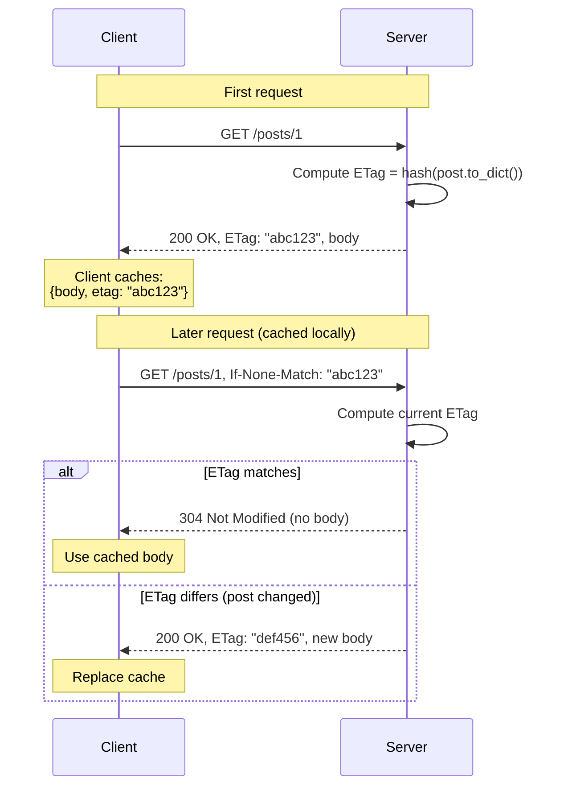

### 9.2 Implementing ETags in Flask

```python
import hashlib
import json
from flask import request, make_response

@posts_bp.route('/<int:post_id>', methods=['GET'])
def get_post(post_id):
    post = db.session.get(Post, post_id)
    if post is None:
        return error_response(404, 'Post not found')
    body = json.dumps(post.to_dict(), sort_keys=True)
    etag = '"' + hashlib.sha256(body.encode()).hexdigest()[:16] + '"'
    if request.headers.get('If-None-Match') == etag:
        return '', 304
    response = make_response(body, 200)
    response.headers['Content-Type'] = 'application/json'
    response.headers['ETag'] = etag
    return response
```

Flask 2.3+ can also auto-generate ETags with `response.set_etag(...)` and validate with `response.is_conditional`.

### 9.3 Conditional requests — the full table

| Header (request) | Header (response) | Behavior |
|------------------|-------------------|----------|
| `If-None-Match: "abc"` | `ETag: "abc"` | If match, return 304 (not modified) |
| `If-Match: "abc"` | `ETag: "abc"` | If no match, return 412 (precondition failed) — used for optimistic locking |
| `If-Modified-Since: <date>` | `Last-Modified: <date>` | If not modified since, return 304 |
| `If-Unmodified-Since: <date>` | `Last-Modified: <date>` | If modified since, return 412 |

`If-Match` is used for **optimistic concurrency control**: client A fetches the post, client B fetches the post, client A PATCHes, client B PATCHes — server should reject B's update because it's based on stale data.

## 10. Rate Limiting

Public APIs need rate limiting to prevent abuse. The standard headers:

```
X-RateLimit-Limit: 1000           # requests allowed per window
X-RateLimit-Remaining: 942        # requests remaining in current window
X-RateLimit-Reset: 1735689600     # Unix timestamp when window resets
Retry-After: 60                   # seconds until you can retry (only on 429)
```

When the limit is exceeded:

```
HTTP/1.1 429 Too Many Requests
X-RateLimit-Limit: 1000
X-RateLimit-Remaining: 0
X-RateLimit-Reset: 1735689600
Retry-After: 60
Content-Type: application/json

{"error": "Rate limit exceeded. Try again in 60 seconds."}
```

In Flask, use `flask-limiter`:

```python
from flask_limiter import Limiter
from flask_limiter.util import get_remote_address

limiter = Limiter(get_remote_address, app=app, default_limits=["1000 per hour"])

@app.route('/api/v1/posts')
@limiter.limit("100 per minute")  # override default
def list_posts():
    ...
```

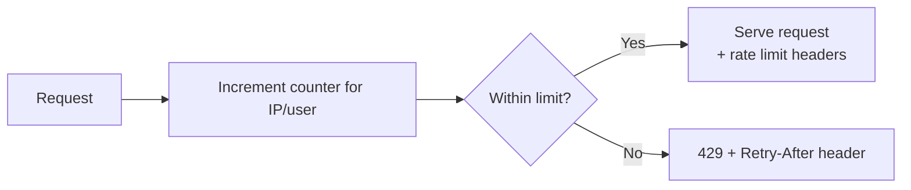

## 11. HATEOAS — The Controversial One

HATEOAS says: every response should include **links** to related actions, so clients can navigate the API without out-of-band knowledge.

```json
{
  "post": {
    "id": 1,
    "title": "Hello",
    "_links": {
      "self": {"href": "/posts/1"},
      "author": {"href": "/users/42"},
      "comments": {"href": "/posts/1/comments"},
      "edit": {"href": "/posts/1", "method": "PATCH"},
      "delete": {"href": "/posts/1", "method": "DELETE"}
    }
  }
}
```

The client can discover the edit and delete URLs from the response — it doesn't need to know the URL pattern in advance.

**Pros:** Decouples client from server URL structure. Server can change URLs without breaking clients. Clients can "discover" the API by following links rather than reading docs.

**Cons:** Verbose. Most clients hard-code URLs anyway. Rarely worth the complexity.

Most "REST" APIs skip HATEOAS. If you implement it, use a standard like [HAL](https://stateless.group/hal_specification.html) or JSON:API's links object.

> [!question] Student asks: "If HATEOAS is the 'right' way, why does everyone skip it?"
> Three reasons. **First**, web API clients are usually written by developers who read the docs anyway — there's no real "discovery" benefit. **Second**, the URL structure of most APIs rarely changes; when it does, you can do a version bump (`/v2/`) instead of relying on HATEOAS links. **Third**, HATEOAS adds bytes to every response that most clients ignore. The benefit is theoretical for most apps; the cost is concrete. That said, if you're building an API for long-term stability where clients are slow to update (banking, government), HATEOAS can be worth the cost.

## 12. Modern: API Authentication

### 12.1 Three options

| Method | How it works | When to use |
|--------|--------------|-------------|
| **API key** | `Authorization: ApiKey abc123` (or `X-API-Key: abc123`) | Server-to-server, simple APIs, low security |
| **JWT** | `Authorization: Bearer eyJhbGc...` | Mobile apps, SPAs, stateless APIs |
| **OAuth2** | `Authorization: Bearer oauth_access_token` (after OAuth dance) | "Log in with Google," third-party apps acting on user's behalf |

### 12.2 JWT in Flask

```python
# pip install PyJWT
import jwt
from datetime import datetime, timedelta, timezone

SECRET = app.config['SECRET_KEY']

def issue_token(user):
    payload = {
        'sub': str(user.id),
        'iat': datetime.now(timezone.utc),
        'exp': datetime.now(timezone.utc) + timedelta(minutes=15),
    }
    return jwt.encode(payload, SECRET, algorithm='HS256')

def verify_token(token):
    try:
        return jwt.decode(token, SECRET, algorithms=['HS256'])
    except jwt.ExpiredSignatureError:
        return None
    except jwt.InvalidTokenError:
        return None

@app.route('/api/v1/auth/login', methods=['POST'])
def api_login():
    data = request.get_json()
    user = User.query.filter_by(username=data['username']).first()
    if not user or not user.check_password(data['password']):
        return error_response(401, 'Invalid credentials')
    return jsonify({'access_token': issue_token(user), 'token_type': 'bearer'})

@api_bp.before_request
def require_auth():
    auth = request.headers.get('Authorization', '')
    if not auth.startswith('Bearer '):
        return error_response(401, 'Missing or invalid Authorization header')
    payload = verify_token(auth[7:])
    if payload is None:
        return error_response(401, 'Invalid or expired token')
    g.current_user = db.session.get(User, int(payload['sub']))
```

Use **short-lived access tokens (15 min)** plus a **refresh token** (longer-lived, used to get new access tokens). The refresh token is stored server-side (revocable); the access token is stateless (not revocable, but expires fast).

The JWT itself has three parts, separated by `.`:

```
eyJhbGciOiJIUzI1NiIsInR5cCI6IkpXVCJ9   ← header (alg, typ)
.eyJzdWIiOiIxIiwiaWF0IjoxNzM1Njg5NjAwLCJleHAiOjE3MzU2ODk3MDB9   ← payload (sub, iat, exp)
.aBcDeFgHiJkLmNoPqRsTuVwXyZ   ← HMAC-SHA256 signature
```

Each part is base64url-encoded. The header and payload are **readable by anyone** with the token (they're not encrypted — only signed). The signature prevents tampering: if anyone changes the payload, the signature no longer matches.

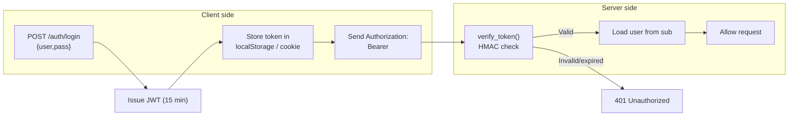

> [!warning] JWT gotchas
> - **JWTs can't be revoked** before they expire. If a user logs out, the token is still valid until expiry. Solution: keep tokens short-lived (15 min) and use server-side refresh tokens for long sessions.
> - **JWTs are not encrypted.** Anyone with the token can read its contents. Don't put secrets (passwords, PII) in the payload.
> - **JWTs need a strong secret.** If `SECRET_KEY` leaks, attackers can forge any token. Treat it like a database password.
> - **Use `HS256` for symmetric (single-server) apps, `RS256` for asymmetric (multi-server / microservices).** With RS256, the signing key is private; the verification key is public — services can verify tokens without sharing the signing key.

### 12.3 API keys

Simpler than JWT — just a random string stored in the database, associated with a user. The client sends it on every request:

```http
GET /api/v1/posts
X-API-Key: sk_live_abc123
```

Easy to revoke (delete from database). Not suitable for browser-based clients (the key would be in JavaScript, where XSS could steal it). Great for server-to-server APIs.

```python
# Model
class ApiKey(db.Model):
    id = db.Column(db.Integer, primary_key=True)
    key = db.Column(db.String(64), unique=True, nullable=False, index=True)
    user_id = db.Column(db.Integer, db.ForeignKey('users.id'), nullable=False)
    created_at = db.Column(db.DateTime, default=datetime.utcnow)
    last_used_at = db.Column(db.DateTime)
    is_active = db.Column(db.Boolean, default=True)

# Issuance (one-time display to user)
import secrets
def issue_api_key(user):
    key = 'sk_live_' + secrets.token_urlsafe(32)
    api_key = ApiKey(key=key, user_id=user.id)
    db.session.add(api_key)
    db.session.commit()
    return key   # only return this once

# Verification
@api_bp.before_request
def require_api_key():
    key = request.headers.get('X-API-Key')
    if not key:
        return error_response(401, 'Missing API key')
    api_key = ApiKey.query.filter_by(key=key, is_active=True).first()
    if api_key is None:
        return error_response(401, 'Invalid API key')
    api_key.last_used_at = datetime.utcnow()
    db.session.commit()
    g.current_user = api_key.user
```

Note the `sk_live_` prefix — this is a Stripe-style convention. The prefix lets you grep logs for accidentally-logged keys (you'd see `sk_live_` in the log line and know to redact). Real keys are 32+ characters of random entropy.

> [!info] The "API key prefix" pattern — Stripe's clever trick
> Stripe, GitHub, Slack, and many others prefix their API keys with a recognizable string:
> - Stripe: `sk_live_...`, `sk_test_...`
> - GitHub: `ghp_...` (personal access token), `gho_...` (OAuth), `ghs_...` (server)
> - Slack: `xoxb_...` (bot), `xoxp_...` (user)
>
> The prefixes serve three purposes. **(1) Grep-ability** — if a key leaks into a log file, you can `grep -r 'sk_live_' .` to find it. GitHub uses this actively: they scan public repos for `ghp_` prefixes and auto-revoke leaked tokens. **(2) Visual recognition** — developers looking at a config file instantly know "this is a production key, treat it carefully" vs. "this is a test key." **(3) Type routing** — your server can branch on the prefix: `sk_test_` goes to the test database, `sk_live_` to production. Adopt this pattern for your own API keys.

### 12.4 Comparing the three approaches

| Property | API key | JWT | OAuth2 access token |
|----------|---------|-----|---------------------|
| Server-side storage | ✅ (DB row) | ❌ (stateless) | Depends (refresh token: yes) |
| Revocation | Trivial (delete row) | Hard (need blocklist) | Refresh: easy; access: hard |
| Cross-domain | ✅ | ✅ | ✅ |
| Browser-friendly | ❌ (XSS risk in JS) | ⚠️ (localStorage XSS risk) | ✅ (cookie or header) |
| Mobile-friendly | ✅ | ✅ | ✅ |
| Setup complexity | Trivial | Moderate | High |
| Best for | Server-to-server | Stateless API auth | Third-party apps acting on user's behalf |

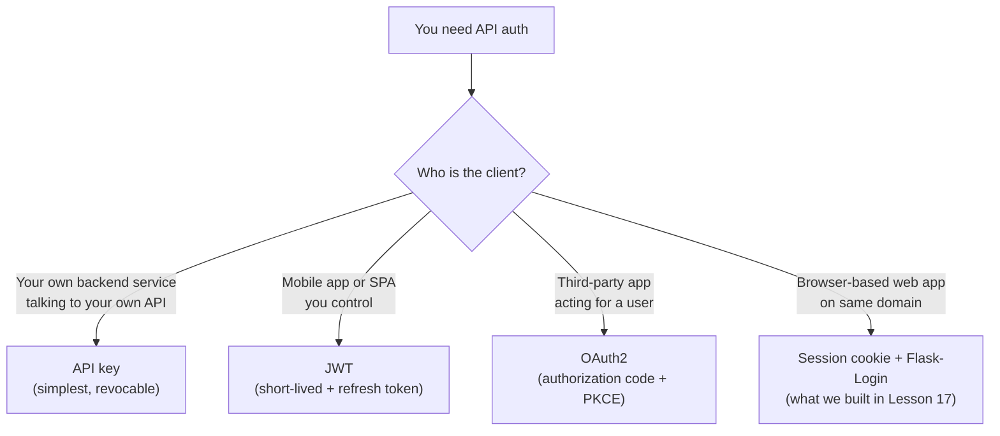

> [!warning] The "JWT in localStorage" trap
> Many tutorials tell you to store JWTs in the browser's `localStorage`. **This is dangerous**: any XSS attack on your site can read `localStorage.getItem('jwt')` and steal the token. Two safer alternatives:
>
> 1. **Store the JWT in an HttpOnly cookie.** The browser sends it automatically; XSS can't read it. The downside: you need CSRF protection (since cookies are sent on cross-site requests) — `SameSite=Lax` covers most cases.
> 2. **Use a refresh-token-in-cookie + access-token-in-memory pattern.** The short-lived access token lives in JS memory (cleared on refresh — XSS has a 15-minute window). The refresh token is in an HttpOnly cookie. After a refresh, the server issues a new access token. This is the pattern Auth0, Firebase, and most modern auth libraries recommend.
>
> For browser apps, **prefer session cookies** (Flask-Login) unless you have a specific reason to use JWTs (cross-domain, mobile + web sharing a backend). JWTs are not "more secure" than session cookies — they're a different trade-off.

## 13. Try This

> [!tip] Try this: implement pagination
> Take the `/api/v1/posts` endpoint from §6.3 and add offset pagination. Test:
> ```bash
> curl http://localhost:5000/api/v1/posts?page=2&per_page=5
> ```
> The response should include 5 posts and pagination metadata. Try `per_page=1000` — your code should cap it at 100.

> [!tip] Try this: add ETags
> Add ETag generation to `GET /posts/<id>`. Make two consecutive requests with `If-None-Match`. The second should return 304. Watch the network tab — you'll see the byte savings.

> [!tip] Try this: rate limit your API
> Install `flask-limiter`. Add `@limiter.limit("5 per minute")` to `/api/v1/posts`. Hit it 6 times in a row with curl — the 6th should return 429 with a `Retry-After` header.

> [!tip] Try this: add JWT auth
> Use the code in §12.2 to add `/api/v1/auth/login` returning a JWT. Protect `POST /api/v1/posts` with `@require_auth`. Test with curl: get a token, then POST with `Authorization: Bearer <token>`.

> [!tip] Try this: implement keyset pagination
> Replace offset pagination with keyset pagination (sort by `created_at desc, id desc`). Use the cursor to fetch the next page. Compare performance with offset on a 100,000-post dataset.

> [!tip] Try this: see idempotency in action
> Make a `DELETE /api/v1/posts/1` request twice. The first should return 204. What does the second return — 204 or 404? Decide which behavior you prefer, and document it. (Both are spec-compliant.)

> [!tip] Try this: send an idempotency key with POST
> Generate a UUID and send it in `Idempotency-Key` header on `POST /api/v1/posts`. Implement server-side: store the key with the response; on retry, return the stored response. Now your POSTs are safe to retry.

> [!tip] Try this: implement content negotiation
> Add an `Accept` header check to `GET /posts/<id>`. If the client sends `Accept: application/json`, return JSON. If they send `Accept: text/html`, render an HTML view of the post. If they send `Accept: application/xml`, return XML (use `dicttoxml` library). Now your one endpoint serves multiple clients — a tiny version of what REST's "uniform interface" enables.

> [!tip] Try this: measure the cost of `to_dict()`
> Profile your `/api/v1/posts` endpoint with 1000 posts. You'll likely find that `to_dict()` is the bottleneck — every call creates dicts, accesses attributes, formats datetimes. Two optimizations: (1) `select(Post).options(lazyload('*'))` to avoid loading relations you don't serialize, and (2) cache the post dict in Redis with a 60-second TTL, invalidating on update. Profile again — the difference should be 10-100x.

> [!tip] Try this: implement optimistic locking
> Add an `etag` column to your `Post` model (or use `updated_at`). When a client GETs a post, include `ETag: <value>` in the response. When they PATCH, they must send `If-Match: <value>`. If the value doesn't match (someone else updated since the GET), return `412 Precondition Failed`. Now two clients can't silently overwrite each other's edits — the second one sees "this post was changed, please refresh and try again."

> [!tip] Try this: see rate-limiting headers in action
> Install `flask-limiter`. Set `@limiter.limit("5 per minute")` on `/api/v1/posts`. Hit the endpoint 6 times rapidly. The first 5 return `200 OK` with `X-RateLimit-Remaining: 4`, `3`, `2`, `1`, `0`. The 6th returns `429 Too Many Requests` with `Retry-After: 60` (or however long until the window resets). This is exactly what real APIs (Stripe, GitHub) do — and your clients will need to handle the 429 gracefully.

## 14. Exercises

### Exercise 1 — Complete the blog API (medium)

Implement all the endpoints in §6.1. Add the `to_dict()` methods to your models. Test every endpoint with curl.

### Exercise 2 — Filtering and sorting (medium)

Add `?author_id=`, `?tag=`, `?status=` filters and `?sort=` (with `-` prefix for descending) to `GET /posts`. Document them in an OpenAPI spec.

### Exercise 3 — Sparse fieldsets (medium)

Add `?fields=id,title,author_id` to `GET /posts`. The response should include only the requested fields. Hint: pass the field list to `to_dict()`.

### Exercise 4 — ETags everywhere (medium)

Add ETags to all GET endpoints. Add `If-Match` checks to PATCH/DELETE — return 412 if the ETag doesn't match (optimistic locking).

### Exercise 5 — Rate limiting per user (medium)

Use `flask-limiter` with a per-user key (the `current_user.id` from the JWT). Free tier: 1000 requests/hour. Paid tier: 10000/hour. Add a `tier` field to your User model.

### Exercise 6 — Refresh tokens (medium)

Implement a refresh-token flow: login returns a short-lived access token (15 min) and a long-lived refresh token (7 days). Add `/api/v1/auth/refresh` that takes a refresh token and returns a new access token.

### Exercise 7 — Webhooks (hard)

Add a `webhooks` table (URL, event type). When a new post is created, POST to all registered webhook URLs. Use Celery (Lesson 22) for the actual HTTP calls so you don't block the request.

### Exercise 8 — GraphQL alternative (hard)

Install `graphene` or `strawberry-graphql`. Build a GraphQL endpoint at `/graphql` that exposes the same data as your REST API. Compare the two approaches for fetching "all posts by user 1 with their comments."

## 15. What We Learned

- **REST** is an architectural style with six principles: client-server, stateless, cacheable, uniform interface, layered system, code-on-demand (optional). The "uniform interface" has four sub-constraints: resource identification, manipulation through representations, self-descriptive messages, HATEOAS.
- **HTTP methods** map to CRUD: GET (read), POST (create), PUT (replace), PATCH (partial update), DELETE (delete). HEAD is "GET without body," OPTIONS is "what methods are allowed?"
- **Safety** = doesn't change server state (GET, HEAD, OPTIONS). **Idempotency** = calling N times has same effect as once (GET, HEAD, OPTIONS, PUT, DELETE). POST is neither. PATCH is usually neither.
- **Idempotency matters** because networks drop connections and clients retry. For non-idempotent operations, use **idempotency keys** to make retries safe.
- **PUT vs. PATCH**: PUT replaces the entire resource; PATCH updates only the provided fields. Most "updates" in real apps are PATCH.
- **URL design**: plural nouns (`/users`), lowercase, hyphens, IDs in path (`/users/1`), filters in query (`?status=active`). Nest for ownership (`/users/1/posts`) or flatten with filters (`/posts?author_id=1`).
- **Status codes for each CRUD operation**: 200 (success with body), 201 (created, with Location), 204 (no content), 400 (bad request), 401 (unauthenticated), 403 (forbidden), 404 (not found), 409 (conflict), 422 (unprocessable), 429 (rate limited), 500 (server error).
- **Pagination strategies**: offset (simple, slow at scale), cursor (stable, can't jump), keyset (fast and stable for time-sorted). Pick based on your data.
- **Filtering, sorting, sparse fieldsets** via query parameters: `?status=active&sort=-created_at&fields=id,title`.
- **ETags and conditional requests** (`If-None-Match`, `If-Match`, `If-Modified-Since`) save bandwidth and enable optimistic concurrency control. Return 304 when nothing changed, 412 when precondition fails.
- **Rate limiting** with `flask-limiter`. Headers: `X-RateLimit-Limit`, `X-RateLimit-Remaining`, `X-RateLimit-Reset`, `Retry-After`. Return 429 when exceeded.
- **HATEOAS** is the most-skipped REST constraint. It's elegant but adds complexity most clients don't need. Consider HAL or JSON:API if you implement it.
- **API authentication**: API keys (simple, server-to-server), JWT (stateless, mobile/SPA), OAuth2 (third-party, "log in with Google"). Use short-lived access tokens + refresh tokens for JWT.

## 16. Next Lesson

You now have a complete REST API. But you're missing one piece that almost every web app needs: **file uploads**. Users want to upload profile pictures, post covers, PDFs, videos.

In [[Lesson-21-File-Uploads]] (first lesson of Module 10 — Advanced Topics) you'll learn:

- The HTML `<form enctype="multipart/form-data">` for file uploads.
- **`request.files`** and the **`FileStorage`** object.
- **`secure_filename()`** — why it's critical for path-traversal prevention.
- Saving files to disk; configuring upload folders.
- **`MAX_CONTENT_LENGTH`** — limiting upload size.
- File-type validation (extension, MIME type, **magic bytes**).
- **Image processing with Pillow** — resize, thumbnails.
- Serving uploaded files with `send_from_directory`.
- Modern: direct-to-S3 uploads with **presigned URLs**.
- **Flash messages** in depth.
- **Cookies** in depth (setting, reading, deleting, security flags).

> [!quote] A note from your teacher
> REST is one of those ideas that seems obvious once you understand it — "of course URLs should describe resources, of course HTTP methods should be verbs." But it took the industry a decade to converge on this. Before REST, we had SOAP with its XML envelopes and WSDL files; we had XML-RPC; we had bespoke URL schemes that mixed verbs and nouns. Fielding's dissertation gave us a vocabulary: statelessness, idempotency, the uniform interface. Today you learned that vocabulary. You can now design APIs that scale, that cache, that handle network failures gracefully, and that other developers can integrate without reading your source code. That's a real skill — and the next lesson, file uploads, will give you one more piece of the production-app puzzle. Onward.
