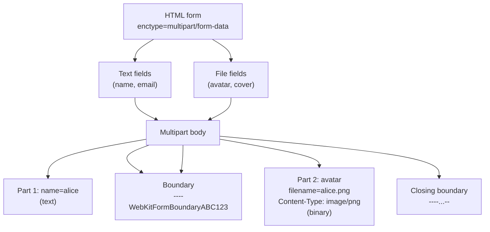
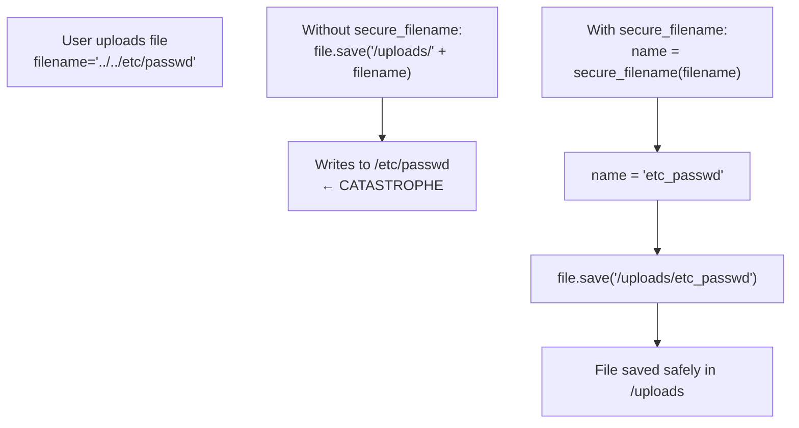
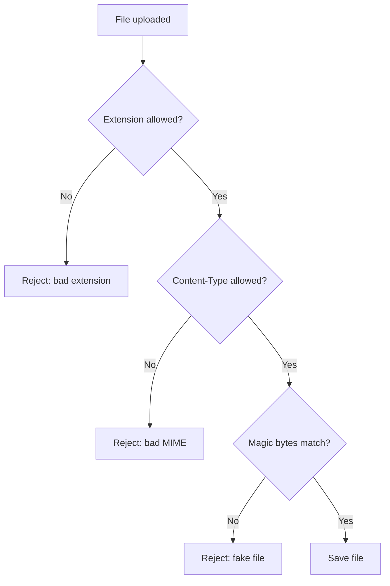
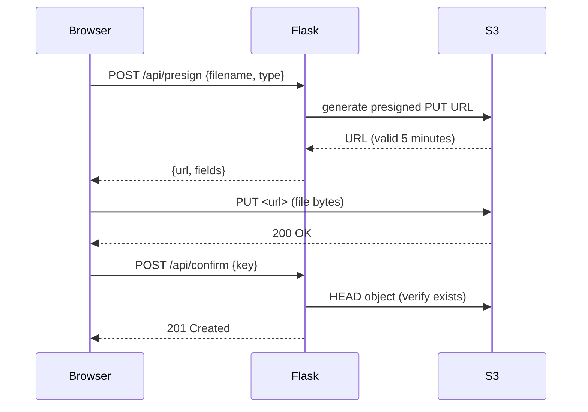
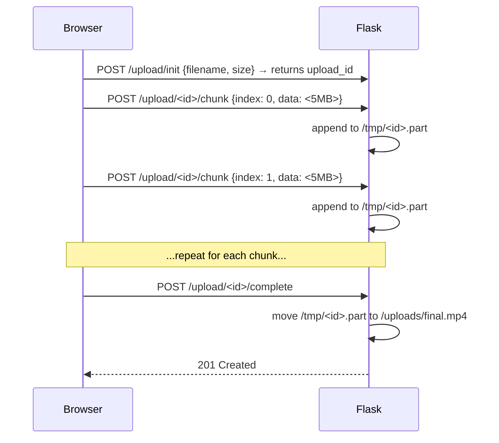
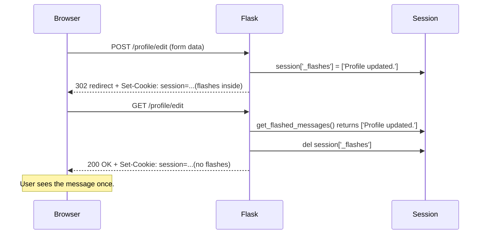

# Lesson 21 — File Uploads: Handling User-Submitted Files Safely

> [!success] First lesson of Module 10 — Advanced Topics.
> So far, every form your users have submitted has been text — names, emails, passwords, post bodies. But real apps need to handle **files**: profile pictures, post covers, PDFs, videos, audio. Today you'll learn how to accept file uploads in Flask, store them safely, serve them back to users, and — crucially — defend against the security nightmares (path traversal, malicious file types, XXE bombs) that file uploads introduce. By the end of this lesson, you'll have a working profile-picture upload feature with image resizing, plus a deep understanding of `multipart/form-data`, `secure_filename`, and the modern cloud-storage workflow (S3 presigned URLs).

## 1. Learning Objectives

By the end of this lesson you will be able to:

1. **Explain why file uploads need a special HTML `enctype`** (`multipart/form-data`) — and why regular `application/x-www-form-urlencoded` won't work.
2. **Describe the structure of a multipart body** — boundary, headers, parts.
3. **Use `request.files`** to access uploaded files in Flask.
4. **Explain what a `FileStorage` object is** — and use its `filename`, `save()`, `read()`, and `stream` attributes.
5. **Use `secure_filename()`** to sanitize user-provided filenames — and explain the path-traversal attack it prevents.
6. **Configure upload folders** and `MAX_CONTENT_LENGTH`.
7. **Validate file types** by extension, MIME type, and **magic bytes** — and explain why each layer is necessary.
8. **Process images with Pillow** — resize, thumbnail, convert formats.
9. **Serve uploaded files** with `send_from_directory` — and explain the security considerations.
10. **Implement direct-to-S3 uploads** with presigned URLs.
11. **Use flash messages** in depth — categories, filtering, Bootstrap integration.
12. **Use cookies** in depth — setting, reading, deleting, security flags.

## 2. Prerequisites

- **[[Lesson-10-HTML-Forms]] completed.** You can build a form, handle POST, and use CSRF tokens.
- **[[Lesson-18-Blueprints]] completed.** You can structure an app into blueprints.
- **[[Lesson-13-CRUD-Operations]] completed.** You can insert and update database rows.

## 3. The Problem

### 3.1 Why file uploads are different from text fields

When a form has text fields, the browser serializes them as `application/x-www-form-urlencoded`:

```
POST /register HTTP/1.1
Content-Type: application/x-www-form-urlencoded

username=alice&email=alice%40example.com&password=hunter2
```

That format is fine for short strings. But it's terrible for files:

- **Binary data has to be encoded as text.** The standard way is base64, which inflates size by 33%. A 10 MB image becomes 13.3 MB of text.
- **There's no clean way to embed the filename.** You'd need a convention like `avatar=@filename;base64,...` — ad-hoc and fragile.
- **Multiple files need a separator.** The format has no built-in separator.

So browsers use a different encoding for forms with files: **`multipart/form-data`**.

### 3.2 The multipart format

When a form has `enctype="multipart/form-data"`, the body is divided into **parts**, each with its own headers, separated by a **boundary** string:

```
POST /upload HTTP/1.1
Content-Type: multipart/form-data; boundary=----WebKitFormBoundaryABC123

------WebKitFormBoundaryABC123
Content-Disposition: form-data; name="username"

alice
------WebKitFormBoundaryABC123
Content-Disposition: form-data; name="avatar"; filename="alice.png"
Content-Type: image/png

<binary data>
------WebKitFormBoundaryABC123--
```

Each part has:

- A `Content-Disposition` header with `name` (the form field name) and optionally `filename` (for files).
- Optionally a `Content-Type` header (for files, the browser guesses based on extension).
- A blank line, then the part's data.

The boundary is a random string that the browser guarantees won't appear in any part's data. The final boundary has `--` appended to mark the end.



### 3.3 Behind the scenes: how Werkzeug parses multipart

When Flask receives a multipart request, Werkzeug does the parsing. The basic algorithm is:

1. **Read the `Content-Type` header** to extract the boundary.
2. **Scan the body** for `--boundary` sequences.
3. **For each part**, parse the headers (up to the first blank line), then read the body (up to the next boundary).
4. **Spool large parts to disk** — Werkzeug uses a tempfile if a part exceeds `max_content_length` (default: 500 KB). This prevents a 1 GB upload from consuming 1 GB of RAM.
5. **Construct a `FileStorage`** for each file part, with `.stream` pointing at the in-memory buffer or the tempfile.
6. **Populate `request.files`** (a `MultiDict`) with the file parts, and `request.form` with the text parts.

The "spool to disk" behavior is critical for production: it means a 100 MB upload uses only ~500 KB of RAM on your server, no matter how many concurrent uploads you get. You can tune this with `app.config['MAX_FORM_MEMORY_SIZE']` and `MAX_CONTENT_LENGTH`.

> [!question] Student asks: "What if a malicious client sends a body that never reaches the closing boundary?"
> Werkzeug has a request timeout (configurable). If the body never completes, the connection is closed and the request is dropped. This is why `MAX_CONTENT_LENGTH` matters — it lets Flask reject the request *before* reading the body, just from the `Content-Length` header.

### 3.4 Why `enctype="multipart/form-data"` is mandatory

If you forget `enctype`, the browser sends the form as `application/x-www-form-urlencoded`. The file field becomes just the filename string:

```
POST /upload HTTP/1.1
Content-Type: application/x-www-form-urlencoded

username=alice&avatar=alice.png
```

Notice: only the filename `alice.png` was sent — not the file's contents! Flask's `request.files` will be empty (because the request isn't multipart). Your code will fail with a "file not provided" error, and you'll spend an hour wondering why.

**Always set `enctype="multipart/form-data"` on forms with file inputs.**

## 4. The Code

### 4.1 The HTML form

```html
<!-- templates/profile/edit.html -->


  <h2>Edit Profile</h2>
  <form method="post" enctype="multipart/form-data">
    {{ form.hidden_tag() }}
    <p>
      {{ form.username.label }}<br>
      {{ form.username() }}
    </p>
    <p>
      {{ form.avatar.label }}<br>
      {{ form.avatar() }}    <!-- renders <input type="file"> -->
    </p>
    <p>{{ form.submit() }}</p>
  </form>

```

```python
# app/profile/forms.py
from flask_wtf import FlaskForm
from flask_wtf.file import FileField, FileAllowed, FileRequired
from wtforms import StringField, SubmitField
from wtforms.validators import DataRequired, Length


class ProfileForm(FlaskForm):
    username = StringField('Username', validators=[DataRequired(), Length(min=4, max=80)])
    avatar = FileField('Avatar', validators=[
        FileOptional(),                          # avatar is optional
        FileAllowed(['jpg', 'jpeg', 'png', 'gif'], 'Images only!')
    ])
    submit = SubmitField('Save')
```

`FileField` is WTForms' file-input field. `FileAllowed` checks the extension; `FileRequired` would make it mandatory. (`FileOptional` is the default, but it's good to be explicit.)

### 4.2 The route

```python
# app/profile/routes.py
import os
from flask import Blueprint, render_template, redirect, url_for, flash, current_app
from flask_login import login_required, current_user
from werkzeug.utils import secure_filename
from app.extensions import db
from app.models import User
from app.profile.forms import ProfileForm

profile = Blueprint('profile', __name__)


@profile.route('/edit', methods=['GET', 'POST'])
@login_required
def edit():
    form = ProfileForm(username=current_user.username)
    if form.validate_on_submit():
        current_user.username = form.username.data
        if form.avatar.data:
            file = form.avatar.data
            # 1. Sanitize the filename
            safe_name = secure_filename(file.filename)
            # 2. Make it unique (so users with same filename don't collide)
            unique_name = f"{current_user.id}_{safe_name}"
            # 3. Save to the upload folder
            upload_dir = os.path.join(current_app.config['UPLOAD_FOLDER'], 'avatars')
            os.makedirs(upload_dir, exist_ok=True)
            file.save(os.path.join(upload_dir, unique_name))
            # 4. Store the path on the user
            current_user.avatar_path = f"avatars/{unique_name}"
        db.session.commit()
        flash('Profile updated.')
        return redirect(url_for('profile.edit'))
    return render_template('profile/edit.html', form=form)
```

### 4.3 Configuration

```python
# config.py
import os
basedir = os.path.abspath(os.path.dirname(__file__))

class Config:
    # ...
    UPLOAD_FOLDER = os.path.join(basedir, 'app', 'static', 'uploads')
    MAX_CONTENT_LENGTH = 2 * 1024 * 1024   # 2 MB max upload
    ALLOWED_EXTENSIONS = {'jpg', 'jpeg', 'png', 'gif', 'webp'}
```

### 4.4 Serving uploaded files

```python
# app/profile/routes.py (continued)
from flask import send_from_directory, abort

@profile.route('/avatars/<path:filename>')
def serve_avatar(filename):
    avatars_dir = os.path.join(current_app.config['UPLOAD_FOLDER'], 'avatars')
    return send_from_directory(avatars_dir, filename)
```

```html
<!-- In a template -->

```

### 4.5 Multiple files in one upload

HTML lets a single `<input type="file" multiple>` field submit several files at once. The browser sends each as a separate multipart part with the **same field name**. Werkzeug collects them into a list accessible via `request.files.getlist('field_name')`:

```html
<form method="post" enctype="multipart/form-data">
  {{ form.hidden_tag() }}
  <input type="file" name="photos" multiple accept="image/*">
  <button type="submit">Upload all</button>
</form>
```

```python
@bp.route('/gallery/upload', methods=['POST'])
@login_required
def upload_gallery():
    files = request.files.getlist('photos')     # → list of FileStorage
    saved = []
    for f in files:
        if not f.filename:
            continue    # empty slot, skip
        safe = secure_filename(f.filename)
        unique = f'{uuid.uuid4().hex}_{safe}'
        f.save(os.path.join(current_app.config['UPLOAD_FOLDER'], 'gallery', unique))
        saved.append(unique)
    flash(f'{len(saved)} photos uploaded.', 'success')
    return redirect(url_for('profile.gallery'))
```

> [!question] Student asks: "Why `getlist` instead of just `request.files['photos']`?"
> A plain `request.files['photos']` returns the **first** file only — the others are silently dropped. `getlist('photos')` returns all of them. This is the same dict-vs-MultiDict behaviour you see with form fields when a checkbox group or multiple select submits several values under one name.

## 5. Line-by-Line Explanation

### 5.1 `request.files` — the FileStorage object

```python
file = form.avatar.data   # or: request.files['avatar']
```

When you access a file field, you get a **`FileStorage`** object (from Werkzeug). It has:

- `filename` — the original filename from the browser (e.g. `"alice.png"`). **Never trust this** — sanitize with `secure_filename`.
- `stream` — a file-like object you can `.read()` to get bytes.
- `read()` — read the entire file into bytes (loads into memory; for big files use `.save()` instead).
- `save(path)` — save to disk efficiently, in chunks.
- `content_type` — the MIME type the browser claimed (e.g. `"image/png"`). **Don't trust this either** — see §5.5.
- `content_length` — the size in bytes (often `None`).
- `mimetype` — the first part of `content_type` (e.g. `"image"`).
- `headers` — the full multipart headers for this part.

```python
file = form.avatar.data
print(file.filename)        # 'alice.png'
print(file.content_type)    # 'image/png'
print(file.read()[:10])     # b'\x89PNG\r\n\x1a\n\x00\x00' (PNG magic bytes)
file.seek(0)                # rewind if you read() and then save()
file.save('/path/to/save.png')
```

> [!question] Student asks: "Why does `form.avatar.data` give me a `FileStorage`, not the bytes?"
> Because the bytes might be very large (a 100 MB video), and Flask doesn't want to load them into memory unnecessarily. `FileStorage` is a lazy wrapper: it holds a stream pointing at the file's data (which may be on disk in a tempfile), and you decide whether to read it (memory) or save it (disk).

### 5.2 `secure_filename()` — the critical sanitizer

```python
from werkzeug.utils import secure_filename
safe_name = secure_filename(file.filename)
```

`secure_filename(file.filename)` strips everything that could be dangerous in a filename:

- **Path separators** (`/`, `\`) — these could let the user write to a different directory.
- **`..` sequences** — these enable path traversal (`../../etc/passwd`).
- **Special characters** — anything that's not alphanumeric, dot, dash, or underscore.

```python
>>> secure_filename('alice.png')
'alice.png'
>>> secure_filename('../../../etc/passwd')
'etc_passwd'
>>> secure_filename('my holiday photo!.jpg')
'my_holiday_photo_.jpg'
>>> secure_filename('')   # empty after sanitization
''
```

> [!danger] Path traversal attack
> If you do `file.save(os.path.join(upload_dir, file.filename))` **without** `secure_filename`, an attacker can upload a file named `../../../var/www/html/shell.php` and overwrite your server's files. With `secure_filename`, the same filename becomes `var_www_html_shell.php` — safe to store.
>
> Always use `secure_filename`. Always. Even if you "trust" your users.



> [!warning] secure_filename can return empty string
> If the filename is `..` (just dots) or `../../../` (only path components), `secure_filename` returns `''`. If you then do `file.save(os.path.join(upload_dir, ''))`, you'll get an error or overwrite the directory itself. Always check for empty:
> ```python
> safe_name = secure_filename(file.filename)
> if not safe_name:
>     safe_name = 'unnamed_' + secrets.token_hex(8)
> ```

### 5.3 Making filenames unique

`secure_filename` makes filenames safe but not unique. Two users uploading `avatar.png` would collide. Solutions:

1. **Prefix with user ID**: `1_avatar.png`, `2_avatar.png`. Simple but limited.
2. **Generate a random name**: `secrets.token_urlsafe(16) + '.png'`. No collisions, no info leak.
3. **Content-hash name**: `hashlib.sha256(file.read()).hexdigest()[:16] + '.png'`. Same image → same filename (deduplication!).
4. **UUID**: `str(uuid.uuid4()) + '.png'`. Standard, easy.

We use approach #1 in the example, but #2 or #3 are better for production.

### 5.4 `MAX_CONTENT_LENGTH` — protecting against huge uploads

```python
app.config['MAX_CONTENT_LENGTH'] = 2 * 1024 * 1024   # 2 MB
```

This is the **single most important defense** against denial-of-service via uploads. Without it, an attacker can upload a 100 GB file, exhaust your disk and RAM, and crash your server.

When `MAX_CONTENT_LENGTH` is set, Flask checks the `Content-Length` request header *before* reading the body. If it's too large, Flask returns `413 Request Entity Too Large` immediately — no disk I/O, no memory allocation.

```python
@app.errorhandler(413)
def request_too_large(e):
    return render_template('errors/413.html'), 413
```

> [!tip] Set MAX_CONTENT_LENGTH conservatively
> If your avatar uploads are 500 KB max, set `MAX_CONTENT_LENGTH = 1024 * 1024` (1 MB). Don't set it to 50 MB "just in case" — that's 50 MB of RAM per attacker request.

### 5.5 Validating file types — three layers

There are three places to check the file type, and you should use all three:

**Layer 1: Extension check.**

```python
def allowed_file(filename):
    return '.' in filename and \
           filename.rsplit('.', 1)[1].lower() in current_app.config['ALLOWED_EXTENSIONS']
```

Cheap, simple, but easily spoofed (`malware.exe` → rename to `malware.png`).

**Layer 2: MIME type check.**

```python
from flask_wtf.file import FileAllowed
avatar = FileField('Avatar', validators=[
    FileAllowed(['jpg', 'jpeg', 'png', 'gif'], 'Images only!')
])
```

Flask-WTF's `FileAllowed` checks the `Content-Type` header the browser sent. But the browser's claim is just a guess based on the extension — easily spoofed.

**Layer 3: Magic bytes (content sniffing).**

```python
# pip install python-magic
import magic

def get_real_mimetype(file_storage):
    # Read first 2048 bytes (enough for magic to identify)
    head = file_storage.read(2048)
    file_storage.seek(0)   # rewind
    return magic.from_buffer(head, mime=True)

# In route:
file = form.avatar.data
real_mime = get_real_mimetype(file)
if real_mime not in ('image/jpeg', 'image/png', 'image/gif', 'image/webp'):
    flash('That file is not a real image.')
    return redirect(url_for('profile.edit'))
```

Magic-byte detection reads the first few bytes of the file and checks them against known file signatures:

| File type | Magic bytes |
|-----------|-------------|
| PNG | `89 50 4E 47 0D 0A 1A 0A` |
| JPEG | `FF D8 FF` |
| GIF | `47 49 46 38` |
| PDF | `25 50 44 46` |
| ZIP | `50 4B 03 04` |

This is the most reliable check — the file's actual content tells you what it is, regardless of its name or the browser's claim.



### 5.6 Image processing with Pillow

`Pillow` (the friendly fork of PIL) is the standard Python image library. Install with `pip install Pillow`.

```python
from PIL import Image
import os

def save_avatar_resized(file_storage, user_id, upload_dir):
    """Save the uploaded image as a 256x256 square thumbnail."""
    img = Image.open(file_storage.stream)
    # Convert to RGB if it's RGBA (PNG with transparency) — JPEG doesn't support alpha
    if img.mode in ('RGBA', 'P'):
        img = img.convert('RGB')
    # Center-crop to a square
    width, height = img.size
    side = min(width, height)
    left = (width - side) // 2
    top = (height - side) // 2
    img = img.crop((left, top, left + side, top + side))
    # Resize to 256x256
    img = img.resize((256, 256), Image.LANCZOS)
    # Save
    output_path = os.path.join(upload_dir, f'{user_id}.jpg')
    img.save(output_path, 'JPEG', quality=85)
    return output_path
```

Common operations:

- `Image.open(stream)` — open from a file-like object.
- `img.resize((w, h), Image.LANCZOS)` — resize with a high-quality resampling filter.
- `img.thumbnail((w, h))` — in-place resize that preserves aspect ratio.
- `img.crop((left, top, right, bottom))` — crop to a rectangle.
- `img.convert('RGB')` — convert color modes (RGBA → RGB for JPEG).
- `img.save(path, 'JPEG', quality=85)` — save in a specific format.

> [!question] Student asks: "Why LANCZOS and not BICUBIC or NEAREST?"
> Resampling filters decide how Pillow picks pixel colors when shrinking or enlarging an image. `NEAREST` just grabs the closest pixel — ugly, blocky, but instant. `BICUBIC` interpolates a 4×4 neighborhood — smooth, decent. `LANCZOS` (a sinc-windowed filter) considers a wider neighborhood and produces the sharpest result with the least aliasing — at the cost of CPU. For one-time avatar processing where quality matters more than speed, LANCZOS is the right choice. For real-time thumbnail generation on a hot path, BICUBIC is a fine compromise.

### 5.7 EXIF stripping — privacy and safety

Most photos taken by phones embed **EXIF metadata** — GPS coordinates, camera model, timestamp, software version, even thumbnail previews. When a user uploads a vacation photo as their avatar, they may unknowingly publish the GPS coordinates of their home.

Pillow loads EXIF into `img.info` and (in newer versions) into `img.getexif()`. To strip it, re-save the image — by default, Pillow's `save()` does not write EXIF unless you explicitly pass `exif=`:

```python
def save_avatar_no_exif(file_storage, user_id, upload_dir):
    img = Image.open(file_storage.stream)
    if img.mode in ('RGBA', 'P'):
        img = img.convert('RGB')
    # Force a fresh save — Pillow drops EXIF unless you pass exif= explicitly
    output_path = os.path.join(upload_dir, f'{user_id}.jpg')
    img.save(output_path, 'JPEG', quality=85)
    # Belt-and-braces: explicitly remove any remaining metadata
    data = list(img.getdata())
    clean = Image.new(img.mode, img.size)
    clean.putdata(data)
    clean.save(output_path, 'JPEG', quality=85)
    return output_path
```

> [!warning] EXIF can also carry thumbnails and entire embedded thumbnails
> The "re-draw into a new image" trick in the snippet above is the most aggressive sanitization: it copies only pixel data, throwing away everything else. Use it if you process images from untrusted sources (think: a public forum where users can upload photos that anyone else can download).


> [!tip] Try this: inspect EXIF
> Take a photo with your phone. Upload it through your Flask app *without* the EXIF-stripping code. Open the saved file with `exiftool photo.jpg` (a free CLI tool). You'll see GPS coordinates, the phone model, and possibly the software version. Now add the stripping code and re-upload — `exiftool` reports "no EXIF data".

### 5.8 `send_from_directory` — serving files safely

```python
from flask import send_from_directory

@profile.route('/avatars/<path:filename>')
def serve_avatar(filename):
    avatars_dir = os.path.join(current_app.config['UPLOAD_FOLDER'], 'avatars')
    return send_from_directory(avatars_dir, filename)
```

`send_from_directory(directory, filename)` does three things:

1. **Joins the path safely** — refuses to serve files outside `directory` (prevents path traversal in the URL too).
2. **Sets the right `Content-Type`** based on the file extension (via `mimetypes`).
3. **Supports conditional requests** (`If-Modified-Since`, `If-None-Match`) — returns 304 if the client's cached copy is fresh.

> [!danger] Never use `send_file` with user input
> ```python
> @app.route('/download/<filename>')
> def download(filename):
>     return send_file(filename)   # ← DANGEROUS
> ```
> `send_file(filename)` interprets `filename` as a path *relative to the current working directory* — and there's no path-traversal protection. A request like `/download/../../../../etc/passwd` would serve your password file. Always use `send_from_directory` with an absolute directory.

### 5.9 Why not serve uploads from `static/`?

Flask's `static/` folder is served at `/static/...` automatically. You could save uploads there and they'd be served for free. But:

- **In production, `static/` is usually served by nginx or a CDN**, not Flask. If you put uploads in `static/`, they may not be served at all (nginx serves only the original static files).
- **Uploads are user-generated content**. Mixing them with your app's static files is messy.
- **Uploads may need access control** (private files). `static/` is public-by-default.

Best practice: store uploads in a separate `uploads/` directory, serve them through a dedicated route (which can add auth), or upload directly to S3/cloud storage.

## 6. Modern: Direct-to-S3 Uploads

### 6.1 Why S3?

For real apps, storing files on the local disk has problems:

- **Doesn't scale horizontally.** If you have 3 servers, an upload to server A isn't visible to server B.
- **No CDN.** Files are served from your app server, which is slow for users far away.
- **Backup is hard.** You need to back up the disk separately from the database.
- **Disk space is limited.** Local SSDs fill up.

The standard solution: **S3** (Amazon S3, or alternatives like Cloudflare R2, Azure Blob, Google Cloud Storage). Files live in a bucket; the bucket is accessible from any server, can be CDN-fronted, has versioning and lifecycle policies, and scales to essentially unlimited size.

### 6.2 Two ways to upload to S3

**Method 1: Server-side upload.** The user uploads to your Flask server; your server uploads to S3.


Cons: your server handles the full file size twice (in and out). A 100 MB video uses 200 MB of bandwidth on your server.

**Method 2: Direct-to-S3 with presigned URLs.** Your Flask server generates a "presigned URL" — a temporary URL that lets the user upload directly to S3.



Pros: your server never sees the file bytes. Scales to any file size. No bandwidth cost on your app server.

### 6.3 Presigned URL implementation

```python
# pip install boto3
import boto3
from flask import jsonify, request

s3 = boto3.client('s3',
    aws_access_key_id=app.config['AWS_ACCESS_KEY_ID'],
    aws_secret_access_key=app.config['AWS_SECRET_ACCESS_KEY'],
    region_name=app.config['AWS_REGION'],
)

@app.route('/api/presign', methods=['POST'])
def presign_upload():
    data = request.get_json()
    filename = secure_filename(data['filename'])
    content_type = data['contentType']
    # Generate a unique key in S3
    key = f"avatars/{current_user.id}/{filename}"
    # Generate a presigned PUT URL valid for 5 minutes
    url = s3.generate_presigned_url(
        'put_object',
        Params={'Bucket': app.config['S3_BUCKET'], 'Key': key,
                'ContentType': content_type},
        ExpiresIn=300,
    )
    return jsonify({'uploadUrl': url, 'key': key})
```

On the client side (JavaScript):

```javascript
async function uploadAvatar(file) {
  // 1. Get presigned URL from your server
  const presign = await fetch('/api/presign', {
    method: 'POST',
    headers: {'Content-Type': 'application/json'},
    body: JSON.stringify({filename: file.name, contentType: file.type})
  }).then(r => r.json());

  // 2. Upload directly to S3
  await fetch(presign.uploadUrl, {
    method: 'PUT',
    headers: {'Content-Type': file.type},
    body: file,
  });

  // 3. Tell your server the upload is done
  await fetch('/api/confirm', {
    method: 'POST',
    headers: {'Content-Type': 'application/json'},
    body: JSON.stringify({key: presign.key})
  });
}
```

Alternatives to S3: **Cloudflare R2** (S3-compatible, cheaper — no egress fees), **Azure Blob**, **Google Cloud Storage**, **Backblaze B2**. All support presigned URLs.

### 6.4 Cloud storage comparison (2026)

| Provider | Strengths | Pricing quirk |
|----------|-----------|----------------|
| **AWS S3** | The default. Every tool integrates with it. 11 nines durability. | Egress fees are steep (~$90/TB). |
| **Cloudflare R2** | S3-compatible API. **Zero egress fees** — game-changer for read-heavy apps. | Slightly higher storage cost ($0.015/GB). |
| **Google Cloud Storage** | Tight integration with BigQuery, App Engine. | Egress fees like S3. |
| **Azure Blob Storage** | Enterprise integration, hot/cool/archive tiers. | Pricing is complex; use the calculator. |
| **Backblaze B2** | Cheapest storage ($0.005/GB). Free egress to Cloudflare. | Smaller ecosystem; use the S3-compatible API. |

> [!tip] 2026 default for new apps
> For a new Flask app that's not married to AWS yet, **Cloudflare R2** is usually the right call. The zero-egress model means a CDN pulling from R2 doesn't cost you anything when users view images — which is exactly the read-heavy pattern of avatar/cover-image apps.

### 6.5 Chunked uploads for large files

`MAX_CONTENT_LENGTH` caps a single request — but what if your app legitimately needs to accept a 5 GB video? You can't set `MAX_CONTENT_LENGTH = 5 * 1024**3` — that's 5 GB of RAM per request from a single attacker. The solution: **chunked uploads**.

The browser splits the file into chunks (say, 5 MB each). Each chunk is a separate POST. The server appends the chunk to a temporary file. When the last chunk arrives, the server assembles the final file.



Server-side sketch:

```python
import os, uuid
from flask import request, jsonify
from werkzeug.utils import secure_filename

UPLOADS_IN_PROGRESS = {}   # in real life: Redis or DB

@app.route('/upload/init', methods=['POST'])
def upload_init():
    data = request.get_json()
    filename = secure_filename(data['filename'])
    upload_id = str(uuid.uuid4())
    temp_path = f'/tmp/{upload_id}.part'
    open(temp_path, 'wb').close()   # create empty file
    UPLOADS_IN_PROGRESS[upload_id] = {'filename': filename, 'path': temp_path}
    return jsonify({'upload_id': upload_id})

@app.route('/upload/<upload_id>/chunk', methods=['POST'])
def upload_chunk(upload_id):
    meta = UPLOADS_IN_PROGRESS.get(upload_id)
    if not meta:
        return jsonify({'error': 'unknown upload'}), 404
    chunk = request.files['chunk']
    with open(meta['path'], 'ab') as f:   # append binary
        f.write(chunk.read())
    return jsonify({'received': upload_id})

@app.route('/upload/<upload_id>/complete', methods=['POST'])
def upload_complete(upload_id):
    meta = UPLOADS_IN_PROGRESS.pop(upload_id, None)
    if not meta:
        return jsonify({'error': 'unknown upload'}), 404
    final_path = os.path.join(app.config['UPLOAD_FOLDER'], meta['filename'])
    os.rename(meta['path'], final_path)
    return jsonify({'path': final_path}), 201
```

> [!question] Student asks: "What about resumable uploads?"
> Chunked uploads are naturally resumable: if the connection drops after chunk 47 of 200, the browser just sends chunk 48 next. The server tracks which chunks it has received (store an array of indices in `UPLOADS_IN_PROGRESS[upload_id]`). For real-world implementations, use a library like `resumable.js` (frontend) with the protocol above (backend) — or use the S3 multipart upload API, which is exactly this pattern but S3-side.

> [!warning] Chunked uploads need their own size limit
> Without one, an attacker can stream chunks forever. Track total bytes written and reject if it exceeds a per-upload cap (stored when `/upload/init` is called). Also rate-limit `/upload/<id>/chunk` to prevent a single client from hammering your server.

## 7. Flash Messages in Depth

### 7.1 What are flash messages?

A flash message is a **one-time message** stored in the session, meant to be shown on the *next* page. The classic use case: after a successful form submission (POST), you redirect to a GET page, and that page shows "Saved!" — but where does the message live between the POST and the GET? In the session, as a flash.

```python
flash('Profile updated.')
return redirect(url_for('profile.edit'))
```

```html

  
    <ul class="flashes">
      
        <li>{{ message }}</li>
      
    </ul>
  

```

### 7.2 Categories

`flash` takes an optional category:

```python
flash('Profile updated.', category='success')
flash('That username is taken.', category='error')
flash('Your subscription expires soon.', category='warning')
flash('Did you know you can export your data?', category='info')
```

In templates, filter by category:

```html

  
    <div class="alert alert-danger">
      <p>{{ msg }}</p>
    </div>
  



  
    <div class="alert alert-success">
      <p>{{ msg }}</p>
    </div>
  

```

The four Bootstrap-style categories (`success`, `info`, `warning`, `error`) are conventional. You can use any string as a category.

### 7.3 How flash messages work behind the scenes

1. `flash(msg)` appends `msg` to `session['_flashes']` (a list).
2. The session cookie is sent to the browser.
3. On the next request, `get_flashed_messages()` reads `session['_flashes']`, removes it from the session, and returns the list.
4. Because the session is now modified (flashes removed), a new cookie is sent — without the flashes.

This is why flash messages are **one-time**: they're consumed on read. If you call `get_flashed_messages()` twice, the second call returns nothing.



## 8. Cookies in Depth

### 8.1 Setting cookies in Flask

```python
from flask import make_response

@app.route('/set-theme/<theme>')
def set_theme(theme):
    response = make_response(redirect(url_for('index')))
    response.set_cookie('theme', theme, max_age=365*24*3600, httponly=True, samesite='Lax')
    return response
```

`set_cookie(key, value, ...)` arguments:

| Argument | What it does |
|----------|--------------|
| `key` | Cookie name |
| `value` | Cookie value (string) |
| `max_age` | Seconds until expiry (alternative to `expires`) |
| `expires` | Datetime when cookie expires |
| `path` | URL path the cookie applies to (default `/`) |
| `domain` | Domain the cookie applies to (default: current host) |
| `secure` | If `True`, browser only sends over HTTPS |
| `httponly` | If `True`, JavaScript can't access the cookie |
| `samesite` | `'Strict'`, `'Lax'`, or `'None'` (must be paired with `secure=True`) |

### 8.2 Reading cookies

```python
from flask import request

@app.route('/')
def index():
    theme = request.cookies.get('theme', 'light')   # default 'light' if missing
    return render_template('index.html', theme=theme)
```

`request.cookies` is a dict-like object. Use `.get(key, default)` rather than `request.cookies[key]` — the latter raises `KeyError` if the cookie is missing.

### 8.3 Deleting cookies

```python
response.delete_cookie('theme')   # sets max_age=0; browser removes the cookie
```

Note that "deleting" a cookie means **setting it with an immediate expiry**. The browser sees the new cookie with `Max-Age=0` and discards it. There's no "delete this cookie" HTTP header — only `Set-Cookie` with an expired timestamp.

If you set the cookie with a specific `path`, you must delete it with the **same path** — otherwise the browser doesn't match the cookies and the deletion silently fails. This is a common gotcha.

### 8.4 Cookie size limits

Browsers enforce limits:

- **~4 KB per cookie** (including name, value, attributes).
- **~50 cookies per domain** (varies by browser).
- **~3000 cookies total** across all domains.

If you exceed these, the browser silently drops cookies — usually the oldest ones. Never store large data in cookies; use the session (which is one cookie) or server-side storage.

### 8.5 Cookie security recap

Always set these on auth-related cookies:

- `httponly=True` — prevents XSS from stealing the cookie.
- `secure=True` — only send over HTTPS (in production).
- `samesite='Lax'` — prevents CSRF for top-level navigations.

For the Flask session, these are configured globally:

```python
app.config['SESSION_COOKIE_HTTPONLY'] = True
app.config['SESSION_COOKIE_SECURE'] = True       # only in production
app.config['SESSION_COOKIE_SAMESITE'] = 'Lax'
```

### 8.6 Third-party cookies and the 2024+ crackdown

Modern browsers (Chrome, Safari, Firefox) are phasing out **third-party cookies** — cookies set by a domain other than the one in the address bar. A first-party cookie on `yourapp.com` set while visiting `yourapp.com` is fine. A third-party cookie on `analytics.com` set while visiting `yourapp.com` (via an embedded iframe) is being blocked.

What this means for your Flask app:

- **Your session cookie is first-party** — unaffected.
- **Embedded widgets that rely on third-party cookies** (like analytics, ad pixels) are breaking.
- **OAuth flows** that used to work via popup + cookie may need to use redirect-based flows.

If you're building embedded widgets, look into the new APIs: `Partitioned` cookie attribute (CHIPS), `Storage Access API`, FedCM.


## 9. Running the Code

### 9.1 Set up

```bash
mkdir lesson21
cd lesson21
python -m venv venv
source venv/bin/activate
pip install Flask Flask-SQLAlchemy Flask-WTF Flask-Login Pillow
```

Create the `app/` structure from Lesson 18. Add the `profile` blueprint from §4.

### 9.2 Start the server

```bash
flask --app run.py run
```

### 9.3 Test the upload

1. Register and log in as `alice`.
2. Visit `/profile/edit`.
3. Choose an image (any JPG or PNG).
4. Click Save.
5. You should see "Profile updated." flash and the avatar appears.

### 9.4 Test the limits

- **Too-large file**: try uploading a 5 MB image. Flask should return 413.
- **Wrong type**: rename a `.txt` file to `.png` and upload. Magic-byte check should reject it.
- **Path traversal**: in DevTools, intercept the upload and change `filename` to `../../../etc/passwd`. `secure_filename` should make this safe.

## 10. Common Mistakes

### 10.1 Forgetting `enctype="multipart/form-data"`

The form submits, but `request.files` is empty. The browser URL-encoded the file (sent only the filename). Always set `enctype`.

### 10.2 Not using `secure_filename`

Path traversal. Catastrophe. Always sanitize.

### 10.3 Trusting the browser's `Content-Type`

```python
if file.content_type != 'image/png':
    abort(400)
```

The browser's `Content-Type` is a guess based on the extension. Attackers can send any value. Verify with magic bytes.

### 10.4 No `MAX_CONTENT_LENGTH`

DoS vulnerability. Always set a limit.

### 10.5 Using `send_file` with user input

```python
return send_file(request.args['filename'])   # ← DANGEROUS
```

Path traversal. Use `send_from_directory`.

### 10.6 Saving files in the database

Storing the file bytes in a BLOB column is tempting but almost always wrong:

- Database backups balloon in size.
- Database queries are slower when the table has large blobs.
- CDNs can't serve database blobs.

Store files on disk or S3; store the *path* in the database.

### 10.7 Mixing uploads into `static/`

In production, nginx serves `static/` from disk and won't see your uploads. Use a separate `uploads/` folder and a dedicated route.

### 10.8 Not handling filename collisions

Two users upload `avatar.png`. Without unique names, the second overwrites the first. Use UUIDs, content hashes, or user-ID prefixes.

### 10.9 Synchronous image processing in the request

Resizing a 50 MB image takes seconds. Doing it synchronously blocks the request. Move it to a background task (Celery — see Lesson 22).

### 10.10 Forgetting to rewind the stream

```python
head = file.read(2048)
mime = magic.from_buffer(head)
file.save('/path/to/file')   # ← saves nothing! stream is at end
```

After `read()`, the stream position is at the end. `save()` saves nothing. Always `file.seek(0)` after `read()`.

## 11. Try This

> [!tip] Try this: inspect a multipart upload
> Build the upload form. Submit it with curl `-v`:
> ```bash
> curl -v -X POST http://localhost:5000/profile/edit \
>   -F "username=alice" \
>   -F "avatar=@photo.png" \
>   -b "session=..."
> ```
> The `-v` flag shows the full request, including the `Content-Type: multipart/form-data; boundary=...` header and the multipart body. You can see the boundary-separated parts.

> [!tip] Try this: see `secure_filename` in action
> ```python
> from werkzeug.utils import secure_filename
> for name in ['alice.png', '../../../etc/passwd', 'my file!.jpg', '..', '']:
>     print(f"{name!r:30s} → {secure_filename(name)!r}")
> ```
> Notice how `..` and `''` both become `''` — handle these cases in your code.

> [!tip] Try this: install `python-magic` and check magic bytes
> Upload a real PNG, a real JPEG, and a `.png`-renamed text file. Use `magic.from_buffer(file.read(2048))` to identify each. The renamed text file will be detected as `text/plain` — your code should reject it.

> [!tip] Try this: resize an image with Pillow
> Upload a 4000x3000 photo. Resize it to 256x256 with `Image.LANCZOS`. Compare file sizes — the original might be 5 MB, the thumbnail 30 KB. You just saved 99% of your bandwidth on every avatar view.

> [!tip] Try this: set up an S3 bucket
> Create a free AWS account, make an S3 bucket, install `boto3`, and implement the presigned-URL flow from §6.3. Test uploading a file directly from your browser to S3. Your Flask server only sees the metadata, not the bytes.

## 12. Exercises

### Exercise 1 — Multiple file upload (medium)

Allow the user to upload multiple files at once (HTML: `<input type="file" multiple>`). Save each with a unique name. Show all uploaded files.

### Exercise 2 — Image variants (medium)

When a user uploads an avatar, generate three sizes: 32x32, 128x128, 256x256. Serve the right size based on the device (use the `srcset` HTML attribute).

### Exercise 3 — PDF upload with text extraction (hard)

Allow PDF uploads. Use `pdfplumber` or `PyMuPDF` to extract text. Store the text in the database for full-text search.

### Exercise 4 — Private files (medium)

Add a `is_private` flag to uploads. If private, only the owner can download (auth check in the download route). Public files are served via S3; private files are served through Flask with auth.

### Exercise 5 — Drag-and-drop upload (easy)

Add the HTML5 drag-and-drop API to your upload form. Show a progress bar during upload.

### Exercise 6 — Direct-to-S3 with progress (medium)

Implement the presigned-URL flow from §6.3. Use `XMLHttpRequest`'s `upload.onprogress` event to show an upload progress bar.

### Exercise 7 — Virus scan (hard)

Install `clamd` (ClamAV daemon). Before saving an uploaded file, scan it. Reject if infected. This is how serious file-upload services work.

### Exercise 8 — Image moderation (hard)

Use a service like AWS Rekognition or a local model to detect explicit/violent content in uploaded images. Reject flagged uploads. Add a "manual review" queue for borderline cases.

## 13. What We Learned

- File uploads need `enctype="multipart/form-data"` on the HTML form. Without it, the browser sends only the filename, not the file contents.
- The **multipart body** is divided into parts separated by a random boundary string. Each part has its own headers (`Content-Disposition`, `Content-Type`) and data.
- **`request.files`** gives you access to uploaded files. Each is a **`FileStorage`** object with `filename`, `stream`, `read()`, `save()`, and `content_type` attributes.
- **`secure_filename(filename)`** strips path separators, `..` sequences, and special characters. Use it on **every** user-provided filename to prevent path-traversal attacks. Handle the case where it returns empty string.
- **`MAX_CONTENT_LENGTH`** is the most important DoS defense — Flask rejects oversized uploads before reading the body.
- **File-type validation** should happen in three layers: extension, MIME type, and magic bytes. The first two are easily spoofed; magic-byte detection (via `python-magic`) checks the actual file content.
- **Pillow** resizes, crops, and converts images. `Image.LANCZOS` is the highest-quality resampling filter.
- **`send_from_directory`** serves files safely — it joins paths safely (no traversal), sets the right Content-Type, and supports conditional requests. Never use `send_file` with user input.
- **Direct-to-S3 uploads** with presigned URLs let users upload directly to S3, bypassing your Flask server. Scales to any file size with no server bandwidth cost.
- **Flash messages** are one-time messages stored in the session. `flash(msg, category)` stores; `get_flashed_messages(category_filter=[...])` retrieves (and consumes). The four standard categories are `success`, `info`, `warning`, `error`.
- **Cookies** are set with `response.set_cookie(key, value, max_age, httponly, secure, samesite)`, read with `request.cookies.get(key)`, deleted with `response.delete_cookie(key)`. Auth cookies should always have `httponly=True`, `secure=True` (in prod), `samesite='Lax'`.
- Modern (2026): prefer **cloud storage** (S3, Cloudflare R2) over local disk for scalability, CDN integration, and backup.

## 14. Next Lesson

You can now handle file uploads — but some operations take time. Sending a welcome email, generating a PDF, processing a video — these take seconds or minutes, and you can't make the user wait. Time for **background tasks**.

In [[Lesson-22-Email-and-Background-Tasks]] (second lesson of Module 10 — Advanced Topics) you'll learn:

- **Email protocols** — SMTP, IMAP, POP3 — what each is for.
- **Flask-Mail** setup and configuration.
- SMTP providers (Gmail, SendGrid, Mailgun, Postmark, AWS SES).
- **HTML emails** with templates.
- **Testing email** — debug SMTP server, MailHog.
- Why **background tasks** — user experience, long operations.
- **Celery** architecture — broker, worker, result backend.
- Defining and calling tasks (`@celery.task`, `.delay()`).
- Running the Celery worker.
- **Periodic tasks** (Celery beat).
- Monitoring with Flower.
- Modern alternatives: **RQ, Dramatiq, Huey**.
- Modern: serverless background tasks (SQS, Cloud Tasks).

> [!quote] A note from your teacher
> File uploads are one of those features that look trivial and hide a thousand sharp edges. Path traversal. MIME spoofing. Magic-byte forgery. Filename collisions. Disk exhaustion. Slow image processing blocking the request thread. Mismatched content types breaking browsers. Today you learned to defend against all of them — and you learned the modern alternative, direct-to-S3, that offloads the bandwidth entirely. The pattern is "defense in depth": extension check, MIME check, magic-byte check, `secure_filename`, `MAX_CONTENT_LENGTH`, separate uploads folder, `send_from_directory`. No single defense is enough; together, they make file uploads safe enough to put on the public internet. Next, we'll send emails and run background jobs — the two operations that, more than any other, separate a tutorial app from a real one. Onward.
