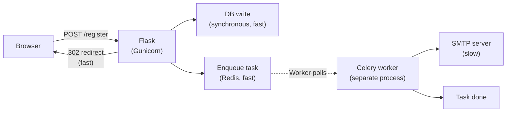
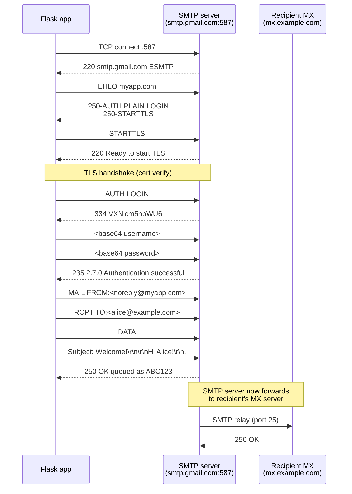
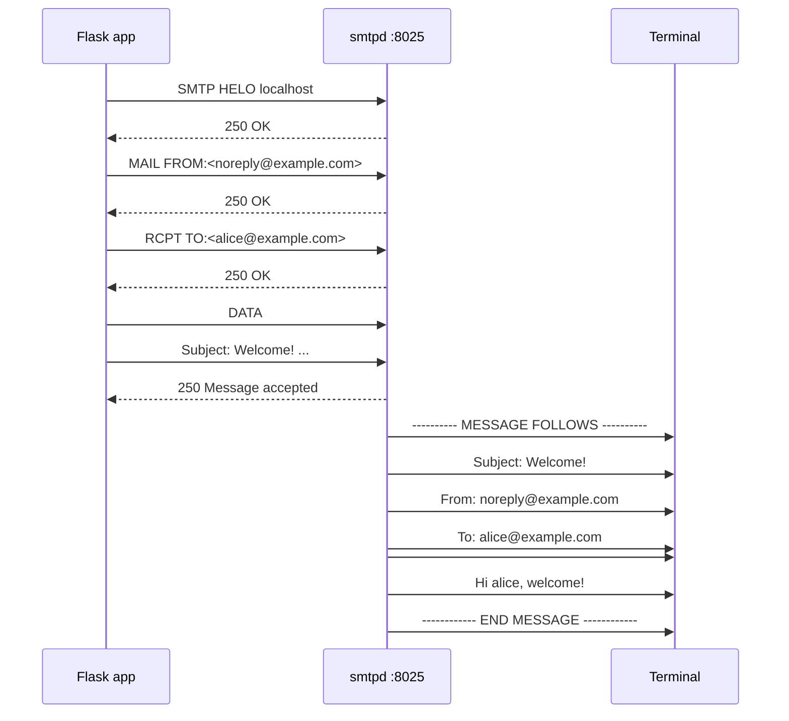
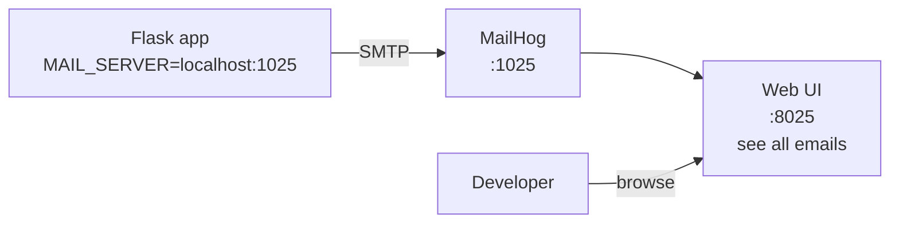
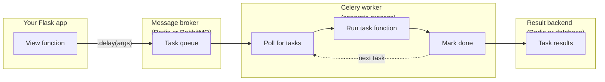
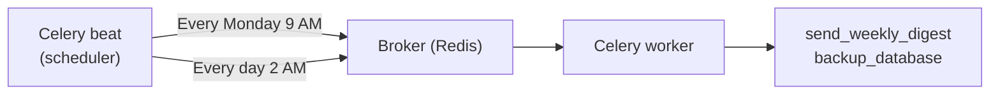
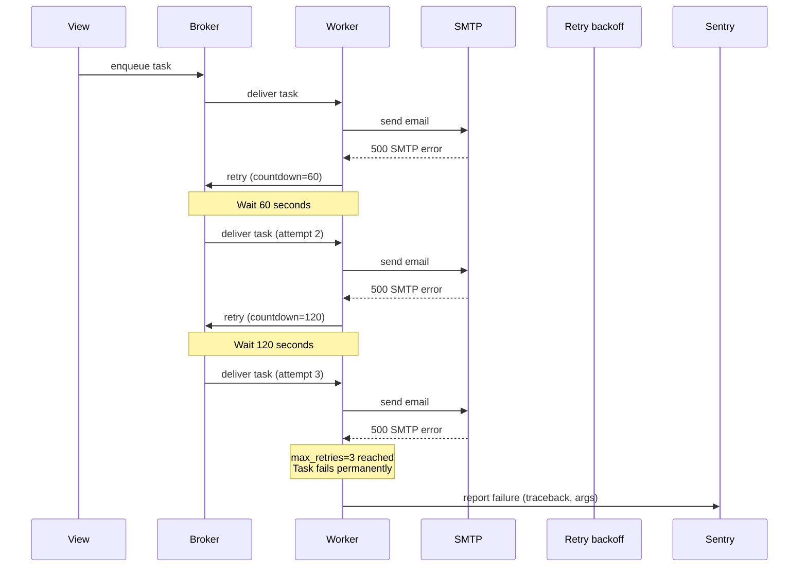
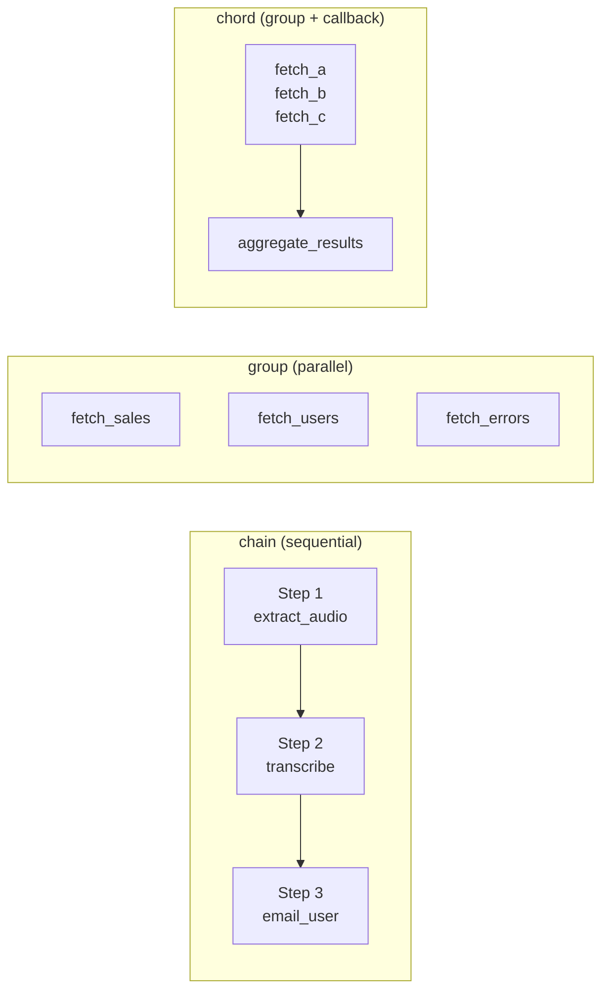
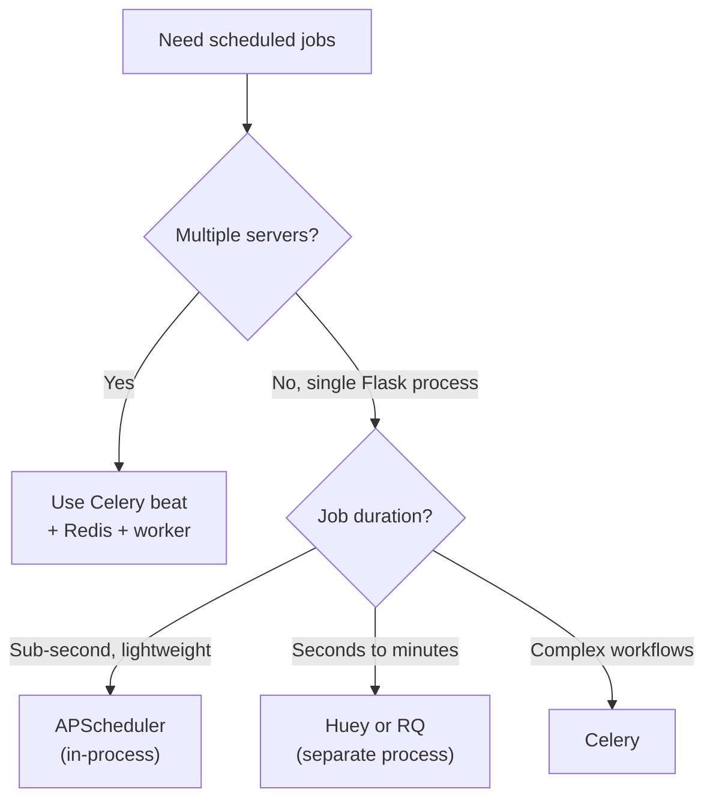
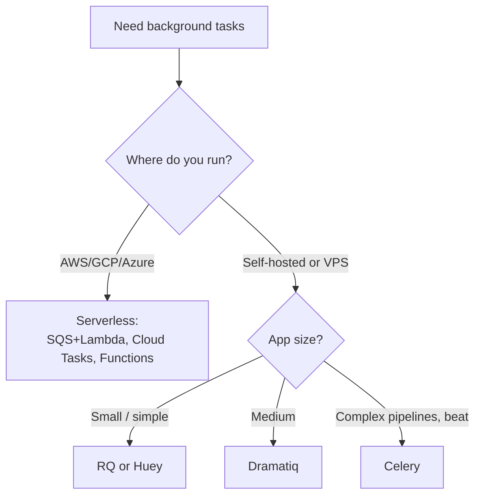

# Lesson 22 — Email and Background Tasks: Sending Mail, Running Jobs

> [!success] Second lesson of Module 10 — Advanced Topics.
> Some operations take time. Sending an email takes a second or two — but a second is an eternity on the web. Generating a PDF report might take 30 seconds. Processing a 1 GB video might take an hour. If you do these in a Flask view, the user stares at a spinning loader, the server thread is blocked, and a few concurrent users can take down your whole app. Today you'll learn to send email and to defer slow work to **background tasks**. By the end of this lesson, you'll send welcome emails on registration, process image uploads asynchronously, and run scheduled jobs every night at midnight — all without blocking a single user's request.

## 1. Learning Objectives

By the end of this lesson you will be able to:

1. **Explain the three email protocols** — SMTP (sending), IMAP (reading), POP3 (reading, older).
2. **Configure Flask-Mail** with a real SMTP provider (Gmail, SendGrid, Mailgun, Postmark, AWS SES).
3. **Send plain-text and HTML emails** with templates.
4. **Add attachments** to emails.
5. **Test email locally** with Python's debug SMTP server or MailHog.
6. **Explain why background tasks exist** — UX, timeouts, scalability.
7. **Describe Celery's architecture** — broker, worker, result backend.
8. **Define and call Celery tasks** with `@celery.task` and `.delay()`.
9. **Run a Celery worker** alongside your Flask app.
10. **Schedule periodic tasks** with Celery beat.
11. **Monitor tasks** with Flower.
12. **Compare Celery alternatives** — RQ, Dramatiq, Huey — and know when to use each.
13. **Use serverless background tasks** — SQS, Cloud Tasks, Cloud Functions.

## 2. Prerequisites

- **[[Lesson-21-File-Uploads]] completed.** You understand Flask extensions and the application factory.
- **[[Lesson-17-Flask-Login]] completed.** You have a User model with an `email` field.
- **[[Lesson-18-Blueprints]] completed.** You have an application factory.

## 3. The Problem

### 3.1 When synchronous isn't good enough

Imagine a user registers on your site. You want to send them a welcome email. The naive approach:

```python
@app.route('/register', methods=['POST'])
def register():
    user = User(...)
    db.session.add(user)
    db.session.commit()
    send_welcome_email(user.email)   # ← blocks for 1-3 seconds
    return redirect(url_for('index'))
```

The user clicks "Register" and waits. The Flask thread connects to the SMTP server, authenticates, sends the message, waits for confirmation — 1-3 seconds, sometimes more. The user is staring at a spinner. Worse: if the SMTP server is slow or down, the user gets a 500 error — even though the registration *succeeded*.

This pattern is everywhere:

- Sending emails (welcome, password reset, receipts, notifications).
- Generating PDFs (invoices, reports).
- Processing uploads (image resizing, video transcoding).
- Calling slow third-party APIs (AI inference, payment processing).
- Bulk operations (sending a newsletter to 100,000 subscribers).
- Periodic jobs (nightly backups, hourly stats computation, daily digests).

For all of these, the answer is the same: **do the work in the background.**

### 3.2 What "background" means

Your Flask app runs inside a WSGI server (Gunicorn, etc.) that handles HTTP requests. Each request gets a thread or process; when the response is sent, the resources are freed. A "background task" is work that happens **outside the request-response cycle** — typically in a separate long-running process called a **worker**.



The Flask process is responsible for: receive request, do fast work, enqueue slow work, return response. The worker process is responsible for: pick up the task, do the slow work, mark it done. They communicate via a **message broker** (typically Redis).

The user sees the response in milliseconds. The email arrives seconds later. Everyone's happy.

## 4. Email in Flask

### 4.1 Email protocols — a quick orientation

Three protocols, two purposes:

| Protocol | Purpose | Port | Used by |
|----------|---------|------|---------|
| **SMTP** (Simple Mail Transfer Protocol) | **Sending** email | 25, 587, 465 | Your app sending mail |
| **IMAP** (Internet Message Access Protocol) | **Reading** email, server-side | 143, 993 | Email clients (Gmail app, Outlook) |
| **POP3** (Post Office Protocol) | **Reading** email, downloaded | 110, 995 | Old email clients |

For Flask apps, only SMTP matters — you're sending, not reading. (If you want to *receive* email in your app, you'd use a service like SendGrid Inbound Parse or Postmark Inbound — they receive email and POST it to your webhook.)

> [!question] Student asks: "What's the difference between ports 25, 587, and 465 for SMTP?"
> **Port 25** is the original "server-to-server" SMTP port. Most cloud providers block outbound 25 to fight spam — you can't use it for sending from a Flask app. **Port 587** is the modern "submission" port, with `STARTTLS` (the connection starts plaintext, then both sides upgrade to TLS). **Port 465** is "SMTPS" — TLS from the very first byte. Both 587 and 465 are fine; Flask-Mail supports either via `MAIL_USE_TLS` (587) or `MAIL_USE_SSL` (465). Most providers prefer 587 today.



> [!info] Why the b64 in AUTH LOGIN?
> SMTP predates modern binary protocols. `334 VXNlcm5hbWU6` is `334 ` (the SMTP code for "send that thing I asked for") + base64 of `Username:`. The username/password themselves are also base64-encoded in transit — but **base64 is not encryption**. That's why `STARTTLS` must complete before `AUTH LOGIN`. The TLS layer provides the actual encryption; base64 is just "make this text SMTP-safe."

### 4.2 SMTP providers — never run your own

You **could** run your own SMTP server (Postfix, Exim). You **shouldn't**. Email deliverability is brutal: Google, Microsoft, and Yahoo aggressively filter "unknown" senders. Your home IP is on a dozen blocklists already. Setting up SPF, DKIM, DMARC, and IP warming is a full-time job.

Instead, use a transactional email provider:

| Provider | Free tier | Notes |
|----------|-----------|-------|
| **Gmail SMTP** | 500 emails/day | Free, but rate-limited. Use an "app password" not your real password. Good for dev, not prod. |
| **SendGrid** | 100/day free | The classic. Owned by Twilio. Generous paid tiers. |
| **Mailgun** | 5000/month (3 months) | Powerful API, good EU presence. |
| **Postmark** | 100/month free | Best deliverability reputation; transactional-only. |
| **AWS SES** | 62,000 free if sent from EC2 | Cheap at scale ($0.10 per 1000), but harder to set up. |
| **Resend** | 3000/month free | Modern developer-friendly. The 2026 darling. |
| **Brevo** (formerly Sendinblue) | 300/day free | Marketing + transactional in one. |

For development, you'll use **MailHog** or **Python's debug SMTP server** — they catch emails locally without sending anything.

### 4.3 Flask-Mail setup

```bash
pip install Flask-Mail
```

```python
# app/extensions.py
from flask_mail import Mail

mail = Mail()   # not bound to an app yet
```

```python
# app/__init__.py — inside create_app()
from app.extensions import mail
mail.init_app(app)
```

```python
# config.py
class Config:
    MAIL_SERVER = os.environ.get('MAIL_SERVER', 'smtp.gmail.com')
    MAIL_PORT = int(os.environ.get('MAIL_PORT', 587))
    MAIL_USE_TLS = os.environ.get('MAIL_USE_TLS', 'true').lower() in ['true', '1', 'yes']
    MAIL_USE_SSL = os.environ.get('MAIL_USE_SSL', 'false').lower() in ['true', '1', 'yes']
    MAIL_USERNAME = os.environ.get('MAIL_USERNAME')
    MAIL_PASSWORD = os.environ.get('MAIL_PASSWORD')
    MAIL_DEFAULT_SENDER = os.environ.get('MAIL_DEFAULT_SENDER', 'noreply@example.com')
```

### 4.4 Sending a plain-text email

```python
from flask_mail import Message
from app.extensions import mail

def send_welcome_email(user):
    msg = Message(
        subject='Welcome to MyApp!',
        recipients=[user.email],
        body=f"Hi {user.username},\n\nThanks for signing up for MyApp. "
             f"Click here to verify your email: https://myapp.com/verify/{user.verification_token}\n\n"
             f"— The MyApp team"
    )
    mail.send(msg)
```

`Message` parameters:

- `subject` — the email subject line.
- `recipients` — a list of email addresses.
- `body` — plain-text body.
- `html` — HTML body (alternative to `body`, not in addition).
- `sender` — overrides `MAIL_DEFAULT_SENDER`.
- `cc`, `bcc` — lists of addresses.
- `attachments` — list of `Attachment` objects.
- `reply_to` — reply-to address.

### 4.5 HTML emails with templates

Plain text is fine for simple notifications. For real emails, you want HTML with branding. Flask-Mail doesn't render templates itself, but you can use Flask's `render_template`:

```python
from flask import render_template

def send_welcome_email(user):
    msg = Message(
        subject='Welcome to MyApp!',
        recipients=[user.email],
        html=render_template('email/welcome.html', user=user),
        body=render_template('email/welcome.txt', user=user),
    )
    mail.send(msg)
```

```html
<!-- templates/email/welcome.html -->
<!doctype html>
<html>
<head>
  <meta charset="utf-8">
  <title>Welcome to MyApp</title>
</head>
<body style="font-family: -apple-system, sans-serif; max-width: 600px; margin: 0 auto;">
  <h1 style="color: #4F46E5;">Welcome, {{ user.username }}!</h1>
  <p>Thanks for signing up. Please verify your email:</p>
  <p>
    <a href="https://myapp.com/verify/{{ user.verification_token }}"
       style="background: #4F46E5; color: white; padding: 10px 20px; text-decoration: none; border-radius: 4px;">
      Verify email
    </a>
  </p>
  <p style="color: #666; font-size: 12px;">
    If you didn't sign up, you can ignore this email.
  </p>
</body>
</html>
```

> [!warning] HTML email is a horror show
> Email clients are stuck in 2003. Gmail strips `<style>` tags; Outlook uses Microsoft Word's HTML renderer (yes, really); mobile clients vary wildly. Use **tables for layout** (yes, really), **inline CSS** (use a tool like [Premailer](https://premailer.io/) to convert `<style>` to inline), and **test across clients** (Litmus, Email on Acid). For new apps, consider a framework like [MJML](https://mjml.io/) that compiles to email-safe HTML.

### 4.6 Attachments

```python
from flask_mail import Attachment

def send_receipt(user, pdf_bytes):
    msg = Message(
        subject='Your receipt',
        recipients=[user.email],
        body='Thanks for your purchase. Receipt attached.'
    )
    msg.attach(
        filename='receipt.pdf',
        content_type='application/pdf',
        data=pdf_bytes,
    )
    mail.send(msg)
```

### 4.7 Testing email locally

**Option 1: Python's built-in debug SMTP server.** Open a terminal:

```bash
python -m smtpd -c DebuggingServer -n localhost:8025
```

This runs a fake SMTP server on port 8025 that prints every email it "receives" to the terminal. Configure Flask-Mail to use it:

```python
app.config['MAIL_SERVER'] = 'localhost'
app.config['MAIL_PORT'] = 8025
app.config['MAIL_USERNAME'] = None
app.config['MAIL_PASSWORD'] = None
```

Send an email — you'll see the full SMTP exchange in the terminal.



**Option 2: MailHog.** A more polished tool with a web UI:

```bash
# Install via Go, Docker, or Homebrew
docker run -p 1025:1025 -p 8025:8025 mailhog/mailhog
```

MailHog runs an SMTP server on port 1025 and a web UI at http://localhost:8025. Every email you send appears in the UI — you can read it as the recipient would see it.



> [!tip] Modern alternative: Mailpit
> MailHog is no longer maintained (as of 2024). The successor is **Mailpit**, a drop-in replacement with a faster UI and active development. `docker run -p 1025:1025 -p 8025:8025 axllent/mailpit`. Use Mailpit for new projects.

### 4.8 Email deliverability — why your emails land in spam

Even with a transactional email provider, your emails can land in spam. Three things to set up:

1. **SPF (Sender Policy Framework)** — a DNS TXT record listing the IP addresses authorized to send email from your domain. Without SPF, Gmail marks you as spam.
2. **DKIM (DomainKeys Identified Mail)** — a DNS record with a public key; your email provider signs each message with the matching private key. Without DKIM, attackers can spoof your domain.
3. **DMARC (Domain-based Message Authentication, Reporting, and Conformance)** — a DNS TXT record telling receivers what to do with emails that fail SPF or DKIM checks. Start with `p=none` (monitor), graduate to `p=quarantine` or `p=reject`.

Most transactional providers (SendGrid, Mailgun, Postmark) walk you through setting these up. Without them, expect 30-50% of your emails to land in spam — even with a paid provider.


## 5. Background Tasks with Celery

### 5.1 Why Celery?

Celery is the most popular Python task queue. It's been around since 2009, it's battle-tested, and it integrates cleanly with Flask. There are alternatives (RQ, Dramatiq, Huey) that we'll cover later, but Celery is the default choice.

> [!question] Student asks: "Why not just use Python's `threading` for background work?"
> You could — for very small apps. But threads die when the process dies (so a server restart kills your in-flight work), they don't survive crashes, they can't be retried, they can't be monitored, and they can't be distributed across machines. A real task queue gives you: persistence (tasks survive process restarts), retries (failed tasks are re-enqueued), monitoring (Flower), scheduling (beat), and distribution (workers on multiple machines). For anything beyond "fire and forget" logging, use a task queue.

### 5.2 Celery architecture



Three components:

1. **Broker** — a message queue (Redis or RabbitMQ) that holds tasks waiting to be executed. Your Flask app pushes messages here; the worker pulls them.
2. **Worker** — a separate process (or many) that runs your task functions. You start it with `celery -A yourapp worker -l info`.
3. **Result backend** — a store (Redis, database) where task results and statuses are kept. Optional — only needed if you want to check task results later.

The broker is the critical piece. **Redis** is the most common choice (cheap, fast, everyone has it). **RabbitMQ** is the more "serious" option (better message-routing semantics, slower to operate). For most Flask apps, Redis is fine.

### 5.3 Setting up Celery with Flask

```bash
pip install celery redis
```

```python
# app/extensions.py
from celery import Celery

def make_celery(app):
    celery = Celery(
        app.import_name,
        broker=app.config['CELERY_BROKER_URL'],
        backend=app.config['CELERY_RESULT_BACKEND'],
    )
    celery.conf.update(app.config)

    class ContextTask(celery.Task):
        def __call__(self, *args, **kwargs):
            with app.app_context():
                return self.run(*args, **kwargs)

    celery.Task = ContextTask
    return celery
```

```python
# app/__init__.py
from app.extensions import db, mail
from app.celery_utils import make_celery

def create_app():
    app = Flask(__name__)
    app.config.from_object(Config)
    db.init_app(app)
    mail.init_app(app)

    celery = make_celery(app)
    app.celery = celery   # store on app for access

    # ... register blueprints ...
    return app
```

The `ContextTask` subclass wraps every task in `app.app_context()` so the task can use Flask extensions (db, mail, etc.) — which require an app context.

### 5.4 Defining tasks

```python
# app/tasks.py
from app.extensions import mail
from app.models import User
from flask_mail import Message

@celery.task
def send_welcome_email_task(user_id):
    user = db.session.get(User, user_id)
    if user is None:
        return  # user deleted before task ran
    msg = Message(
        subject='Welcome to MyApp!',
        recipients=[user.email],
        body=f"Hi {user.username}, welcome to MyApp!"
    )
    mail.send(msg)
    return {'user_id': user_id, 'email': user.email}
```

A few important things:

1. **Tasks take primitive arguments** — `user_id`, not `User`. The task is serialized into the broker; complex objects can't be serialized.
2. **Tasks should be idempotent** — if the worker crashes mid-task, Celery may re-run it. The task should produce the same result whether run once or twice.
3. **Tasks return values** are stored in the result backend. Simple types (dicts, lists, strings, numbers) work; complex objects don't.
4. **Tasks have access to Flask extensions** because of the `ContextTask` wrapper.

### 5.5 Calling tasks

```python
# app/auth/routes.py
from app.tasks import send_welcome_email_task

@auth.route('/register', methods=['POST'])
def register():
    form = RegistrationForm()
    if form.validate_on_submit():
        user = User(username=form.username.data, email=form.email.data)
        user.set_password(form.password.data)
        db.session.add(user)
        db.session.commit()
        # Don't send email synchronously — enqueue it!
        send_welcome_email_task.delay(user.id)
        flash('Registration successful! Welcome email is on its way.')
        return redirect(url_for('auth.login'))
    return render_template('auth/register.html', form=form)
```

`send_welcome_email_task.delay(user.id)` is the magic. It:

1. Serializes the function name and arguments.
2. Pushes the message to the broker (Redis).
3. Returns immediately with an `AsyncResult` object (you can use it to poll for completion).
4. The worker, polling the broker in another process, picks up the message, deserializes it, calls the function.

The Flask view returns in milliseconds. The email is sent seconds later by the worker.

### 5.6 Running the worker

In a separate terminal:

```bash
celery -A run.app.celery worker -l info
```

- `-A run.app.celery` — the Celery app object (in our case, stored on the Flask app at `app.celery`, accessible via `run.app`).
- `worker` — start a worker process.
- `-l info` — log level: info (shows tasks as they execute).

You should see:

```
 -------------- celery@yourhost v5.3.0 (dawn)
- *** ---
- ** ---------- .>
- ** ---------- .>
- ** ---------- .>
- *** --- * --- .>
 -------------- .>

[tasks]
  . app.tasks.send_welcome_email_task

[2026-01-15 12:34:56,789: INFO/MainProcess] celery@yourhost ready.
```

Now visit `/register` in your browser, register a user. Watch the worker terminal:

```
[2026-01-15 12:35:01,234: INFO/MainProcess]
    Task app.tasks.send_welcome_email_task[abc-123] received
[2026-01-15 12:35:01,567: INFO/ForkPoolWorker-1]
    Task app.tasks.send_welcome_email_task[abc-123] succeeded in 1.23s:
    {'user_id': 1, 'email': 'alice@example.com'}
```

The email was sent — without the user waiting.

### 5.7 Periodic tasks with Celery beat

Want to send a "weekly digest" every Monday at 9 AM? Use **Celery beat** — a scheduler that enqueues tasks on a schedule.

```python
# app/celery_utils.py
from celery.schedules import crontab

celery.conf.beat_schedule = {
    'weekly-digest': {
        'task': 'app.tasks.send_weekly_digest',
        'schedule': crontab(hour=9, minute=0, day_of_week=1),
    },
    'nightly-backup': {
        'task': 'app.tasks.backup_database',
        'schedule': crontab(hour=2, minute=0),
    },
}
```

Run beat in another terminal:

```bash
celery -A run.app.celery beat -l info
```

Beat enqueues tasks on schedule; the worker (running in a third terminal) picks them up and runs them.



### 5.8 Monitoring with Flower

[Flower](https://flower.readthedocs.io/) is a real-time web UI for Celery:

```bash
pip install flower
celery -A run.app.celery flower
```

Visit http://localhost:5555. You'll see:

- Active workers and their status.
- Currently-running tasks.
- Recent task history (successes, failures, durations).
- Per-task details (arguments, results, tracebacks).

For production, you'd put Flower behind auth (it has no built-in security) or use a hosted alternative like [Celery Insight](https://github.com/celery/celery-insight).

### 5.9 Handling task failures

Tasks fail. Networks drop, databases hiccup, third-party APIs return 500s. Celery gives you tools:

**Retries:**

```python
@celery.task(bind=True, max_retries=3)
def send_welcome_email_task(self, user_id):
    try:
        user = db.session.get(User, user_id)
        msg = Message(...)
        mail.send(msg)
    except SMTPException as e:
        raise self.retry(exc=e, countdown=60)   # retry in 60 seconds
```

`bind=True` gives the task access to `self` (the task instance). `self.retry(...)` re-enqueues the task with exponential backoff. After `max_retries` (3) attempts, the task fails permanently.

The default retry behavior uses exponential backoff: first retry after 60 seconds, second after 120, third after 240, etc. You can customize:

```python
self.retry(exc=e, countdown=60, max_retries=5)
# Or with jitter (randomness) to avoid thundering herd:
self.retry(exc=e, countdown=60 + random.randint(0, 30))
```

**Dead letter queues:**

If a task fails after all retries, you can route it to a dead-letter queue for manual inspection. Configure `task_routes` to send failed tasks to a separate queue.

**Sentry integration:**

```python
import sentry_sdk
from sentry_sdk.integrations.celery import CeleryIntegration

sentry_sdk.init(dsn='...', integrations=[CeleryIntegration()])
```

Sentry will capture every task failure with full traceback, arguments, and context — invaluable for debugging production issues.



### 5.10 Task states and result inspection

Every task has a state: `PENDING`, `STARTED`, `SUCCESS`, `FAILURE`, `RETRY`, `REVOKED`. You can inspect these via the `AsyncResult` object:

```python
result = send_welcome_email_task.delay(user.id)
result.id           # 'abc-123-def'
result.state        # 'PENDING' → 'STARTED' → 'SUCCESS'
result.ready()      # False until task is done
result.get()        # blocks until done, returns the task's return value
result.result       # the task's return value (or exception)
```

This is useful for long-running tasks where you want to show progress: the client polls `/api/tasks/<task_id>` until `state == 'SUCCESS'`. But don't block in the request — return `PENDING` and let the client poll.

### 5.11 Task composition — chain, group, chord

Real workflows are rarely one task. "Generate a video": extract audio → transcribe → email user. "Daily report": collect stats from 5 services → aggregate → email. Celery gives you three primitives for combining tasks.



**`chain`** runs tasks sequentially, feeding the return value of one into the next:

```python
from celery import chain

@celery.task
def extract_audio(video_path): ...
@celery.task
def transcribe(audio_path): ...
@celery.task
def email_user(transcript): ...

workflow = chain(extract_audio.s(video_path), transcribe.s(), email_user.s())
workflow.apply_async()
```

`.s(*args)` is the task's **signature** — a serializable description of "call this task with these args." `chain` wires them so the output of each task becomes the *first* arg of the next.

**`group`** runs tasks in parallel and returns when all complete:

```python
from celery import group

@celery.task
def fetch_stats(service_name): ...

parallel = group(fetch_stats.s(s) for s in ['sales', 'users', 'errors'])
result = parallel.apply_async()
all_results = result.get()    # blocks until all 3 finish
```

**`chord`** is a group with a callback that receives the group's results:

```python
from celery import chord

@celery.task
def aggregate(results):    # receives list of group results
    return sum(results)

workflow = chord(
    (fetch_stats.s(s) for s in ['sales', 'users', 'errors']),
    aggregate.s()
)
workflow.apply_async()
```

> [!question] Student asks: "Why not just write a single task that does step1, step2, step3?"
> You can — and for tiny tasks that's fine. But `chain`/`group`/`chord` buy you three things: (1) **parallelism** — `group` fans out across workers automatically; (2) **granular retries** — if `transcribe` fails, only that task retries, not the whole pipeline; (3) **visibility** — Flower shows each task as a separate row, so you can see exactly which step is slow. A monolithic task is a black box.

> [!tip] Try this: visualize a chord
> Define three tasks: `add(x, y) → x+y`, `multiply(x, y) → x*y`, `sum_all(results) → sum(results)`. Use `chord((add.s(1,2), add.s(3,4), multiply.s(5,6)), sum_all.s())`. The result should be `3 + 7 + 30 = 40`. Watch in Flower as each `add`/`multiply` runs in parallel, then `sum_all` runs once they all finish.

## 6. Celery Alternatives

Celery is the default, but it's not the only option. Three modern alternatives:

### 6.1 RQ (Redis Queue)

[RQ](https://python-rq.org/) is simpler than Celery — Redis-only, less configuration, less magic. If you don't need Celery's complexity (beat, complex routing, multiple brokers), RQ is a great choice.

```python
from redis import Redis
from rq import Queue

q = Queue(connection=Redis())

def send_welcome_email(user_id):
    ...

# In a view:
q.enqueue(send_welcome_email, user.id)
```

Run a worker:

```bash
rq worker
```

RQ has a web dashboard (`rq-dashboard`) similar to Flower.

### 6.2 Dramatiq

[Dramatiq](https://dramatiq.io/) is a "fast and reliable" alternative to Celery, with a cleaner API and better middleware support.

```python
import dramatiq

@dramatiq.actor
def send_welcome_email(user_id):
    ...

# In a view:
send_welcome_email.send(user.id)
```

Dramatiq is the choice of many 2026 Flask shops. It's slightly less feature-rich than Celery but much simpler to operate.

### 6.3 Huey

[Huey](https://huey.readthedocs.io/) is a lightweight alternative with built-in SQLite support (no Redis required for small apps).

```python
from huey import SqliteHuey

huey = SqliteHuey(filename='/tmp/huey.db')

@huey.task()
def send_welcome_email(user_id):
    ...

# In a view:
send_welcome_email(user.id)
```

Good for small apps or single-server setups where Redis feels overkill.

### 6.4 Which to choose?

| Need | Pick |
|------|------|
| Just getting started, want simple | **RQ** |
| Modern API, great middleware, growing ecosystem | **Dramatiq** |
| SQLite-only (no Redis) | **Huey** |
| Battle-tested, complex needs (workflows, chaining, beat) | **Celery** |

For most Flask apps in 2026, **Dramatiq** is the modern sweet spot. Celery remains the safe choice for complex pipelines.

### 6.5 APScheduler — in-process scheduling (no Redis)

If all you need is "run this job every night at 2 AM" and you only have one Flask process, **APScheduler** is the lightest option. No Redis, no separate worker process — it spawns its own thread inside your Flask app.

```bash
pip install APScheduler
```

```python
# app/scheduler.py
from apscheduler.schedulers.background import BackgroundScheduler
from apscheduler.triggers.cron import CronTrigger

scheduler = BackgroundScheduler()

def nightly_backup():
    # ... dump the database ...
    pass

def start_scheduler(app):
    scheduler.add_job(
        nightly_backup,
        trigger=CronTrigger(hour=2, minute=0),
        id='nightly-backup',
        replace_existing=True,
    )
    scheduler.start()
```

```python
# app/__init__.py — inside create_app()
from app.scheduler import start_scheduler
start_scheduler(app)
```

> [!question] Student asks: "If APScheduler is so simple, why ever use Celery?"
> APScheduler runs **inside your Flask process**. That means three things: (1) it dies with the process — if you have 4 Gunicorn workers, the job runs **4 times** (once per worker); (2) it competes for the request thread — a heavy nightly report will slow your users' requests while it runs; (3) it doesn't scale horizontally — two servers run the job twice. Celery (or RQ, Dramatiq, Huey) isolates the work into a separate process with one scheduler, no matter how many web workers you have. Use APScheduler for **tiny single-server apps** with light jobs (clean up temp files, send a daily reminder). Reach for Celery the moment you have more than one server or any job that takes more than a second.



## 7. Serverless Background Tasks

If you're running on AWS, GCP, or Azure, you may not need to run a worker process at all. Use serverless task queues:

### 7.1 AWS SQS + Lambda

Push a message to SQS; a Lambda function fires to process it. No worker to run, no Flower to monitor — AWS handles it all. Cost scales with usage.

```python
import boto3
sqs = boto3.client('sqs')

# Enqueue:
sqs.send_message(QueueUrl='...', MessageBody=json.dumps({'user_id': user.id}))

# Lambda handler (separate function):
def lambda_handler(event, context):
    for record in event['Records']:
        body = json.loads(record['body'])
        send_welcome_email(body['user_id'])
```

### 7.2 Google Cloud Tasks

Push a task to Cloud Tasks; it calls an HTTP endpoint on your app. Your app's `/tasks/send-welcome-email` route receives a POST with the task payload.

```python
from google.cloud import tasks_v2
client = tasks_v2.CloudTasksClient()

task = {
    'http_request': {
        'http_method': tasks_v2.HttpMethod.POST,
        'url': 'https://myapp.com/tasks/send-welcome-email',
        'headers': {'Content-Type': 'application/json'},
        'body': json.dumps({'user_id': user.id}).encode(),
    }
}
client.create_task(parent=queue_path, task=task)
```

Cloud Tasks handles retries, scheduling, and rate-limiting. Your app just needs an HTTP endpoint.

### 7.3 Pros and cons of serverless

**Pros:** No worker to operate, auto-scales, pay-per-use.

**Cons:** Cold starts (Lambda takes 1-5 seconds to start a new container), harder to debug locally, vendor lock-in.

For high-throughput apps, serverless can be expensive (you pay per task invocation). For low-throughput apps, it's often free or near-free.



## 8. A Complete Example: Async Image Processing

Let's tie this together with a real example: a user uploads an image, we resize it in the background.

```python
# app/tasks.py
from PIL import Image
import os
from celery import shared_task
from app.extensions import db
from app.models import Upload

@shared_task(bind=True, max_retries=3)
def process_upload_task(self, upload_id):
    upload = db.session.get(Upload, upload_id)
    if upload is None:
        return
    try:
        img = Image.open(upload.original_path)
        # Generate thumbnail
        img.thumbnail((256, 256))
        thumb_path = upload.original_path.replace('.orig.', '.thumb.')
        img.save(thumb_path, 'JPEG', quality=85)
        # Update database
        upload.thumbnail_path = thumb_path
        upload.processed = True
        db.session.commit()
    except Exception as e:
        db.session.rollback()
        raise self.retry(exc=e, countdown=60)
```

```python
# app/uploads/routes.py
from app.tasks import process_upload_task

@uploads.route('/upload', methods=['POST'])
def upload():
    file = request.files['file']
    safe = secure_filename(file.filename)
    upload = Upload(original_filename=safe, processed=False)
    db.session.add(upload)
    db.session.commit()
    file.save(f'/uploads/{upload.id}_{safe}')
    upload.original_path = f'/uploads/{upload.id}_{safe}'
    db.session.commit()
    # Don't process synchronously — enqueue
    process_upload_task.delay(upload.id)
    return redirect(url_for('uploads.view', upload_id=upload.id))
```

The user uploads, gets an immediate response, and the image is processed seconds later. The view template can show a "Processing..." spinner until `upload.processed == True`.

## 9. Try This

> [!tip] Try this: send an email with Python's debug SMTP server
> ```bash
> python -m smtpd -c DebuggingServer -n localhost:8025
> ```
> In another terminal, configure Flask-Mail to use `localhost:8025`. Send a welcome email from your Flask shell:
> ```python
> from app import create_app
> from app.extensions import mail
> from flask_mail import Message
> app = create_app()
> with app.app_context():
>     msg = Message('Test', recipients=['you@example.com'], body='Hello!')
>     mail.send(msg)
> ```
> You should see the full email printed in the SMTP server terminal.

> [!tip] Try this: install MailHog
> `docker run -p 1025:1025 -p 8025:8025 mailhog/mailhog`. Configure Flask-Mail to use port 1025. Send an email. Visit http://localhost:8025 — you'll see your email rendered as a real recipient would see it.

> [!tip] Try this: run a Celery worker
> Follow §5.3-5.6 to set up Celery with Redis. Start a worker in one terminal, your Flask app in another. Register a user — watch the worker log show the welcome email task running.

> [!tip] Try this: see a task fail and retry
> Temporarily break the SMTP server address (set `MAIL_SERVER = 'nonexistent'`). Register a user. The worker log will show the task failing and retrying 3 times before giving up.

> [!tip] Try this: schedule a periodic task
> Set up Celery beat with a 10-second schedule (e.g. `crontab(minute='*/1')` or `schedule=10.0`). Have the task print the current time. Watch the worker log — you'll see the task fire every 10 seconds.

> [!tip] Try this: install Flower and watch a task
> `pip install flower && celery -A run.app.celery flower`. Visit http://localhost:5555. Register a user. You'll see the welcome-email task appear in Flower's "Tasks" tab, transition from PENDING → STARTED → SUCCESS, with timing and arguments visible.

> [!tip] Try this: time a synchronous vs async email send
> Add a route `/sync-email` that sends an email synchronously (no Celery). Add a route `/async-email` that enqueues a task. Time both with `curl -w "%{time_total}"`. The sync route should take 1-3 seconds; the async route should take < 50 milliseconds.

> [!tip] Try this: see the worker as a separate process
> With your Flask app and Celery worker running, kill the worker (`Ctrl-C` in the worker terminal). Register a user — the response is fast (the task is enqueued). Now restart the worker. The queued task runs immediately. This shows the decoupling: your app and the worker are independent.

## 10. Common Mistakes

### 10.1 Sending email synchronously in the request

Don't do this. Always enqueue.

### 10.2 Passing complex objects to tasks

```python
@celery.task
def process_user(user):     # ← WRONG
    ...

process_user.delay(user)    # ← tries to serialize User, fails or stores huge JSON
```

Pass IDs:

```python
@celery.task
def process_user(user_id):  # ← RIGHT
    user = db.session.get(User, user_id)
    ...
```

### 10.3 Not using app context in tasks

Celery tasks don't have an app context by default. If your task uses `db.session` or `mail.send`, it'll fail. Use the `ContextTask` wrapper (§5.3) to push an app context automatically.

### 10.4 Non-idempotent tasks

If a task crashes mid-way and Celery retries it, the task runs twice. If the task does "create order #1234," you now have two order #1234s. Make tasks idempotent: check if the order exists before creating.

### 10.5 Long-running tasks

A task that runs for 30 minutes will block a worker slot for 30 minutes. If you have 4 workers and 4 such tasks, no other tasks can run. Break long tasks into smaller chunks, or use Celery's `chunks` / `groups` / `chains` primitives to parallelize.

### 10.6 No visibility timeout

Redis has a "visibility timeout" (default 1 hour). If a task runs longer than that, Redis assumes the worker died and re-delivers the task to another worker — you get two workers running the same long task. Set `broker_transport_options = {'visibility_timeout': 3600 * 4}` for long tasks.

### 10.7 Running the worker as root

Don't run `celery worker` as root — a task bug could delete the filesystem. Run as a non-privileged user.

### 10.8 No monitoring in production

Without Flower or Sentry, you have no idea when tasks fail. Set up monitoring from day one.

### 10.9 Not setting `MAIL_DEFAULT_SENDER`

If you don't set a default sender, every email comes from `root@localhost` — which Gmail instantly flags as spam. Always set `MAIL_DEFAULT_SENDER`.

### 10.10 Mixing dev and prod email config

You accidentally email 10,000 real users while testing in production-like mode. Always use MailHog in dev. Use environment variables to switch configs.

## 11. Exercises

### Exercise 1 — Welcome email on registration (easy)

Implement the full flow: user registers, a Celery task sends them a welcome email. Verify it works by watching the worker log and MailHog.

### Exercise 2 — Password reset email (medium)

Add a "forgot password" flow that enqueues a task to send a reset-link email. The task should render an HTML template with the reset link.

### Exercise 3 — Async image resize (medium)

Implement §8. The user uploads an image, a task resizes it, the page polls for completion (use AJAX or HTMX) and updates when done.

### Exercise 4 — Scheduled digest (medium)

Add a Celery beat schedule that runs every Sunday at 8 AM. The task queries all posts from the last week and emails each user a digest of new content.

### Exercise 5 — RQ instead of Celery (medium)

Rewrite Exercise 1 using RQ instead of Celery. Compare the two. Which is simpler? Which has more features?

### Exercise 6 — Serverless tasks (hard)

Deploy your app to Fly.io or Render. Use Cloud Tasks (if on GCP) or SQS (if on AWS) to handle async email. Compare to running your own worker.

### Exercise 7 — Task chaining (medium)

A user uploads a video. Chain of tasks: (1) extract audio, (2) transcribe with Whisper API, (3) email the user the transcript. Use Celery's `chain()` primitive.

### Exercise 8 — Dead letter queue (hard)

Configure Celery to send failed tasks (after all retries) to a `dead_letter` queue. Write a script to re-queue tasks from the dead letter queue after manual review.

### Exercise 9 — Email templates with MJML (easy)

Install `mjml` (`npm install -g mjml`). Write your welcome email in MJML syntax (clean, component-based). Compile to HTML with `mjml input.mjml -o output.html`. Use the compiled HTML in your email template. Compare to hand-written HTML.

### Exercise 10 — Idempotency test (medium)

Write a Celery task that creates a row in the database. Then run the task twice with the same arguments — you'll get two rows. Now fix the task to be idempotent: check for an existing row with a unique key (`idempotency_key`) before creating. Verify running twice creates only one row.

### Exercise 11 — Email open tracking (hard)

Add a 1x1 transparent pixel to your HTML emails, with a unique URL like `https://myapp.com/track/open/<token>`. When the email is opened, the email client fetches the pixel, hitting your endpoint. Mark the email as opened. (Note: many email clients block tracking pixels by default — your numbers will be lower than reality.)

## 12. What We Learned

- **Three email protocols**: SMTP (sending), IMAP (reading, server-side), POP3 (reading, downloaded). Flask apps only need SMTP.
- **Never run your own SMTP server.** Use a transactional provider: Gmail (dev), SendGrid/Mailgun/Postmark/SES/Resend (prod).
- **Flask-Mail** configures SMTP. `Message(subject, recipients, body, html)` builds the email; `mail.send(msg)` sends it. Use `render_template` for HTML bodies.
- **HTML email is brutal** — use tables for layout, inline CSS, and test across clients. Consider MJML.
- **Test email locally** with `python -m smtpd -c DebuggingServer -n localhost:8025` (basic) or **MailHog** (web UI).
- **Background tasks** exist because some operations take too long for the request-response cycle. The pattern: enqueue slow work, return immediately, worker handles it.
- **Celery** is the standard Python task queue. Three components: **broker** (Redis/RabbitMQ, holds tasks), **worker** (runs tasks), **result backend** (Redis/database, stores results).
- **Tasks take primitive arguments** (IDs, not objects). Tasks should be **idempotent** (safe to retry). Wrap tasks in **app context** with `ContextTask`.
- **`.delay(args)`** enqueues a task. **`.retry(exc=e, countdown=60)`** retries on failure with backoff.
- **Celery beat** schedules periodic tasks with `crontab`. **Flower** is the web dashboard.
- **Alternatives**: RQ (simpler, Redis-only), Dramatiq (modern, clean API), Huey (SQLite, no Redis). For 2026 Flask apps, Dramatiq is a sweet spot.
- **Serverless background tasks**: SQS+Lambda, Cloud Tasks+your HTTP endpoint. No worker to run, auto-scales, pay-per-use.
- **Common pitfalls**: passing objects to tasks, no app context, non-idempotent tasks, long tasks blocking workers, no monitoring.

## 13. Next Lesson

You can now send email and run background jobs. Your app is functionally complete — but it's running on `localhost:5000` with `app.run(debug=True)`. Time to put it on the real internet.

In [[Lesson-23-Deployment]] (first lesson of Module 11 — Deployment) you'll learn:

- **Why `app.run(debug=True)` is NOT for production.**
- **WSGI servers**: Gunicorn, uWSGI, Granian (2026, Rust-based).
- Gunicorn **worker types** (sync, gevent, uvicorn) and the **worker count formula** (2*CPU+1).
- **Nginx reverse proxy**: static files, SSL, load balancing.
- **HTTPS** with Let's Encrypt / Caddy.
- **Environment variables** and `.env` files with `python-dotenv`.
- **Docker deployment**: multi-stage builds, `.dockerignore`, `uv` for fast builds.
- **docker-compose** with database.
- **Deployment platforms**: Fly.io, Render, Railway, Cloud Run.
- **CI/CD** with GitHub Actions.
- **Production checklist** (25+ items).
- **Logging** in production (`structlog`).
- **Error monitoring** (Sentry).
- Modern: **OpenTelemetry** for tracing.

> [!quote] A note from your teacher
> Email and background tasks are the moment your app stops being a demo and starts being a system. Synchronous Flask is a function: request in, response out. Asynchronous Flask is a system: requests enqueue work, workers do the work, results propagate back. Today you learned to build that system — Celery (or RQ, Dramatiq, Huey) for the workers, Redis for the broker, MailHog for testing, SMTP providers for real delivery. The pattern is always the same: don't block the user; enqueue the work; let a worker handle it. With this pattern, your app can do anything — process videos, send millions of emails, run nightly reports — without making anyone wait. Next, we'll put it on the internet. Onward.
