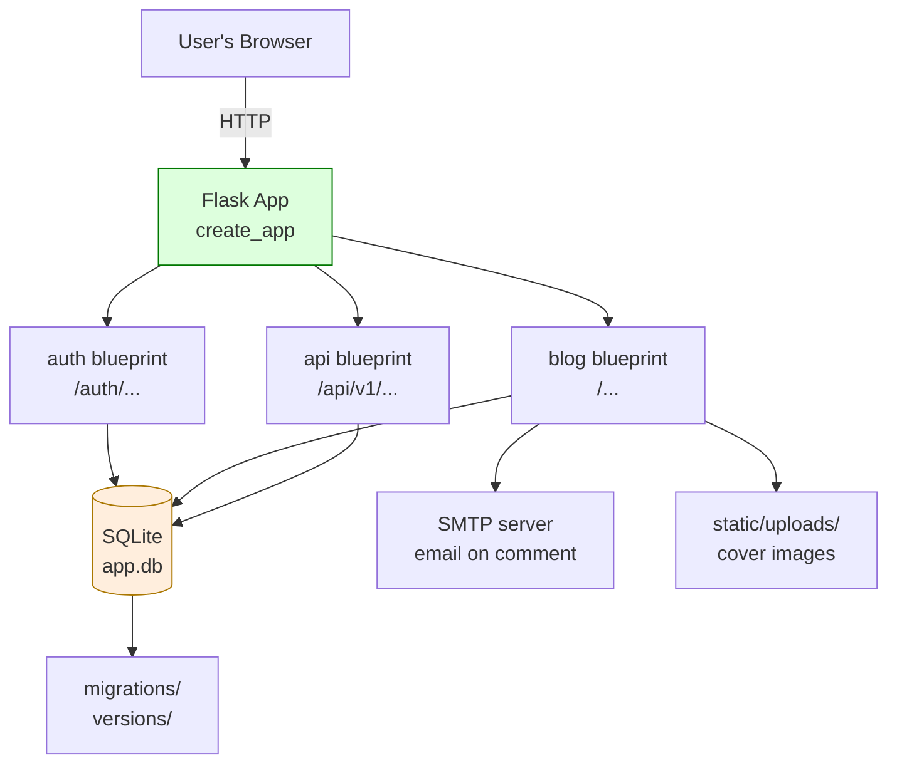
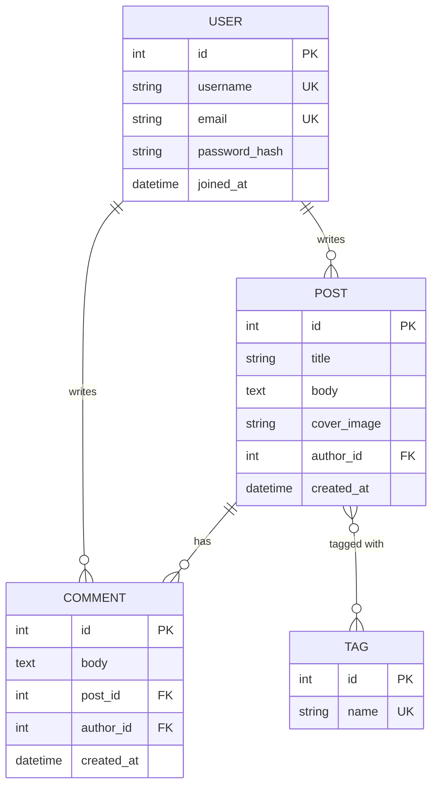
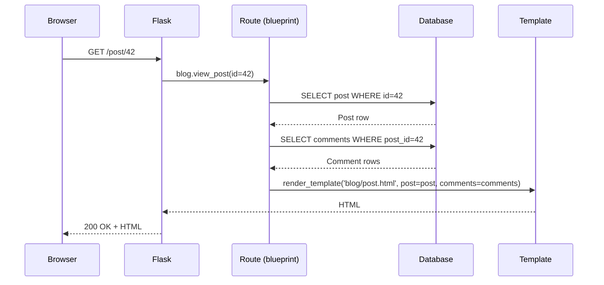
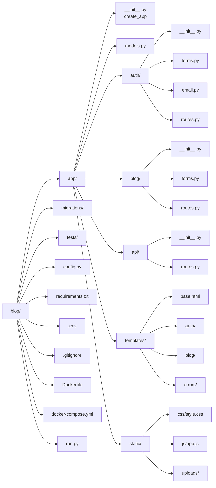
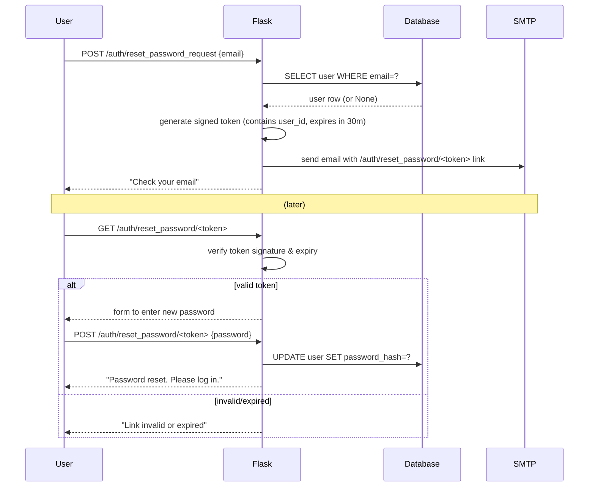
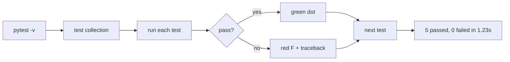

# Lesson 24 — Capstone: Build a Complete Blog Application

> [!success] This is it. The final lesson. The capstone.
> Twenty-three lessons ago you wrote `app = Flask(__name__)` and saw `Hello, World!` in your browser. That was the seed. Today you plant the whole forest. In this capstone you will build **a real, production-shaped blog application** — users register and log in, they write posts with cover images and tags, readers leave comments, the API exposes JSON, an email fires when someone comments, and the whole thing is packaged in Docker ready to ship. Everything you've learned comes together here. Take your time. Celebrate each step that runs. **You've earned this.**

#capstone #blog-project #final-project #celebration

---

## 1. Learning Objectives

By the end of this capstone you will be able to:

1. **Architect a multi-blueprint Flask application** — `auth`, `blog`, and `api` blueprints, each owning its routes, forms, and templates.
2. **Design a four-model schema** with one-to-many and many-to-many relationships — `User`, `Post`, `Comment`, `Tag`.
3. **Use the Application Factory pattern** (`create_app()`) to assemble the app from config, extensions, blueprints, and error handlers.
4. **Implement user authentication end-to-end** — registration with password hashing, login with Flask-Login, logout, route protection with `@login_required`.
5. **Build a full CRUD interface for posts** — create, read, update, delete — with ownership checks so users can only edit their own posts.
6. **Attach comments to posts** with nested user relationships, and **email the post author** when a new comment arrives.
7. **Add tag support** with a many-to-many association table and a `/tag/<name>` browse page.
8. **Upload and serve cover images** for posts, with filename validation and safe storage in `static/uploads/`.
9. **Expose a REST API** under `/api/v1` returning JSON lists and detail views of posts.
10. **Render templates** with a base layout, navigation that adapts to login state, flash messages, and pagination.
11. **Handle 404 and 500 errors** with custom error pages.
12. **Run database migrations** with Flask-Migrate at every schema change.
13. **Test the application** with pytest and the Flask test client.
14. **Deploy with Docker** — `Dockerfile`, `docker-compose.yml`, and a production-ready Gunicorn entry point.

This is a long lesson. **Break it across multiple sessions.** Each numbered step ends with a working checkpoint — when a step runs, save your work with git and take a breath.

## 2. Prerequisites

This capstone assumes you've completed **all 23 prior lessons**. Specifically, before you start, make sure you can answer yes to:

- Can I create a virtual environment and `pip install` packages? → [[Lesson-02-Project-Structure]]
- Can I write `@app.route('/<int:id>')` and read `request.form`? → [[Lesson-04-Routes]], [[Lesson-06-HTTP-Methods]]
- Can I write `` and ``? → [[Lesson-07-Jinja2-Basics]], [[Lesson-08-Template-Logic]]
- Can I render `{{ form.hidden_tag() }}` and validate on submit? → [[Lesson-11-Flask-WTF]]
- Can I write a `db.Model` and call `db.session.commit()`? → [[Lesson-12-SQLAlchemy-Setup]], [[Lesson-13-CRUD-Operations]]
- Can I write `db.relationship(..., backref=...)` and a many-to-many `db.Table`? → [[Lesson-14-Relationships]]
- Can I run `flask db migrate` and `flask db upgrade`? → [[Lesson-15-Flask-Migrate]]
- Can I hash a password and check it? → [[Lesson-16-User-Model-AndPasswords]]
- Can I log a user in with `login_user(user)`? → [[Lesson-17-Flask-Login]]
- Can I write `Blueprint('auth', __name__, url_prefix='/auth')`? → [[Lesson-18-Blueprints]]
- Can I return `jsonify(...)` from a route? → [[Lesson-19-Building-JSON-API]]
- Can I validate an uploaded file's extension and size? → [[Lesson-21-File-Uploads]]
- Can I send an email with `smtplib` or Flask-Mail? → [[Lesson-22-Email-And-Tasks]]
- Can I write a `Dockerfile` and `docker-compose.yml`? → [[Lesson-23-Deployment]]

If any of those feel fuzzy, click the link and review. This lesson moves fast because the foundations are supposed to be solid.

## 3. The Big Picture — What You're Building

### 3.1 The product

A blog. Specifically, **a multi-user blog where**:

- Anyone can read posts on the home page (`/`) and on individual post pages (`/post/<id>`).
- Anyone can browse posts by tag (`/tag/<name>`).
- Readers can sign up (`/auth/register`) and log in (`/auth/login`).
- Logged-in users can write posts (`/blog/new`), edit their own posts (`/post/<id>/edit`), and delete them (`/post/<id>/delete`).
- Logged-in users can comment on any post (`/post/<id>`, scroll to the comment form).
- Each new comment triggers an email to that post's author.
- Each post can have a cover image and any number of tags.
- A JSON API at `/api/v1/posts` exposes every post for programmatic clients.

### 3.2 The architecture



### 3.3 The data model



### 3.4 The request flow



### 3.5 The file structure



## 4. Step-by-Step Build

Now we build. Each step gives you the **complete file contents**. Create the files in the order shown. After every step that introduces a runnable piece, try running the app — even if it does very little, you'll catch typos early.

---

### Step 1 — Project Setup

Create the project directory and folder structure:

```bash
# From wherever you keep your projects:
mkdir blog
cd blog
mkdir -p app/auth app/blog app/api app/templates/auth app/templates/blog \
         app/templates/errors app/static/css app/static/js app/static/uploads \
         migrations tests
touch app/__init__.py app/models.py
touch app/auth/__init__.py app/auth/forms.py app/auth/email.py app/auth/routes.py
touch app/blog/__init__.py app/blog/forms.py app/blog/routes.py
touch app/api/__init__.py app/api/routes.py
touch config.py requirements.txt .env .gitignore Dockerfile docker-compose.yml run.py
touch tests/__init__.py tests/test_models.py tests/test_routes.py
```

Create a virtual environment and install the dependencies:

```bash
python -m venv venv
source venv/bin/activate   # Windows: venv\Scripts\activate
pip install Flask Flask-SQLAlchemy Flask-Migrate Flask-WTF Flask-Login \
            Flask-Mail python-dotenv email-validator Pillow
pip freeze > requirements.txt
```

> [!info] Why these packages?
> - **Flask** — the framework. `app = Flask(__name__)`.
> - **Flask-SQLAlchemy** — ORM (Lessons 12-15).
> - **Flask-Migrate** — Alembic wrapper for schema migrations (Lesson 15).
> - **Flask-WTF** — forms with CSRF (Lesson 11).
> - **Flask-Login** — user session management (Lesson 17).
> - **Flask-Mail** — SMTP email (Lesson 22).
> - **python-dotenv** — load `.env` files (Lessons 22-23).
> - **email-validator** — back-end for WTForms `Email()` validator.
> - **Pillow** — image validation (Lesson 21).

---

### Step 2 — Configuration (`config.py`)

Production apps have **multiple configurations** — dev uses SQLite, test uses an in-memory database, prod uses Postgres and real secrets. We model this with Python classes.

```python
# config.py
import os
from dotenv import load_dotenv

# Load variables from .env into os.environ
basedir = os.path.abspath(os.path.dirname(__file__))
load_dotenv(os.path.join(basedir, '.env'))


class Config:
    """Base configuration shared by all environments."""
    SECRET_KEY = os.environ.get('SECRET_KEY') or 'dev-secret-change-me'
    SQLALCHEMY_DATABASE_URI = os.environ.get('DATABASE_URL') or \
        'sqlite:///' + os.path.join(basedir, 'app.db')
    SQLALCHEMY_TRACK_MODIFICATIONS = False

    # File uploads (Lesson 21)
    UPLOAD_FOLDER = os.path.join(basedir, 'app', 'static', 'uploads')
    ALLOWED_EXTENSIONS = {'png', 'jpg', 'jpeg', 'gif', 'webp'}
    MAX_CONTENT_LENGTH = 2 * 1024 * 1024  # 2 MB

    # Email (Lesson 22)
    MAIL_SERVER = os.environ.get('MAIL_SERVER', 'smtp.googlemail.com')
    MAIL_PORT = int(os.environ.get('MAIL_PORT', 587))
    MAIL_USE_TLS = os.environ.get('MAIL_USE_TLS', 'true').lower() == 'true'
    MAIL_USERNAME = os.environ.get('MAIL_USERNAME')
    MAIL_PASSWORD = os.environ.get('MAIL_PASSWORD')
    MAIL_DEFAULT_SENDER = os.environ.get('MAIL_DEFAULT_SENDER', 'blog@example.com')

    # Pagination
    POSTS_PER_PAGE = 5

    # Application
    APP_NAME = 'Flask Blog'


class DevelopmentConfig(Config):
    DEBUG = True
    # Show SQL queries in the terminal — great for learning
    SQLALCHEMY_ECHO = True


class TestingConfig(Config):
    TESTING = True
    SQLALCHEMY_DATABASE_URI = 'sqlite:///:memory:'
    WTF_CSRF_ENABLED = False
    MAIL_SUPPRESS_SEND = True


class ProductionConfig(Config):
    DEBUG = False
    SQLALCHEMY_ECHO = False


config = {
    'development': DevelopmentConfig,
    'testing': TestingConfig,
    'production': ProductionConfig,
    'default': DevelopmentConfig,
}
```

And the `.env` file (keep it out of git!):

```bash
# .env
FLASK_APP=run.py
FLASK_ENV=development
SECRET_KEY=replace-with-secrets-token_hex-32-output
DATABASE_URL=sqlite:///app.db
MAIL_USERNAME=your-email@gmail.com
MAIL_PASSWORD=your-app-password
MAIL_DEFAULT_SENDER=your-email@gmail.com
```

`.gitignore`:

```gitignore
# .gitignore
venv/
__pycache__/
*.pyc
app.db
app/static/uploads/*
!app/static/uploads/.gitkeep
.env
.pytest_cache/
*.egg-info/
```

```bash
# Create the .gitkeep so the uploads folder is tracked but empty:
touch app/static/uploads/.gitkeep
```

---

### Step 3 — The Application Factory (`app/__init__.py`)

This is the heart of the app. The **Application Factory** pattern (Lesson 18) creates a fresh `Flask` instance on demand — which makes testing, multiple environments, and clean imports trivial.

```python
# app/__init__.py
from flask import Flask
from flask_sqlalchemy import SQLAlchemy
from flask_migrate import Migrate
from flask_login import LoginManager
from flask_mail import Mail
from flask_wtf.csrf import CSRFProtect
from config import config

# Extensions are created WITHOUT an app — they'll be bound later
db = SQLAlchemy()
migrate = Migrate()
login = LoginManager()
login.login_view = 'auth.login'
login.login_message_category = 'info'
mail = Mail()
csrf = CSRFProtect()


def create_app(config_name='default'):
    """Application factory. Builds a Flask app ready to serve requests."""
    app = Flask(__name__)
    app.config.from_object(config[config_name])

    # Bind extensions to this app
    db.init_app(app)
    migrate.init_app(app, db)
    login.init_app(app)
    mail.init_app(app)
    csrf.init_app(app)

    # Register blueprints (defined in later steps)
    from app.auth import bp as auth_bp
    app.register_blueprint(auth_bp)

    from app.blog import bp as blog_bp
    app.register_blueprint(blog_bp)

    from app.api import bp as api_bp
    app.register_blueprint(api_bp, url_prefix='/api/v1')

    # Error handlers
    from app.errors import bp as errors_bp
    app.register_blueprint(errors_bp)

    # Make `app` importable inside shell without circular import pain
    from app import models  # noqa: F401  — ensures models are registered

    return app
```

> [!warning] Blueprint registration order
> Notice that `errors` blueprint is registered last and we import `models` at the end. The order matters because **importing a blueprint module runs its top-level code**, which often imports models. If you import `app.auth.routes` (which imports `app.models`) *before* `db = SQLAlchemy()` exists, you get a circular import. The factory pattern avoids this by structuring imports *inside* `create_app`.

We referenced an `errors` blueprint that doesn't exist yet — create a quick stub:

```bash
mkdir -p app/errors
touch app/errors/__init__.py app/errors/routes.py
```

```python
# app/errors/__init__.py
from flask import Blueprint
bp = Blueprint('errors', __name__)

from app.errors import routes  # noqa
```

```python
# app/errors/routes.py
from flask import render_template
from app.errors import bp


@bp.app_errorhandler(404)
def not_found_error(error):
    return render_template('errors/404.html'), 404


@bp.app_errorhandler(500)
def internal_error(error):
    from app import db
    db.session.rollback()
    return render_template('errors/500.html'), 500
```

We'll create the templates in Step 11.

---

### Step 4 — Models (`app/models.py`)

Four models, three relationships, all the patterns from Lessons 12-14.

```python
# app/models.py
from datetime import datetime
from flask import url_for
from flask_login import UserMixin
from werkzeug.security import generate_password_hash, check_password_hash
from app import db, login


# Association table for the Post↔Tag many-to-many relationship (Lesson 14)
post_tags = db.Table(
    'post_tags',
    db.Column('post_id', db.Integer, db.ForeignKey('post.id'), primary_key=True),
    db.Column('tag_id', db.Integer, db.ForeignKey('tag.id'), primary_key=True),
)


class User(UserMixin, db.Model):
    __tablename__ = 'user'   # 'user' is reserved in some databases — rename it

    id = db.Column(db.Integer, primary_key=True)
    username = db.Column(db.String(64), index=True, unique=True, nullable=False)
    email = db.Column(db.String(120), index=True, unique=True, nullable=False)
    password_hash = db.Column(db.String(256))
    joined_at = db.Column(db.DateTime, default=datetime.utcnow)
    bio = db.Column(db.Text)

    # One-to-many: a user's posts and comments (backref adds .author on Post/Comment)
    posts = db.relationship('Post', backref='author', lazy='dynamic',
                            cascade='all, delete-orphan')
    comments = db.relationship('Comment', backref='author', lazy='dynamic',
                               cascade='all, delete-orphan')

    def set_password(self, password):
        self.password_hash = generate_password_hash(password)

    def check_password(self, password):
        return check_password_hash(self.password_hash, password)

    def __repr__(self):
        return f'<User {self.username}>'


class Post(db.Model):
    id = db.Column(db.Integer, primary_key=True)
    title = db.Column(db.String(140), nullable=False)
    body = db.Column(db.Text, nullable=False)
    cover_image = db.Column(db.String(128))   # filename only, served from /static/uploads/
    created_at = db.Column(db.DateTime, index=True, default=datetime.utcnow)
    author_id = db.Column(db.Integer, db.ForeignKey('user.id'), nullable=False)

    # One-to-many: a post's comments
    comments = db.relationship('Comment', backref='post', lazy='dynamic',
                               cascade='all, delete-orphan')
    # Many-to-many: tags
    tags = db.relationship('Tag', secondary=post_tags, backref=db.backref('posts', lazy='dynamic'))

    def cover_url(self):
        if self.cover_image:
            return url_for('static', filename=f'uploads/{self.cover_image}')
        return None

    def __repr__(self):
        return f'<Post {self.title}>'


class Comment(db.Model):
    id = db.Column(db.Integer, primary_key=True)
    body = db.Column(db.Text, nullable=False)
    created_at = db.Column(db.DateTime, default=datetime.utcnow)
    post_id = db.Column(db.Integer, db.ForeignKey('post.id'), nullable=False)
    author_id = db.Column(db.Integer, db.ForeignKey('user.id'), nullable=False)

    def __repr__(self):
        return f'<Comment by {self.author_id} on post {self.post_id}>'


class Tag(db.Model):
    id = db.Column(db.Integer, primary_key=True)
    name = db.Column(db.String(32), index=True, unique=True, nullable=False)

    def __repr__(self):
        return f'<Tag {self.name}>'


@login.user_loader
def load_user(id):
    return User.query.get(int(id))
```

> [!info] Pattern review — every line is from a previous lesson
> - `UserMixin` → [[Lesson-17-Flask-Login]] (provides `is_authenticated`, `is_active`, `is_anonymous`, `get_id()`)
> - `generate_password_hash` / `check_password_hash` → [[Lesson-16-User-Model-AndPasswords]]
> - `db.relationship(..., backref=...)` → [[Lesson-14-Relationships]] one-to-many
> - `secondary=post_tags` → [[Lesson-14-Relationships]] many-to-many
> - `cascade='all, delete-orphan'` → deleting a user deletes their posts and comments
> - `lazy='dynamic'` → returns a query object you can chain `.filter()` on (Lesson 14)
> - `@login.user_loader` → [[Lesson-17-Flask-Login]] Flask-Login hook

---

### Step 5 — The `auth` Blueprint

Five files: `__init__.py`, `forms.py`, `email.py`, `routes.py`, plus templates later.

```python
# app/auth/__init__.py
from flask import Blueprint
bp = Blueprint('auth', __name__, url_prefix='/auth')

from app.auth import routes  # noqa
```

```python
# app/auth/forms.py
from flask_wtf import FlaskForm
from wtforms import StringField, PasswordField, BooleanField, SubmitField
from wtforms.validators import DataRequired, Email, EqualTo, Length, ValidationError
from app.models import User


class LoginForm(FlaskForm):
    username = StringField('Username', validators=[DataRequired()])
    password = PasswordField('Password', validators=[DataRequired()])
    remember_me = BooleanField('Remember me')
    submit = SubmitField('Sign In')


class RegistrationForm(FlaskForm):
    username = StringField('Username', validators=[DataRequired(), Length(min=3, max=64)])
    email = StringField('Email', validators=[DataRequired(), Email()])
    password = PasswordField('Password', validators=[DataRequired(), Length(min=8)])
    password2 = PasswordField('Repeat password', validators=[DataRequired(),
                                                              EqualTo('password')])
    submit = SubmitField('Register')

    def validate_username(self, username):
        user = User.query.filter_by(username=username.data).first()
        if user is not None:
            raise ValidationError('That username is already taken. Please choose another.')

    def validate_email(self, email):
        user = User.query.filter_by(email=email.data).first()
        if user is not None:
            raise ValidationError('An account with that email already exists.')
```

```python
# app/auth/email.py
from flask import current_app, url_for
from flask_mail import Message
from app import mail
from threading import Thread


def _send_async_email(app, msg):
    """Send email in a background thread so the request doesn't block."""
    with app.app_context():
        mail.send(msg)


def send_registration_email(user):
    """Welcome email on registration — optional but friendly."""
    msg = Message('Welcome to the Flask Blog!',
                  recipients=[user.email])
    msg.body = f"""Hi {user.username},

Welcome to the Flask Blog! Your account has been created.

— The Flask Blog Team
"""
    Thread(target=_send_async_email, args=(current_app._get_current_object(), msg)).start()


def send_comment_notification(post, comment):
    """Email the post's author when a new comment is added."""
    if post.author.email == comment.author.email:
        return  # don't email someone about their own comment
    post_url = url_for('blog.view_post', id=post.id, _external=True)
    msg = Message(f'New comment on "{post.title}"',
                  recipients=[post.author.email])
    msg.body = f"""Hi {post.author.username},

{comment.author.username} just commented on your post "{post.title}":

{comment.body}

Read it here: {post_url}

— The Flask Blog Team
"""
    Thread(target=_send_async_email, args=(current_app._get_current_object(), msg)).start()
```

```python
# app/auth/routes.py
from flask import render_template, redirect, url_for, flash, request
from flask_login import login_user, logout_user, current_user, login_required
from werkzeug.urls import url_parse
from app.auth import bp
from app.auth.forms import LoginForm, RegistrationForm
from app.auth.email import send_registration_email
from app.models import User
from app import db


@bp.route('/login', methods=['GET', 'POST'])
def login():
    if current_user.is_authenticated:
        return redirect(url_for('blog.index'))
    form = LoginForm()
    if form.validate_on_submit():
        user = User.query.filter_by(username=form.username.data).first()
        if user is None or not user.check_password(form.password.data):
            flash('Invalid username or password', 'danger')
            return redirect(url_for('auth.login'))
        login_user(user, remember=form.remember_me.data)
        next_page = request.args.get('next')
        if not next_page or url_parse(next_page).netloc != '':
            # Prevent open-redirect attacks: only allow relative URLs in ?next=
            next_page = url_for('blog.index')
        flash(f'Welcome back, {user.username}!', 'success')
        return redirect(next_page)
    return render_template('auth/login.html', title='Sign in', form=form)


@bp.route('/register', methods=['GET', 'POST'])
def register():
    if current_user.is_authenticated:
        return redirect(url_for('blog.index'))
    form = RegistrationForm()
    if form.validate_on_submit():
        user = User(username=form.username.data, email=form.email.data)
        user.set_password(form.password.data)
        db.session.add(user)
        db.session.commit()
        try:
            send_registration_email(user)
        except Exception:
            # Email is best-effort — never block registration on SMTP failure
            pass
        flash('Registration successful! Please log in.', 'success')
        return redirect(url_for('auth.login'))
    return render_template('auth/register.html', title='Register', form=form)


@bp.route('/logout')
@login_required
def logout():
    logout_user()
    flash('You have been logged out.', 'info')
    return redirect(url_for('blog.index'))
```

#### Step 5b — Password Reset Flow

A complete blog needs a "forgot password" flow. The pattern is universal: user enters their email → app generates a single-use token tied to their account → app emails a link containing the token → user clicks → app verifies the token → user enters a new password.

We need three things on the User model: a method to generate a reset token, a method to verify it, and the `itsdangerous` library (already installed via Flask) to sign tokens.

```python
# Add to app/models.py — inside the User class
from itsdangerous import URLSafeTimedSerializer
from flask import current_app

def get_reset_token(self, expires_sec=1800):
    """Generate a time-limited, signed token for password reset."""
    s = URLSafeTimedSerializer(current_app.config['SECRET_KEY'], salt='password-reset')
    return s.dumps({'user_id': self.id})

@staticmethod
def verify_reset_token(token, expires_sec=1800):
    """Verify a reset token and return the user, or None."""
    s = URLSafeTimedSerializer(current_app.config['SECRET_KEY'], salt='password-reset')
    try:
        data = s.loads(token, max_age=expires_sec)
    except Exception:
        return None    # bad token, expired, tampered — all → None
    return User.query.get(data['user_id'])
```

> [!info] Why `itsdangerous` and not just `secrets.token_urlsafe`?
> A random token works — but then you have to **store it in the database** (with expiry) and look it up when the user clicks. `URLSafeTimedSerializer` is **stateless**: the token *contains* the user ID and an embedded expiry, signed with your `SECRET_KEY`. You don't store anything; you just verify the signature on click. If the signature is valid, the token wasn't tampered with. If `max_age` is exceeded, `loads()` raises. This is the same library Flask uses for session cookies.

```python
# Add to app/auth/forms.py
class ResetPasswordRequestForm(FlaskForm):
    email = StringField('Email', validators=[DataRequired(), Email()])
    submit = SubmitField('Request password reset')


class ResetPasswordForm(FlaskForm):
    password = PasswordField('New password', validators=[DataRequired(), Length(min=8)])
    password2 = PasswordField('Repeat password', validators=[DataRequired(), EqualTo('password')])
    submit = SubmitField('Reset password')
```

```python
# Add to app/auth/email.py
def send_password_reset_email(user):
    token = user.get_reset_token()
    reset_url = url_for('auth.reset_password', token=token, _external=True)
    msg = Message('Reset your Flask Blog password',
                  recipients=[user.email])
    msg.body = f"""Hi {user.username},

To reset your password, visit:

    {reset_url}

This link expires in 30 minutes. If you didn't request a reset, you can ignore this email.

— The Flask Blog Team
"""
    Thread(target=_send_async_email, args=(current_app._get_current_object(), msg)).start()
```

```python
# Add to app/auth/routes.py
from app.auth.forms import (LoginForm, RegistrationForm,
                            ResetPasswordRequestForm, ResetPasswordForm)
from app.auth.email import send_registration_email, send_password_reset_email

@bp.route('/reset_password_request', methods=['GET', 'POST'])
def reset_password_request():
    if current_user.is_authenticated:
        return redirect(url_for('blog.index'))
    form = ResetPasswordRequestForm()
    if form.validate_on_submit():
        user = User.query.filter_by(email=form.email.data).first()
        if user:
            send_password_reset_email(user)
        # ALWAYS flash the same message — don't leak which emails exist
        flash('Check your email for instructions to reset your password.', 'info')
        return redirect(url_for('auth.login'))
    return render_template('auth/reset_password_request.html', form=form)


@bp.route('/reset_password/<token>', methods=['GET', 'POST'])
def reset_password(token):
    if current_user.is_authenticated:
        return redirect(url_for('blog.index'))
    user = User.verify_reset_token(token)
    if user is None:
        flash('That reset link is invalid or has expired.', 'danger')
        return redirect(url_for('auth.reset_password_request'))
    form = ResetPasswordForm()
    if form.validate_on_submit():
        user.set_password(form.password.data)
        db.session.commit()
        flash('Your password has been reset. Please log in.', 'success')
        return redirect(url_for('auth.login'))
    return render_template('auth/reset_password.html', form=form)
```

```html
<!-- app/templates/auth/reset_password_request.html -->

Reset password

<h1>Reset password</h1>
<form method="post">
    {{ form.hidden_tag() }}
    <div class="form-group">
        {{ form.email.label }} {{ form.email(size=64) }}
    </div>
    {{ form.submit(class='btn') }}
</form>

```

```html
<!-- app/templates/auth/reset_password.html -->

Reset password

<h1>Reset password</h1>
<form method="post">
    {{ form.hidden_tag() }}
    <div class="form-group">
        {{ form.password.label }} {{ form.password(size=32) }}
        <span class="error">{{ err }}</span>
    </div>
    <div class="form-group">
        {{ form.password2.label }} {{ form.password2(size=32) }}
        <span class="error">{{ err }}</span>
    </div>
    {{ form.submit(class='btn') }}
</form>

```

Add a link from the login page:

```html
<!-- In app/templates/auth/login.html, add after the form: -->
<p><a href="{{ url_for('auth.reset_password_request') }}">Forgot your password?</a></p>
```

After writing these files, run a migration (we changed nothing in the schema — `get_reset_token` is a method, not a column — so no migration is needed). Test the flow: log out, click "Forgot your password?", enter an email you registered with, check MailHog/Mailpit for the reset email, click the link, set a new password, log in with the new password.

> [!tip] Try this: test the expiry
> Set `expires_sec=10` temporarily. Request a reset email, wait 15 seconds, click the link. You should see "That reset link is invalid or has expired." Now set it back to `1800` (30 minutes).



> [!warning] Don't reveal which emails are registered
> Notice the `if user:` check inside `reset_password_request`. If we flashed "no account with that email" when the user didn't exist, an attacker could enumerate accounts by trying emails. Always show the same message ("Check your email") whether or not the email exists. The email simply doesn't get sent if the user is None. This is **user enumeration** prevention — see OWASP Authentication Cheat Sheet.

> [!tip] Security highlights worth re-reading
> - `url_parse(next_page).netloc != ''` blocks open-redirect attacks — see [[Lesson-17-Flask-Login]].
> - We never store `password` in the DB — only `password_hash` — see [[Lesson-16-User-Model-AndPasswords]].
> - Email is sent in a `Thread` so the request returns fast — see [[Lesson-22-Email-And-Tasks]].
> - `try/except` around `send_registration_email` — email is best-effort. Never let SMTP failure block a user.

> [!question] Student asks: "Why does `_send_async_email` need `app.app_context()`?"
> Flask extensions like Flask-Mail and Flask-SQLAlchemy require an **application context** to find their config — `current_app.config['MAIL_SERVER']`, etc. The request handler runs inside an app context already, so synchronous code "just works." But a `Thread` is a separate Python execution context with no Flask context pushed. We pass `current_app._get_current_object()` (the real Flask app instance, not the proxy) into the thread and push a fresh context with `with app.app_context():`. Without this, `mail.send(msg)` raises `RuntimeError: Working outside of application context`.

> [!question] Student asks: "Why use a thread and not Celery here?"
> Threads are zero-infrastructure: no Redis, no separate worker process, no monitoring. They're the right tool for a single-server hobby blog. The trade-off: if the server crashes mid-send, the email is lost; if you scale to multiple servers, the thread count multiplies; you can't retry. The moment you need reliability, retries, or scheduling, switch to Celery (or RQ, Dramatiq) — see [[Lesson-22-Email-And-Tasks]]. Many production Flask apps use threads for "best-effort" notifications and Celery for "must-succeed" jobs.

---

### Step 6 — The `blog` Blueprint (Posts)

The largest blueprint: list, view, create, edit, delete posts, plus tag browsing.

```python
# app/blog/__init__.py
from flask import Blueprint
bp = Blueprint('blog', __name__)

from app.blog import routes  # noqa
```

```python
# app/blog/forms.py
import os
from flask_wtf import FlaskForm
from flask_wtf.file import FileField, FileAllowed, FileRequired
from wtforms import StringField, TextAreaField, SubmitField
from wtforms.validators import DataRequired, Length, ValidationError
from app.models import Tag


class PostForm(FlaskForm):
    title = StringField('Title', validators=[DataRequired(), Length(max=140)])
    body = TextAreaField('Body', validators=[DataRequired()])
    cover = FileField('Cover image (optional)',
                      validators=[FileAllowed(['png', 'jpg', 'jpeg', 'gif', 'webp'])])
    tags = StringField('Tags (comma-separated)', validators=[Length(max=200)])
    submit = SubmitField('Save post')


def parse_tags(tag_string):
    """Turn 'flask, python, web' into ['flask', 'python', 'web'] and resolve Tag objects."""
    if not tag_string:
        return []
    names = [t.strip().lower() for t in tag_string.split(',') if t.strip()]
    tags = []
    for name in names:
        tag = Tag.query.filter_by(name=name).first()
        if tag is None:
            tag = Tag(name=name)
        tags.append(tag)
    return tags
```

```python
# app/blog/routes.py
import os
from flask import render_template, redirect, url_for, flash, request, current_app, abort
from flask_login import current_user, login_required
from werkzeug.utils import secure_filename
from app.blog import bp
from app.blog.forms import PostForm, parse_tags
from app.models import Post, Comment, Tag, User
from app import db
from app.auth.email import send_comment_notification


def save_cover(form_cover):
    """Save an uploaded cover image and return the filename to store in DB."""
    if not form_cover.data:
        return None
    filename = secure_filename(form_cover.data.filename)
    # Prefix with timestamp to avoid collisions
    import time
    filename = f'{int(time.time())}_{filename}'
    upload_dir = current_app.config['UPLOAD_FOLDER']
    os.makedirs(upload_dir, exist_ok=True)
    form_cover.data.save(os.path.join(upload_dir, filename))
    return filename


@bp.route('/')
@bp.route('/index')
def index():
    page = request.args.get('page', 1, type=int)
    query = Post.query.order_by(Post.created_at.desc())
    pagination = query.paginate(
        page=page, per_page=current_app.config['POSTS_PER_PAGE'], error_out=False
    )
    posts = pagination.items
    return render_template('blog/index.html', title='Home', posts=posts,
                           pagination=pagination)


@bp.route('/post/<int:id>', methods=['GET', 'POST'])
def view_post(id):
    post = Post.query.get_or_404(id)
    if request.method == 'POST':
        if not current_user.is_authenticated:
            flash('Please log in to comment.', 'info')
            return redirect(url_for('auth.login', next=request.url))
        body = request.form.get('body', '').strip()
        if not body:
            flash('Comment cannot be empty.', 'danger')
        else:
            comment = Comment(body=body, post=post, author=current_user)
            db.session.add(comment)
            db.session.commit()
            try:
                send_comment_notification(post, comment)
            except Exception:
                pass
            flash('Your comment has been posted!', 'success')
            return redirect(url_for('blog.view_post', id=post.id) + '#comments')
    comments = post.comments.order_by(Comment.created_at.asc()).all()
    return render_template('blog/post.html', title=post.title, post=post, comments=comments)


@bp.route('/post/new', methods=['GET', 'POST'])
@login_required
def create_post():
    form = PostForm()
    if form.validate_on_submit():
        cover_filename = save_cover(form.cover)
        post = Post(title=form.title.data, body=form.body.data,
                    cover_image=cover_filename, author=current_user,
                    tags=parse_tags(form.tags.data))
        db.session.add(post)
        db.session.commit()
        flash('Your post has been created!', 'success')
        return redirect(url_for('blog.view_post', id=post.id))
    return render_template('blog/edit.html', title='New post', form=form)


@bp.route('/post/<int:id>/edit', methods=['GET', 'POST'])
@login_required
def edit_post(id):
    post = Post.query.get_or_404(id)
    if post.author != current_user:
        abort(403)   # Only the owner can edit
    form = PostForm()
    if form.validate_on_submit():
        post.title = form.title.data
        post.body = form.body.data
        post.tags = parse_tags(form.tags.data)
        if form.cover.data:
            post.cover_image = save_cover(form.cover)
        db.session.commit()
        flash('Your post has been updated.', 'success')
        return redirect(url_for('blog.view_post', id=post.id))
    elif request.method == 'GET':
        form.title.data = post.title
        form.body.data = post.body
        form.tags.data = ', '.join(t.name for t in post.tags)
    return render_template('blog/edit.html', title='Edit post', form=form)


@bp.route('/post/<int:id>/delete', methods=['POST'])
@login_required
def delete_post(id):
    post = Post.query.get_or_404(id)
    if post.author != current_user:
        abort(403)
    db.session.delete(post)
    db.session.commit()
    flash('Post deleted.', 'info')
    return redirect(url_for('blog.index'))


@bp.route('/tag/<name>')
def posts_by_tag(name):
    tag = Tag.query.filter_by(name=name.lower()).first_or_404()
    page = request.args.get('page', 1, type=int)
    pagination = tag.posts.order_by(Post.created_at.desc()).paginate(
        page=page, per_page=current_app.config['POSTS_PER_PAGE'], error_out=False
    )
    return render_template('blog/tag.html', title=f'Posts tagged "{tag.name}"',
                           tag=tag, posts=pagination.items, pagination=pagination)


@bp.route('/user/<username>')
def user_profile(username):
    user = User.query.filter_by(username=username).first_or_404()
    posts = user.posts.order_by(Post.created_at.desc()).all()
    return render_template('blog/user.html', title=user.username, user=user, posts=posts)
```

> [!example] What's happening here?
> - `get_or_404(id)` — fetches the row or returns 404 (Lesson 13).
> - `@login_required` — redirects anonymous users to login (Lesson 17).
> - `abort(403)` — owner check so only the author can edit/delete.
> - `secure_filename` + timestamp prefix — Lesson 21's safe upload pattern.
> - `paginate()` — Flask-SQLAlchemy 3.x API, with `error_out=False` (Lesson 13).
> - The comment form is built by hand (not FlaskForm) because it's tiny and we want it on every post page.

---

### Step 7 — Comments (already in `blog/routes.py`)

Look back at the `view_post` route above. The `POST` branch handles comments:

1. Check the user is logged in (otherwise redirect to login with `next=request.url`).
2. Read `body` from `request.form`.
3. Validate non-empty.
4. Create a `Comment` linked to the post and the current user.
5. Commit.
6. Send email to the post's author (async, best-effort).
7. Redirect back to the post, anchored at `#comments`.

This is **all of Lessons 13 + 14 + 17 + 22 in 12 lines of code**. That's the goal of a capstone — show how everything compresses into clean, idiomatic Flask.

---

### Step 8 — The `api` Blueprint

JSON endpoints for programmatic clients (Lessons 19-20).

```python
# app/api/__init__.py
from flask import Blueprint
bp = Blueprint('api', __name__)

from app.api import routes  # noqa
```

```python
# app/api/routes.py
from flask import jsonify, request, url_for, abort
from app.api import bp
from app.models import Post, Tag
from app import db


def post_to_dict(post):
    """Serialise a Post into a JSON-friendly dict."""
    return {
        'id': post.id,
        'title': post.title,
        'body': post.body,
        'cover_url': post.cover_url(),
        'created_at': post.created_at.isoformat() if post.created_at else None,
        'author': post.author.username,
        'tags': [t.name for t in post.tags],
        'comment_count': post.comments.count(),
        'url': url_for('api.get_post', id=post.id, _external=True),
        'html_url': url_for('blog.view_post', id=post.id, _external=True),
    }


@bp.route('/posts', methods=['GET'])
def get_posts():
    page = request.args.get('page', 1, type=int)
    per_page = min(request.args.get('per_page', 5, type=int), 50)
    pagination = Post.query.order_by(Post.created_at.desc()).paginate(
        page=page, per_page=per_page, error_out=False
    )
    posts = pagination.items
    return jsonify({
        'posts': [post_to_dict(p) for p in posts],
        'total': pagination.total,
        'pages': pagination.pages,
        'current_page': page,
        'next': url_for('api.get_posts', page=page + 1, _external=True) \
            if pagination.has_next else None,
        'prev': url_for('api.get_posts', page=page - 1, _external=True) \
            if pagination.has_prev else None,
    })


@bp.route('/posts/<int:id>', methods=['GET'])
def get_post(id):
    post = Post.query.get_or_404(id)
    return jsonify(post_to_dict(post))


@bp.route('/posts', methods=['POST'])
def create_post():
    # NOTE: real apps require API auth (token, OAuth, etc.) — see Lesson 20
    data = request.get_json() or {}
    if 'title' not in data or 'body' not in data:
        return jsonify({'error': 'title and body are required'}), 400
    post = Post(title=data['title'], body=data['body'])
    # In a real app, set author_id from the authenticated API user
    db.session.add(post)
    db.session.commit()
    return jsonify(post_to_dict(post)), 201, \
        {'Location': url_for('api.get_post', id=post.id, _external=True)}


@bp.route('/tags', methods=['GET'])
def get_tags():
    tags = Tag.query.order_by(Tag.name).all()
    return jsonify({
        'tags': [
            {'name': t.name, 'post_count': t.posts.count(), 'url': url_for('blog.posts_by_tag', name=t.name, _external=True)}
            for t in tags
        ]
    })
```

Test with curl:

```bash
# List posts
curl http://127.0.0.1:5000/api/v1/posts | python -m json.tool

# Get one post
curl http://127.0.0.1:5000/api/v1/posts/1 | python -m json.tool

# Create a post (note: needs auth in real apps)
curl -X POST http://127.0.0.1:5000/api/v1/posts \
     -H "Content-Type: application/json" \
     -d '{"title":"API Post","body":"Created via the JSON API."}'
```

---

### Step 9 — Templates

`base.html` is the foundation everything else extends (Lesson 08).

```html
<!-- app/templates/base.html -->
<!DOCTYPE html>
<html lang="en">
<head>
    <meta charset="UTF-8">
    <meta name="viewport" content="width=device-width, initial-scale=1.0">
    <title>{{ config.APP_NAME }}</title>
    <link rel="stylesheet" href="{{ url_for('static', filename='css/style.css') }}">
</head>
<body>
    <nav class="navbar">
        <a class="navbar-brand" href="{{ url_for('blog.index') }}">{{ config.APP_NAME }}</a>
        <div class="navbar-nav">
            <a href="{{ url_for('blog.index') }}">Home</a>
            
                <a href="{{ url_for('blog.create_post') }}">New post</a>
                <a href="{{ url_for('auth.logout') }}">Logout ({{ current_user.username }})</a>
            
                <a href="{{ url_for('auth.login') }}">Login</a>
                <a href="{{ url_for('auth.register') }}">Register</a>
            
        </div>
    </nav>

    <main class="container">
        
            
                
                    <div class="alert alert-{{ category }}">{{ message }}</div>
                
            
        

        
    </main>

    <footer class="footer">
        <p>Built with Flask. <a href="{{ url_for('api.get_posts') }}">JSON API</a></p>
    </footer>

    <script src="{{ url_for('static', filename='js/app.js') }}"></script>
</body>
</html>
```

```html
<!-- app/templates/blog/index.html -->

Home — {{ config.APP_NAME }}


<h1>Latest posts</h1>


    <div class="post-list">
    
        <article class="post-card">
            
                
            
            <h2><a href="{{ url_for('blog.view_post', id=post.id) }}">{{ post.title }}</a></h2>
            <p class="post-meta">
                by <a href="{{ url_for('blog.user_profile', username=post.author.username) }}">{{ post.author.username }}</a>
                on {{ post.created_at.strftime('%Y-%m-%d') }}
                — {{ post.comments.count() }} comments
            </p>
            <p class="post-excerpt">{{ post.body[:200] }}…</p>
            <p class="post-tags">
                
                    <a href="{{ url_for('blog.posts_by_tag', name=tag.name) }}" class="tag">#{{ tag.name }}</a>
                
            </p>
        </article>
    
    </div>

    <nav class="pagination">
        
            <a href="{{ url_for('blog.index', page=pagination.prev_num) }}">← Newer</a>
        
        <span>Page {{ pagination.page }} of {{ pagination.pages }}</span>
        
            <a href="{{ url_for('blog.index', page=pagination.next_num) }}">Older →</a>
        
    </nav>

    <p>No posts yet. 
        <a href="{{ url_for('blog.create_post') }}">Write the first one!</a>
    </p>


```

```html
<!-- app/templates/blog/post.html -->

{{ post.title }} — {{ config.APP_NAME }}


<article class="post-detail">
    
        
    
    <h1>{{ post.title }}</h1>
    <p class="post-meta">
        by <a href="{{ url_for('blog.user_profile', username=post.author.username) }}">{{ post.author.username }}</a>
        on {{ post.created_at.strftime('%Y-%m-%d %H:%M') }}
    </p>
    <div class="post-body">{{ post.body }}</div>
    <p class="post-tags">
        
            <a href="{{ url_for('blog.posts_by_tag', name=tag.name) }}" class="tag">#{{ tag.name }}</a>
        
    </p>

    
        <p class="post-actions">
            <a href="{{ url_for('blog.edit_post', id=post.id) }}" class="btn">Edit</a>
            <form method="post" action="{{ url_for('blog.delete_post', id=post.id) }}" class="inline"
                  onsubmit="return confirm('Delete this post? This cannot be undone.');">
                {{ form.hidden_tag() if form else '' }}
                <button type="submit" class="btn btn-danger">Delete</button>
            </form>
        </p>
    
</article>

<section id="comments" class="comments">
    <h2>{{ comments|length }} comments</h2>
    
        <div class="comment">
            <p class="comment-meta">
                <strong>{{ comment.author.username }}</strong>
                · {{ comment.created_at.strftime('%Y-%m-%d %H:%M') }}
            </p>
            <p>{{ comment.body }}</p>
        </div>
    
        <p>No comments yet. Be the first!</p>
    

    
        <form method="post" class="comment-form">
            {{ form.hidden_tag() if form else '' }}
            <label for="body">Add a comment</label>
            <textarea name="body" id="body" rows="4" required></textarea>
            <button type="submit" class="btn">Post comment</button>
        </form>
    
        <p><a href="{{ url_for('auth.login', next=request.url) }}">Log in</a> to comment.</p>
    
</section>

```

```html
<!-- app/templates/blog/edit.html -->


<h1>{{ title }}</h1>

<form method="post" enctype="multipart/form-data">
    {{ form.hidden_tag() }}
    <div class="form-group">
        {{ form.title.label }}
        {{ form.title(size=60) }}
        <span class="error">{{ err }}</span>
    </div>
    <div class="form-group">
        {{ form.body.label }}
        {{ form.body(rows=15, style='width:100%') }}
        <span class="error">{{ err }}</span>
    </div>
    <div class="form-group">
        {{ form.cover.label }}
        {{ form.cover() }}
        <span class="error">{{ err }}</span>
    </div>
    <div class="form-group">
        {{ form.tags.label }}
        {{ form.tags(size=40, placeholder='flask, python, web') }}
    </div>
    {{ form.submit(class='btn') }}
</form>

```

```html
<!-- app/templates/blog/tag.html -->

Posts tagged "{{ tag.name }}"

<h1>Posts tagged "{{ tag.name }}"</h1>

    <article class="post-card">
        <h2><a href="{{ url_for('blog.view_post', id=post.id) }}">{{ post.title }}</a></h2>
        <p class="post-meta">by {{ post.author.username }}</p>
    </article>

    <p>No posts with this tag.</p>


```

```html
<!-- app/templates/blog/user.html -->

{{ user.username }}

<h1>{{ user.username }}</h1>
<p>{{ user.bio }}</p>
<p>Joined: {{ user.joined_at.strftime('%Y-%m-%d') }}</p>
<h2>Posts ({{ posts|length }})</h2>

    <article class="post-card">
        <h3><a href="{{ url_for('blog.view_post', id=post.id) }}">{{ post.title }}</a></h3>
        <p class="post-meta">{{ post.created_at.strftime('%Y-%m-%d') }}</p>
    </article>

    <p>This user hasn't posted anything yet.</p>


```

```html
<!-- app/templates/auth/login.html -->

Sign in

<h1>Sign in</h1>
<form method="post">
    {{ form.hidden_tag() }}
    <div class="form-group">
        {{ form.username.label }} {{ form.username(size=32) }}
    </div>
    <div class="form-group">
        {{ form.password.label }} {{ form.password(size=32) }}
    </div>
    <div class="form-group">
        {{ form.remember_me.label }} {{ form.remember_me() }}
    </div>
    {{ form.submit(class='btn') }}
    <p>New here? <a href="{{ url_for('auth.register') }}">Register an account</a>.</p>
</form>

```

```html
<!-- app/templates/auth/register.html -->

Register

<h1>Register</h1>
<form method="post">
    {{ form.hidden_tag() }}
    <div class="form-group">
        {{ form.username.label }} {{ form.username(size=32) }}
        <span class="error">{{ err }}</span>
    </div>
    <div class="form-group">
        {{ form.email.label }} {{ form.email(size=64) }}
        <span class="error">{{ err }}</span>
    </div>
    <div class="form-group">
        {{ form.password.label }} {{ form.password(size=32) }}
        <span class="error">{{ err }}</span>
    </div>
    <div class="form-group">
        {{ form.password2.label }} {{ form.password2(size=32) }}
        <span class="error">{{ err }}</span>
    </div>
    {{ form.submit(class='btn') }}
    <p>Already have an account? <a href="{{ url_for('auth.login') }}">Sign in</a>.</p>
</form>

```

---

### Step 10 — Error Templates and Static Files

```html
<!-- app/templates/errors/404.html -->

Not found

<h1>404 — Page not found</h1>
<p>Sorry, we couldn't find what you were looking for.</p>
<a href="{{ url_for('blog.index') }}" class="btn">Go home</a>

```

```html
<!-- app/templates/errors/500.html -->

Server error

<h1>500 — Something went wrong</h1>
<p>The server encountered an error. We've been notified.</p>
<a href="{{ url_for('blog.index') }}" class="btn">Go home</a>

```

```css
/* app/static/css/style.css */
:root {
    --primary: #2563eb;
    --danger: #dc2626;
    --bg: #f8fafc;
    --text: #1e293b;
}
* { box-sizing: border-box; }
body {
    margin: 0; font-family: system-ui, -apple-system, sans-serif;
    background: var(--bg); color: var(--text); line-height: 1.6;
}
.navbar {
    background: #1e293b; color: #fff; padding: 1rem 2rem;
    display: flex; justify-content: space-between; align-items: center;
}
.navbar a { color: #fff; text-decoration: none; margin-left: 1rem; }
.navbar-brand { font-weight: bold; font-size: 1.25rem; }
.container { max-width: 800px; margin: 2rem auto; padding: 0 1rem; }
.post-card {
    background: #fff; border-radius: 8px; padding: 1.5rem;
    margin-bottom: 1.5rem; box-shadow: 0 1px 3px rgba(0,0,0,0.1);
}
.post-card h2 { margin-top: 0; }
.post-card h2 a { color: var(--primary); text-decoration: none; }
.post-cover { width: 100%; max-height: 200px; object-fit: cover; border-radius: 4px; }
.post-cover-large { width: 100%; max-height: 400px; object-fit: cover; border-radius: 8px; }
.post-meta { color: #64748b; font-size: 0.9rem; }
.post-tags { margin-top: 0.5rem; }
.tag {
    display: inline-block; background: #e0e7ff; color: var(--primary);
    padding: 0.15rem 0.5rem; border-radius: 12px; font-size: 0.85rem;
    text-decoration: none; margin-right: 0.25rem;
}
.btn {
    display: inline-block; background: var(--primary); color: #fff;
    padding: 0.5rem 1rem; border: none; border-radius: 4px;
    cursor: pointer; text-decoration: none; font-size: 1rem;
}
.btn-danger { background: var(--danger); }
.form-group { margin-bottom: 1rem; }
.form-group label { display: block; margin-bottom: 0.25rem; font-weight: 500; }
.form-group input, .form-group textarea {
    width: 100%; padding: 0.5rem; border: 1px solid #cbd5e1; border-radius: 4px;
}
.error { color: var(--danger); display: block; font-size: 0.85rem; margin-top: 0.25rem; }
.alert {
    padding: 0.75rem 1rem; border-radius: 4px; margin-bottom: 1rem;
}
.alert-success { background: #dcfce7; color: #166534; }
.alert-danger  { background: #fee2e2; color: #991b1b; }
.alert-info    { background: #dbeafe; color: #1e40af; }
.alert-warning { background: #fef3c7; color: #92400e; }
.comment {
    background: #fff; padding: 1rem; border-left: 3px solid var(--primary);
    margin-bottom: 1rem; border-radius: 4px;
}
.comment-form textarea { width: 100%; padding: 0.5rem; border: 1px solid #cbd5e1; border-radius: 4px; }
.pagination {
    display: flex; justify-content: space-between; align-items: center;
    margin-top: 2rem;
}
.footer { text-align: center; padding: 2rem; color: #64748b; font-size: 0.9rem; }
.inline { display: inline; }
```

```javascript
// app/static/js/app.js
// Tiny progressive enhancement: confirm before delete.
document.addEventListener('DOMContentLoaded', () => {
    console.log('Flask Blog ready.');
});
```

---

### Step 11 — Error Handlers (already wired in Step 3)

We already created `app/errors/__init__.py` and `app/errors/routes.py` in Step 3. Their templates are in Step 10. The blueprint is registered in `create_app`. Done.

> [!info] Why `app_errorhandler` and not `errorhandler`?
> A blueprint's `@bp.errorhandler` only catches errors from routes **in that blueprint**. `@bp.app_errorhandler` registers an **app-wide** handler — which is what we want for 404 and 500. See [[Lesson-18-Blueprints]].

---

### Step 12 — Migrations

Initialize Alembic and create your first migration. From the project root:

```bash
export FLASK_APP=run.py
flask db init
```

That creates `migrations/` with `alembic.ini`, `env.py`, `script.py.mako`, and `versions/`. Then:

```bash
flask db migrate -m "initial schema: user, post, comment, tag, post_tags"
flask db upgrade
```

Open `app.db` in DB Browser for SQLite (or `sqlite3 app.db ".tables"`) and you should see `user`, `post`, `comment`, `tag`, and `post_tags`.

> [!warning] Review generated migrations
> Always open `migrations/versions/<hash>_<message>.py` and read it before `upgrade`. Alembic occasionally misses things — especially many-to-many association tables that aren't full models. See [[Lesson-15-Flask-Migrate]].

Every time you change a model:

```bash
flask db migrate -m "added bio column to user"
# review the generated file
flask db upgrade
```

---

### Step 13 — Running the App (`run.py`)

```python
# run.py
import os
from app import create_app, db
from app.models import User, Post, Comment, Tag

app = create_app(os.getenv('FLASK_CONFIG') or 'default')


@app.shell_context_processor
def make_shell_context():
    """Pre-load models in `flask shell` so you can poke at the DB interactively."""
    return dict(db=db, User=User, Post=Post, Comment=Comment, Tag=Tag)


if __name__ == '__main__':
    app.run()
```

Run it:

```bash
flask run
# or: python run.py
```

Visit `http://127.0.0.1:5000/`.

### 13.1 Seeding some data

```bash
flask shell
```

```python
>>> from app import db
>>> from app.models import User, Post, Tag
>>> alice = User(username='alice', email='alice@example.com')
>>> alice.set_password('password123')
>>> bob = User(username='bob', email='bob@example.com')
>>> bob.set_password('password123')
>>> db.session.add_all([alice, bob])
>>> db.session.commit()
>>> post = Post(title='My first post', body='Hello world! This is my first blog post.', author=alice)
>>> post.tags = [Tag(name='flask'), Tag(name='intro')]
>>> db.session.add(post)
>>> db.session.commit()
>>> exit()
```

Refresh the home page. You should see Alice's post with its tags.

---

### Step 14 — Testing (Brief)

We use `pytest` with the Flask test client (Lessons 13, 16, 17 introduced the patterns).

```python
# tests/conftest.py
import pytest
from app import create_app, db


@pytest.fixture
def app():
    app = create_app('testing')
    with app.app_context():
        db.create_all()
        yield app
        db.session.remove()
        db.drop_all()


@pytest.fixture
def client(app):
    return app.test_client()
```

```python
# tests/test_models.py
from app.models import User, Post
from app import db


def test_password_hashing(app):
    u = User(username='alice', email='alice@example.com')
    u.set_password('cat')
    assert not u.check_password('dog')
    assert u.check_password('cat')


def test_post_author(app):
    u = User(username='alice', email='alice@example.com')
    u.set_password('cat')
    db.session.add(u)
    db.session.commit()
    p = Post(title='Hello', body='World', author=u)
    db.session.add(p)
    db.session.commit()
    assert p.author == u
    assert u.posts.first() == p
```

```python
# tests/test_routes.py
from app.models import User
from app import db


def register_and_login(client, username, password):
    # Use the model directly to skip email and form validation overhead
    from app import create_app
    app = client.application
    with app.app_context():
        u = User(username=username, email=f'{username}@example.com')
        u.set_password(password)
        db.session.add(u)
        db.session.commit()

    rv = client.post('/auth/login', data={'username': username, 'password': password},
                     follow_redirects=True)
    assert rv.status_code == 200


def test_home_page(client):
    rv = client.get('/')
    assert rv.status_code == 200
    assert b'Latest posts' in rv.data


def test_login_required_to_post(client):
    rv = client.get('/post/new', follow_redirects=True)
    assert b'Sign in' in rv.data   # redirected to login


def test_create_post(client, app):
    register_and_login(client, 'alice', 'password123')
    rv = client.post('/post/new', data={
        'title': 'Test post', 'body': 'Hello world', 'tags': 'flask, test'
    }, follow_redirects=True)
    assert rv.status_code == 200
    assert b'Test post' in rv.data


def test_api_list(client):
    rv = client.get('/api/v1/posts')
    assert rv.status_code == 200
    assert rv.is_json
```

Install pytest and run:

```bash
pip install pytest
pytest -v
```

### 14.1 More tests worth adding

The two tests above are the minimum. Real apps have dozens. Here are four more that catch common bugs:

```python
# tests/test_auth.py
def test_register_then_login(client, app):
    """End-to-end: register a user, then log in with those credentials."""
    rv = client.post('/auth/register', data={
        'username': 'carol', 'email': 'carol@example.com',
        'password': 'supersecret', 'password2': 'supersecret',
    }, follow_redirects=True)
    assert rv.status_code == 200
    assert b'Registration successful' in rv.data

    rv = client.post('/auth/login', data={
        'username': 'carol', 'password': 'supersecret',
    }, follow_redirects=True)
    assert rv.status_code == 200
    assert b'Welcome back, carol!' in rv.data


def test_login_with_wrong_password(client, app):
    register_and_login(client, 'dave', 'rightpassword')
    client.get('/auth/logout')
    rv = client.post('/auth/login', data={
        'username': 'dave', 'password': 'wrongpassword',
    }, follow_redirects=True)
    assert b'Invalid username or password' in rv.data


# tests/test_ownership.py
def test_cannot_edit_others_post(client, app):
    """A user should get 403 when trying to edit someone else's post."""
    # Alice creates a post
    register_and_login(client, 'alice', 'password123')
    client.post('/post/new', data={'title': "Alice's post", 'body': 'mine'},
                follow_redirects=True)
    client.get('/auth/logout')
    # Bob logs in and tries to edit it
    register_and_login(client, 'bob', 'password123')
    rv = client.post('/post/1/edit', data={'title': "Bob's title", 'body': 'hacked'},
                     follow_redirects=False)
    assert rv.status_code == 403


# tests/test_api.py
def test_api_create_post_requires_title_and_body(client):
    rv = client.post('/api/v1/posts', json={'title': 'missing body'})
    assert rv.status_code == 400
    assert b'error' in rv.data


def test_api_pagination(client):
    """The API should respect ?page and ?per_page."""
    # Create 25 posts
    register_and_login(client, 'alice', 'password123')
    for i in range(25):
        client.post('/post/new', data={'title': f'Post {i}', 'body': 'body'},
                    follow_redirects=True)
    rv = client.get('/api/v1/posts?per_page=10&page=1')
    data = rv.get_json()
    assert data['total'] == 25
    assert len(data['posts']) == 10
    assert data['pages'] == 3
    assert data['next'] is not None
```



> [!tip] Try this: measure test coverage
> `pip install pytest-cov && pytest --cov=app --cov-report=term-missing`. The output shows which lines of your app code are *not* exercised by tests. Anything below 70% coverage is a red flag; above 90% is excellent. Don't aim for 100% — diminishing returns kick in around 90%. Target the critical paths: login, post CRUD, ownership checks, the API.

> [!question] Student asks: "Do I need to test the templates?"
> Templates are mostly presentation; you generally test their **effect** (does the page contain "Welcome back, carol!"?) rather than their structure. If you find yourself writing tests like "the navbar has a `logout` link with `href=/auth/logout`", consider whether that's testing implementation details rather than user-visible behavior. A few of those tests are fine; lots of them become a maintenance burden.

---

### Step 15 — Deployment (Brief)

For full deployment theory, see [[Lesson-23-Deployment]]. Here are the deployment files for this blog.

`Dockerfile`:

```dockerfile
# Dockerfile
FROM python:3.11-slim

# Prevent Python from writing .pyc files and buffer stdout
ENV PYTHONDONTWRITEBYTECODE=1 \
    PYTHONUNBUFFERED=1 \
    FLASK_CONFIG=production

WORKDIR /app

# System deps for Pillow and Postgres
RUN apt-get update && apt-get install -y --no-install-recommends \
    libpq-dev gcc curl && rm -rf /var/lib/apt/lists/*

# Install Python deps first (cache layer)
COPY requirements.txt .
RUN pip install --no-cache-dir -r requirements.txt gunicorn psycopg2-binary

# Copy app code
COPY . .

# Create uploads dir
RUN mkdir -p app/static/uploads

# Run migrations and start Gunicorn
EXPOSE 5000
CMD ["sh", "-c", "flask db upgrade && gunicorn -b 0.0.0.0:5000 -w 4 'run:app'"]
```

`docker-compose.yml`:

```yaml
# docker-compose.yml
version: '3.9'

services:
  web:
    build: .
    env_file: .env
    environment:
      - DATABASE_URL=postgresql://bloguser:blogpass@db:5432/blog
      - FLASK_CONFIG=production
    ports:
      - "5000:5000"
    depends_on:
      - db
    volumes:
      - ./app/static/uploads:/app/app/static/uploads

  db:
    image: postgres:16-alpine
    environment:
      POSTGRES_USER: bloguser
      POSTGRES_PASSWORD: blogpass
      POSTGRES_DB: blog
    volumes:
      - pgdata:/var/lib/postgresql/data
    ports:
      - "5432:5432"

volumes:
  pgdata:
```

Build and run locally with Docker:

```bash
docker-compose up --build
```

Visit `http://localhost:5000`. The `flask db upgrade` in the Dockerfile `CMD` runs migrations automatically before Gunicorn starts.

> [!tip] Real production checklist
> See [[Lesson-23-Deployment]] for the full list. In summary:
> - Strong `SECRET_KEY` (32+ random bytes from `secrets.token_hex(32)`).
> - `DEBUG=False` (the production config does this).
> - Postgres not SQLite for any real traffic.
> - HTTPS via Nginx + Let's Encrypt or your platform's load balancer.
> - Backups — Postgres `pg_dump` on a cron.
> - Monitoring — Sentry for errors, UptimeRobot for "is it up".

---

## 5. Walkthrough — Using the App

Now bring the app up and walk through every feature:

### 5.1 First run

```bash
flask run
```

```
 * Serving Flask app 'run.py'
 * Debug mode: on
 * Running on http://127.0.0.1:5000
```

Open the browser. You'll see the home page with the message **"No posts yet."**

### 5.2 Register

Click **Register**. Fill in `alice` / `alice@example.com` / `password123` / `password123`. Submit. You're redirected to the login page with a success flash. (If you configured SMTP, alice also gets a welcome email.)

### 5.3 Log in

Log in with `alice` / `password123`. The navbar now shows **"Logout (alice)"** and **"New post"**.

### 5.4 Create a post

Click **New post**. Title: `Hello World`. Body: `This is my first post on my very own blog!`. Tags: `flask, intro`. Optionally attach a cover image. Click **Save post**.

You're redirected to the post's detail page. The cover image renders if you uploaded one. The tags appear as `#flask` and `#intro` links.

### 5.5 Browse by tag

Click `#flask`. You see a list page showing every post tagged `flask`.

### 5.6 Log out and become Bob

Log out, register `bob`, log in as Bob. Visit Alice's post. Scroll to the comments section. Type a comment. Submit. The comment appears with Bob's username and timestamp. **Alice receives an email** about the new comment (if SMTP is configured).

### 5.7 Try to edit someone else's post

While logged in as Bob, navigate to Alice's post and add `/edit` to the URL. You get a **403 Forbidden** — the ownership check (`if post.author != current_user: abort(403)`) protects it.

### 5.8 Hit the API

In another terminal:

```bash
curl http://127.0.0.1:5000/api/v1/posts | python -m json.tool
```

You get JSON with the post you just created, including the author, tags, comment count, and HATEOAS-style URLs to the next page and the HTML page.

### 5.9 Trigger a 404

Visit `http://127.0.0.1:5000/post/9999`. You see the friendly 404 page.

> [!tip] Try this: trigger a 500 (in dev only)
> Add `raise Exception('boom')` to the top of the `view_post` route, then visit any post page. In debug mode (development config), you'll see the Werkzeug interactive debugger — click any frame in the traceback to open a Python REPL right there. **This is exactly why debug mode must be off in production**: anyone on the internet could open that REPL and run arbitrary Python in your server. Remove the `raise`, confirm the page works again, and move on.

> [!tip] Try this: inspect the database
> With the server running, open a second terminal:
> ```bash
> sqlite3 app.db
> sqlite> .tables
> sqlite> SELECT id, username, email FROM user;
> sqlite> SELECT title, author_id FROM post;
> sqlite> SELECT * FROM post_tags;   -- the many-to-many join table
> ```
> Seeing the raw rows demystifies what `db.session.add()` actually does. The same queries work in Postgres (`psql` instead of `sqlite3`).

> [!tip] Try this: watch the SQL
> `DevelopmentConfig` sets `SQLALCHEMY_ECHO = True`. With that on, every SQL query SQLAlchemy runs is printed to the terminal running `flask run`. Reload the home page and you'll see:
> ```
> SELECT post.id, post.title, ... FROM post ORDER BY post.created_at DESC LIMIT 5
> SELECT user.id, ... FROM user WHERE user.id = ?
> SELECT count(*) FROM comment WHERE comment.post_id = ?
> ```
> Notice the **N+1 problem**: for each post, we run a separate query for its author and another for its comment count. With 5 posts on the page, that's 1 + 5 + 5 = 11 queries. In a real app you'd fix this with `joinedload()` or `selectinload()` (Lesson 14). For now, just observe — seeing N+1 in the wild is the first step to fixing it.

> [!success] Pause and celebrate.
> You just used every major Flask feature — routing, templates, forms, ORM, relationships, migrations, authentication, blueprints, REST API, file uploads, async email, error handling, testing, and Docker. **That's a complete web application.**

---

## 6. Common Mistakes

1. **Circular imports.** If you import `app.blog.routes` at the top of `app/__init__.py` instead of inside `create_app`, you'll hit `ImportError: cannot import name 'db'`. Always import blueprints **inside** the factory.

2. **Forgetting `form.hidden_tag()`** in a template → `KeyError: 'csrf_token'` on POST. Every form that POSTs needs `{{ form.hidden_tag() }}`. See [[Lesson-11-Flask-WTF]].

3. **Forgetting `enctype="multipart/form-data"`** on a form with file uploads → `request.files` is empty. See [[Lesson-21-File-Uploads]].

4. **Schema changes without migrations.** You added a column to `Post` but didn't `flask db migrate` / `flask db upgrade`. Result: `sqlalchemy.exc.OperationalError: no such column`. See [[Lesson-15-Flask-Migrate]].

5. **`User.query.get(id)` returning None.** Always use `get_or_404(id)` in routes — a `None` post will crash `post.title`. See [[Lesson-13-CRUD-Operations]].

6. **`url_for('view_post', ...)`** without the blueprint prefix → `BuildError`. With blueprints it's `url_for('blog.view_post', ...)`. See [[Lesson-18-Blueprints]].

7. **Open redirect via `?next=`** — never `redirect(request.args.get('next'))` without checking the URL is relative. See the `url_parse(next_page).netloc != ''` check in `auth.login` and [[Lesson-17-Flask-Login]].

8. **SMTP blocking the request.** If you call `mail.send(msg)` synchronously in a route, the user waits 2-5 seconds for every comment. Always send in a background `Thread` (as in `auth/email.py`) or use Celery (Lesson 22).

9. **`Post.query` outside an application context.** Common in scripts and `flask shell`. Wrap in `with app.app_context():` or use `flask shell` (which sets it up for you). See [[Lesson-15-Flask-Migrate]] and [[Common-Errors]].

10. **Trusting the cover image extension.** A file named `evil.png` could be a PHP script. We use `secure_filename` and a `FileAllowed` validator. If you serve uploads from a public folder with script execution on, you have a problem. See [[Lesson-21-File-Uploads]].

11. **`paginate(error_out=True)`** (the default in older versions). If a user requests `?page=99999`, the app crashes with 404. We pass `error_out=False` so they get an empty list instead.

12. **Forgetting to commit.** `db.session.add(post)` is not enough — always `db.session.commit()` to persist. See [[Lesson-13-CRUD-Operations]].

---

## 7. Exercises — Stretch the Blog

Now that the blog works, **make it better**. Pick any of these and ship them one at a time.

> [!example] Exercise 1 — Search
> Add a search box to the navbar. Implement `/search?q=...` that uses `Post.query.filter(Post.body.like(f'%{q}%'))`. Bonus: use `whoosh` or PostgreSQL full-text search.

> [!example] Exercise 2 — Pagination everywhere
> `posts_by_tag` and `user_profile` should also paginate. Add the pagination widget (extract it into a Jinja `include` for reuse).

> [!example] Exercise 3 — Rich user profiles
> Let users edit their bio and avatar. Add a `/auth/profile` route with a `ProfileForm`. Avatars are uploaded like cover images.

> [!example] Exercise 4 — RSS feed
> Add `/feed.xml` that returns RSS 2.0 of the latest 20 posts. Use Flask's `Response(rss_xml, mimetype='application/rss+xml')`. Link it from the `<head>` of `base.html` so feed readers can auto-discover.

> [!example] Exercise 5 — Draft and publish
> Add a `published` Boolean column to `Post`. Posts start as drafts. Add a "Publish" button. Only published posts show on the home page; authors see their drafts in a `/my-posts` dashboard.

> [!example] Exercise 6 — Markdown bodies
> Allow posts to be written in Markdown. Install `markdown` and render with `{{ post.body|markdown }}` (register a custom Jinja filter). Sanitise the HTML with `bleach`.

> [!example] Exercise 7 — Comment threading
> Add a `parent_id` self-FK to `Comment`. Write a recursive Jinja macro to render threaded comments. See Lesson 14 exercises.

> [!example] Exercise 8 — API authentication
> Add `/api/v1/tokens` that issues a JWT after username/password verification. Require the token for `POST /api/v1/posts`. See [[Lesson-20-RESTful-Resources]].

> [!example] Exercise 9 — Async tasks with Celery
> Move `send_comment_notification` out of a `Thread` and into a Celery task backed by Redis. See [[Lesson-22-Email-And-Tasks]].

> [!example] Exercise 10 — Like button
> Add a `likes` many-to-many between `User` and `Post`. Add a "Like" button that POSTs via fetch() and updates the count without a page reload.

> [!example] Exercise 11 — Rate limiting
> Install `Flask-Limiter`. Limit comment posts to 5 per minute per IP. Return 429 when exceeded.

> [!example] Exercise 12 — Deploy for real
> Push the Docker image to a registry, spin up a VPS (DigitalOcean, Render, Railway, Fly.io), and put your blog on the public internet with HTTPS. Tell your friends. Send me the link. You've earned the bragging rights.

---

## 8. What We Learned

Look at everything you just touched in this capstone:

| Concept | Lesson | Where in the blog |
|---|---|---|
| `app = Flask(__name__)` | [[Lesson-01-Hello-World]] | `create_app()` factory |
| Project structure | [[Lesson-02-Project-Structure]] | The whole tree |
| Debug mode | [[Lesson-03-Debug-Mode]] | Dev config |
| Routes & URL converters | [[Lesson-04-Routes]], [[Lesson-05-URL-Converters]] | Every `@bp.route` |
| HTTP methods | [[Lesson-06-HTTP-Methods]] | `methods=['GET','POST']` everywhere |
| Jinja2 & inheritance | [[Lesson-07-Jinja2-Basics]], [[Lesson-08-Template-Logic]] | `base.html` + children |
| Static files & `url_for` | [[Lesson-09-Static-Files]] | CSS, JS, uploads |
| HTML forms | [[Lesson-10-HTML-Forms]] | Comment form, hand-built |
| Flask-WTF & CSRF | [[Lesson-11-Flask-WTF]] | `PostForm`, `RegistrationForm` |
| SQLAlchemy setup | [[Lesson-12-SQLAlchemy-Setup]] | `db = SQLAlchemy()` |
| CRUD | [[Lesson-13-CRUD-Operations]] | Create/edit/delete post |
| Relationships | [[Lesson-14-Relationships]] | User→Post→Comment, Post↔Tag |
| Migrations | [[Lesson-15-Flask-Migrate]] | `flask db migrate` |
| Passwords | [[Lesson-16-User-Model-AndPasswords]] | `set_password`, `check_password` |
| Flask-Login | [[Lesson-17-Flask-Login]] | `@login_required`, `current_user` |
| Blueprints | [[Lesson-18-Blueprints]] | `auth`, `blog`, `api`, `errors` |
| JSON API | [[Lesson-19-Building-JSON-API]] | `/api/v1/posts` |
| RESTful resources | [[Lesson-20-RESTful-Resources]] | GET/POST on `/api/v1/posts` |
| File uploads | [[Lesson-21-File-Uploads]] | Cover images |
| Email & async | [[Lesson-22-Email-And-Tasks]] | Comment notifications |
| Deployment | [[Lesson-23-Deployment]] | Dockerfile + docker-compose |

That's **every lesson**, applied.

## 9. How This Connects to Every Lesson You Took

A capstone isn't just "build something." It's the moment you realize that everything you learned was actually one big idea, broken into pieces so you could learn it. Here's the map — every lesson, and where it shows up in the blog you just built:

```mermaid
mindmap
  root((Flask Blog<br/>Capstone))
    Foundations
      Lesson 1 Hello World
        create_app returns app
      Lesson 2 Project Structure
        folder tree, venv, requirements.txt
      Lesson 3 Debug Mode
        DevelopmentConfig DEBUG=True
    Routing
      Lesson 4 Routes
        every @bp.route
      Lesson 5 URL Converters
        post/<int:id>, tag/<name>
      Lesson 6 HTTP Methods
        GET POST on every form route
    Templates
      Lesson 7 Jinja2
        extends base.html
      Lesson 8 Template Logic
        for post in posts, if current_user
      Lesson 9 Static Files
        url_for static css/js
    Forms
      Lesson 10 HTML Forms
        comment form, hand-built
      Lesson 11 Flask-WTF
        PostForm, RegistrationForm, CSRF
    Database
      Lesson 12 SQLAlchemy
        db = SQLAlchemy()
      Lesson 13 CRUD
        create/edit/delete post
      Lesson 14 Relationships
        User to Post to Comment, Post to Tag
      Lesson 15 Migrate
        flask db migrate/upgrade
    Auth
      Lesson 16 Passwords
        set_password, check_password_hash
      Lesson 17 Flask-Login
        login_user, current_user, login_required
    Architecture
      Lesson 18 Blueprints
        auth, blog, api, errors
      Lesson 19 JSON API
        /api/v1/posts returns jsonify
      Lesson 20 REST
        GET POST on /api/v1/posts
    Advanced
      Lesson 21 File Uploads
        cover images, secure_filename
      Lesson 22 Email and Tasks
        comment notification, Thread
    Production
      Lesson 23 Deployment
        Dockerfile, docker-compose, Gunicorn
```

### The lessons in detail

**Foundations (Lessons 1–3).** The very first line of `app/__init__.py` — `app = Flask(__name__)` — is the same line you wrote in Lesson 1. The folder tree from Lesson 2 is the tree you scaffolded in Step 1. The `DevelopmentConfig.DEBUG = True` you set in Lesson 3 is in `config.py`.

**Routing (Lessons 4–6).** Every `@bp.route('/post/<int:id>')` uses the URL converters from Lesson 5. Every `methods=['GET', 'POST']` uses the HTTP methods from Lesson 6. The `?next=` query param in the login redirect is straight out of Lesson 5.

**Templates (Lessons 7–9).** `base.html` + child templates is Lesson 7's inheritance. The `` loop and `` conditional are Lesson 8. `url_for('static', filename='css/style.css')` is Lesson 9.

**Forms (Lessons 10–11).** The comment form is hand-built HTML (Lesson 10). `PostForm`, `RegistrationForm`, and `ResetPasswordForm` are Flask-WTF (Lesson 11). The `{{ form.hidden_tag() }}` in every form is the CSRF token from Lesson 11.

**Database (Lessons 12–15).** `db = SQLAlchemy()` is Lesson 12. The `db.session.add(post); db.session.commit()` pattern is Lesson 13. The User→Post→Comment one-to-many and Post↔Tag many-to-many are Lesson 14. `flask db migrate -m "..."` is Lesson 15.

**Auth (Lessons 16–17).** `set_password` / `check_password_hash` are Lesson 16. `@login_required`, `current_user`, `login_user`, `logout_user` are all Lesson 17.

**Architecture (Lessons 18–20).** Four blueprints — `auth`, `blog`, `api`, `errors` — are Lesson 18. `jsonify(post_to_dict(post))` is Lesson 19. The GET/POST `/api/v1/posts` resource is Lesson 20.

**Advanced (Lessons 21–22).** Cover image upload with `secure_filename` is Lesson 21. Comment notification emails via `Thread` (with `app_context`) is Lesson 22. The password reset token uses `itsdangerous`, the same library Flask uses for sessions.

**Production (Lesson 23).** The `Dockerfile` builds the image, `docker-compose.yml` orchestrates Flask + Postgres, Gunicorn serves the app, and `flask db upgrade` runs in the entrypoint — all of Lesson 23 in 30 lines of YAML + Dockerfile.

> [!quote] The point of the map
> The capstone isn't a final exam — it's a mirror. If you can look at this mind map and say "yes, I built something using each of these," then you've internalized Flask. The next app you build — whatever it is — will reuse 80% of these patterns. The remaining 20% is whatever the new domain requires (image processing, real-time chat, payment flows). The 80% is your foundation. You built it.

## 10. A Note From Your Teacher

> [!quote] You built a real web application.
> You started this course with `print("Hello, World!")` in a browser. You're ending it with a multi-user, multi-blueprint, database-backed, API-equipped, Docker-packaged blog application that you built yourself, line by line.
>
> **You built a real web application.** Not a tutorial. Not a "hello world with extra steps." A real one — with authentication, permissions, file uploads, an API, an admin-free ownership model, email notifications, password resets, custom error pages, automated tests, and a Dockerfile that ships it to the internet. The same building blocks that power Hacker News, Reddit, GitHub Pages, and a million smaller blogs.
>
> That's not a small thing. That's the **whole stack**.
>
> The capstone exists because the only way to really learn Flask is to **build something with it** — something that has more than one feature, more than one file, more than one user. Tutorials teach you syntax. A capstone teaches you **engineering**: how to split concerns, how to grow a schema, how to keep code clean when it doubles in size, how to test, how to ship.
>
> The blog you built today is a foundation. Add search. Add drafts. Add likes. Add real-time comments with WebSockets. Add a Vue or React frontend that talks to your API. Add OAuth login with Google. Add a paid tier with Stripe. Add whatever you can dream up — every one of those features is just a few more routes, a few more columns, a few more templates. **The hard part — learning how a web app fits together — is behind you.**
>
> If you got stuck anywhere, that's normal. Every working developer has a folder of half-finished projects. The difference between people who *can* build software and people who *do* is whether they come back to it tomorrow. So:
>
> - **Push your blog to GitHub.** Future-you will thank you, and it's the start of a portfolio.
> - **Deploy it.** Even on a free tier. Real users teach you things no tutorial can.
> - **Build the next thing.** A todo app, a chat app, a marketplace, an internal tool for your job. You have every tool you need.
>
> Thank you for sticking with the course. Twenty-four lessons is a lot. You showed up, you wrote the code, you hit the bugs, you fixed them. That's what being a developer is. Welcome to the club.
>
> — Your teacher

---

## 11. Next Steps

This is the last lesson in the course, but it is **not** the end of your Flask journey. Here's where to go next:

- **[[Flask-Cheat-Sheet]]** — copy-paste patterns for everyday Flask code.
- **[[Common-Errors]]** — the errors you'll hit and how to fix them.
- **[[Quick-Reference]]** — a one-page lookup of imports, routes, queries, CLI commands.
- **[[Map-of-Content]]** — the master index of every lesson.
- **The official Flask docs** at <https://flask.palletsprojects.com/> — they're excellent and short.
- **Miguel Grinberg's Flask Mega-Tutorial** at <https://blog.miguelgrinberg.com> — a deeper, longer companion to this course.

> [!success] Congratulations.
> You finished the **Flask Teaching Course**. Go build something amazing. 🎉
