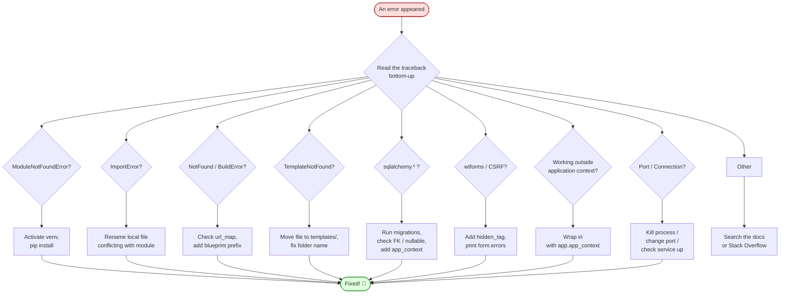

# Common Errors — Every Flask Error You'll Hit, With Fixes

> [!info] How to use this file
> Every Flask developer hits the same wall of errors in their first month. This is the wall, and these are the ladders. Each entry has four parts: **the error message** (what you'll see in the traceback), **what it means** (in plain English), **the cause** (why it happened), and **the fix** (a concrete change to your code). Use `Ctrl+F` and search for the distinctive part of your error.

#errors #debugging #troubleshooting #common-mistakes

---

## 1. Setup & Import Errors

### 1.1 `ModuleNotFoundError: No module named 'flask'`

**What it means:** Python can't find the Flask package in the current environment.

**The cause:** You installed Flask in a different virtual environment than the one your terminal is currently using. Beginners very commonly install Flask with `pip install flask` in the **system Python**, then try to run their script with the **venv Python** — or vice versa.

**The fix:** Activate your virtual environment *before* installing and *before* running:

```bash
# Linux / macOS
source venv/bin/activate
# Windows
venv\Scripts\activate

# Verify you're using the right pip:
which pip          # Linux/macOS — should point inside venv/
where pip          # Windows

# Install Flask in THIS environment:
pip install Flask

# Verify:
python -c "import flask; print(flask.__version__)"
```

If you use VS Code, check the Python interpreter in the bottom-right corner — it should say `venv`. Use `Ctrl+Shift+P` → "Python: Select Interpreter" → pick your `venv`. See [[Lesson-02-Project-Structure]].

---

### 1.2 `ImportError: cannot import name 'Flask' from 'flask'`

**What it means:** Python found *something* called `flask`, but it doesn't have a `Flask` attribute.

**The cause:** Almost always, you have a file in your project called `flask.py` (or a folder called `flask/`). Python imports **local files first**, so it's loading your `flask.py` instead of the real Flask package.

**The fix:** Rename your file. `flask.py` → `app.py` or `server.py`. Then delete any `__pycache__` folders and any `flask.pyc` files. Also check you don't have a folder named `flask` in your working directory.

```bash
# Find the culprit:
ls *.py | grep -i flask
# Rename:
mv flask.py app.py
# Clear the cache:
rm -rf __pycache__
```

---

### 1.3 `flask: command not found`

**What it means:** Your shell can't find the `flask` CLI command.

**The cause:** Either Flask isn't installed, your venv isn't activated, or you installed a Python module without its CLI entry point.

**The fix:**

```bash
# Option A: activate venv first
source venv/bin/activate
flask --version

# Option B: run flask via python -m (works without shell PATH)
python -m flask --version
python -m flask run

# Option C: install with CLI extras
pip install "Flask[async]"
```

See [[Lesson-15-Flask-Migrate]] for `FLASK_APP` setup.

---

### 1.4 `Error: Failed to find Flask application or factory 'app'`

**What it means:** Flask's CLI looked for an `app` variable (or a `create_app()` function) in your `FLASK_APP` module and couldn't find it.

**The cause:** You either forgot to set `FLASK_APP`, set it to the wrong file, or your `app/__init__.py` doesn't expose `app` or `create_app`.

**The fix:**

```bash
# Set FLASK_APP explicitly:
export FLASK_APP=run.py         # if you have a run.py
export FLASK_APP=app            # if you have a package called app/
# Or use the CLI flag:
flask --app run.py run
# Or .flaskenv (auto-loaded):
echo 'FLASK_APP=run.py' > .flaskenv
```

If using the factory pattern, make sure `create_app()` returns the app:

```python
# app/__init__.py
def create_app(config_name='default'):
    app = Flask(__name__)
    ...
    return app   # <-- must return!
```

---

### 1.5 `Port 5000 is already in use`

**What it means:** Another process is listening on port 5000 — Flask can't bind to it.

**The cause:** You already have a Flask server running in another terminal, or (on macOS Monterey and later) AirPlay Receiver uses port 5000 by default.

**The fix:**

```bash
# Option A: use a different port
flask run --port 5001

# Option B: find and kill the process using port 5000
lsof -i :5000                       # macOS / Linux
kill -9 <PID>

# Option C: on macOS Monterey+, disable AirPlay Receiver
# System Settings → General → AirDrop & Handoff → AirPlay Receiver → OFF
```

---

## 2. Routing Errors

### 2.1 `werkzeug.routing.exceptions.NotFound: 404 Not Found`

**What it means:** Flask received a request but no registered route matched the URL.

**The cause:** Three possibilities:
1. The URL you typed doesn't match any `@app.route`.
2. The route exists but the URL converter type doesn't match (e.g. `/post/abc` against `@app.route('/post/<int:id>')`).
3. You registered the blueprint but forgot to register the routes inside it.

**The fix:**

```python
# Inspect all registered routes:
print(app.url_map)
# Or in flask shell:
flask shell
>>> from flask import current_app
>>> print(current_app.url_map)
```

Output looks like:
```
Map([<Rule '/' (GET, HEAD, OPTIONS) -> index>,
    <Rule '/post/<int:id>' (GET, HEAD, OPTIONS) -> blog.view_post>])
```

Compare the endpoint names and URL patterns against what you expected. See [[Lesson-04-Routes]].

---

### 2.2 `werkzeug.routing.exceptions.BuildError: Could not build url for endpoint 'xyz'`

**What it means:** `url_for('xyz')` was called but Flask has no route with endpoint `xyz`.

**The cause:** Either the route doesn't exist, or (more commonly with blueprints) you forgot the blueprint prefix. Inside a blueprint, `@bp.route('/post/<id>')` registers endpoint `blog.view_post`, **not** `view_post`.

**The fix:**

```python
# Wrong:
url_for('view_post', id=42)        # BuildError

# Right (with blueprint named 'blog'):
url_for('blog.view_post', id=42)   # '/post/42'

# To list all endpoints:
print(app.url_map._rules_by_endpoint)
```

See [[Lesson-18-Blueprints]].

---

### 2.3 `TypeError: view function did not return a valid response`

**What it means:** Your route function returned `None`, an integer, a dict without JSON, or forgot a `return` statement.

**The cause:** A code path fell through without returning. Most often a `form.validate_on_submit():` block returns inside the `if`, but you forgot the `return render_template(...)` at the bottom.

**The fix:**

```python
# Wrong — falls through on GET:
@app.route('/login', methods=['GET', 'POST'])
def login():
    if form.validate_on_submit():
        return redirect(url_for('index'))
    # NO RETURN HERE → TypeError

# Right:
@app.route('/login', methods=['GET', 'POST'])
def login():
    if form.validate_on_submit():
        return redirect(url_for('index'))
    return render_template('login.html', form=form)
```

---

## 3. Template Errors

### 3.1 `jinja2.exceptions.TemplateNotFound: index.html`

**What it means:** Jinja couldn't find the template file you asked `render_template` for.

**The cause:** Three usual suspects:
1. The file doesn't exist (typo in name).
2. The file exists but is in the wrong folder (must be in `templates/` next to the Flask app).
3. You named the folder `template/` (singular) instead of `templates/`.

**The fix:**

```bash
# Confirm the path
ls templates/
# Should show: index.html, base.html, etc.

# Confirm Flask's search path:
flask shell
>>> from flask import current_app
>>> print(current_app.jinja_loader.searchpath)
# ['/path/to/your/project/templates']
```

If you're using a non-default structure, tell Flask where templates live:

```python
app = Flask(__name__, template_folder='views', static_folder='assets')
```

See [[Lesson-07-Jinja2-Basics]].

---

### 3.2 `jinja2.exceptions.UndefinedError: 'post' is undefined`

**What it means:** Your template referenced `{{ post.something }}` but you didn't pass `post` to `render_template`.

**The cause:** Either you forgot a context variable, or you have a typo (e.g. passed `posts=` but template uses `post=`).

**The fix:**

```python
# Wrong:
return render_template('post.html', title=post.title)
# Template: {{ post.body }}  → UndefinedError

# Right:
return render_template('post.html', post=post, title=post.title)
```

For development, you can make undefined variables raise loudly:

```python
app.jinja_env.undefined = jinja2.StrictUndefined
```

---

### 3.3 `TemplateSyntaxError: Encountered unknown tag 'endfor'`

**What it means:** Jinja hit `` without a matching ``.

**The cause:** Mismatched control structures — usually because you forgot `` or `` somewhere, or you nested them in the wrong order.

**The fix:**

```jinja2
# Wrong:

    
        {{ item }}
      {# missing endif #}


# Right:

    
        {{ item }}
    

```

The error message tells you the line number. Look there first.

---

### 3.4 `KeyError: 'csrf_token'`

**What it means:** Flask-WTF tried to validate a POST form but couldn't find a CSRF token in the submitted data.

**The cause:** You forgot `{{ form.hidden_tag() }}` in your template.

**The fix:**

```html
<form method="post">
    {{ form.hidden_tag() }}   {# MUST be inside the <form> #}
    {{ form.username.label }} {{ form.username() }}
    {{ form.submit() }}
</form>
```

See [[Lesson-11-Flask-WTF]].

---

## 4. Database Errors

### 4.1 `sqlalchemy.exc.OperationalError: (sqlite3.OperationalError) no such table: user`

**What it means:** SQLAlchemy tried to query the `user` table, but it doesn't exist in the database file.

**The cause:** Either you never ran `db.create_all()` (or `flask db upgrade`), or you're pointing at the wrong database file.

**The fix:**

```bash
# Option A: for fresh dev databases
flask shell
>>> from app import db
>>> db.create_all()

# Option B: for production / managed schemas
flask db upgrade

# Confirm tables exist:
sqlite3 app.db ".tables"
```

Remember `db.create_all()` **only creates tables that don't exist yet** — it does NOT update existing tables. For schema changes, use migrations. See [[Lesson-12-SQLAlchemy-Setup]] and [[Lesson-15-Flask-Migrate]].

---

### 4.2 `sqlalchemy.exc.OperationalError: unable to open database file`

**What it means:** SQLite couldn't create or open the `.db` file at the path you gave.

**The cause:** The directory in your `SQLALCHEMY_DATABASE_URI` doesn't exist, or you used the wrong number of slashes.

**The fix:**

```python
# WRONG (relative path, three slashes means relative):
app.config['SQLALCHEMY_DATABASE_URI'] = 'sqlite:////absolute/path/app.db'  # confusing

# RIGHT — use an absolute path:
import os
basedir = os.path.abspath(os.path.dirname(__file__))
app.config['SQLALCHEMY_DATABASE_URI'] = 'sqlite:///' + os.path.join(basedir, 'app.db')

# Three slashes for relative, four for absolute:
'sqlite:///app.db'           # relative to cwd — usually wrong
'sqlite:////tmp/app.db'      # absolute path /tmp/app.db
'sqlite://'                  # in-memory database
```

---

### 4.3 `sqlalchemy.exc.IntegrityError: UNIQUE constraint failed: user.username`

**What it means:** You tried to insert or update a row with a value that violates a `unique=True` column.

**The cause:** A user with that username (or email, or whatever the unique column is) already exists.

**The fix:** Either check before inserting, or wrap in try/except:

```python
from sqlalchemy.exc import IntegrityError

try:
    user = User(username=form.username.data, email=form.email.data)
    db.session.add(user)
    db.session.commit()
except IntegrityError:
    db.session.rollback()
    flash('That username or email is already taken.', 'danger')
    return redirect(url_for('register'))
```

Better still: do a uniqueness check in your form's `validate_username` method. See [[Lesson-16-User-Model-AndPasswords]].

---

### 4.4 `sqlalchemy.exc.IntegrityError: NOT NULL constraint failed: post.author_id`

**What it means:** You tried to insert a row without setting a column that has `nullable=False`.

**The cause:** You created a `Post` without an author, or you set `author_id` to `None`.

**The fix:**

```python
# Wrong:
post = Post(title='Hello', body='World')  # no author_id
db.session.add(post)
db.session.commit()  # IntegrityError

# Right — assign via the relationship:
post = Post(title='Hello', body='World', author=current_user)
# Or via the FK:
post = Post(title='Hello', body='World', author_id=current_user.id)
```

---

### 4.5 `sqlalchemy.orm.exc.DetachedInstanceError: Parent instance is not bound to a session`

**What it means:** You tried to access an attribute (often a relationship) on a model object after its session was closed.

**The cause:** You queried an object inside a `with app.app_context():` block, then tried to use it outside that block (or after `db.session.remove()`).

**The fix:**

```python
# Wrong:
with app.app_context():
    post = Post.query.get(42)
print(post.author)  # DetachedInstanceError

# Right — access what you need inside the context:
with app.app_context():
    post = Post.query.get(42)
    author_name = post.author.username
print(author_name)  # OK

# Or use eager loading and expunge the object:
from sqlalchemy.orm import joinedload
with app.app_context():
    post = Post.query.options(joinedload(Post.author)).get(42)
    db.session.expunge(post)
print(post.author.username)  # OK because author was already loaded
```

---

### 4.6 `RuntimeError: Working outside of application context`

**What it means:** You tried to use a Flask feature that needs the app context (like `db.session` or `current_app`) outside of a request or explicit context.

**The cause:** You're running code in a script, a Celery task, or a Python REPL that didn't push an app context.

**The fix:**

```python
# Wrong — running in a script.py:
from app import db, User
users = User.query.all()  # RuntimeError

# Right — wrap in app context:
from app import create_app, db
from app.models import User

app = create_app()
with app.app_context():
    users = User.query.all()
    for u in users:
        print(u.username)
```

Or just use `flask shell`, which pushes both app and request contexts for you. See [[Lesson-15-Flask-Migrate]].

---

### 4.7 `sqlalchemy.exc.InvalidRequestError: This session is in 'committed' state`

**What it means:** You tried to do something on a session that's already been committed and is now in a strange state.

**The cause:** Usually you called `db.session.commit()` and then tried `db.session.add()` again without realizing the session was rolled back.

**The fix:**

```python
# Pattern: commit, then add more
db.session.add(post1)
db.session.commit()        # OK
db.session.add(post2)      # usually OK — but if there was an error...

# Safer pattern: always wrap mutations in try/except
try:
    db.session.add(post2)
    db.session.commit()
except Exception:
    db.session.rollback()
    raise
```

---

### 4.8 `flask_migrate.utils.AmbiguousVersionError`

**What it means:** Alembic found two migrations in `versions/` that could be the "current" one.

**The cause:** You created two migrations from the same parent (e.g. two developers each ran `flask db migrate` at the same time).

**The fix:** Pick one as the "winner" and merge:

```bash
flask db merge -m "merge conflicting heads"
flask db upgrade
```

Or delete one of the conflicting files if it's not important. See [[Lesson-15-Flask-Migrate]].

---

## 5. Form Errors

### 5.1 `wtforms.validators.ValidationError: Field must be between 8 and 64 characters`

**What it means:** A validator failed. This isn't really an error — it's the validator doing its job.

**The cause:** User submitted a value outside the range. The error appears in `form.field.errors`.

**The fix:** Make sure your template renders errors:

```html

    <span class="error">{{ err }}</span>

```

---

### 5.2 `form.validate_on_submit()` always returns `False`

**What it means:** The form isn't validating, even when you think it should.

**The cause:** Usually one of:
1. CSRF token missing (you forgot `{{ form.hidden_tag() }}`).
2. CSRF time expired (`WTF_CSRF_TIME_LIMIT`, default 1 hour).
3. The form's `Secret_key` isn't set or differs between the form rendering and submission.
4. A validator is silently failing.

**The fix:**

```python
# Debug: print all errors
form = MyForm()
if form.validate_on_submit():
    # ...
else:
    print(form.errors)   # {'email': ['Invalid email address.']}
```

Confirm `SECRET_KEY` is set and is the same value across requests:

```python
app.config['SECRET_KEY'] = os.environ.get('SECRET_KEY') or 'dev-fallback'
```

---

### 5.3 `AttributeError: 'LoginForm' object has no attribute 'password'`

**What it means:** You're accessing a field on the form that doesn't exist.

**The cause:** Typo in the field name, or you forgot to declare it in the form class.

**The fix:**

```python
# Check your form definition:
class LoginForm(FlaskForm):
    username = StringField('Username', validators=[DataRequired()])
    password = PasswordField('Password', validators=[DataRequired()])

# In your template / route:
form.password.data    # correct
form.passwrod.data    # typo — AttributeError
```

---

## 6. File & Encoding Errors

### 6.1 `UnicodeDecodeError: 'utf-8' codec can't decode byte ...`

**What it means:** Python tried to read a file as UTF-8 text and hit a byte that isn't valid UTF-8.

**The cause:** Either you opened a binary file (an image, a .docx, a .pdf) in text mode, or you saved your Python file in a non-UTF-8 encoding (common on Windows with cp1252).

**The fix:**

```python
# Wrong — opening an image as text:
with open('photo.jpg') as f:
    data = f.read()   # UnicodeDecodeError

# Right — binary mode:
with open('photo.jpg', 'rb') as f:
    data = f.read()

# For Python source files, save as UTF-8 in your editor.
# Add this to the top of your .py file if needed:
# -*- coding: utf-8 -*-
```

---

### 6.2 `FileNotFoundError: [Errno 2] No such file or directory: 'uploads/...'`

**What it means:** Your code tried to open or save a file at a path that doesn't exist.

**The cause:** The directory doesn't exist, or you used a relative path that resolves to the wrong place.

**The fix:**

```python
import os
from flask import current_app

# Use an absolute path from config:
upload_dir = current_app.config['UPLOAD_FOLDER']

# Create the directory if it doesn't exist:
os.makedirs(upload_dir, exist_ok=True)

# Save the file:
form.image.data.save(os.path.join(upload_dir, filename))
```

See [[Lesson-21-File-Uploads]].

---

### 6.3 `werkzeug.utils.secure_filename` returns empty string

**What it means:** The uploaded file's name had no safe characters — `secure_filename` stripped everything.

**The cause:** The user uploaded a file with a name like `../../../etc/passwd` (malicious) or `中文文件名.txt` (non-ASCII), and `secure_filename` removed everything it didn't recognise.

**The fix:**

```python
from werkzeug.utils import secure_filename
import time

filename = secure_filename(form.image.data.filename)
if not filename:
    filename = f'upload_{int(time.time())}.bin'
else:
    filename = f'{int(time.time())}_{filename}'
```

---

## 7. Authentication Errors

### 7.1 `AttributeError: 'AnonymousUser' object has no attribute 'username'`

**What it means:** You accessed `current_user.username` but no one is logged in.

**The cause:** You forgot `@login_required` on the route, or `login.login_view = 'auth.login'` isn't set.

**The fix:**

```python
from flask_login import login_required, current_user

@app.route('/dashboard')
@login_required   # <-- this is the fix
def dashboard():
    return f'Hello, {current_user.username}'
```

Or check explicitly in the template:

```jinja2

    Hi, {{ current_user.username }}

    Sign in

```

See [[Lesson-17-Flask-Login]].

---

### 7.2 `flask_login.mixin.UserMixinError` / `AttributeError: 'User' has no attribute 'is_authenticated'`

**What it means:** Your User model doesn't inherit from `UserMixin`.

**The cause:** You defined `class User(db.Model):` but forgot `UserMixin`.

**The fix:**

```python
from flask_login import UserMixin

class User(UserMixin, db.Model):   # <-- UserMixin here
    id = db.Column(db.Integer, primary_key=True)
    # ...
```

---

### 7.3 `AttributeError: 'NoneType' object has no attribute 'is_active'`

**What it means:** Flask-Login's user loader returned `None` for a session it thought was logged in.

**The cause:** The user was deleted from the DB but their session cookie is still valid. The user loader returns `None` and Flask-Login tries to access `is_active` on `None`.

**The fix:** Handle missing users gracefully in the loader:

```python
@login.user_loader
def load_user(id):
    return User.query.get(int(id))  # returns None if missing
```

This is actually correct behaviour — Flask-Login handles `None` and treats the user as logged out. But if you're seeing this error, you may have an old `@login.user_loader` that does something weird. See [[Lesson-17-Flask-Login]].

---

## 8. Deployment & Production Errors

### 8.1 `ConnectionRefusedError: [Errno 111] Connection refused`

**What it means:** Your app tried to connect to a service (Postgres, Redis, SMTP) and got refused.

**The cause:** The service isn't running, or you're pointing at the wrong host/port.

**The fix:**

```bash
# Check if Postgres is running:
docker-compose ps
psql -h localhost -U bloguser -d blog

# Check your env vars:
echo $DATABASE_URL
# Should be: postgresql://bloguser:blogpass@db:5432/blog

# Inside Docker, the hostname is the service name (e.g. 'db'), not 'localhost'
```

---

### 8.2 `OperationalError: (psycopg2.OperationalError) could not connect to server: Connection refused`

**What it means:** Same root cause as above, but specifically for Postgres.

**The cause:** In docker-compose, the app starts before Postgres is ready. The `depends_on` directive only waits for the container to start, not for Postgres to be ready to accept connections.

**The fix:** Add a healthcheck:

```yaml
services:
  db:
    image: postgres:16-alpine
    healthcheck:
      test: ["CMD-SHELL", "pg_isready -U bloguser"]
      interval: 5s
      timeout: 5s
      retries: 10
  web:
    depends_on:
      db:
        condition: service_healthy
```

Or retry in your app code (less ideal):

```python
import time
from sqlalchemy.exc import OperationalError

for attempt in range(10):
    try:
        db.create_all()
        break
    except OperationalError:
        time.sleep(2)
```

See [[Lesson-23-Deployment]].

---

### 8.3 `gunicorn: command not found`

**What it means:** Gunicorn isn't installed in the current environment.

**The cause:** You forgot to add `gunicorn` to your `requirements.txt`, or you installed it in dev but not in the Docker image.

**The fix:**

```bash
pip install gunicorn
# Add to requirements.txt:
echo "gunicorn==21.2.0" >> requirements.txt
```

---

### 8.4 `404 Not Found` on production but works locally

**What it means:** Same code, different behaviour.

**The cause:** Usually one of:
1. `FLASK_APP` isn't set in production.
2. Static files aren't being served (Nginx isn't configured for `/static/`).
3. `app.run(debug=True)` was used in production — the dev server died.
4. WSGI server is pointed at the wrong module.

**The fix:** Check each one:

```bash
# What's running?
ps aux | grep gunicorn

# Check environment:
env | grep FLASK

# Check the WSGI entry point — does this work?
python -c "from run import app; print(app)"
```

---

### 8.5 `ValueError: OpenSSL is required for HTTPS support`

**What it means:** Flask tried to serve HTTPS but pyOpenSSL isn't installed.

**The cause:** You ran `app.run(ssl_context='adhoc')` without installing pyOpenSSL.

**The fix:**

```bash
pip install pyopenssl
# Then:
app.run(ssl_context='adhoc')
# Or use real certs:
app.run(ssl_context=('/path/cert.pem', '/path/key.pem'))
```

In production, terminate TLS at Nginx — never at Flask. See [[Lesson-23-Deployment]].

---

## 9. Error Diagnosis Flowchart

When something breaks, follow this decision tree to find the fix fast.



---

## 10. Debugging Toolkit — What to Reach For

### 10.1 The Werkzeug debugger

Run with `debug=True`:

```bash
flask run --debug
# or
app.run(debug=True)
```

When an exception fires, the browser shows an interactive traceback. Click any line to drop into a Python shell at that frame. **Protected by a PIN printed in the terminal — never enable in production.** See [[Lesson-03-Debug-Mode]].

### 10.2 The Flask shell

```bash
flask shell
```

Drops you into a Python REPL with the app and request contexts pushed. Useful for poking at the DB:

```python
>>> from app import db
>>> from app.models import User
>>> User.query.all()
[<User alice>, <User bob>]
```

### 10.3 `app.logger`

```python
app.logger.debug('This is a debug message')
app.logger.info('User %s logged in', user.username)
app.logger.warning('Suspicious activity from %s', request.remote_addr)
app.logger.error('Database error', exc_info=True)
```

Logs go to stderr by default. In production, route them to a file or service.

### 10.4 `print()` and `pprint`

When in doubt, sprinkle `print()` statements. They show in the terminal where `flask run` is running. For pretty output of dicts/lists:

```python
from pprint import pprint
pprint(request.form.to_dict())
```

### 10.5 SQL echo

```python
app.config['SQLALCHEMY_ECHO'] = True
```

Prints every SQL query Flask-SQLAlchemy runs, with parameters. Invaluable for debugging N+1 problems. See [[Lesson-12-SQLAlchemy-Setup]].

### 10.6 `pdb` / `breakpoint()`

```python
@app.route('/post/<int:id>')
def view_post(id):
    breakpoint()           # drops into pdb at this line
    post = Post.query.get_or_404(id)
    return render_template('post.html', post=post)
```

Commands: `n` (next line), `s` (step into), `c` (continue), `p var` (print var), `l` (list code), `q` (quit).

### 10.7 `flask routes`

```bash
flask routes
# Endpoint      Methods  Rule
# ------------- -------- ----------------
# static        GET      /static/<path:filename>
# index         GET      /
# blog.view_post GET     /post/<int:id>
```

Lists every registered route, its endpoint name, and allowed methods.

---

## 11. The Mental Model — Read Tracebacks Bottom-Up

When an error appears, Python prints a traceback that looks like 30 lines of noise. **Read it bottom-up**:

```
  File "/app/auth/routes.py", line 25, in login            ← your code
    user = User.query.filter_by(username=form.username.data).first()
  File "/app/models.py", line 18, in check_password         ← your code
    return check_password_hash(self.password_hash, password)
  File "/usr/lib/python3.11/site-packages/werkzeug/security.py", line 99, in check_password_hash
    raise ValueError("Invalid hash method")                 ← the actual error
ValueError: Invalid hash method
```

The **last line** is the error type and message. The **last frame that's YOUR code** is where the bug actually is. Everything in between is framework code you don't need to read.

Train yourself to:

1. Read the last line — what kind of error?
2. Read the bottommost frame that's in YOUR file — what line?
3. Open that line and look at it. The bug is there 80% of the time.
4. Only if the line looks fine, work upward through the stack.

See [[Lesson-03-Debug-Mode]] for the full debugging workflow.

---

## 12. When You're Still Stuck

1. **Read the error message.** Not just skim — actually read every word. Most error messages tell you exactly what's wrong.
2. **Search the exact error string.** Copy the last line of the traceback, paste into Google or your search engine of choice. Someone has hit it before.
3. **Read the docs for the function that errored.** The Flask and Werkzeug docs are short and direct.
4. **Write a minimal repro.** Copy your code into a new file, delete everything unrelated, until the error reproduces in 10 lines. 80% of the time you find the bug while doing this.
5. **Ask.** Post your minimal repro on Stack Overflow, Discord, or a forum. Include the full traceback, your Python version, your Flask version, and what you expected vs. what happened.

> [!tip] The error you're hitting right now is not unique.
> Every Flask developer hits these. Every one of them was once where you are. The difference between a beginner and an expert is not *whether* they hit errors — it's how fast they recover. This file is your recovery manual.

---

## 13. Where to Go Next

- **[[Flask-Cheat-Sheet]]** — patterns to write so you hit fewer errors.
- **[[Quick-Reference]]** — quick lookup of imports and CLI commands.
- **[[Lesson-03-Debug-Mode]]** — the deep dive on reading tracebacks and using the Werkzeug debugger.
- **[[Map-of-Content]]** — the master index of every lesson.
- **Flask docs on debugging** — <https://flask.palletsprojects.com/en/latest/debugging/>
- **Werkzeug docs** — <https://werkzeug.palletsprojects.com/>

> [!success] You're going to be fine.
> Errors feel personal when you're learning — like the language is fighting you. It isn't. Every traceback is a teacher trying to tell you exactly what's wrong. Listen to it. Read it slowly. Apply the fix. Move on. You've got this.
