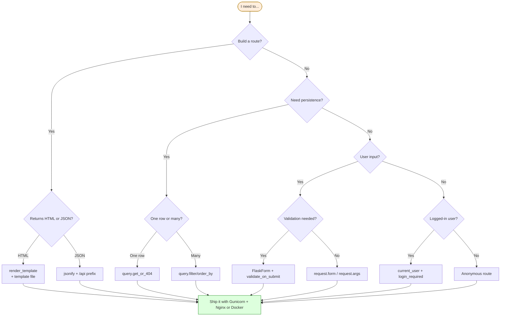

# Flask Cheat Sheet — Copy-Paste Patterns for Everyday Code

> [!info] How to use this sheet
> Each pattern is a self-contained snippet with a one-line comment explaining when to reach for it. **Copy it, paste it, adapt it.** Click the lesson link below each section for the full explanation. When in doubt, see [[Common-Errors]] for what to do when a pattern breaks.

#cheat-sheet #reference #patterns #snippets

---

## 1. App Setup Patterns

### 1.1 Minimal app — `app.py`

```python
# A single-file Flask app — good for tutorials and tiny scripts.
from flask import Flask

app = Flask(__name__)

@app.route('/')
def hello():
    return 'Hello, World!'

if __name__ == '__main__':
    app.run(debug=True)
```
→ Lesson: [[Lesson-01-Hello-World]]

### 1.2 Application Factory — `app/__init__.py`

```python
# Production-grade pattern. Supports multiple configs, blueprints, extensions.
from flask import Flask

def create_app(config_name='default'):
    app = Flask(__name__)
    app.config.from_object(f'config.{config_name.title()}Config')

    # Register extensions and blueprints here, not at module level.
    from app.extensions import db, migrate, login, csrf
    db.init_app(app)
    migrate.init_app(app, db)
    login.init_app(app)
    csrf.init_app(app)

    from app.main import bp as main_bp
    app.register_blueprint(main_bp)
    return app
```
→ Lesson: [[Lesson-18-Blueprints]]

### 1.3 Configuration classes — `config.py`

```python
import os
from dotenv import load_dotenv
basedir = os.path.abspath(os.path.dirname(__file__))
load_dotenv(os.path.join(basedir, '.env'))

class Config:
    SECRET_KEY = os.environ.get('SECRET_KEY') or 'dev-secret'
    SQLALCHEMY_DATABASE_URI = os.environ.get('DATABASE_URL') or \
        'sqlite:///' + os.path.join(basedir, 'app.db')
    SQLALCHEMY_TRACK_MODIFICATIONS = False

class DevelopmentConfig(Config):
    DEBUG = True
    SQLALCHEMY_ECHO = True

class ProductionConfig(Config):
    DEBUG = False

class TestingConfig(Config):
    TESTING = True
    SQLALCHEMY_DATABASE_URI = 'sqlite:///:memory:'
    WTF_CSRF_ENABLED = False
```
→ Lesson: [[Lesson-23-Deployment]]

### 1.4 `.env` file

```bash
FLASK_APP=run.py
FLASK_ENV=development
SECRET_KEY=replace-with-secrets-token-hex-32
DATABASE_URL=sqlite:///app.db
MAIL_USERNAME=you@example.com
MAIL_PASSWORD=your-app-password
```

Load with `python-dotenv`. See [[Lesson-22-Email-And-Tasks]].

### 1.5 `run.py` entry point

```python
# WSGI entry point. Gunicorn / Dockerfile call `gunicorn run:app`.
import os
from app import create_app
app = create_app(os.getenv('FLASK_CONFIG') or 'default')

if __name__ == '__main__':
    app.run()
```

### 1.6 `requirements.txt`

```text
Flask==3.0.0
Flask-SQLAlchemy==3.1.1
Flask-Migrate==4.0.5
Flask-WTF==1.2.1
Flask-Login==0.6.3
Flask-Mail==0.9.1
python-dotenv==1.0.0
email-validator==2.1.0
Pillow==10.2.0
gunicorn==21.2.0
psycopg2-binary==2.9.9
```
→ Lesson: [[Lesson-02-Project-Structure]]

---

## 2. Route Patterns

### 2.1 Basic route

```python
@app.route('/')
def index():
    return 'Hello'
```

### 2.2 Dynamic URL — string (default)

```python
@app.route('/user/<username>')
def show_user(username):
    return f'User: {username}'
```

### 2.3 Dynamic URL — int, float, path, uuid

```python
@app.route('/post/<int:post_id>')           # only integers
@app.route('/price/<float:amount>')         # only floats
@app.route('/files/<path:subpath>')         # includes slashes
@app.route('/item/<uuid:item_id>')          # UUID strings
```
→ Lesson: [[Lesson-05-URL-Converters]]

### 2.4 Multiple converters

```python
@app.route('/user/<username>/post/<int:post_id>')
def show_post(username, post_id):
    return f'{username} / post {post_id}'
```

### 2.5 HTTP methods

```python
@app.route('/login', methods=['GET', 'POST'])
def login():
    if request.method == 'POST':
        return 'Processing login'
    return 'Show login form'
```
→ Lesson: [[Lesson-06-HTTP-Methods]]

### 2.6 Trailing slash — Flask redirects

```python
@app.route('/about')        # GET /about/ → 308 redirect to /about
@app.route('/projects/')    # GET /projects → 308 redirect to /projects/
```

### 2.7 Multiple routes on one function

```python
@app.route('/')
@app.route('/home')
@app.route('/index')
def index():
    return 'Home page'
```
→ Lesson: [[Lesson-04-Routes]]

### 2.8 `url_for` — reverse routing

```python
from flask import url_for
url_for('show_post', post_id=42)             # → '/post/42'
url_for('static', filename='css/style.css')  # → '/static/css/style.css'
url_for('show_post', post_id=42, _external=True)  # absolute URL
```

### 2.9 Blueprint route

```python
# In a blueprint file:
from flask import Blueprint
bp = Blueprint('blog', __name__, url_prefix='/blog')

@bp.route('/post/<int:id>')
def view_post(id):
    return f'Post {id}'

# In create_app():
from app.blog import bp as blog_bp
app.register_blueprint(blog_bp)
```
→ Lesson: [[Lesson-18-Blueprints]]

### 2.10 Query parameters

```python
from flask import request
page = request.args.get('page', 1, type=int)
tags = request.args.getlist('tag')  # ?tag=a&tag=b → ['a', 'b']
```
→ Lesson: [[Lesson-05-URL-Converters]]

### 2.11 Custom converter

```python
from werkzeug.routing import BaseConverter

class HexColorConverter(BaseConverter):
    regex = r'[0-9a-fA-F]{6}'
    def to_python(self, value):
        return f'#{value}'
    def to_url(self, value):
        return value.lstrip('#')

app.url_map.converters['hex'] = HexColorConverter

@app.route('/color/<hex:color>')
def show_color(color):
    return color  # → '#ff0000'
```

---

## 3. Template Patterns

### 3.1 Render a template

```python
from flask import render_template
@app.route('/')
def index():
    return render_template('index.html', name='Alice', items=[1, 2, 3])
```
→ Lesson: [[Lesson-07-Jinja2-Basics]]

### 3.2 Base template — `base.html`

```html
<!DOCTYPE html>
<html>
<head>
    <title></title>
    <link rel="stylesheet" href="{{ url_for('static', filename='css/style.css') }}">
</head>
<body>
    <nav>...</nav>
    
</body>
</html>
```

### 3.3 Child template

```html

Home

    <h1>Hello, {{ name }}!</h1>
    <ul>
    
        <li>{{ item }}</li>
    
    </ul>

```
→ Lesson: [[Lesson-08-Template-Logic]]

### 3.4 Common Jinja filters

```jinja2
{{ name|default('Anonymous') }}      {# fallback if undefined #}
{{ name|upper }}                     {# ALICE #}
{{ name|lower }}                     {# alice #}
{{ name|capitalize }}                {# Alice #}
{{ body|truncate(100) }}             {# first 100 chars + … #}
{{ price|round(2) }}                 {# 3.14 #}
{{ tags|join(', ') }}                {# a, b, c #}
{{ user_input|escape }}              {# auto-escaped, but explicit #}
{{ html_blob|safe }}                 {# DANGEROUS: outputs raw HTML #}
{{ body|striptags }}                 {# strip HTML tags #}
{{ items|length }}                   {# 3 #}
{{ items|sort }}                     {# sorted list #}
{{ items|reverse|list }}             {# reversed list #}
{{ now|tojson }}                     {# JSON-encode for JS #}
```

### 3.5 Conditionals

```jinja2

    Hi, {{ user.username }}

    Sign in

    Unknown state

```

### 3.6 Loops with `loop` variable

```jinja2

    <li class="{{ loop.cycle('odd', 'even') }}">
        {{ loop.index }}. {{ item }}
        (first)
        (last)
    </li>

    <li>No items</li>

```
→ Lesson: [[Lesson-08-Template-Logic]]

### 3.7 Include a partial

```jinja2

```

### 3.8 Set a variable inside a template

```jinja2

{{ greeting }}
```

### 3.9 Comments (stripped from output)

```jinja2
{# This will not appear in the rendered HTML #}
```

### 3.10 Static files — CSS, JS, images

```html
<link rel="stylesheet" href="{{ url_for('static', filename='css/style.css') }}">
<script src="{{ url_for('static', filename='js/app.js') }}"></script>

```
→ Lesson: [[Lesson-09-Static-Files]]

### 3.11 Flash messages

```python
# In route:
from flask import flash
flash('Saved!', 'success')
flash('Something went wrong.', 'danger')

# In base.html:

    
        
            <div class="alert alert-{{ category }}">{{ message }}</div>
        
    

```
→ Lesson: [[Lesson-10-HTML-Forms]]

---

## 4. Database Patterns

### 4.1 Setup — `app/extensions.py`

```python
from flask_sqlalchemy import SQLAlchemy
from flask_migrate import Migrate
db = SQLAlchemy()
migrate = Migrate()
```

```python
# In create_app:
app.config['SQLALCHEMY_DATABASE_URI'] = 'sqlite:///app.db'
app.config['SQLALCHEMY_TRACK_MODIFICATIONS'] = False
db.init_app(app)
migrate.init_app(app, db)
```
→ Lesson: [[Lesson-12-SQLAlchemy-Setup]]

### 4.2 Model definition

```python
from datetime import datetime
from app.extensions import db

class Post(db.Model):
    __tablename__ = 'post'  # optional, but explicit is better
    id = db.Column(db.Integer, primary_key=True)
    title = db.Column(db.String(140), nullable=False)
    body = db.Column(db.Text)
    created_at = db.Column(db.DateTime, default=datetime.utcnow)
    published = db.Column(db.Boolean, default=False)

    def __repr__(self):
        return f'<Post {self.title}>'
```

### 4.3 Column types cheat sheet

```python
db.Column(db.Integer)            # int
db.Column(db.String(50))         # VARCHAR(50)
db.Column(db.Text)               # long text
db.Column(db.Boolean)            # bool
db.Column(db.DateTime)           # datetime
db.Column(db.Date)               # date
db.Column(db.Float)              # float
db.Column(db.Numeric(10, 2))     # decimal
db.Column(db.LargeBinary)        # BLOB
db.Column(db.JSON)               # JSON column
db.Column(db.Enum('draft', 'published'))  # enum
```

### 4.4 Common column options

```python
db.Column(..., primary_key=True)        # PK
db.Column(..., unique=True)             # unique constraint
db.Column(..., nullable=False)          # NOT NULL
db.Column(..., default=10)              # default value
db.Column(..., default=datetime.utcnow) # default callable
db.Column(..., index=True)              # add an index
db.Column(..., ondelete='CASCADE')      # FK behaviour
```

### 4.5 Create (INSERT)

```python
post = Post(title='Hello', body='World')
db.session.add(post)
db.session.commit()
```
→ Lesson: [[Lesson-13-CRUD-Operations]]

### 4.6 Read (SELECT)

```python
# Get by PK
post = Post.query.get(42)                    # None if missing
post = Post.query.get_or_404(42)             # 404 if missing

# All
posts = Post.query.all()

# Filter (kwargs)
alice = User.query.filter_by(username='alice').first()

# Filter (expressions)
recent = Post.query.filter(Post.created_at >= '2024-01-01').all()
popular = Post.query.filter(Post.views > 1000).order_by(Post.views.desc()).limit(10).all()

# Count
total = Post.query.count()
published = Post.query.filter_by(published=True).count()

# One or None — raises if multiple
user = User.query.filter_by(email='a@b.com').one_or_none()

# Pagination
page = Post.query.order_by(Post.created_at.desc()).paginate(
    page=1, per_page=10, error_out=False
)
posts = page.items        # list
page.total                # int
page.pages                # int
page.has_next             # bool
page.has_prev             # bool
```

### 4.7 Update (UPDATE)

```python
post = Post.query.get(42)
post.title = 'New title'
db.session.commit()
```

### 4.8 Delete (DELETE)

```python
post = Post.query.get(42)
db.session.delete(post)
db.session.commit()
```

### 4.9 Relationships

```python
# One-to-many: User → Posts
class User(db.Model):
    posts = db.relationship('Post', backref='author', lazy='dynamic',
                            cascade='all, delete-orphan')

class Post(db.Model):
    author_id = db.Column(db.Integer, db.ForeignKey('user.id'))

# Many-to-many: Post ↔ Tag
post_tags = db.Table('post_tags',
    db.Column('post_id', db.Integer, db.ForeignKey('post.id'), primary_key=True),
    db.Column('tag_id', db.Integer, db.ForeignKey('tag.id'), primary_key=True),
)

class Post(db.Model):
    tags = db.relationship('Tag', secondary=post_tags,
                           backref=db.backref('posts', lazy='dynamic'))

class Tag(db.Model):
    name = db.Column(db.String(32), unique=True)

# Querying relationships
user.posts.all()                       # all posts by user
user.posts.filter(Post.published==True).all()
post.tags.all()
tag.posts.count()
```
→ Lesson: [[Lesson-14-Relationships]]

### 4.10 Avoid N+1 — eager load

```python
from sqlalchemy.orm import joinedload, selectinload

posts = Post.query.options(
    joinedload(Post.author),       # one JOIN instead of N+1
    selectinload(Post.tags),       # one IN query for all tags
).all()
```

### 4.11 Migrations workflow

```bash
flask db init          # one-time, creates migrations/
flask db migrate -m "add users table"
# review migrations/versions/<hash>_add_users_table.py
flask db upgrade       # apply
flask db downgrade     # undo last
flask db current       # show current revision
flask db history       # show all revisions
```
→ Lesson: [[Lesson-15-Flask-Migrate]]

### 4.12 App context for scripts

```python
# Outside a request, you need an app context to query
with app.app_context():
    posts = Post.query.all()
```
→ Lesson: [[Lesson-15-Flask-Migrate]]

---

## 5. Form Patterns

### 5.1 Flask-WTF form class

```python
from flask_wtf import FlaskForm
from wtforms import StringField, PasswordField, SubmitField, TextAreaField
from wtforms.validators import DataRequired, Email, Length, EqualTo

class RegistrationForm(FlaskForm):
    username = StringField('Username', validators=[DataRequired(), Length(min=3, max=64)])
    email = StringField('Email', validators=[DataRequired(), Email()])
    password = PasswordField('Password', validators=[DataRequired(), Length(min=8)])
    password2 = PasswordField('Confirm', validators=[DataRequired(), EqualTo('password')])
    submit = SubmitField('Register')
```
→ Lesson: [[Lesson-11-Flask-WTF]]

### 5.2 Validate on submit

```python
@app.route('/register', methods=['GET', 'POST'])
def register():
    form = RegistrationForm()
    if form.validate_on_submit():
        # POST + CSRF valid + all validators passed
        user = User(username=form.username.data, email=form.email.data)
        user.set_password(form.password.data)
        db.session.add(user)
        db.session.commit()
        flash('Registered!')
        return redirect(url_for('login'))
    return render_template('register.html', form=form)
```

### 5.3 Render form in template

```html
<form method="post">
    {{ form.hidden_tag() }}  {# CSRF token — required! #}

    <div class="form-group">
        {{ form.username.label }}
        {{ form.username(size=32) }}
        
            <span class="error">{{ err }}</span>
        
    </div>

    {{ form.submit(class='btn') }}
</form>
```

### 5.4 Common validators

```python
DataRequired()              # not empty
Email()                     # valid email
Length(min=8, max=64)       # length range
NumberRange(min=1, max=100) # numeric range
URL()                       # valid URL
EqualTo('other_field')      # must match another field
Optional()                  # skip if empty
Regexp(r'^[a-z]+$')         # custom regex
AnyOf(['a', 'b', 'c'])      # must be in list
```

### 5.5 Custom inline validator

```python
def validate_username(self, username):
    user = User.query.filter_by(username=username.data).first()
    if user:
        raise ValidationError('Username already taken.')
```

### 5.6 File upload form

```python
from flask_wtf.file import FileField, FileAllowed, FileRequired

class UploadForm(FlaskForm):
    image = FileField('Image', validators=[
        FileRequired(),
        FileAllowed(['jpg', 'png', 'webp'], 'Images only!')
    ])
    submit = SubmitField('Upload')
```

In the route:

```python
form = UploadForm()
if form.validate_on_submit():
    from werkzeug.utils import secure_filename
    filename = secure_filename(form.image.data.filename)
    form.image.data.save(os.path.join(app.config['UPLOAD_FOLDER'], filename))
```

In the template (must have `enctype`):

```html
<form method="post" enctype="multipart/form-data">
    {{ form.hidden_tag() }}
    {{ form.image() }}
    {{ form.submit() }}
</form>
```
→ Lesson: [[Lesson-21-File-Uploads]]

### 5.7 Populate form from model (edit screen)

```python
# GET: pre-fill the form
form = PostForm(obj=post)   # equivalent to setting each field manually
# or:
form.title.data = post.title
form.body.data = post.body
```

---

## 6. Authentication Patterns

### 6.1 User model

```python
from flask_login import UserMixin
from werkzeug.security import generate_password_hash, check_password_hash

class User(UserMixin, db.Model):
    id = db.Column(db.Integer, primary_key=True)
    username = db.Column(db.String(64), unique=True, nullable=False)
    email = db.Column(db.String(120), unique=True, nullable=False)
    password_hash = db.Column(db.String(256))

    def set_password(self, password):
        self.password_hash = generate_password_hash(password)

    def check_password(self, password):
        return check_password_hash(self.password_hash, password)
```
→ Lesson: [[Lesson-16-User-Model-AndPasswords]]

### 6.2 Flask-Login setup

```python
from flask_login import LoginManager
login = LoginManager()
login.login_view = 'auth.login'   # blueprint endpoint for login page

@login.user_loader
def load_user(id):
    return User.query.get(int(id))
```
→ Lesson: [[Lesson-17-Flask-Login]]

### 6.3 Login route

```python
from flask_login import login_user, logout_user, current_user, login_required
from werkzeug.urls import url_parse

@app.route('/login', methods=['GET', 'POST'])
def login():
    if current_user.is_authenticated:
        return redirect(url_for('index'))
    form = LoginForm()
    if form.validate_on_submit():
        user = User.query.filter_by(username=form.username.data).first()
        if user is None or not user.check_password(form.password.data):
            flash('Invalid credentials', 'danger')
            return redirect(url_for('login'))
        login_user(user, remember=form.remember_me.data)
        next_page = request.args.get('next')
        if not next_page or url_parse(next_page).netloc != '':
            next_page = url_for('index')
        return redirect(next_page)
    return render_template('login.html', form=form)
```

### 6.4 Logout route

```python
@app.route('/logout')
@login_required
def logout():
    logout_user()
    return redirect(url_for('index'))
```

### 6.5 Protect a route

```python
@app.route('/dashboard')
@login_required
def dashboard():
    return f'Hello, {current_user.username}'
```

### 6.6 Template: show login state

```html

    <a href="{{ url_for('logout') }}">Logout ({{ current_user.username }})</a>

    <a href="{{ url_for('login') }}">Sign in</a>

```

### 6.7 Ownership check

```python
@bp.route('/post/<int:id>/edit', methods=['GET', 'POST'])
@login_required
def edit_post(id):
    post = Post.query.get_or_404(id)
    if post.author != current_user:
        abort(403)
    # ... rest of edit logic
```

---

## 7. API Patterns

### 7.1 JSON response

```python
from flask import jsonify

@app.route('/api/posts/<int:id>')
def get_post(id):
    post = Post.query.get_or_404(id)
    return jsonify({
        'id': post.id,
        'title': post.title,
        'body': post.body,
    })
```
→ Lesson: [[Lesson-19-Building-JSON-API]]

### 7.2 RESTful resource

```python
@app.route('/api/posts', methods=['GET'])
def list_posts():
    posts = Post.query.all()
    return jsonify([{'id': p.id, 'title': p.title} for p in posts])

@app.route('/api/posts', methods=['POST'])
def create_post():
    data = request.get_json() or {}
    post = Post(title=data['title'], body=data['body'])
    db.session.add(post)
    db.session.commit()
    return jsonify({'id': post.id}), 201, \
        {'Location': url_for('get_post', id=post.id, _external=True)}

@app.route('/api/posts/<int:id>', methods=['PUT'])
def update_post(id):
    post = Post.query.get_or_404(id)
    data = request.get_json() or {}
    post.title = data.get('title', post.title)
    db.session.commit()
    return jsonify({'id': post.id})

@app.route('/api/posts/<int:id>', methods=['DELETE'])
def delete_post(id):
    post = Post.query.get_or_404(id)
    db.session.delete(post)
    db.session.commit()
    return '', 204
```
→ Lesson: [[Lesson-20-RESTful-Resources]]

### 7.3 Paginated API

```python
@app.route('/api/posts')
def list_posts():
    page = request.args.get('page', 1, type=int)
    per_page = min(request.args.get('per_page', 10, type=int), 50)
    pagination = Post.query.paginate(page=page, per_page=per_page, error_out=False)
    return jsonify({
        'posts': [post_to_dict(p) for p in pagination.items],
        'total': pagination.total,
        'pages': pagination.pages,
        'page': page,
    })
```

### 7.4 Disable CSRF for JSON endpoints

```python
# In create_app, after csrf.init_app(app):
@csrf.exempt
def api_bp_exempt():
    pass
# Or per-blueprint:
csrf.exempt(api_bp)  # APIs usually use tokens, not CSRF cookies
```

### 7.5 API error responses

```python
@app.errorhandler(400)
def bad_request(error):
    return jsonify({'error': 'bad request', 'message': str(error)}), 400

@app.errorhandler(404)
def not_found(error):
    return jsonify({'error': 'not found'}), 404
```

### 7.6 Accept JSON or HTML based on `Accept` header

```python
@app.route('/post/<int:id>')
def view_post(id):
    post = Post.query.get_or_404(id)
    if request.accept_mimetypes.accept_json and not request.accept_mimetypes.accept_html:
        return jsonify(post_to_dict(post))
    return render_template('post.html', post=post)
```

---

## 8. Email Patterns

### 8.1 Flask-Mail setup

```python
from flask_mail import Mail, Message
mail = Mail()

# config.py:
app.config['MAIL_SERVER'] = 'smtp.googlemail.com'
app.config['MAIL_PORT'] = 587
app.config['MAIL_USE_TLS'] = True
app.config['MAIL_USERNAME'] = os.environ.get('MAIL_USERNAME')
app.config['MAIL_PASSWORD'] = os.environ.get('MAIL_PASSWORD')

# In create_app:
mail.init_app(app)
```
→ Lesson: [[Lesson-22-Email-And-Tasks]]

### 8.2 Send synchronously (don't do this in a request handler!)

```python
msg = Message('Subject', recipients=['user@example.com'])
msg.body = 'Plain text body'
msg.html = '<p>HTML body</p>'
mail.send(msg)
```

### 8.3 Send asynchronously (the right way)

```python
from threading import Thread

def send_async_email(app, msg):
    with app.app_context():
        mail.send(msg)

def send_email(subject, recipients, body):
    msg = Message(subject, recipients=recipients)
    msg.body = body
    Thread(target=send_async_email, args=(current_app._get_current_object(), msg)).start()
```

---

## 9. Deployment Commands

### 9.1 Run the dev server

```bash
flask run
# or:
python run.py
# On a different port:
flask run --port 5001
# Visible on the network:
flask run --host=0.0.0.0
```

### 9.2 Set FLASK_APP

```bash
export FLASK_APP=run.py
# or .flaskenv:
echo 'FLASK_APP=run.py' > .flaskenv
# or command-line:
flask --app run.py run
```
→ Lesson: [[Lesson-15-Flask-Migrate]]

### 9.3 Production with Gunicorn

```bash
pip install gunicorn
# 4 workers, bind to port 8000, log to stdout
gunicorn -w 4 -b 0.0.0.0:8000 'run:app'
# With timeout for slow endpoints
gunicorn -w 4 -b 0.0.0.0:8000 --timeout 120 'run:app'
# Worker count rule of thumb: 2 * CPU + 1
gunicorn -w $(($(nproc) * 2 + 1)) -b 0.0.0.0:8000 'run:app'
```
→ Lesson: [[Lesson-23-Deployment]]

### 9.4 Dockerfile

```dockerfile
FROM python:3.11-slim
ENV PYTHONDONTWRITEBYTECODE=1 PYTHONUNBUFFERED=1
WORKDIR /app
COPY requirements.txt .
RUN pip install --no-cache-dir -r requirements.txt gunicorn
COPY . .
EXPOSE 5000
CMD ["gunicorn", "-b", "0.0.0.0:5000", "-w", "4", "run:app"]
```

### 9.5 docker-compose.yml

```yaml
version: '3.9'
services:
  web:
    build: .
    env_file: .env
    ports: ["5000:5000"]
    depends_on: [db]
  db:
    image: postgres:16-alpine
    environment:
      POSTGRES_USER: bloguser
      POSTGRES_PASSWORD: blogpass
      POSTGRES_DB: blog
    volumes: ["pgdata:/var/lib/postgresql/data"]
volumes:
  pgdata:
```

### 9.6 Run migrations in production

```bash
# Before each deploy:
flask db upgrade
```

In Docker:

```dockerfile
CMD ["sh", "-c", "flask db upgrade && gunicorn -b 0.0.0.0:5000 -w 4 run:app"]
```

### 9.7 Nginx reverse proxy (snippet)

```nginx
server {
    listen 80;
    server_name example.com;

    location /static/ {
        alias /app/app/static/;
        expires 30d;
    }

    location / {
        proxy_pass http://127.0.0.1:8000;
        proxy_set_header Host $host;
        proxy_set_header X-Real-IP $remote_addr;
        proxy_set_header X-Forwarded-For $proxy_add_x_forwarded_for;
        proxy_set_header X-Forwarded-Proto $scheme;
    }
}
```
→ Lesson: [[Lesson-23-Deployment]]

### 9.8 Production checklist

- [ ] `DEBUG=False`
- [ ] Strong `SECRET_KEY` from `secrets.token_hex(32)`
- [ ] Postgres (not SQLite) for real traffic
- [ ] HTTPS via Nginx + Let's Encrypt
- [ ] `flask db upgrade` runs on every deploy
- [ ] Static files served by Nginx, not Flask
- [ ] Sentry / error logging configured
- [ ] Daily database backups
- [ ] `.env` is in `.gitignore` and not in the image
- [ ] `requirements.txt` pinned

---

## 10. Request and Response Patterns

### 10.1 The `request` object

```python
from flask import request

request.method               # 'GET', 'POST', etc.
request.args                 # GET params (ImmutableMultiDict)
request.form                 # POST body (form-encoded)
request.files                # uploaded files
request.json                 # parsed JSON body (None if not JSON)
request.get_json(force=True) # parse JSON even if Content-Type missing
request.values               # args + form combined
request.headers              # request headers (dict-like)
request.cookies              # cookies
request.path                 # '/post/42'
request.url                  # full URL
request.base_url             # URL without query string
request.remote_addr          # client IP
request.user_agent           # User-Agent string
request.content_length       # body size in bytes
```
→ Lesson: [[Lesson-06-HTTP-Methods]]

### 10.2 Custom response

```python
from flask import make_response, Response

# Set custom headers / status
resp = make_response(render_template('index.html'), 201)
resp.headers['X-Custom'] = 'hello'
resp.set_cookie('visited', 'yes', max_age=86400)
return resp

# Streaming response
def generate():
    yield 'data: 1\n\n'
    yield 'data: 2\n\n'
return Response(generate(), mimetype='text/event-stream')

# File download
from flask import send_file
return send_file('/path/to/file.pdf', as_attachment=True, download_name='report.pdf')

# CSV download
import csv, io
buf = io.StringIO()
writer = csv.writer(buf)
writer.writerow(['name', 'email'])
buf.seek(0)
return Response(buf.getvalue(), mimetype='text/csv',
                headers={'Content-Disposition': 'attachment; filename=users.csv'})
```

### 10.3 Redirects

```python
from flask import redirect, url_for
return redirect(url_for('login'))           # 302
return redirect(url_for('login'), code=301) # permanent
return redirect('https://example.com')      # external
```

### 10.4 Abort

```python
from flask import abort
abort(404)                          # not found
abort(403)                          # forbidden
abort(400, 'Invalid input')         # custom message
```

### 10.5 Before / after / teardown hooks

```python
@app.before_request
def check_maintenance():
    if app.config.get('MAINTENANCE_MODE') and request.endpoint != 'static':
        return 'Site under maintenance', 503

@app.after_request
def add_security_headers(response):
    response.headers['X-Content-Type-Options'] = 'nosniff'
    response.headers['X-Frame-Options'] = 'DENY'
    return response

@app.teardown_request
def cleanup(exception=None):
    # Always runs after a request, even on error
    db.session.remove()
```

### 10.6 Context globals

```python
from flask import current_app, g, session

# current_app — the active Flask app
current_app.config['SOME_KEY']

# g — per-request scratch space
@app.before_request
def load_user():
    if 'user_id' in session:
        g.user = User.query.get(session['user_id'])

# session — signed cookie storage
session['user_id'] = user.id       # set
session.pop('user_id', None)       # clear
session.permanent = True           # use PERMANENT_SESSION_LIFETIME
```

---

## 11. Error Handling Patterns

### 11.1 Custom 404 and 500 pages

```python
@app.errorhandler(404)
def not_found(error):
    return render_template('errors/404.html'), 404

@app.errorhandler(500)
def server_error(error):
    db.session.rollback()   # always rollback on 500!
    return render_template('errors/500.html'), 500

@app.errorhandler(403)
def forbidden(error):
    return render_template('errors/403.html'), 403
```

### 11.2 Blueprint-level vs app-level error handlers

```python
# In a blueprint — only catches errors FROM THIS BLUEPRINT
@bp.errorhandler(404)
def bp_not_found(error):
    return render_template('blog/404.html'), 404

# App-level — catches errors anywhere
@bp.app_errorhandler(500)
def app_server_error(error):
    return render_template('errors/500.html'), 500
```

### 11.3 Catch-all for unhandled exceptions

```python
@app.errorhandler(Exception)
def handle_all(error):
    app.logger.exception('Unhandled exception')
    return render_template('errors/500.html'), 500
```

### 11.4 Logging

```python
app.logger.info('User %s logged in', user.username)
app.logger.warning('Failed login for %s', username)
app.logger.error('Database error', exc_info=True)
app.logger.debug('Request headers: %s', dict(request.headers))
```
→ Lesson: [[Lesson-22-Email-And-Tasks]]

---

## 12. Testing Patterns

### 12.1 Test client fixture

```python
import pytest
from app import create_app, db

@pytest.fixture
def app():
    app = create_app('testing')
    with app.app_context():
        db.create_all()
        yield app
        db.session.remove()
        db.drop_all()

@pytest.fixture
def client(app):
    return app.test_client()
```

### 12.2 Make requests in tests

```python
def test_home(client):
    rv = client.get('/')
    assert rv.status_code == 200
    assert b'Hello' in rv.data

def test_login(client):
    rv = client.post('/login', data={'username': 'a', 'password': 'b'},
                     follow_redirects=True)
    assert rv.status_code == 200

def test_api_json(client):
    rv = client.get('/api/v1/posts')
    assert rv.is_json
    data = rv.get_json()
    assert 'posts' in data
```

### 12.3 Test CLI commands

```bash
pytest -v                  # verbose
pytest tests/test_routes.py # one file
pytest -k "login"          # only tests matching pattern
pytest --maxfail=1         # stop after first failure
pytest --pdb               # drop into debugger on failure
```

---

## 13. Signal and Event Patterns

### 13.1 SQLAlchemy events

```python
from sqlalchemy import event

@event.listens_for(Post, 'before_insert')
def set_created_at(mapper, connection, target):
    if not target.created_at:
        target.created_at = datetime.utcnow()
```

### 13.2 Flask signals (Blinker)

```python
from flask import signal_started
# Built-in signals: request_started, request_finished,
# got_request_exception, before_render_template, template_rendered

from flask import template_rendered
from contextlib import contextmanager

@contextmanager
def captured_templates(app):
    recorded = []
    def record(sender, template, context, **extra):
        recorded.append((template.name, context))
    template_rendered.connect(record, app)
    try:
        yield recorded
    finally:
        template_rendered.disconnect(record, app)

# Usage in tests:
with captured_templates(app) as templates:
    client.get('/')
    assert templates[0][0] == 'index.html'
```

---

## 14. Decision Flowchart — Which Pattern to Use



---

## 11. Where to Go Next

- **[[Quick-Reference]]** — a one-page lookup of imports, CLI commands, and HTTP status codes.
- **[[Common-Errors]]** — the errors you'll actually hit, with fixes.
- **[[Map-of-Content]]** — the master index of every lesson.
- **[[Lesson-24-Build-A-Blog]]** — the capstone that uses every pattern on this sheet.
- **Official Flask docs** — <https://flask.palletsprojects.com/>
- **Miguel Grinberg's Mega-Tutorial** — <https://blog.miguelgrinberg.com>

> [!tip] Keep this open in a browser tab while you code.
> You'll outgrow it within six months — by then these patterns will be muscle memory, and you'll have your own cheat sheet. That's the goal.
