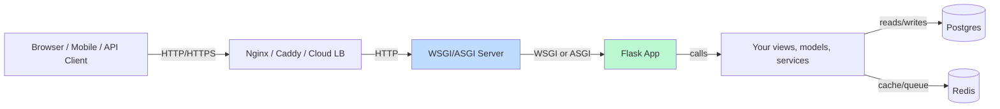
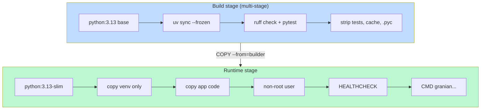
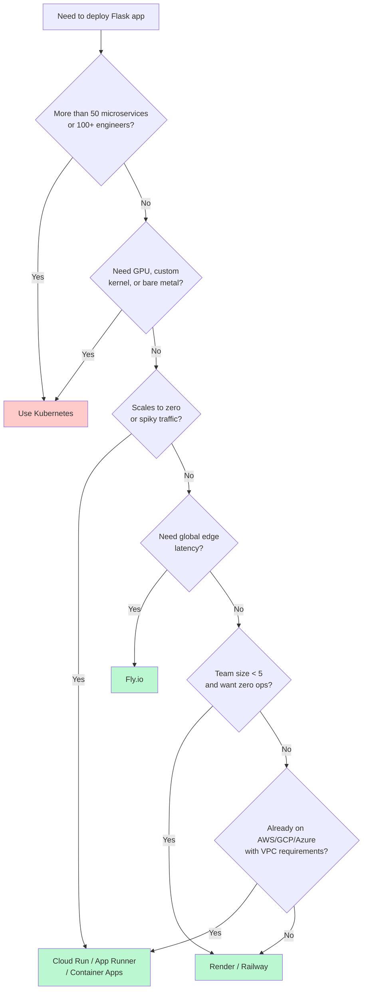
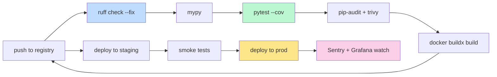
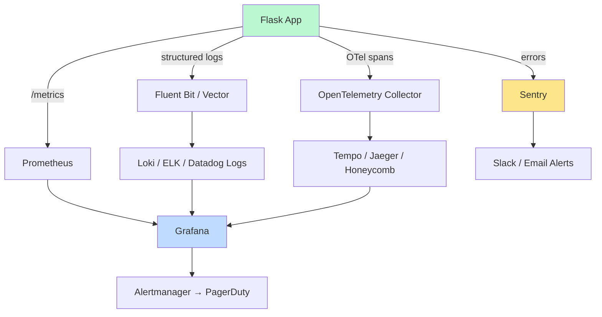
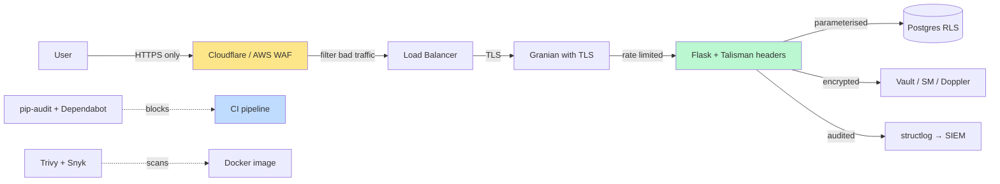
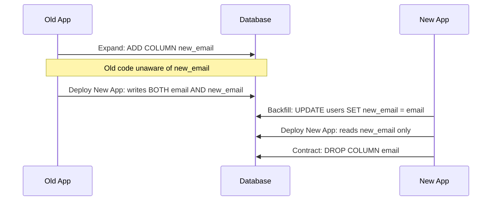

# Modern Deployment & DevOps — The 2026 Landscape

> [!success] You built it. Now operate it.
> [[Lesson-23-Deployment]] taught you to take a Flask app from `localhost:5000` to "on the public internet" using Gunicorn + Nginx + Docker on a single VM. That's still the *conceptual* baseline. But the 2026 deployment landscape has shifted hard: Rust-based WSGI servers (Granian) are eating Gunicorn's lunch for raw throughput, GitHub Actions is the default CI, OpenTelemetry is the standard for tracing, Fly.io / Render / Cloud Run mean you might never touch a VM again, and "observability" has replaced "monitoring" as the word people use. This document is your map. Use it to choose a server, write a Dockerfile that doesn't embarrass you, ship a CI pipeline, and instrument your app like a professional SRE.

#deployment #devops #2026 #modern-tooling

---

## 0. The Big Picture — Why This Module Exists

A 2020 deployment looked like this:

```bash
ssh root@my-server
git pull
pip install -r requirements.txt
gunicorn app:app
# ... pray
```

A 2026 deployment looks like this:

```bash
git push origin main
# GitHub Actions runs: ruff → mypy → pytest → docker build → push → deploy
# Fly.io / Cloud Run / k8s rolls the new revision
# OpenTelemetry traces flow to Grafana Cloud
# Sentry catches the one error you missed
# BetterStack pages you on Slack if uptime drops
```

The difference isn't *one* tool — it's a whole discipline. **DevOps** in 2026 means: containers as the unit of deployment, CI/CD as the release mechanism, observability as the safety net, security as code, and infrastructure as data (Helm/Kustomize/Terraform). This document walks you through every layer of that stack, with Flask-shaped examples, so you can teach it without hand-waving.

> [!info] A note from your teacher
> Don't panic (again). The fundamentals from [[Lesson-23-Deployment]] — WSGI contract, reverse proxy, env vars, the production checklist — are *all still correct*. What changed is the *tools around* deployment: faster servers, better containers, declarative CI, programmable observability. Read this document alongside Lesson 23, not instead of it.

---

## 1. Modern WSGI/ASGI Servers (2026)

Flask is a *framework*, not a *server*. In production you put a process server in front of it. The server handles TCP, concurrency, signals, and process lifecycle; Flask handles HTTP routing and your application code. The interface between them is **WSGI** (PEP 3333, synchronous) or **ASGI** (async, PEP 3333+). Flask 3.x supports both.



### 1.1 Gunicorn — the old reliable

[Gunicorn](https://gunicorn.org/) ("Green Unicorn") is the WSGI server you met in [[Lesson-23-Deployment]]. It's been the default since 2010 and is still the most boring, most documented, most battle-tested choice. In 2026 it remains the *default for new Flask projects* — not because it's the fastest, but because nothing surprising ever happens with it.

Gunicorn's superpower is **worker types**: you can swap the concurrency model with a single flag.

| Worker class | Concurrency model | Best for | Watch out for |
|---|---|---|---|
| `sync` (default) | One request per worker, blocking | CPU-bound, simple apps, beginners | Doesn't scale for slow IO |
| `gevent` | Greenlets (cooperative multitasking) | High IO (HTTP API, DB calls) | Monkey-patching C extensions |
| `eventlet` | Greenlets (older sibling of gevent) | Same as gevent | Less actively maintained in 2026 |
| `gthread` | Threads per worker | Mixed CPU + IO, modest concurrency | GIL still applies |
| `uvicorn.workers.UvicornWorker` | ASGI, async | When you have `async def` views | Requires `asgiref` wrapper for Flask |

```bash
# The classic Gunicorn invocation (sync workers)
gunicorn app:app --workers 5 --bind 0.0.0.0:8000

# gevent workers — for IO-heavy apps
gunicorn app:app --worker-class gevent --workers 4 --worker-connections 1000

# Run Flask as ASGI via uvicorn worker (Flask 3.x supports async views)
gunicorn app:app --worker-class uvicorn.workers.UvicornWorker --workers 4
```

> [!tip] The `2 × CPU + 1` rule
> For sync workers, the classic advice is `workers = (2 × CPU_cores) + 1`. This keeps every CPU busy with one worker while another is doing IO. For gevent/uvicorn workers, use fewer workers (1–4) but raise `--worker-connections` to 1000+. #teaching-tip

### 1.2 Uvicorn — the ASGI native

[Uvicorn](https://www.uvicorn.org/) is built on `uvloop` (a fast Cython reimplementation of asyncio's event loop) and `httptools` (a Python binding to Node's HTTP parser). It's the default server for FastAPI, Starlette, and any modern ASGI app. Flask 3.x is fully ASGI-compatible — you can run it with Uvicorn directly, but you need an `asgiref` wrapper because Flask's `app` object is WSGI:

```bash
# Install once
uv add asgiref uvicorn

# Wrap Flask's WSGI app as ASGI, then run with Uvicorn
uvicorn "asgiref.wsgi:WsgiToAsgi(app)" --factory --host 0.0.0.0 --port 8000
```

Or, more idiomatically, define a small `asgi.py`:

```python
# asgi.py
from asgiref.wsgi import WsgiToAsgi
from app import app

asgi_app = WsgiToAsgi(app)
```

```bash
uvicorn asgi:asgi_app --host 0.0.0.0 --port 8000 --workers 4
```

Uvicorn shines when you have `async def` views that use `httpx.AsyncClient`, async database drivers (asyncpg, databases), or websockets. If your views are all synchronous, Uvicorn gives you *nothing* over Gunicorn — and may be slower.

### 1.3 Granian — the new Rust-powered king

[Granian](https://github.com/emmett-sh/granian) is the 2026 darling. It's an ASGI/ASGI/RSGI server written in Rust with Python bindings, supporting WSGI, ASGI, and RSGI (Granian's own protocol). Benchmarks consistently show it **2–4× faster than Uvicorn** and **3–5× faster than Gunicorn** for the same Flask app. It hit 1.0 in late 2023 and is now considered production-ready.

```bash
uv add granian

# Run Flask (WSGI) with Granian
granian --interface wsgi app:app --host 0.0.0.0 --port 8000

# Run Flask (ASGI via asgiref) — Granian can also do ASGI natively
granian --interface asgi asgi:asgi_app --host 0.0.0.0 --port 8000
```

Granian's selling points:
- **Rust runtime**: no GIL contention on the server side, no garbage-collection pauses.
- **RSGI**: a simpler protocol than ASGI, with native support for streaming, websockets, and backpressure.
- **Single binary deployment possible**: compile Granian into your Docker image and skip Python entirely for the server layer.
- **Built-in TLS**: Granian can terminate TLS itself, no Nginx needed for simple deployments.

> [!warning] Granian gotcha for Flask
> Granian's WSGI interface works perfectly with Flask, but to use *async* `def` views you need the ASGI path via `asgiref.WsgiToAsgi`. The performance gain for sync Flask views comes from Granian's Rust HTTP parser and event loop, not from async. #gotcha

### 1.4 Hypercorn — the feature-complete alternative

[Hypercorn](https://hypercorn.readthedocs.io/) is Uvicorn's older sibling. It supports HTTP/2, HTTP/3 (QUIC), and websockets natively. It's the server you reach for when you *need* HTTP/3 and don't want Nginx in front. It's slightly slower than Uvicorn on raw HTTP/1.1, but its feature set is unmatched.

```bash
uv add hypercorn
hypercorn asgi:asgi_app --bind 0.0.0.0:8000 --workers 4 --quic
```

### 1.5 Comparison: which to pick in 2026?

| Server | Lang | Protocol | Speed (req/s, typical Flask) | When to use |
|---|---|---|---|---|
| **Gunicorn** (sync) | Python | WSGI | ~5,000 | Default. Boring. Documented. |
| **Gunicorn** (gevent) | Python | WSGI | ~15,000 | IO-heavy, no async views |
| **Uvicorn** | Python (Cython) | ASGI | ~20,000 | Async views, websockets |
| **Granian** | Rust + Python | WSGI/ASGI/RSGI | ~50,000 | Performance-critical, new projects |
| **Hypercorn** | Python (Cython) | ASGI | ~18,000 | HTTP/3, websockets without a proxy |

> [!example] Teaching demo: server shootout
> Have students run the same Flask app (`"hello world"` endpoint) under Gunicorn, Uvicorn, and Granian. Run `wrk -t4 -c100 -d10s http://localhost:8000/`. They will see Granian hit ~50k req/s vs Gunicorn's ~5k. The visceral "wow" makes the lesson stick. #exercise #teaching-tip

---

## 2. Modern Containerization (2026)

Docker is no longer optional. Even PaaS platforms like Fly.io and Cloud Run expect a Docker image. The question in 2026 isn't *whether* to containerize, it's *how well*.



### 2.1 Multi-stage builds — the only acceptable pattern

A naive Dockerfile copies your whole project into a fat image with compilers, dev tools, and test fixtures. A 2026 Dockerfile uses **multi-stage builds**: one stage for building, one for runtime.

```dockerfile
# syntax=docker/dockerfile:1.7
ARG PYTHON_VERSION=3.13-slim

# ---- Builder stage ----
FROM python:${PYTHON_VERSION} AS builder

# Install uv (modern package manager — see R1)
COPY --from=ghcr.io/astral-sh/uv:latest /uv /usr/local/bin/uv

WORKDIR /app
ENV UV_COMPILE_BYTECODE=1 UV_LINK_MODE=copy

# Install dependencies first (layer cache!)
COPY pyproject.toml uv.lock ./
RUN uv sync --frozen --no-install-project --no-dev

# Now copy source and install the project
COPY . .
RUN uv sync --frozen --no-dev

# ---- Runtime stage ----
FROM python:${PYTHON_VERSION} AS runtime

# Install only runtime OS deps (no build tools!)
RUN apt-get update && apt-get install -y --no-install-recommends \
    curl tini \
    && rm -rf /var/lib/apt/lists/*

# Create non-root user
RUN useradd --create-home --uid 1000 flask
WORKDIR /app
USER flask

# Copy the virtualenv from the builder
COPY --from=builder --chown=flask:flask /app /app

ENV PATH="/app/.venv/bin:$PATH" \
    PYTHONUNBUFFERED=1 \
    PYTHONDONTWRITEBYTECODE=1 \
    PORT=8000

EXPOSE 8000

# Tini handles signals correctly (no zombie reaping issues)
ENTRYPOINT ["/usr/bin/tini", "--"]

# Health check — calls /healthz every 30s
HEALTHCHECK --interval=30s --timeout=3s --start-period=10s --retries=3 \
    CMD curl -fsS http://localhost:8000/healthz || exit 1

CMD ["granian", "--interface", "wsgi", "app:app", "--host", "0.0.0.0", "--port", "8000"]
```

### 2.2 BuildKit and `docker buildx`

BuildKit is the modern Docker build backend (default since Docker 23.0). It enables:
- **Parallel multi-stage builds** — stages that don't depend on each other build in parallel.
- **Cache mounts** — `RUN --mount=type=cache,target=/root/.cache/uv uv sync` persists the uv cache between builds.
- **Secret mounts** — `RUN --mount=type=secret,id=npmrc` for private registries without leaking into image layers.
- **SSH mounts** — for `git+ssh` dependencies.

```bash
# Use buildx (modern builder) explicitly
docker buildx create --use --name mybuilder
docker buildx build --load -t myapp:latest .

# Cross-platform builds (e.g., build ARM on an x86 laptop for Fly.io/Graviton)
docker buildx build --platform linux/amd64,linux/arm64 -t myapp:latest .
```

### 2.3 `.dockerignore` — your image size depends on it

Without `.dockerignore`, `COPY . .` ships `__pycache__/`, `.git/`, `node_modules/`, `.venv/`, `tests/`, `.env` files, and your IDE configs into the image. That's a security hole (`.env`!) and a size problem.

```gitignore
# .dockerignore — must be in same dir as Dockerfile
.git
.gitignore
.github
.vscode
.idea
.venv
venv/
__pycache__/
*.pyc
*.pyo
*.pyd
.pytest_cache/
.ruff_cache/
.mypy_cache/
htmlcov/
.coverage
.env
.env.*
*.sqlite3
tests/
docs/
*.md
Dockerfile*
docker-compose*.yml
```

### 2.4 Base image: slim vs alpine vs distroless

| Base image | Size | Build pain | Runtime pain | Verdict for Flask |
|---|---|---|---|---|
| `python:3.13` (full) | ~1 GB | None | None | Don't use in prod |
| `python:3.13-slim` | ~150 MB | None | None | **Default choice** |
| `python:3.13-alpine` | ~50 MB | High (many wheels don't have alpine builds; you compile from source) | Sometimes | Only for tiny CLI tools |
| `gcr.io/distroless/python3` | ~50 MB | High (no shell, no package manager, hard to debug) | None | When security > DX |

> [!warning] Alpine is a trap for Python
> Alpine uses `musl` libc, not `glibc`. Most Python wheels are built for `glibc`. On Alpine, `pip install numpy pandas cryptography` compiles from source — your build takes 10 minutes instead of 10 seconds. Use `python:3.13-slim` unless you have a *very* specific reason. #gotcha

### 2.5 Layer caching — order matters

Docker caches layers in order. If a layer changes, every layer *below* it is invalidated. Put your `COPY` statements in order of how often they change:

```dockerfile
# GOOD — deps change rarely, app code changes often
COPY pyproject.toml uv.lock ./
RUN uv sync --frozen --no-dev       # cached unless deps change
COPY . .                            # invalidated every commit, but layers above are safe

# BAD — invalidates the dependency install on every commit
COPY . .
RUN uv sync --frozen --no-dev
```

### 2.6 Non-root users — non-negotiable in 2026

If your container runs as root and an attacker gets RCE, they have root in the container — and likely a path to the host. Every Dockerfile should end with a non-root user (see the `USER flask` line above). Most orchestrators (K8s `runAsNonRoot`, Cloud Run) enforce this by default.

### 2.7 Health checks — the contract with the orchestrator

Docker's `HEALTHCHECK` tells the runtime whether your app is alive. Cloud Run, ECS, k8s all read this (or equivalent probes). Define a `/healthz` endpoint that returns 200 only when the app is *actually* ready (DB connected, cache warm):

```python
# app.py
@app.get("/healthz")
def healthz():
    try:
        db.session.execute(text("SELECT 1"))
        redis.ping()
        return {"status": "ok"}, 200
    except Exception:
        return {"status": "degraded"}, 503
```

### 2.8 Docker Compose v2 — local stacks in 2026

Docker Compose v2 is integrated into the Docker CLI (`docker compose` not `docker-compose`), is rewritten in Go, and supports profiles, health conditions, and `include` for splitting files.

```yaml
# docker-compose.yml
name: flaskapp

services:
  web:
    build: .
    image: flaskapp:latest
    ports: ["8000:8000"]
    env_file: .env
    depends_on:
      db:
        condition: service_healthy
      redis:
        condition: service_started
    restart: unless-stopped
    profiles: ["", "prod"]   # runs by default and in prod

  worker:
    image: flaskapp:latest
    command: celery -A app.celery worker -l info
    env_file: .env
    depends_on:
      redis: { condition: service_healthy }
    profiles: ["prod"]

  db:
    image: postgres:17-alpine
    environment:
      POSTGRES_DB: flaskapp
      POSTGRES_PASSWORD: dev
    volumes: ["pgdata:/var/lib/postgresql/data"]
    healthcheck:
      test: ["CMD-SHELL", "pg_isready -U postgres"]
      interval: 5s
      timeout: 3s
      retries: 10
    profiles: ["", "dev", "prod"]

  redis:
    image: redis:7-alpine
    healthcheck:
      test: ["CMD", "redis-cli", "ping"]
      interval: 5s
      timeout: 3s
      retries: 10

volumes:
  pgdata:
```

```bash
docker compose up                       # default profile
docker compose --profile dev up         # + dev tools
docker compose --profile prod up        # + workers
```

> [!tip] `depends_on: condition: service_healthy`
> The old `depends_on` only waited for the container to *start*. The new `condition: service_healthy` waits until the dependency's `healthcheck` passes. This kills the "Flask starts before Postgres is ready" race condition that haunted 2015-era deployments. #teaching-tip

---

## 3. Modern Orchestration (2026)

Containers solved packaging. Orchestration solves *running* them — at scale, across machines, with self-healing.

### 3.1 Kubernetes — the 800-pound gorilla

Kubernetes (K8s) is the de facto orchestrator. For Flask developers, the mental model:

- A **Pod** runs one (or more) container(s) — your Flask image.
- A **Deployment** says "I want 3 replicas of this Pod."
- A **Service** gives the Pods a stable network address (DNS name).
- An **Ingress** routes HTTP traffic from outside the cluster to your Service.
- A **ConfigMap** holds non-secret config (env vars, Nginx config).
- A **Secret** holds secrets (DB passwords, API keys).
- A **HPA** (HorizontalPodAutoscaler) adds Pods when CPU/memory rises.

```yaml
# k8s/deployment.yaml — minimal Flask deployment
apiVersion: apps/v1
kind: Deployment
metadata:
  name: flaskapp
spec:
  replicas: 3
  selector:
    matchLabels: { app: flaskapp }
  template:
    metadata:
      labels: { app: flaskapp }
    spec:
      securityContext:
        runAsNonRoot: true
        runAsUser: 1000
      containers:
        - name: web
          image: ghcr.io/myorg/flaskapp:1.2.3
          ports: [{ containerPort: 8000 }]
          envFrom:
            - configMapRef: { name: flaskapp-config }
            - secretRef: { name: flaskapp-secrets }
          readinessProbe:
            httpGet: { path: /healthz, port: 8000 }
            initialDelaySeconds: 5
            periodSeconds: 10
          livenessProbe:
            httpGet: { path: /healthz, port: 8000 }
            initialDelaySeconds: 30
            periodSeconds: 30
          resources:
            requests: { cpu: 100m, memory: 128Mi }
            limits:   { cpu: 500m, memory: 512Mi }
---
apiVersion: v1
kind: Service
metadata:
  name: flaskapp
spec:
  selector: { app: flaskapp }
  ports: [{ port: 80, targetPort: 8000 }]
```

> [!warning] Don't teach K8s in lesson 1
> K8s has a 2-week learning curve minimum. For most Flask apps serving < 10k users, K8s is overkill. Teach it last, after students have shipped on Fly.io or Render and felt the pain that K8s solves. #teaching-tip

### 3.2 Helm — K8s package manager

[Helm](https://helm.sh/) packages K8s manifests into a reusable "chart" with templated values. Instead of writing 15 YAML files per environment, you write one chart and override values per env.

```bash
# Use Bitnami's Flask chart (or write your own)
helm repo add bitnami https://charts.bitnami.com/bitnami
helm install flaskapp bitnami/flask \
    --set image.repository=ghcr.io/myorg/flaskapp \
    --set image.tag=1.2.3 \
    --set replicaCount=3
```

Custom chart structure:

```
my-chart/
├── Chart.yaml          # chart metadata
├── values.yaml         # default values
├── values-prod.yaml    # prod overrides
└── templates/
    ├── deployment.yaml
    ├── service.yaml
    ├── ingress.yaml
    └── _helpers.tpl
```

### 3.3 Kustomize — Helm without templating

[Kustomize](https://kustomize.io/) is built into `kubectl`. It overlays patches on a base set of YAMLs — no templating language, just YAML. Many teams prefer it for simpler apps.

```
base/
├── deployment.yaml
├── service.yaml
└── kustomization.yaml
overlays/
├── dev/
│   ├── kustomization.yaml   # patches replicaCount=1
└── prod/
    ├── kustomization.yaml   # patches replicaCount=5
    └── secrets.enc.yaml     # Sealed Secrets for prod
```

### 3.4 Managed K8s: EKS, GKE, AKS

Running your own K8s control plane in 2026 is a niche hobby. Use a managed control plane:

| Provider | Service | Notes |
|---|---|---|
| AWS | EKS | Most popular, most expensive ($73/mo control plane), deep AWS integration |
| GCP | GKE | Best DX, cheapest ($0 control plane for Autopilot), great UI |
| Azure | AKS | Strong for enterprise Windows shops, decent Linux support |
| DigitalOcean | DOKS | Cheapest entry ($12/mo control plane), simple |
| Civo | Civo K8s | Smallest, fastest to provision, UK-focused |

### 3.5 Simpler alternatives: Fly.io, Render, Railway, Cloud Run

For most Flask apps, K8s is a sledgehammer for a nail. Modern PaaS platforms give you 80% of K8s' value at 5% of the complexity:

- **Fly.io** — deploy Docker images to a global edge network. `fly deploy` and you're done. Includes managed Postgres, Redis, volumes. $0/mo free tier.
- **Render** — Heroku's spiritual successor. Auto-deploys from GitHub. Built-in Postgres, Redis, cron. Generous free tier.
- **Railway** — like Render, with a stronger "infrastructure-as-code" vibe (`railway.toml`). Excellent DX.
- **Google Cloud Run** — serverless containers. Scales to zero, pays per request. Great for spiky workloads. $0/mo free tier.
- **AWS App Runner** — Cloud Run's AWS twin. Tighter RDS/VPC integration. Slightly worse DX.
- **Azure Container Apps** — built on K8s + KEDA, but you never see K8s. Best for Microsoft shops.

### 3.6 Decision matrix: K8s vs PaaS



| Use case | Best choice |
|---|---|
| Side project, free tier | Fly.io, Render, Cloud Run |
| Startup MVP, small team | Railway, Render |
| Spiky traffic, scale-to-zero | Cloud Run, App Runner |
| Global edge, low latency | Fly.io, Cloud Run (+ Cloudflare) |
| Many microservices, large org | Kubernetes (managed) |
| Legacy on AWS, VPC required | App Runner, ECS Fargate |
| GPU workloads | K8s (with nvidia device plugin) |

---

## 4. Modern CI/CD (2026)

CI/CD is the conveyor belt that takes code from `git push` to production. In 2026, **GitHub Actions is the dominant platform** — particularly for Flask courses, where students already have GitHub accounts. GitLab CI is the runner-up (strong in EU enterprise), and CircleCI is fading but still common in pre-2024 codebases.



### 4.1 A complete GitHub Actions workflow for Flask

```yaml
# .github/workflows/ci.yml
name: CI

on:
  push:
    branches: [main]
  pull_request:

concurrency:
  group: ci-${{ github.ref }}
  cancel-in-progress: true

env:
  PYTHON_VERSION: "3.13"
  REGISTRY: ghcr.io
  IMAGE_NAME: ${{ github.repository }}

jobs:
  lint:
    runs-on: ubuntu-latest
    steps:
      - uses: actions/checkout@v4
      - uses: astral-sh/setup-uv@v3
        with:
          enable-cache: true           # cache ~/.cache/uv between runs
      - run: uv sync --frozen
      - run: uv run ruff check --output-format=github .
      - run: uv run ruff format --check .

  typecheck:
    runs-on: ubuntu-latest
    steps:
      - uses: actions/checkout@v4
      - uses: astral-sh/setup-uv@v3
        with: { enable-cache: true }
      - run: uv sync --frozen
      - run: uv run mypy --strict app/

  test:
    runs-on: ubuntu-latest
    strategy:
      matrix:
        python-version: ["3.11", "3.12", "3.13"]
    services:
      postgres:
        image: postgres:17
        env:
          POSTGRES_PASSWORD: test
        ports: ["5432:5432"]
        options: >-
          --health-cmd pg_isready
          --health-interval 5s
          --health-retries 10
      redis:
        image: redis:7
        ports: ["6379:6379"]
        options: >-
          --health-cmd "redis-cli ping"
          --health-interval 5s
    steps:
      - uses: actions/checkout@v4
      - uses: astral-sh/setup-uv@v3
        with: { enable-cache: true }
      - run: uv python install ${{ matrix.python-version }}
      - run: uv sync --python ${{ matrix.python-version }}
      - run: uv run pytest --cov --cov-report=xml
      - uses: codecov/codecov-action@v4
        with: { files: ./coverage.xml }

  security:
    runs-on: ubuntu-latest
    steps:
      - uses: actions/checkout@v4
      - uses: astral-sh/setup-uv@v3
      - run: uv sync --frozen
      - run: uv run pip-audit --strict
      - name: Trivy filesystem scan
        uses: aquasecurity/trivy-action@master
        with:
          scan-type: fs
          scan-ref: .
          severity: HIGH,CRITICAL

  build:
    needs: [lint, typecheck, test, security]
    runs-on: ubuntu-latest
    permissions:
      contents: read
      packages: write
    steps:
      - uses: actions/checkout@v4
      - uses: docker/setup-buildx-action@v3
      - uses: docker/login-action@v3
        with:
          registry: ${{ env.REGISTRY }}
          username: ${{ github.actor }}
          password: ${{ secrets.GITHUB_TOKEN }}
      - uses: docker/metadata-action@v5
        id: meta
        with:
          images: ${{ env.REGISTRY }}/${{ env.IMAGE_NAME }}
          tags: |
            type=sha,format=long
            type=ref,event=branch
            type=raw,value=latest,enable={{is_default_branch}}
      - uses: docker/build-push-action@v6
        with:
          context: .
          push: true
          tags: ${{ steps.meta.outputs.tags }}
          labels: ${{ steps.meta.outputs.labels }}
          cache-from: type=gha
          cache-to: type=gha,mode=max
          platforms: linux/amd64,linux/arm64

  deploy:
    needs: build
    if: github.ref == 'refs/heads/main'
    runs-on: ubuntu-latest
    environment: production
    steps:
      - uses: actions/checkout@v4
      - name: Deploy to Fly.io
        uses: superfly/flyctl-actions@1.5
        with:
          args: "deploy --image ${{ env.REGISTRY }}/${{ env.IMAGE_NAME }}:sha-${{ github.sha }}"
        env:
          FLY_API_TOKEN: ${{ secrets.FLY_API_TOKEN }}
```

### 4.2 Caching — the difference between a 30-second and a 12-minute CI

Two caches matter:

1. **uv/pip cache** — `astral-sh/setup-uv@v3` with `enable-cache: true` caches `~/.cache/uv` between runs. Subsequent runs install dependencies in ~3 seconds instead of ~30.
2. **Docker layer cache** — `cache-from: type=gha` and `cache-to: type=gha,mode=max` push BuildKit cache to GitHub Actions cache. Subsequent `docker buildx build` runs skip the dependency-install layer entirely.

### 4.3 Matrix testing

The `test` job above runs against Python 3.11, 3.12, and 3.13 in parallel. If you support library users on multiple Python versions, this catches regressions early. For an app (not a library), pick one version (3.13) and skip the matrix.

### 4.4 Pre-commit hooks in CI

If you use [pre-commit](https://pre-commit.com/) locally, mirror the same checks in CI so a PR can't merge if a hook fails:

```yaml
  pre-commit:
    runs-on: ubuntu-latest
    steps:
      - uses: actions/checkout@v4
      - uses: actions/setup-python@v5
        with: { python-version: "3.13" }
      - uses: pre-commit/action@v3.0.1
```

### 4.5 Secrets management

Never hardcode secrets in YAML. GitHub provides three mechanisms:

- **Repository secrets** (`${{ secrets.FLY_API_TOKEN }}`) — single value, encrypted at rest. Use for most things.
- **Environment secrets** — scoped to an `environment:` (e.g., `production`). Requires manual approval if you enable required reviewers.
- **OIDC + cloud IAM** — for AWS/GCP/Azure, exchange a GitHub OIDC token for short-lived cloud credentials. **No long-lived keys to leak.**

```yaml
  deploy-aws:
    permissions:
      id-token: write       # required for OIDC
      contents: read
    steps:
      - uses: aws-actions/configure-aws-credentials@v4
        with:
          role-to-assume: arn:aws:iam::123456789012:role/github-actions-flaskapp
          aws-region: us-east-1
```

> [!tip] Always use OIDC over long-lived keys
> Long-lived AWS keys in GitHub secrets *will* eventually leak. OIDC + `aws-actions/configure-aws-credentials` is the only correct pattern in 2026. #security #teaching-tip

---

## 5. Modern Deployment Platforms (2026)

This is the part of the document where you decide *where* your Flask app lives. All of these accept a Docker image (or a Dockerfile) and run it. Differences: pricing model, scaling behaviour, region coverage, free tier generosity, and DX.

### 5.1 Fly.io

[Fly.io](https://fly.io) deploys Docker images to a global anycast network of micro-VMs (Firecracker). You write a `fly.toml`, run `fly deploy`, and your app runs in 10+ regions with automatic global load balancing. Managed Postgres (`Fly Postgres`), Redis (`Upstash`), and volumes are first-class.

```toml
# fly.toml
app = "flaskapp"
primary_region = "iad"

[build]
  dockerfile = "Dockerfile"

[http_service]
  internal_port = 8000
  auto_stop_machines = true
  auto_start_machines = true
  min_machines_running = 0

[[http_service.checks]]
  interval = "30s"
  timeout = "3s"
  grace_period = "10s"
  method = "GET"
  path = "/healthz"

[[vm]]
  memory = "512mb"
  cpu_type = "shared"
```

### 5.2 Render

[Render](https://render.com) is the spiritual successor to Heroku. Push to GitHub, Render auto-deploys. Built-in Postgres, Redis, background workers, cron jobs, static sites, preview environments per PR. Strong DX, generous free tier (with limitations).

### 5.3 Railway

[Railway](https://railway.app) is Render with a stronger "infrastructure-as-code" bent. `railway.toml` describes your stack; `railway up` deploys. Best template marketplace of any PaaS.

### 5.4 Google Cloud Run

[Cloud Run](https://cloud.google.com/run) is serverless containers — Google provisions, scales, and bills per request. Scales to zero automatically. Tight integration with Cloud SQL, Secret Manager, Cloud Armor. The cheapest option for spiky or low-traffic workloads.

```bash
gcloud run deploy flaskapp \
    --source . \
    --region us-central1 \
    --allow-unauthenticated \
    --min-instances 0 \
    --max-instances 100 \
    --cpu 1 --memory 512Mi
```

### 5.5 AWS App Runner

[App Runner](https://aws.amazon.com/apprunner/) is Cloud Run's AWS twin. Pull from ECR or GitHub, scale automatically, pay per request. Better VPC integration than Cloud Run (which added VPC later), but worse DX.

### 5.6 Azure Container Apps

[Container Apps](https://learn.microsoft.com/azure/container-apps/) is built on K8s + KEDA + Dapr, but you never see K8s. Best for Microsoft shops; supports scale-to-zero and KEDA rules for custom metrics.

### 5.7 DigitalOcean App Platform

[DO App Platform](https://www.digitalocean.com/products/app-platform) is Render on DigitalOcean. Cheapest "real" PaaS for small teams already on DO. Strong for the "I have 5 droplets and want one of them to be a PaaS" crowd.

### 5.8 Vercel (for Flask, with caveats)

[Vercel](https://vercel.com) is the king of frontend deployment (Next.js, Astro, etc.). It *can* run Flask via serverless functions, but with serious limitations: 50 MB function size, 10–60 second timeout, no long-lived connections (no websockets, no Flask-SocketIO), cold starts. Use Vercel for *frontends* that talk to a Flask API hosted elsewhere. Don't host the Flask API itself on Vercel.

### 5.9 Comparison table

| Platform | Free tier | Scale to zero | Websockets | Multi-region | Best for |
|---|---|---|---|---|---|
| **Fly.io** | 3 shared-VM × 1 GB | Yes | Yes | Yes (native) | Global apps, edge latency |
| **Render** | 750 hrs/mo | Yes (with delay) | Yes | No (US/EU only) | Heroku refugees, MVPs |
| **Railway** | $5/mo trial credit | No | Yes | No | Hobby projects |
| **Cloud Run** | 2M req/mo | Yes | No (use Run HTTP/2) | Yes (manual) | Spiky traffic, GCP shops |
| **App Runner** | None | Yes | No | Yes (manual) | AWS shops |
| **Container Apps** | 50k vCPU-hrs/mo | Yes | Yes | Yes (manual) | Azure shops |
| **DO App Platform** | 3 static + 1 web | No | Yes | No | DO customers |
| **Vercel** | 100 GB-hr/mo | Yes (cold starts) | No | Yes | Frontends only |
| **K8s (managed)** | None | No (without KEDA) | Yes | Yes | Large orgs |

> [!example] Teaching exercise: deploy the same app to three platforms
> Have students deploy the lesson-24 blog to Fly.io, Render, and Cloud Run. Compare: time to first deploy, monthly cost at 1k visits/day, cold-start latency, DX. They'll develop *intuition* for the trade-offs that no comparison table can teach. #exercise #teaching-tip

---

## 6. Modern Observability (2026)

"Monitoring" is dead; long live **observability** — the ability to ask arbitrary questions about your system from outside it. The three pillars are **logs**, **metrics**, and **traces**. In 2026 the standard stack for a Flask app is `structlog` + Prometheus + OpenTelemetry + Sentry.



### 6.1 Logging — structlog → JSON → Loki/ELK/Datadog

String logs (`"User 42 logged in"`) are unparseable. JSON logs (`{"event": "user_login", "user_id": 42, "ts": "..."}`) are greppable, indexable, and searchable. [structlog](https://www.structlog.org/) is the 2026 standard:

```python
# app.py
import structlog
import logging

structlog.configure(
    processors=[
        structlog.contextvars.merge_contextvars,
        structlog.processors.add_log_level,
        structlog.processors.TimeStamper(fmt="iso"),
        structlog.processors.StackInfoRenderer(),
        structlog.processors.format_exc_info,
        structlog.processors.JSONRenderer(),   # JSON for prod; ConsoleRenderer for dev
    ],
    wrapper_class=structlog.make_filtering_bound_logger(logging.INFO),
    cache_logger_on_first_use=True,
)
log = structlog.get_logger()

@app.post("/login")
def login():
    log.info("login_attempt", user_id=request.form["user_id"], ip=request.remote_addr)
    # ...
    log.info("login_success", user_id=user.id)
```

For development, swap `JSONRenderer()` for `structlog.dev.ConsoleRenderer()` — pretty coloured output. For production, JSON all the way.

Ship logs with **Fluent Bit** or **Vector** (the modern replacement for Logstash) to **Loki** (open source, cheap, integrates with Grafana), **Elasticsearch** (expensive, full-text search), or **Datadog Logs** (expensive, all-in-one).

### 6.2 Metrics — Prometheus + Grafana

[Prometheus](https://prometheus.io/) is a time-series database that *pulls* metrics from your app at `/metrics`. [Grafana](https://grafana.com/) visualises them. Use [prometheus-flask-exporter](https://github.com/rycus86/prometheus_flask_exporter):

```python
from prometheus_flask_exporter import PrometheusMetrics
metrics = PrometheusMetrics(app)

# Per-route metrics come for free. Add custom business metrics:
requests_total = metrics.counter(
    "flaskapp_requests_total",
    "Total requests",
    labels={"endpoint": lambda: request.endpoint},
)
```

### 6.3 Tracing — OpenTelemetry is the 2026 standard

[OpenTelemetry](https://opentelemetry.io/) (OTel) is a CNCF project that has consolidated the tracing ecosystem. Every vendor (Datadog, Honeycomb, Tempo, Jaeger, New Relic) accepts OTel data. Instrument once, switch backends freely.

```python
# instrumentation.py
from opentelemetry import trace
from opentelemetry.instrumentation.flask import FlaskInstrumentor
from opentelemetry.instrumentation.sqlalchemy import SQLAlchemyInstrumentor
from opentelemetry.instrumentation.redis import RedisInstrumentor
from opentelemetry.sdk.trace import TracerProvider
from opentelemetry.sdk.trace.export import BatchSpanProcessor
from opentelemetry.exporter.otlp.proto.grpc.trace_exporter import OTLPSpanExporter

trace.set_tracer_provider(TracerProvider())
trace.get_tracer_provider().add_span_processor(
    BatchSpanProcessor(OTLPSpanExporter(endpoint=os.getenv("OTEL_EXPORTER_OTLP_ENDPOINT")))
)

FlaskInstrumentor().instrument_app(app)
SQLAlchemyInstrumentor().instrument(engine=db.engine)
RedisInstrumentor().instrument()
```

You now get distributed traces that span: HTTP request → Flask view → SQL query → Redis call — across services. Send to **Grafana Tempo**, **Jaeger**, **Honeycomb**, or **Datadog APM**.

### 6.4 Error tracking — Sentry still dominant

[Sentry](https://sentry.io) catches uncaught exceptions, groups them, and alerts you. Rollbar and Bugsnag are alternatives but Sentry remains the default for Flask in 2026.

```python
import sentry_sdk
from sentry_sdk.integrations.flask import FlaskIntegration

sentry_sdk.init(
    dsn=os.getenv("SENTRY_DSN"),
    environment=os.getenv("ENV", "dev"),
    release=os.getenv("GIT_SHA", "unknown"),
    traces_sample_rate=0.1,           # 10% of requests get a trace
    profiles_sample_rate=0.1,
    integrations=[FlaskIntegration()],
)
```

### 6.5 APM — DataDog, New Relic, Honeycomb

For "I want one vendor for everything," pick **Datadog** or **New Relic** — they do logs, metrics, traces, APM, synthetics, and alerting in one platform. For "I want to slice and dice high-cardinality events," pick **Honeycomb**. Pricing ranges from "free" (Honeycomb free tier) to "your CFO cries" (Datadog at scale).

### 6.6 Uptime monitoring — BetterStack, UptimeRobot, Pingdom

Synthetic checks (HTTP pings from 10+ regions every minute) catch outages *before* your users do. **BetterStack** has the best DX and Slack integration. **UptimeRobot** has the best free tier (50 monitors). **Pingdom** is the legacy enterprise choice.

> [!tip] Layer your monitoring
> - **Uptime monitor** (external): "is the site up?"
> - **Sentry** (in-app): "is the app erroring?"
> - **Prometheus** (in-app): "is the app slow?"
> - **OTel traces** (cross-service): "where is it slow?"
> - **Logs** (in-app): "what did the app do?"
>
> Each catches a different failure mode. Skip any one and you have a blind spot. #teaching-tip

---

## 7. Modern Security (2026)

Security in 2026 is "shift left" (find issues in CI, not prod) plus "defense in depth" (multiple layers, no single point of failure). For a Flask app:



### 7.1 HTTPS everywhere

In 2026, **HTTP-only sites are unprofessional and unsafe**. Use one of:

- **Caddy** — automatic Let's Encrypt certificates, zero config. The modern Nginx.
- **Nginx + Certbot** — the classic combo. More config, more control.
- **Cloudflare** in front — terminates TLS at the edge, caches static assets, blocks bots.
- **Managed certs** on Cloud Run / App Runner / Fly.io — automatic, invisible.

### 7.2 Security headers — Flask-Talisman

[Flask-Talisman](https://github.com/GoogleCloudPlatform/flask-talisman) sets CSP, HSTS, X-Frame-Options, X-Content-Type-Options, Referrer-Policy, and Permissions-Policy headers. One line of setup, massive security win:

```python
from flask_talisman import Talisman
csp = {
    "default-src": "'self'",
    "script-src": "'self' https://cdn.jsdelivr.net",
    "style-src": "'self' 'unsafe-inline'",
    "img-src": "'self' data: https:",
    "frame-ancestors": "'none'",
}
talisman = Talisman(app, content_security_policy=csp, force_https=True, strict_transport_security_max_age=63072000)
```

### 7.3 Dependency scanning — `pip-audit`, `safety`, Dependabot

- **`pip-audit`** — official PyPA tool, scans against the OSV database. Run in CI.
- **`safety`** — older, commercial DB, still popular.
- **GitHub Dependabot** — opens PRs automatically when a vuln is found. Enable it on every repo.

```bash
uv add --dev pip-audit
uv run pip-audit --strict
```

### 7.4 Container scanning — Trivy, Snyk

[Trivy](https://trivy.dev/) scans Docker images (and filesystems, and K8s manifests) for known CVEs. Snyk is the commercial alternative with a better UI but a higher price tag.

```bash
trivy image ghcr.io/myorg/flaskapp:latest --severity HIGH,CRITICAL --exit-code 1
```

### 7.5 Secrets management — Vault, AWS SM, Doppler

`.env` files are for development. In production, fetch secrets at startup from a real secrets manager:

- **HashiCorp Vault** — open source, self-hosted, dynamic secrets (DB credentials minted per-request).
- **AWS Secrets Manager / Parameter Store** — tight RDS integration, automatic rotation.
- **Google Secret Manager** / **Azure Key Vault** — cloud-native equivalents.
- **Doppler** — SaaS that injects secrets at runtime via a wrapper. Best DX for small teams.

```bash
# Doppler example — secrets are injected as env vars at exec time
doppler run -- granian app:app --host 0.0.0.0 --port 8000
```

### 7.6 OWASP Top 10 for Flask

| OWASP risk | Flask mitigation |
|---|---|
| A01: Broken Access Control | `@login_required`, `@roles_required`, object-level checks in views |
| A02: Cryptographic Failures | bcrypt/argon2 for passwords, TLS 1.3, no plaintext secrets |
| A03: Injection | SQLAlchemy parameterised queries (never f-strings in SQL), Jinja autoescape |
| A04: Insecure Design | Threat model in design review, rate limit, fail closed |
| A05: Security Misconfiguration | `DEBUG=False`, strong `SECRET_KEY`, no default passwords |
| A06: Vulnerable Components | `pip-audit` in CI, Dependabot PRs |
| A07: Auth Failures | Lockout on 5 failures, MFA via Flask-Login + TOTP, secure session cookies |
| A08: Software/Data Integrity Failures | Signed PyPI packages (PEP 458/480), package hashing in `uv.lock` |
| A09: Logging Failures | structlog JSON to SIEM, audit log for sensitive actions |
| A10: SSRF | Validate user-supplied URLs against an allowlist before `httpx.get()` |

### 7.7 Rate limiting — Flask-Limiter with Redis

```python
from flask_limiter import Limiter
from flask_limiter.util import get_remote_address

limiter = Limiter(
    get_remote_address,
    app=app,
    storage_uri=os.getenv("REDIS_URL", "redis://localhost:6379"),
    default_limits=["200 per hour", "50 per minute"],
    strategy="sliding-window-counter",
)

@app.post("/login")
@limiter.limit("5 per minute; 20 per hour")   # brutal on login
def login(): ...
```

Redis as the storage backend means rate limits are shared across all your Flask workers and all your containers.

### 7.8 WAF — Cloudflare, AWS WAF

A Web Application Firewall blocks SQL injection, XSS, bots, and DDoS at the edge before traffic hits your app. **Cloudflare** (free tier covers most apps) or **AWS WAF** (deeper integration with ALB / CloudFront).

---

## 8. Modern Database Deployment (2026)

PostgreSQL remains the default relational database for Flask apps. In 2026, Postgres 16 is the current LTS and Postgres 17 is rolling out (better JSON, faster vacuum, incremental backup improvements).

### 8.1 Connection pooling — PgBouncer, pgcat

Every Flask worker opens a connection to Postgres. With 4 workers × 3 containers × 5 replicas = 60 connections. Postgres handles ~100 before performance degrades. The fix: a pooler.

[PgBouncer](https://www.pgbouncer.org/) sits between Flask and Postgres, multiplexing many Flask connections onto a few Postgres connections. [pgcat](https://github.com/postgresml/pgcat) is the 2026 alternative — multitenant, faster, supports query sharding. Use one of them in front of any production Postgres.

```
Flask → PgBouncer (transaction mode) → Postgres
```

Configure SQLAlchemy with `pool_recycle` and disable prepared statement caching in transaction mode:

```python
SQLALCHEMY_ENGINE_OPTIONS = {
    "pool_pre_ping": True,
    "pool_recycle": 300,
    "connect_args": {"prepare_threshold": None},   # required for PgBouncer txn mode
}
```

### 8.2 Read replicas

For read-heavy workloads (10:1 read:write ratio is typical), add a read replica and route `SELECT` queries to it. SQLAlchemy supports this with [SESSION_REPLICA](https://docs.sqlalchemy.org/en/20/orm/session_api.html) or a custom `bind` per session.

### 8.3 Managed databases — RDS, Cloud SQL, Neon, Supabase

| Provider | Service | Best feature |
|---|---|---|
| AWS | RDS | Aurora Serverless v2, Multi-AZ HA |
| GCP | Cloud SQL | Autopilot, deep IAM |
| Azure | Azure Database | Strong for Microsoft shops |
| **Neon** | Neon Postgres | Branching (per-PR databases!), scale-to-zero |
| **Supabase** | Supabase Postgres | Free tier, built-in auth + storage |
| **Crunchy Bridge** | Crunchy Bridge | Best Postgres expertise, simple pricing |
| **Render Postgres** | Render | Cheapest for hobby projects |

> [!tip] Neon for teaching
> Neon's "database branching" lets each student PR get its own Postgres branch — free, instant, isolated. This is a *game-changer* for teaching migrations safely. #teaching-tip

### 8.4 Migrations in CI/CD

Run migrations as a separate job, *before* the new app version rolls out. Use [[Lesson-15-Flask-Migrate]] patterns:

```yaml
  migrate:
    needs: build
    runs-on: ubuntu-latest
    environment: production
    steps:
      - uses: actions/checkout@v4
      - uses: astral-sh/setup-uv@v3
      - run: uv sync --frozen
      - run: uv run flask --app app db upgrade
        env:
          DATABASE_URL: ${{ secrets.PROD_DATABASE_URL }}
```

### 8.5 Zero-downtime migrations — expand-and-contract

A naive migration (`ALTER TABLE users DROP COLUMN deprecated`) breaks the running app — the old code still references the column. The expand-and-contract pattern fixes this:

1. **Expand** — add the new column/schema. Deploy new code that writes to both old and new. Run for a release cycle.
2. **Migrate** — backfill the new column for existing rows.
3. **Contract** — deploy code that reads only the new column. Drop the old one.



### 8.6 Backup strategies

- **`pg_dump`** — logical backup. Slow to restore, but portable. Run nightly.
- **Point-in-time recovery (PITR)** — replay WAL files to any second in the last 7–35 days. All managed Postgres providers support this. Use it.
- **Snapshots** — block-level backups. Fast to restore, less flexible.
- **Off-region copies** — copy backups to another region/account. Ransomware protection.

> [!danger] Untested backups are not backups
> Every team that lost data had "backups." They just never tested restoring. Once a quarter, restore your prod backup into staging and verify the app boots. #gotcha #teaching-tip

---

## 9. Modern Caching (2026)

Redis is the default cache for Flask apps in 2026, and Redis 7.x (with 7.4 being current) is significantly faster and more memory-efficient than the 6.x you might remember.

### 9.1 Redis — four jobs in one

Redis serves four common roles in a Flask stack:

1. **Cache** — store expensive query results with TTL. Read from Redis; if miss, read DB and write Redis.
2. **Session store** — Flask-Session with Redis backend. Survives worker restarts, shared across containers.
3. **Message broker** — for Celery / RQ / Dramatiq async task queues.
4. **Rate limiter backend** — Flask-Limiter with Redis shares limits across containers.

```python
# Cache pattern with redis-py
import redis, json
r = redis.from_url(os.getenv("REDIS_URL"), decode_responses=True)

def get_user(user_id: int):
    cache_key = f"user:{user_id}"
    if cached := r.get(cache_key):
        return json.loads(cached)
    user = db.session.get(User, user_id)
    r.setex(cache_key, 300, json.dumps(user.to_dict()))   # 5-min TTL
    return user
```

### 9.2 Redis Cluster for scaling

A single Redis instance handles ~100k ops/sec on modern hardware. When you need more, **Redis Cluster** shards keys across N nodes. The `redis-py` client supports it natively:

```python
from redis.cluster import RedisCluster
r = RedisCluster.from_url("redis://redis-cluster:6379", decode_responses=True)
```

### 9.3 Redis Sentinel for HA

For high-availability without sharding, **Redis Sentinel** monitors your Redis primary and automatically promotes a replica if it dies. Cloud-managed Redis (ElastiCache, Upstash) handles this for you.

### 9.4 Managed Redis

| Provider | Service | Best feature |
|---|---|---|
| AWS | ElastiCache | Deep VPC integration, Multi-AZ |
| GCP | Memorystore | Simple, expensive |
| Azure | Azure Cache for Redis | Enterprise tiers with Redis Enterprise |
| **Upstash** | Upstash Redis | Serverless, scale-to-zero, pay per request |
| **Redis Cloud** | Redis Cloud | Best support, multi-region |
| **Aiven** | Aiven for Redis | Multi-cloud, strong SLAs |

### 9.5 CDN — Cloudflare, Fastly, CloudFront

For static assets (CSS, JS, images), a CDN serves them from edge nodes close to users. **Cloudflare** is the default (free tier covers most apps, magical DX). **Fastly** is the high-performance alternative (better caching controls, slightly pricier). **CloudFront** is the AWS-native choice (deepest integration with S3 and Lambda@Edge).

```python
# Flask-CDN config — rewrite url_for('static', ...) to CDN URL
app.config["CDN_DOMAIN"] = "cdn.example.com"
```

For dynamic content, a CDN in front of your Flask app (Cloudflare orange-cloud) caches *responses* — useful for public read-heavy endpoints, dangerous for personalised ones. Set `Cache-Control: private` on authenticated responses.

---

## 10. Teaching Tips — Bringing DevOps Into the Classroom

> [!tip] A 6-week DevOps unit for Flask students
> After students finish [[Lesson-23-Deployment]] (single-VM Gunicorn+Nginx+Docker), here's a recommended 6-week extension:
>
> 1. **Week 1 — Containerize properly.** Convert the lesson-24 blog to a multi-stage Dockerfile with non-root user, healthcheck, and `.dockerignore`. Measure image size before and after.
> 2. **Week 2 — CI/CD.** Add GitHub Actions: ruff + pytest + docker build. Have students watch their first green check on a PR.
> 3. **Week 3 — Deploy to a PaaS.** Pick Fly.io or Render. Have students run `fly deploy` and visit their app on a real URL. *This is the "wow" moment.*
> 4. **Week 4 — Observability.** Add structlog (JSON logs), Sentry (errors), and a single Prometheus metric (`flask_http_requests_total`). Have them find a 500 error in Sentry and trace it back to a log line.
> 5. **Week 5 — Security.** Add Flask-Talisman, Flask-Limiter, and `pip-audit` in CI. Run Trivy on their image. They will be shocked how many CVEs a fresh image has.
> 6. **Week 6 — Capstone.** Add a Postgres read replica OR a Redis cache. Run a load test (`wrk` or `locust`) and measure the improvement. #exercise #teaching-tip

> [!warning] Don't teach Kubernetes to beginners
> K8s has a 2-week learning curve minimum. Students who learn K8s *before* they understand containers, CI, and observability end up confused and demoralised. Teach PaaS first; teach K8s only to students who explicitly need it (large org, microservices, GPU workloads). #teaching-tip

> [!example] The "deploy the same app 3 ways" exercise
> Have each student deploy the lesson-24 blog to (1) Fly.io, (2) Cloud Run, (3) their own Docker image on a $5/mo DigitalOcean droplet. Compare: cost, cold-start time, time to first deploy, DX, debugging experience. This single exercise builds more intuition than 10 lectures. #exercise #teaching-tip

> [!quote] A note from your teacher
> DevOps is the discipline where "works on my machine" becomes "works for everyone, all the time, observably, securely, and cheaply." It's also the discipline where juniors most often burn out — the surface area is huge and the failure modes are surprising. Teach it slowly, with small wins early (a green CI check, a deployed app on Fly.io, a Sentry alert that catches a real bug). Build confidence before breadth. The 2026 stack is the best it has ever been — the tools are finally good enough that "boring" is the right adjective.

---

## 11. What's Next?

You've now seen the 2026 deployment landscape for Flask. To go deeper:

- **Read**: "Site Reliability Engineering" (Google), "Observability Engineering" (Majors/Fong/Jones), "Container Security" (Liz Rice).
- **Watch**: Kelsey Hightower's "Kubernetes the Hard Way" (still the best K8s foundation), Charity Majors' talks on observability, Hynek Schlawack's "Python Packaging" talks.
- **Try**: Convert your existing Flask deployment from "SSH + Gunicorn + Nginx" to "GitHub Actions → Docker image → Fly.io / Cloud Run". Notice what disappears (SSH, Nginx config, manual restarts) and what's added (CI YAML, healthcheck endpoint, observability setup).
- **Teach**: Pick one tool from this document (structlog, Talisman, Flask-Limiter, OpenTelemetry) and have students add it to their lesson-24 blog. Single-tool integrations are more pedagogically effective than "modernise everything at once."

> [!info] Companion documents
> This document is the second of three research pieces in the Modern Tooling module:
> - [[Modern-Flask-And-Python]] (Task R1) — language, framework, packaging, testing
> - **This document** (Task R2) — deployment, CI/CD, observability, security
> - Modern Testing & Quality (Task R3, forthcoming) — pytest, hypothesis, mypy, mutation testing
>
> Read all three together for the complete 2026 picture. The fundamentals you learned in [[Lesson-01-Hello-World]] through [[Lesson-24-Build-A-Blog]] are still correct — what changes is the surrounding toolchain, every 3–5 years, forever.

#flask #devops #deployment #2026 #modern-tooling #research

---

**End of Modern Deployment & DevOps — Research Document (Task R2)**
