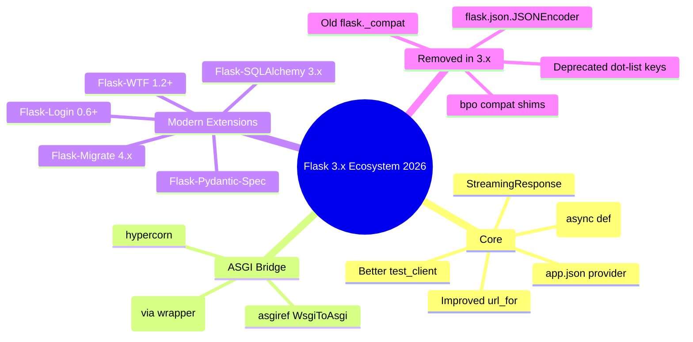
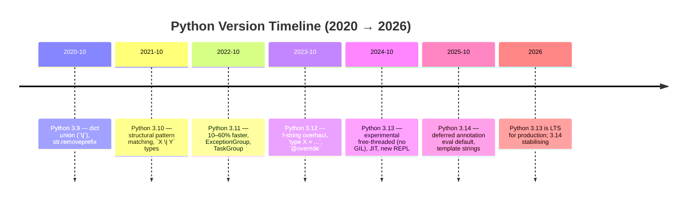
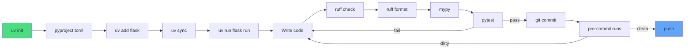
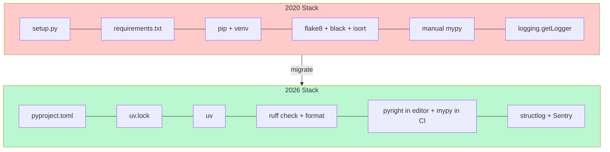

# Modern Flask & Python — The 2026 Landscape

> [!success] You finished the course. Now zoom out.
> If Lessons 01–24 taught you how to *write* Flask, this module teaches you how the surrounding ecosystem *looks today* — in 2026. The tools have shifted under our feet in the last three years: `pip` is being replaced by `uv`, `black` + `flake8` + `isort` collapsed into `ruff`, `setup.py` is gone, Python has a JIT, and the GIL is *optional*. This document is your map. Use it to modernise old tutorials, mentor juniors, and pick the right tool for your next project.

#flask #modern-python #2026 #ecosystem

---

## 0. The Big Picture — Why This Module Exists

If you learned Flask from a 2020 tutorial, you wrote:

```bash
python -m venv venv
source venv/bin/activate
pip install flask
pip freeze > requirements.txt
python app.py
```

That still works. But it's not what a modern Flask project looks like. A 2026 project starts with:

```bash
uv init my-app
cd my-app
uv add flask
uv run flask --app app run --debug
```

No `venv`. No `pip freeze`. No `requirements.txt`. No `setup.py`. Just `pyproject.toml` + `uv.lock`. This document walks you through **every** change — the *why*, the *how*, and the *gotchas* — so you can teach the modern stack with confidence.

> [!info] A note from your teacher
> Don't panic. The fundamentals you learned in Modules 01–14 (routing, templates, ORM, blueprints, deployment) are **all still valid**. What changed is the *tooling around* Flask, not Flask itself. Flask 3.x is still the same "micro-framework with decorators" you fell in love with.

---

## 1. Modern Flask 3.x — What Changed From 2.x

Flask 3.0 shipped in September 2023, Flask 3.1 in early 2025, and Flask 3.2 is the current LTS in 2026. Let's trace what's new.



### 1.1 The Big Ticket Changes

| Area | Flask 2.x | Flask 3.x (2026) | Why It Matters |
|------|-----------|------------------|----------------|
| `@app.route` on `async def` | Experimental, behind flag | First-class | Real `await` in handlers |
| JSON serialisation | Subclass `JSONEncoder` | Pluggable `app.json` provider | Swap in `orjson` without monkey-patching |
| `url_for("_external=True")` | Server-name guessing | Honours `PREFERRED_URL_SCHEME` + `SERVER_NAME` strictly | Predictable URLs in CI/tests |
| `app.test_client()` | Sync only | Sync **and** async (`AsyncTestClient`) | Test async routes ergonomically |
| `before_first_request` | Deprecated 2.3 | **Removed** in 3.0 | Use `with app.app_context()` + init |
| `flask.json.JSONEncoder` | Customise via subclass | **Removed** — use `provider` | See §1.3 |
| `app.jsonify` | Always `application/json` | Configurable MIME type | Emits `application/json; charset=utf-8` by default |

### 1.2 Async Views — Finally First-Class

Flask is still WSGI at heart, but 3.x lets you write `async def` routes. Under the hood, Flask runs each async view in an event loop *per worker*. You don't need an ASGI server to use them — but you do need an async-friendly worker (e.g. `gunicorn -k uvicorn.workers.UvicornWorker`).

```python
# app.py — Flask 3.x async route
import asyncio
from flask import Flask, jsonify

app = Flask(__name__)

@app.route("/")
async def index():
    # Real await — non-blocking
    await asyncio.sleep(0.1)
    return jsonify(message="hello from async Flask 3.x")

@app.route("/users/<int:user_id>")
async def fetch_user(user_id: int):
    user = await db_fetch(user_id)  # async DB driver
    return jsonify(user)
```

> [!warning] Gotcha: don't mix sync DB calls inside async views
> If you `await` an HTTP call but use blocking `psycopg2` to query the database, you freeze the event loop and lose the benefit. Use `psycopg` (v3, async), `aiomysql`, or `httpx.AsyncClient` for IO. #async #gotcha

### 1.3 The `app.json` Provider — Customising JSON Without Monkey-Patching

Flask 2.x made you subclass `flask.json.JSONEncoder`. That global subclass then had to be wired through `app.json_encoder = MyEncoder` — and it broke as soon as you wanted different encoders in different blueprints.

Flask 3.x introduces **JSON providers**. Swap the default for `orjson` (5–10× faster):

```python
# app.py — orjson provider
from flask import Flask
from flask.json.provider import DefaultJSONProvider
import orjson

class OrjsonProvider(DefaultJSONProvider):
    def dumps(self, obj, **kwargs):
        return orjson.dumps(
            obj,
            default=self.default,
            option=orjson.OPT_SERIALIZE_NUMPY | orjson.OPT_NAIVE_UTC,
        ).decode()

    def loads(self, s, **kwargs):
        return orjson.loads(s)

app = Flask(__name__)
app.json = OrjsonProvider(app)
```

Now every `jsonify()`, `request.get_json()`, and `app.json.response()` uses `orjson`. Different blueprints can use different providers if you really want to.

### 1.4 `StreamingResponse` and Improved `url_for`

Flask 3.1 introduced a first-class `StreamingResponse` wrapper (re-exported from Werkzeug) that makes streaming JSON and SSE trivially clean:

```python
# Server-Sent Events in 6 lines
from flask import Flask, StreamingResponse
import json, time

app = Flask(__name__)

@app.route("/stream")
def stream():
    def event_stream():
        for i in range(10):
            yield f"data: {json.dumps({'i': i})}\n\n"
            time.sleep(1)
    return StreamingResponse(event_stream(), mimetype="text/event-stream")
```

`url_for` improvements worth highlighting:

- Honours `PREFERRED_URL_SCHEME` even when there's no active request (great for CLI scripts).
- `_anchor` and `_method` no longer require `_external=True` to work consistently.
- Added a `_scheme` warning when it conflicts with `PREFERRED_URL_SCHEME`, instead of silently producing broken URLs.

### 1.5 `app.test_client()` Improvements

```python
# Tests can now be fully async
import pytest
from myapp import app

@pytest.mark.asyncio
async def test_async_route():
    async with app.test_client().as_async_client() as client:
        r = await client.get("/")
        assert r.status_code == 200
        assert (await r.get_json())["message"] == "hello from async Flask 3.x"
```

The sync `test_client()` is unchanged from Lesson 20 — your existing tests still pass.

### 1.6 Flask on ASGI Servers

Flask is WSGI-native. To run it on ASGI (uvicorn, hypercorn, daphne), wrap it:

```python
# asgi.py
from asgiref.wsgi import WsgiToAsgi
from myapp import app

asgi_app = WsgiToAsgi(app)
```

```bash
uvicorn asgi:asgi_app --reload --port 8000
```

> [!tip] When to bother?
> Wrap Flask in ASGI only when you need **real WebSockets** or **HTTP/2 push**. Otherwise, `gunicorn` (WSGI) is faster, simpler, and has 15 years of production hardening. Don't reach for ASGI just because it sounds modern. #deployment

### 1.7 Modern Flask Extensions (3.x-Compatible)

| Extension | Version (2026) | Notes |
|-----------|----------------|-------|
| `Flask-SQLAlchemy` | 3.1+ | App-factory first; `db.session` is contextual |
| `Flask-Migrate` | 4.0+ | Async-aware migrations; Alembic 1.13+ |
| `Flask-Login` | 0.6+ | Works with async views (use `await current_user.async_reload()`) |
| `Flask-WTF` | 1.2+ | Pydantic-v2 compatible; async `validate_on_submit()` |
| `Flask-Pydantic-Spec` | 0.5+ | Replaces `flask-expects-json` for typed APIs |
| `Flask-Cors` | 5.0+ | Async-safe |
| `Flask-Limiter` | 3.5+ | Redis-backed, async-friendly |
| `Flask-Caching` | 3.0+ | Pluggable backends incl. `aiomcache` |

### 1.8 Deprecated / Removed in Flask 3.x

- `flask._compat` — gone; use `from __future__ import annotations` instead.
- `flask.json.JSONEncoder` — gone; see §1.3.
- `before_first_request` — gone; use app-factory init or `@app.before_request` guard.
- `app.json_encoder` / `app.json_decoder` — gone; replaced by `app.json` provider.
- Dot-list keys in `request.get_json()` (`{"a.b": 1}` → `{"a": {"b": 1}}`) — gone; too many security bugs.
- `flask.Markup` — gone; import `markupsafe.Markup` directly.

> [!example] Teaching tip: the migration story
> When students ask "should I upgrade?", walk them through `flask --version` (which prints Werkzeug + Jinja versions too). Most 2.x → 3.x breakage is *one* of: JSONEncoder subclass, `before_first_request`, or `flask.Markup`. Show them the [official migration guide](https://flask.palletsprojects.com/en/stable/changes/) and let them run `pip-audit` to find lingering 2.x-only extensions. #teaching-tip

---

## 2. Modern Python — 3.12 + 3.13 in 2026



### 2.1 Python 3.12 — The "Polish" Release

#### F-Strings: Finally Sane

In 3.12, f-strings can contain *any* expression — including nested quotes that match the outer quotes, backslashes, and even multi-line:

```python
# Pre-3.12: forbidden
# f"{'hello\nworld'}"   # SyntaxError: backslash not allowed

# 3.12+: totally fine
greeting = f"{'hello\nworld'}"
items = ["a", "b", "c"]
print(f"{f"{items[0]} -> {items[1]}"}")   # nested f-string!
```

This is more than cosmetic — it lets you format SQL inside f-strings, build log messages with embedded dictionaries, and ditch the awkward `f"{x!r}"` dances.

#### `type X = ...` — Type Aliases Without Confusion

```python
# Old (confusing — is this an alias or a variable?)
UserId = int

# 3.12+ (explicit — the type checker KNOWS this is a type alias)
type UserId = int
type JSON = dict[str, "JSON"] | list["JSON"] | str | int | float | bool | None
```

The new `type` keyword creates a *real* `TypeAliasType` that type checkers and IDEs treat specially — including lazy evaluation, so recursive aliases (like `JSON` above) just work.

#### `@override` Decorator (PEP 698)

```python
from typing import override

class AdminUser(User):
    @override
    def can_edit(self, post: Post) -> bool:
        return True  # if User.can_edit signature changes, mypy flags this!
```

If `User.can_edit` is renamed or its signature changes, the type checker now *warns you* that `AdminUser.can_edit` is no longer overriding it. Lifesaver in large codebases.

#### Generic Classes Without `TypeVar` Boilerplate (PEP 695)

```python
# 3.11 and earlier
from typing import TypeVar, Generic
T = TypeVar("T")
class Stack(Generic[T]): ...

# 3.12+
class Stack[T]:
    def push(self, item: T) -> None: ...
```

### 2.2 Python 3.13 — The "Experimental" Release

Python 3.13 (October 2024) is the most consequential release in a decade. Two flagship features:

#### Free-Threaded Mode (No GIL!)

```bash
# Install the free-threaded build (separate binary)
uv python install 3.13t
uv venv --python 3.13t
```

```python
# threads finally scale across cores
import threading
from flask import Flask

app = Flask(__name__)

@app.route("/cpu")
def cpu_burn():
    # In 3.13 with GIL: this blocks every other request
    # In 3.13t free-threaded: other requests run on other cores
    total = sum(i*i for i in range(10_000_000))
    return {"total": total}
```

> [!warning] Free-threaded mode is experimental in 3.13
> Many C extensions (notably some older database drivers) don't release the GIL or aren't free-thread-safe yet. **Don't deploy 3.13t to production on day one.** Stick to 3.13 default (GIL on) for production; experiment with 3.13t in staging. #python313 #experimental

#### JIT Compiler (PEP 744)

```bash
# Enable the JIT (copy-and-patch, ~2-9% faster on macro-benchmarks in 3.13)
export PYTHON_JIT=1
```

In 3.13 the JIT is **off by default**. By 3.14/3.15 it's expected to be on by default and to deliver 10–40% speedups on Flask workloads. Right now it's opt-in and modest.

#### Improved REPL

Type `python` in 3.13+ and you get:

- Multiline editing without `IPython`
- Coloured output
- `F1` opens help, `F2` history, `F3` toggles paste mode
- Better tracebacks (the green/red colours actually help)

#### Coloured Error Messages

3.13's tracebacks now colour-code the *exact* token that caused the error:

```
  File "app.py", line 4
    return jsonify(msg="hi" + user.name  # forgot closing paren
                              ^^^^^^^^^^
SyntaxError: '(' was never closed
```

The `^^^^^^^^^^` underline is interactive — students *see* the problem instantly.

### 2.3 Structural Pattern Matching (`match/case`) in Flask Apps

Python 3.10+ introduced `match/case`. It shines in three Flask contexts:

#### (a) Routing on HTTP method inside one handler

```python
@app.route("/post/<int:pid>", methods=["GET", "POST", "PUT", "DELETE"])
def post(pid: int):
    match request.method:
        case "GET":    return render_post(pid)
        case "POST":   return create_post()
        case "PUT":    return update_post(pid)
        case "DELETE": return delete_post(pid)
        case _:        abort(405)
```

#### (b) Pattern-matching request payloads

```python
def handle_webhook(payload: dict):
    match payload:
        case {"event": "push", "ref": ref, "commits": commits}:
            process_push(ref, commits)
        case {"event": "pull_request", "action": "opened", "pr": pr}:
            process_pr_opened(pr)
        case {"event": "ping"}:
            return "pong"
        case _:
            abort(400, "Unknown event")
```

The `case {"key": value}` syntax destructures the dict *and* binds variables — no more `payload.get("event")` chains.

#### (c) Class-based dispatch

```python
match notification:
    case EmailNotification(to=addr, subject=sub):
        send_email(addr, sub)
    case SMSNotification(phone=num):
        send_sms(num)
    case SlackNotification(channel=ch):
        post_to_slack(ch)
```

### 2.4 Type Hints Improvements Worth Teaching

| Feature | Python version | Example |
|---------|----------------|---------|
| `Self` | 3.11+ | `def with_name(self, n: str) -> Self:` |
| `@override` | 3.12+ | See §2.1 |
| `TypeVarTuple` | 3.11+ | `def f(*args: *Ts) -> tuple[*Ts]:` |
| `override` (no decorator) | 3.12+ | `from typing import override` |
| PEP 604 unions | 3.10+ | `int \| str` instead of `Union[int, str]` |
| `Literal` | 3.8+ | `mode: Literal["r", "w"]` |

### 2.5 `tomllib` — Built-in TOML Parser

Python 3.11+ ships with `tomllib`. No more `toml` or `tomli` packages:

```python
import tomllib

with open("pyproject.toml", "rb") as f:
    config = tomllib.load(f)

print(config["project"]["name"])
print(config["project"]["dependencies"])
```

Note: `tomllib` is **read-only**. For writing TOML, use `tomli-w` or `tomlkit`.

### 2.6 `dataclass(slots=True)` — Memory Efficiency

```python
from dataclasses import dataclass

@dataclass(slots=True)
class UserDTO:
    id: int
    name: str
    email: str
```

`slots=True` (3.10+) prevents `__dict__` creation, cutting memory per instance by ~40% and slightly speeding attribute access. For a Flask app returning thousands of DTOs in an API response, this matters.

### 2.7 `dataclass_transform` — For ORM Decorators

PEP 681 lets library authors (like SQLAlchemy) tell type checkers that a decorator produces dataclass-like classes:

```python
# SQLAlchemy 2.x uses this so that:
class User(Base):
    id: Mapped[int] = mapped_column(primary_key=True)
    name: Mapped[str]

# …type checkers now infer User(id=1, name="x") as valid,
# and User.name is typed as str, not Column[str].
```

You don't write `dataclass_transform` yourself — you just benefit from it when using SQLAlchemy 2.x, Pydantic v2, or attrs.

---

## 3. Modern Python Packaging — `pyproject.toml` Is Now Mandatory

`setup.py` is dead. `setup.cfg` is dead. `requirements.txt` is for *applications* (lock files), not *packages*. The world has standardised on `pyproject.toml` (PEP 621).

### 3.1 A Modern `pyproject.toml` for a Flask Project

```toml
[project]
name = "my-flask-app"
version = "1.4.0"
description = "A teaching example of a modern Flask app"
readme = "README.md"
requires-python = ">=3.12"
license = { text = "MIT" }
authors = [{ name = "Your Name", email = "you@example.com" }]
keywords = ["flask", "teaching", "example"]
classifiers = [
    "Framework :: Flask",
    "Programming Language :: Python :: 3.12",
    "Programming Language :: Python :: 3.13",
]

# Runtime deps — note PEP 508 specifiers
dependencies = [
    "flask>=3.1,<4",
    "flask-sqlalchemy>=3.1",
    "flask-migrate>=4.0",
    "psycopg[binary]>=3.2",        # async + sync Postgres
    "pydantic>=2.7",
    "structlog>=24.1",
    "rich>=13.7",
]

# Optional deps — `uv sync --extra dev` or `pip install ".[dev]"`
[project.optional-dependencies]
dev = [
    "ruff>=0.6",
    "mypy>=1.11",
    "pytest>=8.3",
    "pytest-asyncio>=0.23",
    "pytest-cov>=5.0",
    "freezegun>=1.5",
    "httpx>=0.27",
]
prod = [
    "gunicorn>=23.0",
    "sentry-sdk[flask]>=2.10",
]

# Console script — `my-flask-app` becomes a CLI command
[project.scripts]
my-flask-app = "my_flask_app.cli:main"

# Build backend (how the wheel gets built)
[build-system]
requires = ["hatchling"]
build-backend = "hatchling.build"

# Tool configs go inline in the same file — no more .flake8, .isort.cfg, etc.
[tool.ruff]
line-length = 100
target-version = "py312"

[tool.ruff.lint]
select = ["E", "F", "I", "B", "UP", "SIM", "PL"]

[tool.ruff.format]
quote-style = "double"

[tool.mypy]
python_version = "3.12"
strict = true
plugins = ["pydantic.mypy"]

[tool.pytest.ini_options]
asyncio_mode = "auto"
testpaths = ["tests"]
addopts = "-ra --strict-markers --cov=my_flask_app --cov-report=term-missing"
```

> [!info] One file to rule them all
> Notice how `ruff`, `mypy`, and `pytest` configs all live inside `pyproject.toml`. That's the modern way. No more `.flake8`, `.isort.cfg`, `setup.cfg`, `mypy.ini`, `pytest.ini` — *all* of them collapse into `[tool.*]` sections here. #packaging

### 3.2 Build Backends Compared

| Backend | Best for | Notes |
|---------|----------|-------|
| `setuptools` | Legacy projects, C extensions | Still works; verbose config |
| `hatchling` | Most new pure-Python packages | Fast, PEP 621-native, default for `uv init` |
| `flit-core` | Tiny single-module packages | No build step, dead simple |
| `poetry-core` | Projects already using Poetry | Locks different from `uv.lock` |
| `pdm-backend` | PDM users | Similar to hatchling |

For a Flask *application* (not a library), you don't even need a build backend — just a `[project]` table for metadata. `uv` reads it directly.

### 3.3 Modern Dependency Specification (PEP 508)

```toml
dependencies = [
    "flask>=3.1,<4",                    # range
    "psycopg[binary,pool]>=3.2,<4",     # extras
    "structlog>=24.1 ; python_version>='3.12'",  # environment marker
    "uvloop>=0.19 ; sys_platform!='win32'",      # only on Unix
    "pydantic>=2.7,!=2.10.0",           # exclude a broken release
]
```

Environment markers (`;`) let you express platform/version constraints inline — no more separate `requirements-{linux,mac,win}.txt` files.

### 3.4 Optional Dependencies / Extras

```bash
uv sync                      # only runtime deps
uv sync --extra dev          # add dev tools
uv sync --all-extras         # everything
pip install ".[dev,prod]"    # if you're still on pip
```

### 3.5 Entry Points — `[project.scripts]`

```toml
[project.scripts]
flask-admin = "my_flask_app.cli:admin"
flask-worker = "my_flask_app.worker:main"
```

After `uv sync` (or `pip install -e .`), two new commands exist on your PATH: `flask-admin` and `flask-worker`. This is how Celery workers, CLI admin tools, and management scripts are packaged today.

---

## 4. Modern Development Workflow (2026)



### 4.1 `uv` — The Rust-Powered Replacement for pip/pip-tools/poetry/venv

`uv` (from Astral, the same people who make `ruff`) is 10–100× faster than `pip`. It bundles:

- `pip` — `uv pip install`
- `pip-tools` — `uv pip compile`
- `virtualenv` — `uv venv`
- `poetry` — `uv add`, `uv lock`, `uv sync`
- `pyenv` — `uv python install 3.13`

```bash
# Bootstrap a project
uv init my-app --python 3.13
cd my-app
uv add flask flask-sqlalchemy pydantic
uv add --dev ruff mypy pytest pytest-asyncio

# Run anything inside the venv — no need to "activate"
uv run flask --app app run --debug
uv run pytest
uv run ruff check .

# Reproducible builds via lock file
uv lock      # updates uv.lock
uv sync      # installs exactly what's in uv.lock
```

> [!tip] Why `uv` wins in the classroom
> Students no longer waste 10 minutes on `pip install` latency. A cold install of Flask + SQLAlchemy + pytest takes ~1.5 seconds with `uv` vs ~22 seconds with `pip`. That's the difference between an engaged class and a napping one. #teaching-tip #uv

### 4.2 `ruff` — Replaces flake8 + isort + black + pyupgrade + …

`ruff` is a single Rust binary that does linting *and* formatting. It's roughly 100× faster than `flake8` and 30× faster than `black`.

```bash
ruff check .          # lint
ruff check --fix .    # lint + autofix
ruff format .         # format (replaces black)
```

Configure it in `[tool.ruff]` inside `pyproject.toml` (see §3.1). Key rule sets:

| Code | What it checks |
|------|----------------|
| `E`, `W` | pycodestyle (replaces pycodestyle) |
| `F` | pyflakes (replaces pyflakes) |
| `I` | isort (replaces isort) |
| `B` | bugbear (replaces flake8-bugbear) |
| `UP` | pyupgrade — auto-upgrades syntax to your min Python |
| `SIM` | simplifications |
| `PL` | pylint subset |
| `RUF` | ruff-specific rules |

A single config line — `select = ["E", "F", "I", "B", "UP", "SIM", "PL"]` — replaces a dozen flake8 plugins.

### 4.3 Type Checking: `mypy` vs `pyright`

| Tool | Written in | Speed | Strictness | Editor support |
|------|-----------|-------|------------|----------------|
| `mypy` | Python | Slower | Highly configurable | Standalone |
| `pyright` / `pylance` | TypeScript | Very fast | Sane defaults | VS Code native |
| `basedpyright` | TypeScript | Very fast | Stricter pyright fork | Growing |

For Flask apps in 2026, the community has settled on: **`pyright` in the editor** (instant feedback) + **`mypy` in CI** (canonical strict run). Both honour `# type: ignore` and PEP 484.

### 4.4 `pre-commit` — Last Line of Defence

```yaml
# .pre-commit-config.yaml
repos:
  - repo: https://github.com/astral-sh/ruff-pre-commit
    rev: v0.6.0
    hooks:
      - id: ruff
        args: [--fix]
      - id: ruff-format
  - repo: https://github.com/pre-commit/mirrors-mypy
    rev: v1.11.0
    hooks:
      - id: mypy
        additional_dependencies: [pydantic, types-Flask]
  - repo: https://github.com/pre-commit/pre-commit-hooks
    rev: v4.6.0
    hooks:
      - id: trailing-whitespace
      - id: end-of-file-fixer
      - id: check-yaml
      - id: check-added-large-files
```

```bash
pre-commit install     # wire into .git/hooks
pre-commit run --all-files
```

Every commit now auto-fixes imports, formats code, and type-checks. Bad code literally cannot enter the repo.

> [!warning] Don't over-tighten pre-commit on day one
> A wall of red on every commit *demoralises* students. Start with `ruff-format` + `trailing-whitespace` only. Add lint rules and mypy once the team has internalised the basics. #teaching-tip

---

## 5. Modern Testing (2026)

### 5.1 `pytest` 8.x — What's New

```python
# pytest 8.x: better fixture scoping, dynamic parametrisation
import pytest

@pytest.fixture(scope="session")
def app():
    from myapp import create_app
    return create_app(testing=True)

@pytest.fixture
def client(app):
    return app.test_client()

def test_home(client):
    r = client.get("/")
    assert r.status_code == 200

# Parametrised — runs once per tuple
@pytest.mark.parametrize("url,expected", [
    ("/", 200),
    ("/about", 200),
    ("/nonexistent", 404),
])
def test_status_codes(client, url, expected):
    assert client.get(url).status_code == expected
```

New in 8.x:

- `--no-header`, `--quiet` improvements
- Better `ExceptionGroup` display
- `tmp_path_factory` is now sync-safe with asyncio
- Native `assert` rewriting is faster

### 5.2 `pytest-asyncio` for Async Tests

```python
# pyproject.toml: asyncio_mode = "auto"
import pytest

async def test_async_view(app):
    async with app.test_client().as_async_client() as client:
        r = await client.get("/async-route")
        assert r.status_code == 200
```

With `asyncio_mode = "auto"`, every `async def test_*` is automatically wrapped — no need for `@pytest.mark.asyncio` on each test.

### 5.3 `pytest-cov` — Coverage

```bash
uv run pytest --cov=myapp --cov-report=html --cov-report=term-missing
```

`htmlcov/index.html` shows line-by-line coverage. Aim for ≥85% on business logic; don't chase 100% on boilerplate.

### 5.4 `factory-boy` vs `model_bakery` for Test Data

```python
# factory-boy — declarative, FK-aware
import factory
from myapp.models import User

class UserFactory(factory.alchemy.SQLAlchemyModelFactory):
    class Meta:
        model = User
        sqlalchemy_session = scoped_session

    name = factory.Faker("name")
    email = factory.LazyAttribute(lambda o: f"{o.name.lower().replace(' ', '.')}@example.com")

# Usage
user = UserFactory.build()             # in-memory only
user = UserFactory.create()            # persists to DB
users = UserFactory.create_batch(50)   # bulk

# model_bakery — simpler, faster, less magic
from model_bakery import baker
user = baker.make(User, name="Alice")  # persists
user = baker.prepare(User)             # in-memory
```

`factory-boy` is richer (Faker, traits, post-generation hooks). `model_bakery` is faster and simpler. Pick one — don't mix.

### 5.5 `freezegun` for Time Mocking

```python
from freezegun import freeze_time

@freeze_time("2026-01-15 12:00:00")
def test_anniversary_badge():
    user = UserFactory(joined_at="2025-01-15")
    assert user.has_anniversary_badge()   # exactly 1 year later
```

> [!example] Teaching tip
> Have students write a test that checks "is this user over 18?" with `freezegun` and a fixed `datetime.now()`. They instantly see why mocking time is a superpower — and why every `time.now()` call in business logic is a testability smell. #teaching-tip #testing

### 5.6 `responses` and `httpx` for HTTP Mocking

```python
# responses — mocks the `requests` library
import responses

@responses.activate
def test_github_webhook():
    responses.add(responses.GET, "https://api.github.com/users/octocat",
                  json={"login": "octocat"}, status=200)
    r = client.get("/sync/github/octocat")
    assert r.json()["username"] == "octocat"

# httpx + respx — for async code
import respx, httpx

@respx.mock
async def test_async_fetch():
    respx.get("https://api.github.com/users/octocat").respond(200, json={"login": "octocat"})
    async with httpx.AsyncClient() as http:
        r = await http.get("https://api.github.com/users/octocat")
    assert r.json()["login"] == "octocat"
```

For new code, prefer `httpx` (sync + async) over `requests`. It's what Flask's own `test_client().as_async_client()` uses under the hood.

### 5.7 Property-Based Testing with `hypothesis`

```python
from hypothesis import given, strategies as st

@given(st.text(min_size=1, max_size=100))
def test_slug_does_not_crash(title: str):
    slug = make_slug(title)
    assert isinstance(slug, str)
    assert " " not in slug
    assert len(slug) >= 1
```

`hypothesis` generates *hundreds* of inputs automatically. It finds the edge cases you'd never think to write: empty strings, unicode, control characters, 1 MB of `"a"`. In a Flask app, use it for URL parsers, slug generators, and any function with a string/number input.

```python
# Property test for an endpoint
from hypothesis import given, settings, HealthCheck

@given(
    age=st.integers(min_value=0, max_value=150),
    name=st.text(min_size=1, max_size=50).filter(lambda s: s.isprintable()),
)
@settings(suppress_health_check=[HealthCheck.function_scoped_fixture])
def test_signup_validates_input(client, age, name):
    r = client.post("/signup", json={"name": name, "age": age})
    assert r.status_code in (201, 400)   # never 500
```

> [!success] Hypothesis catches 500s
> The single most valuable property test for a Flask app: "for any reasonable JSON payload, the endpoint must return 4xx, never 5xx." If hypothesis finds a payload that 500s, you've found a real bug. #testing #hypothesis

---

## 6. Code Quality Standards (2026)

### 6.1 Type Hints Everywhere

```python
# 2026 standard — PEP 604 unions, no Optional/Union imports
from flask import Flask, Response, jsonify, request
from typing import Self

app = Flask(__name__)

@app.get("/users/<int:user_id>")
def get_user(user_id: int) -> tuple[Response, int]:
    user: User | None = db.get(user_id)
    if user is None:
        return jsonify(error="not found"), 404
    return jsonify(user.to_dict()), 200

class User:
    def with_name(self, name: str) -> Self:
        self.name = name
        return self
```

PEP 604 unions (`X | Y`) replaced `Union[X, Y]` and `Optional[X]`. `Self` (3.11+) replaces the awkward `T = TypeVar("T", bound="User")` pattern for chainable methods.

### 6.2 Pydantic v2 — Fast, Validated, Type-Safe

Pydantic v2 (Rust core) is 5–50× faster than v1 and integrates perfectly with Flask:

```python
from pydantic import BaseModel, EmailStr, Field, field_validator
from flask import Flask, request, jsonify
from flask_pydantic_spec import FlaskPydanticSpec

app = Flask(__name__)
spec = FlaskPydanticSpec("flask", title="My API")

class CreateUserBody(BaseModel):
    name: str = Field(min_length=1, max_length=100)
    email: EmailStr
    age: int = Field(ge=0, le=150)

    @field_validator("name")
    @classmethod
    def name_strip(cls, v: str) -> str:
        return v.strip()

@app.post("/users")
@spec.validate(body=CreateUserBody)
def create_user(json: CreateUserBody):
    user = db.insert(json.model_dump())
    return jsonify(user), 201
```

The `@spec.validate(body=...)` decorator:

1. Parses the request body
2. Validates types and constraints
3. Returns 422 with a structured error if invalid
4. Hands the typed `CreateUserBody` to your handler

Your route function never sees raw JSON.

### 6.3 `structlog` — Structured Logging

Plain `print()` and `logging.getLogger(__name__)` produce strings that humans can read but machines can't parse. `structlog` produces both:

```python
import structlog

log = structlog.get_logger()

@app.route("/checkout/<int:order_id>")
def checkout(order_id: int):
    log.info("checkout_started", order_id=order_id, user_id=current_user.id)
    try:
        charge = stripe.charge(...)
    except StripeError as e:
        log.error("checkout_failed", order_id=order_id, error=str(e))
        return jsonify(error="payment_failed"), 502
    log.info("checkout_succeeded", order_id=order_id, charge_id=charge.id)
    return jsonify(success=True), 200
```

Output (JSON for production, pretty-coloured for dev):

```json
{"event":"checkout_started","order_id":42,"user_id":7,"timestamp":"2026-01-15T12:00:00Z","level":"info"}
```

In production, ship these logs to Elasticsearch/Loki/Datadog and you can grep them like SQL: `event:checkout_failed AND error:insufficient_funds`.

### 6.4 `rich` — Beautiful Terminal Output

```python
from rich.console import Console
from rich.table import Table
from rich.progress import track

console = Console()

# Coloured output
console.print("[bold green]Success![/] User created.")

# Tables
table = Table(title="Active Users")
table.add_column("ID", justify="right")
table.add_column("Name")
table.add_column("Last seen")
for u in users:
    table.add_row(str(u.id), u.name, u.last_seen.isoformat())
console.print(table)

# Progress bars
for user in track(users, description="Emailing…"):
    send_email(user)
```

`rich` is what makes the new Python 3.13 REPL colourful. It's also excellent for CLI admin tools that ship with your Flask app — your `flask-admin` command can now print gorgeous tables without any effort.

### 6.5 Error Monitoring — Sentry & Rollbar

```python
# pip install sentry-sdk[flask]
import sentry_sdk
from sentry_sdk.integrations.flask import FlaskIntegration

sentry_sdk.init(
    dsn="https://...@sentry.io/123",
    integrations=[FlaskIntegration()],
    traces_sample_rate=0.1,        # 10% perf traces
    environment="production",
    release="my-flask-app@1.4.0",
)
```

Every uncaught exception in your Flask app now:

1. Gets captured with full stack trace
2. Includes the request URL, headers (sensitive ones redacted), and body
3. Is grouped with similar errors across deploys
4. Triggers an alert in Slack/email/PagerDuty

Sentry's Flask integration also instruments `before_request`, database queries, and (with the optional `httpx` integration) outbound HTTP calls. For Flask 3.x + ASGI, use `sentry_sdk.integrations.asgi.SentryAsgiMiddleware` to wrap your `WsgiToAsgi(app)`.

Rollbar offers similar features; Sentry has won the de-facto standard in 2026.

---

## 7. Putting It All Together — A Modern Flask Project Skeleton (2026)

```
my-flask-app/
├── pyproject.toml          # ALL config lives here
├── uv.lock                 # reproducible installs
├── README.md
├── .python-version         # 3.13
├── .pre-commit-config.yaml
├── src/
│   └── my_flask_app/
│       ├── __init__.py     # create_app() factory
│       ├── cli.py          # entry points
│       ├── routes/
│       ├── models/
│       ├── services/
│       └── schemas.py      # Pydantic models
├── tests/
│   ├── conftest.py
│   ├── factories.py        # factory-boy
│   └── test_*.py
└── migrations/             # Alembic, via Flask-Migrate
```

```bash
# Day 1 setup
uv init my-flask-app --python 3.13
cd my-flask-app
uv add flask flask-sqlalchemy flask-migrate pydantic structlog rich
uv add --dev ruff mypy pytest pytest-asyncio pytest-cov freezegun httpx factory-boy hypothesis pre-commit
uv run pre-commit install
uv run flask --app my_flask_app db init
uv run pytest
```

That's it. No `requirements.txt`. No `setup.py`. No `.flake8`. No `tox.ini`. One `pyproject.toml` to read, one `uv.lock` to commit, one `uv sync` to reproduce.

---

## 8. Old Way vs New Way — Quick Reference Table



| Concern | 2020 (old) | 2026 (new) |
|---------|-----------|------------|
| Project metadata | `setup.py` | `[project]` in `pyproject.toml` |
| Lock file | `requirements.txt` + `pip freeze` | `uv.lock` |
| Virtual env | `python -m venv venv` | `uv venv` (or implicit via `uv run`) |
| Install packages | `pip install flask` | `uv add flask` |
| Run command | `python app.py` | `uv run flask --app app run` |
| Format code | `black .` | `ruff format .` |
| Lint code | `flake8 .` | `ruff check .` |
| Sort imports | `isort .` | `ruff check --select I --fix .` |
| Type check | `mypy .` | `pyright` (editor) + `mypy` (CI) |
| Run tests | `pytest` | `uv run pytest` |
| Test data | `factory-boy` or `model_mommy` | `factory-boy` or `model_bakery` |
| HTTP mock | `responses` (sync only) | `respx` + `httpx` (sync + async) |
| Validation | `marshmallow` or hand-rolled | `pydantic` v2 |
| Logging | `logging` module | `structlog` |
| Terminal UI | `print` + ANSI codes | `rich` |
| Errors | Rollbar / Sentry | Sentry (Flask + ASGI integrations) |
| Python runtime | CPython 3.8/3.9 with GIL | CPython 3.13 (GIL on for prod, 3.13t for experiment) |
| Flask version | 2.0–2.2 | 3.1+ (LTS in 2026) |
| JSON serialisation | subclass `JSONEncoder` | `app.json` provider (or `orjson` provider) |

---

## 9. Teaching Tips — Bringing Modern Tooling Into the Classroom

> [!tip] How to introduce this material to students
> Students who finish Lessons 01–24 will be *fluent* in classic Flask. This module bridges them to *production-ready* Flask. Here's a recommended progression:
>
> 1. **Day 1**: Have them install `uv` and run `uv init my-app`. Let them *feel* the speed. Don't explain `pyproject.toml` yet — just show them `uv add flask` works.
> 2. **Day 2**: Open `pyproject.toml` together. Compare each `[project]` field to the old `setup.py` equivalent. Show that `[tool.*]` sections replace five config files.
> 3. **Day 3**: Introduce `ruff`. Run `ruff check --fix .` on a deliberately messy file. Watch 47 lint errors auto-fix in 80 milliseconds. *Then* explain what each rule means.
> 4. **Day 4**: Add `mypy`. Start permissive (`strict = false`), then ratchet up. Show how `@override` and `Self` prevent real bugs.
> 5. **Day 5**: Write one async route together. Test it with `pytest-asyncio`. Discuss when async is worth it (IO-heavy) and when it isn't (CPU-heavy).
> 6. **Day 6**: Add `pydantic` to a POST endpoint. Show how 30 lines of validation disappear into 5 lines of Pydantic schema.
> 7. **Day 7**: Add `structlog`. Have them `grep` the JSON output with `jq`. They'll never go back to string logs.
> 8. **Capstone**: Add `hypothesis` to the capstone blog project. Have students find one bug it discovers that they didn't anticipate. #teaching-tip

> [!warning] Don't teach everything at once
> The biggest mistake is overwhelming students with all 15 tools in week one. The modern stack is *modular* — you can adopt `uv` without `ruff`, `ruff` without `mypy`, `pydantic` without `structlog`. Each tool is independently valuable. Adopt incrementally. #teaching-tip

> [!example] The "convert a Lesson" exercise
> Take any lesson from Modules 02–09 (Routing, Templates, Forms, Database). Have the student:
> 1. Move it from `requirements.txt` to `pyproject.toml`
> 2. Add `ruff` and fix all violations
> 3. Add type hints and a `mypy` config
> 4. Convert one route to `async def` with an async DB call
> 5. Replace `request.get_json()` validation with a Pydantic schema
>
> This single exercise converts theoretical knowledge into muscle memory. #exercise #teaching-tip

---

## 10. What's Next?

You've now seen the entire 2026 Flask ecosystem. To go deeper:

- **Read**: PEP 695 (type params), PEP 698 (`@override`), PEP 621 (project metadata), PEP 744 (JIT), PEP 703 (free-threaded Python).
- **Watch**: Armin Ronacher's talks on "Flask and the Future of Python Web Frameworks" and Hynek Schlawack's "Async in Flask" talks.
- **Try**: Convert one of your existing Flask apps to the modern stack *in a feature branch*. Notice what breaks, what's smoother, what's surprisingly hard.
- **Teach**: Show a junior developer how `uv` works. The "wow, that's fast" reaction is the gateway to the rest of the modern stack.

> [!quote] A note from your teacher
> The fundamentals — HTTP, routing, templating, databases, testing, deployment — haven't changed since Lessons 01–23. What changes every five years is the *tooling*. Learn the fundamentals deeply, and the tooling becomes a fashion choice. Learn only the tooling, and every new release leaves you behind. You've done both. Go build something.

#flask #modern-python #2026 #ecosystem #research

---

**End of Modern Flask & Python — Research Document (Task R1)**
