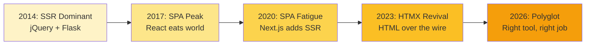
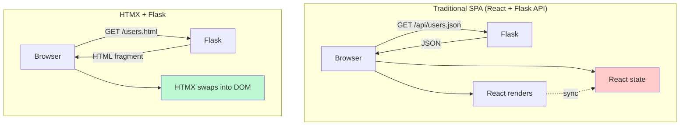
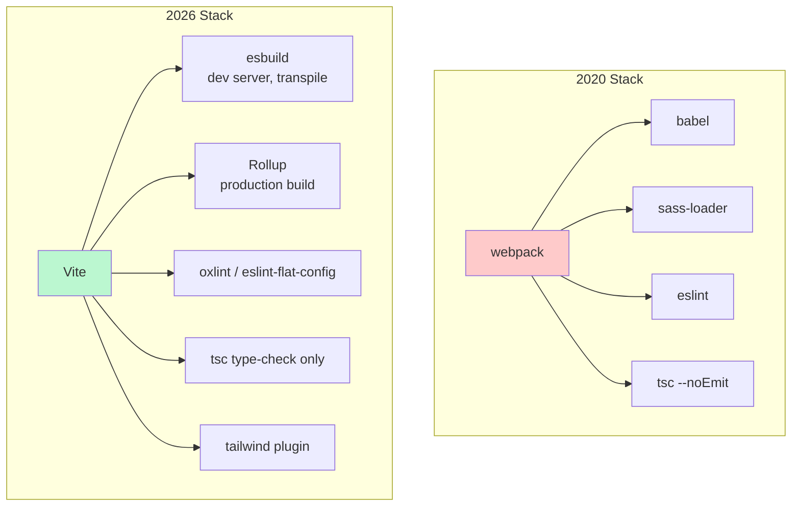
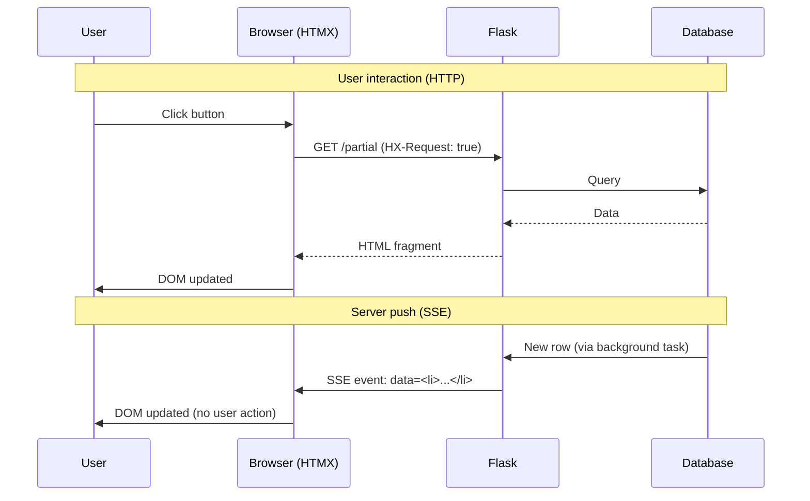
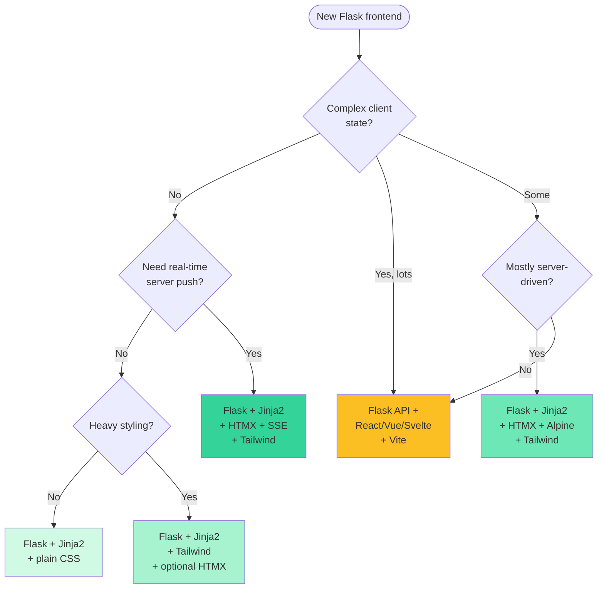

# Modern Frontend Integration — The 2026 Landscape

> [!success] You know Flask. Now make it look good — and feel modern.
> [[Lesson-07-Jinja2-Basics]] taught you to render HTML on the server. [[Lesson-09-Static-Files]] showed you how to wire up CSS and JS. [[Lesson-19-Building-JSON-API]] and [[Lesson-20-RESTful-Resources]] turned Flask into a JSON backend. This document zooms out and asks: *what does a Flask frontend look like in 2026?* The answer is messier — and more interesting — than "use React." HTMX has triggered a server-rendered renaissance. Tailwind 4.0 dropped its config file. Vite ate webpack. Alpine.js lets you sprinkle interactivity without a build step. Svelte 5 has runes. CSS got `:has()`, nesting, and container queries *natively*. This is your map of the territory — so you can teach the right tool, not the trendy one.

#frontend #htmx #tailwind #2026 #modern-tooling

---

## 0. The Big Picture — Why This Module Exists

A 2018 Flask frontend looked like this:

```html
<!-- templates/base.html -->
<link rel="stylesheet" href="{{ url_for('static', filename='css/style.css') }}">
<script src="https://code.jquery.com/jquery-3.3.1.min.js"></script>
<script>
  $('#search').on('keyup', function() {
    $.get('/search?q=' + $(this).val(), function(data) {
      $('#results').html(data);
    });
  });
</script>
```

A 2026 Flask frontend looks like one of three things:

```html
<!-- 1. HTMX — zero JS, server returns HTML fragments -->
<input type="search" name="q"
       hx-get="/search"
       hx-target="#results"
       hx-trigger="keyup changed delay:300ms">
<div id="results"></div>
```

```html
<!-- 2. Alpine.js — 15KB, no build step, declarative reactivity -->
<div x-data="{ open: false }">
  <button @click="open = !open">Toggle</button>
  <div x-show="open" x-transition>Panel</div>
</div>
```

```bash
# 3. SPA — Flask API + Vite-powered React/Vue/Svelte frontend
$ uvicorn api:app --port 8000 &
$ cd frontend && npm run dev    # Vite on :5173, proxies /api → :8000
```

Three very different shapes, each with its own sweet spot. The mistake most tutorials make is picking *one* and pretending it's universal. The truth: **most Flask apps should use #1 or #2**. SPAs are over-prescribed. We'll show you exactly when each is right.

> [!info] A note from your teacher
> This is *not* a "React tutorial" or a "Vue tutorial." It's a decision-making framework. After reading this, you should be able to look at a feature request and confidently say: "HTMX + Alpine here," or "this genuinely needs a SPA." That judgement is more valuable than any single framework's syntax.

---

## 1. The Modern Flask + Frontend Landscape (2026)

### 1.1 Why Flask is still relevant for frontend in 2026

The dominant frontend narrative from 2015 to 2021 was: "the server just serves JSON; the browser does everything." React, Vue, and Angular won. Then something broke. SPAs got *heavy* (megabytes of JS to render a blog post). SEO became a nightmare. State management became a job title. Build times ballooned. Meta-frameworks (Next.js, Nuxt, SvelteKit) emerged to bolt SSR back onto SPAs — admitting, in effect, that the server had a role to play.

In 2026 the pendulum has swung back. **Server-rendered is cool again.** Flask was *never not* server-rendered. It just had to wait for the industry to come home.

Why Flask specifically thrives:

- **Jinja2 is excellent.** It's a mature, fast, well-documented template engine with template inheritance, macros, and filters. Django has it. Rails has ERB. Flask's version is the cleanest of the three.
- **`render_template` returns strings.** That means the same function can return a full page *or* a fragment — perfect for HTMX.
- **` jsonify` is one line.** When you do want an API, Flask doesn't fight you. No serializers, no viewsets, no DRF. Just `return jsonify({"user": user.to_dict()})`.
- **Synchronous by default.** Frontend code, especially HTMX, plays well with synchronous Flask views. You don't have to learn async just to render HTML.
- **Micro = no opinions.** Flask doesn't care whether you use Jinja2, HTMX, or wire up React on top. You choose.

### 1.2 The HTMX movement — "HTML over the wire"

HTMX (created by Carson Gross in 2020, mainstream by 2023, *default* in many Flask tutorials by 2026) is a 17KB JavaScript file that extends HTML with new attributes. The pitch:

> Instead of the server returning JSON and the client rendering HTML, **the server returns HTML and the client swaps it into the DOM.**

That's it. That's the entire paradigm shift. It sounds small until you realize it eliminates:

- The JSON serialization layer on the server
- The fetching/parsing/state-management layer on the client
- The "two rendering stacks to maintain" problem (server for SEO, client for interactivity)
- Most of the `useState` / `useEffect` code you'd write in React

HTMX is **HTML over the wire**, and Flask speaks HTML natively. They were made for each other.

### 1.3 The SPA vs SSR debate in 2026 (SSR is back!)



In 2026 the debate is largely *settled*. The consensus:

- **Default to SSR** (server-rendered HTML). Use HTMX for interactivity.
- **Use a SPA** when you have genuinely complex client state: a code editor (Monaco), a spreadsheet, a design tool (Figma-lite), a video editor, a heavy dashboard with drag-and-drop, an offline-first PWA.
- **Use a meta-framework** (Next.js, SvelteKit, Nuxt) only when you need SSR *and* a SPA — i.e. you have a marketing site plus an app shell.

For most Flask projects — admin panels, internal tools, blogs, CRUD apps, dashboards, marketplaces — **SSR + HTMX is the right answer in 2026**. SPAs are now a deliberate choice, not the default.

### 1.4 When to use what — a first-pass guide

| Use case | Recommended stack | Build step? |
|----------|-------------------|-------------|
| Blog, docs site, marketing page | Flask + Jinja2 + Tailwind | Optional |
| Admin panel, internal CRUD | Flask + Jinja2 + HTMX + Tailwind | No |
| Interactive form (validation, autocomplete) | Flask + HTMX + Alpine | No |
| Public API consumed by mobile app | Flask API only | N/A |
| Complex dashboard with charts | Flask + HTMX + Alpine + Chart.js | No |
| Real-time dashboard (live metrics) | Flask + SSE + HTMX | No |
| Code editor, spreadsheet, design tool | Flask API + React/Vue/Svelte | Yes (Vite) |
| E-commerce (SEO + cart) | Flask + Jinja2 + HTMX + Stripe | No |
| Offline-first PWA | Flask API + SvelteKit | Yes |

> [!tip] Teaching Tip
> When a student asks "should I use React?" the right follow-up question is: *"What's the most complex interaction on the page?"* If the answer is "a dropdown menu" or "live search," they don't need React. They need HTMX or Alpine. If the answer is "a multi-tab code editor with syntax highlighting and shared state across files," then yes, build a SPA.

---

## 2. HTMX + Flask — The Hottest Combo in 2026

### 2.1 What is HTMX

HTMX extends HTML. You add attributes like `hx-get`, `hx-post`, `hx-target` to ordinary HTML elements, and HTMX automatically issues AJAX requests and swaps the returned HTML into the page. It also supports **WebSocket** and **Server-Sent Events (SSE)** via extensions — so the same library handles AJAX, real-time, and partial updates.

The library is 17KB minified, has no dependencies, and is loaded with a single `<script>` tag. No build step. No npm. No `package.json`.

### 2.2 Installation — 30 seconds

```html
<!-- templates/base.html -->
<!DOCTYPE html>
<html lang="en">
<head>
  <meta charset="UTF-8">
  <title>Flask + HTMX</title>
  <!-- HTMX core -->
  <script src="https://unpkg.com/htmx.org@2.0.4"></script>
</head>
<body>
  
</body>
</html>
```

Or self-host it (recommended for production):

```bash
# Save htmx.min.js into your static folder
curl -L https://unpkg.com/htmx.org@2.0.4 -o static/js/htmx.min.js
```

```html
<script src="{{ url_for('static', filename='js/htmx.min.js') }}"></script>
```

### 2.3 Core attributes — the HTMX vocabulary

| Attribute | Purpose | Example |
|-----------|---------|---------|
| `hx-get` | Issue GET to URL on trigger | `hx-get="/users/1"` |
| `hx-post` | Issue POST to URL | `hx-post="/save"` |
| `hx-put`, `hx-patch`, `hx-delete` | Other verbs | `hx-delete="/items/3"` |
| `hx-target` | CSS selector to swap result into | `hx-target="#results"` |
| `hx-swap` | *How* to swap: `innerHTML`, `outerHTML`, `beforeend`, `afterbegin`, `delete`, `none` | `hx-swap="innerHTML"` |
| `hx-trigger` | What event fires the request | `hx-trigger="click"`, `keyup changed delay:300ms` |
| `hx-vals` | Extra values to send (JSON) | `hx-vals='{"page": 2}'` |
| `hx-headers` | Extra request headers | `hx-headers='{"X-Requested": "htmx"}'` |
| `hx-include` | Include other form elements | `hx-include="#filters"` |
| `hx-indicator` | Show this element while loading | `hx-indicator="#spinner"` |
| `hx-push-url` | Update browser URL on success | `hx-push-url="true"` |
| `hx-disabled-elt` | Disable element during request | `hx-disabled-elt="this"` |

### 2.4 Example: a live-filter search box

**The template:**

```html
<!-- templates/search.html -->


  <h1>User Search</h1>
  <input type="search"
         name="q"
         placeholder="Search users…"
         hx-get="/search"
         hx-target="#results"
         hx-trigger="keyup changed delay:300ms"
         hx-indicator="#spinner"
         class="border p-2 rounded">
  <span id="spinner" class="htmx-indicator">…</span>

  <ul id="results" class="mt-4">
    
  </ul>

```

**The partial template** (returns just the `<li>` rows):

```html
<!-- templates/partials/_user_list.html -->

  <li class="py-1">{{ user.name }} — {{ user.email }}</li>

  <li class="text-gray-500">No matches</li>

```

**The Flask route:**

```python
# app.py
from flask import Flask, render_template, request

app = Flask(__name__)

@app.get("/search")
def search():
    q = request.args.get("q", "").strip().lower()
    users = [u for u in ALL_USERS if q in u["name"].lower()]
    # If HTMX made the request, return only the partial.
    # Otherwise return the full page.
    if request.headers.get("HX-Request"):
        return render_template("partials/_user_list.html", users=users)
    return render_template("search.html", users=users)
```

That's it. No JavaScript. No JSON. No React. The browser sends `GET /search?q=...` on every keypress (debounced 300ms), Flask renders the partial, HTMX swaps the `<ul id="results">` contents.

> [!tip] Teaching Tip — `HX-Request` is the magic header
> HTMX sets the `HX-Request: true` header on every request it makes. This lets one Flask route serve *both* the full page (direct navigation) and the partial (HTMX update). It's the single most useful HTMX/Flask pattern.

### 2.5 Out-of-band swaps (`hx-swap-oob`)

Sometimes an interaction needs to update multiple parts of the page — the list *and* a counter, for example. HTMX's "out-of-band" feature lets the server return HTML that updates elements elsewhere on the page.

```python
@app.post("/tasks")
def create_task():
    task = Task.create(request.form["title"])
    return render_template("partials/_task_row.html", task=task), 201, {
        # Tell HTMX: also update the counter
        "HX-Trigger": "taskCreated"
    }
```

Or, in the partial itself:

```html
<!-- partials/_task_row.html -->
<li>{{ task.title }}</li>

<!-- Out-of-band: this div replaces #counter wherever it lives on the page -->
<div id="counter" hx-swap-oob="true">
  {{ task_count }} tasks
</div>
```

When HTMX receives this response, it swaps the main target *and* finds `#counter` on the page and updates it too — without writing any JavaScript.

### 2.6 Why HTMX is perfect for Flask

Both HTMX and Flask share a philosophy: **the server is the source of truth, and the client should be dumb**. Flask renders HTML. HTMX swaps HTML. No impedance mismatch, no JSON serialization boundary, no client-side model layer to keep in sync.

Compare two architectures:



The HTMX version has *one rendering stack* (Jinja2). The SPA version has two: Jinja2 (or some SSR fallback) *and* React. Every model change has to flow through two systems. HTMX eliminates that duplication.

> [!warning] HTMX is not a silver bullet
> HTMX shines for *server-driven* interactivity. It struggles when you have rich client-side state that *isn't* on the server: drag-and-drop reordering of unsaved items, multi-step wizards with complex validation, complex form layouts with conditional logic that depends on local state. For those, reach for **Alpine.js alongside HTMX**, or build a real SPA.

---

## 3. Alpine.js + Flask

### 3.1 What is Alpine.js

Alpine.js is a 15KB JavaScript library that gives you the *reactive* parts of Vue or React — `x-data`, `x-show`, `x-for`, `x-model` — without a build step, without JSX, without components-as-files. You write it directly in HTML.

It was created by Caleb Porzio (also the creator of Livewire, the Laravel equivalent of HTMX+Alpine). The pitch: **"Vue from a CDN."**

### 3.2 Installation

```html
<!-- Always defer so Alpine runs after the DOM parses -->
<script defer src="https://cdn.jsdelivr.net/npm/alpinejs@3.x.x/dist/cdn.min.js"></script>
```

Or self-hosted:

```bash
curl -L https://cdn.jsdelivr.net/npm/alpinejs@3.x.x/dist/cdn.min.js \
  -o static/js/alpine.min.js
```

```html
<script defer src="{{ url_for('static', filename='js/alpine.min.js') }}"></script>
```

### 3.3 Core directives

| Directive | Purpose | Example |
|-----------|---------|---------|
| `x-data` | Declare local reactive state | `x-data="{ open: false }"` |
| `x-show` | Toggle `display` based on expression | `x-show="open"` |
| `x-if` | Add/remove element from DOM | `x-if="open"` |
| `x-bind` / `:attr` | Bind an attribute | `:class="open ? 'on' : 'off'"` |
| `x-on` / `@event` | Event listener | `@click="open = !open"` |
| `x-model` | Two-way input binding | `x-model="name"` |
| `x-for` | Loop over array | `x-for="item in items"` |
| `x-text` | Set text content | `x-text="name"` |
| `x-html` | Set innerHTML | `x-html="markup"` |
| `x-init` | Run on init | `x-init="fetchData()"` |
| `x-transition` | Transition directives | `x-transition.duration.300ms` |

### 3.4 Example: dropdown menu

```html
<div x-data="{ open: false }" class="relative">
  <button @click="open = !open"
          @click.outside="open = false"
          class="px-4 py-2 bg-blue-600 text-white rounded">
    Menu
  </button>
  <div x-show="open"
       x-transition.origin.top
       @keydown.escape.window="open = false"
       class="absolute mt-2 w-48 bg-white shadow rounded">
    <a href="/profile" class="block px-4 py-2 hover:bg-gray-100">Profile</a>
    <a href="/settings" class="block px-4 py-2 hover:bg-gray-100">Settings</a>
    <a href="/logout" class="block px-4 py-2 hover:bg-gray-100">Sign out</a>
  </div>
</div>
```

No build step. No component file. No `useState`. The dropdown works.

### 3.5 Alpine + HTMX together

The idiomatic 2026 Flask stack is **HTMX for server communication + Alpine for client interactivity**. They don't compete — they complement.

- **HTMX** = "talk to the server, swap HTML."
- **Alpine** = "manage local UI state (open/close, tabs, modals, form visibility)."

Example: a modal that loads its content from the server.

```html
<div x-data="{ open: false }">
  <button @click="open = true" class="btn">Open modal</button>

  <div x-show="open" x-transition class="modal-backdrop">
    <div class="modal-content">
      <!-- HTMX fetches the modal body when the modal opens -->
      <div hx-get="/users/42/edit"
           hx-trigger="intersect once"
           x-show="open">
        Loading…
      </div>
      <button @click="open = false">Close</button>
    </div>
  </div>
</div>
```

Alpine controls the modal's visibility. HTMX loads the form from the server. Each library does what it's best at.

> [!tip] Teaching Tip — Alpine's sweet spot
> Alpine is overkill if you only need one or two `x-show`s — for that, plain `<details>` or 5 lines of vanilla JS is fine. Alpine earns its keep when you have multiple interacting pieces of local state: a wizard with 3 steps, a tabbed interface with dirty-state tracking, a multi-select with a search box. For anything bigger than that, you're probably in SPA territory.

---

## 4. Tailwind CSS + Flask (the 2026 standard)

### 4.1 What is Tailwind CSS

Tailwind is a **utility-first** CSS framework. Instead of writing `.btn { background: blue; padding: 8px; }` and then `<button class="btn">`, you write `<button class="bg-blue-600 px-4 py-2 rounded">`. The utility classes map 1:1 to CSS properties.

It looks ugly at first. After two weeks, you'll never go back. The wins:

- **No naming things** (the hardest problem in CSS disappears).
- **No dead CSS** — only utilities you actually use are shipped.
- **Consistency** — colors, spacing, type scale are pre-defined; no off-by-one pixels.
- **Responsive by default** — `md:bg-red-500 lg:bg-blue-500` is just a media query.

### 4.2 Tailwind 4.0 (2026) — CSS-first config

Tailwind 4.0 (released late 2024, dominant in 2026) replaced the old `tailwind.config.js` with **CSS-first configuration**. You now configure the framework inside your CSS file using `@theme`:

```css
/* static/src/app.css */
@import "tailwindcss";

@theme {
  --color-brand: #3b82f6;
  --font-display: "Inter", sans-serif;
  --radius-card: 0.75rem;
}
```

Now `bg-brand`, `font-display`, and `rounded-card` are all available as utilities — no JS config, no restart.

### 4.3 Installation with Flask

Two options: **the standalone CLI** (simplest, no Node required) or **the Vite plugin** (if you're already using Vite for a frontend build).

**Option A — standalone CLI:**

```bash
# Install the Tailwind CLI (single binary, no Node needed)
curl -sLO https://github.com/tailwindlabs/tailwindcss/releases/latest/download/tailwindcss-linux-x64
chmod +x tailwindcss-linux-x64
mv tailwindcss-linux-x64 ./tailwindcss

# Watch mode — rebuilds on file change
./tailwindcss -i static/src/app.css -o static/dist/app.css --watch
```

```html
<!-- templates/base.html -->
<link rel="stylesheet"
      href="{{ url_for('static', filename='dist/app.css') }}">
```

**Option B — Vite plugin** (covered in section 6.3).

### 4.4 Tailwind + Jinja2

Use Tailwind classes directly in Jinja2 templates:

```html
<!-- templates/base.html -->
<!DOCTYPE html>
<html lang="en" class="h-full">
<head>
  <meta charset="UTF-8">
  <title>{{ title or "My Flask App" }}</title>
  <link rel="stylesheet" href="{{ url_for('static', filename='dist/app.css') }}">
</head>
<body class="h-full bg-gray-50 text-gray-900">
  <nav class="bg-white border-b px-6 py-3 flex items-center justify-between">
    <a href="/" class="font-bold text-xl">MyApp</a>
    <div class="flex gap-4">
      <a href="/dashboard" class="hover:text-blue-600">Dashboard</a>
      <a href="/settings" class="hover:text-blue-600">Settings</a>
    </div>
  </nav>
  <main class="max-w-4xl mx-auto p-6">
    
  </main>
</body>
</html>
```

For repeating patterns, define Jinja2 macros that wrap the Tailwind classes:

```html
<!-- templates/macros/buttons.html -->

  
  <button type="{{ type }}"
          class="px-4 py-2 rounded font-medium {{ variants[variant] }}">
    {{ text }}
  </button>

```

```html

{{ button("Save", variant="primary") }}
{{ button("Delete", variant="danger") }}
```

### 4.5 DaisyUI — rapid UI on top of Tailwind

[DaisyUI](https://daisyui.com/) is a component library that sits on top of Tailwind. It gives you semantic class names (`btn`, `card`, `badge`, `alert`, `modal`) that compile to sensible Tailwind combinations. Less typing, consistent design.

```bash
# Install as a Tailwind plugin (Tailwind 4 syntax)
npm install -D daisyui
```

```css
/* static/src/app.css */
@import "tailwindcss";
@plugin "daisyui";
```

```html
<button class="btn btn-primary">Click me</button>
<div class="alert alert-error">Something broke</div>
<div class="card bg-base-100 shadow">
  <div class="card-body">
    <h2 class="card-title">Title</h2>
    <p>Content</p>
  </div>
</div>
```

> [!tip] Teaching Tip — DaisyUI is the Bootstrap of 2026
> If you're prototyping a Flask admin panel and you want it to look acceptable in 20 minutes, DaisyUI is the fastest path. It's not as flexible as raw Tailwind, but it removes 90% of the boilerplate. Pair it with HTMX for interactions and you have a complete no-build-step modern stack.

---

## 5. React + Flask API (the SPA approach)

### 5.1 When to use React with Flask

Use React when:

- The UI has **complex client state** (drag-and-drop board, multi-file editor, spreadsheet).
- You need **offline support** (PWA with service workers).
- The same API is consumed by a **mobile app** and a web app.
- The frontend team already knows React.
- You have **deeply nested component reuse** that HTMX partials can't cleanly express.

Don't use React when:

- The app is "a few forms and a list" — that's HTMX territory.
- SEO matters and you don't want to set up SSR — use Jinja2.
- You're a solo developer who doesn't want to learn two stacks.
- The deploy target is a single small server and bundle size matters.

### 5.2 Flask as JSON API backend

Flask stays exactly the same. You build [[Lesson-19-Building-JSON-API]]-style routes:

```python
# api.py
from flask import Flask, jsonify, request
from flask_cors import CORS

app = Flask(__name__)
CORS(app, resources={r"/api/*": {"origins": "http://localhost:5173"}})

@app.get("/api/users")
def list_users():
    return jsonify({"users": [u.to_dict() for u in User.query.all()]})

@app.post("/api/users")
def create_user():
    data = request.get_json()
    user = User.create(**data)
    return jsonify({"user": user.to_dict()}), 201
```

### 5.3 CORS configuration

Browser security blocks requests from `localhost:5173` (Vite) to `localhost:5000` (Flask) by default. You need CORS:

```bash
pip install flask-cors
```

```python
from flask_cors import CORS

app = Flask(__name__)
# Allow the Vite dev server
CORS(app, resources={
    r"/api/*": {
        "origins": ["http://localhost:5173", "https://myapp.com"],
        "supports_credentials": True,  # for cookies / JWT
    }
})
```

> [!warning] Don't use `CORS(app)` with no args in production
> That sends `Access-Control-Allow-Origin: *` and disables the same-origin policy for *every* route. Always scope it to `/api/*` and explicit origins.

### 5.4 Authentication: JWT for SPA

SPAs typically use **JWT** (JSON Web Tokens) instead of cookies, because cookies complicate CORS and cross-domain setups.

```python
# auth.py
import jwt, datetime
from flask import request, jsonify, current_app

def issue_jwt(user_id: int) -> str:
    payload = {
        "sub": user_id,
        "exp": datetime.datetime.utcnow() + datetime.timedelta(hours=1),
        "iat": datetime.datetime.utcnow(),
    }
    return jwt.encode(payload, current_app.config["JWT_SECRET"], algorithm="HS256")

def require_auth(fn):
    from functools import wraps
    @wraps(fn)
    def wrapper(*args, **kwargs):
        token = request.headers.get("Authorization", "").removeprefix("Bearer ")
        try:
            payload = jwt.decode(token, current_app.config["JWT_SECRET"], algorithms=["HS256"])
            request.current_user_id = payload["sub"]
        except jwt.PyJWTError:
            return jsonify({"error": "unauthorized"}), 401
        return fn(*args, **kwargs)
    return wrapper

@app.post("/api/login")
def login():
    user = User.authenticate(request.json["email"], request.json["password"])
    if not user:
        return jsonify({"error": "invalid"}), 401
    return jsonify({"token": issue_jwt(user.id), "user": user.to_dict()})

@app.get("/api/me")
@require_auth
def me():
    return jsonify({"user": User.find(request.current_user_id).to_dict()})
```

The React frontend stores the JWT in `localStorage` (or, better, in memory) and sends it as `Authorization: Bearer <token>`.

### 5.5 React + Vite — the modern build tool

```bash
# Create a Vite + React + TypeScript project
npm create vite@latest frontend -- --template react-ts
cd frontend
npm install
npm install axios
npm run dev   # → http://localhost:5173
```

Configure Vite to proxy API calls to Flask in dev:

```js
// frontend/vite.config.ts
import { defineConfig } from 'vite'
import react from '@vitejs/plugin-react'

export default defineConfig({
  plugins: [react()],
  server: {
    proxy: {
      '/api': {
        target: 'http://localhost:5000',
        changeOrigin: true,
      },
    },
  },
  build: {
    outDir: '../static/dist',  // build into Flask's static folder
    emptyOutDir: true,
  },
})
```

A React component calling the Flask API:

```tsx
// frontend/src/Users.tsx
import { useEffect, useState } from 'react'
import axios from 'axios'

type User = { id: number; name: string; email: string }

export function Users() {
  const [users, setUsers] = useState<User[]>([])
  useEffect(() => {
    axios.get('/api/users').then(r => setUsers(r.data.users))
  }, [])
  return (
    <ul>
      {users.map(u => <li key={u.id}>{u.name}</li>)}
    </ul>
  )
}
```

For production, run `npm run build`. Vite outputs to `static/dist/`. Flask then serves the built `index.html` and assets:

```python
@app.get("/")
def index():
    return send_from_directory("static/dist", "index.html")

@app.get("/<path:path>")
def assets(path):
    return send_from_directory("static/dist", path)
```

---

## 6. Vue + Flask API

### 6.1 Vue 3 with Composition API

Vue 3 (2020) introduced the **Composition API** with `setup()` and `<script setup>`. It's cleaner than React for many use cases: reactive primitives (`ref`, `reactive`, `computed`) feel like writing plain JavaScript.

```bash
npm create vite@latest frontend -- --template vue-ts
```

```vue
<!-- frontend/src/Users.vue -->
<script setup lang="ts">
import { ref, onMounted } from 'vue'
import axios from 'axios'

interface User { id: number; name: string; email: string }
const users = ref<User[]>([])

onMounted(async () => {
  const { data } = await axios.get('/api/users')
  users.value = data.users
})
</script>

<template>
  <ul>
    <li v-for="u in users" :key="u.id">{{ u.name }}</li>
  </ul>
</template>
```

### 6.2 When Vue over React

| Criteria | Vue | React |
|----------|-----|-------|
| Learning curve | Gentler (HTML-like templates) | Steeper (JSX, hooks mental model) |
| Single-File Components (`.vue`) | Built-in (template + script + style in one file) | Requires CSS-in-JS or separate files |
| Reactivity | Fine-grained (signals-like) | Component-level re-renders |
| Ecosystem size | Smaller | Larger (more jobs, more libraries) |
| TypeScript support | First-class in Vue 3 | First-class |
| Best for | Teams that like templates and SFCs | Teams that prefer functional programming, JSX |

In 2026, Vue 3 is a perfectly valid choice for a Flask SPA — especially if your team finds React's hooks model unintuitive. Vue's SFCs (`.vue` files) keep template, script, and styles colocated, which some find cleaner than React's JSX-everywhere approach.

---

## 7. Svelte + Flask API

### 7.1 Svelte 5 (runes) — the 2026 version

Svelte 5 (released late 2024) introduced **runes** — reactive primitives like `$state`, `$derived`, `$effect` that replace Svelte 4's implicit reactivity. Svelte is *compiled*: there's no runtime reactivity system shipped to the browser. The compiler turns your components into vanilla JS that surgically updates the DOM.

```bash
npm create vite@latest frontend -- --template svelte-ts
```

```svelte
<!-- frontend/src/Users.svelte -->
<script lang="ts">
  let users = $state<{id: number; name: string}[]>([])

  $effect(() => {
    fetch('/api/users').then(r => r.json()).then(d => users = d.users)
  })
</script>

<ul>
  {#each users as u (u.id)}
    <li>{u.name}</li>
  {/each}
</ul>
```

### 7.2 SvelteKit vs plain Svelte

- **Plain Svelte** (via Vite) = same as Vue/React. Flask serves the API, Svelte is the SPA. Pick this if you're committed to Flask as the backend and want a Svelte SPA.
- **SvelteKit** = a full meta-framework (like Next.js for React). Has its own routing, SSR, and server endpoints. If you use SvelteKit's server, Flask becomes redundant for that frontend.

For a Flask-first project, **plain Svelte + Vite** is the right choice. Use SvelteKit only if you're willing to let it be the primary backend (which Flask may not need to be at all).

### 7.3 Why Svelte is gaining popularity

- **Smallest bundles in the industry** — no runtime, compiled to vanilla JS.
- **Simplest mental model** — `$state` is just a variable. Mutate it, the DOM updates.
- **Best DX for simple things** — `let count = 0; <button on:click={() => count++}>{count}</button>` is hard to beat.
- **Fastest** — benchmarks consistently put Svelte at or near the top.

Svelte's share of new projects grew steadily through 2024–2026. It hasn't displaced React (and probably won't, given job-market inertia), but for greenfield work where the team can choose, Svelte is increasingly the answer.

---

## 8. Modern Build Tools (2026)



### 8.1 Vite — the dominant build tool

[Vite](https://vitejs.dev) (created by Evan You, also creator of Vue) is the *de facto* frontend build tool in 2026. It replaced webpack for nearly all new projects by 2023, and webpack's market share has been shrinking since.

Vite's trick:
- **Dev server** uses **esbuild** (Go-based, 10-100x faster than babel) for on-the-fly transpilation. There's no bundling in dev — Vite serves ES modules directly and lets the browser handle the module graph. Cold start in milliseconds.
- **Production build** uses **Rollup**, which produces smaller, more optimized bundles than webpack.

A typical Flask + Vite project:

```
myapp/
├── app.py              # Flask
├── templates/          # Jinja2 (for the SSR shell, if any)
├── static/
│   ├── src/            # Vite source (TS, CSS, Vue/Svelte/React files)
│   │   ├── main.ts
│   │   └── app.css
│   └── dist/           # Vite build output (gitignored)
└── frontend/
    ├── vite.config.ts
    ├── package.json
    └── index.html
```

### 8.2 Vite + Flask integration

Two patterns:

**Pattern 1 — Vite as a separate frontend project, Flask serves the built output.**

Used for full SPAs (sections 5–7). Vite proxies `/api` to Flask in dev; Flask serves `static/dist/` in prod.

**Pattern 2 — Vite just for assets, Flask still renders HTML.**

Used when you want modern JS/CSS but still want Jinja2 to render the page. The [Flask-Vite](https://github.com/aldopyd/flask-vite) extension (or a hand-rolled equivalent) lets you do this:

```python
# app.py
from flask import Flask, render_template

app = Flask(__name__)

@app.get("/")
def index():
    return render_template("index.html")
```

```html
<!-- templates/index.html -->

  <!-- Vite dev server: hot reload, no build -->
  <script type="module" src="http://localhost:5173/src/main.ts"></script>

  <!-- Production: hashed, minified assets -->
  <link rel="stylesheet" href="{{ url_for('static', filename='dist/assets/index.css') }}">
  <script type="module" src="{{ url_for('static', filename='dist/assets/index.js') }}"></script>

```

### 8.3 esbuild — Vite's underlying bundler

[esbuild](https://esbuild.github.io) (written in Go by Evan Wallace, former Figma) is the engine under Vite's dev server. It's:

- **10-100x faster** than babel or tsc for transpilation.
- **Self-contained** — single binary, no Node required for basic use.
- **Limited** — no type-checking (use `tsc --noEmit` separately), fewer plugins than Rollup.

You can use esbuild directly if you don't need Vite's full dev server. Useful for tiny projects or library builds.

### 8.4 Turbopack — Vercel's alternative

[Turbopack](https://turbo.build/pack) (Rust-based, from Vercel, 2023) is positioned as webpack's true successor — it even preserves webpack's plugin API. In 2026 it's stable but only relevant if you're inside the Next.js ecosystem. For Flask work, **Vite is still the right default**.

> [!info] Build tool landscape summary
> - **Vite** = default for new SPAs in 2026. Pick this.
> - **esbuild** = its engine; usable standalone for tiny builds.
> - **Turbopack** = Next.js-only; not relevant for Flask-first projects.
> - **webpack** = legacy; only for existing projects you can't migrate.
> - **Rollup** = library builds; Vite uses it under the hood.

---

## 9. Modern CSS (2026)

CSS moved faster from 2022 to 2026 than in the previous decade. The big-ticket items:

### 9.1 Tailwind CSS 4.0 (CSS-first config)

Already covered in section 4.2. The headline change: no more `tailwind.config.js`. Configuration lives in CSS via `@theme`:

```css
@import "tailwindcss";

@theme {
  --color-brand-50:  #eff6ff;
  --color-brand-500: #3b82f6;
  --color-brand-900: #1e3a8a;
}
```

This makes `bg-brand-500`, `text-brand-900`, etc. available — and they participate in Tailwind's responsive/variant system (`md:bg-brand-500`, `hover:bg-brand-700`).

### 9.2 Native CSS nesting

CSS now supports nesting natively (Chrome 112+, Firefox 117+, Safari 16.5+, all shipping in 2023-2024, universal by 2026):

```css
.card {
  padding: 1rem;

  & .title {
    font-size: 1.5rem;
    font-weight: bold;
  }

  &:hover {
    box-shadow: 0 4px 12px rgba(0,0,0,0.1);
  }
}
```

No Sass required. No PostCSS plugin required. The browser just does it.

### 9.3 `@layer` and cascade control

The `@layer` at-rule lets you control the CSS cascade explicitly:

```css
@layer base, components, utilities;

@layer base {
  h1 { font-size: 2rem; }
  a { color: blue; }
}

@layer components {
  .btn { /* … */ }
}

@layer utilities {
  .text-center { text-align: center; }
}
```

Utilities always win over components, which always win over base styles — regardless of selector specificity. This is the *official* way to escape `!important` wars.

### 9.4 CSS custom properties for theming

Variables have been in CSS for years, but in 2026 they're used *heavily* for theming — and they work in real time (no rebuild needed):

```css
:root {
  --color-bg: #ffffff;
  --color-text: #1a1a1a;
}

[data-theme="dark"] {
  --color-bg: #1a1a1a;
  --color-text: #f5f5f5;
}

body {
  background: var(--color-bg);
  color: var(--color-text);
  transition: background 0.2s, color 0.2s;
}
```

Toggle dark mode by setting `data-theme="dark"` on `<html>`. No JS framework needed.

### 9.5 Container queries

A component can now respond to the size of its *container*, not just the viewport:

```css
.sidebar { container-type: inline-size; }

.card {
  display: block;
}

@container (min-width: 400px) {
  .card {
    display: grid;
    grid-template-columns: 1fr 2fr;
  }
}
```

The same `.card` looks different in a narrow sidebar vs a wide main column. Huge for reusable components.

### 9.6 The `:has()` selector

The "parent selector" CSS has wanted for 20 years:

```css
/* Style a form differently when it contains an invalid input */
form:has(input:invalid) {
  border-color: red;
}

/* Hide a card if it has no image */
.card:not(:has(img)) {
  display: none;
}
```

`:has()` shipped in all major browsers in 2023 and is now a 2026 standard tool.

### 9.7 View Transitions API

The View Transitions API lets you animate between two DOM states — including across page navigations — without a framework. Pair it with HTMX or multi-page Flask apps:

```js
// On every HTMX request, wrap the swap in a view transition
document.addEventListener('htmx:beforeSwap', (e) => {
  if (!document.startViewTransition) return
  e.preventDefault()
  document.startViewTransition(() => {
    htmx.swap('#content', e.detail.xhr.responseText, {
      swapStyle: e.detail.target.getAttribute('hx-swap') || 'innerHTML'
    })
  })
})
```

Or, for plain multi-page Flask (no HTMX), use the meta tag:

```html
<meta name="view-transition" content="same-origin">
```

And animate the cross-fade:

```css
@view-transition { navigation: auto; }

::view-transition-old(root) { animation: 200ms ease-out both fade-out; }
::view-transition-new(root) { animation: 200ms ease-in  both fade-in; }
```

You get SPA-like page transitions for free, on a server-rendered Flask app.

### 9.8 Modern CSS feature map

```mermaid
mindmap
  root((Modern CSS 2026))
    Layout
      CSS Grid (subgrid in 2024)
      Flexbox gap (universal)
      Container queries
      aspect-ratio
    Cascade
      at-layer
      at-property (registered custom props)
      has() parent selector
      is() / where() selector lists
    Color
      color-mix()
      oklch() perceptual color
      relative colors
      color() function
    Animation
      View Transitions API
      Scroll-driven animations
      at-keyframes enhancements
    Theming
      Custom properties (vars)
      light-dark() function
      prefers-color-scheme
      forced-colors
```

> [!tip] Teaching Tip — "CSS is a real language now"
> For students who learned CSS in 2015, the 2026 feature set is shocking. Spend a lesson just walking through `:has()`, container queries, and `@layer`. The mental model — "CSS is for browsers to interpret, preprocessors (Sass/Less) are now mostly obsolete" — is the key insight. Tailwind sits *on top* of native CSS in 2026; it's no longer a preprocessor workaround.

---

## 10. Modern JavaScript (2026)

### 10.1 ES2025 features

ES2025 (finalized June 2025) added:

- **Decorators** (finally standardized after a decade) — clean metadata and method replacement syntax for classes.
- **Pipeline operator** (`|>`) — `x |> f |> g` instead of `g(f(x))`. Big for functional code.
- **`Iterator.from()` and `Iterator.prototype.*` helpers** — `map`, `filter`, `take`, `drop` on iterators directly.
- **`Set` methods** — `union`, `intersection`, `difference`, `isSubsetOf`.
- **`Promise.try`** — wrap sync/async uniformly.
- **Explicit Resource Management** (`using` declarations, like Python's `with`).

Example using pipeline + iterator helpers:

```js
const result = users
  |> %.filter(u => u.active)
  |> %.map(u => u.name)
  |> Array.from(%)
```

### 10.2 TypeScript — should Flask developers learn it?

Short answer: **yes, if you'll touch frontend code at all**.

Long answer:

- The modern frontend ecosystem assumes TypeScript. Vite, Svelte, Vue, React all have first-class TS support. The docs are TS-first.
- TS catches an entire class of bugs (typos in property names, wrong argument types) at compile time, before they reach your users.
- TS serves as **documentation** — a `interface User { id: number; name: string }` is unambiguous in a way that a Python `dataclass` isn't always.

For Flask developers specifically: TS is *easier* to learn than Python was. The type system has overlap with `mypy` / `pydantic`. If you've used [[Modern-Flask-And-Python]]'s Pydantic-heavy patterns, you'll recognize TS interfaces immediately.

> [!tip] Teaching Tip — TypeScript is a 1-week investment
> For Flask devs, the only new concepts are: `interface` and `type` (you know these from `typing`), `as` casting (like Python's `cast()`), and the `?` optional modifier. Generics work like Python's. Spend a weekend on the [TypeScript Handbook](https://www.typescriptlang.org/docs/handbook/) and you'll be productive.

### 10.3 Modern JS without a build step

Not every project needs a build step. Two technologies make this possible in 2026:

**Import maps** — tell the browser where to find bare module specifiers:

```html
<script type="importmap">
{
  "imports": {
    "react": "https://esm.sh/react@18.3.1",
    "react-dom/client": "https://esm.sh/react-dom@18.3.1/client"
  }
}
</script>

<script type="module">
import React from 'react'
import { createRoot } from 'react-dom/client'

createRoot(document.getElementById('root'))
  .render(<h1>Hello from Flask</h1>)
</script>
```

No bundler. No `node_modules`. The browser fetches modules directly from a CDN.

**ES modules in the browser** — `<script type="module">` is fully supported. You can `import` from relative URLs:

```js
// static/js/app.js
import { helpers } from './helpers.js'
helpers.doThing()
```

### 10.4 When you don't need a build step (HTMX + Alpine)

The HTMX + Alpine + Tailwind CLI stack has **no Node.js, no npm, no package.json, no build step**. You write HTML and a single CSS file; the Tailwind CLI compiles to one CSS file. That's it.

This is *the* stack for the no-build movement. It's the closest thing to "jQuery + Flask" that the 2026 ecosystem offers — but with better tooling and better outcomes.

| Stack | Build step? | Best for |
|-------|-------------|----------|
| Jinja2 + plain CSS | No | Simple sites |
| Jinja2 + Tailwind CLI + HTMX + Alpine | Tailwind CLI only | Most Flask apps |
| Jinja2 + Tailwind CLI + Vite (for TS/React islands) | Vite | Apps with one or two complex widgets |
| Flask API + React/Vue/Svelte (full SPA) | Vite | Genuinely complex clients |
| Flask + Vite plugin (Flask-Vite) | Vite | You want modern JS but Jinja2 still renders pages |

---

## 11. Real-Time Frontend (2026)

### 11.1 WebSocket with Flask-SocketIO

[Flask-SocketIO](https://flask-socketio.readthedocs.io/) (built on Socket.IO) gives you bidirectional real-time communication. The server can push to the client at any time.

```bash
pip install flask-socketio
```

```python
# app.py
from flask import Flask, render_template
from flask_socketio import SocketIO, emit

app = Flask(__name__)
socketio = SocketIO(app, cors_allowed_origins="*")

@app.get("/")
def index():
    return render_template("chat.html")

@socketio.on("message")
def handle_message(data):
    emit("message", data, broadcast=True)  # broadcast to all clients

if __name__ == "__main__":
    socketio.run(app, debug=True)  # uses eventlet or gevent
```

```html
<!-- templates/chat.html -->
<script src="https://cdn.socket.io/4.7.5/socket.io.min.js"></script>
<script>
  const socket = io()
  socket.on("message", (data) => {
    document.getElementById("log").innerHTML += `<p>${data.text}</p>`
  })
  function send() {
    socket.emit("message", { text: document.getElementById("input").value })
  }
</script>
```

Flask-SocketIO works but pulls in `eventlet` or `gevent` and a non-trivial production setup (you need `gunicorn` with `eventlet` worker class, plus a message queue like Redis for multi-process scaling).

### 11.2 Server-Sent Events (SSE) — simpler alternative

SSE is **HTTP**: the server keeps a connection open and pushes text events down it. No special protocol, no Socket.IO, no `eventlet`. Just Flask.

```python
# app.py
from flask import Flask, Response, render_template
import time, json

app = Flask(__name__)

@app.get("/stream")
def stream():
    def event_stream():
        while True:
            yield f"data: {json.dumps({'time': time.time()})}\n\n"
            time.sleep(1)
    return Response(event_stream(), mimetype="text/event-stream")

@app.get("/")
def index():
    return render_template("live.html")
```

```html
<!-- templates/live.html -->
<script>
  const es = new EventSource("/stream")
  es.onmessage = (e) => {
    const data = JSON.parse(e.data)
    document.getElementById("clock").textContent = new Date(data.time * 1000)
  }
</script>
<div id="clock"></div>
```

SSE trade-offs vs WebSocket:

| | WebSocket | SSE |
|---|-----------|-----|
| Direction | Bidirectional | Server → client only |
| Protocol | ws:// (needs upgrade) | HTTP |
| Auto-reconnect | Manual | Built-in |
| Browser support | Universal | Universal |
| Flask setup | Flask-SocketIO + eventlet | Plain Flask + generator |
| Production setup | Gunicorn + eventlet + Redis (for scale) | Gunicorn + `--worker-class gthread` |
| Best for | Chat, multiplayer, collaborative editing | Live dashboards, notifications, log streams |

**For most Flask real-time needs, SSE is the simpler and more appropriate choice.**

### 11.3 HTMX SSE extension

HTMX has an [SSE extension](https://htmx.org/extensions/server-sent-events/) that lets you consume SSE streams declaratively:

```html
<script src="https://unpkg.com/htmx.org@2.0.4"></script>
<script src="https://unpkg.com/htmx-ext-sse@2.0.0"></script>

<div hx-ext="sse" sse-connect="/stream" sse-close="stop">
  <div sse-swap="message" hx-swap="innerHTML">
    Waiting for first event…
  </div>
</div>
```

When the server sends an event named `message`, HTMX swaps its content (the event's `data` payload) into the `<div>`. If the server returns HTML in the SSE payload, you get live HTML updates with zero JavaScript.

### 11.4 LiveView-style patterns

[Phoenix LiveView](https://hexdocs.pm/phoenix_live_view/) (Elixir) pioneered a pattern: the server renders HTML, the client sends user events to the server over WebSocket, the server re-renders and pushes HTML diffs back. The client has no application state — it's a thin display layer.

You can achieve the same in Flask with **HTMX + SSE**:

1. Server renders the page normally (Jinja2).
2. User interacts → HTMX sends a request.
3. Flask re-renders the affected partial.
4. HTMX swaps the partial into the DOM.
5. For server-initiated updates (notifications, live data), Flask pushes HTML fragments over SSE.
6. HTMX's SSE extension receives the fragment and swaps it in.

This is the **closest thing to LiveView in the Flask ecosystem**. It's not as polished (LiveView does diffing; HTMX does whole-fragment swaps), but for most apps the difference is invisible to users.



> [!tip] Teaching Tip — Start with SSE
> If a student wants "real-time Flask," don't reach for Socket.IO first. Start with SSE. It's HTTP. It works with `gunicorn` out of the box (with `--worker-class gthread`). It auto-reconnects. You only need WebSocket when the client needs to push high-frequency data back (chat, multiplayer games). Most "real-time" apps are actually "server-push" apps in disguise.

---

## 12. The Decision Matrix

### 12.1 The frontend decision tree



### 12.2 Five canonical stacks

#### Stack 1 — Simple CRUD app
**Flask + Jinja2 + Tailwind (no build step)**

For: blogs, marketing sites, simple admin tools, documentation sites.

```bash
./tailwindcss -i static/src/app.css -o static/dist/app.css --watch
flask --app app run --debug
```

#### Stack 2 — Interactive UI
**Flask + HTMX + Alpine.js + Tailwind (minimal JS)**

For: most internal tools, dashboards, admin panels, SaaS MVPs, content apps.

```html
<script src="{{ url_for('static', filename='js/htmx.min.js') }}"></script>
<script defer src="{{ url_for('static', filename='js/alpine.min.js') }}"></script>
<link rel="stylesheet" href="{{ url_for('static', filename='dist/app.css') }}">
```

#### Stack 3 — Complex SPA
**Flask API + React/Vue/Svelte + Vite + TypeScript**

For: code editors, design tools, spreadsheet-like apps, complex collaborative UIs, offline-first PWAs.

```bash
# Two processes in dev
flask --app api run --debug --port 5000
cd frontend && npm run dev   # Vite on :5173, proxies /api → :5000

# In prod: npm run build → static/dist, Flask serves it
```

#### Stack 4 — Real-time app
**Flask + SSE + HTMX (or Socket.IO for bidirectional)**

For: live dashboards, notification systems, chat apps, monitoring tools.

```python
@app.get("/stream")
def stream():
    def gen():
        while True:
            yield f"data: {render_template('partials/_metric.html', m=get_metric())}\n\n"
            time.sleep(2)
    return Response(gen(), mimetype="text/event-stream")
```

#### Stack 5 — Dashboard
**Flask + HTMX + Alpine + Chart.js**

For: analytics dashboards, KPI displays, admin overviews.

```html
<div x-data="{
  chart: null,
  init() {
    this.chart = new Chart(this.$refs.canvas, { type: 'line', data: {...} })
  },
  refresh() {
    fetch('/api/metrics').then(r => r.json()).then(d => {
      this.chart.data = d; this.chart.update()
    })
  }
}" x-init="init()">
  <canvas x-ref="canvas"></canvas>
  <button @click="refresh()">Refresh</button>
</div>
```

### 12.3 The 2026 default recommendation

For 80% of Flask projects started in 2026, the right answer is:

> **Flask + Jinja2 + HTMX + Alpine.js + Tailwind CSS 4.0, served with Gunicorn (or Granian — see [[Modern-Deployment-And-DevOps]]).**

No build step beyond the Tailwind CLI. No Node.js. No `package.json`. No frontend framework. No TypeScript. No Vite.

You can build *almost anything* on this stack — including real-time (via SSE), including rich interactivity (via Alpine), including beautiful UI (via Tailwind + DaisyUI). Reserve SPAs for the 20% of projects that genuinely need them.

> [!success] Teaching Tip — The "no-build" stack is the most teachable
> If you're teaching Flask to a class, the HTMX + Alpine + Tailwind stack is by far the easiest to teach. Students learn one stack, not three (frontend / backend / build). They don't have to install Node. They don't have to fight Vite. They don't have to learn TypeScript. They focus on Flask — which is the point of the course. Then, *after* they've built something real, you can introduce SPAs as an option for the cases that need them.

---

## 13. Anti-patterns to teach against

A short list of mistakes the 2026 ecosystem has made it easier to avoid:

1. **"Every app needs React."** No. Most apps don't. HTMX exists for a reason.
2. **"If you have any JS, you need a build step."** No. Alpine + HTMX give you 90% of what jQuery gave you, with no build.
3. **"CORS is hard."** It isn't, if you scope `flask-cors` properly and don't disable it globally.
4. **"WebSockets for everything real-time."** SSE covers most real-time needs and is plain HTTP.
5. **"Tailwind needs Node."** Not since the standalone CLI. Flask projects can use Tailwind with zero npm.
6. **"JWT in localStorage is fine."** It's *common* but vulnerable to XSS. Consider `httpOnly` cookies + CSRF tokens for browser SPAs; reserve JWT for mobile/native clients.
7. **"Build your own auth."** Don't. Use `flask-login` (cookies) or a well-reviewed JWT library. Auth bugs are expensive.
8. **"Vue/React/Svelte — pick one forever."** They're all fine. Pick based on your team's experience and the project's complexity, not on Twitter opinions.

---

## 14. Where to go next

- **Build something.** The single best way to internalize this document is to pick a small project (a todo app, a blog, a metrics dashboard) and build it *twice*: once with HTMX + Alpine, once with Flask API + Svelte. The comparison will teach you more than any tutorial.
- **Read the HTMX docs end-to-end.** They're short, opinionated, and excellent: [htmx.org/docs](https://htmx.org/docs/).
- **Read the Alpine docs.** Even shorter: [alpinejs.dev](https://alpinejs.dev/).
- **Skim the Tailwind 4 release notes.** The CSS-first config is the biggest change since the framework launched.
- **Try the View Transitions API on a multi-page Flask app.** Add the meta tag, add 5 lines of CSS, watch page transitions become smooth. It feels like magic.
- **Re-read [[Modern-Flask-And-Python]] and [[Modern-Deployment-And-DevOps]].** The frontend, the backend, and the deploy story are one stack. Understanding all three is what makes you a senior Flask developer in 2026.

---

## 15. Summary — what changed, what stayed

| What | 2018 | 2026 |
|------|------|------|
| Default frontend stack | Flask + Jinja2 + jQuery | Flask + Jinja2 + HTMX + Alpine + Tailwind |
| Build tool | webpack (or none) | Vite, or none |
| CSS framework | Bootstrap or hand-written | Tailwind 4.0 |
| Real-time | Socket.IO (always) | SSE by default, WebSocket when needed |
| SPA framework | React (almost always) | React/Vue/Svelte — pick by need, not default |
| TypeScript | Niche | Default for any SPA |
| CSS features | Preprocessors (Sass/Less) | Native CSS: nesting, `:has()`, `@layer`, container queries |
| Page transitions | SPA-only | View Transitions API (works on MPA) |
| Build step required for interactivity? | Yes (Babel/webpack) | No (HTMX + Alpine) |

The fundamentals — Flask rendering HTML, Jinja2 templating, HTTP request/response — *didn't change*. What changed is that the ecosystem finally caught up to the server-first model Flask has always used. HTMX gave us the interactivity without the SPA cost. Tailwind gave us the styling without the CSS file. Alpine gave us the small-state glue. The result is a Flask frontend stack that's **simpler in 2026 than it was in 2018**, while being more powerful.

That's the lesson: **the modern frontend isn't always more complex. Sometimes the modern answer is less.**

#frontend #htmx #tailwind #alpinejs #2026 #modern-tooling
