# Modern Project Ideas for 2026 — Twelve Non-Trivial Flask Builds

> [!success] You finished the course. Now build something worth talking about in an interview.
> Lessons 01–24 gave you the *vocabulary* of Flask — routes, templates, the ORM, blueprints, deployment. [[Modern-Flask-And-Python]] gave you the *modern ecosystem* (uv, ruff, pyproject.toml). [[Modern-Frontend-Integration]] showed you the *modern UI layer* (HTMX, Tailwind, websockets). What's missing is a *playbook* of projects that pull all of it together — projects that look like the systems you'll actually be hired to build in 2026.
>
> This document designs **twelve non-trivial project ideas**, each one a portfolio-grade build that taps into a 2026 hiring trend: AI integration, real-time collaboration, multi-tenant SaaS, IoT, MLOps, server-first UX. For every project you get a tagline, a tech stack, a feature list, the Flask concepts it teaches, an architecture overview, and a Mermaid diagram. At the end you'll find a **decision matrix** ("which should I build first?") and a **recommended learning path** through all twelve.

#flask #project-ideas #portfolio #2026 #modern-tooling

---

## 0. The Big Picture — Why This Document Exists

There is a curious gap in most Flask tutorials. They teach you how to build *a* thing — a blog, a to-do list, a tiny API — but never *the* thing. Nobody ships a to-do list to production in 2026. They ship a multi-tenant SaaS with Stripe billing. They ship a real-time collaborative editor. They ship an AI-powered chat product. The skills required for those systems (async streaming, WebSocket fan-out, idempotent webhooks, multi-tenant row-level security, time-series data) are exactly the skills that aren't covered in beginner tutorials.

This document closes that gap. Each of the twelve projects below is **designed** — not just named. You'll see exactly which Flask concepts it teaches, which 2026 trends it touches, how long it should take, and how to architect it. Pick the one that matches your goals, build it, and put it on your portfolio. Recruiters in 2026 are looking for AI fluency, real-time systems, and cloud-native deployment — these twelve projects give you all three.

> [!info] How to read this document
> You don't have to build all twelve. Most students will build two or three. Read each project's *Why it's modern* and *What you'll learn* sections first to see if it matches your goals, then dive into the architecture diagram. The decision matrix at the bottom will help you pick a starting point if you're unsure.

---

## 1. What Makes a Project "Modern" in 2026

Before diving into the projects, let's name the trends. A modern Flask project in 2026 will likely touch several of these ten dimensions.

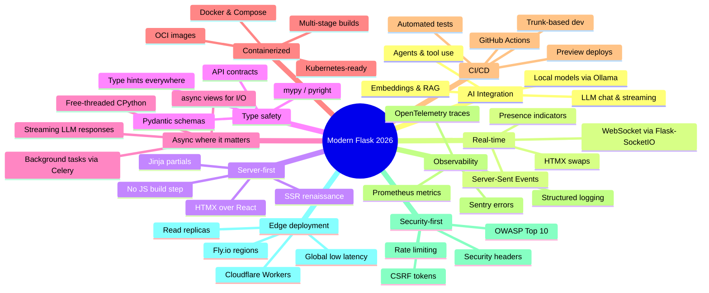

### 1.1 AI Integration (LLMs, embeddings, agents)

The single biggest shift since 2023 is that *every* product is being rebuilt with AI inside it. In 2026, "AI integration" means more than calling the OpenAI API. It means **streaming** responses token-by-token over WebSockets or SSE. It means **retrieval-augmented generation** (RAG) — embedding your product's data into a vector store (pgvector, Qdrant, Chroma) and querying it. It means **agents** — LLMs that call tools, browse the web, execute code. And it means **local models** — running Llama 3 or Mistral on your own GPU via Ollama for privacy or cost reasons. A modern Flask project should at least stream responses from an LLM, and ideally include a RAG retrieval step.

### 1.2 Real-time features (WebSocket, SSE, HTMX)

Users in 2026 expect Google Docs–style live collaboration, live dashboards that update without refresh, and presence indicators ("3 people are viewing this"). Flask-SocketIO is the established way to do WebSockets in Flask, but Server-Sent Events (SSE) are catching up because they're simpler — one-way server→client, no Socket.IO protocol overhead, no extra dependency. HTMX's `hx-swap` and `hx-trigger="every 2s"` give you a third option: server-rendered partials that auto-refresh. A modern project should pick the right tool: WebSocket for bidirectional (chat, cursors), SSE for one-way streaming (LLM tokens, dashboards), HTMX for occasional refresh (form updates, lists).

### 1.3 Server-first (HTMX, SSR renaissance)

After a decade of "build a React SPA and a JSON API," the pendulum swung back. In 2026, many teams ship **server-rendered HTML with HTMX sprinkles** instead of a separate frontend. The benefits are real: less JavaScript, no build step, smaller bundles, simpler mental model. Flask + Jinja + HTMX + Tailwind is the dominant "no-build" stack. A modern project should demonstrate that you can build a complex UI without React.

### 1.4 Type safety (type hints, Pydantic)

Python 3.12+ made type hints first-class. In 2026, professional Flask code is fully type-annotated and checked with **mypy** or **pyright**. **Pydantic v2** is the standard for request/response validation — it's not just for FastAPI anymore; Flask applications now use `pydantic` directly inside view functions, or via `flask-pydantic-spec` / `spectree` for OpenAPI generation. A modern project should have `from __future__ import annotations` at the top of every file and a `pydantic` schema for every API endpoint.

### 1.5 Async where it matters

Flask 3.x supports `async def` views, and CPython 3.13 has a free-threaded build (no GIL). But "async everywhere" is still the wrong default. The modern approach is **async where it matters**: streaming LLM tokens, awaiting external HTTP calls, fanning out WebSocket messages. For most CRUD views, sync is fine. A modern project should use `async def` views for streaming responses and the new `httpx.AsyncClient` for outbound calls — and leave everything else synchronous.

### 1.6 Containerized deployment

In 2026, "deploy to a VPS over SSH" is a hobbyist move. Professional Flask apps ship as **OCI container images** with multi-stage Docker builds (build deps in stage 1, runtime in stage 2). `uv` makes Docker images smaller — final images under 100MB are achievable. A modern project should have a `Dockerfile` and a `docker-compose.yml` that spins up the app, PostgreSQL, Redis, and any other dependencies with one command.

### 1.7 CI/CD pipeline

A GitHub Actions workflow that runs `ruff check`, `mypy`, `pytest`, and builds the Docker image on every push is table stakes in 2026. A modern project should also have **preview deploys** — every pull request gets its own URL on Fly.io or Render. trunk-based development with short-lived branches and automated deployments is the modern norm.

### 1.8 Observability (logging, monitoring, tracing)

`print()` statements are unacceptable in production. A 2026 Flask app uses **structured logging** (`structlog` or `logging` with JSON formatter), ships logs to a service like Grafana Loki or Datadog, exports **OpenTelemetry traces** to Jaeger or Honeycomb, exposes **Prometheus metrics** at `/metrics`, and integrates **Sentry** for error tracking. A modern project should have at least structured logging and Sentry; the best ones have full OpenTelemetry.

### 1.9 Security-first (CSRF, rate limiting, security headers)

OWASP Top 10 hasn't gone away. A modern Flask app uses `flask-wtf` for CSRF, `flask-limiter` for rate limiting, `flask-talisman` for security headers (CSP, HSTS, X-Frame-Options), and `argon2` (not bcrypt) for password hashing. Every project should have a `SECURITY.md` and pass a `bandit` scan in CI.

### 1.10 Edge deployment (Fly.io, Cloudflare)

Latency matters. In 2026, deploying your Flask app to multiple regions close to users is achievable for side projects. **Fly.io** runs the same Docker image in 20+ regions. **Cloudflare Workers** can run Python (via Pyodide) at the edge for tiny functions. Read replicas in PostgreSQL 16+ make multi-region reads cheap. A modern project should at least *consider* multi-region deployment, even if it ships single-region initially.

---

## 2. The Twelve Modern Project Ideas

### Project 1 — Synapse: AI-Powered Chat Application

> **Tagline:** A ChatGPT-style multi-model chat client with streaming, history, and code highlighting.

**What it does:** Synapse is a web-based chat application that lets users converse with multiple LLMs (OpenAI GPT-4o, Anthropic Claude 3.5, Google Gemini, local Ollama models). Responses stream token-by-token, conversation history persists across sessions, and code blocks render with syntax highlighting. Users can switch models mid-conversation and compare responses side-by-side.

**Why it's modern/relevant in 2026:** AI integration is *the* skill of 2026 — every product is being rebuilt with LLMs inside it. Streaming responses are the modern UX expectation; nobody wants to wait 10 seconds for a full reply when they can watch it type out. Multi-model support reflects the real-world reality that no single LLM wins every task — production systems route between providers based on cost, latency, and capability. Building this project teaches you the exact patterns you'll use in any AI-powered product.

**Tech stack:**
- Python 3.13, Flask 3.2
- SQLAlchemy 2.x + PostgreSQL 16 (with `pgvector` for future RAG)
- Redis (for session storage and rate limiting)
- Flask-SocketIO (for streaming) or SSE via `Response` generator
- Tailwind CSS 4 + `marked.js` (Markdown) + `highlight.js` (code)
- `httpx` for async LLM API calls
- Docker + Fly.io deployment

**Key features:**
- Streaming responses (token-by-token via SSE or WebSocket)
- Multi-model switching (OpenAI, Anthropic, Google, Ollama)
- Conversation history with full-text search (`pg_trgm`)
- Markdown rendering with code syntax highlighting
- Per-user API key vault (encrypted at rest with `cryptography`)
- Rate limiting + token-usage tracking (cost control)
- Model comparison view (split-screen A/B)

**What you'll learn:**
- Streaming HTTP responses in Flask (`yield`-based generators, `stream_with_context`)
- Async views (`async def` + `await httpx.AsyncClient`)
- WebSocket integration via Flask-SocketIO or pure SSE
- Encrypted secrets at rest (Fernet encryption)
- Background rate limiting with Redis
- Type-safe LLM provider abstraction (Pydantic models for messages)

**Difficulty:** Intermediate
**Estimated time to build:** 25–35 hours
**Modern techniques:** AI integration, streaming, async views, server-first with HTMX, encrypted secrets

**Architecture overview:** A Flask app holds conversation state in PostgreSQL. When the user sends a message, the view function calls the LLM provider via `httpx.AsyncClient` and streams the response back as an SSE stream. Redis caches active conversations and enforces per-user rate limits. The frontend is plain HTML + Alpine.js + HTMX, with `marked.js` rendering Markdown as tokens arrive.

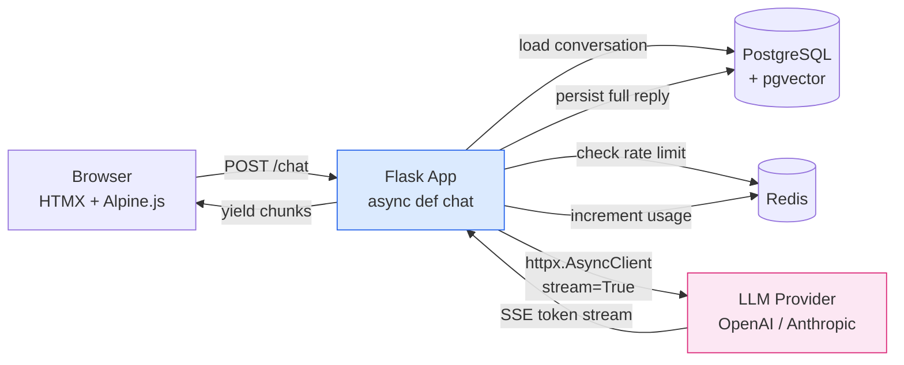

---

### Project 2 — CoDoc: Real-Time Collaborative Document Editor

> **Tagline:** A Google Docs–style editor with live cursors, presence, and CRDT-based conflict resolution.

**What it does:** CoDoc lets multiple users edit the same document simultaneously. Each user sees the others' cursors in real time, text merges without conflicts even on flaky networks, and a version history panel lets you roll back to any previous state. Documents can be organized into workspaces and shared with read or write permissions.

**Why it's modern/relevant in 2026:** Real-time collaboration went from "nice to have" to "expected" between 2020 and 2026. Google Docs set the bar; Figma, Notion, Linear raised it. Any product that involves shared editing — notes, code, whiteboards, spreadsheets — is expected to have live multi-user support. Building this teaches you WebSockets, presence, and CRDTs (Conflict-free Replicated Data Types), which are the algorithms that make collaborative editing possible without central locking.

**Tech stack:**
- Python 3.13, Flask 3.2, Flask-SocketIO
- `y-py` (Python port of Yjs CRDT library)
- PostgreSQL 16 (document metadata, version snapshots)
- Redis (SocketIO message broker, presence)
- TipTap or ProseMirror on the frontend
- Tailwind CSS 4
- Docker Compose for local dev

**Key features:**
- Real-time text editing with CRDT conflict resolution
- Live cursors with user names and colors
- Presence indicators ("Alice is editing…")
- Version history with diff view and restore
- Workspace + document sharing (read/write permissions)
- Offline edit queueing (edits sync when reconnected)
- Export to Markdown / PDF

**What you'll learn:**
- Flask-SocketIO rooms and namespaces
- Pub/sub fan-out via Redis adapter (multi-worker scaling)
- CRDT merge semantics (Yjs / `y-py`)
- Database snapshots for version history
- Permission systems at the document level
- Connection lifecycle (join, leave, reconnect)

**Difficulty:** Advanced
**Estimated time to build:** 50–70 hours
**Modern techniques:** WebSocket, real-time collaboration, CRDTs, presence, offline-first

**Architecture overview:** Each document is a SocketIO room. When a user edits, their client sends a CRDT update to the server, which broadcasts it to all other clients in the room and persists a snapshot to PostgreSQL every N seconds. Redis serves as the SocketIO message broker so the app can scale across multiple Flask workers via Gevent or Eventlet. Presence is tracked in Redis with TTL keys.

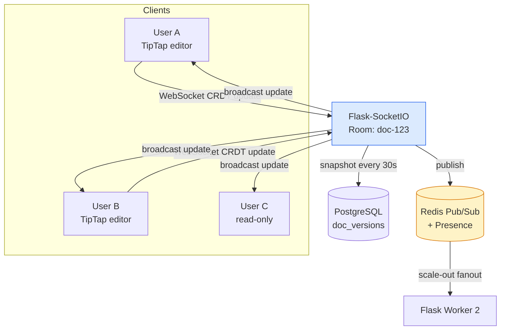

---

### Project 3 — Forge: Multi-Tenant SaaS Starter Kit

> **Tagline:** A production-ready SaaS boilerplate with Stripe billing, RBAC, and per-tenant data isolation.

**What it does:** Forge is a starter kit you'd use to launch a new SaaS business. New users sign up, create an organization (tenant), invite teammates, and pick a subscription plan. Stripe handles billing. Each tenant's data is isolated at the database level via row-level security. An admin dashboard shows per-tenant usage, MRR, churn. The kit ships with the boring-but-hard parts already solved: multi-tenancy, billing webhooks, role-based access, and audit logging.

**Why it's modern/relevant in 2026:** SaaS is the dominant business model for software in 2026 — every indie hacker, every YC startup, every enterprise internal tool is a SaaS. The hard parts (multi-tenancy, billing, RBAC, audit logs) are also the parts that take weeks to get right. A starter kit that solves them is genuinely useful and demonstrates senior-level engineering. This is also the project most likely to *make you money* — many indie hackers sell SaaS boilerplates for $200–500 a copy.

**Tech stack:**
- Python 3.13, Flask 3.2, Flask-Login
- SQLAlchemy 2.x + PostgreSQL 16 (with RLS policies)
- Stripe Python SDK + Stripe webhooks
- HTMX + Tailwind CSS 4 (no JS build)
- Celery + Redis (for emails, dunning, usage aggregation)
- Pydantic v2 for all request schemas
- Docker, deploy to Fly.io

**Key features:**
- Organization (tenant) model with `tenant_id` on every table
- PostgreSQL Row-Level Security policies enforce isolation
- Stripe Checkout + Customer Portal + webhook handling
- Subscription tiers (Free / Pro / Team) with feature gating
- Role-based access (Owner / Admin / Member / Viewer)
- Usage tracking (API calls, seats, storage) with metered billing
- Audit log of all admin actions

**What you'll learn:**
- Multi-tenant data models (shared DB, shared schema, RLS)
- Stripe billing end-to-end (Checkout, webhooks, Customer Portal)
- Role-based access control as middleware/decorator
- Idempotent webhook handling (the hard part of billing)
- Feature flags tied to subscription tier
- Pydantic for request validation at the edge

**Difficulty:** Intermediate → Advanced
**Estimated time to build:** 40–55 hours
**Modern techniques:** Multi-tenancy, RLS, payment integration, RBAC, async dunning emails, server-first UI

**Architecture overview:** Every request includes a `tenant_id` (from session or subdomain). SQLAlchemy sets a PostgreSQL session variable on each connection so RLS policies automatically filter queries. Stripe webhooks come into a dedicated endpoint, are verified by signature, de-duplicated by event ID, and processed by Celery workers. HTMX handles all form submissions (signup, plan change, invite user) without a JS framework.

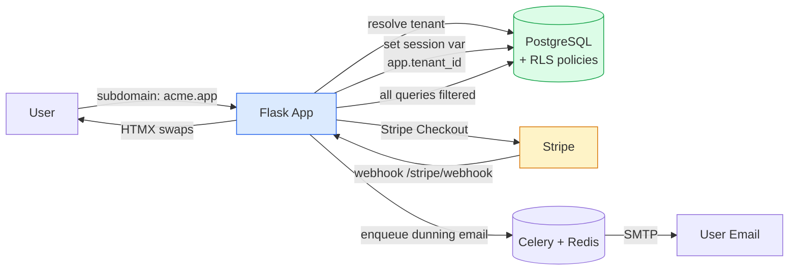

---

### Project 4 — Mercado: Modern E-Commerce Platform

> **Tagline:** A full storefront with cart, checkout, inventory, async emails, and a real-time admin panel.

**What it does:** Mercado is a complete e-commerce platform — product catalog with search and filtering, shopping cart, Stripe checkout, order tracking, inventory management, and an admin dashboard with real-time sales charts. Customers get email confirmations and shipping notifications; admins get low-stock alerts and a live sales feed.

**Why it's modern/relevant in 2026:** E-commerce is the *evergreen* project — it's been a portfolio staple since the 2000s — but the *modern* version uses async tasks, caching, real-time updates, and a no-build frontend. Building it teaches you the patterns that power every Shopify competitor and every internal B2B commerce tool. The combination of Stripe + Celery + Redis + WebSocket is exactly the stack real e-commerce teams use.

**Tech stack:**
- Python 3.13, Flask 3.2
- SQLAlchemy + PostgreSQL 16 (products, orders, inventory)
- Redis (cart cache, Celery broker, rate limiting)
- Celery (order confirmation emails, inventory sync, abandoned-cart reminders)
- Stripe (Checkout + Payment Intents)
- HTMX + Tailwind CSS 4 + Alpine.js
- Chart.js for admin analytics
- Docker Compose

**Key features:**
- Product catalog with faceted search (PostgreSQL `tsvector` + trigram)
- Persistent cart (Redis for guests, DB for logged-in users)
- Stripe Checkout with idempotency keys
- Real-time order notifications to admin via WebSocket
- Inventory management with stock reservations
- Async email pipeline (confirmation, shipping, abandoned cart)
- Admin dashboard with live sales chart, top products, low-stock alerts

**What you'll learn:**
- Async task orchestration with Celery (`@app.task`, retries, dead-letter queue)
- Redis as a multi-purpose cache (cart, rate limit, Celery broker)
- Stripe idempotency (preventing double-charges on retry)
- WebSocket fan-out for admin notifications
- Database transactions across inventory + order + payment
- HTMX for cart updates without page reloads

**Difficulty:** Intermediate → Advanced
**Estimated time to build:** 45–60 hours
**Modern techniques:** Async tasks, caching, real-time updates, server-first UI, payment integration

**Architecture overview:** Customer traffic hits Flask views that read from PostgreSQL and write cart state to Redis. Checkout creates a Stripe Payment Intent and, on webhook confirmation, writes an order row, decrements inventory in a transaction, and enqueues confirmation + shipping emails to Celery. A separate WebSocket connection pushes new-order events to admin browsers for the live dashboard. Background Celery beat jobs send abandoned-cart reminders 24 hours after cart abandonment.

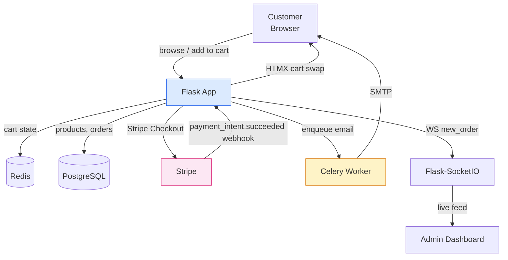

---

### Project 5 — Pulse: Live Analytics Dashboard

> **Tagline:** A product-analytics dashboard with real-time event streams, funnels, and cohort retention.

**What it does:** Pulse is a Mixpanel-style analytics tool. You drop a tiny JavaScript snippet on your site; it sends events to a Flask ingestion endpoint; the dashboard shows real-time active users, funnel conversion, cohort retention, and top pages — all updating live without refresh. Users can export reports as CSV or schedule them as email digests.

**Why it's modern/relevant in 2026:** Every product team is data-driven in 2026. Building an analytics dashboard teaches you the *ingestion* problem (high-write, eventually-consistent), the *aggregation* problem (pre-compute vs. query-time), and the *visualization* problem (real-time charts without React). The HTMX-based UI demonstrates that you can build a "live dashboard" without a single line of frontend JavaScript framework code.

**Tech stack:**
- Python 3.13, Flask 3.2
- PostgreSQL 16 (events table, materialized views for rollups)
- Redis (write buffer, real-time counters, WebSocket adapter)
- Flask-SocketIO or pure SSE for live updates
- Chart.js + HTMX for the dashboard
- Celery beat for hourly/daily rollups
- ClickHouse is an optional swap for high-volume setups

**Key features:**
- Event ingestion endpoint (`POST /track`) at >1k events/sec
- Real-time active-user counter (Redis `HINCRBY`)
- Funnel analysis (sequence of events within a window)
- Cohort retention table (weekly cohorts, retention %)
- Live charts that update via SSE / HTMX `hx-trigger="every 5s"`
- Scheduled email reports (Celery beat + SMTP)
- CSV export of any report

**What you'll learn:**
- High-throughput ingestion (batched writes, Redis buffer)
- Materialized views + `REFRESH CONCURRENTLY` for rollups
- SSE vs. WebSocket trade-offs for one-way updates
- HTMX polling as a real-time primitive
- Cohort analysis SQL (self-joins, window functions)
- Time-bucket aggregation (`date_trunc`, `generate_series`)

**Difficulty:** Intermediate → Advanced
**Estimated time to build:** 35–50 hours
**Modern techniques:** Real-time, HTMX polling, async ingestion, materialized views, observability

**Architecture overview:** Events hit `/track` and are buffered in Redis as a list, then flushed to PostgreSQL in batches by a Celery worker every 5 seconds. Rollup tables (materialized views) are refreshed every hour. The dashboard opens an SSE connection that streams counter updates from Redis pub/sub. HTMX polls the rollup endpoints every 5 seconds for chart data, swapping just the chart SVG.

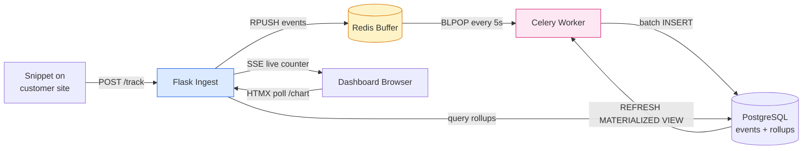

---

### Project 6 — Sentinel: IoT Data Hub

> **Tagline:** A time-series hub for IoT devices with real-time alerts, historical charts, and OTA management.

**What it does:** Sentinel ingests sensor data from IoT devices over MQTT, stores it in a time-series database, and exposes a dashboard with real-time charts and historical queries. Devices register themselves, authenticate with per-device tokens, and can be grouped into fleets. Alert rules (e.g., "temperature > 80°C for 5 minutes") fire webhooks or emails. The dashboard shows device health, battery levels, and rolling charts.

**Why it's modern/relevant in 2026:** IoT is exploding — smart home, industrial, agriculture, logistics. Time-series data is a fundamentally different problem from CRUD: writes are append-only and high-volume, queries are almost always aggregations over time windows, and retention policies matter. Building an IoT hub teaches you MQTT (the dominant IoT protocol), time-series databases (TimescaleDB or InfluxDB), and the alert-rule pattern that powers every monitoring system.

**Tech stack:**
- Python 3.13, Flask 3.2
- `paho-mqtt` or `gmqtt` (async MQTT client)
- TimescaleDB (PostgreSQL extension) or InfluxDB
- Redis (device presence, alert state)
- Flask-SocketIO for live chart updates
- Chart.js with time axis
- Docker Compose with an Eclipse Mosquitto broker

**Key features:**
- Device registration + per-device API tokens
- MQTT topic namespacing (`devices/{device_id}/telemetry`)
- Time-series ingestion at >10k events/sec per broker
- Real-time charts via WebSocket (last 60 seconds)
- Historical queries with downsampling (`time_bucket`)
- Alert rules with cooldown (no alert spam)
- OTA firmware update endpoint (signed firmware bundles)

**What you'll learn:**
- MQTT protocol (topics, QoS, last-will messages)
- Time-series schema design (hypertables, retention policies)
- Continuous aggregates in TimescaleDB
- Alert-rule evaluation (windowed queries, deduplication)
- Per-device authentication
- WebSocket fan-out scoped by device

**Difficulty:** Advanced
**Estimated time to build:** 45–65 hours
**Modern techniques:** MQTT, time-series DB, real-time charts, async ingestion, OTA updates

**Architecture overview:** Devices connect to an MQTT broker (Mosquitto) and publish telemetry to topics. A Flask background task subscribes to `devices/+/telemetry`, validates each message against a Pydantic schema, and writes it to TimescaleDB. Alert rules run as Celery beat jobs every minute. The dashboard subscribes to a per-device WebSocket room and receives new data points as they're ingested.

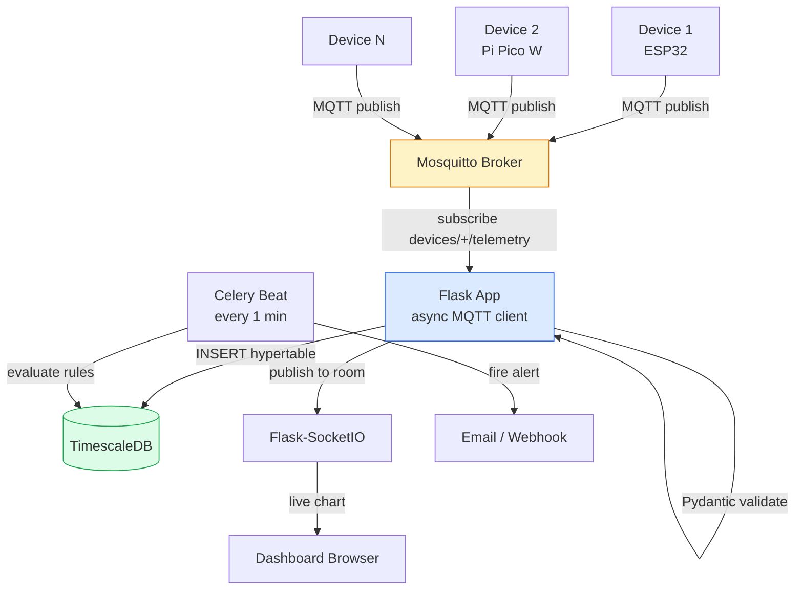

---

### Project 7 — Echo: Social Media API (Instagram / Twitter Clone)

> **Tagline:** A REST + GraphQL social API with feeds, follows, image uploads, and a ranking algorithm.

**What it does:** Echo is a social media backend. Users register, post text or images, follow others, like and comment, and get a personalized feed. The feed is built using a ranking algorithm (chronological for small followings, ranked for large ones). A Celery worker pre-computes fan-out feeds for active users. Notifications fire on mentions and follows. The API supports both REST and GraphQL via `ariadne` or `strawberry`.

**Why it's modern/relevant in 2026:** Social features show up in every product — fitness apps, learning platforms, marketplaces all have social layers. Building a social API teaches you the *feed* problem (one of the most famous engineering challenges — see Twitter's fanout-on-write vs. fanout-on-read), image handling (S3 uploads, thumbnails), and notification fan-out. This is also the project that best demonstrates you can build a *backend* — recruiters specifically look for API-only projects.

**Tech stack:**
- Python 3.13, Flask 3.2
- SQLAlchemy + PostgreSQL 16 (posts, follows, likes)
- Redis (feed cache, rate limiting, notification queue)
- Celery (fanout-on-write, image thumbnails, push notifications)
- AWS S3 / MinIO (image storage)
- JWT auth via `flask-jwt-extended`
- `strawberry-graphql` for the GraphQL endpoint
- Pydantic for request schemas

**Key features:**
- JWT-based auth with refresh tokens
- Posts (text + images), likes, comments, follows
- Personalized feed (fanout-on-write for ≤1k followers, fanout-on-read for celebrities)
- Image upload to S3 with auto-generated thumbnails
- Real-time notifications via WebSocket (mention, follow, like)
- REST + GraphQL endpoints on the same app
- Rate limiting (per-user, per-endpoint)

**What you'll learn:**
- Feed architecture (fanout trade-offs, hybrid approach)
- JWT auth with refresh token rotation
- Pre-signed S3 uploads (browser uploads straight to S3)
- Celery for fanout and thumbnail generation
- GraphQL alongside REST in one Flask app
- Denormalized counters (`like_count` on posts)

**Difficulty:** Advanced
**Estimated time to build:** 50–70 hours
**Modern techniques:** Feed ranking, async fanout, JWT, GraphQL, object storage, real-time notifications

**Architecture overview:** On post creation, Flask writes the post to PostgreSQL and enqueues a Celery task that fan-outs the post ID to each follower's feed list in Redis. When a user requests their feed, the app reads the cached list and hydrates the post objects from PostgreSQL. Image uploads use pre-signed S3 URLs (browser uploads directly to S3, Flask only signs the URL). Mentions trigger a Celery task that pushes a WebSocket notification and an email.

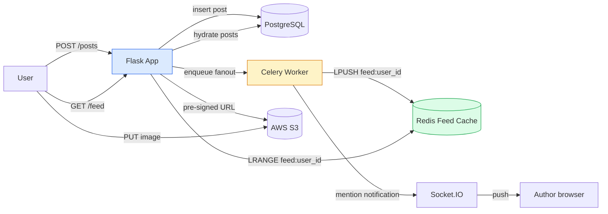

---

### Project 8 — Cortex: AI Model Serving API

> **Tagline:** An MLOps-friendly model-serving API with versioning, batch inference, and Prometheus monitoring.

**What it does:** Cortex is a Flask API that serves machine-learning models. Data scientists upload model artifacts (joblib pickles, ONNX files), the API versions them, and exposes `/predict` endpoints. Clients can request a specific version, do batch inference, and view latency / error metrics. Rate limiting protects the API from runaway clients; a Celery worker handles long-running batch jobs.

**Why it's modern/relevant in 2026:** MLOps is one of the hottest hiring areas in 2026. Companies have models; the hard part is *deploying* them — versioning, A/B testing, monitoring drift, scaling inference. Building a model-serving API teaches you the exact patterns behind services like AWS SageMaker, Baseten, and Replicate. Even if you never deploy to production, this project demonstrates you understand the *engineering* of ML, which is what most teams need.

**Tech stack:**
- Python 3.13, Flask 3.2
- `joblib` + `onnxruntime` + `transformers` (model runtimes)
- SQLAlchemy + PostgreSQL 16 (model metadata, versions)
- S3 / MinIO (model artifact storage)
- Redis (rate limiting, batch job queue)
- Celery (batch inference, model warmup)
- JWT auth
- `prometheus-client` for metrics, OpenTelemetry for tracing
- Docker (each model can run in its own container)

**Key features:**
- Model upload with auto-versioning (`v1`, `v2`, `v3…`)
- Per-version `/predict` endpoint with Pydantic schemas
- Batch inference via Celery (returns a job ID, polls for results)
- A/B testing (route % of traffic to a new version)
- Rate limiting per API key (token bucket in Redis)
- Prometheus metrics (latency p50/p95/p99, error rate, qps)
- Model warm-up on cold start (load into memory at boot)

**What you'll learn:**
- Model artifact management (S3 + PostgreSQL metadata)
- Versioning strategies (semantic version, canary, blue/green)
- Pydantic for input/output validation of model schemas
- Async batch processing with Celery
- Prometheus metrics in Flask (`prometheus-client`)
- OpenTelemetry tracing across request boundaries
- Rate limiting with token bucket algorithm

**Difficulty:** Advanced
**Estimated time to build:** 40–55 hours
**Modern techniques:** ML deployment, observability, async batch, versioning, rate limiting

**Architecture overview:** A data scientist uploads a model artifact via `POST /models` (multipart upload to S3, metadata to PostgreSQL). Each model gets a `/v1/models/{name}/predict` endpoint. Flask loads the model into memory on first request (lazy) or at boot (eager, via `before_first_request`-style hook). Batch requests are enqueued to Celery and the client polls `/jobs/{id}`. Prometheus scrapes `/metrics` every 15 seconds.

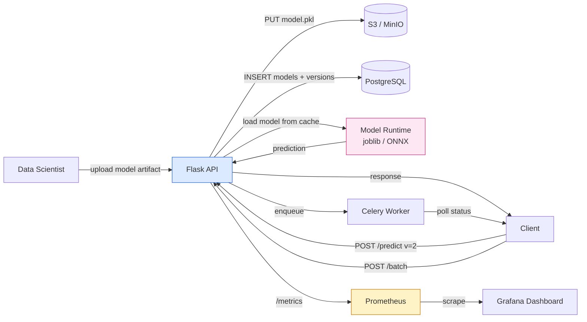

---

### Project 9 — Reserve: Event Booking Platform

> **Tagline:** A Ticketmaster-style event platform with real-time availability, QR tickets, and email reminders.

**What it does:** Reserve lets organizers publish events with limited capacity. Attendees browse events, see real-time seat availability, book tickets, pay with Stripe, and receive QR-coded PDF tickets by email. On the day of the event, a check-in page scans QR codes and marks attendees as arrived. Organizers get a dashboard with sales, attendance, and revenue.

**Why it's modern/relevant in 2026:** Booking systems are everywhere — events, restaurants, doctors, classes. The interesting engineering challenge is **real-time availability** under contention (multiple users trying to book the last seat). Building this teaches you optimistic concurrency, inventory reservations with TTL, QR code generation, and the lifecycle of a "booking" from intent → payment → fulfillment.

**Tech stack:**
- Python 3.13, Flask 3.2
- SQLAlchemy + PostgreSQL 16 (events, bookings, tickets)
- Redis (seat reservations with TTL, rate limiting)
- Stripe (payment)
- `qrcode` + `reportlab` (QR + PDF ticket generation)
- Celery (ticket emails, reminders 24h before event)
- Flask-SocketIO (real-time seat map updates)
- FullCalendar.js (organizer's event calendar)
- HTMX + Tailwind CSS 4

**Key features:**
- Event creation with capacity limits and tiered pricing
- Real-time seat map (held seats expire after 10 minutes)
- Stripe Checkout with idempotent booking completion
- QR-coded PDF tickets emailed on payment success
- 24-hour-before-event reminder emails (Celery beat)
- Organizer dashboard with sales / attendance / revenue
- Day-of-event QR check-in page (camera scanner)

**What you'll learn:**
- Optimistic concurrency control (PostgreSQL `SELECT FOR UPDATE` or version columns)
- Redis-backed seat holds with TTL (the "ticketmaster problem")
- Idempotent webhooks (Stripe + internal booking completion)
- PDF generation in Python (`reportlab` or `weasyprint`)
- QR code generation and validation
- Celery beat for scheduled reminders

**Difficulty:** Intermediate → Advanced
**Estimated time to build:** 40–55 hours
**Modern techniques:** Real-time availability, async emails, QR codes, payment integration, server-first UI

**Architecture overview:** When a user clicks "book seat 12A," Flask creates a Redis key `hold:event-123:12A` with a 10-minute TTL and broadcasts the hold via WebSocket. Other users see seat 12A as "held." On Stripe webhook success, Flask promotes the hold to a database booking row, generates a PDF ticket with a signed QR code, and emails it via Celery. If the user abandons checkout, the Redis key expires and the seat frees up.

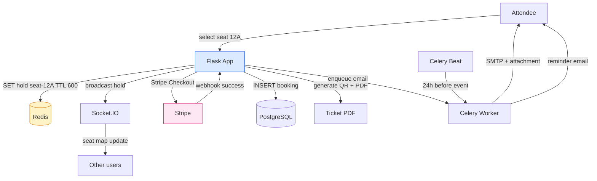

---

### Project 10 — PulseOps: Developer Tools Dashboard

> **Tagline:** A unified DevOps dashboard for CI/CD, deployments, logs, and uptime across all your projects.

**What it does:** PulseOps aggregates data from GitHub Actions, your deployment platform (Fly.io, Render, AWS), and your apps' log streams into a single dashboard. You see build status, deployment history, uptime, error rates, and recent log entries across all your projects. Alerts fire on failed builds, downtime, or error spikes. It's a personal Datadog / Sentry hybrid.

**Why it's modern/relevant in 2026:** DevOps dashboards are essential infrastructure. Every team uses one; most teams pay $500+/month for them. Building your own teaches you the *ingestion* problem (webhooks from N services, log streaming), the *time-windowed alerting* problem, and the *real-time UI* problem (live log tails). It's also the project most directly relevant to SRE / DevOps roles — a high-paying 2026 career path.

**Tech stack:**
- Python 3.13, Flask 3.2
- SQLAlchemy + PostgreSQL 16 (builds, deploys, alerts)
- Redis (log ring buffer, alert dedup, WebSocket adapter)
- `docker` Python SDK (deploy to local Docker engine)
- `httpx` for GitHub / Fly.io API calls
- Flask-SocketIO for live log tails
- HTMX + Tailwind + Chart.js
- OpenTelemetry SDK for self-observability

**Key features:**
- GitHub Actions webhook ingestion (`/webhooks/github`)
- Deploy tracking (webhook from CI on deploy success)
- Live log tailing via WebSocket (with regex filter)
- Uptime monitoring (Celery beat pings your apps every minute)
- Alert rules (failed build, downtime, error-rate spike)
- Acknowledged / silenced alerts with TTL
- Multi-project dashboard (one view across all repos / apps)

**What you'll learn:**
- Webhook ingestion from multiple providers (signature verification!)
- Log streaming over WebSocket (with back-pressure)
- Polling-based monitoring (Celery beat + `httpx`)
- Alert deduplication (don't spam Slack on every error)
- Time-series storage of uptime pings
- Self-observability (the dashboard monitors itself)

**Difficulty:** Intermediate → Advanced
**Estimated time to build:** 35–50 hours
**Modern techniques:** Webhooks, real-time log streaming, observability, async monitoring, server-first UI

**Architecture overview:** GitHub Actions fires a webhook on every build → Flask verifies the signature, persists the build, and emits a WebSocket event to any open dashboard. A Celery beat job pings each registered app every minute; if a ping fails three times in a row, an alert fires (deduped in Redis for 30 minutes so Slack doesn't spam). Logs are ingested via a `POST /logs` endpoint, buffered in a Redis ring buffer (last 1000 lines per app), and streamed over WebSocket to connected dashboards.

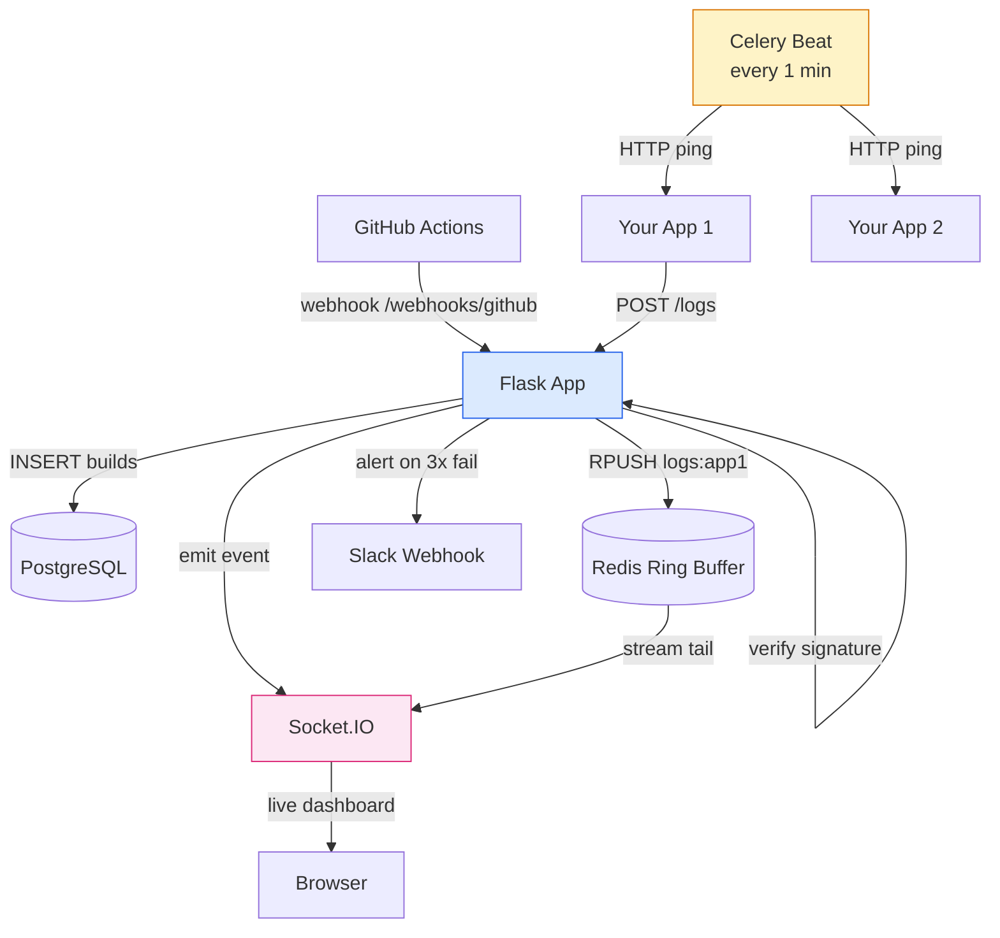

---

### Project 11 — Quill: AI-Powered CMS

> **Tagline:** A Markdown-first CMS with AI content generation, SEO suggestions, and a visual page builder.

**What it does:** Quill is a content management system where editors write in Markdown, an AI assistant suggests improvements, generates meta descriptions, and proposes alt text for images. A drag-and-drop page builder assembles pages from reusable blocks. SEO analysis scores each page against best practices. Multi-user roles (Editor, Author, Reviewer) gate publishing. The published site is fully static-cached.

**Why it's modern/relevant in 2026:** AI-assisted content creation is the 2026 standard — every CMS from Ghost to Webflow added AI features in 2024–2025. Building an AI-powered CMS teaches you *server-side rendering of Markdown*, *AI prompt engineering for content tasks*, *SEO optimization*, and *multi-role auth* — the patterns behind every modern publishing tool. It's also a project that *non-engineers* understand immediately, making it an excellent portfolio piece.

**Tech stack:**
- Python 3.13, Flask 3.2
- SQLAlchemy + PostgreSQL 16 (pages, posts, media, users)
- `markdown-it-py` (Markdown → HTML)
- OpenAI / Anthropic API (AI suggestions)
- HTMX + Alpine.js + Tailwind CSS 4
- S3 / MinIO (media library)
- Celery (publish-hook, sitemap generation, image optimization)
- Redis (cached rendered pages, rate limiting)

**Key features:**
- WYSIWYG Markdown editor with live preview
- AI assistant: improve tone, generate meta description, suggest headings
- Page builder with reusable blocks (Hero, CTA, Gallery, FAQ)
- Media library with auto-generated alt text via vision LLM
- SEO scorecard (title length, meta, headings, keyword density)
- Role-based workflow (Author → Reviewer → Editor → Publish)
- Static-cache published pages (sub-10ms response)

**What you'll learn:**
- Markdown rendering pipelines (with syntax extensions)
- AI prompt design for content tasks (system prompts, structured output)
- Block-based content modeling (JSON column in PostgreSQL)
- Role-based publishing workflows
- Server-side caching (cached rendered HTML in Redis)
- Image processing pipelines (Pillow, S3 upload)

**Difficulty:** Intermediate
**Estimated time to build:** 35–50 hours
**Modern techniques:** AI integration, server-first, content modeling, SEO, multi-role auth, caching

**Architecture overview:** Editors write Markdown in a textarea; on blur, an HTMX request asks the server to render a preview and run AI analysis (tone, meta description, headings). The AI calls go to OpenAI / Anthropic via `httpx.AsyncClient`. On publish, the page is rendered to HTML and cached in Redis keyed by URL path. The public site reads directly from Redis (sub-10ms response). A Celery job regenerates the sitemap.xml on every publish.

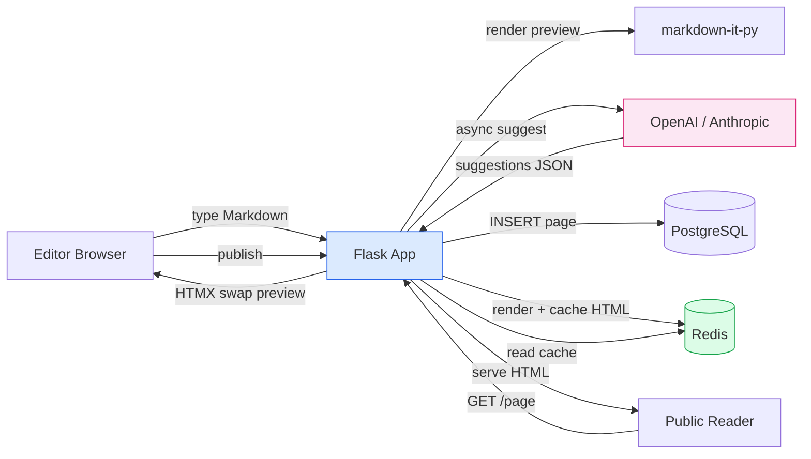

---

### Project 12 — Gavel: Real-Time Auction Platform

> **Tagline:** A live auction site with countdown timers, auto-bid, and real-time bid streaming.

**What it does:** Gavel is a real-time auction platform. Sellers list items with a starting price and end time. Buyers place bids; everyone sees the current high bid update in real time. Buyers can configure auto-bid (maximum willingness to pay) and the system bids on their behalf up to that limit. When the timer hits zero, the winner pays via Stripe and receives a confirmation email. A live dashboard shows auction activity across the platform.

**Why it's modern/relevant in 2026:** Real-time + financial transactions is one of the hardest combinations in web engineering. Every bid must be processed atomically, every connected client must see the update within milliseconds, and the payment flow must be airtight. Building this teaches you *atomic bid processing* (PostgreSQL `SELECT FOR UPDATE`), *WebSocket fan-out under load*, *countdown timer synchronization* (server-authoritative time), and *auto-bid logic* (a tiny rules engine). It's a portfolio centerpiece.

**Tech stack:**
- Python 3.13, Flask 3.2
- SQLAlchemy + PostgreSQL 16 (auctions, bids, users)
- Redis (real-time bid stream, auction-end queue, rate limiting)
- Flask-SocketIO (live bid updates, countdown sync)
- Stripe (winner payment)
- Celery (auction-end settlement, email notifications)
- HTMX + Alpine.js + Tailwind CSS 4
- `apscheduler` or Celery beat for auction-end jobs

**Key features:**
- Auction creation with start price, reserve, end time, buy-it-now
- Real-time bid stream (WebSocket fan-out to all viewers)
- Server-authoritative countdown (no client-side drift)
- Auto-bid (proxy bidding up to user's max)
- Anti-snipe extension (last 10 seconds extends timer by 30s)
- Stripe payment on win (with 7-day grace period)
- Live auction dashboard (top bids, ending soon, hot items)

**What you'll learn:**
- Atomic bid processing with `SELECT FOR UPDATE` + version columns
- Server-authoritative time (countdowns computed server-side, sent via WS)
- WebSocket fan-out patterns (rooms per auction, broadcast on bid)
- Proxy bidding algorithm (Vickrey-style increment logic)
- Anti-snipe timer extension (the "eBay rule")
- Async settlement via Celery (auction ends → winner pays → seller ships)

**Difficulty:** Advanced
**Estimated time to build:** 45–65 hours
**Modern techniques:** Real-time, atomic transactions, financial integration, async settlement, server-first UI

**Architecture overview:** Each auction is a SocketIO room. On a bid, Flask starts a transaction, locks the auction row, validates the bid (must exceed current high bid by the increment), updates the high bid, inserts a bid row, commits, then broadcasts the new high bid to all clients in the room. A Celery beat job runs every second to find auctions that should end; on end, it enqueues a settlement task (charge the winner's saved payment method, email both parties). The countdown timer is computed server-side and broadcast every second.

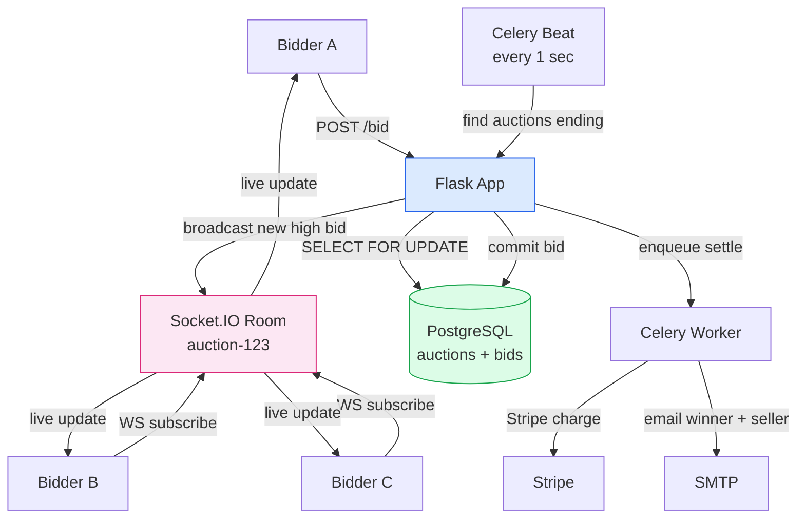

---

## 3. Decision Matrix — Which Project Should I Build First?

Use the matrix below to pick a starting point. Score yourself on each row, then sum.

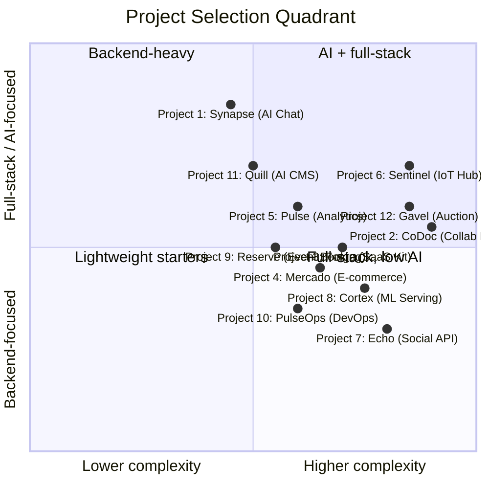

> [!tip] How to read the quadrant
> - **Top-left (AI + full-stack, lower complexity):** Synapse, Quill — great first projects if you want AI exposure without weeks of work.
> - **Top-right (AI + full-stack, higher complexity):** Sentinel, Gavel — stretch goals after you've built one or two simpler projects.
> - **Bottom-right (Backend-heavy, higher complexity):** CoDoc, Echo, Cortex — pick these if you're targeting backend / infra roles.
> - **Bottom-left (Backend-heavy, lower complexity):** PulseOps, Mercado, Reserve — solid mid-complexity builds.

### 3.1 Match Project to Your Goal

| Your Goal in 2026 | Best Project(s) | Why |
|---|---|---|
| Get hired as an **AI engineer** | Synapse (#1), Quill (#11) | Direct LLM integration; streaming; RAG-ready |
| Get hired as a **backend engineer** | Echo (#7), Cortex (#8), Forge (#3) | API design, async tasks, multi-tenancy, MLOps |
| Get hired as a **full-stack engineer** | Mercado (#4), Reserve (#9), Gavel (#12) | Full user journeys; HTMX; real-time + payments |
| Get hired as an **SRE / DevOps** | PulseOps (#10), Cortex (#8), Sentinel (#6) | Observability, monitoring, containerization |
| Get hired as a **product engineer** (indie) | Forge (#3), Quill (#11), Mercado (#4) | SaaS boilerplate, content, commerce — shippable products |
| Get hired as a **real-time systems engineer** | CoDoc (#2), Gavel (#12), Pulse (#5) | WebSocket fan-out, CRDTs, atomic transactions |
| Get hired as an **IoT / embedded engineer** | Sentinel (#6) | MQTT, time-series DB, device management |
| Get hired as an **MLOps engineer** | Cortex (#8), Synapse (#1) | Model serving, versioning, observability |
| Learn **modern frontend** (HTMX) | Quill (#11), Mercado (#4), Pulse (#5) | No-JS-build, server-rendered, HTMX patterns |
| Learn **payment integration** | Forge (#3), Mercado (#4), Reserve (#9), Gavel (#12) | Stripe Checkout, webhooks, idempotency |

### 3.2 Match Project to Your Skill Level

| Skill Level | Recommended Starter | Recommended Second | Stretch Goal |
|---|---|---|---|
| Beginner (just finished Lessons 01–24) | Quill (#11) | Mercado (#4) | Synapse (#1) |
| Intermediate (built 2–3 Flask apps) | Synapse (#1) | Forge (#3) | CoDoc (#2) |
| Advanced (familiar with Celery, Docker, websockets) | Cortex (#8) | Sentinel (#6) | Gavel (#12) |

> [!warning] Don't try to build all twelve
> The trap is to start five projects and finish none. Pick **one** starter that matches your skill level, ship it (deploy to Fly.io!), then pick a stretch goal. Two finished projects on a portfolio is worth more than ten abandoned ones.

---

## 4. Learning Path — Projects in Order of Difficulty

Below is a recommended path through the twelve projects, ordered from least to most challenging. Each step builds on the skills learned in the previous one.

### 4.1 Phase 1 — Build Confidence (Weeks 1–4)

Start with **Project 11 (Quill — AI CMS)**. It's the gentlest introduction to AI integration, Markdown rendering, and role-based auth, and it produces a tangible artifact you can show non-engineers. You'll learn `markdown-it-py`, basic AI prompt design, multi-role auth, and Redis caching. Estimated 35–50 hours.

Then build **Project 4 (Mercado — E-commerce)**. This widens the scope: Stripe integration, Celery tasks, Redis as a multi-purpose cache, real-time WebSocket updates to the admin dashboard. You'll learn async task orchestration and idempotent webhooks — the patterns behind every commerce system. Estimated 45–60 hours.

### 4.2 Phase 2 — Add Real-Time and AI (Weeks 5–8)

Now tackle **Project 1 (Synapse — AI Chat)**. This is your first encounter with streaming responses (`stream_with_context`), async views (`async def` + `httpx.AsyncClient`), and the LLM provider abstraction. The codebase is smaller than Mercado but the techniques are deeper. Estimated 25–35 hours.

Follow with **Project 5 (Pulse — Live Analytics)**. This introduces high-throughput ingestion, Redis-buffered writes, materialized views, and SSE / HTMX-polling as a real-time primitive. You'll also learn cohort SQL. Estimated 35–50 hours.

### 4.3 Phase 3 — Production Patterns (Weeks 9–12)

Build **Project 9 (Reserve — Event Booking)** to master the booking-system pattern: optimistic concurrency, Redis-backed seat holds with TTL, PDF generation, and Celery beat for scheduled reminders. Estimated 40–55 hours.

Then build **Project 10 (PulseOps — DevOps Dashboard)** to learn webhook ingestion, log streaming over WebSocket, and observability — the self-monitoring dashboard pattern. Estimated 35–50 hours.

Now build **Project 3 (Forge — SaaS Starter Kit)**. This is where everything comes together: multi-tenancy with PostgreSQL RLS, Stripe billing end-to-end, RBAC, and a no-build frontend. By the end of this project, you'll have a SaaS boilerplate you could literally sell. Estimated 40–55 hours.

### 4.4 Phase 4 — Stretch Goals (Weeks 13+)

The remaining five projects are stretch goals for advanced students. Each one teaches a distinct specialty:

- **Project 7 (Echo — Social API):** Feed ranking, fanout-on-write, GraphQL, S3 uploads.
- **Project 6 (Sentinel — IoT Hub):** MQTT, time-series DB, OTA updates.
- **Project 8 (Cortex — ML Serving):** MLOps, model versioning, Prometheus metrics.
- **Project 2 (CoDoc — Collaborative Editor):** CRDTs, presence, offline-first.
- **Project 12 (Gavel — Real-Time Auction):** Atomic bid processing, anti-snipe, settlement.

You don't need to build all five. Pick the one that matches your career goal (see the decision matrix in §3.1).

### 4.5 Cumulative Skills Map

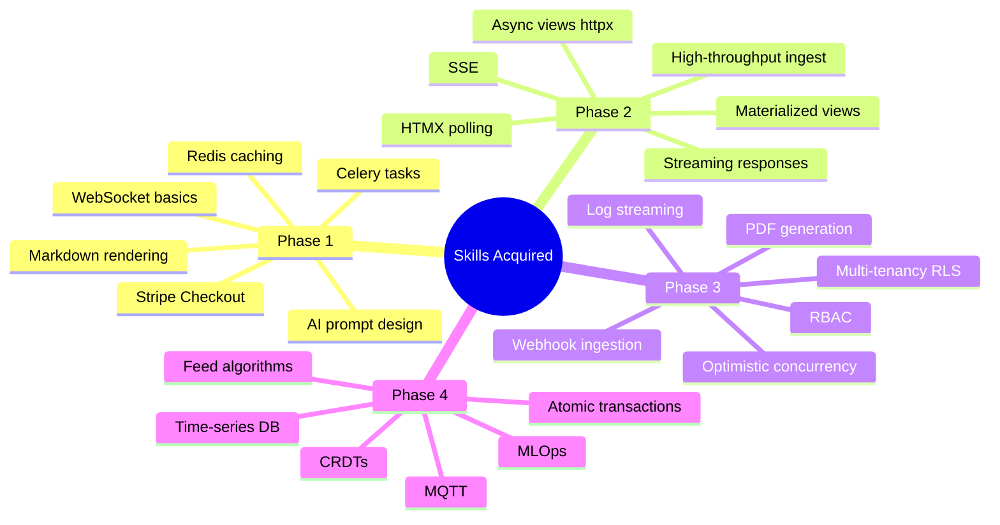

---

## 5. Comparison Tables

### 5.1 At a Glance — All Twelve Projects

| # | Project | Difficulty | Hours | Real-time | AI | Payments | Async | Highlights |
|---|---|---|---|---|---|---|---|---|
| 1 | Synapse (AI Chat) | Intermediate | 25–35 | ✅ | ✅ | — | ✅ | Streaming LLM responses |
| 2 | CoDoc (Collab Editor) | Advanced | 50–70 | ✅ | — | — | — | CRDTs, presence |
| 3 | Forge (SaaS Kit) | Int → Adv | 40–55 | — | — | ✅ | ✅ | Multi-tenancy + RLS |
| 4 | Mercado (E-commerce) | Int → Adv | 45–60 | ✅ | — | ✅ | ✅ | Stripe + Celery + WebSocket |
| 5 | Pulse (Analytics) | Int → Adv | 35–50 | ✅ | — | — | ✅ | Materialized views + SSE |
| 6 | Sentinel (IoT Hub) | Advanced | 45–65 | ✅ | — | — | ✅ | MQTT + time-series DB |
| 7 | Echo (Social API) | Advanced | 50–70 | ✅ | — | — | ✅ | Feed ranking + GraphQL |
| 8 | Cortex (ML Serving) | Advanced | 40–55 | — | ✅ | — | ✅ | MLOps + Prometheus |
| 9 | Reserve (Booking) | Int → Adv | 40–55 | ✅ | — | ✅ | ✅ | Seat holds + QR codes |
| 10 | PulseOps (DevOps) | Int → Adv | 35–50 | ✅ | — | — | ✅ | Log streaming + uptime |
| 11 | Quill (AI CMS) | Intermediate | 35–50 | — | ✅ | — | ✅ | AI content + SEO |
| 12 | Gavel (Auction) | Advanced | 45–65 | ✅ | — | ✅ | ✅ | Atomic bids + auto-bid |

### 5.2 Tech Stack Comparison

| Project | Database | Cache | Async | Frontend | Notable Library |
|---|---|---|---|---|---|
| Synapse | PostgreSQL + pgvector | Redis | Celery | HTMX + Alpine | `httpx` async |
| CoDoc | PostgreSQL | Redis | — | TipTap | `y-py` (CRDT) |
| Forge | PostgreSQL (RLS) | Redis | Celery | HTMX | Stripe SDK |
| Mercado | PostgreSQL | Redis | Celery | HTMX + Chart.js | Stripe + Pillow |
| Pulse | PostgreSQL (mat. views) | Redis | Celery | HTMX + Chart.js | `date_trunc` SQL |
| Sentinel | TimescaleDB | Redis | Celery | Chart.js | `paho-mqtt` |
| Echo | PostgreSQL | Redis | Celery | (API only) | `strawberry-graphql` |
| Cortex | PostgreSQL | Redis | Celery | (API only) | `onnxruntime` + `prometheus-client` |
| Reserve | PostgreSQL | Redis | Celery | HTMX + FullCalendar | `qrcode` + `reportlab` |
| PulseOps | PostgreSQL | Redis | Celery | HTMX + Chart.js | `docker` SDK |
| Quill | PostgreSQL | Redis | Celery | HTMX + Alpine | `markdown-it-py` |
| Gavel | PostgreSQL | Redis | Celery | HTMX + Alpine | `apscheduler` |

### 5.3 Flask Concepts Taught Per Project

| Concept | Synapse | CoDoc | Forge | Mercado | Pulse | Sentinel | Echo | Cortex | Reserve | PulseOps | Quill | Gavel |
|---|---|---|---|---|---|---|---|---|---|---|---|---|
| Blueprints | ✅ | ✅ | ✅ | ✅ | ✅ | ✅ | ✅ | ✅ | ✅ | ✅ | ✅ | ✅ |
| SQLAlchemy 2.x | ✅ | ✅ | ✅ | ✅ | ✅ | ✅ | ✅ | ✅ | ✅ | ✅ | ✅ | ✅ |
| `async def` views | ✅ | — | — | — | — | ✅ | ✅ | ✅ | — | — | ✅ | — |
| Flask-SocketIO | ✅ | ✅ | — | ✅ | ✅ | ✅ | ✅ | — | ✅ | ✅ | — | ✅ |
| SSE streaming | ✅ | — | — | — | ✅ | — | — | — | — | ✅ | — | — |
| Flask-Login | — | ✅ | ✅ | ✅ | ✅ | ✅ | — | — | ✅ | ✅ | ✅ | ✅ |
| JWT auth | — | — | — | — | — | — | ✅ | ✅ | — | — | — | — |
| Flask-WTF (CSRF) | ✅ | ✅ | ✅ | ✅ | ✅ | ✅ | — | — | ✅ | ✅ | ✅ | ✅ |
| Flask-Limiter | ✅ | — | ✅ | ✅ | ✅ | ✅ | ✅ | ✅ | ✅ | ✅ | ✅ | ✅ |
| Flask-Talisman | ✅ | ✅ | ✅ | ✅ | ✅ | ✅ | ✅ | ✅ | ✅ | ✅ | ✅ | ✅ |
| Celery | — | — | ✅ | ✅ | ✅ | ✅ | ✅ | ✅ | ✅ | ✅ | ✅ | ✅ |
| Flask-Migrate | ✅ | ✅ | ✅ | ✅ | ✅ | ✅ | ✅ | ✅ | ✅ | ✅ | ✅ | ✅ |

---

## 6. Closing Thoughts

The twelve projects above are not academic exercises. Each one is modeled on a real product category that hiring managers in 2026 are actively recruiting for: AI chat products, real-time collaboration, multi-tenant SaaS, IoT platforms, MLOps, social feeds, live auctions. Build two or three of them well — deployed to Fly.io, with a README, a CI badge, and a live demo link — and your portfolio will stand out from the sea of "to-do list in Flask" tutorials.

A few closing principles to keep in mind:

> [!success] Principles for building modern projects in 2026
> 1. **Ship it.** An unfinished project on your local machine teaches you 20% of what a deployed one does. Use Fly.io's free tier; get a live URL.
> 2. **Write the README first.** If you can't explain what the project does in three sentences, you don't understand it yet.
> 3. **Type everything.** `from __future__ import annotations` at the top of every file, Pydantic for every API request, `mypy` in CI.
> 4. **Observability from day one.** Structured logging and Sentry take 30 minutes to set up and save you hours of debugging.
> 5. **No build step if you can help it.** HTMX + Tailwind 4 + Alpine.js is enough for 90% of projects. Save React for when you actually need it.
> 6. **Containerize.** A `Dockerfile` and `docker-compose.yml` are non-negotiable on a modern portfolio.
> 7. **Test the hard parts.** You don't need 100% coverage. But test the webhook handlers, the bid logic, the streaming endpoints — the parts that *will* break in production.
> 8. **Document your decisions.** A short `ARCHITECTURE.md` explaining *why* you chose Celery over RQ, or SSE over WebSocket, is more impressive than the code itself.

> [!info] What's next?
> Pick a project from the decision matrix in §3. Create a new directory, `uv init`, `uv add flask`, and start with `app = Flask(__name__)`. You know the rest — Lessons 01–24 taught you. The only way to learn modern Flask is to build modern Flask. Go ship something.

#flask #project-ideas #portfolio #2026 #modern-tooling
