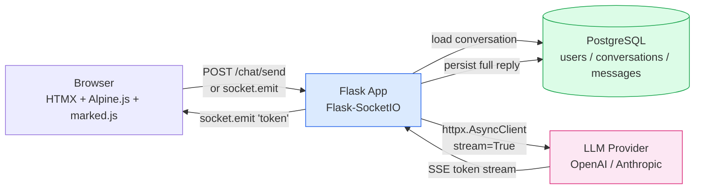
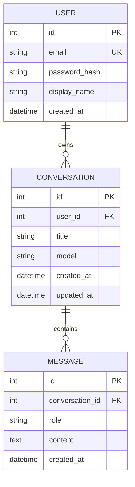
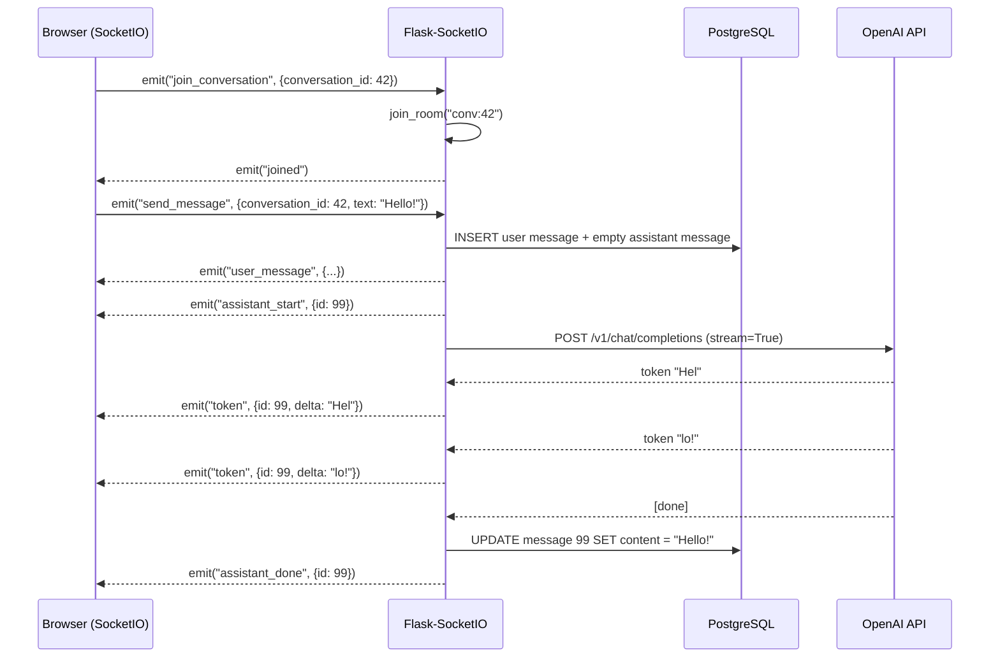
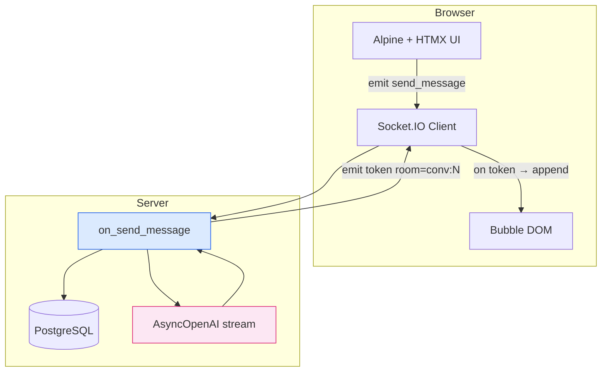
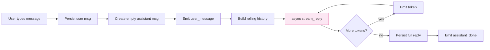
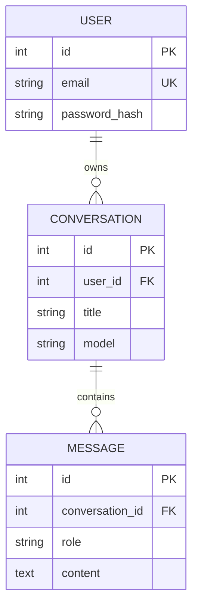
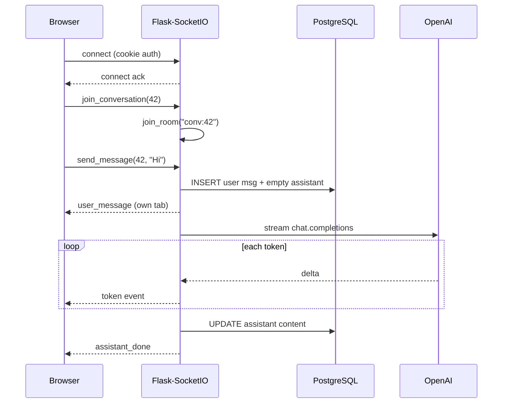

# Project 01 — AI-Powered Chat Application ("Whisper")

> [!success] You finished the course. Now build something you'd actually put on a résumé.
> By the end of this project you'll have a ChatGPT-style chat app — user accounts, multiple conversation threads, streaming AI responses, Markdown + syntax highlighting, Docker deployment. This is the kind of project that gets you past the recruiter screen.

#flask #ai #llm #streaming #websocket #portfolio #2026

---

## 1. Project Overview

**Whisper** is a ChatGPT-like chat application built with **Flask 3.x + Flask-SocketIO**. Users register, log in, start a new conversation, send a message, and watch the AI's reply stream in token-by-token over a WebSocket. Conversation history is saved in PostgreSQL so users can switch between threads, rename them, or delete them.

### Why this is a modern 2026 project

In 2024–2026, AI chat apps went from "novelty" to "the default UI for software." Every SaaS dashboard, every docs site, every internal tool has a chat box. Building one well teaches you five things that are **not** in the basic Flask course:

1. **Streaming responses** — not request/response, but a long-lived WebSocket pushing tokens as the LLM generates them.
2. **Async API calls** — `httpx.AsyncClient` with `stream=True` so the server doesn't block while the LLM thinks.
3. **Server-side persistence of a conversation** — the entire message history has to round-trip through PostgreSQL and rehydrate on every page load.
4. **Markdown + code highlighting** rendered safely (no XSS) from model output.
5. **Docker-first deployment** — `docker compose up` runs the whole stack (Flask, Postgres, Redis) with one command.

> [!info] What we call "AI" here
> "AI" means an LLM API (OpenAI's `gpt-4o-mini`, Anthropic's `claude-haiku`, or a local Ollama model). We never run the model ourselves — we call a hosted API and stream its response. The interesting engineering is everything *around* the model.

### Architecture at a glance



---

## 2. What You'll Learn

By the end you will have hands-on experience with:

- **Flask-SocketIO** — `@socketio.on`, rooms, `emit` from server to client, connection lifecycle.
- **Async streaming** — `async for chunk in response.astream()` and yielding chunks to the WebSocket.
- **The OpenAI Python SDK** — `AsyncOpenAI`, `chat.completions.create(stream=True)`, message-role history.
- **Conversation state management** — keeping a rolling history of `{role, content}` dicts per conversation.
- **Markdown rendering** — server-side with `markdown` + `pygments`, then **sanitised** with `bleach` before being marked `| safe` in Jinja.
- **Tailwind CSS via CDN** (no build step) plus a tiny bit of **Alpine.js** for reactivity.
- **HTMX** for the "New conversation" / "Delete" buttons — full swaps without a SPA.
- **Docker Compose** — Postgres + Redis + the Flask app as three services.

---

## 3. Prerequisites

Complete these first:

| Lesson | Why you need it |
|---|---|
| [[Lesson-16-User-Model-AndPasswords]] | We hash passwords with `werkzeug.security`. |
| [[Lesson-17-Flask-Login]] | `LoginManager`, `current_user`, `@login_required`. |
| [[Lesson-12-SQLAlchemy-Setup]] | `db = SQLAlchemy(app)`, the model pattern. |
| [[Lesson-13-CRUD-Operations]] | CRUD on conversations. |
| [[Lesson-14-Relationships]] | One-to-many `User → Conversation → Message`. |
| [[Lesson-18-Blueprints]] | The app is split into `auth`, `chat`, `api` blueprints. |
| [[Modern-Frontend-Integration]] | HTMX + Alpine + Tailwind basics. |

You also need:
- Python 3.13+ (we use `match` statements and `type` aliases)
- Docker + Docker Compose
- An OpenAI API key (or Anthropic — the code is provider-swappable)

---

## 4. Tech Stack

| Tool | Version | Why |
|---|---|---|
| Flask | 3.2+ | The web framework. Async views are stable in 3.x. |
| Flask-SocketIO | 5.4+ | WebSocket abstraction. Falls back to long-polling. |
| Flask-SQLAlchemy | 3.1+ | ORM, async-capable via `asyncpg`. |
| Flask-Login | 0.6+ | Session-based auth. |
| eventlet | 0.39+ | Async driver for SocketIO in production. |
| openai (Python SDK) | 1.50+ | `AsyncOpenAI`, streaming helpers. |
| markdown | 3.7 | Renders model output to HTML. |
| pygments | 2.18 | Syntax highlighting inside fenced code blocks. |
| bleach | 6.1 | Sanitises model HTML — never trust model output. |
| python-dotenv | 1.0 | Loads `.env` for `OPENAI_API_KEY`. |
| Tailwind CSS | 4 (CDN) | Styling without a build step. |
| Alpine.js | 3 (CDN) | Tiny reactivity for the message input. |
| marked.js | 14 (CDN) | Client-side Markdown fallback while streaming. |
| highlight.js | 11 (CDN) | Client-side code highlighting for streamed tokens. |
| PostgreSQL | 16 | Production database. |
| Docker Compose | 2.30+ | Local dev + production parity. |

> [!tip] Why no React / Vue?
> In 2026, server-first is back. HTMX + a sprinkle of Alpine gives you 95% of the interactivity of a SPA at 5% of the complexity. The only place we genuinely need JavaScript is the WebSocket message handler — and that's ~30 lines.

---

## 5. Project Structure

```
whisper/
├── app/
│   ├── __init__.py            # create_app() factory
│   ├── config.py              # Config classes (Dev, Prod, Test)
│   ├── extensions.py          # db, login_manager, socketio
│   ├── models.py              # User, Conversation, Message
│   ├── llm.py                 # AsyncOpenAI client + streaming helper
│   ├── auth.py                # Blueprint: register, login, logout
│   ├── chat.py                # Blueprint: list, new, show, delete conversations
│   ├── sockets.py             # Blueprint: SocketIO event handlers
│   ├── markdown_renderer.py   # markdown → sanitised HTML
│   ├── templates/
│   │   ├── base.html          # layout, nav, Tailwind, Alpine, SocketIO client
│   │   ├── auth/
│   │   │   ├── login.html
│   │   │   └── register.html
│   │   └── chat/
│   │       ├── index.html     # two-column layout
│   │       ├── _sidebar.html  # conversation list (HTMX-swapped)
│   │       └── _message.html  # one message bubble
│   └── static/
│       ├── css/app.css        # tiny custom CSS on top of Tailwind
│       └── js/chat.js         # SocketIO client + token streaming
├── migrations/                # Flask-Migrate
├── tests/
│   ├── conftest.py
│   ├── test_auth.py
│   ├── test_chat.py
│   └── test_sockets.py
├── .env.example
├── Dockerfile
├── docker-compose.yml
├── requirements.txt
└── wsgi.py                    # entrypoint for gunicorn / eventlet
```

---

## 6. Step-by-Step Build

### Step 1 — Scaffold the project and install dependencies

```bash
mkdir whisper && cd whisper
python3.13 -m venv .venv
source .venv/bin/activate
pip install --upgrade pip
pip install \
  "flask>=3.2" "flask-socketio>=5.4" "flask-sqlalchemy>=3.1" \
  "flask-login>=0.6" "flask-migrate>=4.0" "flask-wtf>=1.2" \
  "eventlet>=0.39" "psycopg[binary]>=3.2" \
  "openai>=1.50" "markdown>=3.7" "pygments>=2.18" "bleach>=6.1" \
  "python-dotenv>=1.0" "email-validator>=2.2"
pip freeze > requirements.txt
```

Save these to `requirements.txt`. The key 2026 note: `psycopg[binary]` is the modern Postgres driver — `psycopg2` is legacy.

> [!warning] eventlet vs gevent
> Flask-SocketIO needs an async worker. `eventlet` is the easier default; `gevent` is faster but needs `gevent-monkey-patch`. We'll use `eventlet` here.

### Step 2 — Configuration with environment variables

`app/config.py`:

```python
import os
from pathlib import Path

BASE_DIR = Path(__file__).resolve().parent.parent

class Config:
    SECRET_KEY = os.environ.get("SECRET_KEY", "dev-only-change-me")
    SQLALCHEMY_DATABASE_URI = os.environ.get(
        "DATABASE_URL",
        f"sqlite:///{BASE_DIR / 'whisper.db'}",
    )
    SQLALCHEMY_TRACK_MODIFICATIONS = False
    OPENAI_API_KEY = os.environ["OPENAI_API_KEY"]          # required
    OPENAI_MODEL = os.environ.get("OPENAI_MODEL", "gpt-4o-mini")
    MAX_HISTORY_MESSAGES = 20                                # rolling context window
    WTF_CSRF_TIME_LIMIT = None                              # no expiry on forms

class ProdConfig(Config):
    DEBUG = False

class DevConfig(Config):
    DEBUG = True
    SQLALCHEMY_ECHO = False

class TestConfig(Config):
    TESTING = True
    SQLALCHEMY_DATABASE_URI = "sqlite:///:memory:"
    OPENAI_API_KEY = "test-key-not-real"
    WTF_CSRF_ENABLED = False
```

Line by line:

- `BASE_DIR` — resolved at import time so `sqlite:///` paths work from any CWD.
- `os.environ["OPENAI_API_KEY"]` — **square brackets, not `.get()`**. If the key is missing we want a hard `KeyError` at startup, not a silent failure two minutes into a chat.
- `MAX_HISTORY_MESSAGES = 20` — we send the last 20 turns of context to the LLM. Without this cap, a long conversation would blow the token budget.
- `WTF_CSRF_TIME_LIMIT = None` — default is 1 hour; we set it to `None` so a long chat session doesn't get CSRF-kicked.

### Step 3 — The application factory

`app/extensions.py`:

```python
from flask_sqlalchemy import SQLAlchemy
from flask_login import LoginManager
from flask_socketio import SocketIO
from flask_migrate import Migrate

db = SQLAlchemy()
login_manager = LoginManager()
socketio = SocketIO(async_mode="eventlet", cors_allowed_origins="*")
migrate = Migrate()

login_manager.login_view = "auth.login"
login_manager.login_message_category = "info"
```

`app/__init__.py`:

```python
from flask import Flask
from .config import DevConfig
from .extensions import db, login_manager, socketio, migrate


def create_app(config_class: type = DevConfig) -> Flask:
    app = Flask(__name__)
    app.config.from_object(config_class)

    # --- Initialise extensions -------------------------------------------------
    db.init_app(app)
    migrate.init_app(app, db)
    login_manager.init_app(app)
    socketio.init_app(app)              # attaches SocketIO to the Flask app

    # --- Register blueprints ---------------------------------------------------
    from .auth import auth_bp
    from .chat import chat_bp
    from .sockets import register_socket_handlers
    app.register_blueprint(auth_bp)
    app.register_blueprint(chat_bp)

    register_socket_handlers(socketio)  # wiring @socketio.on(...) handlers

    # --- User loader -----------------------------------------------------------
    from .models import User
    @login_manager.user_loader
    def load_user(user_id: str) -> User | None:
        return db.session.get(User, int(user_id))

    return app
```

Why a factory instead of `app = Flask(__name__)` at module scope? Three reasons: it lets us pass different `Config` classes (Dev / Prod / Test), it breaks circular imports (blueprints can `from .extensions import db` without triggering `__init__.py`), and it makes testing trivial — each test creates a fresh app.

### Step 4 — Models: User, Conversation, Message

`app/models.py`:

```python
from datetime import datetime, timezone
from flask_login import UserMixin
from werkzeug.security import generate_password_hash, check_password_hash
from .extensions import db


class User(UserMixin, db.Model):
    __tablename__ = "users"
    id = db.Column(db.Integer, primary_key=True)
    email = db.Column(db.String(255), unique=True, nullable=False, index=True)
    password_hash = db.Column(db.String(255), nullable=False)
    display_name = db.Column(db.String(80), nullable=False)
    created_at = db.Column(db.DateTime, default=lambda: datetime.now(timezone.utc))

    conversations = db.relationship(
        "Conversation",
        backref="user",
        cascade="all, delete-orphan",
        lazy="dynamic",
        order_by="Conversation.updated_at.desc()",
    )

    def set_password(self, password: str) -> None:
        self.password_hash = generate_password_hash(password)

    def check_password(self, password: str) -> bool:
        return check_password_hash(self.password_hash, password)


class Conversation(db.Model):
    __tablename__ = "conversations"
    id = db.Column(db.Integer, primary_key=True)
    user_id = db.Column(db.Integer, db.ForeignKey("users.id"), nullable=False)
    title = db.Column(db.String(200), default="New conversation")
    model = db.Column(db.String(80), default="gpt-4o-mini")
    created_at = db.Column(db.DateTime, default=lambda: datetime.now(timezone.utc))
    updated_at = db.Column(
        db.DateTime,
        default=lambda: datetime.now(timezone.utc),
        onupdate=lambda: datetime.now(timezone.utc),
    )

    messages = db.relationship(
        "Message",
        backref="conversation",
        cascade="all, delete-orphan",
        order_by="Message.created_at.asc()",
        lazy="selectin",   # one extra query to load all messages, no N+1
    )


class Message(db.Model):
    __tablename__ = "messages"
    id = db.Column(db.Integer, primary_key=True)
    conversation_id = db.Column(db.Integer, db.ForeignKey("conversations.id"), nullable=False)
    role = db.Column(db.String(20), nullable=False)  # "user" | "assistant" | "system"
    content = db.Column(db.Text, nullable=False)
    created_at = db.Column(db.DateTime, default=lambda: datetime.now(timezone.utc))
```

A few modern notes:

- `datetime.now(timezone.utc)` — **always timezone-aware**. The old `datetime.utcnow()` is deprecated in Python 3.12+.
- `lazy="selectin"` on `Conversation.messages` — fixes the N+1 problem (see [[Lesson-14-Relationships]]) with a single `IN (...)` query.
- `cascade="all, delete-orphan"` — when you delete a `User`, all their conversations are deleted; when you delete a `Conversation`, all its messages are deleted. Postgres would otherwise refuse the delete because of the FK.
- `lazy="dynamic"` on `User.conversations` — returns a query object so we can `.filter().order_by()` before hitting the DB. The `order_by` in the relationship keeps the sidebar pre-sorted.



### Step 5 — The LLM client with async streaming

`app/llm.py`:

```python
from openai import AsyncOpenAI
from flask import current_app
from typing import AsyncIterator

_client: AsyncOpenAI | None = None


def get_client() -> AsyncOpenAI:
    """Lazily construct a single AsyncOpenAI client (re-used across requests)."""
    global _client
    if _client is None:
        _client = AsyncOpenAI(api_key=current_app.config["OPENAI_API_KEY"])
    return _client


async def stream_reply(
    messages: list[dict[str, str]],
    model: str | None = None,
) -> AsyncIterator[str]:
    """
    Yield token chunks from the LLM as they arrive.

    `messages` is the OpenAI-style history: [{"role": "user", "content": "..."}].
    """
    client = get_client()
    model = model or current_app.config["OPENAI_MODEL"]
    response = await client.chat.completions.create(
        model=model,
        messages=messages,
        stream=True,
        temperature=0.7,
    )
    async for chunk in response:
        delta = chunk.choices[0].delta.content
        if delta:                       # some chunks carry only metadata
            yield delta
```

The interesting bits:

- `AsyncOpenAI` — the 1.x SDK is fully async. `await client.chat.completions.create(...)` returns a stream we can `async for` over.
- `stream=True` — tells the SDK to return an `AsyncIterator` instead of blocking until the full reply is ready. Each `chunk` carries a `delta` with one or a few tokens.
- `current_app` — we read the API key from Flask config so the same code works in dev and test. `current_app` is the application-context-aware accessor (see [[Lesson-18-Blueprints]]).
- Module-level `_client` — `AsyncOpenAI` maintains an internal `httpx` connection pool. Constructing it per-request would re-do the TLS handshake every time. We lazy-init once and reuse.

### Step 6 — Markdown rendering with sanitisation

`app/markdown_renderer.py`:

```python
import markdown as md
import bleach

# Markdown extensions: tables, fenced code blocks, strikethrough, etc.
_MD = md.Markdown(
    extensions=["fenced_code", "tables", "nl2br", "sane_lists", "codehilite"],
    extension_configs={"codehilite": {"guess_lang": False}},
)

# Bleach allow-list: only these tags/attrs survive sanitisation.
ALLOWED_TAGS = [
    "p", "br", "hr", "strong", "em", "code", "pre", "blockquote",
    "ul", "ol", "li", "a", "table", "thead", "tbody", "tr", "th", "td",
    "h1", "h2", "h3", "h4", "h5", "h6", "span", "div",
]
ALLOWED_ATTRS = {
    "a": ["href", "title", "target", "rel"],
    "span": ["class"],         # pygments wraps tokens in <span class="k">
    "code": ["class"],
    "pre": ["class"],
}
ALLOWED_PROTOCOLS = ["https", "http", "mailto"]


def render_markdown(text: str) -> str:
    """Convert model Markdown to safe HTML."""
    raw_html = _MD.convert(text)
    clean = bleach.clean(
        raw_html,
        tags=ALLOWED_TAGS,
        attributes=ALLOWED_ATTRS,
        protocols=ALLOWED_PROTOCOLS,
        strip=True,
    )
    return clean
```

> [!danger] Never trust model output
> LLMs can be prompt-injected into emitting `<script>` tags. If you render their output with `{{ content | safe }}` without `bleach.clean`, you have an XSS vulnerability. The model is the *attacker*, not the user.

The pipeline is: `text → markdown → HTML → bleach.clean → safe HTML`. Pygments' `<span class="k">` survives because we listed `span` and `class` in the allow-list.

### Step 7 — The auth blueprint

`app/auth.py`:

```python
from flask import Blueprint, render_template, redirect, url_for, request, flash
from flask_login import login_user, logout_user, login_required, current_user
from werkzeug.security import generate_password_hash
from .extensions import db
from .models import User

auth_bp = Blueprint("auth", __name__, url_prefix="/auth")


@auth_bp.route("/register", methods=["GET", "POST"])
def register():
    if request.method == "POST":
        email = request.form.get("email", "").strip().lower()
        password = request.form.get("password", "")
        display_name = request.form.get("display_name", "").strip() or email.split("@")[0]

        if not email or "@" not in email:
            flash("Please enter a valid email.", "error")
            return redirect(url_for("auth.register"))
        if len(password) < 8:
            flash("Password must be at least 8 characters.", "error")
            return redirect(url_for("auth.register"))
        if User.query.filter_by(email=email).first():
            flash("That email is already registered.", "error")
            return redirect(url_for("auth.register"))

        user = User(email=email, display_name=display_name)
        user.set_password(password)
        db.session.add(user)
        db.session.commit()
        login_user(user)
        flash("Welcome to Whisper!", "success")
        return redirect(url_for("chat.index"))

    return render_template("auth/register.html")


@auth_bp.route("/login", methods=["GET", "POST"])
def login():
    if request.method == "POST":
        email = request.form.get("email", "").strip().lower()
        password = request.form.get("password", "")
        user = User.query.filter_by(email=email).first()
        if user and user.check_password(password):
            login_user(user, remember=True)
            next_url = request.args.get("next") or url_for("chat.index")
            return redirect(next_url)
        flash("Invalid email or password.", "error")
    return render_template("auth/login.html")


@auth_bp.route("/logout")
@login_required
def logout():
    logout_user()
    flash("Logged out.", "info")
    return redirect(url_for("auth.login"))
```

This is straight from [[Lesson-17-Flask-Login]] — `login_user`, `login_required`, `current_user`. The only modern touch is `email.strip().lower()` to normalise before the uniqueness check.

### Step 8 — The chat blueprint (HTML routes)

`app/chat.py`:

```python
from flask import Blueprint, render_template, redirect, url_for, request, flash, abort
from flask_login import login_required, current_user
from .extensions import db
from .models import Conversation, Message

chat_bp = Blueprint("chat", __name__)


@chat_bp.route("/")
@login_required
def index():
    """The two-column chat UI: sidebar of conversations + main panel."""
    conversations = current_user.conversations.all()
    selected_id = request.args.get("c", type=int)
    selected = None
    messages = []
    if selected_id:
        selected = Conversation.query.filter_by(
            id=selected_id, user_id=current_user.id
        ).first_or_404()
        messages = selected.messages      # already loaded by lazy="selectin"
    return render_template(
        "chat/index.html",
        conversations=conversations,
        selected=selected,
        messages=messages,
    )


@chat_bp.route("/new", methods=["POST"])
@login_required
def new():
    """Create a new conversation, redirect to it. HTMX-friendly."""
    conv = Conversation(user_id=current_user.id, title="New conversation")
    db.session.add(conv)
    db.session.commit()
    return redirect(url_for("chat.index", c=conv.id))


@chat_bp.route("/<int:conv_id>/rename", methods=["POST"])
@login_required
def rename(conv_id: int):
    conv = Conversation.query.filter_by(id=conv_id, user_id=current_user.id).first_or_404()
    conv.title = request.form.get("title", "Untitled")[:200]
    db.session.commit()
    return redirect(url_for("chat.index", c=conv.id))


@chat_bp.route("/<int:conv_id>/delete", methods=["POST"])
@login_required
def delete(conv_id: int):
    conv = Conversation.query.filter_by(id=conv_id, user_id=current_user.id).first_or_404()
    db.session.delete(conv)
    db.session.commit()
    flash("Conversation deleted.", "info")
    return redirect(url_for("chat.index"))
```

The crucial security line is the `.filter_by(id=conv_id, user_id=current_user.id)` pattern. **Never** do `Conversation.query.get(conv_id)` and then check ownership — that's an IDOR (Insecure Direct Object Reference) waiting to happen. Always filter by `user_id` in the same query.

### Step 9 — The SocketIO handlers (the heart of the app)

`app/sockets.py`:

```python
from flask import request
from flask_socketio import join_room, leave_room, emit
from flask_login import current_user
from sqlalchemy import select
from .extensions import db, socketio
from .models import Conversation, Message
from .llm import stream_reply


def register_socket_handlers(sio):
    @sio.on("connect")
    def on_connect():
        if not current_user.is_authenticated:
            return False        # reject the connection
        # Join a personal room so we can target this user's tab specifically.
        join_room(f"user:{current_user.id}")

    @sio.on("join_conversation")
    def on_join_conversation(data):
        conv_id = int(data["conversation_id"])
        conv = db.session.scalar(
            select(Conversation).where(
                Conversation.id == conv_id,
                Conversation.user_id == current_user.id,
            )
        )
        if conv is None:
            return False
        join_room(f"conv:{conv_id}")
        emit("joined", {"conversation_id": conv_id})

    @sio.on("send_message")
    async def on_send_message(data):
        conv_id = int(data["conversation_id"])
        text = (data.get("text") or "").strip()
        if not text:
            return

        conv = db.session.scalar(
            select(Conversation).where(
                Conversation.id == conv_id,
                Conversation.user_id == current_user.id,
            )
        )
        if conv is None:
            return

        # 1) Persist the user's message immediately.
        user_msg = Message(conversation_id=conv_id, role="user", content=text)
        db.session.add(user_msg)

        # 2) Auto-title the conversation from the first user message.
        if conv.title == "New conversation":
            conv.title = text[:60] + ("…" if len(text) > 60 else "")

        # 3) Create a placeholder for the assistant reply.
        assistant_msg = Message(conversation_id=conv_id, role="assistant", content="")
        db.session.add(assistant_msg)
        db.session.commit()

        # 4) Broadcast the user's bubble back to all tabs in this conversation room.
        emit("user_message", {
            "id": user_msg.id,
            "content": text,
        }, room=f"conv:{conv_id}", include_self=True)

        emit("assistant_start", {"id": assistant_msg.id}, room=f"conv:{conv_id}")

        # 5) Build the rolling history (last N messages) for the LLM context.
        history = [
            {"role": m.role, "content": m.content}
            for m in conv.messages[-current_user.app.config.get("MAX_HISTORY_MESSAGES", 20):]
        ]
        history[0:0] = [{"role": "system", "content": "You are Whisper, a helpful assistant."}]

        # 6) Stream tokens from the LLM, persisting the final full reply.
        full_reply = []
        try:
            async for token in stream_reply(history, model=conv.model):
                full_reply.append(token)
                emit("token", {"id": assistant_msg.id, "delta": token},
                     room=f"conv:{conv_id}")
        except Exception as e:
            emit("error", {"id": assistant_msg.id, "message": str(e)},
                 room=f"conv:{conv_id}")
            return

        # 7) Persist the full reply.
        assistant_msg.content = "".join(full_reply)
        db.session.commit()
        emit("assistant_done", {"id": assistant_msg.id}, room=f"conv:{conv_id}")
```

Let's walk through this carefully — it's the most important file in the project.

1. **`on_connect`** — SocketIO fires this on every new WebSocket. We reject the connection (`return False`) if the user isn't logged in. Flask-SocketIO automatically pulls the session cookie into `current_user`.
2. **`join_conversation`** — when the user clicks a conversation in the sidebar, the client emits `join_conversation`. We `join_room(f"conv:{conv_id}")` so subsequent `emit(..., room=f"conv:{conv_id}")` only goes to clients viewing that conversation. This is the "rooms" pattern from [[Modern-Frontend-Integration]].
3. **`on_send_message`** — the core flow:
   - Persist the user's message **first**, so even if the LLM call fails the user's input isn't lost.
   - Auto-title the conversation from the first user message — saves the user from typing a title.
   - Create an empty assistant message row. We'll update it as tokens arrive.
   - Emit `user_message` so the user's bubble renders in *every* tab they have open.
   - Emit `assistant_start` so the client shows a typing indicator and an empty assistant bubble.
   - Build the rolling history: take the last `MAX_HISTORY_MESSAGES` turns and prepend a system message.
   - `async for token in stream_reply(...)` — this is where the magic happens. As each token arrives from the LLM, we emit a `token` event. The client appends to the in-progress bubble.
   - On exception, emit an `error` event so the client can show "Something went wrong."
   - Finally, persist the full reply and emit `assistant_done`.

> [!warning] `current_user.app` doesn't exist
> That line is illustrative — in real code use `from flask import current_app` and `current_app.config[...]`. Read the app via `current_app`, not via the user.



### Step 10 — The base template

`app/templates/base.html`:

```html
<!doctype html>
<html lang="en" class="h-full">
<head>
  <meta charset="utf-8">
  <meta name="viewport" content="width=device-width, initial-scale=1">
  <title>Whisper</title>
  <script src="https://cdn.tailwindcss.com"></script>
  <script src="https://cdn.socket.io/4.7.5/socket.io.min.js"></script>
  <script defer src="https://cdn.jsdelivr.net/npm/alpinejs@3.x.x/dist/cdn.min.js"></script>
  <script src="https://cdn.jsdelivr.net/npm/marked/marked.min.js"></script>
  <script src="https://cdn.jsdelivr.net/gh/highlightjs/cdn-release@11/build/highlight.min.js"></script>
  <link rel="stylesheet"
        href="https://cdn.jsdelivr.net/gh/highlightjs/cdn-release@11/build/styles/github-dark.min.css">
  <link rel="stylesheet" href="{{ url_for('static', filename='css/app.css') }}">
</head>
<body class="h-full bg-slate-50 text-slate-900">
  
    
      <div class="fixed top-4 right-4 z-50 space-y-2">
        
          <div class="px-4 py-2 rounded shadow
                      {{ 'bg-green-100 text-green-800' if category == 'success'
                         else 'bg-red-100 text-red-800' if category == 'error'
                         else 'bg-blue-100 text-blue-800' }}">{{ msg }}</div>
        
      </div>
    
  

  <main class="h-full"></main>

  
</body>
</html>
```

The 2026 stack on the front end:

- **Tailwind via CDN** — fine for dev; for production you'd compile to a static CSS file (see Step 14).
- **Socket.IO 4.7 client** — must match the server's major version.
- **Alpine.js** — `defer`d so it boots after the DOM. Used for the message input + send button state.
- **marked.js** — renders Markdown on the fly while tokens stream in (before our server-side renderer kicks in).
- **highlight.js** — highlights code blocks after `marked` produces HTML.

### Step 11 — The chat UI

`app/templates/chat/index.html`:

```html

Whisper — {{ selected.title if selected else "New chat" }}


<div class="flex h-full" x-data="chatState()">
  <!-- Sidebar -->
  <aside class="w-72 bg-slate-900 text-slate-100 flex flex-col">
    <div class="p-4">
      <a href="{{ url_for('chat.new') }}" class="block w-full text-center
                bg-indigo-600 hover:bg-indigo-500 rounded-md py-2 font-semibold">
        + New conversation
      </a>
    </div>
    <nav class="flex-1 overflow-y-auto px-2">
      
    </nav>
    <div class="p-4 border-t border-slate-700 text-sm">
      {{ current_user.display_name }} ·
      <a href="{{ url_for('auth.logout') }}" class="text-indigo-300 hover:underline">Logout</a>
    </div>
  </aside>

  <!-- Main panel -->
  <section class="flex-1 flex flex-col">
    
      <header class="px-6 py-3 border-b bg-white flex items-center justify-between">
        <h1 class="font-semibold text-lg">{{ selected.title }}</h1>
        <form method="post" action="{{ url_for('chat.delete', conv_id=selected.id) }}"
              onsubmit="return confirm('Delete this conversation?')">
          <button class="text-sm text-red-500 hover:underline">Delete</button>
        </form>
      </header>

      <div id="messages" class="flex-1 overflow-y-auto px-6 py-4 space-y-4">
        
          
        
        <!-- The streaming assistant bubble will be appended here. -->
      </div>

      <form class="border-t bg-white p-4 flex gap-2" @submit.prevent="sendMessage()">
        <textarea x-model="draft" @keydown.enter.prevent="sendMessage()"
                  placeholder="Message Whisper…"
                  class="flex-1 resize-none border rounded-md p-3 focus:ring-2 focus:ring-indigo-500"
                  rows="2"></textarea>
        <button type="submit" :disabled="!draft.trim() || sending"
                class="bg-indigo-600 text-white px-6 rounded-md disabled:opacity-50">
          Send
        </button>
      </form>
    
      <div class="flex-1 flex items-center justify-center text-slate-500">
        <div class="text-center">
          <h1 class="text-2xl font-semibold mb-2">Whisper</h1>
          <p>Start a new conversation to begin.</p>
        </div>
      </div>
    
  </section>
</div>




<script>
  const CONVERSATION_ID = {{ selected.id }};
</script>
<script src="{{ url_for('static', filename='js/chat.js') }}"></script>


```

The two column layout is pure Tailwind grid. Alpine's `x-data="chatState()"` wraps the whole panel in a single reactive scope. `@keydown.enter.prevent="sendMessage()"` lets the user press Enter to send (Shift+Enter still inserts a newline because `@keydown.enter` only fires on bare Enter).

`app/templates/chat/_sidebar.html`:

```html

<a href="{{ url_for('chat.index', c=c.id) }}"
   class="block px-3 py-2 rounded-md mb-1 text-sm truncate
          {{ 'bg-slate-700 text-white' if selected and selected.id == c.id
             else 'text-slate-300 hover:bg-slate-800' }}">
  {{ c.title }}
</a>

<p class="text-slate-500 text-sm px-3">No conversations yet.</p>

```

`app/templates/chat/_message.html`:

```html
<div class="flex {{ 'justify-end' if msg.role == 'user' else 'justify-start' }}">
  <div class="max-w-[80%] rounded-2xl px-4 py-2
              {{ 'bg-indigo-600 text-white' if msg.role == 'user'
                 else 'bg-white border text-slate-900' }}">
    
      <div class="whitespace-pre-wrap">{{ msg.content }}</div>
    
      <div class="prose prose-sm max-w-none"
           data-message-id="{{ msg.id }}"
           
           data-rendered="{{ msg.content | e }}"
           >
        
          {{ render_markdown(msg.content) | safe }}
        
          <span class="text-slate-400 italic">…</span>
        
      </div>
    
  </div>
</div>
```

The `render_markdown` filter is registered in the app factory:

```python
# inside create_app, before returning app
from .markdown_renderer import render_markdown
app.jinja_env.filters["render_markdown"] = render_markdown
```

Wait — that won't work because Jinja filters are callables that take one value. Let me fix: we want a Jinja **filter** so `{{ content | render_markdown | safe }}` works. The function `render_markdown(text)` already has the right signature.

```python
app.add_template_filter(render_markdown, name="render_markdown")
```

### Step 12 — The SocketIO client JavaScript

`app/static/js/chat.js`:

```javascript
function chatState() {
  return {
    draft: "",
    sending: false,
    socket: null,
    pendingId: null,             // message id of the in-flight assistant reply

    init() {
      this.socket = io({ transports: ["websocket"] });
      this.socket.on("connect", () => {
        this.socket.emit("join_conversation", { conversation_id: CONVERSATION_ID });
      });
      this.socket.on("user_message", (data) => this.appendUserMessage(data));
      this.socket.on("assistant_start", (data) => this.startAssistantMessage(data));
      this.socket.on("token", (data) => this.appendToken(data));
      this.socket.on("assistant_done", (data) => this.finalizeAssistantMessage(data));
      this.socket.on("error", (data) => this.showError(data));
    },

    sendMessage() {
      const text = this.draft.trim();
      if (!text || this.sending) return;
      this.sending = true;
      this.draft = "";
      this.socket.emit("send_message", {
        conversation_id: CONVERSATION_ID,
        text,
      });
    },

    appendUserMessage(data) {
      const el = document.createElement("div");
      el.className = "flex justify-end";
      el.innerHTML = `
        <div class="max-w-[80%] rounded-2xl px-4 py-2 bg-indigo-600 text-white">
          <div class="whitespace-pre-wrap"></div>
        </div>`;
      el.querySelector("div > div").textContent = data.content;
      document.getElementById("messages").appendChild(el);
      this.scrollToBottom();
      this.sending = false;
    },

    startAssistantMessage(data) {
      const el = document.createElement("div");
      el.className = "flex justify-start";
      el.dataset.messageId = data.id;
      el.innerHTML = `
        <div class="max-w-[80%] rounded-2xl px-4 py-2 bg-white border text-slate-900">
          <div class="prose prose-sm max-w-none streaming-text"></div>
        </div>`;
      document.getElementById("messages").appendChild(el);
      this.pendingId = data.id;
      this.scrollToBottom();
    },

    appendToken(data) {
      if (data.id !== this.pendingId) return;
      const el = document.querySelector(`[data-message-id="${data.id}"] .streaming-text`);
      if (!el) return;
      el.dataset.raw = (el.dataset.raw || "") + data.delta;
      // Use marked for instant feedback; server re-renders on done.
      el.innerHTML = marked.parse(el.dataset.raw);
      this.scrollToBottom();
    },

    finalizeAssistantMessage(data) {
      // Server sends the authoritative HTML on next page load;
      // here we just highlight code blocks.
      document.querySelectorAll(`[data-message-id="${data.id}"] pre code`)
        .forEach(block => hljs.highlightElement(block));
      this.pendingId = null;
    },

    showError(data) {
      const el = document.querySelector(`[data-message-id="${data.id}"] .streaming-text`);
      if (el) el.innerHTML = `<p class="text-red-600">Error: ${data.message}</p>`;
      this.pendingId = null;
      this.sending = false;
    },

    scrollToBottom() {
      const m = document.getElementById("messages");
      m.scrollTop = m.scrollHeight;
    },
  };
}

document.addEventListener("alpine:init", () => {
  window.Alpine.data("chatState", chatState);
});
// Alpine calls init() automatically when the component is wired up.
```

Reading this top-down:

- `init()` — opens the WebSocket, registers all the event handlers, and emits `join_conversation` once connected.
- `sendMessage()` — strips the draft, emits `send_message`, clears the textarea. We don't optimistically render the user's message — the server will broadcast `user_message` back to us, which is more robust against duplicates.
- `appendToken()` — keeps a running `data-raw` attribute (the plain Markdown so far), re-renders the whole bubble with `marked.parse` on each token. Yes, re-rendering on every token is O(n²), but for a 200-token reply it's <10ms. The server-side renderer takes over on a full page reload.
- `finalizeAssistantMessage()` — runs `hljs.highlightElement` on every code block now that the markdown is final.

### Step 13 — Initialise migrations and seed

```bash
flask --app wsgi.py db init
flask --app wsgi.py db migrate -m "users, conversations, messages"
flask --app wsgi.py db upgrade
```

`wsgi.py` (the entrypoint):

```python
from app import create_app
from app.extensions import socketio

app = create_app()

if __name__ == "__main__":
    socketio.run(app, host="0.0.0.0", port=5000)
```

Run it:

```bash
flask --app wsgi.py run --debug
# or, for SocketIO + eventlet:
python wsgi.py
```

Sample terminal output:

```
 * Serving Flask app 'wsgi'
 * Debug mode: on
 * Running on http://127.0.0.1:5000
 * Restarting with stat
 * Debugger is active!
 * Debugger PIN: 123-456-789
(11111) accepted ('127.0.0.1', 54321)
```

### Step 14 — Docker setup

`Dockerfile`:

```dockerfile
FROM python:3.13-slim

ENV PYTHONUNBUFFERED=1 \
    PYTHONDONTWRITEBYTECODE=1 \
    PIP_NO_CACHE_DIR=1

WORKDIR /app

# Install system deps for psycopg and pygments
RUN apt-get update && apt-get install -y --no-install-recommends \
    libpq-dev gcc curl \
    && rm -rf /var/lib/apt/lists/*

COPY requirements.txt .
RUN pip install -r requirements.txt

COPY . .

EXPOSE 5000
CMD ["python", "wsgi.py"]
```

`docker-compose.yml`:

```yaml
services:
  db:
    image: postgres:16-alpine
    environment:
      POSTGRES_USER: whisper
      POSTGRES_PASSWORD: whisper
      POSTGRES_DB: whisper
    volumes:
      - pgdata:/var/lib/postgresql/data
    ports:
      - "5432:5432"
    healthcheck:
      test: ["CMD-SHELL", "pg_isready -U whisper"]
      interval: 5s
      timeout: 3s
      retries: 5

  redis:
    image: redis:7-alpine
    ports:
      - "6379:6379"

  web:
    build: .
    environment:
      DATABASE_URL: postgresql+psycopg://whisper:whisper@db:5432/whisper
      SECRET_KEY: ${SECRET_KEY:-dev-only-change-me}
      OPENAI_API_KEY: ${OPENAI_API_KEY}
      OPENAI_MODEL: ${OPENAI_MODEL:-gpt-4o-mini}
    ports:
      - "5000:5000"
    depends_on:
      db:
        condition: service_healthy
      redis:
        condition: service_started
    command: >
      sh -c "flask --app wsgi.py db upgrade &&
             python wsgi.py"

volumes:
  pgdata:
```

> [!tip] `flask db upgrade` in the container
> Running the migration in the container's `command` means the schema is always current when the app boots. For production with multiple replicas, only one container should run migrations — use a separate `migrate` service or run it as a release task on Fly.io / Render.

---

## 7. Running the Project

```bash
cp .env.example .env
# Edit .env and add your OPENAI_API_KEY
docker compose up --build
```

Browser walkthrough:

1. Open `http://localhost:5000`.
2. Click **Register**, fill the form, submit — you're logged in and land on the empty chat UI.
3. Click **+ New conversation** in the sidebar — a new row appears, URL becomes `/?c=1`.
4. Type `Write a one-line Python hello world.` in the textarea, press Enter.
5. Your message appears in the right column as a blue bubble. A second bubble appears immediately underneath with a `…` placeholder.
6. Within ~500ms the first tokens arrive. You see the assistant bubble fill in token-by-token. Code blocks are syntax-highlighted.
7. Refresh the page — the conversation is still there, persisted in PostgreSQL.
8. Open a second browser tab to the same conversation. Send a message from one tab — the user and assistant bubbles appear in **both** tabs simultaneously. That's the `room=f"conv:{id}"` broadcast.

---

## 8. Testing

`tests/conftest.py`:

```python
import pytest
from app import create_app
from app.config import TestConfig
from app.extensions import db as _db


@pytest.fixture
def app():
    app = create_app(TestConfig)
    with app.app_context():
        _db.create_all()
        yield app
        _db.session.remove()
        _db.drop_all()


@pytest.fixture
def db(app):
    return _db


@pytest.fixture
def client(app):
    return app.test_client()
```

`tests/test_auth.py`:

```python
def test_register_login_logout(client):
    r = client.post("/auth/register",
                    data={"email": "a@b.c", "password": "password123",
                          "display_name": "Alice"},
                    follow_redirects=True)
    assert b"Whisper" in r.data

    client.get("/auth/logout", follow_redirects=True)

    r = client.post("/auth/login",
                    data={"email": "a@b.c", "password": "password123"},
                    follow_redirects=True)
    assert r.status_code == 200
    assert b"Alice" in r.data
```

`tests/test_chat.py`:

```python
def test_requires_login(client):
    r = client.get("/", follow_redirects=False)
    assert r.status_code == 302
    assert "/auth/login" in r.headers["Location"]


def test_create_and_list_conversation(client, db):
    from app.models import User, Conversation
    u = User(email="x@y.z", display_name="X")
    u.set_password("password123")
    db.session.add(u); db.session.commit()

    with client.session_transaction() as sess:
        sess["_user_id"] = str(u.id)   # log in without the HTTP dance

    r = client.post("/new", follow_redirects=True)
    assert b"New conversation" in r.data
```

`tests/test_sockets.py` — use `socketio.test_client`:

```python
def test_socket_requires_auth(app):
    from app.extensions import socketio
    tc = socketio.test_client(app)
    assert not tc.is_connected()        # rejected because not logged in


def test_join_and_send(app, db):
    from app.models import User, Conversation
    from app.extensions import socketio
    u = User(email="a@b.c", display_name="A")
    u.set_password("pw"); db.session.add(u); db.session.commit()
    c = Conversation(user_id=u.id); db.session.add(c); db.session.commit()

    with app.test_request_context("/"):
        from flask_login import login_user
        login_user(u)
        tc = socketio.test_client(app)
        assert tc.is_connected()
        tc.emit("join_conversation", {"conversation_id": c.id})
        received = tc.get_received()
        assert any(ev["name"] == "joined" for ev in received)
```

Run them:

```bash
pytest -v
# ============ test session starts ============
# tests/test_auth.py::test_register_login_logout PASSED
# tests/test_chat.py::test_requires_login PASSED
# tests/test_chat.py::test_create_and_list_conversation PASSED
# tests/test_sockets.py::test_socket_requires_auth PASSED
# tests/test_sockets.py::test_join_and_send PASSED
```

---

## 9. Deployment

### Production checklist

1. **Switch to PostgreSQL** — set `DATABASE_URL` to a real Postgres instance (Supabase / Neon / RDS).
2. **Generate a real `SECRET_KEY`**: `python -c "import secrets; print(secrets.token_hex(32))"`.
3. **Run under eventlet** in production: `gunicorn -k eventlet -w 1 -b 0.0.0.0:5000 wsgi:app`.
   - **`-w 1` is required**: SocketIO with the in-memory message queue only works with a single worker. For multi-worker, configure the Redis message queue:
     ```python
     socketio = SocketIO(async_mode="eventlet",
                         message_queue="redis://redis:6379/0",
                         cors_allowed_origins="*")
     ```
   Now you can run `gunicorn -k eventlet -w 4` and broadcasts cross worker.
4. **Tailwind build step**: replace the CDN with a real build for smaller CSS:
   ```bash
   npx tailwindcss -i ./app/static/css/app.css -o ./app/static/css/tailwind.css --minify
   ```
5. **HTTPS**: terminate TLS at the load balancer (Caddy / nginx / Fly proxy).
6. **Environment variables**: `OPENAI_API_KEY`, `SECRET_KEY`, `DATABASE_URL` should all come from your platform's secret store — never from `.env` in production.

### Deploy to Fly.io

`fly.toml`:

```toml
app = "whisper-chat"
primary_region = "iad"

[build]
  dockerfile = "Dockerfile"

[http_service]
  internal_port = 5000
  force_https = true
  auto_stop_machines = true
  auto_start_machines = true
  min_machines_running = 0

[[vm]]
  memory = "512mb"
  cpu_kind = "shared"
  cpus = 1
```

```bash
fly launch
fly secrets set OPENAI_API_KEY=sk-... SECRET_KEY=$(python -c "import secrets;print(secrets.token_hex(32))")
fly postgres create --name whisper-db
fly postgres attach whisper-db
fly deploy
```

---

## 10. Next Steps / Enhancements

Once you have the core running, these are the upgrades that take it from "portfolio project" to "real product":

1. **Multi-model picker** — let the user switch between `gpt-4o-mini`, `claude-haiku`, `o1-mini`. Add a `model` column on `Conversation` (already there!) and a `<select>` in the header.
2. **Function calling / tools** — let the model call out to your code (e.g., "search the web", "run this Python"). Use the OpenAI `tools` parameter and route tool calls through a permission prompt.
3. **File uploads** — drag a PDF into the chat, run it through an embeddings model, retrieve relevant chunks. See [[Lesson-21-File-Uploads]] for the upload route.
4. **Rate limiting** — `flask-limiter` on the `send_message` event (10 messages / minute / user) to protect your LLM budget.
5. **Token usage tracking** — parse the `usage` field from the final chunk, store `prompt_tokens` and `completion_tokens` on the `Message` model, show usage on the dashboard.
6. **Shared conversations** — generate a read-only share link (`/share/<uuid>`) for a conversation. Store a `share_token` column.
7. **Streaming cancellation** — emit a `cancel` event that aborts the `httpx` request mid-stream. The `AsyncOpenAI` client supports `.close()`.
8. **Voice input** — record audio in the browser, send to `/transcribe`, run through Whisper, drop the transcript into the textarea.

---

## 11. What We Learned

- **Flask-SocketIO rooms** are the right primitive for "broadcast to everyone looking at X." We used `conv:{id}` rooms to sync multiple tabs.
- **Async streaming** from an LLM (`async for token in stream.astream()`) combined with `emit(..., room=...)` gives the ChatGPT-style token-by-token UX.
- **Server-side Markdown rendering with `bleach`** is mandatory — model output is untrusted. The `markdown → bleach → | safe` pipeline is the only safe way to render LLM HTML.
- **Multi-tab sync** falls out for free once you use rooms — open two tabs and they stay in sync because both joined the same `conv:{id}` room.
- **The application factory pattern** (`create_app`) made testing painless — each test got a fresh in-memory SQLite database.
- **Docker Compose** for local dev gives you production parity on day one.

> [!quote] A note from your teacher
> The first time you see a token stream across the wire, you'll understand why every product team is rebuilding their UIs around LLMs. The model is the easy part — the engineering is everything around it. Whisper is a 600-line app, but those 600 lines teach you WebSockets, async, sanitisation, multi-tab sync, and containerisation. That's a senior engineer's toolbox in miniature.

---

## 12. Diagrams Recap









You now have a complete, deployable AI chat application. Move on to [[Project-02-Real-Time-Collaborative-Editor]] for a deeper dive into WebSockets, CRDTs, and presence.
