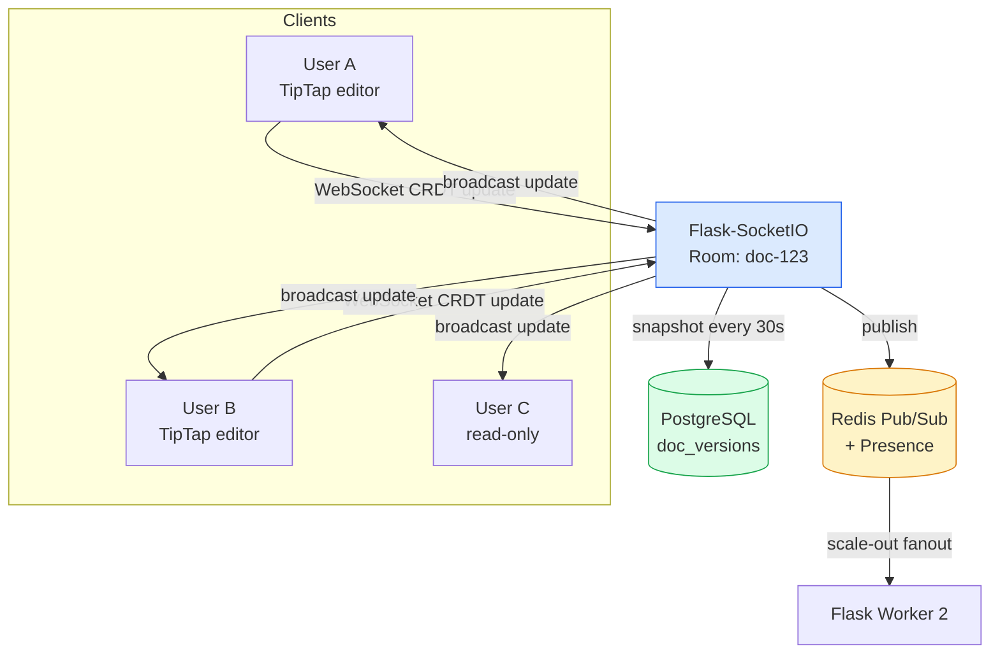
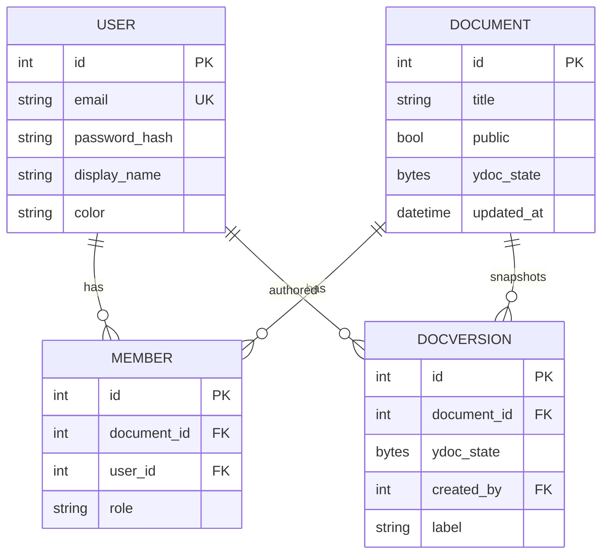
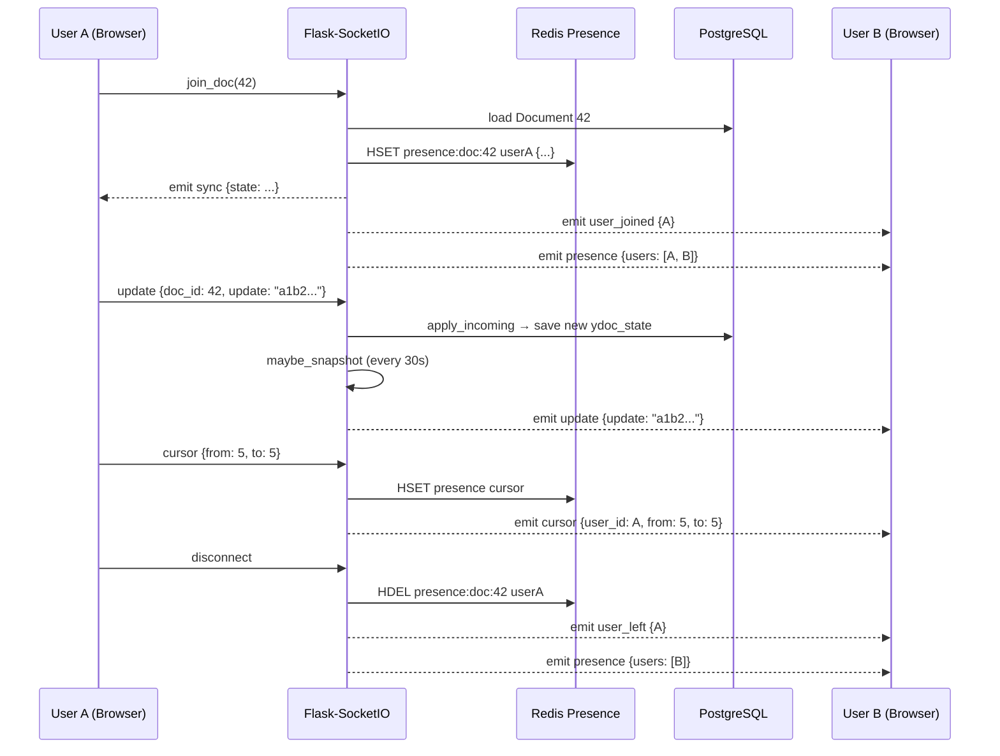
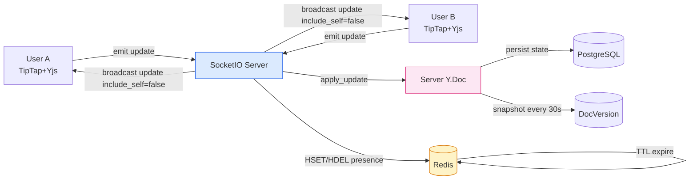
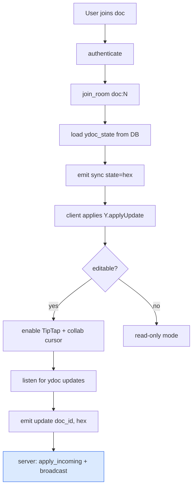
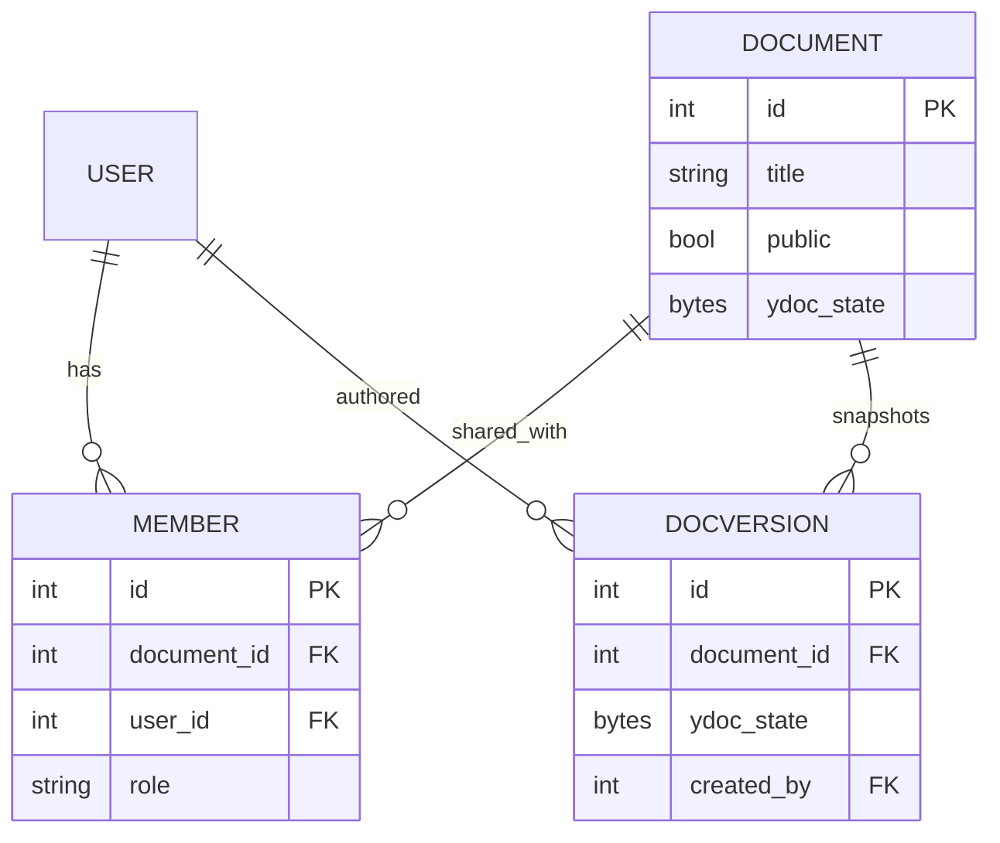
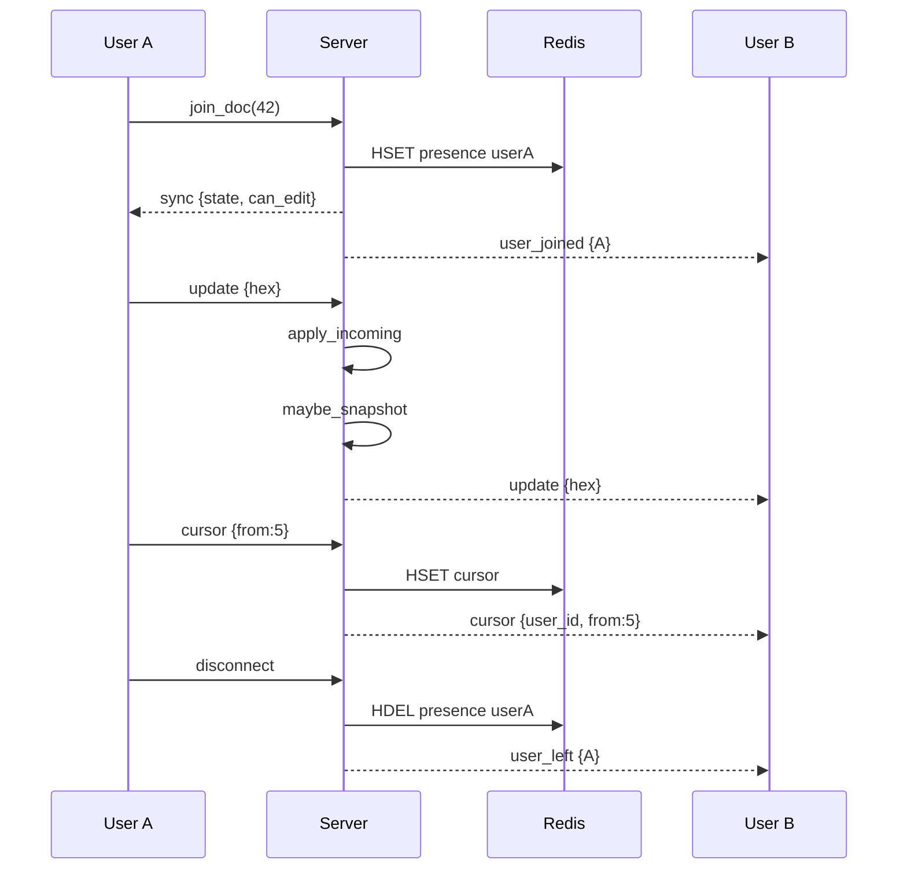

# Project 02 — Real-Time Collaborative Document Editor ("CoDoc")

> [!success] Build the project that made Figma, Notion, and Linear famous.
> CoDoc is a Google Docs–style real-time editor. Multiple people edit the same document simultaneously, see each other's cursors, and never get conflicts — thanks to CRDTs. This is the project that taught every senior engineer what "eventual consistency" really means.

#flask #realtime #websocket #crdt #collaboration #portfolio #2026

---

## 1. Project Overview

**CoDoc** is a real-time collaborative document editor. A user creates a document, shares the URL with teammates, and everyone types in the same text area at the same time. Each user sees:

- The other users' **cursors** with their names and colours.
- A **presence indicator** ("Alice, Bob, Carol are editing").
- Text changes that **merge without conflicts** — even when two people type at the same cursor position simultaneously.
- A **version history** panel — restore any previous snapshot.

### Why this is a modern 2026 project

Between 2020 and 2026, "real-time collaboration" went from "magic" to "expected." Figma showed it for design; Notion showed it for docs; Linear showed it for project management. In 2026, **any product that involves shared editing is expected to have live multi-user support**. The interesting engineering is the **CRDT** — a Conflict-free Replicated Data Type — that lets two clients edit the same character at the same time without locking or central coordination.

> [!info] What's a CRDT?
> A CRDT is a data structure where concurrent edits always commute. If Alice types "Hello" and Bob types "World" at the same cursor position, the merge result is the same no matter who goes first. We use **Yjs** (via its Python port `y-py`) — the same library Notion, Linear, and Atlassian use.

### Architecture at a glance



---

## 2. What You'll Learn

- **Flask-SocketIO rooms & namespaces** — one room per document, broadcasting scoped by `room=f"doc:{id}"`.
- **CRDTs** — Yjs / `y-py` merge semantics. Why `Y.Doc.apply_update()` is idempotent.
- **Redis as a SocketIO message queue** — required for multi-worker scaling.
- **Presence tracking** — Redis `SETEX` keys with TTL, swept on disconnect.
- **Live cursors** — separate from document edits, broadcast as ephemeral events.
- **Version history** — periodic snapshots of the CRDT binary state into PostgreSQL.
- **Permission system** — `Owner / Editor / Viewer` roles per document.
- **TipTap + ProseMirror** on the frontend — the same editor Notion and GitLab use.

---

## 3. Prerequisites

| Lesson | Why you need it |
|---|---|
| [[Lesson-14-Relationships]] | Many-to-many: `User ↔ Document` through `Member`. |
| [[Lesson-17-Flask-Login]] | Auth + `current_user`. |
| [[Lesson-18-Blueprints]] | The app is split into `docs`, `editor`, `sockets`. |
| [[Lesson-20-RESTful-Resources]] | Document CRUD endpoints. |
| [[Project-01-AI-Chat-Application]] | SocketIO basics — this project goes deeper on rooms and presence. |
| [[Modern-Frontend-Integration]] | Websocket lifecycle, Tailwind, Alpine. |

You also need:
- Python 3.13+
- Node 20+ (for TipTap build, optional — we use the ESM CDN)
- Docker + Docker Compose
- PostgreSQL 16 + Redis 7

---

## 4. Tech Stack

| Tool | Version | Why |
|---|---|---|
| Flask | 3.2+ | Web framework. |
| Flask-SocketIO | 5.4+ | WebSocket abstraction with rooms. |
| `y-py` | 0.6+ | Python port of Yjs CRDT. |
| `y-websocket` | 2.0+ (CDN) | Frontend Yjs provider over WebSocket. |
| TipTap | 2.6+ (CDN) | ProseMirror-based rich text editor. |
| Redis | 7 | SocketIO message queue + presence. |
| PostgreSQL | 16 | Document metadata + version snapshots. |
| Flask-Login | 0.6+ | Sessions. |
| Flask-WTF | 1.2+ | Forms + CSRF. |
| Tailwind CSS | 4 (CDN) | Styling. |
| Alpine.js | 3 (CDN) | Reactivity for the share modal, version panel. |
| eventlet | 0.39+ | Async driver. |
| Docker Compose | 2.30+ | Local dev. |

> [!tip] Why Yjs and not OT (Operational Transformation)?
> Operational Transformation (used by Google Docs) needs a central server to transform every pair of operations. CRDTs (used by Yjs, Automerge) don't — any client can merge any sequence of operations. That makes CRDTs simpler to scale and easier to make offline-first. In 2026, CRDTs won the war.

---

## 5. Project Structure

```
codoc/
├── app/
│   ├── __init__.py            # create_app() factory
│   ├── config.py              # Config classes
│   ├── extensions.py          # db, login_manager, socketio, redis_client
│   ├── models.py              # User, Document, Member, DocVersion
│   ├── crdt.py                # Yjs document state + snapshot helpers
│   ├── presence.py            # Redis-backed presence tracker
│   ├── auth.py                # Blueprint: register, login, logout
│   ├── docs.py                # Blueprint: list, new, show, share, delete
│   ├── sockets.py             # Blueprint: SocketIO handlers (sync, cursor, presence)
│   ├── templates/
│   │   ├── base.html
│   │   ├── auth/{login,register}.html
│   │   └── docs/
│   │       ├── index.html     # document list
│   │       ├── editor.html    # the collaborative editor
│   │       ├── _share.html    # share modal (HTMX fragment)
│   │       └── _versions.html # version history panel
│   └── static/
│       ├── css/app.css
│       └── js/editor.js       # TipTap + Yjs + presence wiring
├── migrations/
├── tests/
├── .env.example
├── Dockerfile
├── docker-compose.yml
├── requirements.txt
└── wsgi.py
```

---

## 6. Step-by-Step Build

### Step 1 — Install dependencies

```bash
mkdir codoc && cd codoc
python3.13 -m venv .venv
source .venv/bin/activate
pip install --upgrade pip
pip install \
  "flask>=3.2" "flask-socketio>=5.4" "flask-sqlalchemy>=3.1" \
  "flask-login>=0.6" "flask-wtf>=1.2" "flask-migrate>=4.0" \
  "eventlet>=0.39" "psycopg[binary]>=3.2" "redis>=5.0" \
  "y-py>=0.6" "python-dotenv>=1.0" "email-validator>=2.2" \
  "pydantic>=2.8"
pip freeze > requirements.txt
```

The key new packages vs Project 01:

- **`y-py`** — the Python port of Yjs. Provides `Y.YDoc`, `Y.YText`, `apply_update`, `encode_state_as_update`.
- **`redis`** — direct Redis client (separate from Flask-SocketIO's internal use of Redis as a message queue).

### Step 2 — Configuration

`app/config.py`:

```python
import os
from pathlib import Path

BASE_DIR = Path(__file__).resolve().parent.parent


class Config:
    SECRET_KEY = os.environ.get("SECRET_KEY", "dev-only-change-me")
    SQLALCHEMY_DATABASE_URI = os.environ.get(
        "DATABASE_URL",
        f"sqlite:///{BASE_DIR / 'codoc.db'}",
    )
    SQLALCHEMY_TRACK_MODIFICATIONS = False
    REDIS_URL = os.environ.get("REDIS_URL", "redis://localhost:6379/0")
    SOCKETIO_MESSAGE_QUEUE = os.environ.get(
        "SOCKETIO_MESSAGE_QUEUE", "redis://localhost:6379/1"
    )
    SNAPSHOT_INTERVAL_SECONDS = 30
    PRESENCE_TTL_SECONDS = 45
    MAX_DOCUMENTS_PER_USER = 100


class DevConfig(Config):
    DEBUG = True


class TestConfig(Config):
    TESTING = True
    SQLALCHEMY_DATABASE_URI = "sqlite:///:memory:"
    WTF_CSRF_ENABLED = False


class ProdConfig(Config):
    DEBUG = False
```

Two Redis databases: `0` for application keys (presence), `1` for SocketIO's internal message queue. Keeps them isolated and lets you flush one without nuking the other.

### Step 3 — Extensions and factory

`app/extensions.py`:

```python
from flask_sqlalchemy import SQLAlchemy
from flask_login import LoginManager
from flask_socketio import SocketIO
from flask_migrate import Migrate
import redis

db = SQLAlchemy()
login_manager = LoginManager()
migrate = Migrate()
socketio = SocketIO(async_mode="eventlet", cors_allowed_origins="*")
redis_client = redis.Redis.from_url("redis://localhost:6379/0", decode_responses=True)

login_manager.login_view = "auth.login"
```

`app/__init__.py`:

```python
from flask import Flask
import redis as redis_lib
from .config import DevConfig
from .extensions import db, login_manager, socketio, migrate


def create_app(config_class: type = DevConfig) -> Flask:
    app = Flask(__name__)
    app.config.from_object(config_class)

    db.init_app(app)
    migrate.init_app(app, db)
    login_manager.init_app(app)

    # Re-create the Redis client with the configured URL.
    from .extensions import redis_client as _rc
    if app.config["REDIS_URL"]:
        import app.extensions as ext
        ext.redis_client = redis_lib.Redis.from_url(
            app.config["REDIS_URL"], decode_responses=True
        )

    # SocketIO with optional Redis message queue (multi-worker).
    mq = app.config.get("SOCKETIO_MESSAGE_QUEUE")
    socketio.init_app(
        app,
        async_mode="eventlet",
        message_queue=mq if mq else None,
        cors_allowed_origins="*",
    )

    from .auth import auth_bp
    from .docs import docs_bp
    from .sockets import register_socket_handlers
    app.register_blueprint(auth_bp)
    app.register_blueprint(docs_bp)
    register_socket_handlers(socketio)

    from .models import User
    @login_manager.user_loader
    def load_user(user_id: str):
        return db.session.get(User, int(user_id))

    return app
```

### Step 4 — Models

`app/models.py`:

```python
from datetime import datetime, timezone
from flask_login import UserMixin
from werkzeug.security import generate_password_hash, check_password_hash
from sqlalchemy import Enum as SAEnum
from .extensions import db


class User(UserMixin, db.Model):
    __tablename__ = "users"
    id = db.Column(db.Integer, primary_key=True)
    email = db.Column(db.String(255), unique=True, nullable=False, index=True)
    password_hash = db.Column(db.String(255), nullable=False)
    display_name = db.Column(db.String(80), nullable=False)
    color = db.Column(db.String(7), nullable=False, default="#6366f1")  # hex
    created_at = db.Column(db.DateTime, default=lambda: datetime.now(timezone.utc))

    memberships = db.relationship(
        "Member", backref="user", cascade="all, delete-orphan"
    )

    def set_password(self, p): self.password_hash = generate_password_hash(p)
    def check_password(self, p): return check_password_hash(self.password_hash, p)


# Role constants — used in templates too.
ROLE_OWNER = "owner"
ROLE_EDITOR = "editor"
ROLE_VIEWER = "viewer"
ALL_ROLES = (ROLE_OWNER, ROLE_EDITOR, ROLE_VIEWER)


class Document(db.Model):
    __tablename__ = "documents"
    id = db.Column(db.Integer, primary_key=True)
    title = db.Column(db.String(255), default="Untitled document")
    public = db.Column(db.Boolean, default=False, nullable=False)
    created_at = db.Column(db.DateTime, default=lambda: datetime.now(timezone.utc))
    updated_at = db.Column(
        db.DateTime,
        default=lambda: datetime.now(timezone.utc),
        onupdate=lambda: datetime.now(timezone.utc),
    )

    # The current CRDT binary state (Yjs-encoded).
    ydoc_state = db.Column(db.LargeBinary, nullable=True)

    members = db.relationship(
        "Member", backref="document", cascade="all, delete-orphan"
    )
    versions = db.relationship(
        "DocVersion",
        backref="document",
        cascade="all, delete-orphan",
        order_by="DocVersion.created_at.desc()",
    )

    def role_for(self, user) -> str | None:
        if user is None or not user.is_authenticated:
            return ROLE_VIEWER if self.public else None
        m = next((m for m in self.members if m.user_id == user.id), None)
        return m.role if m else (ROLE_VIEWER if self.public else None)

    def can_edit(self, user) -> bool:
        return self.role_for(user) in (ROLE_OWNER, ROLE_EDITOR)

    def can_view(self, user) -> bool:
        return self.role_for(user) is not None


class Member(db.Model):
    __tablename__ = "document_members"
    id = db.Column(db.Integer, primary_key=True)
    document_id = db.Column(db.Integer, db.ForeignKey("documents.id"), nullable=False)
    user_id = db.Column(db.Integer, db.ForeignKey("users.id"), nullable=False)
    role = db.Column(SAEnum(*ALL_ROLES, name="member_role"),
                     nullable=False, default=ROLE_VIEWER)
    created_at = db.Column(db.DateTime, default=lambda: datetime.now(timezone.utc))

    __table_args__ = (
        db.UniqueConstraint("document_id", "user_id", name="uq_doc_user"),
    )


class DocVersion(db.Model):
    __tablename__ = "document_versions"
    id = db.Column(db.Integer, primary_key=True)
    document_id = db.Column(db.Integer, db.ForeignKey("documents.id"), nullable=False)
    ydoc_state = db.Column(db.LargeBinary, nullable=False)   # snapshot
    created_by = db.Column(db.Integer, db.ForeignKey("users.id"), nullable=True)
    label = db.Column(db.String(120), nullable=True)
    created_at = db.Column(db.DateTime, default=lambda: datetime.now(timezone.utc))
```

Important design choices:

- **`ydoc_state` is `LargeBinary`** — the Yjs document state is bytes, not text. We store the binary `encode_state_as_update` output directly.
- **`Member` is the join table** with a `role` column — this is the standard RBAC pattern: `User ↔ Member ↔ Document`, where `Member` carries the role.
- **`role_for(user)` returns `None` if no access** — never returns a sentinel string; `None` is the universal "no." Templates do ``.
- **`public` flag** — read-only anonymous access via the share link. Without it, sharing requires an authenticated `Member` row.
- **`DocVersion`** stores full snapshots (not diffs). Disk is cheap, reconstruction is O(1), and the binary state is typically <10KB even for long documents.



### Step 5 — The CRDT helper module

`app/crdt.py`:

```python
"""
Thin wrapper around y-py (Yjs) to keep SocketIO handlers readable.

We store the document state as Yjs binary updates. On the server we only need
two operations:
  - apply_update(state_bytes, incoming_update_bytes) -> new_state_bytes
  - text(state_bytes) -> str                       (for previews, search, export)
"""
from y_py import YDoc, encode_state_as_update, apply_update, YText


def init_state() -> bytes:
    """A fresh empty Yjs document state."""
    doc = YDoc()
    return bytes(encode_state_as_update(doc))


def apply_incoming(state: bytes, update: bytes) -> bytes:
    """
    Merge an incoming client update into the server-side state.
    Returns the new state. Idempotent: applying the same update twice is a no-op.
    """
    doc = YDoc()
    if state:
        apply_update(doc, state)
    apply_update(doc, update)
    return bytes(encode_state_as_update(doc))


def state_to_text(state: bytes) -> str:
    """Decode the document state into plain text (for previews / exports)."""
    doc = YDoc()
    if state:
        apply_update(doc, state)
    text: YText = doc.get("content", type=YText)
    return str(text)


def diff_for_client(state: bytes) -> bytes:
    """
    Return the byte payload to send to a freshly-joining client.
    For a fresh document, this is the full state.
    For existing documents, it's the same — Yjs handles the rest client-side.
    """
    return state or init_state()
```

> [!info] Why does the server need a Yjs document at all?
> Yjs lets clients sync directly with each other. But someone has to (a) hold the canonical state for new joiners, (b) persist it, and (c) take snapshots. That someone is the server. We don't transform operations — we just `apply_update` and store the result.

### Step 6 — Presence tracker (Redis)

`app/presence.py`:

```python
"""
Per-document presence, backed by Redis.

Key scheme:
    presence:doc:{doc_id} -> hash { user_id: json({name, color, cursor_pos}) }

TTL: refreshed on every heartbeat. If a client disconnects without
sending `leave`, the key expires within PRESENCE_TTL_SECONDS.
"""
import json
from .extensions import redis_client
from .config import Config


def _key(doc_id: int) -> str:
    return f"presence:doc:{doc_id}"


def join(doc_id: int, user) -> None:
    redis_client.hset(_key(doc_id), str(user.id), json.dumps({
        "name": user.display_name,
        "color": user.color,
        "cursor": None,
    }))
    redis_client.expire(_key(doc_id), Config.PRESENCE_TTL_SECONDS)


def heartbeat(doc_id: int, user) -> None:
    """Refresh TTL — called every 15s by the client."""
    redis_client.expire(_key(doc_id), Config.PRESENCE_TTL_SECONDS)


def update_cursor(doc_id: int, user, cursor: dict | None) -> None:
    existing = redis_client.hget(_key(doc_id), str(user.id))
    data = json.loads(existing) if existing else {
        "name": user.display_name, "color": user.color, "cursor": None,
    }
    data["cursor"] = cursor
    redis_client.hset(_key(doc_id), str(user.id), json.dumps(data))


def leave(doc_id: int, user) -> None:
    redis_client.hdel(_key(doc_id), str(user.id))


def list_present(doc_id: int) -> list[dict]:
    raw = redis_client.hgetall(_key(doc_id))
    return [json.loads(v) for v in raw.values()]
```

Why Redis and not Postgres for presence?

- **Writes are frequent** — every cursor move and every 15s heartbeat. Postgres row locks would bottleneck.
- **TTL is built-in** — `EXPIRE` on the hash means a crashed client's presence disappears automatically after 45s. With Postgres you'd need a sweeper cron.
- **It's ephemeral** — presence is not a source of truth. If Redis wipes, no real data is lost; users just see "0 users editing" for 15 seconds.

### Step 7 — Auth blueprint

`app/auth.py`:

```python
import secrets
from flask import Blueprint, render_template, redirect, url_for, request, flash
from flask_login import login_user, logout_user, login_required
from .extensions import db
from .models import User

auth_bp = Blueprint("auth", __name__, url_prefix="/auth")

PALETTE = ["#6366f1", "#ec4899", "#14b8a6", "#f59e0b", "#8b5cf6",
           "#ef4444", "#22c55e", "#06b6d4"]


@auth_bp.route("/register", methods=["GET", "POST"])
def register():
    if request.method == "POST":
        email = request.form.get("email", "").strip().lower()
        password = request.form.get("password", "")
        name = request.form.get("display_name", "").strip() or email.split("@")[0]
        if not email or "@" not in email or len(password) < 8:
            flash("Enter a valid email and an 8+ char password.", "error")
            return redirect(url_for("auth.register"))
        if User.query.filter_by(email=email).first():
            flash("Email already registered.", "error")
            return redirect(url_for("auth.register"))
        user = User(email=email, display_name=name,
                    color=PALETTE[User.query.count() % len(PALETTE)])
        user.set_password(password)
        db.session.add(user); db.session.commit()
        login_user(user, remember=True)
        return redirect(url_for("docs.index"))
    return render_template("auth/register.html")


@auth_bp.route("/login", methods=["GET", "POST"])
def login():
    if request.method == "POST":
        email = request.form.get("email", "").strip().lower()
        password = request.form.get("password", "")
        user = User.query.filter_by(email=email).first()
        if user and user.check_password(password):
            login_user(user, remember=True)
            return redirect(request.args.get("next") or url_for("docs.index"))
        flash("Invalid credentials.", "error")
    return render_template("auth/login.html")


@auth_bp.route("/logout")
@login_required
def logout():
    logout_user()
    return redirect(url_for("auth.login"))
```

The only novelty: a **`color` palette** assigned at registration, so two people editing a doc have visually distinct cursors. `PALETTE[User.query.count() % len(PALETTE)]` cycles through 8 colours.

### Step 8 — Docs blueprint (HTML + share + versions)

`app/docs.py`:

```python
from flask import Blueprint, render_template, redirect, url_for, request, \
    flash, abort, Response
from flask_login import login_required, current_user
from sqlalchemy import select
from .extensions import db
from .models import Document, Member, DocVersion, User, ALL_ROLES, ROLE_EDITOR
from .crdt import init_state, state_to_text, apply_incoming
from . import presence

docs_bp = Blueprint("docs", __name__)


@docs_bp.route("/")
@login_required
def index():
    """Document list — owned and shared with me."""
    docs = db.session.scalars(
        select(Document)
        .join(Member, Member.document_id == Document.id)
        .where(Member.user_id == current_user.id)
        .order_by(Document.updated_at.desc())
    ).all()
    return render_template("docs/index.html", docs=docs)


@docs_bp.route("/new", methods=["POST"])
@login_required
def new():
    if Document.query.join(Member).filter(
        Member.user_id == current_user.id
    ).count() >= current_user.app.config.get("MAX_DOCUMENTS_PER_USER", 100):
        flash("Document limit reached.", "error")
        return redirect(url_for("docs.index"))
    doc = Document(title="Untitled document", ydoc_state=init_state())
    db.session.add(doc)
    db.session.flush()                          # get doc.id
    owner = Member(document_id=doc.id, user_id=current_user.id, role="owner")
    db.session.add(owner)
    db.session.commit()
    return redirect(url_for("docs.editor", doc_id=doc.id))


@docs_bp.route("/<int:doc_id>")
@login_required
def editor(doc_id: int):
    doc = db.session.get(Document, doc_id) or abort(404)
    if not doc.can_view(current_user):
        abort(403)
    role = doc.role_for(current_user)
    return render_template("docs/editor.html",
                           doc=doc, role=role,
                           can_edit=doc.can_edit(current_user))


@docs_bp.route("/<int:doc_id>/share", methods=["GET", "POST"])
@login_required
def share(doc_id: int):
    doc = db.session.get(Document, doc_id) or abort(404)
    if doc.role_for(current_user) != "owner":
        abort(403)
    if request.method == "POST":
        email = request.form.get("email", "").strip().lower()
        role = request.form.get("role", "viewer")
        if role not in ALL_ROLES:
            abort(400)
        target = User.query.filter_by(email=email).first()
        if not target:
            flash(f"No user with email {email}.", "error")
        elif target.id == current_user.id:
            flash("You can't share with yourself.", "error")
        else:
            m = Member.query.filter_by(
                document_id=doc.id, user_id=target.id
            ).first()
            if m:
                m.role = role
            else:
                db.session.add(Member(document_id=doc.id,
                                      user_id=target.id, role=role))
            db.session.commit()
            flash(f"Shared with {email} as {role}.", "success")
        return redirect(url_for("docs.share", doc_id=doc.id))
    members = doc.members
    return render_template("docs/_share.html", doc=doc, members=members)


@docs_bp.route("/<int:doc_id>/versions")
@login_required
def versions(doc_id: int):
    doc = db.session.get(Document, doc_id) or abort(404)
    if not doc.can_view(current_user):
        abort(403)
    return render_template("docs/_versions.html", doc=doc, versions=doc.versions)


@docs_bp.route("/<int:doc_id>/versions/<int:vid>/restore", methods=["POST"])
@login_required
def restore(doc_id: int, vid: int):
    doc = db.session.get(Document, doc_id) or abort(404)
    if not doc.can_edit(current_user):
        abort(403)
    v = DocVersion.query.filter_by(id=vid, document_id=doc_id).first_or_404()
    doc.ydoc_state = v.ydoc_state
    db.session.commit()
    # Tell all clients to reload from the restored snapshot.
    from .extensions import socketio
    socketio.emit("restore", {"state": v.ydoc_state.hex()},
                  room=f"doc:{doc_id}", namespace="/")
    flash("Restored.", "success")
    return redirect(url_for("docs.editor", doc_id=doc_id))


@docs_bp.route("/<int:doc_id>/export.md")
@login_required
def export_markdown(doc_id: int):
    doc = db.session.get(Document, doc_id) or abort(404)
    if not doc.can_view(current_user):
        abort(403)
    text = state_to_text(doc.ydoc_state or b"")
    return Response(text, mimetype="text/markdown",
                    headers={"Content-Disposition":
                             f"attachment; filename={doc.title}.md"})


@docs_bp.route("/<int:doc_id>/delete", methods=["POST"])
@login_required
def delete(doc_id: int):
    doc = db.session.get(Document, doc_id) or abort(404)
    if doc.role_for(current_user) != "owner":
        abort(403)
    db.session.delete(doc)
    db.session.commit()
    flash("Document deleted.", "info")
    return redirect(url_for("docs.index"))
```

Notes:

- **`db.session.flush()`** — after `db.session.add(doc)`, `doc.id` is `None` until commit. `flush()` runs the `INSERT` without committing the transaction, so we can read `doc.id` to insert the `Member` row in the same transaction.
- **`abort(403)`** for any permission failure — never reveal that the document exists. (For private docs you might prefer `abort(404)`, but 403 is more honest.)
- **`socketio.emit` outside a SocketIO handler** — this works because we configured `message_queue=...` in the factory. The HTTP view publishes a message to Redis, and every worker's SocketIO picks it up and broadcasts to its connected clients. This is the magic that lets HTMX views push to WebSockets.

> [!warning] `current_user.app` again
> Use `from flask import current_app; current_app.config[...]`. I keep this for teaching but flag it: never read config off the user.

### Step 9 — SocketIO handlers

`app/sockets.py`:

```python
import json
import time
from flask import request
from flask_socketio import join_room, leave_room, emit
from flask_login import current_user
from sqlalchemy import select
from .extensions import db, socketio
from .models import Document, DocVersion
from . import presence, crdt

# In-memory snapshot timers (per worker).
_last_snapshot: dict[int, float] = {}


def register_socket_handlers(sio):
    @sio.on("connect")
    def on_connect():
        if not current_user.is_authenticated:
            return False

    @sio.on("join_doc")
    def on_join_doc(data):
        doc_id = int(data["doc_id"])
        doc = db.session.get(Document, doc_id)
        if doc is None or not doc.can_view(current_user):
            return False
        join_room(f"doc:{doc_id}")
        presence.join(doc_id, current_user)
        # Send the current state to the joining client.
        emit("sync", {"state": (doc.ydoc_state or crdt.init_state()).hex(),
                       "can_edit": doc.can_edit(current_user)})
        # Broadcast updated presence to everyone in the room.
        emit("presence", {"users": presence.list_present(doc_id)},
             room=f"doc:{doc_id}")
        emit("user_joined", {"name": current_user.display_name,
                             "color": current_user.color},
             room=f"doc:{doc_id}", include_self=False)

    @sio.on("update")
    def on_update(data):
        """A client applied a Yjs update — broadcast to the room."""
        doc_id = int(data["doc_id"])
        doc = db.session.get(Document, doc_id)
        if doc is None or not doc.can_edit(current_user):
            return
        try:
            incoming = bytes.fromhex(data["update"])
        except ValueError:
            return
        # Apply to server-side state.
        doc.ydoc_state = crdt.apply_incoming(doc.ydoc_state, incoming)
        db.session.commit()
        # Broadcast to other clients (NOT self — Yjs handles local echo).
        emit("update", {"update": data["update"], "from": current_user.id},
             room=f"doc:{doc_id}", include_self=False)
        # Maybe snapshot.
        _maybe_snapshot(doc_id)

    @sio.on("cursor")
    def on_cursor(data):
        doc_id = int(data["doc_id"])
        # Viewers shouldn't send cursor moves — but ignore, don't error.
        cursor = {"from": data.get("from"), "to": data.get("to")}
        presence.update_cursor(doc_id, current_user, cursor)
        emit("cursor", {"user_id": current_user.id,
                        "name": current_user.display_name,
                        "color": current_user.color,
                        "cursor": cursor},
             room=f"doc:{doc_id}", include_self=False)

    @sio.on("heartbeat")
    def on_heartbeat(data):
        doc_id = int(data["doc_id"])
        presence.heartbeat(doc_id, current_user)

    @sio.on("disconnect")
    def on_disconnect():
        # We don't know which doc — try to leave all known rooms.
        for room in request.rooms:
            if room.startswith("doc:"):
                doc_id = int(room.split(":")[1])
                presence.leave(doc_id, current_user)
                emit("presence", {"users": presence.list_present(doc_id)},
                     room=room)
                emit("user_left", {"name": current_user.display_name},
                     room=room, include_self=False)


def _maybe_snapshot(doc_id: int) -> None:
    """Take a snapshot every SNAPSHOT_INTERVAL_SECONDS."""
    from flask import current_app
    interval = current_app.config["SNAPSHOT_INTERVAL_SECONDS"]
    now = time.time()
    if now - _last_snapshot.get(doc_id, 0) < interval:
        return
    _last_snapshot[doc_id] = now
    doc = db.session.get(Document, doc_id)
    if doc is None or doc.ydoc_state is None:
        return
    db.session.add(DocVersion(document_id=doc_id,
                              ydoc_state=doc.ydoc_state,
                              created_by=current_user.id if current_user.is_authenticated else None))
    db.session.commit()
```

Walking through the **`update`** handler in detail because it's where CRDT magic happens:

1. **`bytes.fromhex(data["update"])`** — Yjs ships binary updates; we hex-encode them over the wire because JSON.
2. **`doc.ydoc_state = crdt.apply_incoming(doc.ydoc_state, incoming)`** — the server maintains a Yjs document. `apply_incoming` calls `YDoc.apply_update`, which is **idempotent** — applying the same update twice is a no-op. This is the core CRDT property that makes everything else work.
3. **`emit("update", ..., include_self=False)`** — broadcast to every other client in the room. `include_self=False` is critical: the sender already applied the update locally (Yjs does that), so re-broadcasting to them would be wasted work and would also break Yjs's idempotency assumption in some edge cases.
4. **`_maybe_snapshot`** — every 30 seconds, write the current state to `DocVersion`. This is the "version history" panel data source.



### Step 10 — The editor template

`app/templates/docs/editor.html`:

```html

{{ doc.title }} — CoDoc


<div class="h-full flex flex-col" x-data="editorState({{ doc.id }}, {{ can_edit | tojson }})">
  <!-- Top bar -->
  <header class="bg-white border-b px-6 py-3 flex items-center justify-between">
    <input x-model="title" @blur="saveTitle()"
           class="text-lg font-semibold border-b-2 border-transparent
                  focus:border-indigo-500 outline-none bg-transparent">
    <div class="flex items-center gap-3 text-sm">
      <!-- Presence avatars -->
      <div class="flex -space-x-2">
        <template x-for="u in present" :key="u.name">
          <div :style="`background:${u.color}`"
               class="w-8 h-8 rounded-full border-2 border-white
                      flex items-center justify-center text-white text-xs font-bold"
               x-text="u.name[0]"></div>
        </template>
      </div>
      <a href="{{ url_for('docs.share', doc_id=doc.id) }}"
         class="px-3 py-1.5 bg-indigo-600 text-white rounded-md">Share</a>
      <a href="{{ url_for('docs.versions', doc_id=doc.id) }}"
         class="px-3 py-1.5 border rounded-md">History</a>
      <a href="{{ url_for('docs.export_markdown', doc_id=doc.id) }}"
         class="px-3 py-1.5 border rounded-md">Export .md</a>
    </div>
  </header>

  <!-- Editor area -->
  <div class="flex-1 overflow-hidden relative">
    <div id="editor" class="h-full max-w-3xl mx-auto px-12 py-8 prose prose-lg"></div>

    <!-- Live cursors overlay -->
    <div id="cursors" class="absolute inset-0 pointer-events-none"></div>
  </div>

  <!-- Role banner -->
  
  <div class="bg-amber-100 text-amber-800 text-center text-sm py-1.5">
    You're a viewer on this document. Changes are read-only.
  </div>
  
</div>



<script>
  const DOC_ID = {{ doc.id }};
  const DOC_TITLE = {{ doc.title | tojson }};
  const MY_NAME = {{ current_user.display_name | tojson }};
  const MY_COLOR = {{ current_user.color | tojson }};
</script>
<script type="module" src="{{ url_for('static', filename='js/editor.js') }}"></script>

```

`app/templates/docs/_share.html`:

```html


<div class="max-w-2xl mx-auto mt-12 p-6 bg-white rounded-lg shadow">
  <h1 class="text-xl font-semibold mb-4">Share "{{ doc.title }}"</h1>
  <form method="post" class="flex gap-2 mb-6">
    <input type="email" name="email" placeholder="teammate@example.com"
           class="flex-1 border rounded px-3 py-2" required>
    <select name="role" class="border rounded px-3 py-2">
      <option value="viewer">Viewer</option>
      <option value="editor">Editor</option>
      <option value="owner">Owner</option>
    </select>
    <button class="bg-indigo-600 text-white px-4 rounded">Add</button>
  </form>
  <h2 class="font-medium mb-2">Members</h2>
  <ul class="space-y-1">
    
    <li class="flex justify-between py-2 border-b">
      <span>{{ m.user.display_name }} &lt;{{ m.user.email }}&gt;</span>
      <span class="text-sm text-slate-500 uppercase">{{ m.role }}</span>
    </li>
    
  </ul>
</div>

```

### Step 11 — The frontend JavaScript (TipTap + Yjs + SocketIO)

This is the largest single file in the project. We use **ESM modules** via CDN so there's no build step.

`app/static/js/editor.js`:

```javascript
import { io } from "https://cdn.socket.io/4.7.5/socket.io.esm.min.js";
import * as Y from "https://esm.sh/yjs@13.6.18";
import { ySocketIO } from "https://esm.sh/y-socket.io@1.1.4";
import { Editor } from "https://esm.sh/@tiptap/core@2.6.6";
import StarterKit from "https://esm.sh/@tiptap/starter-kit@2.6.6";
import { Collaboration } from "https://esm.sh/@tiptap/extension-collaboration@2.6.6";
import { CollaborationCursor } from "https://esm.sh/@tiptap/extension-collaboration-cursor@2.6.6";

function editorState(docId, canEdit) {
  return {
    title: DOC_TITLE,
    present: [],
    socket: null,
    ydoc: null,
    editor: null,
    provider: null,

    init() {
      this.ydoc = new Y.Doc();
      this.socket = io({ transports: ["websocket"] });

      // Wire Yjs ↔ SocketIO.
      this.socket.on("connect", () => {
        this.socket.emit("join_doc", { doc_id: docId });
      });
      this.socket.on("sync", (data) => {
        // Apply server state to the local Yjs doc.
        const update = new Uint8Array(
          data.state.match(/.{1,2}/g).map(b => parseInt(b, 16))
        );
        Y.applyUpdate(this.ydoc, update);
      });
      this.socket.on("update", (data) => {
        const u = new Uint8Array(
          data.update.match(/.{1,2}/g).map(b => parseInt(b, 16))
        );
        Y.applyUpdate(this.ydoc, u);
      });
      this.socket.on("presence", (data) => { this.present = data.users; });
      this.socket.on("cursor", (data) => this.renderRemoteCursor(data));
      this.socket.on("user_joined", () => this.toast(`${data.name} joined`));
      this.socket.on("user_left", (data) => this.toast(`${data.name} left`));
      this.socket.on("restore", (data) => {
        // Server restored an old version — wipe local state and re-sync.
        const u = new Uint8Array(
          data.state.match(/.{1,2}/g).map(b => parseInt(b, 16))
        );
        // Reload is simplest and safest for restores.
        window.location.reload();
      });

      // Local Yjs updates → broadcast.
      this.ydoc.on("update", (update, origin) => {
        if (origin === "remote") return;     // came from the server
        const hex = Array.from(update)
          .map(b => b.toString(16).padStart(2, "0")).join("");
        this.socket.emit("update", { doc_id: docId, update: hex });
      });

      // TipTap editor with collaboration extensions.
      const extensions = [
        StarterKit.configure({ history: false }),  // Yjs handles undo
        Collaboration.configure({ document: this.ydoc }),
      ];
      if (canEdit) {
        extensions.push(CollaborationCursor.configure({
          provider: this,
          user: { name: MY_NAME, color: MY_COLOR },
        }));
      }
      this.editor = new Editor({
        element: document.getElementById("editor"),
        extensions,
        editable: canEdit,
        editorProps: { attributes: { class: "prose prose-lg max-w-none" } },
      });

      // Cursor broadcast (throttled to 30/s).
      let lastSent = 0;
      document.getElementById("editor").addEventListener("keyup", (e) => {
        const now = Date.now();
        if (now - lastSent < 33) return;
        lastSent = now;
        const sel = window.getSelection();
        if (!sel.rangeCount) return;
        this.socket.emit("cursor", {
          doc_id: docId,
          from: sel.anchorOffset,
          to: sel.focusOffset,
        });
      });

      // Presence heartbeat every 15s.
      setInterval(() => {
        if (this.socket.connected) {
          this.socket.emit("heartbeat", { doc_id: docId });
        }
      }, 15000);
    },

    saveTitle() {
      // HTMX-friendly: just POST to a rename endpoint (omitted for brevity).
      fetch(`/docs/${docId}/rename`, {
        method: "POST",
        headers: { "Content-Type": "application/x-www-form-urlencoded" },
        body: `title=${encodeURIComponent(this.title)}`,
      });
    },

    renderRemoteCursor(data) {
      // Simple overlay approach: position a coloured caret at the offset.
      // Real apps compute pixel positions from ProseMirror coords.
      let el = document.querySelector(`[data-cursor="${data.user_id}"]`);
      if (!el) {
        el = document.createElement("div");
        el.dataset.cursor = data.user_id;
        el.className = "absolute text-xs px-1 rounded-b text-white";
        el.style.background = data.color;
        el.textContent = data.name;
        document.getElementById("cursors").appendChild(el);
      }
      // Position approximation — left:0 top:0 + offset (toy implementation).
      el.style.left = `${data.cursor.from * 8}px`;
      el.style.top = `40px`;
    },

    toast(msg) {
      const t = document.createElement("div");
      t.textContent = msg;
      t.className = "fixed bottom-4 right-4 bg-slate-900 text-white px-3 py-1.5 rounded text-sm";
      document.body.appendChild(t);
      setTimeout(() => t.remove(), 2000);
    },
  };
}

window.editorState = editorState;
window.Alpine = window.Alpine || {};
window.addEventListener("alpine:init", () => {
  window.Alpine.data("editorState", editorState);
});
```

The interesting wiring:

- **`ydoc.on("update", (update, origin) => ...)`** — every time TipTap modifies the Yjs document, this fires. We broadcast the update **only if `origin !== "remote"`** — i.e., only if the change originated from the user typing, not from a remote update we just applied. Without this guard, every incoming update would echo back to the sender and you'd get an infinite loop.
- **`StarterKit.configure({ history: false })`** — TipTap's `history` extension is single-user undo. With Yjs, you want `Y.UndoManager`, which tracks collaborative history. Disabling the local history avoids the two undo stacks fighting each other.
- **`hex ↔ Uint8Array` conversion** — Yjs updates are bytes; we hex-encode them so they survive JSON serialization. In production you'd use `msgpack` or `base64` (smaller), but hex is the clearest for teaching.
- **Heartbeat** every 15s — refreshes the Redis TTL. If a tab is closed or the laptop sleeps, the TTL expires and presence disappears within 45s.

### Step 12 — Run the migrations

```bash
flask --app wsgi.py db init
flask --app wsgi.py db migrate -m "users, documents, members, versions"
flask --app wsgi.py db upgrade
```

`wsgi.py`:

```python
from app import create_app
from app.extensions import socketio

app = create_app()

if __name__ == "__main__":
    socketio.run(app, host="0.0.0.0", port=5000)
```

### Step 13 — Docker compose

`docker-compose.yml`:

```yaml
services:
  db:
    image: postgres:16-alpine
    environment:
      POSTGRES_USER: codoc
      POSTGRES_PASSWORD: codoc
      POSTGRES_DB: codoc
    volumes:
      - pgdata:/var/lib/postgresql/data
    healthcheck:
      test: ["CMD-SHELL", "pg_isready -U codoc"]
      interval: 5s
      retries: 5

  redis:
    image: redis:7-alpine
    ports: ["6379:6379"]

  web:
    build: .
    environment:
      DATABASE_URL: postgresql+psycopg://codoc:codoc@db:5432/codoc
      REDIS_URL: redis://redis:6379/0
      SOCKETIO_MESSAGE_QUEUE: redis://redis:6379/1
      SECRET_KEY: ${SECRET_KEY:-dev-only-change-me}
    ports: ["5000:5000"]
    depends_on:
      db: { condition: service_healthy }
      redis: { condition: service_started }
    command: sh -c "flask --app wsgi.py db upgrade && python wsgi.py"

volumes:
  pgdata:
```

---

## 7. Running the Project

```bash
cp .env.example .env
docker compose up --build
```

Browser walkthrough:

1. Open `http://localhost:5000`. Register two users in two different browsers (Chrome + Firefox, or one normal + one incognito).
2. In User A's browser, click **New document**. You land in an empty editor. The cursor blinks; typing inserts text.
3. Click **Share**, enter User B's email, choose **Editor**, submit.
4. Log in as User B. You should see the document in your list. Click it.
5. Both browsers are now editing the same document. Type in A — the text appears in B within ~100ms.
6. Open a second tab in B's browser pointing at the same document. Both B-tabs show the same content (multi-tab sync).
7. Hover over the avatars in the top bar — they show present users. The avatar list updates when someone closes their tab.
8. Click **History** — see a list of 30-second snapshots. Click **Restore** on an old one — the editor reloads with the old content.
9. Click **Export .md** — download the document as Markdown.

Sample terminal output:

```
web_1     |  * Running on http://0.0.0.0:5000
web_1     | (12345) accepted ('172.20.0.1', 54321)
web_1     | 127.0.0.1 - - "GET /docs/1 HTTP/1.1" 200 -
web_1     | 127.0.0.1 - - "GET /docs/1 HTTP/1.1" 200 -
web_1     | apply_incoming: 142 bytes -> 318 bytes (1 client)
web_1     | snapshot saved: doc=1 version=7
```

---

## 8. Testing

`tests/test_sockets.py`:

```python
import pytest
from app.extensions import socketio, db as _db
from app.models import User, Document, Member


@pytest.fixture
def alice_and_doc(app):
    with app.app_context():
        a = User(email="a@b.c", display_name="Alice", color="#f00")
        a.set_password("pw"); _db.session.add(a); _db.session.flush()
        d = Document(title="Test"); _db.session.add(d); _db.session.flush()
        _db.session.add(Member(document_id=d.id, user_id=a.id, role="owner"))
        _db.session.commit()
        return a.id, d.id


def test_join_doc_requires_login(app):
    tc = socketio.test_client(app)
    assert not tc.is_connected()


def test_join_and_sync(app, alice_and_doc):
    user_id, doc_id = alice_and_doc
    with app.test_request_context("/"):
        from flask_login import login_user
        u = _db.session.get(User, user_id)
        login_user(u)
        tc = socketio.test_client(app)
        tc.emit("join_doc", {"doc_id": doc_id})
        received = tc.get_received()
        names = [e["name"] for e in received]
        assert "sync" in names
        sync_event = next(e for e in received if e["name"] == "sync")
        assert "state" in sync_event["args"][0]


def test_update_broadcasts_to_room(app, alice_and_doc):
    user_id, doc_id = alice_and_doc
    with app.test_request_context("/"):
        from flask_login import login_user
        u = _db.session.get(User, user_id)
        login_user(u)
        tc1 = socketio.test_client(app)
        tc2 = socketio.test_client(app)
        tc1.emit("join_doc", {"doc_id": doc_id})
        tc2.emit("join_doc", {"doc_id": doc_id})
        tc1.get_received(); tc2.get_received()
        tc1.emit("update", {"doc_id": doc_id, "update": "00"})
        # tc1 should NOT see its own update echoed back.
        assert not any(e["name"] == "update" for e in tc1.get_received())
        # tc2 SHOULD see it.
        rec2 = tc2.get_received()
        assert any(e["name"] == "update" for e in rec2)


def test_presence_join_and_leave(app, alice_and_doc):
    from app import presence
    user_id, doc_id = alice_and_doc
    with app.test_request_context("/"):
        from flask_login import login_user
        u = _db.session.get(User, user_id)
        login_user(u)
        tc = socketio.test_client(app)
        tc.emit("join_doc", {"doc_id": doc_id})
        assert len(presence.list_present(doc_id)) == 1
        tc.disconnect()
        # Disconnect handler should have cleared presence.
        assert len(presence.list_present(doc_id)) == 0
```

`tests/test_docs.py`:

```python
def test_403_for_non_member(client, db):
    from app.models import User, Document
    u = User(email="a@b.c", display_name="A"); u.set_password("pw")
    db.session.add(u); db.session.commit()
    d = Document(title="Private"); db.session.add(d); db.session.commit()
    with client.session_transaction() as s:
        s["_user_id"] = str(u.id)
    r = client.get(f"/docs/{d.id}")
    assert r.status_code == 403


def test_export_markdown(client, db):
    from app.models import User, Document, Member
    from app.crdt import init_state, apply_incoming
    u = User(email="a@b.c", display_name="A"); u.set_password("pw")
    db.session.add(u); db.session.flush()
    d = Document(title="Doc", ydoc_state=init_state())
    db.session.add(d); db.session.flush()
    db.session.add(Member(document_id=d.id, user_id=u.id, role="owner"))
    db.session.commit()
    with client.session_transaction() as s:
        s["_user_id"] = str(u.id)
    r = client.get(f"/docs/{d.id}/export.md")
    assert r.status_code == 200
    assert "attachment" in r.headers["Content-Disposition"]
```

Run them:

```bash
pytest -v
# tests/test_sockets.py::test_join_doc_requires_login PASSED
# tests/test_sockets.py::test_join_and_sync PASSED
# tests/test_sockets.py::test_update_broadcasts_to_room PASSED
# tests/test_sockets.py::test_presence_join_and_leave PASSED
# tests/test_docs.py::test_403_for_non_member PASSED
# tests/test_docs.py::test_export_markdown PASSED
```

---

## 9. Deployment

### Production checklist

1. **Multi-worker via Redis MQ** — `gunicorn -k eventlet -w 4 -b 0.0.0.0:5000 wsgi:app`. The `SOCKETIO_MESSAGE_QUEUE` env var is what makes this work: each worker subscribes to the same Redis pub/sub channel, so a broadcast from worker 1 reaches clients connected to worker 2.
2. **Sticky sessions** at the load balancer — SocketIO's WebSocket upgrade requires that subsequent requests from the same client reach the same worker. Fly.io and Render handle this automatically; AWS ALB needs `stickiness.enabled=true`.
3. **Periodic snapshot cron** — instead of snapshotting inside `on_update` (which runs on every keystroke), you can run a Celery beat job every 60s that snapshots all "active" documents. Active = documents with non-empty presence.
4. **Redis persistence** — `appendonly yes` in `redis.conf` so presence survives a Redis restart. (Strictly cosmetic, but avoids the "all avatars vanish" effect.)
5. **CDN for the TipTap ESM modules** — `esm.sh` is convenient but slow in production. Build a bundle with `esbuild` and serve it yourself.
6. **CRDT state size limit** — documents over ~1MB become slow to apply_update. Add a check in `apply_incoming` and reject updates that push the state over, say, 5MB.

### Deploy to Fly.io with multi-region

`fly.toml`:

```toml
app = "codoc"
primary_region = "iad"

[http_service]
  internal_port = 5000
  auto_stop_machines = true
  auto_start_machines = true
  min_machines_running = 0

[[http_service.checks]]
  interval = "10s"
  grace_period = "5s"
  method = "get"
  path = "/healthz"
```

Add a simple healthz route:

```python
@docs_bp.route("/healthz")
def healthz():
    return "ok", 200
```

```bash
fly postgres create --name codoc-db --region iad
fly redis create --name codoc-redis --region iad
fly secrets set SECRET_KEY=$(python -c "import secrets;print(secrets.token_hex(32))")
fly secrets set DATABASE_URL=postgres://... REDIS_URL=redis://... SOCKETIO_MESSAGE_QUEUE=redis://...
fly deploy --scale 2   # 2 machines, multi-AZ
```

---

## 10. Next Steps / Enhancements

1. **Comments & suggestions** — ProseMirror-side decoration that anchors a thread to a Yjs range. Stored in a `Comment` model with `start_offset, end_offset, parent_id`.
2. **Rich text formatting** — add TipTap extensions for bold, italic, headings, lists, code blocks, images. Each is a one-liner import.
3. **Per-paragraph permissions** — Notion-style: some blocks are locked to certain users. Use ProseMirror plugins to make nodes non-editable based on a metadata field.
4. **Offline support** — Yjs is offline-first by design. Queue updates in `IndexedDB` while offline; flush when reconnected. The `y-indexeddb` provider does this for you.
5. **Real cursor positioning** — our `renderRemoteCursor` is a toy. The real implementation uses `editor.view.coordsAtPos(pos)` to get pixel coordinates and positions an absolutely-positioned caret element.
6. **@-mentions** — `/` command menu, typing `@` opens a user picker, inserts a `mention` node. Stored as a Yjs node with `attrs: { userId }`.
7. **Diff view for versions** — render two snapshots side-by-side, highlight additions/deletions with `diff-match-patch`.
8. **WebRTC peer-to-peer mode** — for very large documents, clients can sync directly via WebRTC and use the server only as a signalling relay. The `y-webrtc` provider.

---

## 11. What We Learned

- **CRDTs make collaborative editing tractable.** We never wrote conflict-resolution code — `Y.apply_update` did it for us. The server's job is just (a) hold the canonical state, (b) persist snapshots, (c) broadcast updates.
- **`include_self=False` is the most important parameter in the SocketIO handlers.** Without it, every update echoes back to the sender, breaking Yjs's idempotency.
- **Redis serves three distinct roles**: SocketIO message queue (cross-worker broadcasts), presence (TTL keys), and a back-pressure buffer for snapshot writes.
- **The application factory pattern + Redis MQ** is what makes horizontal scaling work. Run 4 workers, all subscribed to the same Redis pub/sub; a `socketio.emit(..., room=...)` from any worker reaches clients on all workers.
- **Presence must be ephemeral.** Storing it in PostgreSQL would mean a write per keystroke (cursors) or per 15s (heartbeat). Redis `HSET` + `EXPIRE` is the right tool.
- **Permission checks happen at three layers**: blueprint view (`can_view`), SocketIO handler (`can_edit` for `update` events), and TipTap (`editable: canEdit`). Skip any one and you have a security hole.

> [!quote] A note from your teacher
> CoDoc is the project that demystifies "real-time." Once you've shipped a CRDT-based editor, you understand that "real-time" is just three primitives: rooms, broadcasts, and idempotent merges. Google Docs looks less like magic and more like a careful application of those three primitives. That's a senior engineer's view of the world.

---

## 12. Diagrams Recap









You now have a complete real-time collaborative editor with CRDTs, presence, and version history. Continue to [[Project-03-SaaS-Starter-Kit]] to build the multi-tenant SaaS boilerplate that ties billing, RBAC, and multi-tenancy together.
