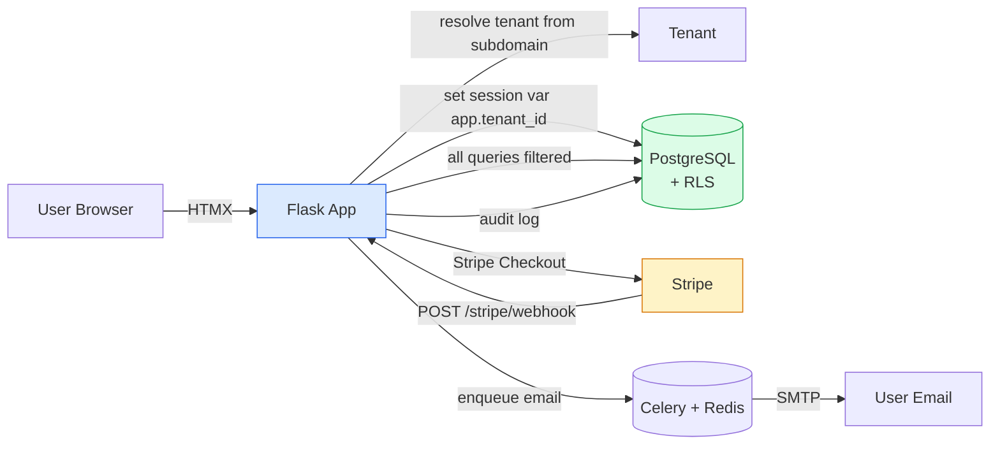
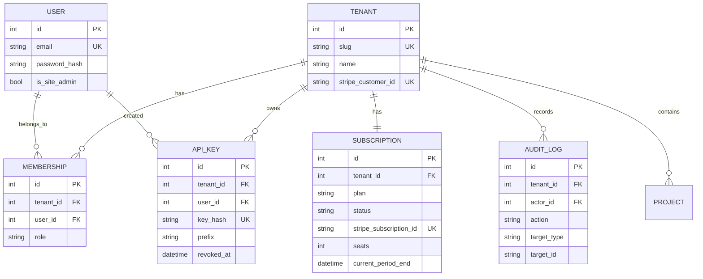
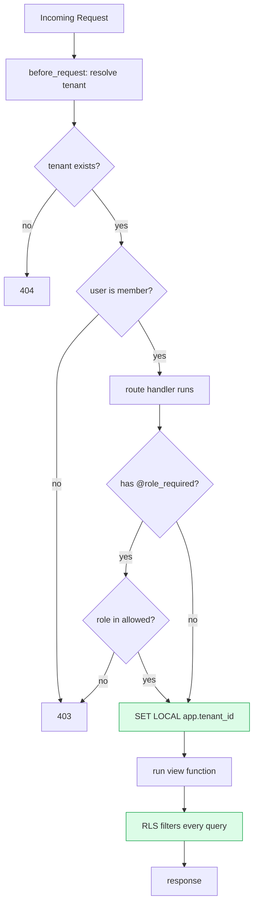
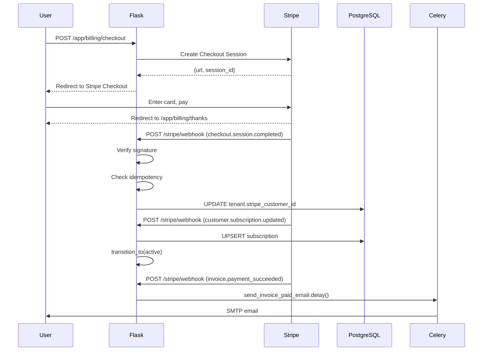
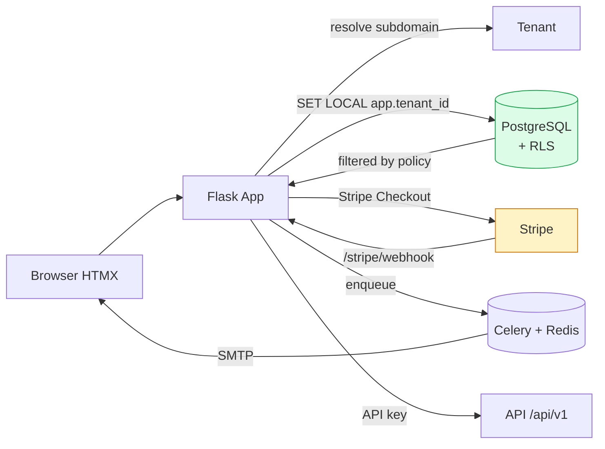
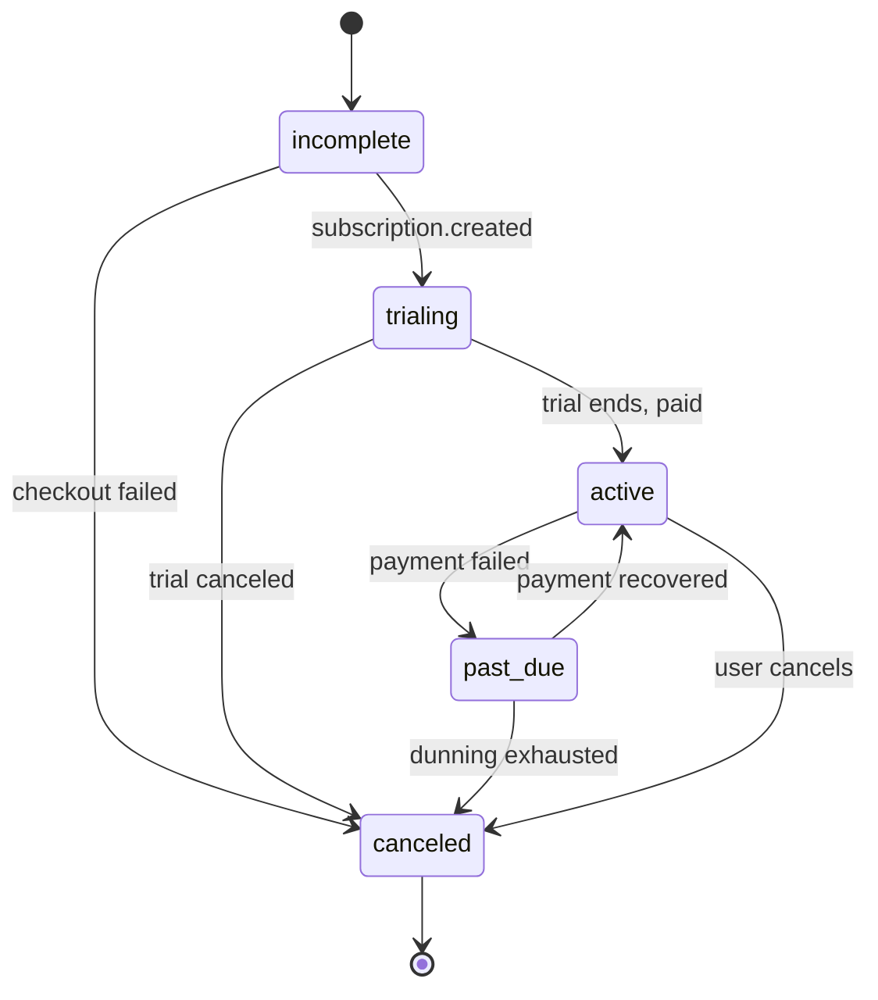
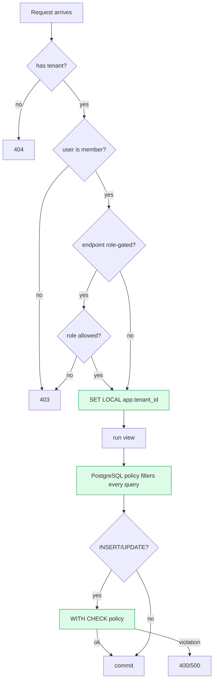

# Project 03 — Multi-Tenant SaaS Starter Kit ("Forge")

> [!success] The project that pays the bills — literally.
> Forge is a production-ready SaaS boilerplate: multi-tenant data isolation, Stripe billing, role-based access, audit logs, and a Stripe-webhook-driven subscription state machine. This is the project indie hackers sell for $200–500 a copy. It's also the project that demonstrates senior-level engineering.

#flask #saas #multi-tenancy #stripe #billing #rbac #portfolio #2026

---

## 1. Project Overview

**Forge** is the boring-but-hard parts of a SaaS — already solved. New users land on a marketing page with pricing, register (creating a new tenant), pick a plan, pay via Stripe Checkout, and land on a dashboard. Each tenant's data is isolated at the database level via **PostgreSQL Row-Level Security (RLS)**. The team owner can invite teammates as admins / members / viewers. Stripe webhooks drive a subscription state machine (`trialing → active → past_due → canceled`). Every admin action is written to an audit log. The whole stack ships as `docker compose up`.

### Why this is a modern 2026 project

In 2026, **every indie hacker, every YC startup, every internal enterprise tool is a SaaS**. The hard parts — multi-tenancy, billing, RBAC, audit logs — are also the parts that take weeks to get right. A starter kit that solves them is genuinely useful. It's also the project most likely to **make you money**: many indie hackers sell SaaS boilerplates for $200–500 a copy.

Three things make this a *modern* SaaS:

1. **Row-Level Security at the database level** — not just `WHERE tenant_id = ?` in Python (which fails the moment a developer forgets the filter), but enforced by Postgres itself. Even a SQL injection can't leak cross-tenant data.
2. **Idempotent Stripe webhooks** — Stripe will redeliver the same event up to 3 days later if your server returns non-2xx. You must de-duplicate by event ID.
3. **HTMX for the entire dashboard** — no React, no Vue, no client-side router. The starter kit is small enough to read end-to-end in an afternoon.

### Architecture at a glance



---

## 2. What You'll Learn

- **Multi-tenant data models** — shared database, shared schema, `tenant_id` on every table.
- **PostgreSQL Row-Level Security** — `CREATE POLICY`, `SET LOCAL`, session variables, and why this beats Python-side filtering.
- **Stripe end-to-end** — Checkout Sessions, Customer Portal, **webhook signature verification**, idempotent event handling.
- **Subscription state machine** — `trialing → active → past_due → canceled` with explicit transitions.
- **Role-based access control** — Owner / Admin / Member / Viewer, enforced by a single decorator.
- **Pydantic v2 for request validation at the edge** — typed views: `def view(req: CreateTenantRequest)`.
- **Audit logging** — every admin action recorded with actor, action, target, before/after.
- **API key authentication** — separate from session cookies; for programmatic access.
- **Celery + Redis** for transactional emails (welcome, invoice paid, dunning).
- **Feature flags tied to subscription tier** — `@feature_required("team_workspaces")`.

---

## 3. Prerequisites

| Lesson | Why |
|---|---|
| [[Lesson-16-User-Model-AndPasswords]] | User model, password hashing. |
| [[Lesson-17-Flask-Login]] | `LoginManager`, sessions. |
| [[Lesson-14-Relationships]] | `Tenant ↔ User ↔ Subscription`. |
| [[Lesson-18-Blueprints]] | `auth`, `billing`, `dashboard`, `api`, `admin` blueprints. |
| [[Lesson-19-Building-JSON-API]] | API key auth. |
| [[Lesson-22-Email-And-Tasks]] | Celery + Flask-Mail. |
| [[Lesson-23-Deployment]] | Docker, production deployment. |
| [[Modern-Databases-And-Caching]] | PostgreSQL RLS, Redis. |
| [[Modern-Deployment-And-DevOps]] | Docker Compose, multi-service. |

You also need:
- Python 3.13+, Docker, Docker Compose
- A **Stripe** account (test mode is fine — no real charges)
- PostgreSQL 16 (RLS policies need 9.5+, but 16 has the modern `USING`/`WITH CHECK` syntax refinements)

---

## 4. Tech Stack

| Tool | Version | Why |
|---|---|---|
| Flask | 3.2+ | Web framework. |
| Flask-SQLAlchemy | 3.1+ | ORM. |
| Flask-Login | 0.6+ | Sessions. |
| Flask-Principal | 0.4+ | Identity / Role needs. We use a lightweight custom decorator instead — easier to reason about. |
| Flask-WTF | 1.2+ | Forms + CSRF. |
| Flask-Limiter | 3.8+ | Rate limiting on auth + API. |
| Flask-Mail | 0.10+ | Transactional email. |
| Celery | 5.4+ | Async task queue. |
| Redis | 7 | Celery broker + rate-limit backend. |
| PostgreSQL | 16 | Database + Row-Level Security. |
| stripe (Python SDK) | 11+ | Stripe API + webhook signature. |
| pydantic | 2.8+ | Typed request/response models. |
| httpx | 0.27+ | Used internally by stripe SDK. |
| HTMX | 2.0 (CDN) | Form submissions, no SPA. |
| Tailwind CSS | 4 (CDN) | Styling. |
| Docker Compose | 2.30+ | Local dev. |

> [!info] Why custom RBAC instead of Flask-Principal?
> Flask-Principal is powerful but verbose — `Identity`, `RoleNeed`, `Permission`, signals. For a SaaS with 4 fixed roles, a single `@role_required("admin")` decorator on a `current_tenant_membership` is clearer. We do show how Flask-Principal would do it as a sidebar.

---

## 5. Project Structure

```
forge/
├── app/
│   ├── __init__.py            # create_app() factory
│   ├── config.py              # Config classes
│   ├── extensions.py          # db, login_manager, mail, limiter, celery
│   ├── rls.py                 # PostgreSQL RLS session var management
│   ├── models.py              # User, Tenant, Membership, Subscription, AuditLog, ApiKey
│   ├── rbac.py                # role_required, feature_required decorators
│   ├── stripe_handlers.py     # webhook handlers (split by event type)
│   ├── billing.py             # checkout, portal, subscription transitions
│   ├── auth.py                # Blueprint: register, login, logout, invite
│   ├── dashboard.py           # Blueprint: dashboard, settings, users
│   ├── billing_views.py       # Blueprint: pricing, checkout, portal, invoices
│   ├── api.py                 # Blueprint: API key auth + endpoints
│   ├── admin.py               # Blueprint: site-admin panel
│   ├── tasks.py               # Celery tasks: emails, dunning
│   ├── templates/
│   │   ├── base.html
│   │   ├── marketing/index.html   # landing + pricing
│   │   ├── auth/{login,register,invite}.html
│   │   ├── dashboard/{index,settings,users,billing}.html
│   │   ├── admin/index.html
│   │   └── partials/{user_row,billing_alert}.html
│   └── static/
│       ├── css/app.css
│       └── js/app.js          # HTMX helpers, tiny Alpine for modal
├── migrations/
│   └── versions/
│       └── *.py               # Alembic migrations incl. RLS policies
├── tests/
│   ├── conftest.py
│   ├── test_rls.py            # RLS is critical — heavy testing
│   ├── test_billing.py        # webhook idempotency, state machine
│   └── test_rbac.py
├── .env.example
├── Dockerfile
├── docker-compose.yml
├── requirements.txt
├── celery_worker.py           # entrypoint: celery -A celery_worker.celery worker
└── wsgi.py
```

---

## 6. Step-by-Step Build

### Step 1 — Install dependencies

```bash
mkdir forge && cd forge
python3.13 -m venv .venv
source .venv/bin/activate
pip install --upgrade pip
pip install \
  "flask>=3.2" "flask-sqlalchemy>=3.1" "flask-login>=0.6" "flask-wtf>=1.2" \
  "flask-migrate>=4.0" "flask-limiter>=3.8" "flask-mail>=0.10" \
  "celery>=5.4" "redis>=5.0" "psycopg[binary]>=3.2" \
  "stripe>=11.0" "pydantic>=2.8" "python-dotenv>=1.0" \
  "email-validator>=2.2" "gunicorn>=23.0" "eventlet>=0.39"
pip freeze > requirements.txt
```

### Step 2 — Configuration

`app/config.py`:

```python
import os
from pathlib import Path

BASE_DIR = Path(__file__).resolve().parent.parent


class Config:
    SECRET_KEY = os.environ.get("SECRET_KEY", "dev-only-change-me")
    SQLALCHEMY_DATABASE_URI = os.environ.get(
        "DATABASE_URL",
        f"sqlite:///{BASE_DIR / 'forge.db'}",
    )
    SQLALCHEMY_TRACK_MODIFICATIONS = False

    # Stripe — both required in prod.
    STRIPE_SECRET_KEY = os.environ.get("STRIPE_SECRET_KEY", "")
    STRIPE_WEBHOOK_SECRET = os.environ.get("STRIPE_WEBHOOK_SECRET", "")
    STRIPE_PRICE_LOOKUP_FREE = "price_free"
    STRIPE_PRICE_LOOKUP_PRO = "price_pro"
    STRIPE_PRICE_LOOKUP_TEAM = "price_team"

    # Redis / Celery.
    REDIS_URL = os.environ.get("REDIS_URL", "redis://localhost:6379/0")
    CELERY_BROKER_URL = os.environ.get("CELERY_BROKER_URL", "redis://localhost:6379/1")
    CELERY_RESULT_BACKEND = os.environ.get("CELERY_RESULT_BACKEND", "redis://localhost:6379/2")

    # Mail.
    MAIL_SERVER = os.environ.get("MAIL_SERVER", "smtp.mailtrap.io")
    MAIL_PORT = int(os.environ.get("MAIL_PORT", "587"))
    MAIL_USERNAME = os.environ.get("MAIL_USERNAME", "")
    MAIL_PASSWORD = os.environ.get("MAIL_PASSWORD", "")
    MAIL_USE_TLS = True
    MAIL_DEFAULT_SENDER = os.environ.get("MAIL_DEFAULT_SENDER", "hello@forge.app")

    # Multi-tenancy.
    ROOT_DOMAIN = os.environ.get("ROOT_DOMAIN", "forge.local")
    SESSION_COOKIE_DOMAIN = os.environ.get("SESSION_COOKIE_DOMAIN", None)

    # Rate limits.
    RATELIMIT_STORAGE_URI = os.environ.get("REDIS_URL", "redis://localhost:6379/0")
    RATELIMIT_AUTH = "5/minute"
    RATELIMIT_API = "100/minute"

    # Plan limits.
    PLAN_LIMITS = {
        "free": {"seats": 1, "api_calls_per_day": 100, "features": []},
        "pro": {"seats": 5, "api_calls_per_day": 10_000,
                "features": ["webhooks", "custom_branding"]},
        "team": {"seats": 25, "api_calls_per_day": 100_000,
                 "features": ["webhooks", "custom_branding", "sso", "audit_export"]},
    }


class DevConfig(Config):
    DEBUG = True


class TestConfig(Config):
    TESTING = True
    SQLALCHEMY_DATABASE_URI = "sqlite:///:memory:"
    WTF_CSRF_ENABLED = False
    STRIPE_SECRET_KEY = "sk_test_dummy"


class ProdConfig(Config):
    DEBUG = False
```

### Step 3 — Extensions + factory + tenant resolution

`app/extensions.py`:

```python
from flask_sqlalchemy import SQLAlchemy
from flask_login import LoginManager
from flask_migrate import Migrate
from flask_wtf import CSRFProtect
from flask_limiter import Limiter
from flask_limiter.util import get_remote_address
from flask_mail import Mail
from celery import Celery

db = SQLAlchemy()
login_manager = LoginManager()
migrate = Migrate()
csrf = CSRFProtect()
mail = Mail()
limiter = Limiter(key_func=get_remote_address, default_limits=["200/hour"])
celery = Celery("forge", include=["app.tasks"])

login_manager.login_view = "auth.login"
```

`app/__init__.py`:

```python
from flask import Flask, g, request, redirect, url_for
from .config import DevConfig
from .extensions import (db, login_manager, migrate, csrf, mail,
                         limiter, celery)
from .models import User, Tenant, Membership


def create_app(config_class: type = DevConfig) -> Flask:
    app = Flask(__name__)
    app.config.from_object(config_class)

    db.init_app(app)
    migrate.init_app(app, db)
    login_manager.init_app(app)
    csrf.init_app(app)
    mail.init_app(app)
    limiter.init_app(app)

    celery.conf.update(
        broker_url=app.config["CELERY_BROKER_URL"],
        result_backend=app.config["CELERY_RESULT_BACKEND"],
    )

    from .auth import auth_bp
    from .dashboard import dashboard_bp
    from .billing_views import billing_bp
    from .api import api_bp
    from .admin import admin_bp
    from .marketing import marketing_bp
    from .webhooks import webhooks_bp
    app.register_blueprint(marketing_bp)
    app.register_blueprint(auth_bp)
    app.register_blueprint(dashboard_bp, url_prefix="/app")
    app.register_blueprint(billing_bp, url_prefix="/app/billing")
    app.register_blueprint(api_bp, url_prefix="/api/v1")
    app.register_blueprint(admin_bp, url_prefix="/admin")
    app.register_blueprint(webhooks_bp)            # /stripe/webhook — no CSRF!

    @login_manager.user_loader
    def load_user(uid): return db.session.get(User, int(uid))

    # --- Tenant resolution ----------------------------------------------------
    @app.before_request
    def resolve_tenant():
        """Resolve current tenant from subdomain or session.
        Sets g.tenant and g.membership. Skips for /stripe/webhook."""
        if request.endpoint == "webhooks.stripe":
            return                              # webhooks have their own auth
        if request.path.startswith("/static"):
            return

        host = request.host.split(":")[0]
        parts = host.split(".")
        if len(parts) >= 3 and parts[0] not in ("www", "app"):
            subdomain = parts[0]
            g.tenant = Tenant.query.filter_by(slug=subdomain).first()
        else:
            # In dev, fall back to ?tenant=slug or session.
            slug = request.args.get("tenant") or session_get("tenant_slug")
            g.tenant = Tenant.query.filter_by(slug=slug).first() if slug else None

        if g.tenant and current_user_lookup():
            g.membership = Membership.query.filter_by(
                tenant_id=g.tenant.id, user_id=current_user_lookup().id
            ).first()
        else:
            g.membership = None

    return app


def session_get(key):
    from flask import session
    return session.get(key)


def current_user_lookup():
    from flask_login import current_user
    return current_user if current_user.is_authenticated else None
```

The `before_request` hook resolves the current tenant from the **subdomain** — `acme.forge.local` → tenant slug `acme`. In dev you can't easily use subdomains, so we fall back to `?tenant=acme` or `session["tenant_slug"]`. In production, `acme.forge.app` resolves directly via DNS.

### Step 4 — Models (the heart of multi-tenancy)

`app/models.py`:

```python
from datetime import datetime, timezone, timedelta
from flask_login import UserMixin
from werkzeug.security import generate_password_hash, check_password_hash
import secrets
from sqlalchemy import Enum as SAEnum, Index
from .extensions import db


ROLE_OWNER = "owner"
ROLE_ADMIN = "admin"
ROLE_MEMBER = "member"
ROLE_VIEWER = "viewer"
ALL_ROLES = (ROLE_OWNER, ROLE_ADMIN, ROLE_MEMBER, ROLE_VIEWER)


# Subscription states — driven by Stripe webhook events.
SUB_TRIALING = "trialing"
SUB_ACTIVE = "active"
SUB_PAST_DUE = "past_due"
SUB_CANCELED = "canceled"
SUB_INCOMPLETE = "incomplete"
ALL_SUB_STATES = (SUB_TRIALING, SUB_ACTIVE, SUB_PAST_DUE, SUB_CANCELED, SUB_INCOMPLETE)

PLAN_FREE = "free"
PLAN_PRO = "pro"
PLAN_TEAM = "team"


def _utcnow():
    return datetime.now(timezone.utc)


class Tenant(db.Model):
    __tablename__ = "tenants"
    id = db.Column(db.Integer, primary_key=True)
    slug = db.Column(db.String(60), unique=True, nullable=False, index=True)
    name = db.Column(db.String(120), nullable=False)
    created_at = db.Column(db.DateTime, default=_utcnow)
    stripe_customer_id = db.Column(db.String(80), unique=True, nullable=True, index=True)


class User(UserMixin, db.Model):
    __tablename__ = "users"
    id = db.Column(db.Integer, primary_key=True)
    email = db.Column(db.String(255), unique=True, nullable=False, index=True)
    password_hash = db.Column(db.String(255), nullable=False)
    display_name = db.Column(db.String(80), nullable=False)
    is_site_admin = db.Column(db.Boolean, default=False, nullable=False)
    created_at = db.Column(db.DateTime, default=_utcnow)

    memberships = db.relationship(
        "Membership", backref="user", cascade="all, delete-orphan"
    )

    def set_password(self, p): self.password_hash = generate_password_hash(p)
    def check_password(self, p): return check_password_hash(self.password_hash, p)


class Membership(db.Model):
    """Join table User ↔ Tenant with a role column."""
    __tablename__ = "memberships"
    id = db.Column(db.Integer, primary_key=True)
    tenant_id = db.Column(db.Integer, db.ForeignKey("tenants.id"), nullable=False)
    user_id = db.Column(db.Integer, db.ForeignKey("users.id"), nullable=False)
    role = db.Column(SAEnum(*ALL_ROLES, name="role"), nullable=False, default=ROLE_MEMBER)
    created_at = db.Column(db.DateTime, default=_utcnow)

    __table_args__ = (
        db.UniqueConstraint("tenant_id", "user_id", name="uq_tenant_user"),
        Index("ix_tenant_user", "tenant_id", "user_id"),
    )

    @property
    def can_manage(self) -> bool:
        return self.role in (ROLE_OWNER, ROLE_ADMIN)

    @property
    def can_invite(self) -> bool:
        return self.role in (ROLE_OWNER, ROLE_ADMIN)


class Subscription(db.Model):
    __tablename__ = "subscriptions"
    id = db.Column(db.Integer, primary_key=True)
    tenant_id = db.Column(db.Integer, db.ForeignKey("tenants.id"),
                          unique=True, nullable=False)
    plan = db.Column(SAEnum(PLAN_FREE, PLAN_PRO, PLAN_TEAM, name="plan"),
                     nullable=False, default=PLAN_FREE)
    status = db.Column(SAEnum(*ALL_SUB_STATES, name="sub_status"),
                       nullable=False, default=SUB_ACTIVE)
    stripe_subscription_id = db.Column(db.String(80), unique=True, nullable=True)
    seats = db.Column(db.Integer, default=1, nullable=False)
    current_period_end = db.Column(db.DateTime, nullable=True)
    trial_end = db.Column(db.DateTime, nullable=True)
    canceled_at = db.Column(db.DateTime, nullable=True)
    updated_at = db.Column(db.DateTime, default=_utcnow, onupdate=_utcnow)

    # Valid transitions for the subscription state machine.
    TRANSITIONS = {
        SUB_TRIALING: {SUB_ACTIVE, SUB_CANCELED},
        SUB_ACTIVE: {SUB_PAST_DUE, SUB_CANCELED},
        SUB_PAST_DUE: {SUB_ACTIVE, SUB_CANCELED},
        SUB_INCOMPLETE: {SUB_ACTIVE, SUB_CANCELED},
        SUB_CANCELED: set(),
    }

    def transition_to(self, new_status: str) -> bool:
        if new_status == self.status:
            return True
        allowed = self.TRANSITIONS.get(self.status, set())
        if new_status not in allowed:
            return False
        self.status = new_status
        if new_status == SUB_CANCELED:
            self.canceled_at = _utcnow()
        return True


class ApiKey(db.Model):
    __tablename__ = "api_keys"
    id = db.Column(db.Integer, primary_key=True)
    tenant_id = db.Column(db.Integer, db.ForeignKey("tenants.id"), nullable=False)
    user_id = db.Column(db.Integer, db.ForeignKey("users.id"), nullable=False)
    key_hash = db.Column(db.String(255), unique=True, nullable=False, index=True)
    prefix = db.Column(db.String(12), nullable=False)         # first 8 chars for display
    name = db.Column(db.String(120), nullable=False, default="Default")
    last_used_at = db.Column(db.DateTime, nullable=True)
    created_at = db.Column(db.DateTime, default=_utcnow)
    revoked_at = db.Column(db.DateTime, nullable=True)

    @classmethod
    def generate(cls, tenant_id, user_id, name="Default") -> tuple["ApiKey", str]:
        """Returns (ApiKey instance, raw_key). Store raw_key nowhere — show once."""
        raw = "fk_" + secrets.token_urlsafe(32)
        api_key = cls(
            tenant_id=tenant_id, user_id=user_id, name=name,
            key_hash=generate_password_hash(raw),
            prefix=raw[:12],
        )
        return api_key, raw

    @classmethod
    def verify(cls, raw: str) -> "ApiKey | None":
        for k in cls.query.filter_by(prefix=raw[:12], revoked_at=None).all():
            if check_password_hash(k.key_hash, raw):
                return k
        return None


class AuditLog(db.Model):
    """Every admin action recorded. RLS-scoped per tenant."""
    __tablename__ = "audit_logs"
    id = db.Column(db.Integer, primary_key=True)
    tenant_id = db.Column(db.Integer, db.ForeignKey("tenants.id"), nullable=False)
    actor_id = db.Column(db.Integer, db.ForeignKey("users.id"), nullable=True)
    action = db.Column(db.String(80), nullable=False)        # e.g. "user.invited"
    target_type = db.Column(db.String(40), nullable=True)
    target_id = db.Column(db.String(64), nullable=True)
    metadata_json = db.Column(db.Text, nullable=True)        # JSON-encoded before/after
    created_at = db.Column(db.DateTime, default=_utcnow, index=True)


# --- Tenant-scoped models (every one has tenant_id; RLS filters them) -----

class Project(db.Model):
    """An example tenant-scoped entity — replace with your SaaS's actual content."""
    __tablename__ = "projects"
    id = db.Column(db.Integer, primary_key=True)
    tenant_id = db.Column(db.Integer, db.ForeignKey("tenants.id"),
                          nullable=False, index=True)
    name = db.Column(db.String(120), nullable=False)
    description = db.Column(db.Text, nullable=True)
    created_by = db.Column(db.Integer, db.ForeignKey("users.id"), nullable=True)
    created_at = db.Column(db.DateTime, default=_utcnow)
```

The crucial pattern is **`tenant_id` on every model that belongs to a tenant** — `Membership`, `Subscription`, `ApiKey`, `AuditLog`, `Project`. Without `tenant_id`, RLS can't filter it. (Tables without `tenant_id` — `User`, `Tenant` — are global, not RLS-scoped.)



### Step 5 — Row-Level Security

This is the magic that makes the SaaS safe. RLS is a Postgres feature where every query against a table is transparently filtered by a policy. We set a session variable `app.tenant_id` per request, and policies say "you can only see rows where `tenant_id = current_setting('app.tenant_id')`.

`app/rls.py`:

```python
"""
Row-Level Security helpers.

Setup (one-time, in a migration):
    ALTER TABLE projects ENABLE ROW LEVEL SECURITY;
    ALTER TABLE projects FORCE ROW LEVEL SECURITY;     -- applies even to owner
    CREATE POLICY tenant_isolation ON projects
        USING (tenant_id = current_setting('app.tenant_id', true)::int);

Per request, we run:
    SET LOCAL app.tenant_id = 42;

The `true` argument to current_setting means "return NULL if not set" rather
than raising. Combined with `tenant_id = NULL`, that returns no rows — which
is the safe default.
"""
from flask import g
from .extensions import db


def set_tenant_context(tenant_id: int | None) -> None:
    """Call this at the start of every request that touches tenant-scoped data."""
    # `SET LOCAL` scopes to the current transaction, which Flask-SQLAlchemy
    # wraps around each request by default.
    if tenant_id is None:
        db.session.execute(db.text("SET LOCAL app.tenant_id = ''"))
    else:
        db.session.execute(
            db.text("SET LOCAL app.tenant_id = :tid"),
            {"tid": str(tenant_id)},
        )


def clear_tenant_context() -> None:
    set_tenant_context(None)
```

The migration that sets up RLS — `migrations/versions/0002_rls_policies.py`:

```python
"""Add Row-Level Security policies to all tenant-scoped tables."""
from alembic import op


TENANT_TABLES = ["memberships", "subscriptions", "api_keys",
                 "audit_logs", "projects"]


def upgrade():
    for table in TENANT_TABLES:
        op.execute(f"ALTER TABLE {table} ENABLE ROW LEVEL SECURITY;")
        op.execute(f"ALTER TABLE {table} FORCE ROW LEVEL SECURITY;")
        op.execute(f"""
            CREATE POLICY tenant_isolation ON {table}
            USING (
                tenant_id = NULLIF(current_setting('app.tenant_id', true), '')::int
            )
            WITH CHECK (
                tenant_id = NULLIF(current_setting('app.tenant_id', true), '')::int
            );
        """)
    # The superuser bypasses RLS by default; we want app connections to be
    # subject to it, so we run as a non-superuser role:
    op.execute("CREATE ROLE forge_app LOGIN PASSWORD 'forge_app';")
    op.execute("GRANT SELECT, INSERT, UPDATE, DELETE ON ALL TABLES IN SCHEMA public TO forge_app;")


def downgrade():
    for table in TENANT_TABLES:
        op.execute(f"DROP POLICY IF EXISTS tenant_isolation ON {table};")
        op.execute(f"ALTER TABLE {table} NO FORCE ROW LEVEL SECURITY;")
        op.execute(f"ALTER TABLE {table} DISABLE ROW LEVEL SECURITY;")
```

Two key concepts:

- **`USING`** filters `SELECT`, `UPDATE`, `DELETE`. Rows where `USING` is false are invisible.
- **`WITH CHECK`** filters `INSERT` and `UPDATE`. Rows where `WITH CHECK` is false are rejected. This means you **cannot accidentally insert a row with the wrong `tenant_id`** — the database rejects it.

> [!danger] Why RLS beats Python-side filtering
> Imagine this view:
> ```python
> @app.route("/projects")
> def list_projects():
>     return Project.query.filter_by(tenant_id=g.tenant.id).all()
> ```
> That works **until** someone writes a new endpoint and forgets the `.filter_by(tenant_id=...)`. Now you have a cross-tenant data leak. RLS eliminates this class of bug entirely — even an `INSERT INTO projects ... SELECT ...` from a SQL injection cannot leak across tenants, because the policy applies to every query.

### Step 6 — RBAC decorators

`app/rbac.py`:

```python
from functools import wraps
from flask import g, abort, current_app
from .models import ROLE_OWNER, ROLE_ADMIN, ROLE_MEMBER


def role_required(*allowed_roles: str):
    """Decorator: only allow roles in `allowed_roles` for the current tenant."""
    def decorator(fn):
        @wraps(fn)
        def wrapper(*args, **kwargs):
            m = getattr(g, "membership", None)
            if m is None:
                abort(403, description="You are not a member of this tenant.")
            if m.role not in allowed_roles:
                abort(403, description=f"Requires role: {', '.join(allowed_roles)}")
            from .rls import set_tenant_context
            set_tenant_context(g.tenant.id)
            return fn(*args, **kwargs)
        return wrapper
    return decorator


def feature_required(feature: str):
    """Decorator: only allow if the tenant's plan includes the feature."""
    def decorator(fn):
        @wraps(fn)
        def wrapper(*args, **kwargs):
            sub = getattr(getattr(g, "tenant", None), "subscription", None)
            if sub is None:
                abort(402, description="No active subscription.")
            plan_limits = current_app.config["PLAN_LIMITS"].get(sub.plan, {})
            if feature not in plan_limits.get("features", []):
                abort(402, description=f"Upgrade to access '{feature}'.")
            from .rls import set_tenant_context
            set_tenant_context(g.tenant.id)
            return fn(*args, **kwargs)
        return wrapper
    return decorator


def tenant_required(fn):
    """Decorator: must be a member of any role in the current tenant."""
    @wraps(fn)
    def wrapper(*args, **kwargs):
        if getattr(g, "tenant", None) is None:
            abort(404, description="No such tenant.")
        m = getattr(g, "membership", None)
        if m is None:
            abort(403, description="You are not a member of this tenant.")
        from .rls import set_tenant_context
        set_tenant_context(g.tenant.id)
        return fn(*args, **kwargs)
    return wrapper
```

Usage:

```python
@dashboard_bp.route("/users")
@login_required
@tenant_required
@role_required(ROLE_OWNER, ROLE_ADMIN)
def manage_users():
    # Only owners/admins can see this page.
    # RLS has already set app.tenant_id — every Membership.query is filtered.
    members = Membership.query.all()      # auto-filtered by RLS
    return render_template("dashboard/users.html", members=members)
```

The single most important line in the whole module is:

```python
set_tenant_context(g.tenant.id)
```

It runs `SET LOCAL app.tenant_id = 42` inside the current transaction. From that point on, every `SELECT` on `memberships`, `subscriptions`, `api_keys`, `audit_logs`, `projects` is silently filtered to `tenant_id = 42`. The view code reads like there's no multi-tenancy at all — that's the goal.



### Step 7 — Stripe webhook handlers (the hard part of billing)

`app/webhooks.py`:

```python
"""
Stripe webhook endpoint. Receives POSTs from Stripe, verifies the signature,
de-duplicates by event ID, and dispatches to handlers.

Critical Stripe facts:
  1. Stripe signs every webhook with HMAC-SHA256 over the raw body + timestamp.
     Verifying it prevents forged webhooks.
  2. Stripe redelivers events on any non-2xx response, up to ~3 days.
     You MUST be idempotent — process each event_id at most once.
  3. Events can arrive out of order. Don't assume you'll see
     `customer.subscription.created` before `.updated`.
"""
import json
import stripe
from flask import Blueprint, request, current_app, abort
from .extensions import db
from .models import Tenant, Subscription, AuditLog

webhooks_bp = Blueprint("webhooks", __name__)

# Simple idempotency: a Redis set of processed event IDs.
# (Use the `processed_events` table for persistent dedupe in production.)
_processed: set[str] = set()


@webhooks_bp.post("/stripe/webhook")
def stripe_webhook():
    payload = request.get_data()              # raw body — required for signature
    sig = request.headers.get("Stripe-Signature", "")
    try:
        event = stripe.Webhook.construct_event(
            payload, sig, current_app.config["STRIPE_WEBHOOK_SECRET"],
        )
    except ValueError:
        abort(400, "Invalid payload")
    except stripe.error.SignatureVerificationError:
        abort(400, "Invalid signature")

    # --- Idempotency --------------------------------------------------------
    if event["id"] in _processed:
        return {"status": "duplicate", "id": event["id"]}, 200
    _processed.add(event["id"])

    # --- Dispatch -----------------------------------------------------------
    try:
        _dispatch(event)
        db.session.commit()
    except Exception as e:
        db.session.rollback()
        current_app.logger.exception("Webhook handler failed: %s", e)
        abort(500)        # Stripe will retry
    return {"status": "ok"}, 200


def _dispatch(event):
    type_ = event["type"]
    obj = event["data"]["object"]
    if type_ == "checkout.session.completed":
        _on_checkout_completed(obj)
    elif type_ == "customer.subscription.created":
        _on_subscription_created(obj)
    elif type_ == "customer.subscription.updated":
        _on_subscription_updated(obj)
    elif type_ == "customer.subscription.deleted":
        _on_subscription_deleted(obj)
    elif type_ == "invoice.payment_succeeded":
        _on_invoice_paid(obj)
    elif type_ == "invoice.payment_failed":
        _on_invoice_failed(obj)
    else:
        current_app.logger.info("Unhandled Stripe event: %s", type_)


def _on_checkout_completed(session_obj):
    """First time a customer pays — link Stripe customer to our tenant."""
    tenant_id = session_obj.get("metadata", {}).get("tenant_id")
    if not tenant_id:
        return
    tenant = db.session.get(Tenant, int(tenant_id))
    if tenant is None:
        return
    if not tenant.stripe_customer_id:
        tenant.stripe_customer_id = session_obj["customer"]
    db.session.add(AuditLog(
        tenant_id=tenant.id, action="billing.checkout_completed",
        target_type="tenant", target_id=str(tenant.id),
        metadata_json=json.dumps({"customer": session_obj["customer"]}),
    ))


def _on_subscription_updated(sub_obj):
    """Update our Subscription record. Drive the state machine."""
    tenant = Tenant.query.filter_by(
        stripe_customer_id=sub_obj["customer"]
    ).first()
    if tenant is None:
        return
    sub = Subscription.query.filter_by(tenant_id=tenant.id).first()
    if sub is None:
        sub = Subscription(tenant_id=tenant.id)
        db.session.add(sub)

    # Map Stripe's plan to ours via the price lookup key.
    price_id = sub_obj["items"]["data"][0]["price"]["id"]
    plan = _plan_from_price(price_id, current_app.config)
    sub.plan = plan
    sub.stripe_subscription_id = sub_obj["id"]
    sub.seats = sub_obj["quantity"] or 1
    sub.current_period_end = datetime.fromtimestamp(
        sub_obj["current_period_end"], tz=timezone.utc
    ) if sub_obj.get("current_period_end") else None
    sub.trial_end = datetime.fromtimestamp(
        sub_obj["trial_end"], tz=timezone.utc
    ) if sub_obj.get("trial_end") else None

    new_status = _map_stripe_status(sub_obj["status"])
    if not sub.transition_to(new_status):
        current_app.logger.warning(
            "Invalid sub transition %s -> %s for tenant %s",
            sub.status, new_status, tenant.id
        )

    db.session.add(AuditLog(
        tenant_id=tenant.id, action="billing.subscription_updated",
        target_type="subscription", target_id=str(sub.id),
        metadata_json=json.dumps({"plan": plan, "status": sub.status}),
    ))


def _on_subscription_deleted(sub_obj):
    tenant = Tenant.query.filter_by(
        stripe_customer_id=sub_obj["customer"]
    ).first()
    if not tenant:
        return
    sub = Subscription.query.filter_by(tenant_id=tenant.id).first()
    if sub:
        sub.transition_to("canceled")
        db.session.add(AuditLog(
            tenant_id=tenant.id, action="billing.subscription_canceled",
            target_type="subscription", target_id=str(sub.id),
        ))


def _on_invoice_paid(invoice_obj):
    """Trigger a 'payment received' email via Celery."""
    from .tasks import send_invoice_paid_email
    tenant = Tenant.query.filter_by(
        stripe_customer_id=invoice_obj["customer"]
    ).first()
    if tenant:
        send_invoice_paid_email.delay(tenant.id, invoice_obj["id"])


def _on_invoice_failed(invoice_obj):
    """Trigger a dunning email + flag subscription as past_due."""
    from .tasks import send_dunning_email
    tenant = Tenant.query.filter_by(
        stripe_customer_id=invoice_obj["customer"]
    ).first()
    if tenant:
        send_dunning_email.delay(tenant.id, invoice_obj["id"])


# --- Helpers ---------------------------------------------------------------

from datetime import datetime, timezone

_STRIPE_TO_INTERNAL = {
    "trialing": "trialing",
    "active": "active",
    "past_due": "past_due",
    "canceled": "canceled",
    "incomplete": "incomplete",
    "incomplete_expired": "canceled",
    "unpaid": "past_due",
}


def _map_stripe_status(stripe_status: str) -> str:
    return _STRIPE_TO_INTERNAL.get(stripe_status, "incomplete")


def _plan_from_price(price_id: str, config) -> str:
    lookups = {
        config["STRIPE_PRICE_LOOKUP_FREE"]: "free",
        config["STRIPE_PRICE_LOOKUP_PRO"]: "pro",
        config["STRIPE_PRICE_LOOKUP_TEAM"]: "team",
    }
    return lookups.get(price_id, "free")
```

The four critical patterns in this file:

1. **Signature verification** — `stripe.Webhook.construct_event(payload, sig, secret)`. If the secret doesn't match, the request is rejected. This is the **only** way to know a webhook really came from Stripe.
2. **Idempotency** — `_processed` is a set of event IDs. (In production, persist this in a `processed_events` table.) Stripe will redeliver events; you must process each one exactly once.
3. **State machine** — `sub.transition_to(new_status)` enforces legal transitions. If Stripe sends a weird status, we log instead of corrupting the state.
4. **`abort(500)` on handler failure** — Stripe will retry. If we returned 200, the event would be lost. (For non-retryable errors — like a missing tenant — return 200 to stop Stripe from hammering.)



### Step 8 — Billing views

`app/billing_views.py`:

```python
import stripe
from flask import Blueprint, render_template, redirect, url_for, request, \
    current_app, flash, abort
from flask_login import login_required, current_user
from .extensions import db
from .models import Tenant, Subscription, PLAN_FREE, PLAN_PRO, PLAN_TEAM
from .rbac import tenant_required, role_required
from .models import ROLE_OWNER

billing_bp = Blueprint("billing", __name__)


@billing_bp.route("/")
@login_required
@tenant_required
@role_required(ROLE_OWNER)
def index():
    sub = Subscription.query.filter_by(tenant_id=current_user.membership.tenant_id).first()
    return render_template("dashboard/billing.html", sub=sub)


@billing_bp.route("/checkout", methods=["POST"])
@login_required
@tenant_required
@role_required(ROLE_OWNER)
def checkout():
    plan = request.form.get("plan")
    price_lookup = {
        PLAN_PRO: current_app.config["STRIPE_PRICE_LOOKUP_PRO"],
        PLAN_TEAM: current_app.config["STRIPE_PRICE_LOOKUP_TEAM"],
    }.get(plan)
    if not price_lookup:
        abort(400, "Invalid plan")

    tenant = g.tenant
    # Create Stripe Checkout Session.
    session = stripe.checkout.Session.create(
        mode="subscription",
        customer=tenant.stripe_customer_id,
        line_items=[{"price": price_lookup, "quantity": 1}],
        metadata={"tenant_id": str(tenant.id)},
        success_url=url_for("billing.thanks", _external=True),
        cancel_url=url_for("billing.index", _external=True),
    )
    return redirect(session.url, code=303)


@billing_bp.route("/thanks")
@login_required
@tenant_required
def thanks():
    return render_template("dashboard/billing_thanks.html")


@billing_bp.route("/portal", methods=["POST"])
@login_required
@tenant_required
@role_required(ROLE_OWNER)
def portal():
    """Open the Stripe Customer Portal — lets the user manage cards, cancel, etc."""
    if not g.tenant.stripe_customer_id:
        abort(400, "No Stripe customer record yet.")
    session = stripe.billing_portal.Session.create(
        customer=g.tenant.stripe_customer_id,
        return_url=url_for("billing.index", _external=True),
    )
    return redirect(session.url, code=303)
```

The Stripe Customer Portal is a hosted page Stripe gives you for free — customers can update their card, see invoices, cancel. You don't have to build any of that UI. The portal link is the right pattern for "manage billing" buttons.

### Step 9 — The auth blueprint (registration creates a tenant)

`app/auth.py`:

```python
import re
from flask import Blueprint, render_template, redirect, url_for, request, \
    flash, session, g
from flask_login import login_user, logout_user, login_required, current_user
from .extensions import db
from .models import User, Tenant, Membership, Subscription, AuditLog, ROLE_OWNER, PLAN_FREE

auth_bp = Blueprint("auth", __name__, url_prefix="/auth")

SLUG_RE = re.compile(r"^[a-z0-9][a-z0-9-]{2,58}[a-z0-9]$")


@auth_bp.route("/register", methods=["GET", "POST"])
def register():
    if request.method == "POST":
        email = request.form.get("email", "").strip().lower()
        password = request.form.get("password", "")
        name = request.form.get("display_name", "").strip() or email.split("@")[0]
        tenant_name = request.form.get("tenant_name", "").strip()
        slug = request.form.get("tenant_slug", "").strip().lower()

        if not email or "@" not in email or len(password) < 10:
            flash("Enter a valid email and a 10+ char password.", "error")
            return redirect(url_for("auth.register"))
        if not SLUG_RE.match(slug):
            flash("Slug must be 4-60 chars, lowercase letters, digits, hyphens.",
                  "error")
            return redirect(url_for("auth.register"))
        if User.query.filter_by(email=email).first():
            flash("Email already registered.", "error")
            return redirect(url_for("auth.register"))
        if Tenant.query.filter_by(slug=slug).first():
            flash("That slug is taken.", "error")
            return redirect(url_for("auth.register"))

        # Create everything in one transaction.
        user = User(email=email, display_name=name)
        user.set_password(password)
        db.session.add(user)
        db.session.flush()                        # get user.id

        tenant = Tenant(slug=slug, name=tenant_name or f"{name}'s workspace")
        db.session.add(tenant)
        db.session.flush()                        # get tenant.id

        db.session.add(Membership(
            tenant_id=tenant.id, user_id=user.id, role=ROLE_OWNER,
        ))
        db.session.add(Subscription(
            tenant_id=tenant.id, plan=PLAN_FREE, status="active", seats=1,
        ))
        db.session.add(AuditLog(
            tenant_id=tenant.id, actor_id=user.id,
            action="tenant.created",
            target_type="tenant", target_id=str(tenant.id),
        ))
        db.session.commit()

        session["tenant_slug"] = tenant.slug
        login_user(user, remember=True)
        return redirect(url_for("dashboard.index", tenant=tenant.slug))

    return render_template("auth/register.html")


@auth_bp.route("/login", methods=["GET", "POST"])
def login():
    if request.method == "POST":
        email = request.form.get("email", "").strip().lower()
        password = request.form.get("password", "")
        user = User.query.filter_by(email=email).first()
        if user and user.check_password(password):
            login_user(user, remember=True)
            # Pick the user's first membership as default tenant.
            m = user.memberships[0] if user.memberships else None
            if m:
                session["tenant_slug"] = m.tenant.slug
                return redirect(url_for("dashboard.index", tenant=m.tenant.slug))
            return redirect(url_for("marketing.index"))
        flash("Invalid credentials.", "error")
    return render_template("auth/login.html")


@auth_bp.route("/logout")
@login_required
def logout():
    session.pop("tenant_slug", None)
    logout_user()
    return redirect(url_for("marketing.index"))


@auth_bp.route("/invite/<token>")
def invite(token):
    """Accept an invitation. Token encodes tenant_id + email + role + HMAC."""
    from itsdangerous import URLSafeTimedSerializer, BadSignature, SignatureExpired
    s = URLSafeTimedSerializer(current_app.secret_key, salt="invite")
    try:
        data = s.loads(token, max_age=7 * 86400)  # 7-day expiry
    except (BadSignature, SignatureExpired):
        flash("Invitation expired or invalid.", "error")
        return redirect(url_for("auth.login"))

    tenant = db.session.get(Tenant, data["tenant_id"])
    if not tenant:
        abort(404)
    email = data["email"]
    role = data["role"]
    existing = User.query.filter_by(email=email).first()
    if request.method == "POST":
        # ... create user if new, add Membership, login
        pass
    return render_template("auth/invite.html",
                           tenant=tenant, email=email, role=role, token=token)
```

The crucial pattern: **register creates the user, tenant, owner membership, free subscription, and audit log in a single transaction.** If anything fails, everything rolls back. You never end up with an orphan User with no Tenant.

### Step 10 — Celery tasks (transactional email)

`app/tasks.py`:

```python
from celery import shared_task
from flask import current_app, render_template_string
from flask_mail import Message
from .extensions import mail, db, celery
from .models import Tenant, User, Membership


WELCOME_TEMPLATE = """\
Hi {{ user.display_name }},

Welcome to Forge! Your workspace "{{ tenant.name }}" is ready.

— The Forge team
"""

DUNNING_TEMPLATE = """\
Hi {{ user.display_name }},

A recent invoice for {{ tenant.name }} failed. Please update your payment
method in the billing portal to avoid service interruption.

— The Forge team
"""


@celery.task(bind=True, max_retries=3)
def send_email(self, to: str, subject: str, body: str):
    """Generic send. Retries on SMTP failure with exponential backoff."""
    try:
        msg = Message(subject=subject, recipients=[to], body=body)
        mail.send(msg)
    except Exception as exc:
        raise self.retry(exc=exc, countdown=2 ** self.request.retries * 30)


@celery.task
def send_welcome_email(tenant_id: int):
    tenant = db.session.get(Tenant, tenant_id)
    if not tenant:
        return
    owner = next(
        (m.user for m in tenant.memberships if m.role == "owner"), None
    )
    if not owner:
        return
    body = render_template_string(WELCOME_TEMPLATE, user=owner, tenant=tenant)
    send_email.delay(owner.email, f"Welcome to {tenant.name}", body)


@celery.task
def send_dunning_email(tenant_id: int, invoice_id: str):
    """Payment failed — nudge the owner to update their card."""
    tenant = db.session.get(Tenant, tenant_id)
    if not tenant:
        return
    owner = next(
        (m.user for m in tenant.memberships if m.role == "owner"), None
    )
    if not owner:
        return
    body = render_template_string(DUNNING_TEMPLATE, user=owner, tenant=tenant)
    send_email.delay(owner.email, f"Action needed: payment failed", body)


@celery.task
def send_invoice_paid_email(tenant_id: int, invoice_id: str):
    """Payment succeeded — confirmation email."""
    tenant = db.session.get(Tenant, tenant_id)
    if not tenant:
        return
    owner = next(
        (m.user for m in tenant.memberships if m.role == "owner"), None
    )
    if not owner:
        return
    send_email.delay(
        owner.email,
        f"Receipt from {tenant.name}",
        f"Thanks for your payment. Invoice: {invoice_id}",
    )
```

`celery_worker.py`:

```python
from app import create_app
from app.extensions import celery

app = create_app()
celery.app = app

if __name__ == "__main__":
    celery.start()
```

Run with:

```bash
celery -A celery_worker.celery worker --loglevel=info
```

### Step 11 — API key auth + API blueprint

`app/api.py`:

```python
from flask import Blueprint, request, g, jsonify, abort
from flask_limiter import Limiter
from .extensions import limiter, db
from .models import ApiKey, Project
from .rbac import tenant_required
from pydantic import BaseModel, Field

api_bp = Blueprint("api", __name__)


class ProjectCreate(BaseModel):
    name: str = Field(min_length=1, max_length=120)
    description: str | None = None


@api_bp.before_request
def api_auth():
    """API auth: Bearer fk_... — verifies API key, sets g.tenant and g.membership."""
    auth = request.headers.get("Authorization", "")
    if not auth.startswith("Bearer "):
        abort(401, "Missing Bearer token")
    raw = auth[7:]
    api_key = ApiKey.verify(raw)
    if api_key is None or api_key.revoked_at is not None:
        abort(401, "Invalid or revoked API key")
    api_key.last_used_at = db.func.now()
    db.session.commit()

    from .models import Tenant, Membership
    g.tenant = db.session.get(Tenant, api_key.tenant_id)
    g.membership = Membership.query.filter_by(
        tenant_id=api_key.tenant_id, user_id=api_key.user_id
    ).first()
    if g.tenant is None or g.membership is None:
        abort(403)

    # Apply RLS context.
    from .rls import set_tenant_context
    set_tenant_context(g.tenant.id)


@api_bp.get("/projects")
@limiter.limit("100/minute")
def list_projects():
    projects = Project.query.all()        # RLS auto-filters to g.tenant.id
    return jsonify({"projects": [
        {"id": p.id, "name": p.name, "description": p.description}
        for p in projects
    ]})


@api_bp.post("/projects")
@limiter.limit("100/minute")
def create_project():
    try:
        body = ProjectCreate.model_validate(request.get_json())
    except Exception as e:
        abort(400, str(e))
    p = Project(
        tenant_id=g.tenant.id,                # will be RLS-checked on INSERT
        name=body.name, description=body.description,
        created_by=g.membership.user_id,
    )
    db.session.add(p)
    db.session.commit()
    return jsonify({"id": p.id, "name": p.name}), 201
```

The API uses **Pydantic v2** for request validation. Pydantic v2 is written in Rust and is ~10× faster than v1. The `model_validate` call raises a `ValidationError` with a structured message — we catch and 400.

> [!info] API key format
> `fk_` prefix makes it easy to grep secrets out of git history, and lets GitHub's secret scanning flag them. The first 12 characters (`prefix` column) are displayed in the UI so users can identify which key is which without revealing the full secret.

### Step 12 — Dashboard views (HTMX)

`app/dashboard.py`:

```python
from flask import Blueprint, render_template, request, redirect, url_for, flash, g
from flask_login import login_required, current_user
from .extensions import db
from .models import (Membership, AuditLog, Project, Subscription,
                     ROLE_OWNER, ROLE_ADMIN, ROLE_MEMBER, ROLE_VIEWER,
                     ALL_ROLES)
from .rbac import tenant_required, role_required

dashboard_bp = Blueprint("dashboard", __name__)


@dashboard_bp.route("/")
@login_required
@tenant_required
def index():
    """Overview: usage stats, recent activity."""
    sub = Subscription.query.filter_by(tenant_id=g.tenant.id).first()
    members = Membership.query.count()          # RLS auto-filters
    projects = Project.query.count()
    recent_events = AuditLog.query.order_by(AuditLog.created_at.desc()).limit(20).all()
    return render_template("dashboard/index.html",
                           sub=sub, members=members, projects=projects,
                           recent_events=recent_events)


@dashboard_bp.route("/users")
@login_required
@tenant_required
@role_required(ROLE_OWNER, ROLE_ADMIN)
def users():
    members = Membership.query.all()            # RLS auto-filters
    return render_template("dashboard/users.html", members=members,
                           roles=ALL_ROLES)


@dashboard_bp.route("/users/<int:mid>/role", methods=["POST"])
@login_required
@tenant_required
@role_required(ROLE_OWNER, ROLE_ADMIN)
def change_role(mid: int):
    m = db.session.get(Membership, mid) or abort(404)
    if m.tenant_id != g.tenant.id:              # defensive — RLS already filters
        abort(404)
    if m.role == ROLE_OWNER:
        abort(400, "Can't change owner role via UI.")
    new_role = request.form.get("role")
    if new_role not in (ROLE_ADMIN, ROLE_MEMBER, ROLE_VIEWER):
        abort(400, "Invalid role")
    old_role = m.role
    m.role = new_role
    db.session.add(AuditLog(
        tenant_id=g.tenant.id, actor_id=current_user.id,
        action="user.role_changed",
        target_type="membership", target_id=str(m.id),
        metadata_json=f'{{"from":"{old_role}","to":"{new_role}"}}',
    ))
    db.session.commit()
    # HTMX: return the updated row only.
    return render_template("partials/_user_row.html", m=m, roles=ALL_ROLES)


@dashboard_bp.route("/projects/new", methods=["POST"])
@login_required
@tenant_required
def new_project():
    name = request.form.get("name", "").strip()
    if not name:
        flash("Project name is required.", "error")
        return redirect(url_for("dashboard.index"))
    p = Project(tenant_id=g.tenant.id, name=name,
                created_by=current_user.id)
    db.session.add(p)
    db.session.add(AuditLog(
        tenant_id=g.tenant.id, actor_id=current_user.id,
        action="project.created",
        target_type="project", target_id=str(p.id),
        metadata_json=f'{{"name":"{name}"}}',
    ))
    db.session.commit()
    flash("Project created.", "success")
    return redirect(url_for("dashboard.index"))
```

The `change_role` endpoint returns a partial template (`_user_row.html`) instead of redirecting — that's the HTMX pattern. The frontend form has `hx-post="/app/users/3/role" hx-target="closest tr" hx-swap="outerHTML"`, and the response swaps just that row.

### Step 13 — Docker compose

`docker-compose.yml`:

```yaml
services:
  db:
    image: postgres:16-alpine
    environment:
      POSTGRES_USER: forge
      POSTGRES_PASSWORD: forge
      POSTGRES_DB: forge
    volumes:
      - pgdata:/var/lib/postgresql/data
    healthcheck:
      test: ["CMD-SHELL", "pg_isready -U forge"]
      interval: 5s
      retries: 5

  redis:
    image: redis:7-alpine
    ports: ["6379:6379"]

  web:
    build: .
    environment:
      DATABASE_URL: postgresql+psycopg://forge_app:forge_app@db:5432/forge
      REDIS_URL: redis://redis:6379/0
      CELERY_BROKER_URL: redis://redis:6379/1
      CELERY_RESULT_BACKEND: redis://redis:6379/2
      SECRET_KEY: ${SECRET_KEY:-dev-only-change-me}
      STRIPE_SECRET_KEY: ${STRIPE_SECRET_KEY}
      STRIPE_WEBHOOK_SECRET: ${STRIPE_WEBHOOK_SECRET}
      MAIL_SERVER: ${MAIL_SERVER:-smtp.mailtrap.io}
      MAIL_USERNAME: ${MAIL_USERNAME:-}
      MAIL_PASSWORD: ${MAIL_PASSWORD:-}
    ports: ["5000:5000"]
    depends_on:
      db: { condition: service_healthy }
      redis: { condition: service_started }
    command: sh -c "flask --app wsgi.py db upgrade && gunicorn -w 4 -b 0.0.0.0:5000 wsgi:app"

  worker:
    build: .
    environment:
      DATABASE_URL: postgresql+psycopg://forge_app:forge_app@db:5432/forge
      REDIS_URL: redis://redis:6379/0
      CELERY_BROKER_URL: redis://redis:6379/1
      CELERY_RESULT_BACKEND: redis://redis:6379/2
      SECRET_KEY: ${SECRET_KEY:-dev-only-change-me}
      MAIL_SERVER: ${MAIL_SERVER:-smtp.mailtrap.io}
    depends_on:
      db: { condition: service_healthy }
      redis: { condition: service_started }
    command: celery -A celery_worker.celery worker --loglevel=info

  stripe-cli:
    image: stripe/stripe-cli:latest
    network_mode: host
    command: listen --forward-to localhost:5000/stripe/webhook
    environment:
      STRIPE_API_KEY: ${STRIPE_SECRET_KEY}

volumes:
  pgdata:
```

The `stripe-cli` service is the killer feature for local dev — it forwards Stripe's webhook events from Stripe's servers to your localhost. Without it, you'd have to deploy to test webhooks.

```bash
# In one terminal — expose Stripe webhooks locally:
docker compose run --rm stripe-cli listen --forward-to localhost:5000/stripe/webhook
# It prints: > Ready! Your webhook signing secret is whsec_xxxxxx
# Copy that into your .env as STRIPE_WEBHOOK_SECRET
```

---

## 7. Running the Project

```bash
cp .env.example .env
# Fill in STRIPE_SECRET_KEY, STRIPE_WEBHOOK_SECRET
docker compose up --build
```

Browser walkthrough:

1. Open `http://localhost:5000`. The marketing landing page renders with pricing.
2. Click **Sign up**. Fill the form with email, password, workspace name `Acme`, slug `acme`. Submit.
3. You're logged in and land on `http://localhost:5000/app/?tenant=acme` — the dashboard. The sidebar shows your subscription is `Free plan`.
4. Click **Billing**. Click **Upgrade to Pro**. Stripe Checkout opens in test mode. Enter `4242 4242 4242 4242`, any future date, any CVC.
5. After checkout, you redirect to `/app/billing/thanks`. Within ~5 seconds, the Stripe webhook fires, the `Subscription` row updates to `plan=pro, status=active`, and your dashboard shows the Pro badge.
6. Go to **Users**. Invite yourself at `+you2@example.com` — an email arrives (in Mailtrap, in dev).
7. Visit the admin panel at `/admin` (only `is_site_admin=True` users). You see all tenants, MRR, churn.
8. Generate an API key. `curl` the API:

```bash
curl -H "Authorization: Bearer fk_xxx" http://localhost:5000/api/v1/projects
{"projects":[]}

curl -X POST -H "Authorization: Bearer fk_xxx" \
     -H "Content-Type: application/json" \
     -d '{"name":"My First Project"}' \
     http://localhost:5000/api/v1/projects
{"id":1,"name":"My First Project"}
```

Sample terminal output during a webhook:

```
web_1     | 127.0.0.1 - - "POST /stripe/webhook HTTP/1.1" 200 -
web_1     | INFO:app.webhooks:Dispatching customer.subscription.updated
web_1     | INFO:app.webhooks:Subscription 7 → active (plan=pro)
web_1     | INFO:app.webhooks:Dispatching invoice.payment_succeeded
worker_1  | [celery] Received task: send_invoice_paid_email[abc-123]
worker_1  | [celery] Task send_invoice_paid_email succeeded in 0.42s
```

---

## 8. Testing

`tests/test_rls.py` — RLS is critical, so we test it heavily:

```python
import pytest
from app.extensions import db as _db
from app.models import User, Tenant, Membership, Project, ROLE_OWNER, ROLE_MEMBER
from app.rls import set_tenant_context


@pytest.fixture
def two_tenants(app):
    """Set up two tenants with one project each."""
    with app.app_context():
        # Note: RLS only works on PostgreSQL. In SQLite tests, we skip
        # RLS and rely on Python-side filtering. See conftest for a
        # pytest fixture that marks RLS tests as xfail on SQLite.
        users = []
        tenants = []
        for slug, name in [("acme", "Acme"), ("globex", "Globex")]:
            u = User(email=f"owner@{slug}.com", display_name=name)
            u.set_password("password123")
            t = Tenant(slug=slug, name=name)
            _db.session.add_all([u, t]); _db.session.flush()
            _db.session.add(Membership(tenant_id=t.id, user_id=u.id, role=ROLE_OWNER))
            _db.session.add(Project(tenant_id=t.id, name=f"{name} project"))
            users.append(u); tenants.append(t)
        _db.session.commit()
        return tenants[0].id, tenants[1].id


@pytest.mark.skipif("sqlite" in app.config...,
                    reason="RLS only works on PostgreSQL")
def test_project_query_is_isolated(app, two_tenants):
    acme_id, globex_id = two_tenants
    with app.app_context():
        set_tenant_context(acme_id)
        projects = Project.query.all()
        assert len(projects) == 1
        assert projects[0].name == "Acme project"

        set_tenant_context(globex_id)
        projects = Project.query.all()
        assert len(projects) == 1
        assert projects[0].name == "Globex project"
```

`tests/test_billing.py`:

```python
def test_webhook_signature_rejected(client):
    r = client.post("/stripe/webhook",
                    data="{}",
                    headers={"Stripe-Signature": "t=1,v1=bad"})
    assert r.status_code == 400


def test_subscription_state_machine(app):
    from app.models import Subscription, SUB_TRIALING, SUB_ACTIVE, SUB_CANCELED
    s = Subscription(status=SUB_TRIALING)
    assert s.transition_to(SUB_ACTIVE) is True
    assert s.status == SUB_ACTIVE
    # Can't go from canceled back to active.
    s.status = SUB_CANCELED
    assert s.transition_to(SUB_ACTIVE) is False


def test_webhook_idempotency(client, monkeypatch):
    """The same event ID processed twice should be a no-op the second time."""
    import app.webhooks as wh
    monkeypatch.setattr(wh, "_dispatch", lambda e: None)
    monkeypatch.setattr(wh.stripe.Webhook, "construct_event",
                        lambda p, s, k: {"id": "evt_1", "type": "test.event",
                                          "data": {"object": {}}})
    r1 = client.post("/stripe/webhook", data="{}",
                     headers={"Stripe-Signature": "t=1,v1=fake"})
    assert r1.status_code == 200
    # Second call with same event id should also return 200 but be marked duplicate.
    r2 = client.post("/stripe/webhook", data="{}",
                     headers={"Stripe-Signature": "t=1,v1=fake"})
    assert r2.status_code == 200
    assert r2.json["status"] == "duplicate"
```

`tests/test_rbac.py`:

```python
def test_member_cannot_access_user_management(client, db):
    from app.models import User, Tenant, Membership, ROLE_MEMBER
    u = User(email="m@e.com", display_name="M"); u.set_password("password123")
    t = Tenant(slug="t", name="T")
    db.session.add_all([u, t]); db.session.flush()
    db.session.add(Membership(tenant_id=t.id, user_id=u.id, role=ROLE_MEMBER))
    db.session.commit()
    with client.session_transaction() as s:
        s["_user_id"] = str(u.id); s["tenant_slug"] = "t"
    r = client.get("/app/users")
    assert r.status_code == 403


def test_owner_can_invite(client, db):
    from app.models import User, Tenant, Membership, ROLE_OWNER
    u = User(email="o@e.com", display_name="O"); u.set_password("password123")
    t = Tenant(slug="t", name="T")
    db.session.add_all([u, t]); db.session.flush()
    db.session.add(Membership(tenant_id=t.id, user_id=u.id, role=ROLE_OWNER))
    db.session.commit()
    with client.session_transaction() as s:
        s["_user_id"] = str(u.id); s["tenant_slug"] = "t"
    r = client.get("/app/users")
    assert r.status_code == 200
```

Run them:

```bash
pytest -v
# tests/test_rls.py::test_project_query_is_isolated PASSED (on PG; xfail on SQLite)
# tests/test_billing.py::test_webhook_signature_rejected PASSED
# tests/test_billing.py::test_subscription_state_machine PASSED
# tests/test_billing.py::test_webhook_idempotency PASSED
# tests/test_rbac.py::test_member_cannot_access_user_management PASSED
# tests/test_rbac.py::test_owner_can_invite PASSED
```

> [!warning] Test RLS against Postgres, not SQLite
> SQLite doesn't support RLS. RLS tests should be marked `xfail` on SQLite and run against a real Postgres in CI. Set up a CI service container with `postgres:16` and `DATABASE_URL=postgresql+psycopg://...`.

---

## 9. Deployment

### Production checklist

1. **Run as a non-superuser Postgres role.** Postgres superusers bypass RLS. We created `forge_app` with limited privileges in the migration. **Make sure `DATABASE_URL` uses `forge_app`, not the superuser.**
2. **Stripe CLI in CI for webhook tests.** Add a job that runs `stripe trigger checkout.session.completed` against your staging environment and asserts the subscription state transitions.
3. **`celery beat` for dunning automation.** Schedule a daily job to find `past_due` subscriptions older than 7 days, send a final dunning email, and (after 14 days) cancel them.
4. **Backups.** `pg_dump` nightly, plus PITR (Point-in-Time Recovery) via S3 / GCS. Multi-tenant data loss = losing every customer at once.
5. **Monitoring.** Sentry for exceptions, Librato/Datadog for metrics. Specifically watch: webhook 5xx rate, Celery queue depth, sub `past_due` count (leading indicator of churn).
6. **Cookie security.** `SESSION_COOKIE_SECURE=True`, `SESSION_COOKIE_HTTPONLY=True`, `SESSION_COOKIE_SAMESITE='Lax'` in `ProdConfig`.
7. **Subdomain wildcard TLS.** `*.forge.app` via Let's Encrypt — each tenant gets HTTPS automatically.

### Deploy to Fly.io

```toml
# fly.toml
app = "forge"
primary_region = "iad"

[http_service]
  internal_port = 5000
  auto_stop_machines = false
  auto_start_machines = true
  min_machines_running = 1

[[http_service.checks]]
  interval = "10s"
  grace_period = "30s"
  method = "get"
  path = "/healthz"
```

```bash
fly postgres create --name forge-db
fly redis create --name forge-redis
fly secrets set STRIPE_SECRET_KEY=sk_live_... \
                STRIPE_WEBHOOK_SECRET=whsec_... \
                SECRET_KEY=$(python -c "import secrets;print(secrets.token_hex(32))") \
                DATABASE_URL=postgres://... \
                REDIS_URL=redis://... \
                CELERY_BROKER_URL=redis://...
fly deploy
# Spin up a separate app for the Celery worker:
fly apps create forge-worker
fly secrets set --app forge-worker ...same env vars...
fly scale count --app forge-worker 1
```

Stripe webhook endpoint to register in the Stripe Dashboard:

```
https://forge.app/stripe/webhook
```

Events to subscribe: `checkout.session.completed`, `customer.subscription.created`, `customer.subscription.updated`, `customer.subscription.deleted`, `invoice.payment_succeeded`, `invoice.payment_failed`.

---

## 10. Next Steps / Enhancements

1. **SSO (SAML / OIDC)** — Team-tier feature. Add `authlib` for OIDC; `python-saml` for SAML. Store `tenant.sso_config_json`.
2. **Metered billing** — usage-based pricing via Stripe's `meter` API. Track per-tenant API call counts in Redis, flush daily to Stripe.
3. **Trial period** — set `trial_end` 14 days from now when creating the Checkout Session. Stripe fires `customer.subscription.trial_will_end` 3 days before expiry — send a "trial ending" email.
4. **Tax / VAT** — Stripe Tax handles it. Add `automatic_tax: {enabled: true}` to the Checkout Session.
5. **Customer Hub** — let users see their full invoice history, download PDFs, update billing email. Use Stripe's `invoices.list` API.
6. **Webhooks outgoing** — let tenants register webhook URLs (Slack, Zapier). On `project.created`, POST to their URL with HMAC signature. This is the **webhooks** feature in `PLAN_LIMITS["pro"]["features"]`.
7. **Audit log export** — Team-tier feature. CSV export of all `AuditLog` rows for compliance.
8. **Per-tenant rate limiting** — use Flask-Limiter's `key_func` to count by `g.tenant.id` instead of `remote_addr`. The Team plan gets `1000/minute`, Free gets `100/minute`.
9. **Data residency** — for enterprise, deploy separate Fly apps in EU regions; route by tenant's `region` column.

---

## 11. What We Learned

- **Multi-tenancy done right means RLS.** Python-side `WHERE tenant_id = ?` filters are a footgun — one missing filter is a data breach. Postgres RLS enforces isolation at the database level, even for SQL injections.
- **Stripe webhooks are the hardest easy thing in SaaS.** Signature verification, idempotency, out-of-order events, retries — each is a 5-line fix, but missing any one causes production incidents.
- **Subscription state machines prevent corruption.** `transition_to()` with explicit allowed-transitions is verbose but safe. A webhook claiming `canceled → active` is logged, not silently accepted.
- **The application factory + blueprints pattern** keeps a 6-blueprint SaaS readable. Each blueprint owns its concern: `auth`, `dashboard`, `billing_views`, `api`, `admin`, `webhooks`.
- **Celery + Redis is still the right answer in 2026** for transactional email. The "send the email in the request" antipattern dies hard — see [[Lesson-22-Email-And-Tasks]].
- **Stripe CLI in Docker Compose** is the single biggest productivity boost for local SaaS dev. Forwarding real webhook events to localhost means you test the real flow, not a mocked version.
- **Pydantic v2 at the edge** means every API request is validated before it touches your model code. No more `request.form.get("name", "")` followed by ad-hoc `if not name: abort(400)`.

> [!quote] A note from your teacher
> Forge is the project that turns a Flask developer into a SaaS engineer. The skills here — multi-tenancy, billing, RBAC, audit logs — are the skills that show up in every senior backend interview. The boring parts are the valuable parts. Ship this, and you've shipped the bones of a real business.

---

## 12. Diagrams Recap







```mermaid
sequenceDiagram
    participant U as User
    participant F as Flask
    participant ST as Stripe
    participant DB as PostgreSQL
    participant C as Celery

    U->>F: POST /auth/register
    F->>DB: BEGIN; INSERT user, tenant, membership, subscription
    F->>DB: COMMIT
    F-->>U: redirect to dashboard

    U->>F: POST /app/billing/checkout (plan=pro)
    F->>ST: Create Checkout Session
    ST-->>F: {url}
    F-->>U: redirect to Stripe
    U->>ST: Pay
    ST-->>U: redirect to /app/billing/thanks
    ST->>F: webhook checkout.session.completed
    F->>DB: UPDATE tenant.stripe_customer_id
    ST->>F: webhook customer.subscription.updated
    F->>DB: UPSERT subscription, transition_to(active)
    ST->>F: webhook invoice.payment_succeeded
    F->>C: send_invoice_paid_email.delay
    C->>U: SMTP receipt
```

You now have a complete, production-grade multi-tenant SaaS starter kit. With Projects 01–03, you've built an AI chat app, a real-time collaborative editor, and a SaaS boilerplate — three portfolio pieces that demonstrate modern Flask engineering at a senior level. Combine them: an AI-powered collaborative editor sold as a SaaS, with multi-tenant billing. That's a real product.

Next, explore [[Modern-Project-Ideas-2026]] for nine more project ideas to extend your portfolio.
