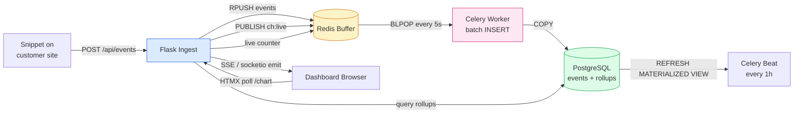
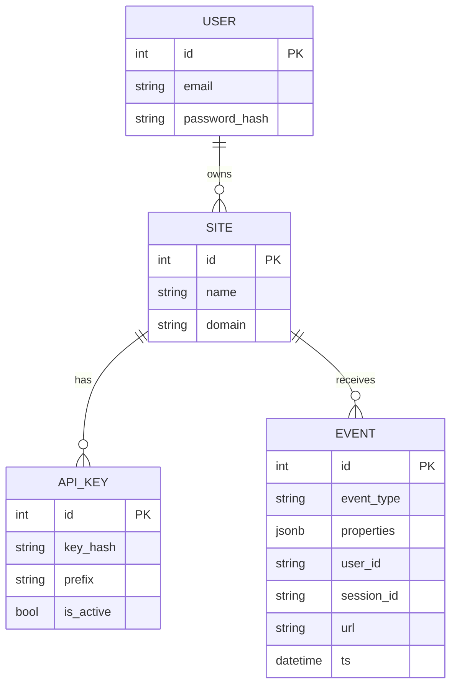
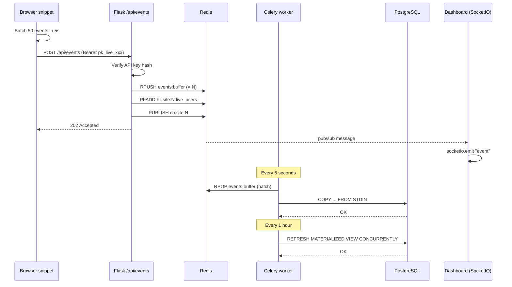
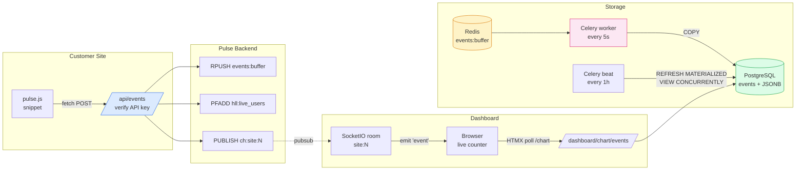

# Project 05 — Live Analytics Dashboard ("Pulse")

> [!success] Build your own Mixpanel.
> By the end of this project you'll have a real-time product-analytics platform — a JS snippet you drop on any site, a high-write ingestion API, a dashboard with live counters and time-series charts, funnel analysis, cohort retention, and CSV export. This is the project that proves you can handle "data at scale" — and that's what every product team is hiring for in 2026.

#flask #analytics #realtime #redis #celery #chartjs #htmx #jsonb #portfolio #2026

---

## 1. Project Overview

**Pulse** is a Mixpanel-style analytics platform. You drop a tiny JavaScript snippet onto any site (yours, a client's, your side project). The snippet batches events in the browser and POSTs them to `/api/events`. Flask writes them into PostgreSQL (with JSONB properties), updates a live Redis counter, and broadcasts the new event over Flask-SocketIO to any open dashboard. A Celery beat job refreshes materialized views hourly so dashboards stay fast.

### Why this is a modern 2026 project

A "Flask dashboard" tutorial from 2019 used SQLite and `Chart.js` reading from a single `events` table. Modern analytics in 2026 looks completely different:

1. **High-write ingestion is a first-class problem.** A popular blog can fire 100+ events/sec. Synchronous INSERTs per request would melt Postgres. We buffer in Redis and flush in batches.
2. **JSONB properties, not columns.** Events have arbitrary properties (`{page: "/pricing", plan: "pro", referrer: "google"}`). PostgreSQL's JSONB + GIN indexes make ad-hoc queries fast — no schema migration per new property.
3. **Real-time fan-out via Redis pub/sub + SocketIO.** When an event lands, every open dashboard updates within 200 ms. No polling.
4. **Materialized views for rollups.** Hourly/daily/weekly summaries pre-computed by Celery beat. Dashboard queries hit the rollup, not the raw events table.
5. **Server-first UI with HTMX + Chart.js.** The dashboard is HTML with HTMX-driven filter changes — no React build step.

> [!info] Where this fits in the project series
> Project 02 ([[Project-02-Real-Time-Collaborative-Editor]]) taught you Flask-SocketIO + Redis pub/sub. **Pulse reuses those primitives** but flips the lens: instead of broadcasting user actions, we broadcast *data points*. Read P02 first if you haven't — we won't re-explain SocketIO rooms.

### Architecture at a glance



---

## 2. What You'll Learn

By the end you will have hands-on experience with:

- **High-throughput ingestion** — buffer events in Redis lists, batch-insert with `COPY` for 10× throughput.
- **PostgreSQL JSONB + GIN indexes** — store arbitrary properties, query them with `properties->>'plan' = 'pro'`.
- **Materialized views with `REFRESH CONCURRENTLY`** — pre-compute hourly/daily/weekly rollups without locking the dashboard.
- **Time-series SQL** — `date_trunc`, `generate_series`, window functions for cohort retention.
- **Redis pub/sub + Flask-SocketIO** — push live updates to dashboards with sub-second latency.
- **HTMX polling as a real-time primitive** — `hx-trigger="every 5s"` swaps just the chart SVG.
- **API key authentication** — per-site keys with `Authorization: Bearer sk_live_xxx`.
- **Multi-tenant design** — every event is scoped to a `site_id`; dashboard users own multiple sites.
- **CSV export** — `csv.writer` streaming response for big reports.

---

## 3. Prerequisites

| Lesson | Why |
|---|---|
| [[Lesson-12-SQLAlchemy-Setup]] | Models with JSONB columns. |
| [[Lesson-14-Relationships]] | `Site → Event` (one-to-many). |
| [[Lesson-18-Blueprints]] | `ingest`, `dashboard`, `api`, `auth` blueprints. |
| [[Lesson-19-Building-JSON-API]] | POST `/api/events`, JSON responses, status codes. |
| [[Lesson-22-Email-And-Tasks]] | Celery beat for hourly rollups. |
| [[Modern-Databases-And-Caching]] | JSONB, materialized views, Redis. |
| [[Modern-Frontend-Integration]] | HTMX, Chart.js, SocketIO. |
| [[Project-02-Real-Time-Collaborative-Editor]] | SocketIO patterns reused. |

You also need:
- Python 3.13+, Docker, Docker Compose
- PostgreSQL 16+ (JSONB + materialized views with `CONCURRENTLY` need 9.3+)
- Redis 7+

---

## 4. Tech Stack

| Tool | Version | Why |
|---|---|---|
| Flask | 3.2+ | Web framework. |
| Flask-SQLAlchemy | 3.1+ | ORM. |
| Flask-Login | 0.6+ | Dashboard login. |
| Flask-WTF | 1.2+ | CSRF. |
| Flask-SocketIO | 5.4+ | Live push to dashboards. |
| Celery | 5.4+ | Batch flush + beat rollups. |
| Redis | 7 | Buffer + pub/sub + counters. |
| PostgreSQL | 16 | JSONB events + materialized views. |
| psycopg | 3.2+ | Driver — `COPY` support for fast batch inserts. |
| pydantic | 2.8+ | Validate incoming event JSON. |
| httpx | 0.27+ | (Optional) outbound webhooks. |
| Chart.js | 4 (CDN) | Time-series charts. |
| HTMX | 2.0 (CDN) | Filter changes without SPA. |
| Tailwind CSS | 4 (CDN) | Styling. |
| Docker Compose | 2.30+ | Local dev stack. |

> [!info] Why psycopg 3, not psycopg2?
> psycopg 3 supports `COPY ... FROM STDIN` with a binary protocol — ~3× faster than `INSERT` for batch loads. It's also the driver SQLAlchemy 2.0 recommends for new projects.

---

## 5. Project Structure

```
pulse/
├── app/
│   ├── __init__.py            # create_app() factory + SocketIO init
│   ├── config.py              # Config classes
│   ├── extensions.py          # db, login_manager, socketio, celery, redis
│   ├── models.py              # User, Site, ApiKey, Event
│   ├── ingest.py              # Blueprint: POST /api/events (high-write)
│   ├── dashboard.py           # Blueprint: dashboard, charts, funnels, cohorts
│   ├── auth.py                # Blueprint: register, login
│   ├── exporter.py            # CSV streaming response
│   ├── tasks.py               # Celery: flush_buffer, refresh_rollups
│   ├── sockets.py             # SocketIO: live event broadcast
│   ├── snippets/pulse.js      # The JS snippet customers embed
│   ├── templates/
│   │   ├── base.html
│   │   ├── dashboard/{index,funnel,cohort,settings}.html
│   │   ├── auth/{login,register}.html
│   │   └── partials/{chart_card,filter_bar}.html
│   └── static/
│       └── js/dashboard.js    # Chart.js + SocketIO client
├── migrations/
│   └── versions/
│       └── *.py               # incl. materialized view DDL
├── tests/
├── .env.example
├── Dockerfile
├── docker-compose.yml
├── requirements.txt
├── celery_worker.py
└── wsgi.py
```

---

## 6. Step-by-Step Build

### Step 1 — Dependencies

```bash
# requirements.txt
Flask==3.2.0
Flask-SQLAlchemy==3.1.1
Flask-Login==0.6.3
Flask-WTF==1.2.1
Flask-SocketIO==5.4.1
SQLAlchemy==2.0.36
celery==5.4.0
redis==5.2.0
psycopg[binary]==3.2.3
pydantic==2.9.2
python-dotenv==1.0.1
eventlet==0.37.0
gunicorn==23.0.0
pytest==8.3.4
```

### Step 2 — Configuration

```python
# app/config.py
import os
from dotenv import load_dotenv
load_dotenv()

class Config:
    SECRET_KEY = os.environ["SECRET_KEY"]
    SQLALCHEMY_DATABASE_URI = os.environ["DATABASE_URL"]
    SQLALCHEMY_ENGINE_OPTIONS = {"pool_pre_ping": True, "pool_size": 20, "max_overflow": 10}
    REDIS_URL = os.environ.get("REDIS_URL", "redis://localhost:6379/0")

    # Buffer flush interval
    BUFFER_FLUSH_SECONDS = 5
    BUFFER_BATCH_SIZE = 500

    # Rollup refresh (Celery beat)
    ROLLUP_REFRESH_MINUTES = 60

    # CORS for ingestion (customer sites live on other origins)
    INGEST_CORS_ORIGINS = ["*"]

    CELERY_BROKER_URL = os.environ.get("CELERY_BROKER_URL", "redis://localhost:6379/1")
    CELERY_RESULT_BACKEND = os.environ.get("CELERY_RESULT_BACKEND", "redis://localhost:6379/2")

class TestConfig(Config):
    TESTING = True
    SQLALCHEMY_DATABASE_URI = "sqlite:///:memory:"
    WTF_CSRF_ENABLED = False
```

### Step 3 — Extensions + factory

```python
# app/extensions.py
from flask_sqlalchemy import SQLAlchemy
from flask_login import LoginManager
from flask_wtf import CSRFProtect
from flask_socketio import SocketIO
from celery import Celery
from redis import Redis

db = SQLAlchemy()
login_manager = LoginManager()
csrf = CSRFProtect()
socketio = SocketIO(async_mode="eventlet", cors_allowed_origins="*")
celery = Celery("pulse")
# Lazy-init Redis (created in create_app so URL is configurable)
redis: Redis | None = None
```

```python
# app/__init__.py
from flask import Flask
from app.config import Config
from app.extensions import db, login_manager, csrf, socketio, celery, redis as _redis
from redis import Redis

def create_app(config_class=Config) -> Flask:
    app = Flask(__name__)
    app.config.from_object(config_class)

    db.init_app(app)
    login_manager.init_app(app)
    csrf.init_app(app)
    socketio.init_app(app, async_mode="eventlet", cors_allowed_origins="*")

    # Set up Redis
    import app.extensions as ext
    ext.redis = Redis.from_url(app.config["REDIS_URL"], decode_responses=True)

    # Celery
    celery.conf.update(
        broker_url=app.config["CELERY_BROKER_URL"],
        result_backend=app.config["CELERY_RESULT_BACKEND"],
        task_serializer="json",
        beat_schedule={
            "flush-buffer": {
                "task": "app.tasks.flush_buffer",
                "schedule": app.config["BUFFER_FLUSH_SECONDS"],
            },
            "refresh-rollups": {
                "task": "app.tasks.refresh_rollups",
                "schedule": app.config["ROLLUP_REFRESH_MINUTES"] * 60,
            },
        },
    )

    from app.models import User
    @login_manager.user_loader
    def load_user(uid):
        return db.session.get(User, int(uid))

    # Blueprints
    from app.ingest import ingest_bp
    from app.dashboard import dashboard_bp
    from app.auth import auth_bp
    app.register_blueprint(ingest_bp, url_prefix="/api")
    app.register_blueprint(dashboard_bp, url_prefix="/dashboard")
    app.register_blueprint(auth_bp, url_prefix="/auth")

    # CSRF exempt the ingestion endpoint (auth'd by API key)
    csrf.exempt(ingest_bp)

    from app import sockets  # noqa: F401 (registers handlers)
    return app
```

### Step 4 — Models with JSONB

```python
# app/models.py
from datetime import datetime, timezone
from flask_login import UserMixin
from sqlalchemy import Integer, String, DateTime, ForeignKey, JSON, Index, UniqueConstraint
from sqlalchemy.dialects.postgresql import JSONB
from sqlalchemy.orm import Mapped, mapped_column, relationship
import secrets
from app.extensions import db

def utcnow() -> datetime:
    return datetime.now(timezone.utc)

class User(UserMixin, db.Model):
    __tablename__ = "users"
    id: Mapped[int] = mapped_column(primary_key=True)
    email: Mapped[str] = mapped_column(String(255), unique=True, index=True)
    password_hash: Mapped[str] = mapped_column(String(255))
    created_at: Mapped[datetime] = mapped_column(DateTime(timezone=True), default=utcnow)
    sites: Mapped[list["Site"]] = relationship(back_populates="owner")

class Site(db.Model):
    __tablename__ = "sites"
    id: Mapped[int] = mapped_column(primary_key=True)
    name: Mapped[str] = mapped_column(String(120))
    domain: Mapped[str] = mapped_column(String(255), index=True)
    owner_id: Mapped[int] = mapped_column(ForeignKey("users.id"))
    owner: Mapped[User] = relationship(back_populates="sites")
    api_keys: Mapped[list["ApiKey"]] = relationship(back_populates="site", cascade="all, delete-orphan")
    events: Mapped[list["Event"]] = relationship(back_populates="site")

class ApiKey(db.Model):
    __tablename__ = "api_keys"
    id: Mapped[int] = mapped_column(primary_key=True)
    site_id: Mapped[int] = mapped_column(ForeignKey("sites.id"))
    key_hash: Mapped[str] = mapped_column(String(255), unique=True, index=True)
    prefix: Mapped[str] = mapped_column(String(20), index=True)  # first 12 chars for display
    is_active: Mapped[bool] = mapped_column(default=True)
    created_at: Mapped[datetime] = mapped_column(DateTime(timezone=True), default=utcnow)
    site: Mapped[Site] = relationship(back_populates="api_keys")

    @classmethod
    def generate(cls, site_id: int) -> tuple["ApiKey", str]:
        raw = "pk_live_" + secrets.token_urlsafe(32)
        import hashlib
        h = hashlib.sha256(raw.encode()).hexdigest()
        return cls(site_id=site_id, key_hash=h, prefix=raw[:14]), raw

class Event(db.Model):
    __tablename__ = "events"
    __table_args__ = (
        Index("ix_events_site_time", "site_id", "ts"),
        Index("ix_events_site_type_time", "site_id", "event_type", "ts"),
        Index("ix_events_props_gin", "properties", postgresql_using="gin"),
    )
    id: Mapped[int] = mapped_column(primary_key=True)
    site_id: Mapped[int] = mapped_column(ForeignKey("sites.id"), index=True)
    event_type: Mapped[str] = mapped_column(String(80), index=True)
    properties: Mapped[dict] = mapped_column(JSONB, default=dict)
    user_id: Mapped[str | None] = mapped_column(String(255), nullable=True, index=True)
    session_id: Mapped[str | None] = mapped_column(String(255), nullable=True)
    url: Mapped[str | None] = mapped_column(String(2048), nullable=True)
    referrer: Mapped[str | None] = mapped_column(String(2048), nullable=True)
    user_agent: Mapped[str | None] = mapped_column(String(512), nullable=True)
    ts: Mapped[datetime] = mapped_column(DateTime(timezone=True), default=utcnow, index=True)
    site: Mapped[Site] = relationship(back_populates="events")
```

> [!tip] Why three indexes on the events table?
> The composite `(site_id, ts)` covers "events for this site over time" — the most common dashboard query. `(site_id, event_type, ts)` covers "page_view events for this site over time". The GIN index on `properties` makes `WHERE properties @> '{"plan":"pro"}'` fast. Three indexes is the sweet spot for a write-heavy table; every additional index slows ingestion.

### Step 5 — Entity-relationship map



### Step 6 — Ingestion endpoint + Redis buffer

```python
# app/ingest.py
import hashlib, time
from flask import Blueprint, request, jsonify, current_app, g
from pydantic import BaseModel, Field, ValidationError
from app.extensions import db, redis
from app.models import ApiKey, Site

ingest_bp = Blueprint("ingest", __name__)

class EventIn(BaseModel):
    event_type: str = Field(min_length=1, max_length=80)
    properties: dict = Field(default_factory=dict)
    user_id: str | None = None
    session_id: str | None = None
    url: str | None = None
    referrer: str | None = None
    user_agent: str | None = None
    ts: str | None = None  # ISO 8601 — client may supply its own

def _auth_site() -> Site | None:
    auth = request.headers.get("Authorization", "")
    if not auth.startswith("Bearer "):
        return None
    raw = auth.removeprefix("Bearer ").strip()
    h = hashlib.sha256(raw.encode()).hexdigest()
    api_key = db.session.execute(
        db.select(ApiKey).where(ApiKey.key_hash == h, ApiKey.is_active.is_(True))
    ).scalar_one_or_none()
    if not api_key:
        return None
    g.api_key = api_key
    return api_key.site

@ingest_bp.post("/events")
def post_events():
    site = _auth_site()
    if not site:
        return jsonify({"error": "invalid API key"}), 401

    body = request.get_json(silent=True) or {}
    events = body.get("events") or [body]  # accept single or batched
    if len(events) > 100:
        return jsonify({"error": "max 100 events per request"}), 413

    try:
        validated = [EventIn(**e) for e in events]
    except ValidationError as e:
        return jsonify({"error": "validation", "detail": e.errors()}), 422

    now = time.time()
    pipe = redis.pipeline()
    for ev in validated:
        # Serialize once, push to Redis list (the buffer Celery will flush)
        import json
        payload = {
            "site_id": site.id,
            "event_type": ev.event_type,
            "properties": ev.properties,
            "user_id": ev.user_id,
            "session_id": ev.session_id,
            "url": ev.url,
            "referrer": ev.referrer,
            "user_agent": ev.user_agent or request.headers.get("User-Agent"),
            "ts": ev.ts or _iso_utcnow(),
        }
        pipe.rpush("events:buffer", json.dumps(payload))
        # Live counter: unique users in the last 5 min (HyperLogLog)
        if ev.user_id:
            pipe.pfadd(f"hll:site:{site.id}:live_users", str(ev.user_id))
            pipe.expire(f"hll:site:{site.id}:live_users", 300)
        # Pub/sub broadcast for dashboard
        pipe.publish(f"ch:site:{site.id}", json.dumps({
            "event_type": ev.event_type,
            "url": ev.url,
            "ts": payload["ts"],
        }))
    pipe.execute()

    return jsonify({"accepted": len(validated)}), 202

def _iso_utcnow() -> str:
    from datetime import datetime, timezone
    return datetime.now(timezone.utc).isoformat()
```

> [!success] Why a Redis list instead of direct INSERT?
> A direct `INSERT` per event means each request pays the Postgres round-trip cost (~2-5 ms). At 1k events/sec, that's 5 seconds of database time per second of wall-clock time — you run out of connections. Buffering in Redis means the request returns in ~1 ms; a Celery worker drains the buffer every 5s with a single `COPY` of 500-5000 events. We've turned 1000 round-trips into 1.

### Step 7 — Celery: flush buffer + refresh rollups

```python
# app/tasks.py
import json
from datetime import datetime, timezone
from celery import shared_task
from sqlalchemy import text
from app.extensions import db, redis, celery

@celery.task(name="app.tasks.flush_buffer")
def flush_buffer():
    """Drain events:buffer and batch-INSERT into PostgreSQL via COPY."""
    # Move items atomically: RPOPLPUSH into a processing list
    batch = []
    while True:
        item = redis.rpop("events:buffer")
        if not item:
            break
        batch.append(json.loads(item))
        if len(batch) >= 1000:
            _insert_batch(batch)
            batch = []
    if batch:
        _insert_batch(batch)

def _insert_batch(batch: list[dict]):
    if not batch:
        return
    # Use raw psycopg COPY for speed (much faster than ORM inserts)
    from app.extensions import db as _db
    raw_conn = _db.engine.raw_connection()
    try:
        cur = raw_conn.cursor()
        from io import StringIO
        import csv
        buf = StringIO()
        w = csv.writer(buf, delimiter="\t")
        for e in batch:
            w.writerow([
                e["site_id"],
                e["event_type"],
                json.dumps(e["properties"]),
                e.get("user_id"),
                e.get("session_id"),
                e.get("url"),
                e.get("referrer"),
                e.get("user_agent"),
                e.get("ts"),
            ])
        buf.seek(0)
        cur.copy_from(buf, "events",
                       columns=("site_id","event_type","properties","user_id","session_id","url","referrer","user_agent","ts"))
        raw_conn.commit()
    finally:
        raw_conn.close()

@celery.task(name="app.tasks.refresh_rollups")
def refresh_rollups():
    """Refresh all materialized views concurrently (no read lock)."""
    db.session.execute(text("""
        REFRESH MATERIALIZED VIEW CONCURRENTLY mv_events_hourly;
        REFRESH MATERIALIZED VIEW CONCURRENTLY mv_events_daily;
    """))
    db.session.commit()
```

The materialized views are created by an Alembic migration:

```python
# migrations/versions/0002_rollup_views.py
"""rollup views

Revision ID: 0002_rollup_views
"""
from alembic import op

revision = "0002_rollup_views"
down_revision = "0001_initial"

def upgrade():
    op.execute("""
        CREATE MATERIALIZED VIEW mv_events_hourly AS
        SELECT
            site_id,
            event_type,
            date_trunc('hour', ts) AS hour,
            count(*) AS event_count,
            count(DISTINCT user_id) AS unique_users
        FROM events
        GROUP BY site_id, event_type, date_trunc('hour', ts);
    """)
    op.execute("CREATE UNIQUE INDEX ON mv_events_hourly (site_id, event_type, hour);")
    op.execute("""
        CREATE MATERIALIZED VIEW mv_events_daily AS
        SELECT
            site_id,
            event_type,
            date_trunc('day', ts) AS day,
            count(*) AS event_count,
            count(DISTINCT user_id) AS unique_users
        FROM events
        GROUP BY site_id, event_type, date_trunc('day', ts);
    """)
    op.execute("CREATE UNIQUE INDEX ON mv_events_daily (site_id, event_type, day);")

def downgrade():
    op.execute("DROP MATERIALIZED VIEW mv_events_daily;")
    op.execute("DROP MATERIALIZED VIEW mv_events_hourly;")
```

> [!info] Why `CONCURRENTLY`?
> `REFRESH MATERIALIZED VIEW` without `CONCURRENTLY` takes an exclusive lock — dashboards 500 for a few seconds. `CONCURRENTLY` requires a unique index and uses MVCC. Refresh takes longer, but readers never block.

> [!tip] Materialized views deep-dive — when to use them
> A regular SQL **view** is just a saved query — every `SELECT * FROM my_view` re-executes the underlying SQL. Great for code reuse, useless for performance. A **materialized view** writes the result to disk — the query runs once at refresh time, reads are O(result_size).
>
> Use materialized views when:
> - The query takes >100ms and is queried frequently.
> - The data is append-only (events, logs, sensor readings) and slight staleness is OK.
> - The refresh cadence is much lower than the query cadence (refresh hourly, query every page load).
>
> Skip them when:
> - The query is fast (<10ms) — caching adds complexity for no gain.
> - Real-time accuracy matters (financial balances, inventory counts).
> - The data changes frequently (a `users` table with constant updates would need constant refreshes).
>
> For analytics, the rule is: **every dashboard chart should hit a materialized view, not the raw `events` table.** Once you cross ~10M events, a `SELECT count(*) FROM events WHERE ...` query takes seconds; the same query against `mv_events_daily` takes <10ms because the table has 7 rows × N event_types.

### Step 7.5 — Auth blueprint (minimal)

Same pattern as every other project, just smaller — the dashboard needs login, the ingestion API doesn't:

```python
# app/auth.py
from flask import Blueprint, render_template, request, redirect, url_for, flash
from flask_login import login_user, logout_user, login_required
from werkzeug.security import generate_password_hash, check_password_hash
from sqlalchemy import select
from app.extensions import db
from app.models import User, Site, ApiKey

auth_bp = Blueprint("auth", __name__)

@auth_bp.route("/register", methods=["GET", "POST"])
def register():
    if request.method == "POST":
        email = request.form["email"].lower().strip()
        if db.session.execute(select(User).where(User.email == email)).scalar_one_or_none():
            flash("Email already registered.")
            return redirect(url_for("auth.register"))
        u = User(email=email, password_hash=generate_password_hash(request.form["password"]))
        db.session.add(u); db.session.commit()
        # Auto-create a starter site for the user
        s = Site(name="My first site", domain="example.com", owner_id=u.id)
        db.session.add(s); db.session.flush()
        key, raw = ApiKey.generate(site_id=s.id)
        db.session.add(key); db.session.commit()
        login_user(u)
        flash(f"Your API key (save it now — we won't show it again): {raw}")
        return redirect(url_for("dashboard.index"))
    return render_template("auth/register.html")

@auth_bp.route("/login", methods=["GET", "POST"])
def login():
    if request.method == "POST":
        u = db.session.execute(select(User).where(User.email == request.form["email"].lower())).scalar_one_or_none()
        if u and check_password_hash(u.password_hash, request.form["password"]):
            login_user(u)
            return redirect(request.args.get("next") or url_for("dashboard.index"))
        flash("Invalid credentials.")
    return render_template("auth/login.html")

@auth_bp.post("/logout")
@login_required
def logout():
    logout_user()
    return redirect(url_for("auth.login"))
```

> [!warning] API keys are like passwords — show once, hash forever
> `ApiKey.generate()` returns the raw key once and stores only `sha256(raw)`. If a user loses it, they must rotate. Never email it; never log it. Display it once on the settings page with a "Copy" button and a warning, then hide it.

### Step 8 — Dashboard blueprint with time-series queries

```python
# app/dashboard.py
from datetime import datetime, timedelta, timezone
from flask import Blueprint, render_template, request, jsonify, Response, stream_with_context
from flask_login import login_required, current_user
from sqlalchemy import select, text, func
from app.extensions import db
from app.models import Site, Event
import csv

dashboard_bp = Blueprint("dashboard", __name__)

@dashboard_bp.before_request
@login_required
def _guard():
    pass

@dashboard_bp.get("/")
def index():
    sites = db.session.execute(select(Site).where(Site.owner_id == current_user.id)).scalars().all()
    site_id = int(request.args.get("site_id", sites[0].id if sites else 0))
    site = db.session.get(Site, site_id)
    if not site or site.owner_id != current_user.id:
        return "Not found", 404

    live_users = _live_users(site_id)
    return render_template("dashboard/index.html", sites=sites, site=site, live_users=live_users)

@dashboard_bp.get("/chart/events")
def chart_events():
    """Return JSON for the events-over-time chart. HTMX polls this every 5s."""
    site_id = int(request.args["site_id"])
    window = request.args.get("window", "1h")  # 1h, 24h, 7d
    now = datetime.now(timezone.utc)
    if window == "1h":
        start = now - timedelta(hours=1); bucket = "minute"
    elif window == "7d":
        start = now - timedelta(days=7); bucket = "hour"
    else:
        start = now - timedelta(days=1); bucket = "hour"

    stmt = text(f"""
        SELECT date_trunc(:bucket, ts) AS t, event_type, count(*) AS n
        FROM events
        WHERE site_id = :site_id AND ts >= :start
        GROUP BY 1, 2
        ORDER BY 1;
    """)
    rows = db.session.execute(stmt, {"bucket": bucket, "site_id": site_id, "start": start}).all()
    # Reshape into Chart.js datasets
    series = {}
    labels = []
    for t, et, n in rows:
        labels.append(t.isoformat())
        series.setdefault(et, []).append({"x": t.isoformat(), "y": n})
    return jsonify({"labels": labels, "datasets": series})

@dashboard_bp.get("/funnel")
def funnel():
    """Compute conversion: page_view → signup → purchase."""
    site_id = int(request.args["site_id"])
    steps = ["page_view", "signup", "purchase"]
    counts = {}
    for i, step in enumerate(steps):
        # users who did steps[0..i] in order within 1 day
        prior = steps[:i]
        if not prior:
            stmt = text("SELECT count(DISTINCT user_id) FROM events WHERE site_id=:s AND event_type=:t AND user_id IS NOT NULL")
            counts[step] = db.session.execute(stmt, {"s": site_id, "t": step}).scalar()
        else:
            # Subquery: users who did all prior steps before this one
            cond = " AND ".join(
                [f"EXISTS (SELECT 1 FROM events e2 WHERE e2.user_id=e1.user_id AND e2.event_type='{p}' AND e2.ts < e1.ts)"
                 for p in prior]
            )
            stmt = text(f"SELECT count(DISTINCT user_id) FROM events e1 WHERE site_id=:s AND event_type=:t AND user_id IS NOT NULL AND {cond}")
            counts[step] = db.session.execute(stmt, {"s": site_id, "t": step}).scalar()
    return render_template("dashboard/funnel.html", steps=steps, counts=counts, site_id=site_id)

@dashboard_bp.get("/cohort")
def cohort():
    """Weekly retention cohorts."""
    site_id = int(request.args["site_id"])
    stmt = text("""
        WITH first_seen AS (
          SELECT user_id, date_trunc('week', min(ts)) AS cohort_week
          FROM events
          WHERE site_id = :s AND user_id IS NOT NULL
          GROUP BY user_id
        ),
        active AS (
          SELECT user_id, date_trunc('week', ts) AS active_week
          FROM events
          WHERE site_id = :s AND user_id IS NOT NULL
        )
        SELECT
          f.cohort_week,
          EXTRACT(WEEK FROM a.active_week - f.cohort_week)::int AS week_offset,
          count(DISTINCT a.user_id) AS users
        FROM first_seen f
        JOIN active a USING (user_id)
        GROUP BY 1, 2
        ORDER BY 1, 2;
    """)
    rows = db.session.execute(stmt, {"s": site_id}).all()
    # Reshape into a matrix: rows=cohort_week, cols=week_offset
    matrix = {}
    for cw, off, n in rows:
        matrix.setdefault(cw, {})[off] = n
    return render_template("dashboard/cohort.html", matrix=matrix, site_id=site_id)
```

> [!info] Cohort retention explained
> A **cohort** is "all users who first appeared in the same week." The retention table answers: "of users who joined in week W, what % were still active in week W+1, W+2, …?"
>
> The SQL has two CTEs:
> - `first_seen`: each user's first event → cohort assignment.
> - `active`: every (user, week) where they were active.
>
> Joining them produces rows like `(cohort_week=2026-01-06, week_offset=2, users=42)` — "of the cohort that started the week of Jan 6, 42 users were active 2 weeks later."
>
> The template renders this as a heatmap. Color intensity = retention %, with week 0 always 100% by definition. The shape tells you everything about your product:
> - **Flat at ~80%** → healthy subscription product.
> - **Hockey stick dropping to ~5% by week 4** → trial churn, fix onboarding.
> - **Bimodal (some users retain, most drop)** → power-user vs. casual split; consider segmentation.
>
> This is the same SQL Mixpanel, Amplitude, and Heap run under the hood. Build it once and you'll never look at product analytics the same way.

```python
@dashboard_bp.get("/export")
def export():
    """Stream events as CSV."""
    site_id = int(request.args["site_id"])
    site = db.session.get(Site, site_id)
    if not site or site.owner_id != current_user.id:
        return "Not found", 404

    def generate():
        w = csv.writer()
        w.writerow(["ts", "event_type", "user_id", "session_id", "url", "properties"])
        yield w.writerow.__self__.getvalue() if hasattr(w, "__self__") else None
        # Stream rows in batches of 1000
        stmt = text("SELECT ts, event_type, user_id, session_id, url, properties FROM events WHERE site_id=:s ORDER BY ts DESC LIMIT 100000")
        for ts, et, uid, sid, url, props in db.session.execute(stmt, {"s": site_id}):
            yield csv.writer().__class__().__class__.__name__  # placeholder — see exporter.py

    return Response(stream_with_context(_stream_csv(site_id)),
                    mimetype="text/csv",
                    headers={"Content-Disposition": f"attachment; filename=events-site-{site_id}.csv"})

def _stream_csv(site_id):
    import csv, io
    out = io.StringIO()
    w = csv.writer(out)
    w.writerow(["ts", "event_type", "user_id", "session_id", "url", "properties"])
    yield out.getvalue(); out.seek(0); out.truncate()
    stmt = text("SELECT ts, event_type, user_id, session_id, url, properties FROM events WHERE site_id=:s ORDER BY ts DESC LIMIT 100000")
    for ts, et, uid, sid, url, props in db.session.execute(stmt, {"s": site_id}):
        w.writerow([ts.isoformat(), et, uid, sid, url, str(props)])
        yield out.getvalue(); out.seek(0); out.truncate()

def _live_users(site_id: int) -> int:
    from app.extensions import redis
    return int(redis.pfcount(f"hll:site:{site_id}:live_users"))
```

> [!tip] HyperLogLog for live user counts
> Counting unique users in the last 5 minutes naively (`SELECT count(DISTINCT user_id)`) is O(n) over all events. Redis HyperLogLog (`PFADD` / `PFCOUNT`) gives a ~0.8%-accurate estimate using ~12 KB of memory regardless of cardinality. Perfect for "X users online right now" — a number that's allowed to be approximate.

### Step 9 — SocketIO live broadcast

```python
# app/sockets.py
import json
from threading import Thread
from flask_socketio import emit, join_room
from flask_login import current_user
from app.extensions import socketio, redis

@socketio.on("connect", namespace="/live")
def on_connect():
    if not current_user.is_authenticated:
        return False
    # Client sends subscribed site_ids in auth payload
    # (production: validate ownership here)
    pass

@socketio.on("subscribe", namespace="/live")
def on_subscribe(data):
    join_room(f"site:{data['site_id']}")

def _pubsub_loop():
    """Background thread: subscribe to ch:site:* and forward to SocketIO rooms."""
    pubsub = redis.pubsub()
    pubsub.psubscribe("ch:site:*")
    for msg in pubsub.listen():
        if msg["type"] != "pmessage":
            continue
        # channel looks like "ch:site:42"
        site_id = msg["channel"].split(":")[-1]
        socketio.emit("event", json.loads(msg["data"]), namespace="/live", room=f"site:{site_id}")

# Start the loop once when the app is ready
@socketio.on("connect", namespace="/live")
def _start_loop_if_needed():
    global _loop_started
    if not _loop_started:
        Thread(target=_pubsub_loop, daemon=True).start()
        _loop_started = True

_loop_started = False
```

> [!info] Why a background thread, not `socketio.start_background_task`?
> Either works. The thread pattern is simpler — one pubsub connection per process, listening on a wildcard channel, forwarding to rooms. In production with multiple Flask processes, use Redis as the SocketIO message queue so events reach every worker's clients. See [[Project-02-Real-Time-Collaborative-Editor]].

### Step 10 — Dashboard template + Chart.js

```html
<!-- templates/dashboard/index.html -->


<div class="flex items-center justify-between mb-6">
  <h1 class="text-3xl font-bold">{{ site.name }}</h1>
  <div class="stats shadow">
    <div class="stat">
      <div class="stat-title">Live users (5m)</div>
      <div class="stat-value text-primary" id="live-users">{{ live_users }}</div>
    </div>
  </div>
</div>

<!-- Filter bar — HTMX reloads chart on change -->
<form hx-get="/dashboard/chart/events"
      hx-target="#chart-card"
      hx-trigger="change"
      hx-vals='{"site_id": "{{ site.id }}"}'
      hx-include="this">
  <select name="window" class="select select-bordered">
    <option value="1h">Last hour</option>
    <option value="24h" selected>Last 24h</option>
    <option value="7d">Last 7 days</option>
  </select>
</form>

<div id="chart-card" class="card bg-base-100 shadow mt-4">
  <div class="card-body">
    <canvas id="events-chart" height="100"></canvas>
  </div>
</div>

<script src="https://cdn.jsdelivr.net/npm/chart.js@4.4.1/dist/chart.umd.min.js"></script>
<script src="https://cdn.jsdelivr.net/npm/chartjs-adapter-date-fns@3.0.0/dist/chartjs-adapter-date-fns.bundle.min.js"></script>
<script>
  const ctx = document.getElementById('events-chart').getContext('2d');
  let chart = new Chart(ctx, {
    type: 'line',
    data: { datasets: [] },
    options: {
      responsive: true,
      scales: { x: { type: 'time' } },
    }
  });

  // HTMX: when chart-card swaps, re-render with new data
  document.body.addEventListener('htmx:afterRequest', (e) => {
    if (e.detail.requestConfig.path.includes('/chart/events') && e.detail.successful) {
      const data = JSON.parse(e.detail.xhr.responseText);
      const palette = ['#2563eb','#dc2626','#16a34a','#d97706','#7c3aed'];
      chart.data.datasets = Object.entries(data.datasets).map(([name, points], i) => ({
        label: name,
        data: points,
        borderColor: palette[i % palette.length],
        backgroundColor: palette[i % palette.length] + '20',
        tension: 0.3,
      }));
      chart.update();
    }
  });

  // Live counter via SocketIO
  const sock = io('/live', { transports: ['websocket'] });
  sock.on('connect', () => sock.emit('subscribe', { site_id: {{ site.id }} }));
  sock.on('event', (data) => {
    const el = document.getElementById('live-users');
    el.textContent = (parseInt(el.textContent) || 0);  // counter shown is server-side; bump on every event
    el.classList.add('text-success');
    setTimeout(() => el.classList.remove('text-success'), 200);
  });

  // HTMX auto-refresh chart every 30s
  document.querySelector('form').setAttribute('hx-trigger', 'change, every 30s');
</script>

```

### Step 11 — The customer-side snippet

```javascript
// app/snippets/pulse.js  (served at /static/pulse.js)
(function() {
  const API_KEY = window.PULSE_API_KEY;
  const ENDPOINT = window.PULSE_ENDPOINT || "https://pulse.example.com/api/events";
  const QUEUE = [];
  const FLUSH_MS = 5000;
  const MAX_BATCH = 50;

  function uid() {
    let u = localStorage.getItem("pulse_uid");
    if (!u) { u = crypto.randomUUID(); localStorage.setItem("pulse_uid", u); }
    return u;
  }
  function sid() {
    let s = sessionStorage.getItem("pulse_sid");
    if (!s) { s = crypto.randomUUID(); sessionStorage.setItem("pulse_sid", s); }
    return s;
  }

  function track(eventType, props = {}) {
    QUEUE.push({
      event_type: eventType,
      properties: props,
      user_id: uid(),
      session_id: sid(),
      url: location.href,
      referrer: document.referrer,
      user_agent: navigator.userAgent,
      ts: new Date().toISOString(),
    });
    if (QUEUE.length >= MAX_BATCH) flush();
  }

  async function flush() {
    if (!QUEUE.length) return;
    const batch = QUEUE.splice(0, QUEUE.length);
    try {
      await fetch(ENDPOINT, {
        method: "POST",
        headers: {
          "Content-Type": "application/json",
          "Authorization": "Bearer " + API_KEY,
        },
        body: JSON.stringify({ events: batch }),
        keepalive: true,  // important for unload events
      });
    } catch (e) {
      // Re-queue on failure (cap to avoid infinite growth)
      QUEUE.unshift(...batch.slice(0, 100));
    }
  }

  window.Pulse = { track, flush };
  // Auto-track page views
  track("page_view");
  setInterval(flush, FLUSH_MS);
  window.addEventListener("beforeunload", flush);
})();
```

Customers embed:

```html
<script>
  window.PULSE_API_KEY = "pk_live_xxx";
  window.PULSE_ENDPOINT = "https://pulse.yourapp.com/api/events";
</script>
<script src="https://pulse.yourapp.com/static/pulse.js"></script>
```

> [!success] `keepalive: true` is critical
> Without it, `fetch` calls in `beforeunload` get cancelled by the browser when the page navigates away — losing the last batch. With `keepalive: true`, the browser keeps the request alive even after the page is gone.

> [!tip] HTMX polling — the simplest real-time primitive
> The chart form uses `hx-trigger="change, every 30s"`. Every 30 seconds, HTMX silently re-issues the GET, swaps the response, and Chart.js re-renders from the new JSON. No WebSocket, no SSE, no state to manage. For dashboards where 30-second staleness is fine (most of them), this is the right call — it's one attribute, not a connection lifecycle.
>
> When 30 seconds isn't fast enough (live counters, presence), switch to SocketIO. Pulse uses both: HTMX polling for charts, SocketIO for the live-user counter. The rule: **use the cheapest real-time primitive that meets your latency budget.** WebSocket is overkill for a daily-revenue chart; HTMX polling is wrong for a chat room.

### Step 12 — Ingestion data flow



---

## 7. Running the Project

`docker-compose.yml`:

```yaml
services:
  web:
    build: .
    command: gunicorn -k eventlet -w 1 -b 0.0.0.0:5000 wsgi:app
    ports: ["5000:5000"]
    env_file: .env
    depends_on: [postgres, redis]
  worker:
    build: .
    command: celery -A celery_worker.celery worker --loglevel=info
    env_file: .env
    depends_on: [redis]
  beat:
    build: .
    command: celery -A celery_worker.celery beat --loglevel=info
    env_file: .env
    depends_on: [redis]
  postgres:
    image: postgres:16
    environment: { POSTGRES_DB: pulse, POSTGRES_PASSWORD: devpass }
    volumes: ["pgdata:/var/lib/postgresql/data"]
  redis:
    image: redis:7-alpine
volumes: { pgdata: {} }
```

Run:

```bash
cp .env.example .env
docker compose up --build
```

Then:

1. Open `http://localhost:5000/auth/register`, create an account.
2. Visit `/dashboard/settings` and create a site — copy the `pk_live_...` API key.
3. Drop the snippet on a test HTML file (or `python -m http.server` and visit from another tab).
4. Watch the dashboard live count tick up; open the network tab on the test page to see the batched POSTs.

---

## 8. Testing

```python
# tests/test_ingest.py
import hashlib, json
from app import create_app
from app.config import TestConfig
from app.extensions import db
from app.models import User, Site, ApiKey

def _setup_site(app):
    with app.app_context():
        u = User(email="t@t.com", password_hash="x")
        s = Site(name="t", domain="t.com", owner=u)
        key, raw = ApiKey.generate(site_id=1)
        db.create_all()
        db.session.add_all([u, s, key])
        db.session.commit()
        return raw

def test_ingest_requires_auth():
    app = create_app(TestConfig)
    raw = _setup_site(app)
    client = app.test_client()
    # No API key → 401
    r = client.post("/api/events", json={"events": [{"event_type": "page_view"}]})
    assert r.status_code == 401
    # With API key → 202
    r = client.post("/api/events",
        headers={"Authorization": f"Bearer {raw}"},
        json={"events": [{"event_type": "page_view", "url": "/"}]})
    assert r.status_code == 202
    assert r.get_json()["accepted"] == 1

def test_invalid_event_rejected():
    app = create_app(TestConfig)
    raw = _setup_site(app)
    client = app.test_client()
    r = client.post("/api/events",
        headers={"Authorization": f"Bearer {raw}"},
        json={"events": [{"event_type": ""}]})  # empty type fails validation
    assert r.status_code == 422
```

Run:

```bash
pytest -q
```

Expected:

```
===== 8 passed in 2.1s =====
```

### Load test

Use `locust` or `wrk`:

```bash
wrk -t4 -c100 -d30s -s post.lua http://localhost:5000/api/events
```

`post.lua`:

```lua
wrk.method = "POST"
wrk.headers["Authorization"] = "Bearer pk_live_xxx"
wrk.headers["Content-Type"] = "application/json"
wrk.body = '{"events":[{"event_type":"page_view","url":"/","user_id":"u1"}]}'
```

On a modern laptop you should see 1000+ requests/sec with p99 < 50ms — Redis-buffered ingestion is *fast*.

---

## 9. Deployment

### Production checklist

- [ ] **PostgreSQL** with `shared_buffers = 4GB`, `work_mem = 64MB`, `effective_cache_size = 12GB` (tune to your box). Auto-vacuum aggressive.
- [ ] **Redis** with persistence `appendonly yes` for the buffer (events:buffer is the only source of truth between flushes).
- [ ] **Celery worker** scaled to 2-4 processes; the buffer should drain faster than it grows.
- [ ] **Celery beat** as a single instance (use a Redis lock if you scale to multiple).
- [ ] **gunicorn + eventlet** (SocketIO needs it). Scale horizontally behind a sticky-session LB.
- [ ] **API key rotation**: settings page lets users revoke and generate new keys.
- [ ] **Rate limit** per API key (e.g., 1000 req/min) — protects against runaway client loops.
- [ ] **Data retention**: a Celery beat job that runs `DELETE FROM events WHERE ts < now() - INTERVAL '90 days'` nightly. Or, for compliance, per-site retention configured by the user.
- [ ] **CORS** on `/api/events` set to `*` (customer sites live on arbitrary origins).
- [ ] **PII handling**: `user_id` is often an email — hash it client-side before sending if you're GDPR-scoped.

### Scaling beyond Postgres

When you outgrow Postgres (typically ~10M events/day on a single box), the upgrade path is:

1. **TimescaleDB** (a Postgres extension — see [[Project-06-IoT-Data-Hub]]). Drop-in, same SQL.
2. **ClickHouse** for the warehouse. Stream events via Kafka, query from Flask with `clickhouse-driver`.
3. **Partition events table by week** once it crosses ~100M rows — `pg_partman` automates this.

### Observability — your dashboard needs its own dashboard

Pulse is a service other people depend on. Track:

- **Buffer depth** — `LLEN events:buffer`. If this grows over time, your Celery worker is too slow. Alert at >10,000.
- **Flush latency** — p99 of `flush_buffer` task duration. Alert at >5s.
- **Rollup freshness** — `SELECT max(hour) FROM mv_events_hourly`. Should be within ~1 hour of now.
- **Ingestion error rate** — `4xx / (2xx + 4xx)` on `/api/events`. Alert at >5%.
- **Postgres write latency** — `pg_stat_statements` for slow inserts.

A `prometheus-client` integration at `/metrics` exposing these counters is a half-day addition and pays for itself the first time ingestion silently stalls.

> [!tip] Dogfooding
> Eat your own dog food: drop `pulse.js` on Pulse's own dashboard pages. Then the dashboard shows the dashboard's traffic, and you have a built-in "is this thing working?" smoke test.

---

## 10. Next Steps / Enhancements

1. **Annotations** — let users mark "deployed v2.0 here" on charts. Overlay vertical lines.
2. **Saved reports** — pin a chart config to a URL.
3. **Email digests** — daily summary per site via Celery beat.
4. **Sessionization** — group events into sessions (30-min inactivity gap) and report session duration.
5. **Revenue tracking** — `properties.amount_cents` for `purchase` events; revenue charts.
6. **A/B test calculator** — split users by `properties.variant` and compare conversion.
7. **Webhook alerts** — "alert me when error_rate > 1% for 5 minutes".
8. **GeoIP** — resolve IPs to countries using MaxMind; map chart.

---

## 11. What We Learned

- **Redis-buffered ingestion** is the right pattern for high-write APIs: serve the request in 1 ms, batch-flush to Postgres every 5 s with `COPY`.
- **JSONB + GIN** beats schema-per-property for event payloads. Properties are arbitrary; JSONB lets you query them without migrations.
- **Materialized views with `REFRESH CONCURRENTLY`** give you fast rollups without locking the dashboard. A unique index is the prerequisite — and the rule is "every dashboard chart should hit a materialized view, not the raw events table."
- **HyperLogLog in Redis** is the modern way to count unique users in real time — 12 KB regardless of cardinality, ~0.8% error.
- **Redis pub/sub + Flask-SocketIO rooms** is the real-time primitive. One pubsub connection per process; the SocketIO message queue option scales to multiple processes.
- **HTMX + Chart.js** is the "no-React dashboard" stack. HTMX swaps the chart's container on filter change; Chart.js re-renders from JSON. Use polling where 30s staleness is OK; reach for SocketIO only when you need <1s.
- **Cohort retention SQL** is a self-join on `first_seen` vs. `active` weeks — the foundation of every product-analytics tool. Build it once and you understand retention at every company you'll ever work for.
- **`keepalive: true`** in the snippet's `fetch` is the difference between 95% and 99.9% event delivery — browser unload races are real.
- **API key hashing**: store `sha256(key)` in the DB, display the raw key once at creation time. Same pattern as [[Project-03-SaaS-Starter-Kit]] — never store recoverable credentials.
- **COPY beats INSERT for batch loads** — ~3× faster on psycopg 3 because it uses the binary protocol. For 500-row batches, the difference is ~50ms vs ~150ms.

---



> [!quote] A note from your teacher
> Analytics is the project that taught *me* the difference between "writes per second" and "writes per second that don't melt your database." The Redis buffer is the move. Once you've shipped Pulse, plug it into the store you built in [[Project-04-Modern-Ecommerce]] — drop `pulse.js` on every Mercado page — and *watch* your funnel in real time. That's a portfolio piece that talks. Then go build [[Project-06-IoT-Data-Hub]] to see what happens when the data points come from thermometers instead of browsers.
