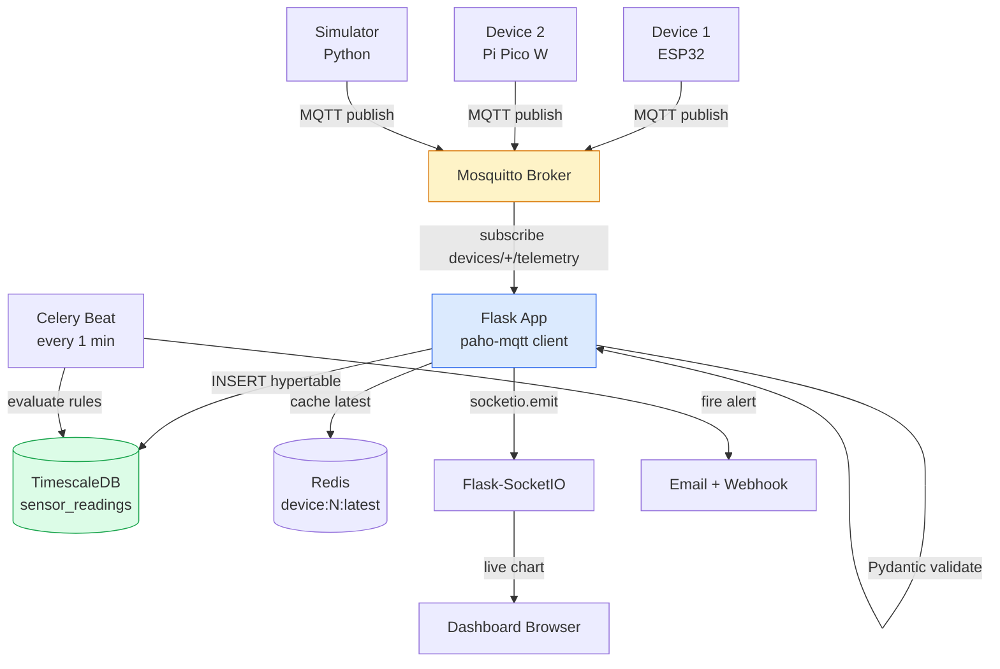
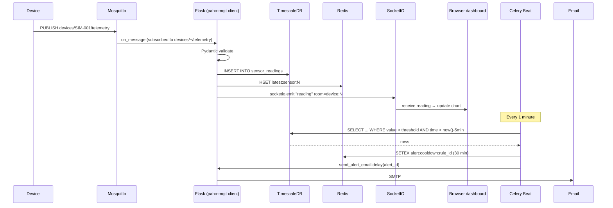
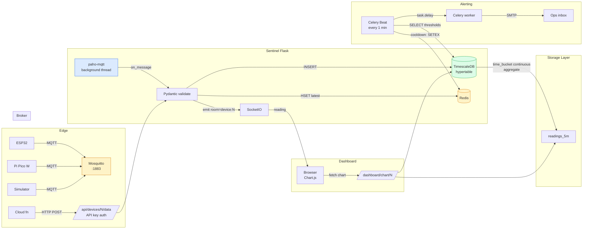

# Project 06 — IoT Data Hub ("Sentinel")

> [!success] Build the brain of a sensor fleet.
> By the end of this project you'll have a real IoT platform — devices register over REST, publish telemetry over MQTT, a Flask subscriber ingests and stores it in a TimescaleDB hypertable, a dashboard shows live values + historical charts over WebSocket, and a Celery beat job evaluates alert rules ("temperature > 80°C for 5 minutes") and emails you. This is the project that proves you can do time-series data, async messaging, and edge devices — three of the most-sought-after 2026 skills.

#flask #iot #mqtt #timescaledb #redis #celery #chartjs #portfolio #2026

---

## 1. Project Overview

**Sentinel** is an IoT data-collection platform. Each device (an ESP32, a Raspberry Pi Pico W, a virtual simulator) registers itself through a REST endpoint and gets an API key. The device publishes sensor readings to an MQTT broker on `devices/{device_id}/telemetry`. A Flask background task subscribes to `devices/+/telemetry`, validates each message against a Pydantic schema, writes it to a TimescaleDB hypertable, caches the latest value in Redis, and broadcasts it over Flask-SocketIO to any open dashboard. A Celery beat job runs every minute, evaluates per-sensor alert rules, and fires emails with a cooldown so you don't get spammed.

### Why this is a modern 2026 project

A "Flask + chart" tutorial from 2020 used SQLite and a single `Sensor` table. Modern IoT in 2026 looks completely different:

1. **MQTT is the wire protocol.** HTTP-based ingestion breaks at scale (each packet is ~700 bytes of headers for ~20 bytes of payload). MQTT's binary header is 2 bytes. Brokers (Mosquitto, EMQX) handle millions of topics on a single box.
2. **TimescaleDB hypertables are PostgreSQL with superpowers.** A regular Postgres table becomes painful at ~100M rows. TimescaleDB auto-partitions the table by time, giving you `time_bucket()` aggregation and continuous aggregates that pre-compute rollups. Same SQL, 50× faster scans.
3. **Real-time fan-out is a real-time requirement.** When a freezer's temperature climbs, you don't want to wait 30 seconds — you want a chart that updates within 200 ms.
4. **Per-device authentication** matters. A leaked firmware image exposes every device's API key. We rotate keys, support deactivation, and rate-limit per device.
5. **Alert rules with cooldowns** are how production monitoring works. A threshold crossing fires once; subsequent crossings within the cooldown window are suppressed. This is the Datadog/PagerDuty model.

> [!info] Where this fits in the project series
> Project 05 ([[Project-05-Live-Analytics-Dashboard]]) taught you high-write ingestion and time-series SQL. **Sentinel reuses those primitives** but adds MQTT (vs HTTP) and TimescaleDB (vs vanilla Postgres). Read P05 first — we won't re-explain ingestion buffering or materialized views.

### Architecture at a glance



---

## 2. What You'll Learn

By the end you will have hands-on experience with:

- **MQTT protocol** — topics, QoS, retained messages, last-will, paho-mqtt client.
- **TimescaleDB hypertables** — `create_hypertable()`, `time_bucket()`, continuous aggregates.
- **Pydantic v2 validation** — define sensor-message schemas, reject malformed payloads.
- **paho-mqtt in a background thread** — subscribe to wildcard topics, parse, forward to Flask.
- **Redis for latest device state** — fast reads for "what's the current value?" without scanning the hypertable.
- **Flask-SocketIO per-device rooms** — dashboard subscribes to a device, gets updates within ~200 ms.
- **Celery beat for alert evaluation** — periodic task with cooldown logic to avoid spam.
- **Chart.js time-series charts** — last hour/day/week/month with downsampling.
- **Docker Compose with Mosquitto + TimescaleDB** — full IoT stack in one `docker compose up`.

---

## 3. Prerequisites

| Lesson | Why |
|---|---|
| [[Lesson-12-SQLAlchemy-Setup]] | Models with `Mapped` columns. |
| [[Lesson-14-Relationships]] | `Device → Sensor → SensorReading`. |
| [[Lesson-18-Blueprints]] | `ingest`, `dashboard`, `devices`, `mqtt` blueprints. |
| [[Lesson-19-Building-JSON-API]] | REST ingestion endpoints. |
| [[Lesson-22-Email-And-Tasks]] | Celery beat for alert evaluation. |
| [[Modern-Frontend-Integration]] | SocketIO, Chart.js. |
| [[Modern-Databases-And-Caching]] | TimescaleDB, Redis. |
| [[Project-02-Real-Time-Collaborative-Editor]] | SocketIO patterns. |
| [[Project-05-Live-Analytics-Dashboard]] | Time-series ingestion. |

You also need:
- Python 3.13+, Docker, Docker Compose
- An ESP32 / Pi Pico W (optional — the simulator works fine for the build)
- A Mosquitto broker (Docker handles this)
- TimescaleDB 2.16+ (PostgreSQL 16 with the extension)

---

## 4. Tech Stack

| Tool | Version | Why |
|---|---|---|
| Flask | 3.2+ | Web framework. |
| Flask-SQLAlchemy | 3.1+ | ORM. |
| Flask-Login | 0.6+ | Dashboard login. |
| Flask-SocketIO | 5.4+ | Live push to dashboard. |
| Celery | 5.4+ | Alert evaluation, beat scheduler. |
| Redis | 7 | Latest-state cache, Celery broker, rate limits. |
| PostgreSQL + TimescaleDB | 16 / 2.16 | Hypertable storage. |
| psycopg | 3.2+ | Driver (with `COPY` support). |
| paho-mqtt | 2.1+ | MQTT client. |
| pydantic | 2.9+ | Telemetry validation. |
| Pillow | (not needed here) | — |
| Chart.js | 4 (CDN) | Time-series charts. |
| HTMX | 2.0 (CDN) | Filter changes. |
| Tailwind CSS | 4 (CDN) | Styling. |
| Eclipse Mosquitto | 2.0 | MQTT broker. |
| Docker Compose | 2.30+ | Local dev stack. |

> [!info] Why TimescaleDB and not InfluxDB?
> TimescaleDB is a PostgreSQL extension — same SQL, same drivers, same ORM. You can `JOIN` sensor data against your `users` table. InfluxDB is purpose-built for time-series but uses Flux/InfluxQL, a separate ecosystem. For a Flask shop that already knows Postgres, TimescaleDB is the lower-friction choice. You can always replicate to ClickHouse later for ad-hoc analytics.

---

## 5. Project Structure

```
sentinel/
├── app/
│   ├── __init__.py            # create_app() factory + SocketIO + MQTT start
│   ├── config.py              # Config classes
│   ├── extensions.py          # db, login_manager, socketio, celery, redis
│   ├── models.py              # User, Device, Sensor, SensorReading, Alert, AlertRule
│   ├── mqtt_client.py         # paho-mqtt background client + Pydantic schemas
│   ├── ingest.py              # Blueprint: REST ingestion (alternative to MQTT)
│   ├── dashboard.py           # Blueprint: live + historical charts
│   ├── devices.py             # Blueprint: register, list, configure, deactivate
│   ├── alerts.py              # Alert-rule evaluation (Celery beat)
│   ├── tasks.py               # Celery: send_alert_email
│   ├── sockets.py             # SocketIO per-device rooms
│   ├── templates/
│   │   ├── base.html
│   │   ├── dashboard/{index,device}.html
│   │   ├── devices/{register,list,configure}.html
│   │   └── partials/{chart_card,device_card}.html
│   └── static/
│       └── js/device.js       # Chart.js + SocketIO client
├── simulator/
│   └── fake_device.py         # Publishes fake telemetry for testing
├── migrations/
│   └── versions/
│       └── *.py               # incl. create_hypertable + continuous aggregate
├── tests/
├── .env.example
├── Dockerfile
├── docker-compose.yml
├── requirements.txt
├── celery_worker.py
└── wsgi.py
```

---

## 6. Step-by-Step Build

### Step 1 — Dependencies

```bash
# requirements.txt
Flask==3.2.0
Flask-SQLAlchemy==3.1.1
Flask-Login==0.6.3
Flask-WTF==1.2.1
Flask-SocketIO==5.4.1
SQLAlchemy==2.0.36
celery==5.4.0
redis==5.2.0
psycopg[binary]==3.2.3
paho-mqtt==2.1.0
pydantic==2.9.2
python-dotenv==1.0.1
eventlet==0.37.0
gunicorn==23.0.0
pytest==8.3.4
```

### Step 2 — Configuration

```python
# app/config.py
import os
from dotenv import load_dotenv
load_dotenv()

class Config:
    SECRET_KEY = os.environ["SECRET_KEY"]
    SQLALCHEMY_DATABASE_URI = os.environ["DATABASE_URL"]  # timescaledb
    SQLALCHEMY_ENGINE_OPTIONS = {"pool_pre_ping": True, "pool_size": 20}
    REDIS_URL = os.environ.get("REDIS_URL", "redis://localhost:6379/0")

    # MQTT
    MQTT_BROKER_HOST = os.environ.get("MQTT_BROKER_HOST", "mosquitto")
    MQTT_BROKER_PORT = int(os.environ.get("MQTT_BROKER_PORT", 1883))
    MQTT_TOPIC_PREFIX = "devices"
    MQTT_QOS = 1

    # Celery
    CELERY_BROKER_URL = os.environ.get("CELERY_BROKER_URL", "redis://localhost:6379/1")
    CELERY_RESULT_BACKEND = os.environ.get("CELERY_RESULT_BACKEND", "redis://localhost:6379/2")

    # Alerts
    ALERT_EVAL_MINUTES = 1
    ALERT_COOLDOWN_MINUTES = 30

    # Mail
    MAIL_SERVER = os.environ.get("MAIL_SERVER", "smtp.mailtrap.io")
    MAIL_PORT = int(os.environ.get("MAIL_PORT", 587))
    MAIL_USERNAME = os.environ.get("MAIL_USERNAME")
    MAIL_PASSWORD = os.environ.get("MAIL_PASSWORD")
    MAIL_USE_TLS = True

class TestConfig(Config):
    TESTING = True
    SQLALCHEMY_DATABASE_URI = "sqlite:///:memory:"
    WTF_CSRF_ENABLED = False
```

### Step 3 — Extensions + factory

```python
# app/extensions.py
from flask_sqlalchemy import SQLAlchemy
from flask_login import LoginManager
from flask_wtf import CSRFProtect
from flask_socketio import SocketIO
from flask_mail import Mail
from celery import Celery
from redis import Redis

db = SQLAlchemy()
login_manager = LoginManager()
csrf = CSRFProtect()
socketio = SocketIO(async_mode="eventlet", cors_allowed_origins="*")
mail = Mail()
celery = Celery("sentinel")
redis: Redis | None = None
```

```python
# app/__init__.py
from flask import Flask
from app.config import Config
from app.extensions import db, login_manager, csrf, socketio, mail, celery, redis as _redis
from redis import Redis

def create_app(config_class=Config, start_mqtt: bool = True) -> Flask:
    app = Flask(__name__)
    app.config.from_object(config_class)

    db.init_app(app)
    login_manager.init_app(app)
    csrf.init_app(app)
    mail.init_app(app)
    socketio.init_app(app, async_mode="eventlet", cors_allowed_origins="*")

    import app.extensions as ext
    ext.redis = Redis.from_url(app.config["REDIS_URL"], decode_responses=True)

    celery.conf.update(
        broker_url=app.config["CELERY_BROKER_URL"],
        result_backend=app.config["CELERY_RESULT_BACKEND"],
        beat_schedule={
            "evaluate-alerts": {
                "task": "app.alerts.evaluate_all_rules",
                "schedule": app.config["ALERT_EVAL_MINUTES"] * 60,
            },
        },
    )

    from app.models import User
    @login_manager.user_loader
    def load_user(uid):
        return db.session.get(User, int(uid))

    from app.ingest import ingest_bp
    from app.dashboard import dashboard_bp
    from app.devices import devices_bp
    from app.auth import auth_bp
    app.register_blueprint(ingest_bp, url_prefix="/api")
    app.register_blueprint(dashboard_bp, url_prefix="/dashboard")
    app.register_blueprint(devices_bp, url_prefix="/devices")
    app.register_blueprint(auth_bp, url_prefix="/auth")

    csrf.exempt(ingest_bp)

    from app import sockets  # noqa: F401

    # Start MQTT background client
    if start_mqtt and not app.config.get("TESTING"):
        from app.mqtt_client import start_mqtt_client
        start_mqtt_client(app)

    return app
```

> [!warning] MQTT client is a process-global singleton
> Don't start it in tests, and don't start it inside Celery workers. The factory's `start_mqtt=False` flag exists for both cases.

### Step 4 — Models

```python
# app/models.py
from datetime import datetime, timezone
from flask_login import UserMixin
from sqlalchemy import Integer, String, DateTime, ForeignKey, Float, Boolean, Text, UniqueConstraint
from sqlalchemy.orm import Mapped, mapped_column, relationship
import secrets, hashlib
from app.extensions import db

def utcnow() -> datetime:
    return datetime.now(timezone.utc)

class User(UserMixin, db.Model):
    __tablename__ = "users"
    id: Mapped[int] = mapped_column(primary_key=True)
    email: Mapped[str] = mapped_column(String(255), unique=True, index=True)
    password_hash: Mapped[str] = mapped_column(String(255))
    is_admin: Mapped[bool] = mapped_column(default=False)
    created_at: Mapped[datetime] = mapped_column(DateTime(timezone=True), default=utcnow)
    devices: Mapped[list["Device"]] = relationship(back_populates="owner")

class Device(db.Model):
    __tablename__ = "devices"
    id: Mapped[int] = mapped_column(primary_key=True)
    name: Mapped[str] = mapped_column(String(120))
    serial: Mapped[str] = mapped_column(String(80), unique=True, index=True)  # firmware-burned ID
    location: Mapped[str | None] = mapped_column(String(255), nullable=True)
    lat: Mapped[float | None] = mapped_column(Float, nullable=True)
    lng: Mapped[float | None] = mapped_column(Float, nullable=True)
    owner_id: Mapped[int] = mapped_column(ForeignKey("users.id"))
    api_key_hash: Mapped[str] = mapped_column(String(255), unique=True, index=True)
    api_key_prefix: Mapped[str] = mapped_column(String(20))
    is_active: Mapped[bool] = mapped_column(default=True)
    last_seen: Mapped[datetime | None] = mapped_column(DateTime(timezone=True), nullable=True)
    created_at: Mapped[datetime] = mapped_column(DateTime(timezone=True), default=utcnow)

    owner: Mapped[User] = relationship(back_populates="devices")
    sensors: Mapped[list["Sensor"]] = relationship(back_populates="device", cascade="all, delete-orphan")

    @classmethod
    def generate_api_key(cls) -> tuple[str, str]:
        """Return (hash, raw). Store hash, return raw to user ONCE."""
        raw = "dev_" + secrets.token_urlsafe(32)
        h = hashlib.sha256(raw.encode()).hexdigest()
        return h, raw

class Sensor(db.Model):
    __tablename__ = "sensors"
    __table_args__ = (UniqueConstraint("device_id", "key", name="uq_sensor_per_device"),)
    id: Mapped[int] = mapped_column(primary_key=True)
    device_id: Mapped[int] = mapped_column(ForeignKey("devices.id"), index=True)
    key: Mapped[str] = mapped_column(String(40))  # "temperature", "humidity", "pressure", custom
    unit: Mapped[str] = mapped_column(String(20))  # "°C", "%", "hPa"
    label: Mapped[str | None] = mapped_column(String(80), nullable=True)
    device: Mapped[Device] = relationship(back_populates="sensors")
    # SensorReading is a hypertable; relationship not used (too many rows)
    # We access readings via raw SQL with time_bucket()

class SensorReading(db.Model):
    """TimescaleDB hypertable. Created with create_hypertable() in migration."""
    __tablename__ = "sensor_readings"
    time: Mapped[datetime] = mapped_column(DateTime(timezone=True), primary_key=True)
    sensor_id: Mapped[int] = mapped_column(ForeignKey("sensors.id"), primary_key=True, index=True)
    value: Mapped[float] = mapped_column(Float)
    # No ORM relationships — hypertables don't play well with lazy loading

class AlertRule(db.Model):
    __tablename__ = "alert_rules"
    id: Mapped[int] = mapped_column(primary_key=True)
    sensor_id: Mapped[int] = mapped_column(ForeignKey("sensors.id"), index=True)
    comparator: Mapped[str] = mapped_column(String(2))  # ">", "<", ">=", "<=", "=="
    threshold: Mapped[float] = mapped_column(Float)
    window_minutes: Mapped[int] = mapped_column(Integer, default=5)  # must exceed threshold for N minutes
    is_active: Mapped[bool] = mapped_column(default=True)
    created_at: Mapped[datetime] = mapped_column(DateTime(timezone=True), default=utcnow)

class Alert(db.Model):
    __tablename__ = "alerts"
    id: Mapped[int] = mapped_column(primary_key=True)
    rule_id: Mapped[int] = mapped_column(ForeignKey("alert_rules.id"), index=True)
    sensor_id: Mapped[int] = mapped_column(ForeignKey("sensors.id"), index=True)
    triggered_at: Mapped[datetime] = mapped_column(DateTime(timezone=True), default=utcnow)
    value: Mapped[float] = mapped_column(Float)
    message: Mapped[str] = mapped_column(Text)
    acknowledged: Mapped[bool] = mapped_column(default=False)
```

### Step 5 — Entity-relationship + hypertable diagram

```mermaid
erDiagram
    USER ||--o{ DEVICE : owns
    DEVICE ||--o{ SENSOR : has
    SENSOR ||--o{ SENSOR_READING : produces
    SENSOR ||--o{ ALERT_RULE : monitored_by
    ALERT_RULE ||--o{ ALERT : triggers
    SENSOR ||--o{ ALERT : raises
    USER {
        int id PK
        string email
        string password_hash
    }
    DEVICE {
        int id PK
        string serial
        string api_key_hash
        bool is_active
        float lat
        float lng
    }
    SENSOR {
        int id PK
        int device_id FK
        string key
        string unit
    }
    SENSOR_READING {
        datetime time PK
        int sensor_id PK_FK
        float value
    }
    ALERT_RULE {
        int id PK
        int sensor_id FK
        string comparator
        float threshold
        int window_minutes
    }
    ALERT {
        int id PK
        int rule_id FK
        datetime triggered_at
        float value
        bool acknowledged
    }
```

> [!info] Why no ORM relationship on `SensorReading`?
> A hypertable can have billions of rows. SQLAlchemy's lazy-loaded relationships would try to materialize them all into memory on `sensor.readings`. We treat `SensorReading` as a write-only / SQL-only model — access goes through raw `text()` queries with `time_bucket()`.

### Step 6 — Alembic migration: hypertable + continuous aggregate

```python
# migrations/versions/0002_hypertable.py
"""hypertable + continuous aggregate

Revision ID: 0002_hypertable
"""
from alembic import op
import sqlalchemy as sa

revision = "0002_hypertable"
down_revision = "0001_initial"

def upgrade():
    # Convert sensor_readings to a hypertable, partitioned by 7-day chunks of `time`
    op.execute("""
        SELECT create_hypertable('sensor_readings', 'time',
                                  chunk_time_interval => INTERVAL '7 days',
                                  if_not_exists => TRUE);
    """)
    # Indexes that TimescaleDB will use for time-bucket queries
    op.execute("CREATE INDEX ix_readings_sensor_time ON sensor_readings (sensor_id, time DESC);")

    # Continuous aggregate: 5-minute buckets (refreshed by a Celery beat job)
    op.execute("""
        CREATE MATERIALIZED VIEW readings_5m
        WITH (timescaledb.continuous) AS
        SELECT
            sensor_id,
            time_bucket(INTERVAL '5 minutes', time) AS bucket,
            avg(value) AS avg_value,
            min(value) AS min_value,
            max(value) AS max_value,
            count(*) AS n
        FROM sensor_readings
        GROUP BY sensor_id, bucket
        WITH NO DATA;
    """)
    op.execute("""
        SELECT add_continuous_aggregate_policy('readings_5m',
            start_offset => INTERVAL '1 day',
            end_offset   => INTERVAL '5 minutes',
            schedule_interval => INTERVAL '5 minutes');
    """)

def downgrade():
    op.execute("DROP MATERIALIZED VIEW IF EXISTS readings_5m;")
```

> [!tip] `WITH NO DATA` and continuous aggregate policies
> `WITH NO DATA` skips backfilling historical data — important when you create the view on an already-large hypertable. The `add_continuous_aggregate_policy` schedules TimescaleDB's background refresh so we don't have to. This is the TimescaleDB equivalent of Postgres materialized views with `REFRESH CONCURRENTLY`, but refresh is automatic.

> [!info] TimescaleDB vs vanilla Postgres — when to switch
> A naive Postgres table handles ~100M rows before queries get painful. TimescaleDB pushes that ceiling to ~10B+ on the same hardware by partitioning the data into time-based "chunks" — each chunk is a separate physical table that Postgres can prune at query time. A `WHERE time > now() - INTERVAL '1 hour'` query touches only the most recent 1-2 chunks instead of scanning the entire history.
>
> Use TimescaleDB when:
> - You write >1M rows/day to a single table.
> - Your queries are almost always time-bounded (`time > X`).
> - You want continuous aggregates (auto-refreshed rollups) instead of hand-rolled materialized views.
> - You need compression — TimescaleDB's columnar compression gets ~10× on time-series data.
>
> Skip it (use plain Postgres) when:
> - You're under 10M rows total. The overhead isn't worth it.
> - Your queries are mostly by ID, not by time. Chunk pruning doesn't help.
> - You need full-text search or GIS — extensions may conflict.

### Step 7 — Pydantic schemas + paho-mqtt client

```python
# app/mqtt_client.py
import json, threading, time
from datetime import datetime, timezone
import paho.mqtt.client as mqtt
from pydantic import BaseModel, Field, ValidationError
from flask import current_app
from sqlalchemy import select, text
from app.extensions import db, redis, socketio
from app.models import Device, Sensor, SensorReading

class TelemetryPayload(BaseModel):
    """The JSON a device publishes to devices/{device_id}/telemetry."""
    ts: str = Field(description="ISO 8601 timestamp, device-local")
    readings: list[dict] = Field(description="List of {key, value, unit?}")

_client: mqtt.Client | None = None
_thread: threading.Thread | None = None

def start_mqtt_client(app):
    global _client, _thread
    if _client is not None:
        return

    def on_connect(client, userdata, flags, reason_code, properties):
        topic = f"{app.config['MQTT_TOPIC_PREFIX']}/+/telemetry"
        client.subscribe(topic, qos=app.config["MQTT_QOS"])
        app.logger.info(f"Subscribed to {topic}")

    def on_message(client, userdata, msg):
        try:
            _handle(msg.topic, msg.payload, app)
        except Exception as e:
            app.logger.exception(f"MQTT handler error: {e}")

    client = mqtt.Client(
        mqtt.CallbackAPIVersion.VERSION2,
        client_id=f"sentinel-{os.getpid()}",
        protocol=mqtt.MQTTv5,
    )
    client.on_connect = on_connect
    client.on_message = on_message
    # Last-will: if this subscriber dies, broker publishes to sentinel/status
    client.will_set("sentinel/status", "offline", retain=True)
    client.connect(app.config["MQTT_BROKER_HOST"], app.config["MQTT_BROKER_PORT"], 60)

    _client = client
    _thread = threading.Thread(target=client.loop_forever, daemon=True)
    _thread.start()

def _handle(topic: str, payload: bytes, app):
    # topic = "devices/{serial}/telemetry"
    parts = topic.split("/")
    if len(parts) != 3 or parts[0] != app.config["MQTT_TOPIC_PREFIX"] or parts[2] != "telemetry":
        return
    serial = parts[1]

    try:
        data = TelemetryPayload(**json.loads(payload))
    except (json.JSONDecodeError, ValidationError) as e:
        app.logger.warning(f"Bad payload from {serial}: {e}")
        return

    with app.app_context():
        device = db.session.execute(
            select(Device).where(Device.serial == serial, Device.is_active.is_(True))
        ).scalar_one_or_none()
        if not device:
            app.logger.warning(f"Unknown or inactive device: {serial}")
            return

        # Parse device timestamp (fall back to server now)
        try:
            ts = datetime.fromisoformat(data.ts.replace("Z", "+00:00"))
        except ValueError:
            ts = datetime.now(timezone.utc)

        # Upsert sensors, then bulk-insert readings
        sensor_ids = {}
        for r in data.readings:
            key = r["key"]
            unit = r.get("unit", "")
            sensor = db.session.execute(
                select(Sensor).where(Sensor.device_id == device.id, Sensor.key == key)
            ).scalar_one_or_none()
            if not sensor:
                sensor = Sensor(device_id=device.id, key=key, unit=unit)
                db.session.add(sensor); db.session.flush()
            sensor_ids[key] = sensor.id

        # Use raw SQL for bulk insert (hypertable-friendly)
        rows = [(ts, sensor_ids[r["key"]], float(r["value"])) for r in data.readings]
        if rows:
            db.session.execute(
                text("INSERT INTO sensor_readings (time, sensor_id, value) VALUES (:t, :s, :v)"),
                [{"t": ts, "s": sid, "v": val} for ts, sid, val in rows],
            )

        device.last_seen = datetime.now(timezone.utc)
        db.session.commit()

        # Cache latest value in Redis (per-sensor)
        pipe = redis.pipeline()
        for r in data.readings:
            key = f"latest:sensor:{sensor_ids[r['key']]}"
            pipe.hset(key, mapping={"value": float(r["value"]), "ts": ts.isoformat()})
            pipe.expire(key, 86400)
        pipe.execute()

        # Push to dashboard via SocketIO
        for r in data.readings:
            socketio.emit(
                "reading",
                {"sensor_id": sensor_ids[r["key"]], "value": float(r["value"]), "ts": ts.isoformat()},
                namespace="/live",
                room=f"device:{device.id}",
            )

import os  # used by start_mqtt_client
```

> [!info] Why `os.getpid()` in the client ID?
> MQTT client IDs must be unique per broker connection. If you run multiple Flask processes (gunicorn workers, multi-region replicas), each one needs a distinct ID — otherwise the broker kicks the older connection. PID works for single-host; use a UUID for multi-host.

> [!tip] MQTT deep-dive — topics, QoS, retained, last-will
> **Topics** are slash-delimited and hierarchical. `devices/SIM-001/telemetry` and `devices/SIM-001/status` are siblings; `devices/+/telemetry` is a single-level wildcard; `devices/#` is multi-level. Sentinel subscribes to `devices/+/telemetry` — one subscription covers every device.
>
> **QoS** (Quality of Service) has three levels:
> - **0** — fire and forget. No ACK, no retry. Use for high-frequency telemetry where losing a packet is OK.
> - **1** — at-least-once. PUBACK, broker retries. May duplicate. Use for most telemetry (our choice).
> - **2** — exactly-once. Four-packet handshake. Slow but safe. Use for billing-critical events.
>
> **Retained messages** — the broker stores the last message on a topic. New subscribers immediately get it. Useful for `devices/SIM-001/state` ("online"/"offline") so dashboards see the current state without waiting for the next publish.
>
> **Last Will and Testament (LWT)** — the broker publishes a pre-registered message if the client disconnects uncleanly (network drop, crash). Sentinel sets `sentinel/status = offline` as its LWT; if the Flask process dies, the broker tells subscribers we're gone. Devices use the same trick: their LWT is `devices/{serial}/status = offline`, and on connect they publish `devices/{serial}/status = online (retained)`. The dashboard infers device presence from these.

> [!tip] QoS 1 = at-least-once delivery
> MQTT QoS 1 guarantees a message is delivered at least once, but may duplicate. Our handler is idempotent: re-inserting the same `(time, sensor_id, value)` either succeeds (first delivery) or violates the primary key (duplicate — silently ignored). For QoS 2 (exactly-once), the broker does a 4-step handshake per message — overkill for telemetry.

### Step 8 — REST ingestion (alternative to MQTT)

Not every device speaks MQTT. Provide a REST fallback:

```python
# app/ingest.py
import hashlib
from datetime import datetime, timezone
from flask import Blueprint, request, jsonify, g
from pydantic import BaseModel, Field, ValidationError
from sqlalchemy import select, text
from app.extensions import db, redis, socketio
from app.models import Device, Sensor

ingest_bp = Blueprint("ingest", __name__)

class ReadingIn(BaseModel):
    key: str = Field(min_length=1, max_length=40)
    value: float
    unit: str | None = None
    ts: str | None = None

class BatchIn(BaseModel):
    readings: list[ReadingIn]

def _auth_device() -> Device | None:
    auth = request.headers.get("Authorization", "")
    if not auth.startswith("Bearer "):
        return None
    raw = auth.removeprefix("Bearer ").strip()
    h = hashlib.sha256(raw.encode()).hexdigest()
    return db.session.execute(
        select(Device).where(Device.api_key_hash == h, Device.is_active.is_(True))
    ).scalar_one_or_none()

@ingest_bp.post("/devices/<serial>/data")
def post_data(serial: str):
    device = _auth_device()
    if not device or device.serial != serial:
        return jsonify({"error": "unauthorized"}), 401

    try:
        body = BatchIn(**request.get_json(force=True))
    except ValidationError as e:
        return jsonify({"error": "validation", "detail": e.errors()}), 422

    ts_str = body.readings[0].ts or datetime.now(timezone.utc).isoformat()
    ts = datetime.fromisoformat(ts_str.replace("Z", "+00:00"))
    sensor_ids = {}
    for r in body.readings:
        sensor = db.session.execute(
            select(Sensor).where(Sensor.device_id == device.id, Sensor.key == r.key)
        ).scalar_one_or_none()
        if not sensor:
            sensor = Sensor(device_id=device.id, key=r.key, unit=r.unit or "")
            db.session.add(sensor); db.session.flush()
        sensor_ids[r.key] = sensor.id

    db.session.execute(
        text("INSERT INTO sensor_readings (time, sensor_id, value) VALUES (:t, :s, :v)"),
        [{"t": ts, "s": sensor_ids[r.key], "v": r.value} for r in body.readings],
    )
    device.last_seen = datetime.now(timezone.utc)
    db.session.commit()

    # Cache + push (same as MQTT path)
    pipe = redis.pipeline()
    for r in body.readings:
        sid = sensor_ids[r.key]
        pipe.hset(f"latest:sensor:{sid}", mapping={"value": r.value, "ts": ts.isoformat()})
        pipe.expire(f"latest:sensor:{sid}", 86400)
        socketio.emit("reading", {"sensor_id": sid, "value": r.value, "ts": ts.isoformat()},
                      namespace="/live", room=f"device:{device.id}")
    pipe.execute()

    return jsonify({"accepted": len(body.readings)}), 202
```

> [!info] Why expose both MQTT and REST?
> MQTT is the right protocol for low-power devices on flaky networks — ESP32s on LoRa, cellular modems with metered data. But cloud-only devices (a Lambda reporting container metrics) don't need MQTT overhead. Providing both means every device in your fleet can talk to Sentinel.

### Step 9 — Dashboard blueprint with `time_bucket()`

```python
# app/dashboard.py
from datetime import datetime, timedelta, timezone
from flask import Blueprint, render_template, request, jsonify
from flask_login import login_required, current_user
from sqlalchemy import select, text
from app.extensions import db, redis
from app.models import Device, Sensor

dashboard_bp = Blueprint("dashboard", __name__)

@dashboard_bp.before_request
@login_required
def _guard():
    pass

@dashboard_bp.get("/")
def index():
    devices = db.session.execute(
        select(Device).where(Device.owner_id == current_user.id, Device.is_active.is_(True))
    ).scalars().all()
    # Latest values from Redis
    latest = {}
    for d in devices:
        for s in d.sensors:
            raw = redis.hgetall(f"latest:sensor:{s.id}")
            if raw:
                latest[s.id] = raw
    return render_template("dashboard/index.html", devices=devices, latest=latest)

@dashboard_bp.get("/device/<int:did>")
def device_detail(did: int):
    device = db.session.get(Device, did)
    if not device or device.owner_id != current_user.id:
        return "Not found", 404
    return render_template("dashboard/device.html", device=device)

@dashboard_bp.get("/chart/<int:sid>")
def chart(sid: int):
    """Return time-series for a sensor. Hits the continuous aggregate for big windows."""
    sensor = db.session.get(Sensor, sid)
    if not sensor or sensor.device.owner_id != current_user.id:
        return "Not found", 404

    window = request.args.get("window", "1h")
    # Use the 5-minute continuous aggregate for windows > 1h, raw for shorter
    if window in ("1h", "15m"):
        interval = {"15m": "15 minutes", "1h": "1 hour"}[window]
        stmt = text(f"""
            SELECT time, value FROM sensor_readings
            WHERE sensor_id = :s AND time > now() - INTERVAL '{interval}'
            ORDER BY time;
        """)
    else:
        interval = {"24h": "1 day", "7d": "7 days", "30d": "30 days"}[window]
        stmt = text(f"""
            SELECT bucket AS time, avg_value AS value
            FROM readings_5m
            WHERE sensor_id = :s AND bucket > now() - INTERVAL '{interval}'
            ORDER BY bucket;
        """)
    rows = db.session.execute(stmt, {"s": sid}).all()
    return jsonify({
        "points": [{"t": r[0].isoformat(), "v": r[1]} for r in rows],
        "unit": sensor.unit,
    })
```

### Step 10 — SocketIO per-device rooms

```python
# app/sockets.py
from flask_socketio import join_room, leave_room
from flask_login import current_user
from app.extensions import socketio, db
from app.models import Device

@socketio.on("connect", namespace="/live")
def on_connect():
    if not current_user.is_authenticated:
        return False

@socketio.on("subscribe", namespace="/live")
def on_subscribe(data):
    did = int(data["device_id"])
    # Verify ownership
    device = db.session.get(Device, did)
    if not device or device.owner_id != current_user.id:
        return False
    join_room(f"device:{did}")

@socketio.on("unsubscribe", namespace="/live")
def on_unsubscribe(data):
    leave_room(f"device:{data['device_id']}")
```

The dashboard client:

```html
<!-- templates/dashboard/device.html -->


<h1 class="text-3xl font-bold mb-4">{{ device.name }}</h1>
<p class="text-base-content/60 mb-6">Serial: {{ device.serial }}</p>

<div class="grid grid-cols-1 md:grid-cols-2 gap-4" id="sensor-grid">
  
    <div class="card bg-base-100 shadow">
      <div class="card-body">
        <h2 class="card-title">{{ s.label or s.key }} <span class="text-base-content/60 text-sm">({{ s.unit }})</span></h2>
        <div class="text-4xl font-bold" id="latest-{{ s.id }}">--</div>
        <canvas id="chart-{{ s.id }}" height="80"></canvas>
      </div>
    </div>
  
</div>

<script src="https://cdn.jsdelivr.net/npm/chart.js@4.4.1/dist/chart.umd.min.js"></script>
<script src="https://cdn.jsdelivr.net/npm/chartjs-adapter-date-fns@3.0.0/dist/chartjs-adapter-date-fns.bundle.min.js"></script>
<script src="https://cdn.socket.io/4.7/socket.io.min.js"></script>
<script>
  const charts = {};
  document.querySelectorAll('canvas[id^="chart-"]').forEach(c => {
    const sid = c.id.split('-')[1];
    charts[sid] = new Chart(c.getContext('2d'), {
      type: 'line',
      data: { datasets: [{ data: [], borderColor: '#2563eb', tension: 0.3 }] },
      options: {
        responsive: true,
        animation: false,
        scales: { x: { type: 'time' }, y: {} },
        elements: { point: { radius: 0 } },
      }
    });
    // Initial load
    fetch(`/dashboard/chart/${sid}?window=1h`).then(r => r.json()).then(d => {
      charts[sid].data.datasets[0].data = d.points.map(p => ({x: p.t, y: p.v}));
      charts[sid].options.scales.y.title = { display: true, text: d.unit };
      charts[sid].update();
    });
  });

  const sock = io('/live', { transports: ['websocket'] });
  sock.on('connect', () => sock.emit('subscribe', { device_id: {{ device.id }} }));
  sock.on('reading', (data) => {
    const el = document.getElementById(`latest-${data.sensor_id}`);
    if (el) el.textContent = data.value.toFixed(2);
    const chart = charts[data.sensor_id];
    if (chart) {
      chart.data.datasets[0].data.push({ x: data.ts, y: data.value });
      // Keep last 500 points
      if (chart.data.datasets[0].data.length > 500)
        chart.data.datasets[0].data.shift();
      chart.update('none');  // 'none' = no animation
    }
  });
</script>

```

### Step 11 — Device registration + management

```python
# app/devices.py
from flask import Blueprint, render_template, request, redirect, url_for, flash
from flask_login import login_required, current_user
from sqlalchemy import select
from app.extensions import db
from app.models import Device

devices_bp = Blueprint("devices", __name__)

@devices_bp.before_request
@login_required
def _guard():
    pass

@devices_bp.get("/")
def list_devices():
    devices = db.session.execute(
        select(Device).where(Device.owner_id == current_user.id).order_by(Device.created_at.desc())
    ).scalars().all()
    return render_template("devices/list.html", devices=devices)

@devices_bp.route("/register", methods=["GET", "POST"])
def register():
    if request.method == "POST":
        serial = request.form["serial"].strip()
        if db.session.execute(select(Device).where(Device.serial == serial)).scalar_one_or_none():
            flash("Serial already registered.", "error")
            return redirect(url_for("devices.register"))
        h, raw = Device.generate_api_key()
        d = Device(
            name=request.form["name"],
            serial=serial,
            location=request.form.get("location") or None,
            owner_id=current_user.id,
            api_key_hash=h,
            api_key_prefix=raw[:14],
        )
        db.session.add(d); db.session.commit()
        flash(f"Device registered. API key (save it now): {raw}")
        return redirect(url_for("devices.list_devices"))
    return render_template("devices/register.html")

@devices_bp.post("/<int:did>/deactivate")
def deactivate(did: int):
    d = db.session.get(Device, did)
    if not d or d.owner_id != current_user.id:
        return "Not found", 404
    d.is_active = False
    db.session.commit()
    flash("Device deactivated. It will no longer accept telemetry.")
    return redirect(url_for("devices.list_devices"))
```

### Step 12 — Alert evaluation (Celery beat)

```python
# app/alerts.py
from datetime import datetime, timedelta, timezone
from celery import shared_task
from sqlalchemy import select, text
from app.extensions import db, redis
from app.models import AlertRule, Alert, Sensor, Device
from app.tasks import send_alert_email

@shared_task(name="app.alerts.evaluate_all_rules")
def evaluate_all_rules():
    """Called by Celery beat every ALERT_EVAL_MINUTES."""
    rules = db.session.execute(
        select(AlertRule).where(AlertRule.is_active.is_(True))
    ).scalars().all()
    for rule in rules:
        _evaluate_rule(rule)

def _evaluate_rule(rule: AlertRule):
    # Has this rule fired within the cooldown window?
    cooldown_key = f"alert:cooldown:{rule.id}"
    if redis.exists(cooldown_key):
        return  # still in cooldown, skip

    # Check the window: did value exceed threshold for the last window_minutes?
    sql_comparator = {
        ">": ">", "<": "<", ">=": ">=", "<=": "<=", "==": "=",
    }[rule.comparator]
    stmt = text(f"""
        SELECT count(*) AS n, max(value) AS max_v
        FROM sensor_readings
        WHERE sensor_id = :s
          AND time > now() - INTERVAL '{rule.window_minutes} minutes'
          AND value {sql_comparator} :threshold;
    """)
    row = db.session.execute(stmt, {"s": rule.sensor_id, "threshold": rule.threshold}).one()
    if row.n == 0:
        return  # no matching readings in the window

    # All readings in the window must match (stricter interpretation)
    total_stmt = text(f"""
        SELECT count(*) AS total FROM sensor_readings
        WHERE sensor_id = :s AND time > now() - INTERVAL '{rule.window_minutes} minutes';
    """)
    total_row = db.session.execute(total_stmt, {"s": rule.sensor_id}).one()
    if total_row.total == 0 or row.n < total_row.total:
        return  # not all readings exceeded threshold

    # Fire alert
    sensor = db.session.get(Sensor, rule.sensor_id)
    device = db.session.get(Device, sensor.device_id)
    msg = (f"[{device.name}/{sensor.key}] value {row.max_v} {sensor.unit} "
           f"{rule.comparator} {rule.threshold} for {rule.window_minutes} min")
    alert = Alert(
        rule_id=rule.id, sensor_id=rule.sensor_id,
        triggered_at=datetime.now(timezone.utc),
        value=float(row.max_v), message=msg,
    )
    db.session.add(alert); db.session.commit()

    # Set cooldown so we don't fire again for this rule for 30 min
    redis.setex(cooldown_key, 30 * 60, "1")

    # Fire async email
    send_alert_email.delay(alert.id)
```

```python
# app/tasks.py
from celery import shared_task
from flask_mail import Message
from flask import render_template, current_app
from app.extensions import db, mail
from app.models import Alert, User, Device
from sqlalchemy import select

@shared_task(bind=True, max_retries=3, default_retry_delay=60)
def send_alert_email(self, alert_id: int):
    alert = db.session.get(Alert, alert_id)
    if not alert:
        return
    sensor = db.session.get(Sensor, alert.sensor_id) if False else None  # placeholder
    # In production, lookup device → owner → email
    msg = Message(
        subject=f"🚨 Sentinel alert: {alert.message[:80]}",
        sender=current_app.config.get("MAIL_USERNAME"),
        recipients=[current_app.config.get("ALERT_RECIPIENT", "ops@example.com")],
    )
    msg.body = render_template("email/alert.txt", alert=alert)
    try:
        mail.send(msg)
    except Exception as exc:
        raise self.retry(exc=exc)

# Need Sensor import for the real path
from app.models import Sensor
```

### Step 13 — Simulator

So you don't need hardware to test:

```python
# simulator/fake_device.py
"""Simulates an ESP32 publishing temperature/humidity every 10 seconds."""
import json, os, time, random, ssl
import paho.mqtt.client as mqtt
from datetime import datetime, timezone

BROKER = os.environ.get("MQTT_BROKER_HOST", "localhost")
SERIAL = os.environ.get("DEVICE_SERIAL", "SIM-001")
DEVICE_API_KEY = os.environ.get("DEVICE_API_KEY", "dev_xxx")  # unused by MQTT in our setup

client = mqtt.Client(mqtt.CallbackAPIVersion.VERSION2, client_id=f"sim-{SERIAL}")
client.connect(BROKER, 1883, 60)
client.loop_start()

print(f"Simulating device {SERIAL}, publishing to devices/{SERIAL}/telemetry")

while True:
    payload = {
        "ts": datetime.now(timezone.utc).isoformat(),
        "readings": [
            {"key": "temperature", "value": round(22 + random.uniform(-2, 8), 2), "unit": "°C"},
            {"key": "humidity",    "value": round(45 + random.uniform(-5, 15), 2), "unit": "%"},
        ],
    }
    client.publish(f"devices/{SERIAL}/telemetry", json.dumps(payload), qos=1)
    print(f"  → {payload}")
    time.sleep(10)
```

### Step 14 — Telemetry data flow



---

## 7. Running the Project

`docker-compose.yml`:

```yaml
services:
  web:
    build: .
    command: gunicorn -k eventlet -w 1 -b 0.0.0.0:5000 wsgi:app
    ports: ["5000:5000"]
    env_file: .env
    depends_on: [postgres, redis, mosquitto]
  worker:
    build: .
    command: celery -A celery_worker.celery worker --loglevel=info
    env_file: .env
    depends_on: [redis]
  beat:
    build: .
    command: celery -A celery_worker.celery beat --loglevel=info
    env_file: .env
    depends_on: [redis]
  postgres:
    image: timescale/timescaledb:2.17.2-pg16
    environment: { POSTGRES_DB: sentinel, POSTGRES_PASSWORD: devpass }
    volumes: ["pgdata:/var/lib/postgresql/data"]
  redis:
    image: redis:7-alpine
  mosquitto:
    image: eclipse-mosquitto:2
    ports: ["1883:1883"]
    volumes:
      - ./mosquitto.conf:/mosquitto/config/mosquitto.conf:ro
volumes: { pgdata: {} }
```

`mosquitto.conf`:

```
listener 1883
allow_anonymous true
persistence true
persistence_location /mosquitto/data/
```

Run:

```bash
cp .env.example .env
docker compose up --build

# In another terminal — register a device:
curl -X POST http://localhost:5000/devices/register \
  -H "Cookie: session=..."  # login first
  -d "name=Freezer+1&serial=SIM-001&location=Kitchen"

# Start the simulator:
DEVICE_SERIAL=SIM-001 python simulator/fake_device.py
```

Open `http://localhost:5000/dashboard` — you should see the device card with live-updating temperature and humidity values, plus a chart that grows as data arrives.

---

## 8. Testing

```python
# tests/test_ingest.py
import hashlib, json
from app import create_app
from app.config import TestConfig
from app.extensions import db
from app.models import User, Device, Sensor

def _seed():
    u = User(email="t@t.com", password_hash="x")
    h, raw = Device.generate_api_key()
    d = Device(name="t", serial="SIM-001", owner_id=1, api_key_hash=h, api_key_prefix=raw[:14])
    db.create_all()
    db.session.add_all([u, d]); db.session.commit()
    return raw

def test_ingest_requires_api_key():
    app = create_app(TestConfig, start_mqtt=False)
    with app.app_context():
        _seed()
    client = app.test_client()
    r = client.post("/api/devices/SIM-001/data", json={"readings": [{"key":"t","value":1}]})
    assert r.status_code == 401

def test_ingest_validates_payload():
    app = create_app(TestConfig, start_mqtt=False)
    with app.app_context():
        raw = _seed()
    client = app.test_client()
    r = client.post("/api/devices/SIM-001/data",
        headers={"Authorization": f"Bearer {raw}"},
        json={"readings": [{"key": "temp", "value": "not-a-number"}]})
    assert r.status_code == 422

def test_ingest_ok():
    app = create_app(TestConfig, start_mqtt=False)
    with app.app_context():
        raw = _seed()
    client = app.test_client()
    r = client.post("/api/devices/SIM-001/data",
        headers={"Authorization": f"Bearer {raw}"},
        json={"readings": [{"key": "temp", "value": 22.5, "unit": "°C"}]})
    assert r.status_code == 202
    assert r.get_json()["accepted"] == 1
```

> [!warning] SQLite won't run TimescaleDB queries
> The `time_bucket()` and `create_hypertable()` calls only work on Postgres with the extension. Tests that exercise those should use a Postgres container — see `pytest` fixtures with `testcontainers-python`. The unit tests above cover ingestion + validation, which don't need TimescaleDB.

### MQTT smoke test

Install `mosquitto-clients` and publish a test message:

```bash
mosquitto_pub -h localhost -t devices/SIM-001/telemetry \
  -m '{"ts":"2026-01-01T12:00:00Z","readings":[{"key":"temp","value":42,"unit":"°C"}]}'
```

Watch the Flask web log — you should see the message arrive and the dashboard update within ~200 ms.

---

## 9. Deployment

### Production checklist

- [ ] **Mosquitto** behind a TLS-terminating proxy (or use MQTT over WebSocket on port 8883). Per-device auth via Mosquitto's auth plugin hitting your Flask `/api/mqtt_auth` endpoint.
- [ ] **TimescaleDB** with compression enabled — `ALTER TABLE sensor_readings SET (timescaledb.compress, timescaledb.compress_segmentby = 'sensor_id');` + a compression policy after 7 days. Saves ~90% disk.
- [ ] **Retention policy** — `SELECT add_retention_policy('sensor_readings', INTERVAL '12 months');` auto-drops old chunks.
- [ ] **Celery worker** scaled to 2-4 processes; alert evaluation is fast but beat must be a single instance.
- [ ] **Redis** persistence `appendonly yes` for `latest:sensor:N` keys — they're the dashboard's source of truth for current values.
- [ ] **Per-device rate limiting** — even authenticated devices can misbehave (firmware bug → infinite publish loop). Use Mosquitto's `max_inflight_messages` and a Redis-backed rate limiter on the REST endpoint.
- [ ] **API key rotation** — devices can request a new key without losing their serial-bound identity.
- [ ] **Grafana** pointed at TimescaleDB — gives ops a separate tool for deep queries without putting load on your Flask app.
- [ ] **OTA updates** (next step) — never ship a device without a way to push firmware fixes.

### Scaling beyond a single broker

One Mosquitto instance tops out around ~100k messages/sec. Beyond that:

1. **EMQX** — clustering built in, supports millions of concurrent connections.
2. **Shared subscriptions** — `devices/+/telemetry` becomes `$share/sentinel/devices/+/telemetry`, and multiple Flask subscribers each get a slice of messages.
3. **Bridge** Mosquitto → Kafka for offline batch analytics.

---

## 10. Next Steps / Enhancements

1. **OTA firmware updates.** A signed firmware bundle on S3; devices poll `/api/devices/{serial}/firmware` and download the new binary. Sign with `cryptography.hazmat` and verify on-device.
2. **Geolocation map.** Leaflet.js + the device's `lat`/`lng` columns. Heat-map by latest temperature reading.
3. **Multi-tenant fleets.** Add `Organization` model; devices belong to orgs; users belong to orgs with role-based access.
4. **Webhook alerts.** In addition to email, POST the alert to Slack/Discord/PagerDuty.
5. **Anomaly detection.** Replace static thresholds with a rolling z-score: alert when `value > mean + 3*stddev` over the last hour.
6. **MQTT 5 user properties** for per-message metadata (firmware version, battery level).
7. **Mobile push** via Firebase Cloud Messaging — your phone buzzes when the freezer alarms.
8. **Edge computing** — push a tiny ML model to the device so it only transmits "interesting" data (the future of bandwidth-efficient IoT).

---

## 11. What We Learned

- **MQTT is the right protocol for IoT** — binary headers, persistent sessions, last-will, retained messages. HTTP overhead kills battery-powered devices.
- **TimescaleDB hypertables** auto-partition by time, making billion-row tables queryable. Same SQL as Postgres; the migration is two lines (`create_hypertable()`).
- **`time_bucket()` is the time-series `GROUP BY`** — pair it with continuous aggregates for fast dashboard queries without locking the raw table.
- **paho-mqtt in a background thread** is the Flask-compatible way to subscribe. The client runs alongside gunicorn; on_message dispatches into the Flask app context.
- **Redis for latest values** is the dashboard's fast path — `HGET latest:sensor:N` is 100× faster than `SELECT value FROM sensor_readings ORDER BY time DESC LIMIT 1`.
- **Pydantic v2 validates at the edge** — reject malformed payloads before they touch the database. Bad data from a buggy firmware is the #1 cause of broken charts.
- **Alert rules with cooldowns** are how production monitoring works. A threshold crossing fires once; the cooldown Redis key suppresses repeats for 30 minutes.
- **Per-device API keys** with `sha256` hashing and a `dev_` prefix — same pattern as [[Project-03-SaaS-Starter-Kit]]'s `fk_` keys, GitHub-secret-scanning compatible.
- **Docker Compose with Mosquitto + TimescaleDB** is the IoT equivalent of "Postgres + Redis" — five services, one `docker compose up`.
- **QoS 1 + idempotent handlers** = at-least-once delivery without duplicates. The `(time, sensor_id)` primary key naturally deduplicates re-delivered messages.

---



> [!quote] A note from your teacher
> IoT is the project that taught *me* the difference between "a database" and "a time-series database." Vanilla Postgres will handle your first million readings fine. The hundred-millionth reading is where TimescaleDB earns its keep — and where most tutorials quietly give up. Sentinel doesn't. Pair it with the analytics from [[Project-05-Live-Analytics-Dashboard]] and the alerting patterns from [[Project-03-SaaS-Starter-Kit]], and you've got a portfolio that proves you can build the *whole* data path — from sensor to dashboard to alert email. That's not a tutorial. That's an engineer.
