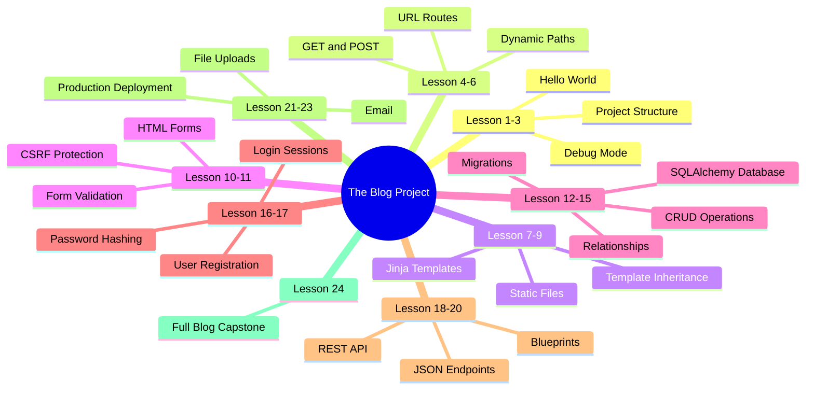
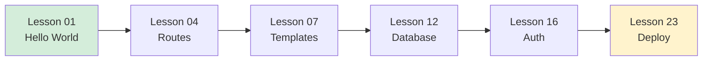

# Welcome to the Flask Teaching Course 🌶️

<p align="center">
  <a href="https://razorpay.me/@CodeChap?amount=kXxURMaXFk%2Bmrv%2B9uGrYpg%3D%3D" target="_blank">
    
  </a>
</p>

> [!success] You're in the right place.
> Whether you've never written a single line of Python for the web, or you've poked at Flask and want to actually *understand* it — this course was written for you. We will take it slow, we will explain every line, and you will build real things.

Hello, friend. Pull up a chair. 👋

This is a **step-by-step teaching course** for [Flask](https://flask.palletsprojects.com/), the lightweight Python web framework. It is not a reference manual. It is not a list of API endpoints you have to memorize. It is a *teacher*, sitting next to you, walking you from `app = Flask(__name__)` all the way to a deployed, database-backed web application that you wrote yourself.

By the end of this course, you will have built:

- 📝 A **multi-user blog** with authentication, comments, and a database
- 🔌 A **REST JSON API** that other apps can talk to
- 🔐 A **login system** with password hashing and protected routes
- 🚀 A **deployed application** running on a real server, not just `localhost`

And you'll understand *why* every line is there.

---

## What This Course Is #about

Flask is famous for being small. The "hello world" is six lines:

```python
from flask import Flask

app = Flask(__name__)

@app.route("/")
def hello():
    return "Hello, World!"
```

That's beautiful, but it's also a trap. Tutorials show you those six lines and then jump to "now build a blog!" without ever explaining what `__name__` means, what `@app.route` actually does, why you need a virtual environment, or what happens when a request comes in.

**This course closes that gap.** Every lesson:

1. **Starts with real code** — you'll see the actual `app.py` first, not the theory
2. **Explains every line** — why it's there, what it does, what would break if you removed it
3. **Shows the running result** — what you'll see in your browser and your terminal
4. **Builds incrementally** — each lesson adds a small, understandable piece to the last
5. **Gives you exercises** — you write the code, not just read it
6. **Recaps** — every lesson ends with a "What we learned" section you can refer back to

> [!tip] The promise of this course
> When you finish Lesson 24, you won't just *have* a Flask blog. You'll **understand** it. You'll be able to open any Flask codebase — yours or someone else's — and read it like a book.

---

## Who This Course Is For #audience

This course is for you if:

- ✅ You know **basic Python** (functions, lists, dictionaries, classes at a glance)
- ✅ You've heard of **HTTP** but couldn't quite explain what a `POST` request is
- ✅ You've maybe tried Flask's hello world but want to *actually* build something real
- ✅ You're tired of tutorials that skip steps and leave you confused
- ✅ You like learning by **doing** — typing code, running it, breaking it, fixing it

You do **not** need to be a Python expert. If you can write a function that returns a string, you can start Lesson 01 today.

> [!note] Already know some Flask?
> Skip ahead to [[Syllabus]] and find the right entry point. Lessons 14+ (relationships, blueprints, REST, deployment) are where even experienced Flask developers often have gaps.

---

## What You'll Build #projects

This isn't a course of disconnected examples. You build **one growing application**, layer by layer:



By Lesson 24, your blog has:

- User registration and login (with hashed passwords)
- Create, read, update, delete blog posts
- Comments on posts
- A separate REST API endpoint for fetching posts as JSON
- Organized into blueprints like a real production app
- Deployed with Gunicorn, ready for real visitors

---

## What You Need Before Starting #prerequisites

You don't need much. Here's the checklist:

### 1. Python 3.10 or newer

Check with:

```bash
python3 --version
```

If you don't have it, download it from [python.org](https://www.python.org/downloads/). On macOS, `brew install python` works great. On Linux, your package manager has it.

### 2. A code editor

We recommend **VS Code** (free, works everywhere, has great Python support). But Sublime, PyCharm, Neovim, or even `nano` will work — we don't care what you type in, only that you *do* type.

### 3. A terminal

The place where you'll type `python app.py`. macOS and Linux: you already have one. Windows: we recommend **PowerShell** or **Git Bash** — the regular Command Prompt will work but is less pleasant.

### 4. About 30–60 minutes per lesson

Most lessons take 30–60 minutes if you type the code, run it, and do the exercises. The whole course is **roughly 15–25 hours of focused work**, depending on your speed.

### 5. Curiosity and patience

You will get error messages. You will type a colon instead of a period and spend 10 minutes finding it. **This is normal.** This is what programming *is*. We'll show you how to read errors and not panic.

> [!example] Quick self-check
> Open your terminal and run:
> ```bash
> python3 -c "print('I am ready to learn Flask')"
> ```
> If you see `I am ready to learn Flask`, you're ready for Lesson 01.

---

## How the Course Is Structured #structure

**24 lessons, across 12 modules**, in a strict progressive order. Each module builds on the last. Each lesson builds on the one before.

| Module | Topic | Lessons | What you unlock |
|--------|-------|---------|-----------------|
| 01 | Getting Started | 01–03 | Your first running Flask app |
| 02 | Routing | 04–06 | Multiple pages with dynamic URLs |
| 03 | Templates | 07–09 | Real HTML pages, not just strings |
| 04 | Forms | 10–11 | User input, validated |
| 05 | Database | 12–13 | Persistent storage |
| 06 | Models & Relationships | 14–15 | Connected data, migrations |
| 07 | Authentication | 16–17 | Real users, real logins |
| 08 | Blueprints | 18 | App organization at scale |
| 09 | REST API | 19–20 | JSON endpoints for other apps |
| 10 | Advanced Topics | 21–22 | File uploads, email, async |
| 11 | Deployment | 23 | Real visitors, real server |
| 12 | Capstone Project | 24 | A full blog, built by you |

> [!info] Module size varies on purpose
> Some modules are 3 lessons, some are 1. We didn't pad them. Routing needs 3 lessons to do it justice; Blueprints fits cleanly in 1. Trust the pacing.

---

## The Teaching Philosophy #philosophy

This course is built on five beliefs. They sound soft, but they shape every lesson:

### 1. Code first, theory second

You will see `app = Flask(__name__)` before you see a definition of "WSGI." Definitions without context are noise. Context without definitions is mystery. We do context first, then definitions when you actually need them.

### 2. Every line is explained

If a lesson shows you `app.config["SECRET_KEY"] = "dev"`, it will tell you what `SECRET_KEY` is, why it's needed, and why the value `"dev"` is fine for now but **must** change in production. No magic strings. No "just trust me."

### 3. Motivation precedes mechanism

Before we introduce a new concept, we show you the *problem* it solves. We don't teach `url_for` because it's in the docs — we teach it because you'll write `href="/static/style.css"` and your app will break when you deploy, and `url_for` fixes that. Every concept has a "why now?"

### 4. Errors are lessons, not failures

When something breaks — and it will — we treat that as a teaching moment. The lesson on debug mode literally walks you through an `UndefinedError` and shows you the traceback, line by line.

### 5. You type the code

Reading code is not the same as writing code. Every lesson includes code blocks you should type yourself, run yourself, and modify yourself. **Do not copy-paste.** The exercises only work if you do them.

---

## How to Use This Vault #obsidian

This course is formatted as an **[Obsidian](https://obsidian.md/) vault**. Obsidian is a free, local-first note app that supports wikilinks, tags, callouts, and Mermaid diagrams. It's not required — you can read these files in any markdown viewer — but Obsidian is how they're meant to be experienced.

### Key features to know

- **Wikilinks** like `[[Lesson 01 — Your First Flask App]]` connect lessons. Click them to jump.
- **Tags** like `#routing` or `#jinja` appear throughout. Click a tag to find all related lessons.
- **Callouts** like the green box above highlight tips, warnings, examples, and notes.
- **Mermaid diagrams** render as visual charts in Obsidian's reading view.
- **YAML frontmatter** (the `---` block at the top) holds metadata Obsidian uses for search.

### The Map of Content (MOC)

The hub of the vault is [[Map-of-Content]]. Bookmark it. Every lesson is one click away from there. When you get lost, go back to the MOC.

### Recommended Obsidian settings

1. Open **Settings → Editor** and enable "Default view for new tabs: Reading view"
2. Open **Settings → Appearance** and pick a theme you like (we like "Things")
3. Install the **Dataview** community plugin if you want auto-generated indexes (optional)

> [!tip] Daily notes for learning
> Obsidian has a "Daily Notes" feature. We recommend creating a daily note each time you study and writing down:
> - Which lesson you completed
> - One thing that clicked
> - One thing that confused you
> - Code snippets you want to remember
> Over 24 lessons, this becomes a personal learning journal worth its weight in gold.

---

## Learning Paths #paths

Not everyone has 25 hours in one block. Here are three suggested paths through the course:

### 🏃 The Weekend Crash Course (8 hours)

For when you just want to *build something* by Monday.



Skim the deep stuff. You'll come back for the rest later. You'll have a working app, but you'll have skipped relationships, blueprints, REST, and the capstone.

### 📚 The Two-Week Deep Dive (2 hours/day)

The recommended path for most learners.

```mermaid
flowchart TD
    subgraph Week 1
        D1[Day 1: Lessons 1-3<br/>Getting Started] --> D2[Day 2: Lessons 4-5<br/>Routing]
        D2 --> D3[Day 3: Lesson 6 + 7<br/>HTTP + Templates]
        D3 --> D4[Day 4: Lessons 8-9<br/>Templates Deep]
        D4 --> D5[Day 5: Lessons 10-11<br/>Forms]
        D5 --> D6[Day 6: Lessons 12-13<br/>Database]
        D6 --> D7[Day 7: Lessons 14-15<br/>Models + Migrations]
    end
    subgraph Week 2
        D8[Day 8: Lessons 16-17<br/>Authentication] --> D9[Day 9: Lesson 18<br/>Blueprints]
        D9 --> D10[Day 10: Lessons 19-20<br/>REST API]
        D10 --> D11[Day 11: Lessons 21-22<br/>Advanced]
        D11 --> D12[Day 12: Lesson 23<br/>Deployment]
        D12 --> D13[Days 13-14: Lesson 24<br/>Capstone]
    end

    style D1 fill:#d4edda
    style D13 fill:#fff3cd
```



You'll finish with the full blog project and a complete mental model.

### 🎓 The Semester Pace (1 lesson/week)

For learners with limited time or who want to deeply absorb each topic. One lesson per week, exercises done properly, daily notes kept. By the end of six months, you'll be a confident Flask developer.

> [!example] Pick your path now
> Open a note called `My Learning Plan` and write down:
> 1. Which path you're taking
> 2. When you'll study each week
> 3. A target completion date
> Committing to a schedule increases completion rate by ~70%. Don't skip this step.

---

## What Happens in Lesson 01 #preview

Just so you know what's coming, here's a preview of Lesson 01's first code block:

```python
# app.py
from flask import Flask

app = Flask(__name__)

@app.route("/")
def home():
    return "Hello, Flask!"

if __name__ == "__main__":
    app.run(debug=True)
```

That's 8 lines. Lesson 01 spends a full lesson on them. By the end you'll know:

- What `from flask import Flask` actually imports
- Why we pass `__name__` to `Flask()` and what breaks if you pass `"app"` instead
- What the `@` symbol does in `@app.route("/")` (it's a decorator — we'll explain)
- Why the function is called `home` and why that name matters
- What `if __name__ == "__main__":` checks and why you need it
- What `debug=True` does and why it's both wonderful and dangerous

That's a lot from 8 lines. And every lesson does the same thing — takes a small piece of code and *really* teaches it.

---

## A Note on Mistakes and Asking for Help #mindset

You will get stuck. Everyone does. The difference between people who finish courses and people who don't isn't talent — it's what they do when they get stuck.

When you get stuck:

1. **Read the error message.** Out loud. Slowly. Most Python errors tell you exactly what's wrong; you just have to read them.
2. **Search the error.** Paste the exact error text into Google or your favorite AI. Someone has had this error before.
3. **Check the lesson's "Common Pitfalls" section.** Every lesson has one.
4. **Sleep on it.** Honestly. Some bugs only resolve after a walk.
5. **Ask in a community.** See [[How-To-Use-This-Course]] for where to ask.

> [!warning] The one trap to avoid
> **Do not copy-paste code from later lessons into earlier ones.** Each lesson is calibrated for what you've learned so far. If you grab a snippet from Lesson 18 because it "looks better," you'll bring in dependencies you haven't learned yet and your app will break in confusing ways. Trust the progression.

---

## Ready to Start? #start

Your first stop is [[How-To-Use-This-Course]]. It explains how each lesson is structured and how to actually run the code on your machine.

Then [[Syllabus]] for the full roadmap.

Then [[Map-of-Content]] to bookmark as your home base.

Then **Lesson 01**: `[[Lesson 01 — Your First Flask App]]`.

> [!success] You've got this.
> Every Flask developer you admire started exactly where you are now: staring at `app = Flask(__name__)` and wondering what `__name__` meant. They figured it out. So will you. Let's go. 🌶️

---

**Tags:** #flask #python #web-development #course #welcome #getting-started
**Next:** [[How-To-Use-This-Course]] →
